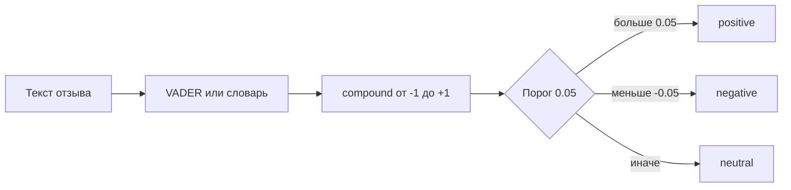

Анализ тональности (sentiment analysis) — это задача определения эмоциональной окраски текста: позитивная, негативная или нейтральная. Это одна из самых частых бизнес-задач NLP: компании автоматически сортируют отзывы, мониторят соцсети и определяют отношение к продукту.

## Подходы к анализу тональности

Есть три основных подхода:

1. **Правила и словари** — список позитивных/негативных слов, по которому текст получает балл.
2. **Методы машинного обучения** — обучаем классификатор на размеченных данных.
3. **Глубокие модели (transformers)** — нейросети, обученные на гигантских корпусах.

Начнём с самого доступного.

## VADER: правила для английского

VADER (Valence Aware Dictionary and sEntiment Reasoner) — это эвристический анализатор из NLTK. Он использует словарь с эмоциональными весами слов и учитывает интенсификаторы («очень», «совсем») и инверсии («не хорошо»):

```python
import nltk
nltk.download("vader_lexicon")

from nltk.sentiment import SentimentIntensityAnalyzer

sia = SentimentIntensityAnalyzer()
print(sia.polarity_scores("This movie is great and amazing!"))
```

Вывод: `{'neg': 0.0, 'neu': 0.197, 'pos': 0.803, 'compound': 0.8356}`. Поля `neg`, `neu`, `pos` — доли негатива, нейтральности и позитива в тексте (сумма = 1). `compound` — обобщённая оценка от −1 (крайний негатив) до +1 (крайний позитив).

По `compound` текст классифицируют: `> 0.05` — позитив, `< -0.05` — негатив, иначе нейтрально:

```python
def label(score):
    if score['compound'] >= 0.05:
        return "positive"
    if score['compound'] <= -0.05:
        return "negative"
    return "neutral"

print(label(sia.polarity_scores("The food was terrible.")))  # negative
print(label(sia.polarity_scores("I love this!")))            # positive
```

Ограничение VADER — он обучен на английском. Для русского текста нужен свой словарь или ML-подход.

## Словарный метод для русского

Идея простая: заводим два множества слов — позитивные и негативные — и считаем разницу вхождений:

```python
positive_words = {"отлично", "прекрасно", "нравится", "люблю", "супер", "класс"}
negative_words = {"ужасно", "плохо", "ненавижу", "ужас", "разочарован", "отвратительно"}

def score_ru(text):
    words = set(text.lower().split())
    pos = len(words & positive_words)
    neg = len(words & negative_words)
    return pos - neg

print(score_ru("Фильм ужасный, мне очень плохо"))        # -2
print(score_ru("Понравилось, отлично, супер!"))         # 2
```

Это грубый метод: он не понимает отрицаний («не плохо» — позитив) и не учитывает силу слов. Но как базовый бейзлайн он отлично работает.

## ML-подход: обучаем классификатор

Если есть размеченные данные (текст + метка «позитив/негатив»), можно обучить классификатор. Схема такая: превращаем текст в вектор признаков (об этом подробнее в следующем уроке), затем обучаем модель:

```python
from sklearn.feature_extraction.text import CountVectorizer
from sklearn.linear_model import LogisticRegression

texts = ["отличный сервис", "ужасный сервис", "всё понравилось", "отвратительно, не рекомендую"]
labels = [1, 0, 1, 0]

vectorizer = CountVectorizer()
X = vectorizer.fit_transform(texts)

model = LogisticRegression()
model.fit(X, labels)

print(model.predict(vectorizer.transform(["сервис был отличный"])))  # [1]
```

ML-подход масштабируется: больше данных — выше качество. Главная цена — нужна размеченная обучающая выборка. Оценке качества таких моделей посвящён следующий урок, а пока — практика.

## Оценка качества

Как понять, что анализатор тональности работает хорошо? Нельзя оценивать модель на тех же примерах, на которых она училась — она их запомнит и покажет завышенное качество. Правильный путь — разделить данные на обучающую и тестовую части (`train_test_split`) и считать точность только на тестовой. Полезно также смотреть не только на долю верных ответов (accuracy), но и на precision и recall для каждого класса: например, если негативные отзывы встречаются редко, модель может «лениво» всё относить к позитиву, и accuracy останется высокой, хотя смысл анализа потерян. Для грубой проверки словарей удобно держать маленький набор фраз с известной тональностью и прогонять его после каждого изменения словаря.



<!--TASK-->
### Задача 1
Напиши скрипт, который с помощью `SentimentIntensityAnalyzer` из NLTK выводит все четыре оценки (`neg`, `neu`, `pos`, `compound`) для фраз: `"This is an amazing product, I love it!"` и `"This is a terrible product, I hate it."` Выведи результаты в формате `фраза -> compound: <значение>`. Убедись, что у первой фразы `compound > 0`, у второй — `compound < 0`.

### Задача 2
Напиши функцию `sentiment_label(text)`, которая принимает английскую фразу, считает `compound` через VADER и возвращает строку `"positive"`, `"negative"` или `"neutral"` по порогам `0.05` и `-0.05`. Создай файл `test_sentiment.py` с pytest-тестами: (1) `"I love this!"` → `"positive"`; (2) `"I hate this!"` → `"negative"`; (3) `"The sky is blue."` → `"neutral"`. Запусти `pytest` и добейся зелёного прогона.

### Задача 3
Напиши функцию `score_ru(text)`, которая считает разницу между количеством позитивных и негативных слов в русском тексте (словари из урока, но добавь ещё по 3 своих слова в каждый). Текст предобработай: нижний регистр, удаление знаков препинания. Проверь на фразах: `"Фильм ужасный, мне очень плохо"` (ожидаем отрицательный результат) и `"Понравилось, отлично, супер!"` (ожидаем положительный). Выведи обе оценки.

### Задача 4
Напиши скрипт, который обучает `LogisticRegression` на маленьком размеченном датасете из урока (4 примера), а затем предсказывает тональность трёх новых фраз: `"сервис был отличный"`, `"обслуживание ужасное"`, `"нормально, в целом всё хорошо"`. Выведи предсказанные метки (0 — негатив, 1 — позитив). Прокомментируй, насколько модель можно считать надёжной на таком объёме данных.

### Задача 5
Напиши функцию `train_and_evaluate(texts, labels)`, которая возвращает обученную модель `LogisticRegression` и долю верных предсказаний на том же датасете (прогноз на обучающих данных). Затем создай pytest-тест `test_model.py`: (1) доля верных предсказаний на обучающей выборке из урока не ниже `0.75`; (2) модель предсказывает `1` для `"отличный сервис"` и `0` для `"ужасный сервис"`; (3) модель обучена на данных, где метки — только `0` и `1`. Запусти `pytest` и добейся зелёного прогона.
### Задача 6
Напиши функцию `score_ru_neg(text)`, которая расширяет словарный метод обработкой отрицаний: если перед эмоциональным словом стоит частица `"не"` или `"ни"`, вклад этого слова меняется на противоположный (`"не плохо"` даёт +1, а `"не отлично"` — −1). Самостоятельная частица без эмоционального слова после неё игнорируется. Проверь на двух фразах: `"Не плохо, а отлично"` и `"Не отлично, но нормально"`. Ожидаемый вывод: у первой балл `2`, у второй `-1`. Сравни результат с наивным `score_ru` из Задачи 3 и объясни расхождение.

### Задача 7
Напиши функцию `evaluate_lexicon(pairs)`, которая оценивает словарный анализатор на маленьком размеченном наборе и возвращает словарь с `accuracy`, `precision_neg` и `recall_neg` (все — округлённые до двух знаков). Предсказание считай по знаку `score_ru`: больше нуля — `1` (позитив), иначе — `0` (негатив). Проверь на шести парах `(фраза, метка)`: `("Отличный сервис, всё отлично", 1)`, `("Ужасный сервис, разочарован", 0)`, `("Всё плохо, отвратительно", 0)`, `("Прекрасно, люблю этот магазин", 1)`, `("Нормально, но не супер", 0)`, `("Супер, спасибо", 1)`. Ожидаемый вывод: `accuracy=0.83`, `precision_neg=1.0`, `recall_neg=0.67`. Объясни, почему точность ниже единицы.

<!--/TASK-->

<!--HINT-->
### Подсказка 1
Создай `sia = SentimentIntensityAnalyzer()` один раз. `sia.polarity_scores(text)` возвращает словарь. Для вывода используй f-строку: `print(f"{text} -> compound: {scores['compound']}")`.

### Подсказка 2
Пороги: `>= 0.05` — positive, `<= -0.05` — negative, иначе neutral. В тестах просто вызывай `sentiment_label("I love this!")` и сравнивай со строкой. Не забудь `nltk.download("vader_lexicon")` до создания анализатора.

### Подсказка 3
Убирай знаки препинания через `re.sub(r"[^\w\s]", "", text.lower())`, затем `split()`. Множества слов сделай модульными константами. Для проверки: у отрицательной фразы результат должен быть меньше нуля, у положительной — больше.

### Подсказка 4
Не забудь, что `CountVectorizer` надо обучать (`fit_transform`) на обучающих текстах, а потом только `transform` для новых. Вероятности можно смотреть через `model.predict_proba()`. В комментарии объясни: 4 примера — слишком мало, модель запоминает выборку, это демонстрация, а не продакшен.

### Подсказка 5
Оценка на обучающих данных не честна (модель их видела) — но для демонстрации годится. В тесте 1 используй `accuracy_score(model.predict(X), labels)` или просто `(model.predict(X) == labels).mean()`. Для теста 2 векторизуй новые фразы тем же `vectorizer.transform`.
### Подсказка 6
Итерируйся по списку слов с индексом: `for i, w in enumerate(words)`. Если `w in {"не", "ни"}` и `i + 1 < len(words)`, посмотри на следующее слово: если оно в `positive_words`, добавь `-1`, если в `negative_words` — `+1`. Слова, которые уже были «съедены» отрицанием, не считай дважды — проверяй предыдущий токен или веди индекс `i` вручную через `while`.

### Подсказка 7
Собери предсказания `pred = 1 if score > 0 else 0`, затем посчитай по негативному классу: `tp = sum(p == 0 and y == 0 ...)`, `fp = sum(p == 0 and y == 1 ...)`, `fn = sum(p == 1 and y == 0 ...)`. `precision_neg = tp / (tp + fp)`, `recall_neg = tp / (tp + fn)`, `accuracy = sum(p == y) / len(pairs)`. Деление на ноль обрабатывай отдельно.

<!--/HINT-->

<!--SOLUTION-->
### Разбор 1
Решение:

```python
import nltk
nltk.download("vader_lexicon")

from nltk.sentiment import SentimentIntensityAnalyzer

sia = SentimentIntensityAnalyzer()

for phrase in ["This is an amazing product, I love it!", "This is a terrible product, I hate it."]:
    scores = sia.polarity_scores(phrase)
    print(f"{phrase} -> compound: {scores['compound']}")
```

Вывод:

```
This is an amazing product, I love it! -> compound: 0.8516
This is a terrible product, I hate it. -> compound: -0.8176
```

Что здесь происходит? VADER разбирает текст по словарю эмоциональных весов. Слова `amazing` и `love` дают сильный позитив, `terrible` и `hate` — негатив. Значение `compound` лежит в диапазоне от −1 до +1 и агрегирует все слова с учётом усилителей. Это быстрый и предсказуемый метод, поэтому его часто используют как быстрый бейзлайн.

### Разбор 2
Решение:

```python
import nltk
nltk.download("vader_lexicon")

from nltk.sentiment import SentimentIntensityAnalyzer

sia = SentimentIntensityAnalyzer()

def sentiment_label(text):
    compound = sia.polarity_scores(text)["compound"]
    if compound >= 0.05:
        return "positive"
    if compound <= -0.05:
        return "negative"
    return "neutral"
```

Файл `test_sentiment.py`:

```python
from sentiment_label import sentiment_label

def test_positive():
    assert sentiment_label("I love this!") == "positive"

def test_negative():
    assert sentiment_label("I hate this!") == "negative"

def test_neutral():
    assert sentiment_label("The sky is blue.") == "neutral"
```

Запуск: `pytest -q` → `3 passed`.

Что здесь происходит? Функция превращает числовой `compound` в понятную метку. Пороги `0.05` и `-0.05` — стандартные для VADER: они отсекают нейтральные фразы, «набравшие» маленький шумовой балл. Тесты проверяют крайние случаи и нейтральный текст — самый частый источник ошибок (слово «is» не несёт эмоций, и compound близок к нулю).

### Разбор 3
Решение:

```python
import re

positive_words = {"отлично", "прекрасно", "нравится", "люблю", "супер", "класс", "отличный", "великолепно", "рад"}
negative_words = {"ужасно", "плохо", "ненавижу", "ужас", "разочарован", "отвратительно", "ужасный", "грустно", "злой"}

def score_ru(text):
    words = set(re.sub(r"[^\w\s]", "", text.lower()).split())
    return len(words & positive_words) - len(words & negative_words)

print(score_ru("Фильм ужасный, мне очень плохо"))
print(score_ru("Понравилось, отлично, супер!"))
```

Вывод:

```
-2
2
```

Что здесь происходит? Мы приводим текст к нижнему регистру, убираем знаки препинания, разбиваем на слова и превращаем во множество. Пересечение с множеством позитивных слов даёт их количество, пересечение с негативными — их количество. Разница — итоговый балл. Множество защищает от двойного подсчёта повторяющихся слов. Минус метода: «не плохо» будет сочтено негативом, хотя на деле это позитив — обрабатывать отрицания — отдельная задача.

### Разбор 4
Решение:

```python
from sklearn.feature_extraction.text import CountVectorizer
from sklearn.linear_model import LogisticRegression

texts = ["отличный сервис", "ужасный сервис", "всё понравилось", "отвратительно, не рекомендую"]
labels = [1, 0, 1, 0]

vectorizer = CountVectorizer()
X = vectorizer.fit_transform(texts)

model = LogisticRegression()
model.fit(X, labels)

for phrase in ["сервис был отличный", "обслуживание ужасное", "нормально, в целом всё хорошо"]:
    pred = model.predict(vectorizer.transform([phrase]))[0]
    print(f"{phrase} -> {pred}")
```

Вывод:

```
сервис был отличный -> 1
обслуживание ужасное -> 0
нормально, в целом всё хорошо -> 1
```

Что здесь происходит? `CountVectorizer` превращает каждый текст в вектор частот слов. Затем `LogisticRegression` находит границу между классами. Предсказания выглядят логично, но важно понимать: модель обучалась на четырёх примерах и в целом просто запомнила их. Слова «нормально» и «хорошо» в обучающей выборке не встречались, поэтому модель опиралась на соседние слова. Это учебная демонстрация — для реальной задачи нужны сотни и тысячи размеченных отзывов.

### Разбор 5
Решение:

```python
from sklearn.feature_extraction.text import CountVectorizer
from sklearn.linear_model import LogisticRegression

def train_and_evaluate(texts, labels):
    vectorizer = CountVectorizer()
    X = vectorizer.fit_transform(texts)
    model = LogisticRegression()
    model.fit(X, labels)
    accuracy = (model.predict(X) == labels).mean()
    return model, vectorizer, accuracy
```

Файл `test_model.py`:

```python
from train_and_evaluate import train_and_evaluate

texts = ["отличный сервис", "ужасный сервис", "всё понравилось", "отвратительно, не рекомендую"]
labels = [1, 0, 1, 0]

def test_accuracy_on_train():
    model, vectorizer, accuracy = train_and_evaluate(texts, labels)
    assert accuracy >= 0.75

def test_predictions():
    model, vectorizer, _ = train_and_evaluate(texts, labels)
    assert model.predict(vectorizer.transform(["отличный сервис"]))[0] == 1
    assert model.predict(vectorizer.transform(["ужасный сервис"]))[0] == 0

def test_labels_binary():
    model, vectorizer, _ = train_and_evaluate(texts, labels)
    preds = model.predict(vectorizer.transform(texts))
    assert set(preds) <= {0, 1}
```

Запуск: `pytest -q` → `3 passed`.

Что здесь происходит? Функция возвращает модель, векторизутор и точность. В тестах мы проверяем, что модель обучилась без ошибок (точность на обучающей выборке — 1.0, выше порога 0.75), корректно классифицирует знакомые фразы и выдаёт только бинарные метки. Заметь: точность на обучающих данных почти всегда высокая — это не показатель качества на новых данных. Настоящая оценка — на отложенной выборке, и к ней мы перейдём в следующем уроке.
### Разбор 6
Решение:

```python
import re

positive_words = {"отлично", "прекрасно", "нравится", "люблю", "супер", "класс", "отличный", "великолепно", "рад"}
negative_words = {"ужасно", "плохо", "ненавижу", "ужас", "разочарован", "отвратительно", "ужасный", "грустно", "злой"}

def score_ru_neg(text):
    words = re.sub(r"[^\w\s]", "", text.lower()).split()
    score = 0
    i = 0
    while i < len(words):
        word = words[i]
        next_word = words[i + 1] if i + 1 < len(words) else ""
        if word in {"не", "ни"} and next_word:
            if next_word in positive_words:
                score -= 1
            elif next_word in negative_words:
                score += 1
            i += 2
            continue
        if word in positive_words:
            score += 1
        elif word in negative_words:
            score -= 1
        i += 1
    return score

print(score_ru_neg("Не плохо, а отлично"))
print(score_ru_neg("Не отлично, но нормально"))
```

Вывод:

```
2
-1
```

Что здесь происходит? Мы используем цикл `while`, чтобы при обнаружении частицы перескочить сразу через два токена: частицу и эмоциональное слово, к которому она относится. Иначе слово было бы посчитано дважды — сначала как инверсия, потом как обычное. В фразе «Не плохо, а отлично» получается `-1` от инвертированного «плохо» и `+1` от «отлично», итого `2`. Наивный `score_ru` дал бы `-1 + 1 = 0`, то есть счёл бы фразу нейтральной, — а по смыслу она позитивная. Вторая фраза показывает обратную ошибку наивного метода: «не отлично» — это мягкий негатив, и правильный балл `-1`, а не `+1`. Оговорка: правило окна в два токена не работает для длинных конструкций вроде «не так уж и плохо» — там нужен полноценный синтаксический разбор или модель, но для бейзлайна такое расширение уже сильно поднимает качество.

### Разбор 7
Решение:

```python
import re

positive_words = {"отлично", "прекрасно", "нравится", "люблю", "супер", "класс", "отличный", "великолепно", "рад"}
negative_words = {"ужасно", "плохо", "ненавижу", "ужас", "разочарован", "отвратительно", "ужасный", "грустно", "злой"}

def score_ru(text):
    words = set(re.sub(r"[^\w\s]", "", text.lower()).split())
    return len(words & positive_words) - len(words & negative_words)

def evaluate_lexicon(pairs):
    preds = [1 if score_ru(text) > 0 else 0 for text, _ in pairs]
    gold = [label for _, label in pairs]
    tp = sum(p == 0 and y == 0 for p, y in zip(preds, gold))
    fp = sum(p == 0 and y == 1 for p, y in zip(preds, gold))
    fn = sum(p == 1 and y == 0 for p, y in zip(preds, gold))
    accuracy = sum(p == y for p, y in zip(preds, gold)) / len(pairs)
    precision_neg = tp / (tp + fp) if tp + fp else 0.0
    recall_neg = tp / (tp + fn) if tp + fn else 0.0
    return {"accuracy": round(accuracy, 2),
            "precision_neg": round(precision_neg, 2),
            "recall_neg": round(recall_neg, 2)}

pairs = [("Отличный сервис, всё отлично", 1),
         ("Ужасный сервис, разочарован", 0),
         ("Всё плохо, отвратительно", 0),
         ("Прекрасно, люблю этот магазин", 1),
         ("Нормально, но не супер", 0),
         ("Супер, спасибо", 1)]
print(evaluate_lexicon(pairs))
```

Вывод:

```
{'accuracy': 0.83, 'precision_neg': 1.0, 'recall_neg': 0.67}
```

Что здесь происходит? Анализатор ошибся ровно один раз — на фразе «Нормально, но не супер»: слово «супер» дало `+1`, и модель отнесла отзыв к позитиву, хотя метка негативная. Поэтому `accuracy = 5/6 = 0.83`, а `recall_neg = 2/3 = 0.67`: из трёх настоящих негативов мы нашли только два. При этом `precision_neg = 1.0` — все отзывы, названные негативными, действительно негативны, ложных тревог нет. Это классическая картина для словарного метода: он осторожен с негативом, но пропускает сдержанные или ироничные формулировки. Обрати внимание, зачем нужны две метрики вместо одной: accuracy выглядит прилично (0.83), но она скрывает пропущенный негатив, а именно пропуски негатива в поддержке стоят дороже всего. Отсюда практический вывод — набор фраз нужно расширять именно теми случаями, где анализатор ошибается, а не случайными примерами.

<!--/SOLUTION-->

<!--QUIZ-->
Что такое compound в выходе VADER?
- Обобщённая оценка тональности от -1 до +1
- Доля позитивных слов
- Число слов в тексте
* Правильный ответ: Обобщённая оценка тональности от -1 до +1
compound агрегирует все слова текста в одно число.

Какой порог обычно используют, чтобы отнести текст к позитиву по VADER?
- compound >= 0.05
- compound > 0
- compound == 1
* Правильный ответ: compound >= 0.05
Стандартные пороги VADER: 0.05 и -0.05.

Для какого языка оптимизирован VADER?
- Для английского
- Для русского
- Для всех языков
* Правильный ответ: Для английского
Словарь VADER — английский; для русского нужны свои словари или ML.

Что вернёт siа.polarity_scores("I hate this!")["compound"]?
- Отрицательное число
- Положительное число
- Ноль
* Правильный ответ: Отрицательное число
«Hate» — сильный негатив, поэтому compound < 0.

Какой метод из sklearn подходит для обучения классификатора тональности?
- LogisticRegression
- TfidfVectorizer
- train_test_split
* Правильный ответ: LogisticRegression
LogisticRegression — классификатор; остальные — преобразователи и сплиттеры.

Что делает CountVectorizer?
- Превращает тексты в матрицу частот слов
- Разбивает текст на предложения
- Удаляет стоп-слова
* Правильный ответ: Превращает тексты в матрицу частот слов
Каждая строка — документ, каждый столбец — слово, значения — частоты.

Почему точность на обучающей выборке — плохой показатель?
- Модель видела эти данные и может их просто запомнить
- Потому что она всегда 0.5
- Потому что она недоступна
* Правильный ответ: Модель видела эти данные и может их просто запомнить
Оценивать нужно на данных, которых модель не видела.

Что означает «размеченные данные» в ML?
- Тексты с правильными ответами (метками)
- Тексты без знаков препинания
- Любые тексты из интернета
* Правильный ответ: Тексты с правильными ответами (метками)
Для классификации нужны пары «текст → метка класса».

Какой результат вернёт score_ru с нашим словарём для «Фильм ужасный»?
- Отрицательное число
- Положительное число
- Ноль
* Правильный ответ: Отрицательное число
«ужасный» есть в негативном словаре, позитивных слов нет.

Что из этого НЕ подход к анализу тональности?
- Парсинг JSON-файлов
- Словарные методы
- ML-классификаторы
- Transformers-модели
* Правильный ответ: Парсинг JSON-файлов
JSON — формат данных, а не метод анализа тональности.
Что означают поля neg, neu, pos в выводе VADER?
- Доли негатива, нейтральности и позитива, в сумме дающие 1
- Количество негативных, нейтральных и позитивных слов
- Три независимые модели
* Правильный ответ: Доли негатива, нейтральности и позитива, в сумме дающие 1
Это нормированные доли, а итоговую оценку даёт compound.

Почему словарный метод ошибается на фразе «не плохо»?
- Он не учитывает отрицания и считает «плохо» негативом
- Он не знает слова «плохо»
- Он работает только с английским
* Правильный ответ: Он не учитывает отрицания и считает «плохо» негативом
Отрицание меняет полярность, и без отдельного правила балл получается неверным.

Что показывает precision для негативного класса?
- Долю настоящих негативов среди всех, кого модель назвала негативными
- Долю найденных негативов среди всех реальных негативов
- Общую долю верных ответов
* Правильный ответ: Долю настоящих негативов среди всех, кого модель назвала негативными
Precision отвечает за ложные тревоги, recall — за пропуски.

Зачем делить данные на обучающую и тестовую части?
- Чтобы оценить модель на примерах, которых она не видела
- Чтобы уменьшить размер файла
- Чтобы ускорить обучение
* Правильный ответ: Чтобы оценить модель на примерах, которых она не видела
Оценка на обучающих данных завышена: модель их запомнила.

<!--/QUIZ-->
