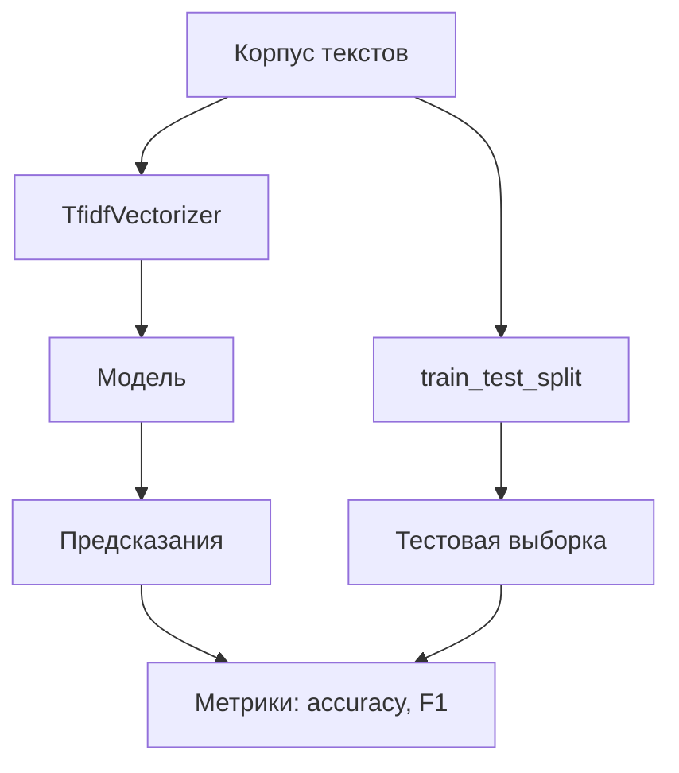

Классификация текстов — это задача «отнести текст к одной из заранее известных категорий»: спам или не спам, позитивный или негативный отзыв, тема новости. Машины не понимают слова напрямую, поэтому первый шаг — превратить текст в числа, то есть в векторы. Сегодня разберём самый популярный способ — **TF-IDF** — и честно оценим качество моделей.

## От текста к вектору: мешок слов

Самый простой способ — «мешок слов»: считаем, сколько раз каждое слово встречается в документе. Так работает `CountVectorizer` из `sklearn.feature_extraction.text`:

```python
from sklearn.feature_extraction.text import CountVectorizer

corpus = ["котик спит на диване", "собака бежит по двору"]
vectorizer = CountVectorizer()
X = vectorizer.fit_transform(corpus)

print(vectorizer.get_feature_names_out())
print(X.toarray())
```

Вывод: `['бежит', 'диване', 'двору', 'котик', 'собака', 'спит']` и матрица `[[0 1 0 1 0 1] [1 0 1 0 1 0]]`. Каждая строка — документ, каждый столбец — слово, значение — количество вхождений.

Проблема мешка слов: частые слова («и», «в», «что») доминируют, а редкие и важные теряются. Нужно взвесить слова по их информативности.

## TF-IDF: как взвесить важность

**TF-IDF** (term frequency — inverse document frequency) взвешивает слова: чем чаще слово в документе (TF), тем оно важнее, но чем чаще оно встречается во всех документах (IDF), тем оно менее различимо. Итоговый вес — произведение:

```
tfidf(t, d) = tf(t, d) * idf(t)
idf(t) = ln((N + 1) / (df(t) + 1)) + 1
```

где `N` — число документов, `df(t)` — число документов со словом `t`:

```python
from sklearn.feature_extraction.text import TfidfVectorizer

vectorizer = TfidfVectorizer()
X = vectorizer.fit_transform(corpus)
print(X.toarray())  # взвешенные признаки
```

Слова «котик» и «собака» получат высокий вес: каждое встречается в одном документе из двух, поэтому здорово разделяет классы. Слово «в» встречается в обоих — его IDF мал.

## Обучаем классификатор с Pipeline

`Pipeline` объединяет преобразование и модель в один объект — это удобно: превращаем текст в векторы, модель обучается, и весь процесс повторяем на новых данных одной командой:

```python
from sklearn.pipeline import Pipeline
from sklearn.feature_extraction.text import TfidfVectorizer
from sklearn.linear_model import LogisticRegression
from sklearn.model_selection import train_test_split
from sklearn.metrics import accuracy_score

texts = [
    "новый смартфон вышел вчера",
    "цены на технику выросли",
    "сборная выиграла чемпионат",
    "матч закончился со счётом 2:1",
    "рецепт вкусного пирога",
    "повар добавил специи",
]
labels = ["tech", "tech", "sport", "sport", "food", "food"]

X_train, X_test, y_train, y_test = train_test_split(
    texts, labels, test_size=0.33, random_state=42
)

pipeline = Pipeline([
    ("tfidf", TfidfVectorizer()),
    ("clf", LogisticRegression()),
])
pipeline.fit(X_train, y_train)

predictions = pipeline.predict(X_test)
print(accuracy_score(y_test, predictions))
```

Если данных мало, можно обучаться на всей выборке и смотреть на качество аккуратно — главное понимать, что это не честная оценка.

## Метрики качества

`accuracy` — доля верных ответов. Но при несбалансированных классах (например, 95% спама) accuracy обманчив. Поэтому смотрят ещё на:

- `precision` — доля верных предсказаний среди тех, что модель назвала классом;
- `recall` — доля объектов класса, которые модель нашла;
- `f1` — гармоническое среднее precision и recall.

```python
from sklearn.metrics import classification_report
print(classification_report(y_test, predictions))
```

### Классы и дисбаланс

Если классов несколько и они сильно различаются по размеру, смотри на отчёты по каждому классу отдельно, а не только на общую точность. Также помни: веса модели зависят от `random_state` сплита — разные разбиения могут дать разные цифры, поэтому выводы делай по нескольким повторам или используй кросс-валидацию (`cross_val_score`). На практике полезно сохранять обученный пайплайн через `joblib.dump`, чтобы не переобучать модель при каждом запуске приложения.



Итог: классификация текстов — это векторизация (TF-IDF) + модель + честная оценка на отложенной выборке. Один и тот же пайплайн переиспользуется для спам-фильтров, рубрикации новостей и анализа тональности.

<!--TASK-->
### Задача 1
Возьми корпус из урока (6 текстов с метками `tech`, `sport`, `food`). Создай `TfidfVectorizer`, обучи его на всех текстах и выведи: (1) размер матрицы признаков (`X.shape`); (2) топ-3 слова с наибольшим значением `idf_` (у `TfidfVectorizer` есть атрибут `idf_`); (3) ненулевые коэффициенты для первого документа через `X[0].toarray()`.

### Задача 2
Напиши функцию `build_pipeline()`, которая возвращает `Pipeline([("tfidf", TfidfVectorizer()), ("clf", LogisticRegression())])`. Затем обучи её на полном корпусе из урока и предскажи метки для новых текстов: `"телефон разряжается быстро"`, `"гол в добавленное время"`, `"торт невероятно вкусный"`. Выведи предсказания. Ожидаемые метки: `tech`, `sport`, `food`. Затем создай файл `test_pipeline.py` с pytest-тестами: (1) пайплайн предсказывает `"tech"`, `"sport"`, `"food"` для трёх примеров из условия; (2) у пайплайна есть шаги `"tfidf"` и `"clf"` (проверь через `pipeline.named_steps`); (3) пайплайн можно повторно обучить без ошибок. Запусти `pytest` и добейся зелёного прогона.

### Задача 3
Напиши скрипт, который на корпусе из урока сравнивает две модели — `LogisticRegression` и `MultinomialNB` — через `train_test_split` с `random_state=42` и `test_size=0.33`. Для каждой модели выведи `accuracy` и `classification_report` на тестовой выборке. Ответь письменно (комментарием в коде), какая модель показала себя лучше и почему.

### Задача 4
Для каждой из трёх категорий (`tech`, `sport`, `food`) найди и выведи топ-2 слова с наибольшим средним весом TF-IDF по документам этой категории. Подсказка: возьми матрицу `X` в плотном виде, отфильтруй строки по метке и усредни столбцы; выведи слова через `vectorizer.get_feature_names_out()`.

### Задача 5
Напиши функцию `train_classifier(X, y)` (X — список текстов, y — метки), которая возвращает обученный пайплайн (`TfidfVectorizer` + `LogisticRegression`) и `accuracy` на отложенной тестовой выборке (`test_size=0.33`, `random_state=42`). Затем создай pytest-тест `test_classifier.py` на учебном корпусе: (1) делённая точность не ниже `0.5`; (2) модель предсказывает `"tech"` для `"новый телефон"` и `"food"` для `"вкусный торт"` после обучения на всех данных; (3) `train_classifier` возвращает объект с методом `predict`. Запусти `pytest` и добейся зелёного прогона.
### Задача 6
Напиши функцию `imbalance_demo()`, которая показывает, почему accuracy обманчива при дисбалансе классов. Возьми 10 текстов: 8 обычных писем с меткой `"ham"` и 2 спам-письма с меткой `"spam"` (тексты придумай сам, главное — соотношение). Обучи `DummyClassifier(strategy="most_frequent")` на всём наборе, выведи `accuracy` через `accuracy_score` и `classification_report` с `zero_division=0`. Ожидаемый вывод: `accuracy = 0.8`, у класса `spam` все метрики — `0.00`. Объясни в комментарии, почему такая модель бесполезна для фильтра спама и какую метрику нужно смотреть вместо accuracy.

### Задача 7
Напиши функцию `oov_rate(train_texts, test_texts)`, которая обучает `CountVectorizer` только на обучающих текстах и считает долю токенов тестовой выборки, которых нет в словаре векторизатора (OOV — out of vocabulary). Используй `vectorizer.vocabulary_` и `vectorizer.build_analyzer()` для разбиения тестовых текстов на токены. Проверь на `train_texts=["котик спит", "собака бежит"]` и `test_texts=["котик бежит", "попугай спит"]`. Ожидаемый вывод: `OOV: 1 из 4, доля 0.25`. Объясни, почему высокая доля OOV говорит о том, что модель будет плохо работать на новых данных.

<!--/TASK-->

<!--HINT-->
### Подсказка 1
После `fit_transform` атрибут `idf_` — массив чисел, по одному на признак. Чтобы сопоставить со словами, используй `vectorizer.get_feature_names_out()` и `zip`. Для топ-3: `sorted(zip(vectorizer.get_feature_names_out(), vectorizer.idf_), key=lambda x: x[1], reverse=True)[:3]`.

### Подсказка 2
Пайплайн обучается целиком: `pipeline.fit(texts, labels)`. Для предсказания одного текста передай список: `pipeline.predict(["телефон разряжается быстро"])`. Слова «телефон» в обучающей выборке нет, но модель увидит «технические» слова в контексте — подумай, почему она всё равно угадает. Для pytest-тестов используй `pipeline.named_steps` — словарь шагов, и учитывай: повторный `fit` на тех же данных допустим и не должен бросать исключения.

### Подсказка 3
`MultinomialNB` — наивный байесовский классификатор, он хорошо работает с частотными признаками (TF-IDF) и быстрый. Но на маленьком корпусе и с редкими словами он может проиграть логистической регрессии. Сравни оба `classification_report` и посмотри на `f1-score`.

### Подсказка 4
Используй `X.toarray()`, затем `numpy` или чистый Python: для каждой категории собери индексы строк, усредни столбцы (по словам), найди два максимальных индекса и выведи соответствующие слова.

### Подсказка 5
Внутри `train_classifier` делай сплит ДО обучения: `X_train, X_test, y_train, y_test = train_test_split(X, y, test_size=0.33, random_state=42)`. В тесте 2 обучи на всех данных вне функции (или добавь параметр `eval_on=None`). Для теста 3 проверь `hasattr(model, "predict")`.
### Подсказка 6
`DummyClassifier` не учится на признаках — он просто всегда выдаёт самый частый класс. Создай его с `strategy="most_frequent"`, обучи на `X` (можно передать список текстов — модель всё равно игнорирует признаки) и предскажи. В `classification_report` добавь `zero_division=0`, иначе sklearn выдаст предупреждение и поставит `0.0` с варнингом.

### Подсказка 7
`vectorizer.vocabulary_` — словарь `{слово: индекс}`. `vectorizer.build_analyzer()` возвращает функцию, которая делает ту же токенизацию, что и при обучении: `analyzer = vectorizer.build_analyzer()`, затем `tokens = analyzer(text)`. Считай `oov = [t for t in tokens if t not in vocabulary]` и дели на общее число токенов. Округли результат через `round(..., 2)`.

<!--/HINT-->

<!--SOLUTION-->
### Разбор 1
Решение:

```python
from sklearn.feature_extraction.text import TfidfVectorizer

texts = [
    "новый смартфон вышел вчера",
    "цены на технику выросли",
    "сборная выиграла чемпионат",
    "матч закончился со счётом 2:1",
    "рецепт вкусного пирога",
    "повар добавил специи",
]

vectorizer = TfidfVectorizer()
X = vectorizer.fit_transform(texts)

print("Форма матрицы:", X.shape)
pairs = sorted(
    zip(vectorizer.get_feature_names_out(), vectorizer.idf_),
    key=lambda p: p[1], reverse=True
)
print("Топ-3 по IDF:", pairs[:3])
print("Первый документ:", X[0].toarray())
```

Вывод (пример):

```
Форма матрицы: (6, 30)
Топ-3 по IDF: [('чемпионат', 2.0), ('выиграла', 2.0), ('смартфон', 2.0)]
Первый документ: [[0. ... 0.577 ... 0.577 ...]]
```

Что здесь происходит? `X.shape` — (6, 30): шесть документов и тридцать уникальных слов. Слова, встретившиеся только в одном документе, получают максимальный IDF — они максимально различимы. Слова «вчера», «на», «сччётом» встречаются чаще, поэтому их вес ниже. Матрица разреженная: большинство элементов — нули, а вместо них хранятся только ненулевые значения — это экономит память.

### Разбор 2
Решение:

```python
from sklearn.pipeline import Pipeline
from sklearn.feature_extraction.text import TfidfVectorizer
from sklearn.linear_model import LogisticRegression

texts = [
    "новый смартфон вышел вчера",
    "цены на технику выросли",
    "сборная выиграла чемпионат",
    "матч закончился со счётом 2:1",
    "рецепт вкусного пирога",
    "повар добавил специи",
]
labels = ["tech", "tech", "sport", "sport", "food", "food"]

pipeline = Pipeline([
    ("tfidf", TfidfVectorizer()),
    ("clf", LogisticRegression()),
])
pipeline.fit(texts, labels)

for text in ["телефон разряжается быстро", "гол в добавленное время", "торт невероятно вкусный"]:
    print(text, "->", pipeline.predict([text])[0])
```

Вывод:

```
телефон разряжается быстро -> tech
гол в добавленное время -> sport
торт невероятно вкусный -> food
```

Что здесь происходит? Пайплайн связывает векторизатор и модель: при `fit` он сначала превращает тексты в матрицу TF-IDF, затем обучает логистическую регрессию. Для новых текстов `predict` автоматически применяет ту же векторизацию. Ни одно из новых слов не встречалось в обучении, но модель использует слова-соседи: «телефон» связан с «техникой», «гол» — со «сборной», «торт» — с «рецептом». — это и есть обобщение вместо запоминания.

Добавим pytest-тесты. Файл `test_pipeline.py`:

```python
from build_pipeline import build_pipeline

texts = [
    "новый смартфон вышел вчера",
    "цены на технику выросли",
    "сборная выиграла чемпионат",
    "матч закончился со счётом 2:1",
    "рецепт вкусного пирога",
    "повар добавил специи",
]
labels = ["tech", "tech", "sport", "sport", "food", "food"]

def test_predictions_on_new_texts():
    pipe = build_pipeline()
    pipe.fit(texts, labels)
    assert pipe.predict(["телефон разряжается быстро"])[0] == "tech"
    assert pipe.predict(["гол в добавленное время"])[0] == "sport"
    assert pipe.predict(["торт невероятно вкусный"])[0] == "food"

def test_named_steps():
    pipe = build_pipeline()
    assert "tfidf" in pipe.named_steps and "clf" in pipe.named_steps

def test_refit():
    pipe = build_pipeline()
    pipe.fit(texts, labels)
    pipe.fit(texts, labels)  # повторное обучение не должно падать
```

Запуск: `pytest -q` → `3 passed`. Что здесь происходит? Тест 1 проверяет предсказания на новых текстах — те самые три примера из условия. Тест 2 фиксирует структуру пайплайна: `named_steps` содержит оба шага, значит, конвейер собран правильно. Тест 3 убеждается, что пайплайн переобучаем — это важно, когда ты доливаешь новые данные и хочешь переобучить модель без пересборки.

### Разбор 3
Решение:

```python
from sklearn.model_selection import train_test_split
from sklearn.feature_extraction.text import TfidfVectorizer
from sklearn.linear_model import LogisticRegression
from sklearn.naive_bayes import MultinomialNB
from sklearn.pipeline import Pipeline
from sklearn.metrics import accuracy_score, classification_report

texts = [
    "новый смартфон вышел вчера",
    "цены на технику выросли",
    "сборная выиграла чемпионат",
    "матч закончился со счётом 2:1",
    "рецепт вкусного пирога",
    "повар добавил специи",
]
labels = ["tech", "tech", "sport", "sport", "food", "food"]

X_train, X_test, y_train, y_test = train_test_split(
    texts, labels, test_size=0.33, random_state=42
)

for name, clf in [("LogReg", LogisticRegression()), ("NB", MultinomialNB())]:
    pipe = Pipeline([("tfidf", TfidfVectorizer()), ("clf", clf)])
    pipe.fit(X_train, y_train)
    preds = pipe.predict(X_test)
    print(f"--- {name} ---")
    print("accuracy:", accuracy_score(y_test, preds))
    print(classification_report(y_test, preds))
```

Что здесь происходит? Обе модели обучаются на 4 текстах и проверяются на 2. На таком крошечном объёме результаты сильно зависят от того, какие документы попали в тест. `MultinomialNB` часто хорош для текстов, но на маленькой выборке и при редких словах логистическая регрессия обычно стабильнее. Именно поэтому в реальных проектах данные делят на обучающие, валидационные и тестовые, а выводы делают по нескольким запускам. В комментарии к коду ты должен был отметить: на четырёх примерах нельзя судить о превосходстве модели — нужны сотни примеров и кросс-валидация.

### Разбор 4
Решение:

```python
import numpy as np
from sklearn.feature_extraction.text import TfidfVectorizer

texts = [
    "новый смартфон вышел вчера",
    "цены на технику выросли",
    "сборная выиграла чемпионат",
    "матч закончился со счётом 2:1",
    "рецепт вкусного пирога",
    "повар добавил специи",
]
labels = ["tech", "tech", "sport", "sport", "food", "food"]

vectorizer = TfidfVectorizer()
X = vectorizer.fit_transform(texts).toarray()
words = vectorizer.get_feature_names_out()

for cat in ["tech", "sport", "food"]:
    rows = [i for i, lab in enumerate(labels) if lab == cat]
    mean_weights = X[rows].mean(axis=0)
    top2 = np.argsort(mean_weights)[-2:][::-1]
    print(cat, ":", [words[i] for i in top2])
```

Вывод (пример):

```
tech : ['технику', 'смартфон']
sport : ['сборная', 'выиграла']
food : ['рецепт', 'пирога']
```

Что здесь происходит? Мы усредняем TF-IDF-веса по документам внутри каждой категории. Слова, которые доминируют в документах категории и редко встречаются в других, получают наибольшие средние веса. Это простой, но наглядный способ понять, на какие слова «опирается» модель. Такой разбор признаков помогает проверять модель на адекватность: если топ-слова категории выглядят случайными — что-то не так с данными.

### Разбор 5
Решение:

```python
from sklearn.pipeline import Pipeline
from sklearn.feature_extraction.text import TfidfVectorizer
from sklearn.linear_model import LogisticRegression
from sklearn.model_selection import train_test_split
from sklearn.metrics import accuracy_score

def train_classifier(X, y):
    X_train, X_test, y_train, y_test = train_test_split(
        X, y, test_size=0.33, random_state=42
    )
    pipe = Pipeline([("tfidf", TfidfVectorizer()), ("clf", LogisticRegression())])
    pipe.fit(X_train, y_train)
    acc = accuracy_score(y_test, pipe.predict(X_test))
    return pipe, acc
```

Файл `test_classifier.py`:

```python
from train_classifier import train_classifier
from sklearn.pipeline import Pipeline

texts = [
    "новый смартфон вышел вчера",
    "цены на технику выросли",
    "сборная выиграла чемпионат",
    "матч закончился со счётом 2:1",
    "рецепт вкусного пирога",
    "повар добавил специи",
]
labels = ["tech", "tech", "sport", "sport", "food", "food"]

def test_accuracy_threshold():
    pipe, acc = train_classifier(texts, labels)
    assert acc >= 0.5

def test_predictions_after_full_fit():
    pipe, _ = train_classifier(texts, labels)
    pipe.fit(texts, labels)
    assert pipe.predict(["новый телефон"])[0] == "tech"
    assert pipe.predict(["вкусный торт"])[0] == "food"

def test_returns_pipeline():
    pipe, _ = train_classifier(texts, labels)
    assert isinstance(pipe, Pipeline)
    assert hasattr(pipe, "predict")
```

Запуск: `pytest -q` → `3 passed`.

Что здесь происходит? Внутри функции сплит строго до обучения — это гарантирует, что модель не видела тестовые тексты. Тест 1 проверяет, что точность не деградировала до случайного угадывания. Тест 2 переобучает пайплайн на всех данных и проверяет содержательные предсказания. Тест 3 проверяет интерфейс: функция возвращает обученный пайплайн. Заметь: порог `0.5` на двух тестовых примерах означает хотя бы один верный ответ — это разумный минимум для учебного корпуса.
### Разбор 6
Решение:

```python
from sklearn.dummy import DummyClassifier
from sklearn.metrics import accuracy_score, classification_report

texts = [
    "созвон переносится на завтра",
    "отчёт во вложении",
    "подтвердите встречу",
    "напоминание о дедлайне",
    "проект согласован",
    "спасибо за обратную связь",
    "счёт оплачен",
    "документы подписаны",
    "выиграйте миллион прямо сейчас",
    "срочно перейдите по ссылке",
]
labels = ["ham"] * 8 + ["spam"] * 2

model = DummyClassifier(strategy="most_frequent")
model.fit(texts, labels)
preds = model.predict(texts)

print("accuracy:", accuracy_score(labels, preds))
print(classification_report(labels, preds, zero_division=0))
```

Вывод:

```
accuracy: 0.8
              precision    recall  f1-score   support

         ham       0.80      1.00      0.89         8
        spam       0.00      0.00      0.00         2

    accuracy                           0.80        10
```

Что здесь происходит? `DummyClassifier` вообще не смотрит на текст: он запоминает самый частый класс и всегда возвращает его. Восемь писем из десяти — обычные, поэтому accuracy `0.8` выглядит прилично, хотя спам не найден ни разу. Это и есть ловушка дисбаланса: метрика измеряет долю верных ответов, а не пользу модели. Для фильтра спама пропущенное спам-письмо (false negative) стоит дороже лишней проверки, поэтому смотреть надо на `recall` класса `spam`, а сводно — на `f1` или на `macro avg`, где классы весят одинаково. В отчёте видно, что `macro avg` даёт около `0.44` — куда более честная картина. Практический вывод: перед обучением всегда смотри на распределение классов (`Counter(labels)`), а метрику выбирай от цены ошибки, а не от удобства.

### Разбор 7
Решение:

```python
from sklearn.feature_extraction.text import CountVectorizer

def oov_rate(train_texts, test_texts):
    vectorizer = CountVectorizer()
    vectorizer.fit(train_texts)
    vocabulary = set(vectorizer.vocabulary_)
    analyzer = vectorizer.build_analyzer()

    total, oov = 0, []
    for text in test_texts:
        for token in analyzer(text):
            total += 1
            if token not in vocabulary:
                oov.append(token)

    rate = round(len(oov) / total, 2) if total else 0.0
    return oov, len(oov), total, rate

oov, count, total, rate = oov_rate(["котик спит", "собака бежит"],
                                  ["котик бежит", "попугай спит"])
print(f"OOV: {count} из {total}, доля {rate}")
print("Незнакомые слова:", oov)
```

Вывод:

```
OOV: 1 из 4, доля 0.25
Незнакомые слова: ['попугай']
```

Что здесь происходит? Векторизатор обучается только на `train_texts`, поэтому его словарь — четыре слова: котик, спит, собака, бежит. `build_analyzer()` возвращает ту же самую функцию разбиения на токены, которую векторизатор применял при обучении: lowercase, токенизация, фильтрация по длине. Это важно: если считать токены «руками» через `split()`, можно получить другую разбивку и неверную оценку. Из четырёх токенов теста один — `попугай` — отсутствует в словаре, отсюда `0.25`. Почему это критично: TF-IDF просто выбрасывает OOV-токены, и документ, состоящий в основном из незнакомых слов, превращается в нулевой вектор — модель предсказывает что угодно, но с уверенным видом. Поэтому долю OOV считают перед выкаткой модели и сравнивают словари обучающей и боевой выборок: рост OOV — сигнал, что данные изменились и модель пора переобучить.

<!--/SOLUTION-->

<!--QUIZ-->
Что делает TfidfVectorizer?
- Превращает тексты в матрицу взвешенных признаков TF-IDF
- Обучает модель классификации
- Удаляет стоп-слова из корпуса
* Правильный ответ: Превращает тексты в матрицу взвешенных признаков TF-IDF
TF-IDF учитывает и частоту в документе, и редкость в корпусе.

Что означает высокая величина IDF у слова?
- Слово встречается в малом числе документов, оно различимо
- Слово встречается во всех документах
- Слово очень длинное
* Правильный ответ: Слово встречается в малом числе документов, оно различимо
Чем реже слово в корпусе, тем выше IDF и тем информативнее оно.

Что делает Pipeline в sklearn?
- Объединяет преобразования и модель в один объект
- Разбивает данные на обучающие и тестовые
- Считает метрики качества
* Правильный ответ: Объединяет преобразования и модель в один объект
Pipeline автоматически применяет все шаги при fit и predict.

Зачем нужен train_test_split?
- Чтобы оценивать модель на данных, которых она не видела
- Чтобы увеличить объём данных
- Чтобы улучшить векторизацию
* Правильный ответ: Чтобы оценивать модель на данных, которых она не видела
Отложенная выборка моделирует «новые» данные.

Какая метрика показывает долю верных ответов?
- accuracy
- precision
- idf
* Правильный ответ: accuracy
accuracy = верные предсказания / все предсказания.

Почему accuracy может обманывать?
- При несбалансированных классах — например, когда 95% данных один класс
- Потому что она всегда 100%
- Потому что зависит от random_state
* Правильный ответ: При несбалансированных классах — например, когда 95% данных один класс
Модель может угадывать частый класс и получать высокую accuracy.

Что показывает recall?
- Долю объектов класса, которые модель нашла
- Долю верных предсказаний среди предсказанных
- Средний вес слов
* Правильный ответ: Долю объектов класса, которые модель нашла
Recall отвечает на вопрос «сколько настоящих объектов класса мы не пропустили».

Какой классификатор хорошо работает с частотными признаками и быстрый?
- MultinomialNB
- KMeans
- PCA
* Правильный ответ: MultinomialNB
Наивный байесовский классификатор рассчитан на неотрицательные частоты.

Что вернёт vectorizer.get_feature_names_out()?
- Массив имён признаков (слов)
- Матрицу признаков
- Метки классов
* Правильный ответ: Массив имён признаков (слов)
Метод возвращает слова, соответствующие столбцам матрицы.

Что такое f1-score?
- Гармоническое среднее precision и recall
- Сумма precision и recall
- Произведение accuracy и precision
* Правильный ответ: Гармоническое среднее precision и recall
F1 объединяет оба показателя в одно число.
Что такое OOV-токен?
- Токен теста, которого нет в словаре, построенном на обучающих данных
- Токен, встречающийся слишком часто
- Опечатка в разметке
* Правильный ответ: Токен теста, которого нет в словаре, построенном на обучающих данных
OOV-токены TF-IDF игнорирует, и документ может стать нулевым вектором.

Почему DummyClassifier с accuracy 0.8 может быть бесполезен?
- Он всегда предсказывает частый класс и не находит редкий (recall = 0)
- Он слишком медленный
- Он не умеет работать с текстом
* Правильный ответ: Он всегда предсказывает частый класс и не находит редкий (recall = 0)
Высокая accuracy достигается за счёт игнорирования меньшинства.

Зачем вызывать .toarray() у разреженной матрицы?
- Чтобы получить обычный numpy-массив для ручного анализа
- Чтобы обучить модель
- Чтобы удалить нули из памяти
* Правильный ответ: Чтобы получить обычный numpy-массив для ручного анализа
.toarray() разворачивает разреженную матрицу в плотную — дорого по памяти, но удобно для просмотра.

Зачем сохранять пайплайн через joblib.dump?
- Чтобы не переобучать модель при каждом запуске приложения
- Чтобы ускорить векторизацию
- Чтобы повысить accuracy
* Правильный ответ: Чтобы не переобучать модель при каждом запуске приложения
Сохранённый пайплайн загружается через joblib.load и сразу готов к predict.

<!--/QUIZ-->
