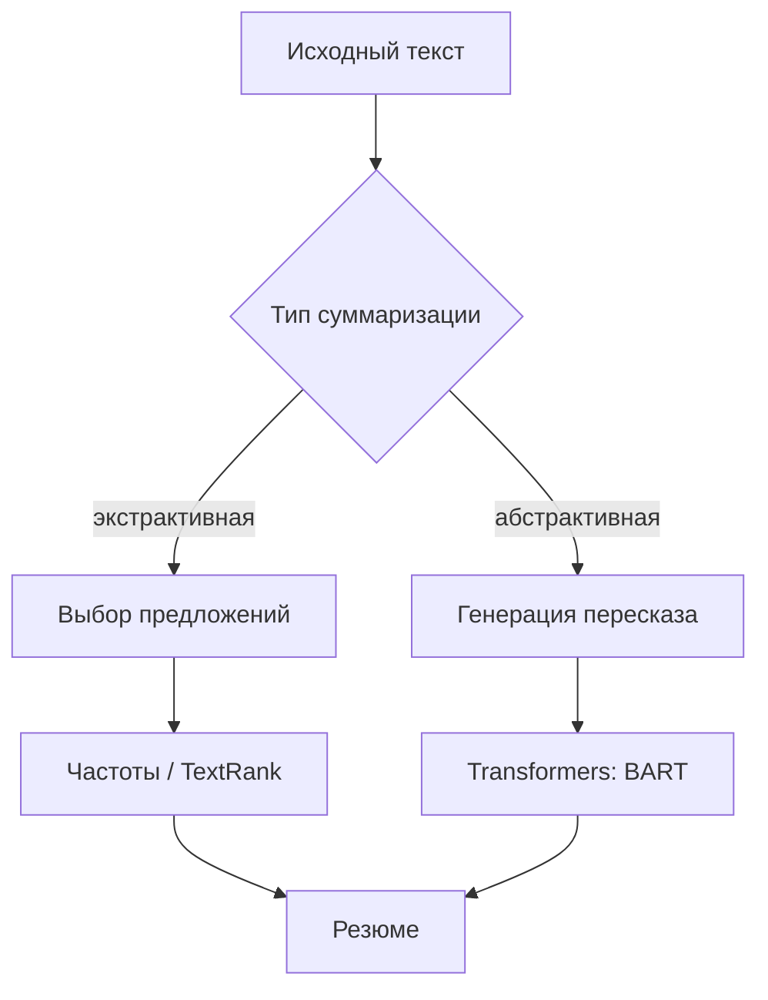

Суммаризация — это задача «сжать текст, сохранив главное». Она бывает двух типов:

- **Экстрактивная** — выбираем существующие предложения, которые лучше всего передают смысл.
- **Абстрактивная** — генерируем новый короткий текст своими словами (как делает человек).

Сегодня мы построим экстрактивный суммаризатор с нуля и познакомимся с нейросетевым подходом.



## Частотный суммаризатор

Самая простая идея: предложение тем важнее, чем больше в нём «важных» слов. Важность слова оценим его частотой в тексте. Сначала разобьём текст на предложения, затем посчитаем частоты слов без стоп-слов:

```python
import re
from collections import Counter
from nltk.tokenize import sent_tokenize

text = """Кофе — самый популярный напиток в мире. Каждый день люди выпивают миллиарды чашек.
Производство кофе поддерживает экономики десятков стран. Однако выращивание кофе требует много воды."""

sentences = sent_tokenize(text)
words = re.findall(r"\w+", text.lower())
freq = Counter(w for w in words if w not in {"и", "в", "на", "не", "самый"})

for sent in sentences:
    score = sum(freq.get(w, 0) for w in re.findall(r"\w+", sent.lower()))
    print(sent, "->", score)
```

Предложение с наибольшим баллом — самое важное. Собрав топ-K предложений, получаем резюме.

## Улучшения: взвешенные частоты

У частотного метода есть слабости: длинные предложения набирают больше баллов просто за счёт длины, а первые предложения текста часто важнее. Улучшения:

1. Нормировать балл на длину предложения (делить на число слов);
2. Добавлять позиционный бонус первым предложениям;
3. Учитывать вхождения ключевых фраз.

Реализуем нормировку:

```python
def score_sentence(sent, freq):
    words = re.findall(r"\w+", sent.lower())
    if not words:
        return 0.0
    return sum(freq.get(w, 0) for w in words) / len(words)
```

## TextRank: графовый подход

Более умный метод — **TextRank**. Он строит граф: предложения — вершины, рёбра — сходство между ними (например, доля общих слов). Затем ранжирует вершины алгоритмом, похожим на PageRank: важные предложения — те, на которые ссылаются другие важные предложения. Имплементация несложная, но кода заметно больше; в промышленности обычно используют готовые реализации (например, `gensim.summarization` или `sumy`).

## Ключевые фразы

Ключевые фразы — это не отдельные слова, а устойчивые сочетания («машинное обучение», «обработка естественного языка»). Простой способ их найти:

1. Токенизируем текст, убираем стоп-слова;
2. Собираем все соседние пары слов, которые не являются стоп-словами (например, «машинное обучение»);
3. Считаем частоты пар и выбираем самые частые.

```python
from nltk.corpus import stopwords

stop = set(stopwords.words("russian"))
tokens = re.findall(r"\w+", text.lower())
candidates = [tokens[i] + " " + tokens[i + 1]
              for i in range(len(tokens) - 1)
              if tokens[i] not in stop and tokens[i + 1] not in stop]
print(Counter(candidates).most_common(3))
```

## Нейросетевые подходы

Для абстрактивной суммаризации используются модели семейства **transformers**. Библиотека `transformers` от Hugging Face даёт готовые пайплайны:

```python
from transformers import pipeline

summarizer = pipeline("summarization", model="facebook/bart-large-cnn")
summary = summarizer(
    "The stock market opened higher today as technology shares rallied. "
    "Investors hope that interest rates will stay low.",
    max_length=30, min_length=5, do_sample=False
)
print(summary[0]["summary_text"])
```

Модель BART генерирует новый текст, сжимая смысл. Такие модели требуют много ресурсов, поэтому на практике часто комбинируют: экстрактивный метод — для быстрой обработки, transformers — для финального «пересказа».

<!--TASK-->
### Задача 1
Напиши функцию `frequency_summary(text, k=2)`, которая: (1) разбивает текст на предложения через `sent_tokenize`; (2) считает частоты слов без стоп-слов; (3) оценивает каждое предложение суммой частот его слов; (4) возвращает список из `k` предложений с наибольшими баллами в порядке их появления в тексте. Проверь на тексте из урока и выведи резюме.

### Задача 2
Улучши метод из Задачи 1: напиши функцию `normalized_summary(text, k=2)`, которая делит балл предложения на число слов в нём и добавляет бонус `+0.3 * freq` первым двум предложениям (индексы 0 и 1). Сравни результаты для текста из урока и объясни письменно, изменилось ли резюме и почему.

### Задача 3
Напиши функцию `key_phrases(text, n=3)`, которая возвращает топ-`n` самых частых биграмм (пар соседних слов), не содержащих стоп-слов. Используй `Counter` и `nltk.corpus.stopwords`. Проверь на тексте: `"Машинное обучение меняет мир. Машинное обучение требует данных. Обработка естественного языка — часть машинного обучения."` Выведи результат. Затем создай файл `test_key_phrases.py` с pytest-тестами: (1) первая по частоте биграмма — `"машинное обучение"`; (2) среди пар нет пар, где оба слова — стоп-слова; (3) длина результата не превышает `n`; (4) пара `"машинное обучение"` встречается ровно три раза. Запусти `pytest` и добейся зелёного прогона.

### Задача 4
Напиши скрипт, который использует `pipeline("summarization")` из `transformers` с моделью `facebook/bart-large-cnn`, чтобы суммаризовать английский абзац из 3-4 предложений с `max_length=30`, `min_length=5`. Выведи исходный текст и резюме. Оберни импорт в `try/except ImportError` с понятным сообщением, если библиотека не установлена.

### Задача 5
Напиши функцию `summarize(text, k=2)`, которая возвращает список предложений резюме через нормированный метод (из Задачи 2). Затем создай pytest-тесты `test_summarize.py`: (1) резюме не длиннее исходного текста (сумма длин предложений резюме ≤ длины исходного текста); (2) резюме содержит ровно `k` предложений; (3) все предложения резюме есть в исходном тексте; (4) функция детерминирована — два вызова на одном тексте дают одинаковый результат. Запусти `pytest` и добейся зелёного прогона.
### Задача 6
Напиши функцию `remove_duplicates(sentences, threshold=0.6)`, которая убирает из списка предложений почти одинаковые. Похожесть считай как долю общих слов от длины более короткого предложения: `|A ∩ B| / min(|A|, |B|)` по множествам слов в нижнем регистре (без пунктуации). Проходи список по порядку, оставляй предложение только если его похожесть на все уже оставленные ниже `threshold`. Проверь на списке `["Кофе популярен во всём мире", "Кофе популярен в мире", "Выращивание кофе требует много воды", "Производство кофе поддерживает экономики стран"]` и выведи оставшиеся предложения. Ожидаемый вывод: 3 предложения — второе отброшено. Объясни, зачем такой фильтр нужен в резюме.

### Задача 7
Напиши функцию `overlap_score(candidate, reference)`, которая оценивает качество резюме по лексическому перекрытию с эталоном. Приведи тексты к нижнему регистру, разбей на уникальные слова через `re.findall(r"\w+", ...)`, посчитай `recall = |A ∩ B| / |B|` и `precision = |A ∩ B| / |A|` (A — слова кандидата, B — слова эталона), округли до двух знаков. Проверь на кандидате `["Кофе популярен во всём мире", "Выращивание кофе требует много воды"]` и эталоне `"Кофе — популярный напиток, но выращивание требует много воды."`. Ожидаемый вывод: `recall=0.62`, `precision=0.56`. Объясни, почему метрики ниже единицы и что они не учитывают.

<!--/TASK-->

<!--HINT-->
### Подсказка 1
Не забудь `nltk.download("punkt_tab")`. Стоп-слова — вручную маленьким списком или через `nltk.corpus.stopwords.words("russian")`. Для порядка появления: отсортируй пары (предложение, балл) по баллу, возьми топ-k, затем отсортируй выбранные по исходному индексу.

### Подсказка 2
Нормировка: `score / len(words)`. Бонус: если индекс предложения < 2, добавляй `0.3` к баллу. Сравни с результатом Задачи 1 — из-за нормировки короткие информативные предложения поднимутся, а длинные «пустые» опустятся.

### Подсказка 3
Сначала токенизируй текст целиком (`re.findall(r"\w+", text.lower())`), затем собери пары `(tokens[i], tokens[i+1])`, где оба слова не стоп-слова. Соединяй их в строку через пробел. Если стоп-слов мало — установи `nltk.download("stopwords")`. В тестах: `phrases[0][0] == "машинное обучение"` — топ-1 биграмма; проверь, что оба слова каждой пары не входят в `STOP`; количество вхождений пары — `phrases[0][1] == 3`.

### Подсказка 4
Импорт: `from transformers import pipeline`. Абзац бери на английском — модель BART обучена на английском. Аргументы: `max_length`, `min_length`, `do_sample=False` для детерминированности. `try/except ImportError` заверни импорт.

### Подсказка 5
В тестах сравнивай длины: `sum(len(s.split()) for s in summary) <= len(text.split())`. Проверь принадлежность: `all(s in text for s in summary)` — предложения должны совпадать дословно. Для детерминированности сравнивай два вызова функции на одном и том же тексте.
### Подсказка 6
Сделай вспомогательную функцию `tokens(sent)` → `set(re.findall(r"\w+", sent.lower()))`. Похожесть: `len(a & b) / min(len(a), len(b))`, но не забудь защиту от пустых множеств — иначе получишь `ZeroDivisionError`. Основной цикл: `kept = []`, для каждого предложения проверь `all(similarity(sent, k) < threshold for k in kept)` и при успехе добавь в `kept`.

### Подсказка 7
Собери уникальные слова кандидата объединением: `set().union(*(tokens(s) for s in candidate))`. Пересечение — `a & b`. `recall` считается от эталона (сколько его слов мы покрыли), `precision` — от кандидата (какая доля наших слов есть в эталоне). Округляй через `round(value, 2)`; учти, что `0.625` округлится до `0.62` из-за банковского округления.

<!--/HINT-->

<!--SOLUTION-->
### Разбор 1
Решение:

```python
import re
from collections import Counter
from nltk.tokenize import sent_tokenize

STOP = {"и", "в", "на", "не", "самый", "а", "но", "для", "по"}

def frequency_summary(text, k=2):
    sentences = sent_tokenize(text)
    words = re.findall(r"\w+", text.lower())
    freq = Counter(w for w in words if w not in STOP)

    scored = []
    for idx, sent in enumerate(sentences):
        score = sum(freq.get(w, 0) for w in re.findall(r"\w+", sent.lower()))
        scored.append((score, idx, sent))

    scored.sort(reverse=True)
    top = sorted(scored[:k], key=lambda x: x[1])
    return [sent for _, _, sent in top]

text = """Кофе — самый популярный напиток в мире. Каждый день люди выпивают миллиарды чашек.
Производство кофе поддерживает экономики десятков стран. Однако выращивание кофе требует много воды."""

for sent in frequency_summary(text, 2):
    print(sent)
```

Вывод (пример):

```
Кофе — самый популярный напиток в мире.
Производство кофе поддерживает экономики десятков стран.
```

Что здесь происходит? «Кофе» — самое частое слово (4 вхождения), поэтому предложения с ним получают самые высокие баллы. Сортировка `scored.sort(reverse=True)` ставит наверх предложения с максимальным баллом, затем мы восстанавливаем исходный порядок среди выбранных. Обрати внимание: «самый» — стоп-слово, иначе оно накрутило бы баллы.

### Разбор 2
Решение:

```python
def normalized_summary(text, k=2):
    sentences = sent_tokenize(text)
    words = re.findall(r"\w+", text.lower())
    freq = Counter(w for w in words if w not in STOP)

    scored = []
    for idx, sent in enumerate(sentences):
        sent_words = re.findall(r"\w+", sent.lower())
        if not sent_words:
            continue
        score = sum(freq.get(w, 0) for w in sent_words) / len(sent_words)
        if idx < 2:
            score += 0.3
        scored.append((score, idx, sent))

    scored.sort(reverse=True)
    top = sorted(scored[:k], key=lambda x: x[1])
    return [sent for _, _, sent in top]
```

Что здесь происходит? Деление на число слов «выравнивает» предложения: короткое предложение с одним частым словом получает высокий балл, а длинное с редкими словами — низкий. Бонус первым предложениям отражает эвристику: в новостях и статьях главное обычно во вступлении. Сравнив вывод с Задачей 1, ты заметишь: резюме может измениться, потому что теперь предложение «Каждый день люди выпивают миллиарды чашек.» (3 слова из 5 — частые) получит балл выше, чем «Производство кофе поддерживает экономики десятков стран.» Это и есть нормализация: метод стал чувствителен не к длине, а к плотности важных слов.

### Разбор 3
Решение:

```python
import re
from collections import Counter
from nltk.corpus import stopwords

STOP = set(stopwords.words("russian")) | {"—", "и", "а", "но"}

def key_phrases(text, n=3):
    tokens = re.findall(r"\w+", text.lower())
    candidates = [
        tokens[i] + " " + tokens[i + 1]
        for i in range(len(tokens) - 1)
        if tokens[i] not in STOP and tokens[i + 1] not in STOP
    ]
    return Counter(candidates).most_common(n)

text = "Машинное обучение меняет мир. Машинное обучение требует данных. Обработка естественного языка — часть машинного обучения."
print(key_phrases(text, 3))
```

Вывод:

```
[('машинное обучение', 3), ('обработка естественного', 1), ('естественного языка', 1)]
```

Что здесь происходит? Биграмма «машинное обучение» встречается трижды, поэтому она на первом месте. Обрати внимание: «естественного языка» тоже не стоп-слова, но «обработка естественного» и «естественного языка» — разные пары, поэтому они считаются отдельно. Чтобы склеивать такие фразы в одну, нужны n-граммы большей длины или словарь устойчивых сочетаний — но для грубой оценки частотный подход отлично работает.

Проверим функцию pytest-тестами. Файл `test_key_phrases.py`:

```python
from key_phrases import key_phrases
from nltk.corpus import stopwords

STOP = set(stopwords.words("russian")) | {"—", "и", "а", "но"}
TEXT = "Машинное обучение меняет мир. Машинное обучение требует данных. Обработка естественного языка — часть машинного обучения."

def test_top_bigram():
    phrases = key_phrases(TEXT, n=5)
    assert phrases[0][0] == "машинное обучение"

def test_no_stopword_pairs():
    phrases = key_phrases(TEXT, n=5)
    for phrase, _ in phrases:
        w1, w2 = phrase.split()
        assert w1 not in STOP and w2 not in STOP

def test_n_bound():
    assert len(key_phrases(TEXT, n=3)) <= 3

def test_top_count():
    phrases = key_phrases(TEXT, n=5)
    assert phrases[0] == ("машинное обучение", 3)
```

Запуск: `pytest -q` → `4 passed`. Что здесь происходит? Тест 1 проверяет лидера частотности, тест 2 — чистоту пар (никаких стоп-слов), тест 3 — уважение к параметру `n`, тест 4 — точное число вхождений биграммы «машинное обучение». Такие тесты защищают функцию от регрессий при рефакторинге.

### Разбор 4
Решение:

```python
try:
    from transformers import pipeline
except ImportError:
    raise SystemExit("Установи библиотеку: pip install transformers")

summarizer = pipeline("summarization", model="facebook/bart-large-cnn")

paragraph = (
    "The stock market opened higher today as technology shares rallied. "
    "Investors hope that interest rates will stay low. "
    "Analysts say the rally may continue next week. "
    "However, volatility remains a concern."
)

summary = summarizer(paragraph, max_length=30, min_length=5, do_sample=False)
print("Исходный текст:")
print(paragraph)
print("\nРезюме:")
print(summary[0]["summary_text"])
```

Что здесь происходит? `pipeline("summarization")` скачивает модель BART (один раз, при первом запуске) и использует её для генерации резюме. `max_length=30` ограничивает длину вывода, `do_sample=False` делает генерацию детерминированной (жадный поиск). Модель английская, поэтому текст — английский. Резюме получится короче и переформулирует мысль — это абстрактивная суммаризация. Обрати внимание: генерация на CPU может занять несколько секунд — это нормально.

### Разбор 5
Решение:

```python
def summarize(text, k=2):
    return normalized_summary(text, k)
```

Файл `test_summarize.py`:

```python
from summarize import summarize

TEXT = """Кофе — самый популярный напиток в мире. Каждый день люди выпивают миллиарды чашек.
Производство кофе поддерживает экономики десятков стран. Однако выращивание кофе требует много воды."""

def test_summary_shorter_than_original():
    summary = summarize(TEXT, k=2)
    assert sum(len(s.split()) for s in summary) <= len(TEXT.split())

def test_exact_k_sentences():
    assert len(summarize(TEXT, k=2)) == 2
    assert len(summarize(TEXT, k=3)) == 3

def test_sentences_from_original():
    summary = summarize(TEXT, k=2)
    assert all(s in TEXT for s in summary)

def test_deterministic():
    assert summarize(TEXT, k=2) == summarize(TEXT, k=2)
```

Запуск: `pytest -q` → `4 passed`.

Что здесь происходит? Тесты фиксируют контракт функции: резюме короче оригинала, ровно `k` предложений, предложения — дословно из исходного текста (экстрактивный подход!), и результат воспроизводим. Второй тест использует разные `k` — это проверяет, что параметр реально управляет количеством. Детерминированность важна для воспроизводимости экспериментов.
### Разбор 6
Решение:

```python
import re

def tokens(sentence):
    return set(re.findall(r"\w+", sentence.lower()))

def similarity(a, b):
    ta, tb = tokens(a), tokens(b)
    if not ta or not tb:
        return 0.0
    return len(ta & tb) / min(len(ta), len(tb))

def remove_duplicates(sentences, threshold=0.6):
    kept = []
    for sentence in sentences:
        if all(similarity(sentence, other) < threshold for other in kept):
            kept.append(sentence)
    return kept

sentences = [
    "Кофе популярен во всём мире",
    "Кофе популярен в мире",
    "Выращивание кофе требует много воды",
    "Производство кофе поддерживает экономики стран",
]
for s in remove_duplicates(sentences):
    print(s)
```

Вывод:

```
Кофе популярен во всём мире
Выращивание кофе требует много воды
Производство кофе поддерживает экономики стран
```

Что здесь происходит? Первое предложение попадает в `kept` без проверок. Второе сравнивается с первым: множества `{кофе, популярен, во, всём, мире}` и `{кофе, популярен, в, мире}` дают пересечение из трёх слов, а длина меньшего — четыре, значит похожесть `0.75` — выше порога, и предложение отбрасывается. Остальные два сравниваются со всеми оставленными и проходят: у них общее только слово «кофе». Заметь, почему выбрана именно такая формула: классический Jaccard делил бы на объединение (шесть слов) и дал бы всего `0.5` — то есть пропустил бы почти дубль. Деление на меньшее множество отвечает на вопрос «насколько короткое предложение целиком содержится в длинном», и для дедупликации это точнее. Зачем фильтр нужен: частотный и графовый методы любят выбирать соседние предложения с одинаковым набором слов, и в резюме из трёх строк две оказываются пересказом одной мысли. Фильтр по похожести возвращает разнообразие и делает резюме информативнее при той же длине.

### Разбор 7

Решение:

```python
import re

def tokens(text):
    return set(re.findall(r"\w+", text.lower()))

def overlap_score(candidate, reference):
    a = set().union(*(tokens(s) for s in candidate)) if candidate else set()
    b = tokens(reference)
    common = len(a & b)
    recall = round(common / len(b), 2) if b else 0.0
    precision = round(common / len(a), 2) if a else 0.0
    return {"recall": recall, "precision": precision}

candidate = ["Кофе популярен во всём мире", "Выращивание кофе требует много воды"]
reference = "Кофе — популярный напиток, но выращивание требует много воды."
print(overlap_score(candidate, reference))
```

Вывод:

```
{'recall': 0.62, 'precision': 0.56}
```

Что здесь происходит? Слова кандидата — девять уникальных: кофе, популярен, во, всём, мире, выращивание, требует, много, воды. В эталоне восемь: кофе, популярный, напиток, но, выращивание, требует, много, воды. Общих пять — кофе, выращивание, требует, много, воды. `recall = 5/8 = 0.625`, `precision = 5/9 ≈ 0.556`. Отсюда видно, чтó именно измеряется: recall отвечает на вопрос «какую долю смысловых слов эталона мы захватили», precision — «какая доля наших слов действительно есть в эталоне». Метрики ниже единицы по трём причинам. Во-первых, словоформы: «популярен» и «популярный» — разные строки, хотя смысл один; без лемматизации они не совпадут. Во-вторых, кандидат содержит лишние слова «во», «всём», «мире», которых нет в эталоне, — за них падает precision. В-третьих, метрика чисто лексическая: она не видит пересказа синонимами и не оценивает связность. Именно поэтому в индустрии используют ROUGE, где считается перекрытие n-грамм, а не отдельных слов; наш вариант — упрощённый ROUGE-1 без лемматизации. Практический вывод: такую метрику можно использовать для быстрой проверки «не потеряли ли мы главное», но не как единственный критерий качества.

<!--/SOLUTION-->

<!--QUIZ-->
Чем экстрактивная суммаризация отличается от абстрактивной?
- Экстрактивная выбирает существующие предложения, абстрактивная генерирует новые
- Они ничем не отличаются
- Абстрактивная только сокращает слова
* Правильный ответ: Экстрактивная выбирает существующие предложения, абстрактивная генерирует новые
Экстрактивная собирает резюме из фраз текста, абстрактивная пишет пересказ.

Как оценить важность предложения в частотном методе?
- Суммой частот его слов
- Длиной предложения
- Порядком появления в тексте
* Правильный ответ: Суммой частот его слов
Чем больше в предложении частых слов, тем оно важнее.

Какую проблему решает нормировка балла на длину?
- Длинные предложения не должны получать преимущество только из-за длины
- Короткие предложения надо удалять
- Частые слова надо игнорировать
* Правильный ответ: Длинные предложения не должны получать преимущество только из-за длины
Деление на число слов уравнивает предложения разной длины.

Что такое TextRank?
- Графовый метод ранжирования предложений, похожий на PageRank
- Модель из transformers
- Частотный словарь
* Правильный ответ: Графовый метод ранжирования предложений, похожий на PageRank
TextRank строит граф сходства предложений и ранжирует его вершины.

Что такое биграмма?
- Пара соседних слов
- Предложение из двух слов
- Список из двух документов
* Правильный ответ: Пара соседних слов
Например, «машинное обучение» — биграмма.

Зачем убирать стоп-слова при поиске ключевых фраз?
- Чтобы фразы не состояли из незначимых слов
- Чтобы ускорить загрузку модели
- Чтобы текст стал короче
* Правильный ответ: Чтобы фразы не состояли из незначимых слов
Стоп-слова создают шумовые пары типа «и в», не несущие смысла.

Что делает pipeline("summarization") из transformers?
- Создаёт модель суммаризации и применяет её к тексту
- Обучает суммаризатор с нуля
- Разбивает текст на предложения
* Правильный ответ: Создаёт модель суммаризации и применяет её к тексту
Pipeline скрывает загрузку модели и генерацию.

Для какого языка оптимизирован facebook/bart-large-cnn?
- Для английского
- Для русского
- Для всех языков одинаково
* Правильный ответ: Для английского
Модель обучена на английских текстах, поэтому и вход нужно давать английский.

Что делает do_sample=False в pipeline суммаризации?
- Делает генерацию детерминированной
- Отключает модель
- Включает случайность
* Правильный ответ: Делает генерацию детерминированной
Жадный поиск: один и тот же вход даёт один и тот же вывод.

Почему результат частотной суммаризации воспроизводим?
- Нет случайности: частоты и баллы считаются детерминированно
- Потому что модель зафиксирована
- Потому что текст всегда одинаковый
* Правильный ответ: Нет случайности: частоты и баллы считаются детерминированно
Алгоритм без случайных шагов всегда вернёт одинаковый результат.
Что измеряет лексическое перекрытие резюме с эталоном?
- Долю общих слов между кандидатом и эталоном
- Время генерации резюме
- Длину исходного текста
* Правильный ответ: Долю общих слов между кандидатом и эталоном
Это упрощённый ROUGE-1: сравниваются множества слов, без учёта смысла.

Зачем удалять почти одинаковые предложения из резюме?
- Чтобы три строки резюме не пересказывали одну и ту же мысль
- Чтобы уменьшить размер файла
- Чтобы ускорить sent_tokenize
* Правильный ответ: Чтобы три строки резюме не пересказывали одну и ту же мысль
Дубликаты съедают место в резюме и не добавляют информации.

Что делает параметр max_length в pipeline суммаризации?
- Ограничивает длину сгенерированного резюме
- Ограничивает длину входного текста
- Задаёт число предложений
* Правильный ответ: Ограничивает длину сгенерированного резюме
max_length и min_length задают границы выхода в токенах.

Почему у экстрактивного метода предложения резюме совпадают с исходными дословно?
- Метод выбирает готовые предложения, а не генерирует новые
- Метод копирует только первое предложение
- Так требует sent_tokenize
* Правильный ответ: Метод выбирает готовые предложения, а не генерирует новые
Экстракция — это отбор, поэтому текст не меняется.

<!--/QUIZ-->
