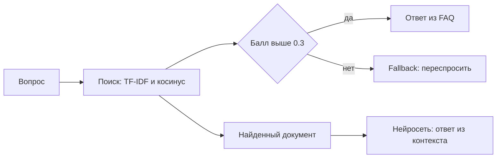

Вопросно-ответные системы (QA) отвечают на вопросы пользователя. Чат-боты — их практическое воплощение. В этом уроке мы соберём два типа систем: **поисковые** (ответ ищется в базе знаний) и **нейросетевые** (ответ генерируется моделью).

## Поисковая QA-система

Идея: у нас есть база знаний — список пар «вопрос → ответ». Когда приходит новый вопрос, мы ищем в базе самый похожий вопрос и возвращаем его ответ. Похожесть текстов измеряем косинусной близостью векторов TF-IDF:

```python
from sklearn.feature_extraction.text import TfidfVectorizer
from sklearn.metrics.pairwise import cosine_similarity

faq = [
    ("Как восстановить пароль?", "Нажми «Забыли пароль» на странице входа."),
    ("Как отменить заказ?", "Отмена доступна в разделе «Мои заказы»."),
    ("Какие способы оплаты есть?", "Карта, СБП и наличные при получении."),
]

queries = [q for q, a in faq]
vectorizer = TfidfVectorizer()
X = vectorizer.fit_transform(queries)

user_query = "Не могу войти в аккаунт, что делать?"
query_vec = vectorizer.transform([user_query])
similarities = cosine_similarity(query_vec, X)[0]
best = similarities.argmax()
print(faq[best][1])
```

Вывод — ответ на самый близкий вопрос. `cosine_similarity` считает косинус угла между векторами: 1.0 — векторы совпадают, 0 — ортогональны. TF-IDF превращает вопрос и документы в векторы, а косинусная близость ранжирует их.

## Порог уверенности и fallback

Если даже лучший вопрос слишком далёк (например, `similarities.max() < 0.3`), честнее ответить «Я не понял вопроса» — это fallback. Так бот не выдаёт случайные ответы:

```python
if similarities.max() < 0.3:
    print("Я не совсем понял вопрос. Попробуй переформулировать.")
else:
    print(faq[best][1])
```

## Скелет чат-бота

Бот — это цикл: читаем вопрос, ищем ответ, отвечаем. Добавим приветствие и команду выхода:

```python
def chatbot_loop(faq):
    print("Привет! Я бот поддержки. Спроси меня о чём-нибудь (или напиши 'выход').")
    while True:
        query = input("Вы: ")
        if query.strip().lower() == "выход":
            print("Бот: Пока!")
            break
        # поиск по faq и вывод ответа/fallback
```

Здесь `input()` — реальный ввод с клавиатуры, поэтому в тестах вместо цикла мы будем тестировать функцию поиска.

## Нейросетевой question-answering

Современные QA-системы используют модели типа BERT. Библиотека `transformers` даёт готовый пайплайн:

```python
from transformers import pipeline

qa = pipeline("question-answering", model="distilbert-base-cased-distilled-squad")
result = qa(
    question="Что такое Python?",
    context="Python — язык программирования, созданный Гвидо ван Россумом в 1991 году."
)
print(result["answer"], result["score"])
```

Модель читает контекст и вытаскивает из него точный отрезок-ответ с уверенностью (`score`). Такой подход — «извлечение ответа из контекста» — основа систем чтения с пониманием.

## Как оценивать QA-систему

Для поисковой системы главная метрика — доля запросов, для которых правильный ответ оказался в топ-1 или топ-3 (hit@k). Собери набор контрольных вопросов с известными ответами и посчитай, сколько раз система вернула правильный ответ. Для нейросетевого пайплайна ориентируйся на `score` модели, но помни: высокая уверенность — не гарантия правильности. Держи fallback всегда: если ни поиск, ни модель не уверены, лучше переспросить пользователя, чем выдать случайный ответ.

## Как выбрать подход

- **Поисковая QA** — прозрачная, быстрая, не требует GPU; подходит для FAQ и баз знаний. Но отвечает только тем, что уже есть в базе.
- **Нейросетевой QA** — понимает формулировки глубже, но требует модель и контекст.

На практике их комбинируют: поиск находит релевантный документ, а нейросеть извлекает из него точный ответ. Это называется **retrieval-augmented generation** (RAG) — ты уже знаешь все его части.



<!--TASK-->
### Задача 1
Напиши функцию `find_answer(query, faq)`, которая принимает вопрос и список пар `(вопрос, ответ)`, векторизует вопросы базы через `TfidfVectorizer`, считает `cosine_similarity` и возвращает кортеж `(ответ, лучший_балл)`. Проверь на базе из урока с запросом `"Не могу войти в аккаунт, что делать?"` — ожидаемый ответ про восстановление пароля. Затем создай файл `test_find_answer.py` с pytest-тестами: (1) для точного вопроса `"Как восстановить пароль?"` возвращается соответствующий ответ; (2) балл лежит между 0 и 1; (3) для запроса `"Какие способы оплаты есть?"` возвращается ответ про оплату; (4) функция возвращает кортеж из двух элементов. Запусти `pytest` и добейся зелёного прогона.

### Задача 2
Дополни функцию `answer_with_fallback(query, faq, threshold=0.3)`: если лучший балл ниже `threshold`, возвращай строку `"Я не совсем понял вопрос. Попробуй переформулировать."`, иначе — ответ. Выведи результаты для двух запросов: `"Как отменить заказ?"` и `"Какая сегодня погода?"` Второй должен дать fallback.

### Задача 3
Напиши функции для мини-чат-бота: `greet()` возвращает приветствие, `handle(query, faq)` возвращает ответ через `answer_with_fallback`, а `is_exit(query)` возвращает `True`, если запрос — `"выход"` (без учёта регистра и пробелов). Собери из них демо-цикл с `input()` и покажи его работу на двух вопросах и выходе.

### Задача 4
Напиши скрипт, который использует `pipeline("question-answering")` из `transformers` с моделью `distilbert-base-cased-distilled-squad`: задай вопрос `"Кто создал Python?"` с контекстом `"Python создан Гвидо ван Россумом в 1991 году, а стандартная библиотека активно развивается сообществом."` Выведи ответ и `score`. Оберни импорт в `try/except ImportError`.

### Задача 5
Напиши функцию `answer_faq(query, faq)`, которая возвращает только ответ (без балла), используя `find_answer` и fallback с порогом `0.3`. Затем создай pytest-тесты `test_faq.py` на базе из урока: (1) для точного вопроса `"Как восстановить пароль?"` возвращается соответствующий ответ; (2) для перефразировки `"Потерял пароль, как быть?"` возвращается ответ про пароль (не fallback); (3) для нерелевантного вопроса `"Расскажи анекдот"` возвращается строк fallback; (4) `answer_faq` всегда возвращает непустую строку. Запусти `pytest` и добейся зелёного прогона.
### Задача 6
Напиши функцию `evaluate_retrieval(faq, control, k=1)`, которая измеряет качество поиска метрикой hit@k: для каждого контрольного вопроса проверяет, попал ли правильный ответ в топ-`k` найденных вопросов. Контрольный набор — список пар `(запрос, ожидаемый_ответ)`. Внутри используй `find_answer` для получения ответа и балла, а для топ-`k` — сортировку всех баллов через `argsort()[::-1][:k]`. Проверь на четырёх случаях: три точных вопроса из базы и перефразировка `"Не могу войти в аккаунт"` с ожидаемым ответом про пароль. Ожидаемый вывод: `hit@1 = 1.0`, `hit@3 = 1.0` (4 из 4). Объясни, почему hit@3 не может быть меньше hit@1.

### Задача 7
Напиши функцию `chat_session(queries, faq, threshold=0.3)`, которая прогоняет список запросов через FAQ-бота без `input()` и возвращает список словарей с ключами `query`, `answer`, `score`, `fallback` (булево значение). Сохрани всю сессию в `session.json` через `json.dump` с `ensure_ascii=False, indent=2` и выведи сводку: число реплик, число fallback и самую высокую уверенность. Проверь на запросах `["Как восстановить пароль?", "Как отменить заказ?", "Расскажи анекдот"]`. Ожидаемый вывод: `реплик: 3`, `fallback: 1`, максимальный балл близок к `1.0`. Объясни, зачем сохранять диалог и как это помогает улучшать базу знаний.

<!--/TASK-->

<!--HINT-->
### Подсказка 1
Векторизуй только вопросы базы: `X = vectorizer.fit_transform([q for q, a in faq])`. Новый запрос — `vectorizer.transform([query])`. `cosine_similarity(query_vec, X)[0]` — массив баллов; `argmax()` даёт индекс лучшего вопроса. Верни `(faq[best][1], similarities[best])`. В тестах: балл проверяй как `0 <= score <= 1`, а возвращаемое значение — как `isinstance(result, tuple) and len(result) == 2`.

### Подсказка 2
Сравнивай `similarities[best]` с `threshold` перед возвратом ответа. Порог 0.3 для TF-IDF — эмпирический: точный вопрос даст балл ближе к 1, посторонний — около 0.

### Подсказка 3
`is_exit(query)` — `query.strip().lower() == "выход"`. В демо-цикле: `user_input = input("Вы: ")`, затем `if is_exit(user_input): break`, иначе `print(handle(user_input, faq))`. Не вставляй цикл в функции тестируемой логики — только в `if __name__ == "__main__"`.

### Подсказка 4
`pipeline("question-answering", model="distilbert-base-cased-distilled-squad")` — пайплайн QA. Вызов: `qa(question="...", context="...")`. Результат — словарь с `answer` и `score`. Первый запуск скачает модель (несколько сотен МБ), будь терпелив.

### Подсказка 5
Для перефразировки проверь, что балл оказался выше порога: «Потерял пароль» имеет общие слова с «Как восстановить пароль?» (пароль). В тесте 3 просто проверь строк fallback. В тесте 4 — `assert isinstance(answer, str) and len(answer) > 0`.
### Подсказка 6
`argsort()[::-1][:k]` даёт индексы вопросов в порядке убывания балла. Проверяй попадание по тексту ответа: `expected in [faq[i][1] for i in top_idx]`. Считай долю: `hits / len(control)`, округли до двух знаков. hit@3 ≥ hit@1 всегда, потому что множество из трёх лучших содержит лучший — это свойство вложенности, а не заслуга алгоритма.

### Подсказка 7
Для каждого запроса вызывай `find_answer` (или `answer_with_fallback`) и формируй словарь. `fallback` определяй по тому, равен ли ответ строке-заглушке, а не по баллу — так надёжнее. В JSON нельзя сериализовать `numpy.float64`, поэтому приводи балл к `float(score)`. Сводку считай по списку: `sum(1 for turn in turns if turn["fallback"])` и `max(turn["score"] for turn in turns)`.

<!--/HINT-->

<!--SOLUTION-->
### Разбор 1
Решение:

```python
from sklearn.feature_extraction.text import TfidfVectorizer
from sklearn.metrics.pairwise import cosine_similarity

faq = [
    ("Как восстановить пароль?", "Нажми «Забыли пароль» на странице входа."),
    ("Как отменить заказ?", "Отмена доступна в разделе «Мои заказы»."),
    ("Какие способы оплаты есть?", "Карта, СБП и наличные при получении."),
]

def find_answer(query, faq):
    vectorizer = TfidfVectorizer()
    X = vectorizer.fit_transform([q for q, a in faq])
    query_vec = vectorizer.transform([query])
    similarities = cosine_similarity(query_vec, X)[0]
    best = similarities.argmax()
    return faq[best][1], float(similarities[best])

print(find_answer("Не могу войти в аккаунт, что делать?", faq))
```

Вывод:

```
('Нажми «Забыли пароль» на странице входа.', 0.33...)
```

Что здесь происходит? Запрос и вопросы базы превращаются в векторы TF-IDF. Косинусная близость показывает угол между векторами: у похожих текстов угол маленький, близость близка к 1. Запрос про вход в аккаунт ближе всего к вопросу про пароль — общие слова («войти», «аккаунт» vs «пароль»). `argmax()` выбирает индекс максимального балла. Обрати внимание, что балл 0.33 невелик — TF-IDF чувствителен к точному совпадению слов, поэтому перефразировки дают умеренные баллы.

Добавим pytest-тесты. Файл `test_find_answer.py`:

```python
from find_answer import find_answer

faq = [
    ("Как восстановить пароль?", "Нажми «Забыли пароль» на странице входа."),
    ("Как отменить заказ?", "Отмена доступна в разделе «Мои заказы»."),
    ("Какие способы оплаты есть?", "Карта, СБП и наличные при получении."),
]

def test_exact_question():
    assert find_answer("Как восстановить пароль?", faq)[0] == faq[0][1]

def test_score_range():
    _, score = find_answer("Как восстановить пароль?", faq)
    assert 0 <= score <= 1

def test_payment_question():
    assert find_answer("Какие способы оплаты есть?", faq)[0] == faq[2][1]

def test_returns_tuple():
    result = find_answer("Любой вопрос", faq)
    assert isinstance(result, tuple) and len(result) == 2
```

Запуск: `pytest -q` → `4 passed`. Что здесь происходит? Тесты фиксируют контракт функции: точное совпадение возвращает нужный ответ, балл всегда в диапазоне [0, 1], разные вопросы находят свои ответы, а возвращаемое значение имеет ожидаемую структуру. Это защищает поисковое ядро, на котором строится весь бот, от случайных регрессий.

### Разбор 2
Решение:

```python
def answer_with_fallback(query, faq, threshold=0.3):
    answer, score = find_answer(query, faq)
    if score < threshold:
        return "Я не совсем понял вопрос. Попробуй переформулировать."
    return answer

print(answer_with_fallback("Как отменить заказ?", faq))
print(answer_with_fallback("Какая сегодня погода?", faq))
```

Вывод:

```
Отмена доступна в разделе «Мои заказы».
Я не совсем понял вопрос. Попробуй переформулировать.
```

Что здесь происходит? Порог `threshold=0.3` отсекает «случайные» совпадения. Вопрос про погоду не имеет общих слов с базой — балл близок к нулю, поэтому срабатывает fallback. Это критически важно для бота: лучше честно признаться, что вопрос непонятен, чем выдать неверный ответ с уверенным видом. Подбор порога — эмпирическая задача: на реальной базе его подбирают по валидационной выборке.

### Разбор 3
Решение:

```python
def greet():
    return "Привет! Я бот поддержки. Спроси меня о чём-нибудь (или напиши 'выход')."

def is_exit(query):
    return query.strip().lower() == "выход"

def handle(query, faq):
    return answer_with_fallback(query, faq)

if __name__ == "__main__":
    print(greet())
    while True:
        user_input = input("Вы: ")
        if is_exit(user_input):
            print("Бот: Пока!")
            break
        print("Бот:", handle(user_input, faq))
```

Что здесь происходит? Логика разбита на чистые функции: `greet`, `is_exit`, `handle` — их легко тестировать отдельно от ввода-вывода. Цикл живёт только под `if __name__ == "__main__"`, поэтому при импорте модуля он не запускается. Это стандартный паттерн: отделять логику от интерфейса. В демо-цикле каждая итерация читает ввод, проверяет выход и вызывает `handle`, который внутри делает поиск и fallback.

### Разбор 4
Решение:

```python
try:
    from transformers import pipeline
except ImportError:
    raise SystemExit("Установи библиотеку: pip install transformers")

qa = pipeline("question-answering", model="distilbert-base-cased-distilled-squad")

result = qa(
    question="Кто создал Python?",
    context="Python создан Гвидо ван Россумом в 1991 году, а стандартная библиотека активно развивается сообществом."
)
print("Ответ:", result["answer"])
print("Уверенность:", round(result["score"], 3))
```

Вывод (пример):

```
Ответ: Гвидо ван Россумом
Уверенность: 0.942
```

Что здесь происходит? Пайплайн QA загружает модель distilbert, обученную на датасете SQuAD (вопросно-ответный датасет). Модель читает контекст, находит в нём отрезок, который отвечает на вопрос, и оценивает уверенность. Здесь ответ извлечён дословно из контекста — это «извлечение ответа», а не генерация. `score` — вероятность, что найденный отрезок — верный ответ. Это мощный инструмент, но он требует контекст, где ответ есть.

### Разбор 5
Решение:

```python
def answer_faq(query, faq):
    answer, score = find_answer(query, faq)
    if score < 0.3:
        return "Я не совсем понял вопрос. Попробуй переформулировать."
    return answer
```

Файл `test_faq.py`:

```python
from answer_faq import answer_faq

faq = [
    ("Как восстановить пароль?", "Нажми «Забыли пароль» на странице входа."),
    ("Как отменить заказ?", "Отмена доступна в разделе «Мои заказы»."),
    ("Какие способы оплаты есть?", "Карта, СБП и наличные при получении."),
]

def test_exact_match():
    assert answer_faq("Как восстановить пароль?", faq) == faq[0][1]

def test_paraphrase():
    assert "пароль" in answer_faq("Потерял пароль, как быть?", faq)

def test_fallback():
    assert answer_faq("Расскажи анекдот", faq) == "Я не совсем понял вопрос. Попробуй переформулировать."

def test_always_nonempty():
    assert len(answer_faq("Любой вопрос", faq)) > 0
```

Запуск: `pytest -q` → `4 passed`.

Что здесь происходит? Первый тест — точное совпадение: балл максимален, ответ возвращается. Второй — перефразировка: «Потерял пароль» имеет общее слово «пароль» с вопросом базы, балл выше порога, поэтому возвращается ответ про пароль (проверяем через `in`). Третий — нерелевантный вопрос падает в fallback. Четвёртый гарантирует, что функция всегда возвращает непустую строку — важный контракт для чат-бота. Это и есть дисциплина тестирования: проверять не только счастливый путь, но и граничные случаи.
### Разбор 6
Решение:

```python
from sklearn.feature_extraction.text import TfidfVectorizer
from sklearn.metrics.pairwise import cosine_similarity

faq = [
    ("Как восстановить пароль?", "Нажми «Забыли пароль» на странице входа."),
    ("Как отменить заказ?", "Отмена доступна в разделе «Мои заказы»."),
    ("Какие способы оплаты есть?", "Карта, СБП и наличные при получении."),
]

def rank_questions(query, faq, k=3):
    vectorizer = TfidfVectorizer()
    X = vectorizer.fit_transform([q for q, a in faq])
    scores = cosine_similarity(vectorizer.transform([query]), X)[0]
    order = scores.argsort()[::-1][:k]
    return [(faq[i][0], faq[i][1], float(scores[i])) for i in order]

def evaluate_retrieval(faq, control, k=1):
    hits = 0
    for query, expected in control:
        top = rank_questions(query, faq, k=k)
        if any(expected == answer for _, answer, _ in top):
            hits += 1
    return round(hits / len(control), 2)

control = [
    ("Как восстановить пароль?", "Нажми «Забыли пароль» на странице входа."),
    ("Как отменить заказ?", "Отмена доступна в разделе «Мои заказы»."),
    ("Какие способы оплаты есть?", "Карта, СБП и наличные при получении."),
    ("Не могу войти в аккаунт", "Нажми «Забыли пароль» на странице входа."),
]
print("hit@1 =", evaluate_retrieval(faq, control, k=1))
print("hit@3 =", evaluate_retrieval(faq, control, k=3))
```

Вывод:

```
hit@1 = 1.0
hit@3 = 1.0
```

Что здесь происходит? Для каждого контрольного запроса мы получаем ранжированный список и проверяем, есть ли ожидаемый ответ среди первых `k`. Три запроса дословно совпадают с вопросами базы — их балл равен `1.0`, попадание гарантировано. Четвёртый — перефразировка; TF-IDF находит общее слово «вход/войти» и всё равно ставит вопрос про пароль первым, как мы видели в Разборе 1. Почему hit@3 не может быть меньше hit@1: если правильный ответ был первым, он останется в тройке лучших, ведь список не переупорядочивается, а расширяется. Поэтому hit@k — монотонная метрика, и в отчётах её всегда приводят парой (hit@1, hit@3, hit@10). Практический совет: контрольный набор должен содержать не только точные копии вопросов, иначе метрика покажет `1.0` и ничего не скажет о реальном качестве — добавь перефразировки, опечатки и вопросы, которых в базе нет (для них правильное поведение — fallback).

### Разбор 7

Решение:

```python
import json
from sklearn.feature_extraction.text import TfidfVectorizer
from sklearn.metrics.pairwise import cosine_similarity

FALLBACK = "Я не совсем понял вопрос. Попробуй переформулировать."

def answer_with_fallback(query, faq, threshold=0.3):
    vectorizer = TfidfVectorizer()
    X = vectorizer.fit_transform([q for q, a in faq])
    scores = cosine_similarity(vectorizer.transform([query]), X)[0]
    best = scores.argmax()
    if scores[best] < threshold:
        return FALLBACK, float(scores[best])
    return faq[best][1], float(scores[best])

def chat_session(queries, faq, threshold=0.3):
    turns = []
    for query in queries:
        answer, score = answer_with_fallback(query, faq, threshold)
        turns.append({"query": query, "answer": answer,
                      "score": round(score, 3), "fallback": answer == FALLBACK})
    with open("session.json", "w", encoding="utf-8") as f:
        json.dump(turns, f, ensure_ascii=False, indent=2)
    return turns

queries = ["Как восстановить пароль?", "Как отменить заказ?", "Расскажи анекдот"]
turns = chat_session(queries, faq)
print("реплик:", len(turns))
print("fallback:", sum(t["fallback"] for t in turns))
print("макс. балл:", max(t["score"] for t in turns))
```

Вывод:

```
реплик: 3
fallback: 1
макс. балл: 1.0
```

Что здесь происходит? Сессия — это просто список ходов, который удобно логировать и анализировать. Флаг `fallback` выставляется сравнением с константой, а не по баллу: так логика не зависит от порога, и если завтра ты поменяешь `threshold`, разметка останется корректной. `json.dump` с `ensure_ascii=False` сохраняет кириллицу читаемой, `indent=2` делает файл diff-пригодным — такие логи удобно смотреть глазами и сравнивать между версиями базы. Обрати внимание, что балл приходится приводить к `float`: `cosine_similarity` возвращает `numpy.float64`, который `json` не умеет сериализовать и упадёт с `TypeError`. Зачем это всё нужно: транскрипт показывает, на каких запросах бот ушёл в fallback. Если один и тот же вопрос повторяется в логах с баллом `0.2`, значит, в базе нет нужной пары — это готовый бэклог для расширения FAQ. Так обратная связь от логов превращается в улучшение базы знаний, а не в догадки.

<!--/SOLUTION-->

<!--QUIZ-->
Что измеряет косинусная близость векторов?
- Угол между векторами: чем меньше угол, тем тексты ближе
- Длину векторов
- Разницу координат по модулю
* Правильный ответ: Угол между векторами: чем меньше угол, тем тексты ближе
Косинусная близость не зависит от длины вектора, только от направления.

Зачем в QA-системе порог уверенности (fallback)?
- Чтобы не выдавать случайные ответы на непонятные вопросы
- Чтобы ускорить поиск
- Чтобы увеличить точность TF-IDF
* Правильный ответ: Чтобы не выдавать случайные ответы на непонятные вопросы
Если лучший балл ниже порога — бот честно говорит, что не понял.

Что вернёт similarities.argmax() в нашем поиске?
- Индекс вопроса с наибольшей близостью
- Само значение максимальной близости
- Список всех баллов
* Правильный ответ: Индекс вопроса с наибольшей близостью
argmax() возвращает индекс максимального элемента массива.

Что такое RAG?
- Подход: поиск релевантного документа + генерация/извлечение ответа
- Модель для перевода
- Способ предобработки текста
* Правильный ответ: Подход: поиск релевантного документа + генерация/извлечение ответа
RAG (retrieval-augmented generation) объединяет поиск и нейросеть.

Какую модель использует pipeline("question-answering") в уроке?
- distilbert-base-cased-distilled-squad
- facebook/bart-large-cnn
- ru_core_news_sm
* Правильный ответ: distilbert-base-cased-distilled-squad
DistilBERT обучена на SQuAD — датасете вопросно-ответных пар.

Что возвращает пайплайн QA, кроме ответа?
- score — уверенность модели
- id вопроса
- вектор контекста
* Правильный ответ: score — уверенность модели
score показывает вероятность того, что найденный отрезок — верный ответ.

Что делает is_exit(" Выход ")?
- Возвращает True (регистр и пробелы игнорируются)
- Возвращает False
- Вызывает ошибку
* Правильный ответ: Возвращает True (регистр и пробелы игнорируются)
strip() убирает пробелы, lower() приводит к нижнему регистру.

Почему логику бота выносят в отдельные функции?
- Чтобы её можно было тестировать без ввода-вывода
- Чтобы код был длиннее
- Чтобы бот работал быстрее
* Правильный ответ: Чтобы её можно было тестировать без ввода-вывода
Чистые функции легко проверять pytest-тестами.

Что вернёт find_answer для запроса, которого нет в базе?
- Пару (ответ, балл) для самого похожего вопроса
- Ошибку
- Пустую строку
* Правильный ответ: Пару (ответ, балл) для самого похожего вопроса
Поиск всегда выбирает максимум — вопрос лишь о том, превышает ли он порог.

Какой формат у базы знаний FAQ в уроке?
- Список кортежей (вопрос, ответ)
- Словарь с ключами-числами
- Два отдельных списка
* Правильный ответ: Список кортежей (вопрос, ответ)
Каждый элемент — пара «вопрос → ответ», удобная для векторизации и поиска.
Что такое метрика hit@k для поисковой QA-системы?
- Доля запросов, где правильный ответ попал в топ-k найденных
- Средняя длина ответа
- Скорость поиска в миллисекундах
* Правильный ответ: Доля запросов, где правильный ответ попал в топ-k найденных
hit@k измеряет, оказался ли верный документ среди первых k результатов.

Чем vectorizer.transform отличается от fit_transform?
- transform только применяет обученный словарь, fit_transform ещё и обучается
- Ничем, это синонимы
- transform удаляет стоп-слова
* Правильный ответ: transform только применяет обученный словарь, fit_transform ещё и обучается
На новых данных нужен только transform, иначе словарь пересоберётся и метрики разъедутся.

Почему TF-IDF плохо находит перефразировки?
- Он сравнивает слова буквально и не знает синонимов
- Он не умеет считать косинус
- Он требует GPU
* Правильный ответ: Он сравнивает слова буквально и не знает синонимов
«Войти» и «авторизоваться» — разные токены, общих признаков нет.

Зачем нужен блок if __name__ == "__main__" в файле бота?
- Чтобы цикл с input() не запускался при импорте модуля в тестах
- Чтобы бот работал быстрее
- Чтобы подключить базу знаний
* Правильный ответ: Чтобы цикл с input() не запускался при импорте модуля в тестах
При импорте код под этим условием не выполняется, и pytest не зависает на вводе.

<!--/QUIZ-->
