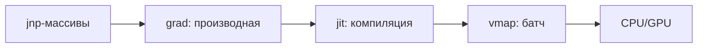

JAX — библиотека для научных вычислений от Google: NumPy-совместимый API, автоматическое дифференцирование и JIT-компиляция под XLA, работающая и на CPU, и на GPU/TPU.

## Почему JAX

- Привычный синтаксис: `import jax.numpy as jnp`.
- `grad` — автодифференцирование функций.
- `jit` — компиляция в машинный код.
- `vmap` — векторизация «по осям».
- Вычисления на GPU без изменения кода (при наличии CUDA).

## Базовые массивы

```python
import jax.numpy as jnp

x = jnp.array([1.0, 2.0, 3.0])
print(x * 2, x.sum())
```

## Автодифференцирование

```python
from jax import grad

def f(x):
    return x ** 2

print(grad(f)(3.0))  # 6.0
```

`grad` возвращает функцию, вычисляющую производную. Для функций многих переменных — через `grad(f, argnums=1)`.

## jit: компиляция

```python
from jax import jit

@jit
def square_sum(x):
    return jnp.sum(x ** 2)
```

Первый вызов компилирует, последующие работают быстро.

## vmap: векторизация

`vmap(f)` применяет функцию к батчу входов, избегая явных циклов.

## Итог урока

JAX превращает Python в инструмент для исследовательских вычислений: одна и та же функция работает на CPU и GPU и дифференцируется автоматически.




## Практическое применение

JAX активно используется там, где нужны и скорость, и производные: обучение нейросетей, оптимизация, моделирование. Градиенты, полученные через grad, применяются в методе спуска; jit часто ускоряет циклы обучения в разы; vmap заменяет батч-циклы без изменения математики. Благодаря единому API эксперименты легко переносятся с CPU на GPU. Такой инструментарий востребован в научных исследованиях, финансах и ML-инженерии.


<!--TASK-->
### Задача 1 — Массивы jnp
Создай массивы jnp: из списка, через jnp.linspace(0, 1, 5) и jnp.ones((3, 2)). Выведи их формы и суммы.

### Задача 2 — Производная через grad
Напиши функцию f(x) = x**3 + 2*x. Вычисли производную в точке 2 через grad. Ожидаемое значение 3*4+2=14.

### Задача 3 — grad по нескольким аргументам
Для f(x, y) = x**2 + y**3 вычисли градиент по второй переменной (argnums=1) в точке (1, 2). Ожидаемое значение 12.

### Задача 4 — jit-функция
Оформи f через @jit и вызови дважды; замерь время первого и второго вызова, объясни разницу.

### Задача 5 — vmap вместо цикла
Напиши функцию square(x) и примени её к вектору [1,2,3] через vmap. Сравни с явным for.

### Задача 6 — Матричное умножение
Сравни время умножения матриц 512×512 через jnp (CPU) и через обычный numpy. Зафиксируй результаты в комментарии.

### Задача 7 — Пайплайн grad+jit
Объедини @jit и grad: вычисли производную функции суммы квадратов вектора в точке [1,2,3].
<!--/TASK-->

<!--HINT-->
### Подсказка 1
jnp.array([...]) как numpy; shape/ dtype аналогичны.

### Подсказка 2
grad(f)(3.0) — производная в точке.

### Подсказка 3
argnums=1: grad(f, argnums=1)(x, y).

### Подсказка 4
Первый вызов компилирует в XLA — он медленнее.

### Подсказка 5
vmap(square)(jnp.array([1,2,3])).

### Подсказка 6
jnp.dot(A, B) — обычное умножение; time.perf_counter вокруг.

### Подсказка 7
grad(lambda v: jnp.sum(v**2))(jnp.array([1.0,2.0,3.0])).
<!--/HINT-->

<!--SOLUTION-->
### Разбор 1
```python
import jax.numpy as jnp

a = jnp.array([1, 2, 3])
b = jnp.linspace(0, 1, 5)
c = jnp.ones((3, 2))
print(a.shape, b, c.sum())
```
JAX-массивы ведут себя как numpy, но поддерживают компиляцию и GPU.

### Разбор 2
```python
from jax import grad

def f(x):
    return x ** 3 + 2 * x

print(grad(f)(2.0))  # 14.0
```
Производная 3x²+2 при x=2 равна 14.

### Разбор 3
```python
def f(x, y):
    return x ** 2 + y ** 3

print(grad(f, argnums=1)(1.0, 2.0))  # 12.0
```
Производная по второй переменной: 3y²=12.

### Разбор 4
```python
from jax import jit
import time

@jit
def square_sum(x):
    return jnp.sum(x ** 2)

x = jnp.arange(1000.0)
t0 = time.perf_counter(); square_sum(x); t1 = time.perf_counter()
square_sum(x); t2 = time.perf_counter()
print(t1 - t0, t2 - t1)
```
Первый вызов включает компиляцию XLA, поэтому обычно дольше.

### Разбор 5
```python
from jax import vmap
import jax.numpy as jnp

def square(x):
    return x ** 2

print(vmap(square)(jnp.array([1.0, 2.0, 3.0])))
```
vmap применяет функцию к каждому элементу батча, сохраняя скорость.

### Разбор 6
```python
import numpy as np
import jax.numpy as jnp
import time

A = np.random.rand(512, 512)
B = np.random.rand(512, 512)
t0 = time.perf_counter(); C = A @ B; t1 = time.perf_counter()
jA = jnp.array(A); jB = jnp.array(B)
t2 = time.perf_counter(); jC = jA @ jB; t3 = time.perf_counter()
print("numpy", t1 - t0, "jax", t3 - t2)
```
На CPU времена сравнимы; на GPU JAX ускоряет заметно.

### Разбор 7
```python
from jax import grad, jit
import jax.numpy as jnp

@jit
def f(v):
    return jnp.sum(v ** 2)

print(grad(f)(jnp.array([1.0, 2.0, 3.0])))
```
Производная вектора (2x, 2y, 2z) = [2,4,6].
<!--/SOLUTION-->

<!--QUIZ-->
Что делает jax.grad?
- Вычисляет производную функции
- Компилирует код
- Векторизует
- Создаёт массивы
* Правильный ответ: Вычисляет производную функции
grad возвращает функцию градиента.

Зачем нужен @jit?
- Для компиляции в XLA и ускорения
- Для отладки
- Для сериализации
- Для графики
* Правильный ответ: Для компиляции в XLA и ускорения
Первый вызов компилирует.

Что делает vmap?
- Применяет функцию к элементам массива
- Умножает матрицы
- Считает производную
- Останавливает вычисления
* Правильный ответ: Применяет функцию к элементам массива
Векторизация без явных циклов.

Какой модуль даёт NumPy-подобный API?
- jax.numpy
- jax.grad
- jax.jit
- jax.vmap
* Правильный ответ: jax.numpy
jnp — аналог numpy.

Как взять производную по второму аргументу?
- grad(f, argnums=1)
- grad(f)
- jit(f)
- vmap(f)
* Правильный ответ: grad(f, argnums=1)
argnums выбирает переменную.

Где JAX особенно быстр?
- На GPU/TPU
- На CPU только
- В интерпретаторе
- В браузере
* Правильный ответ: На GPU/TPU
XLA исполняет на ускорителях.

Что возвращает vmap(square)(array)?
- Массив результатов для каждого элемента
- Одно число
- Функцию
- Объект компиляции
* Правильный ответ: Массив результатов для каждого элемента
Форма повторяет вход.

Совместим ли синтаксис jnp с numpy?
- Да, в основном
- Нет, полностью другой
- Только операции сложения
- Только векторные
* Правильный ответ: Да, в основном
API повторяет numpy.

Что произойдёт при первом вызове jit-функции?
- Компиляция и медленное выполнение
- Мгновенный ответ
- Ошибка
- Пропуск
* Правильный ответ: Компиляция и медленное выполнение
Далее кэш ускоряет.

Для чего JAX используется в научных расчётах?
- Для автодифференцирования и ускорения
- Для работы с БД
- Для веб-фреймворков
- Для GUI
* Правильный ответ: Для автодифференцирования и ускорения
Он сочетает скорость с гибкостью.
Как проверить доступность GPU в JAX?
- jax.devices()
- jax.gpu()
- jnp.gpu
- jit.gpu
* Правильный ответ: jax.devices()
Он показывает доступные устройства.

Что такое XLA?
- Компилятор, ускоряющий вычисления
- Библиотека графиков
- Формат данных
- Веб-сервер
* Правильный ответ: Компилятор, ускоряющий вычисления
JIT-компиляция под устройства.


<!--/QUIZ-->
