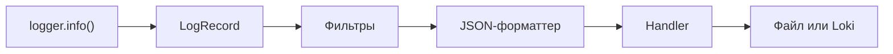

Когда твоё приложение работает локально, `print()` и базовые логи кажутся достаточными. Но в проде всё меняется: у тебя десятки инстансов, миллионы строк логов в сутки, и в момент инцидента нужно за минуты найти конкретный запрос, понять его путь через сервисы и ответить на вопрос «почему». Обычные текстовые логи для этого не подходят — и именно поэтому индустрия пришла к **структурированным логам**.

## Почему текстовые логи плохи

Посмотри на типичную запись:

```
2026-11-01 12:03:22 ERROR failed to process order id 1024
```

Такую строку сложно фильтровать: в одном месте «id 1024» стоит в конце, в другом — в середине; время — в нестандартном формате; нет структуры. Чтобы найти все ошибки за час, приходится писать хрупкие регулярные выражения. А если нужно автоматически посчитать долю ошибок или передать запись в поисковую систему — текст приходится разбирать прямо в ней.

**Структурированный лог** — это запись в машиночитаемом формате, обычно JSON:

```json
{"timestamp": "2026-11-01T12:03:22.123456Z", "level": "ERROR", "logger": "app.orders", "message": "failed to process order", "order_id": 1024, "user_id": 77}
```

Теперь каждое поле — отдельная сущность. Можно фильтровать по `order_id`, строить дашборды по `level`, искать все записи конкретного пользователя, а `timestamp` в ISO-8601 корректно сортируется. Именно так работают современные стеки (ELK, Loki, ClickHouse, Cloud Logging).

## Модуль logging: база

Логирование в Python построено вокруг модуля `logging` с четырьмя ключевыми объектами: **logger** (куда ты пишешь), **handler** (куда записи уходят: консоль, файл, сеть), **formatter** (как записи превращаются в текст) и **level** (порог серьёзности). Стандартный минимум — `basicConfig`:

```python
import logging

logging.basicConfig(level=logging.INFO, format="%(asctime)s %(levelname)s %(name)s %(message)s")
logger = logging.getLogger("app.orders")
logger.info("order created", extra={"order_id": 42})
```

Уровни: `DEBUG`, `INFO`, `WARNING`, `ERROR`, `CRITICAL`. Пиши `logger.info()` для событий успеха, `logger.warning()` для подозрительного, `logger.error()` для ошибок, которые надо чинить. Не используй `print()` — у него нет уровней, фильтров и handlers, и его сложно выключить в проде.

## JSON-форматтер: python-json-logger

Самый популярный способ получить JSON-логи в Python — библиотека **python-json-logger** (пакет `python-json-logger`, импорт `pythonjsonlogger`):

```bash
pip install python-json-logger
```

```python
import logging
from pythonjsonlogger import jsonlogger

formatter = jsonlogger.JsonFormatter(
    "%(asctime)s %(levelname)s %(name)s %(message)s",
    rename_fields={"asctime": "timestamp", "levelname": "level", "name": "logger"},
    timestamp=True,
)

handler = logging.StreamHandler()
handler.setFormatter(formatter)

logger = logging.getLogger("app.orders")
logger.handlers = [handler]
logger.setLevel(logging.INFO)

logger.info("order created", extra={"order_id": 42})
```

Спецификатор `%(...)s` в первой строке — это резервируемые имена атрибутов `LogRecord`. `rename_fields` переименовывает их в красивые ключи. Все нестандартные поля попадают в JSON через `extra`: `logger.info("...", extra={"order_id": 42})` даст поле `"order_id": 42`.

## Форматтер без зависимостей

Если подключать библиотеку нельзя, легко написать свой форматтер на чистом `logging`:

```python
import json
import logging

class JsonFormatter(logging.Formatter):
    def format(self, record: logging.LogRecord) -> str:
        payload = {
            "timestamp": self.formatTime(record, "%Y-%m-%dT%H:%M:%S"),
            "level": record.levelname,
            "logger": record.name,
            "message": record.getMessage(),
        }
        for key, value in record.__dict__.items():
            if key not in payload:
                payload[key] = value
        return json.dumps(payload, ensure_ascii=False, default=str)
```

`record.__dict__` содержит все атрибуты, включая `extra`-поля. `default=str` защищает от несериализуемых объектов. Такой форматтер — отличная отправная точка, если ты не хочешь тянуть зависимость.

## Контекст и correlation id

Сам по себе JSON не спасает, если по записям нельзя восстановить один запрос. Для этого вводят **correlation id** — идентификатор, который создаётся при входе запроса (или приходит в заголовке `X-Request-ID`) и прокидывается через все логи внутри этого запроса. В Python для этого используют `contextvars` — контекстные переменные, которые живут в пределах одного запроса и автоматически копируются в воркеры:

```python
import contextvars

correlation_id: contextvars.ContextVar[str] = contextvars.ContextVar("correlation_id", default="-")

class CorrelationIdFilter(logging.Filter):
    def filter(self, record: logging.LogRecord) -> bool:
        record.correlation_id = correlation_id.get()
        return True
```

Фильтр добавляет в каждую запись атрибут `correlation_id`, который JSON-форматтер автоматически включит в вывод. При подключении фильтра к обработчику, в каждом логе будет виден id текущего запроса — и ты сможешь связать все события одной транзакции.

## Ротация файлов

Если логи пишутся в файл, он бесконечно растёт. Решение — `RotatingFileHandler`: файл разрезается по размеру и хранится N копий:

```python
import logging.handlers

handler = logging.handlers.RotatingFileHandler(
    "app.log", maxBytes=10_000_000, backupCount=5, encoding="utf-8"
)
handler.setFormatter(jsonlogger.JsonFormatter("%(asctime)s %(levelname)s %(message)s"))
```

Когда файл достигает 10 МБ, обработчик закрывает его, переименовывает в `app.log.1` и начинает новый; хранится 5 копий. Это классический паттерн «log rotation».

## Путь записи: от вызова до хранилища

Прежде чем писать код, полезно увидеть, что происходит с одной строкой лога. Вызов `logger.info()` создаёт `LogRecord`, затем его последовательно обрабатывают фильтры, форматтер и handler:



Каждый этап настраивается независимо: фильтр добавит `correlation_id`, форматтер превратит запись в JSON, а handler решит, куда её отправить — в консоль, файл с ротацией или по сети в Loki. Именно поэтому в примерах выше мы отдельно создаём formatter, отдельно handler и отдельно навешиваем filter.

## Лучшие практики

- **Никогда не логируй секреты**: пароли, токены, номера карт. В JSON они станут легко искомыми.
- Не логируй в горячих циклах без необходимости — это дорого и забивает хранилище.
- Используй уровни по смыслу: `INFO` — событие успеха, `WARNING` — аномалия, `ERROR` — сбой, требующий внимания.
- В `ERROR`-записи указывай `exc_info=True` или `logger.exception()` внутри `except`, чтобы получить traceback.
- Логируй бизнес-события с ключевыми id: `order_id`, `user_id`, `correlation_id` — это делает поиск инцидентов быстрым.

<!--TASK-->
### Задача 1
Создай файл `json_logging.py`. Настрой логирование так, чтобы записи выводились в консоль в формате JSON с полями `timestamp`, `level`, `logger`, `message` (используй `python-json-logger` или свой форматтер из теории). Затем запиши в лог три события: `logger.info("server started", extra={"port": 8000})`, `logger.warning("high latency", extra={"latency_ms": 1500})` и `logger.error("db connection lost", exc_info=False)`. Запусти скрипт и убедись, что каждая строка вывода — валидный JSON. Можешь проверить это, скопировав одну строку в любой онлайн-валидатор JSON или выполнив `python -c "import json,sys; json.loads(sys.stdin.read())"` с поданной на вход строкой.

### Задача 2
Напиши модуль `logging_setup.py` с функцией `setup_logger(stream=None) -> logging.Logger`, которая возвращает логгер с JSON-форматтером (python-json-logger), пишущий в переданный поток (`stream`), по умолчанию — в `sys.stdout`. Теперь напиши pytest-тесты в файле `test_logging.py`: тест 1 — создай логгер с потоком `io.StringIO()`, вызови `logger.info("hello", extra={"user_id": 7})`, затем считай содержимое потока, распарси его как JSON и проверь, что поля `message == "hello"`, `user_id == 7`, а `level` — `INFO`. Тест 2 — проверь, что `timestamp` в записи присутствует и парсится через `datetime.fromisoformat`. Убедись, что оба теста проходят: `pytest test_logging.py -v`.

### Задача 3
Реализуй сorrelation id на `contextvars`, как в теории: переменная `correlation_id`, фильтр `CorrelationIdFilter`, который добавляет запись `correlation_id`. Напиши функцию `process_request(request_id: str)`, которая ставит `correlation_id.set(request_id)` (через `token = correlation_id.set(request_id)`, а в конце — `correlation_id.reset(token)`), вызывает `logger.info("handling request")` и `logger.error("failed")`. В `main()` обработай два запроса с id `req-1` и `req-2` и выведи логи. Убедись, что в каждой JSON-записи поле `correlation_id` соответствует текущему запросу и не «утекает» между запросами.

### Задача 4
Добавь тесты для `process_request` из задачи 3 в файл `test_correlation.py`. Создай логгер, который пишет в `io.StringIO()`. В тесте 1 вызови `process_request("req-1")` и `process_request("req-2")` подряд, затем разбери все строки из потока как JSON: проверь, что первые записи содержат `correlation_id == "req-1"`, а последние — `"req-2"`, и что в потоке нет ни одной записи с чужим id. В тесте 2 проверь, что после `process_request` значение `correlation_id.get()` снова равно дефолтному `"-"` (состояние не протекает между вызовами). Запусти `pytest test_correlation.py -v`.

### Задача 5
Добавь в модуль `logging_setup.py` фильтр `SecretsFilter`, который маскирует секретные поля в записях. Фильтр должен проходить по `record.__dict__` и для ключей, содержащих `password`, `token` или `secret` (без учёта регистра), заменять значение на `"***"`. Измени `setup_logger()` так, чтобы фильтр добавлялся к обработчику. В задаче 1 или 3 попробуй залогировать `extra={"password": "hunter2", "token": "abc"}` и убедись, что в JSON-выводе вместо значений стоит `"***"` (сам вывод в pytest при этом проверять не нужно).
### Задача 6
Настрой в `logging_setup.py` функцию `setup_file_logger(path: str) -> logging.Logger`, которая пишет JSON-логи в файл с суточной ротацией. Используй `logging.handlers.TimedRotatingFileHandler(when="midnight", backupCount=7, encoding="utf-8", utc=True)` и тот же JSON-форматтер с полями `timestamp`, `level`, `logger`, `message`. В скрипте `rotate_demo.py` запиши три события `order created` с разными `order_id`, затем принудительно вызови `doRollover()` у обработчика (он доступен как `logger.handlers[0]`), запиши четвёртое событие и выведи `sorted(os.listdir("."))`. Ожидаемый вывод: два файла — `app.log` и `app.log.<дата>` — и валидные JSON-строки в обоих.

### Задача 7
Добавь сквозную корреляцию в FastAPI. В `app.py` создай `FastAPI()`, подключи `CorrelationIdFilter` к обработчику логгера `app` и напиши HTTP-middleware: он читает заголовок `X-Request-ID`, при отсутствии генерирует `uuid.uuid4().hex`, ставит значение через `token = correlation_id.set(...)`, логирует `logger.info("request started", extra={"path": request.url.path})`, вызывает `call_next`, добавляет ответу заголовок `X-Request-ID` и в `finally` делает `correlation_id.reset(token)`. В `test_request_id.py` через `TestClient` выполни два запроса с разными id и проверь, что заголовок ответа совпадает с отправленным, а в перехваченных логах каждый запрос имеет свой `correlation_id`. Ожидаемый вывод: два ответа `200` и две записи с id `req-1` и `req-2`.
<!--/TASK-->

<!--HINT-->
### Подсказка 1
Форматтер с rename_fields: `jsonlogger.JsonFormatter("%(asctime)s %(levelname)s %(name)s %(message)s", rename_fields={"asctime": "timestamp", "levelname": "level", "name": "logger"})`. Поля `timestamp`, `level`, `logger`, `message` получатся автоматически; `extra`-поля попадут в JSON как есть. Не забудь `ensure_ascii` — python-json-logger по умолчанию пишет `ensure_ascii=False`, так что кириллица останется читаемой.

### Подсказка 2
Функция принимает поток и возвращает логгер: `logger = logging.getLogger("setup"); handler = logging.StreamHandler(stream); handler.setFormatter(jsonlogger.JsonFormatter(...)); logger.handlers = [handler]; logger.setLevel(logging.INFO); return logger`. В тесте создай `buf = io.StringIO()`, получи логгер, напиши запись и затем `json.loads(buf.getvalue())` — но учти, что если записей несколько, надо брать последнюю строку или читать построчно.

### Подсказка 3
Помни: `contextvars.ContextVar` нельзя «просто поставить» — сохрани токен и верни его в конце: `token = correlation_id.set(request_id); try: ... finally: correlation_id.reset(token)`. Фильтр добавляет поле в `record` и возвращает `True`. Добавь фильтр к обработчику: `handler.addFilter(CorrelationIdFilter())`. Выведи логи двумя отдельными запусками `process_request` — и проверь, что в выводе присутствуют оба id.

### Подсказка 4
Разбери весь вывод потока построчно: `lines = buf.getvalue().strip().splitlines()` и `records = [json.loads(line) for line in lines]`. В тесте 1, если вызов `process_request` логирует два события (info и error), в потоке будет 4 записи: первые две — с `req-1`, вторые две — с `req-2`. Проверяй по срезам списка `records[:2]` и `records[2:]`. В тесте 2 после вызова значение `correlation_id.get()` должно равняться `"-"` — потому что `reset(token)` снял значение.

### Подсказка 5
Фильтр — это класс с методом `filter(self, record) -> bool`. Модифицируй атрибуты прямо в `record` (например, `setattr(record, key, "***")`), но не трогай стандартные поля `message`, `levelname` и т. д. Проверку проще всего сделать глазами при запуске скрипта из задачи 1: в JSON вместо `"password": "hunter2"` должно быть `"password": "***"`.
### Подсказка 6
`TimedRotatingFileHandler` принимает `when="midnight"`, `backupCount=7`, `utc=True` и `encoding="utf-8"`; форматтер тот же, что в задаче 2. Ротацию можно проверить без ожидания полуночи: `logger.handlers[0].doRollover()` переименует текущий файл в `app.log.YYYY-MM-DD` и откроет новый. Не забудь `logger.propagate = False`, иначе записи продублируются в корневой логгер и в файле окажется больше строк, чем ожидаешь.

### Подсказка 7
Middleware объявляется как `@app.middleware("http")` и принимает `request: Request, call_next`. Заголовок ответа удобно ставить после `await call_next(request)`, но `reset(token)` делай в `finally` — иначе при исключении контекст «протечёт» в следующий запрос. В тесте подмени `logger.handlers` на `StreamHandler(io.StringIO())` с тем же фильтром и форматтером, иначе записи уйдут в консоль и разбирать их будет нечем.
<!--/HINT-->

<!--SOLUTION-->
### Разбор 1
Решение:

```python
import logging
from pythonjsonlogger import jsonlogger

formatter = jsonlogger.JsonFormatter(
    "%(asctime)s %(levelname)s %(name)s %(message)s",
    rename_fields={"asctime": "timestamp", "levelname": "level", "name": "logger"},
    timestamp=True,
)

handler = logging.StreamHandler()
handler.setFormatter(formatter)

logger = logging.getLogger("app.orders")
logger.handlers = [handler]
logger.setLevel(logging.INFO)

logger.info("server started", extra={"port": 8000})
logger.warning("high latency", extra={"latency_ms": 1500})
logger.error("db connection lost")
```

Вывод (примерно):

```json
{"timestamp": "2026-11-01T12:03:22.123Z", "level": "INFO", "logger": "app.orders", "message": "server started", "port": 8000}
{"timestamp": "2026-11-01T12:03:22.124Z", "level": "WARNING", "logger": "app.orders", "message": "high latency", "latency_ms": 1500}
{"timestamp": "2026-11-01T12:03:22.125Z", "level": "ERROR", "logger": "app.orders", "message": "db connection lost"}
```

Что здесь происходит? Форматтер `JsonFormatter` получает список спецификаторов: он берёт значения из `LogRecord` и раскладывает их в словарь, который затем сериализуется в JSON. `rename_fields` переименовывает ключи (`asctime` → `timestamp` и т. д.), а `timestamp=True` включает миллисекунды. `extra`-поля (`port`, `latency_ms`) автоматически попадают в запись как отдельные ключи. Это и есть суть структурированного логирования: вместо строки с текстом — объект с полями.

### Разбор 2
Решение (`logging_setup.py`):

```python
import io
import logging
import sys
from pythonjsonlogger import jsonlogger

def setup_logger(stream=None) -> logging.Logger:
    logger = logging.getLogger("setup")
    logger.handlers = []
    handler = logging.StreamHandler(stream or sys.stdout)
    handler.setFormatter(
        jsonlogger.JsonFormatter(
            "%(asctime)s %(levelname)s %(message)s",
            rename_fields={"asctime": "timestamp", "levelname": "level"},
        )
    )
    logger.addHandler(handler)
    logger.setLevel(logging.INFO)
    logger.propagate = False
    return logger
```

Тесты (`test_logging.py`):

```python
import io
import json
from datetime import datetime
from logging_setup import setup_logger

def test_json_record_fields():
    buf = io.StringIO()
    logger = setup_logger(stream=buf)
    logger.info("hello", extra={"user_id": 7})
    record = json.loads(buf.getvalue())
    assert record["message"] == "hello"
    assert record["user_id"] == 7
    assert record["level"] == "INFO"

def test_timestamp_parses():
    buf = io.StringIO()
    logger = setup_logger(stream=buf)
    logger.info("hello")
    record = json.loads(buf.getvalue())
    datetime.fromisoformat(record["timestamp"])
```

Что здесь происходит? Мы создаём логгер «с нуля»: сбрасываем обработчики, добавляем `StreamHandler(stream)` с JSON-форматтером и отключаем `propagate`, чтобы записи не дублировались корневым логгером. В тесте поток `StringIO` играет роль «фиктивного файла»: логгер пишет в него, а мы читаем и парсим. `datetime.fromisoformat` бросает `ValueError`, если `timestamp` не в ISO-формате — поэтому отсутствие исключения уже является проверкой.

### Разбор 3
Решение:

```python
import contextvars
import logging
from pythonjsonlogger import jsonlogger

correlation_id: contextvars.ContextVar[str] = contextvars.ContextVar("correlation_id", default="-")

class CorrelationIdFilter(logging.Filter):
    def filter(self, record: logging.LogRecord) -> bool:
        record.correlation_id = correlation_id.get()
        return True

formatter = jsonlogger.JsonFormatter("%(asctime)s %(levelname)s %(message)s",
                                     rename_fields={"asctime": "timestamp", "levelname": "level"})
handler = logging.StreamHandler()
handler.setFormatter(formatter)
handler.addFilter(CorrelationIdFilter())

logger = logging.getLogger("app")
logger.handlers = [handler]
logger.setLevel(logging.INFO)

def process_request(request_id: str) -> None:
    token = correlation_id.set(request_id)
    try:
        logger.info("handling request")
        logger.error("failed")
    finally:
        correlation_id.reset(token)

if __name__ == "__main__":
    process_request("req-1")
    process_request("req-2")
```

Что здесь происходит? Фильтр выполняется перед форматтированием и «дорисовывает» записи поле `correlation_id`, взятое из контекстной переменной. `contextvars.ContextVar` хранит значение, актуальное для текущего контекста выполнения, а `token`/`reset` гарантируют, что после обработки одного запроса контекст вернётся к исходному — и следующий запрос не увидит чужой id. В выводе первые две записи будут с `req-1`, следующие две — с `req-2`. Именно так организуется корреляция в реальных веб-фреймворках.

### Разбор 4
Решение (`test_correlation.py`):

```python
import io
import json
import contextvars
from app_logging import correlation_id, logger, process_request

def make_logger_with_buffer():
    buf = io.StringIO()
    import logging
    from pythonjsonlogger import jsonlogger
    handler = logging.StreamHandler(buf)
    handler.setFormatter(jsonlogger.JsonFormatter("%(levelname)s %(message)s",
                                                 rename_fields={"levelname": "level"}))
    handler.addFilter(CorrelationIdFilter())
    logger.handlers = [handler]
    return buf

def test_correlation_id_isolated():
    buf = make_logger_with_buffer()
    process_request("req-1")
    process_request("req-2")
    lines = buf.getvalue().strip().splitlines()
    records = [json.loads(line) for line in lines]
    assert all(r["correlation_id"] == "req-1" for r in records[:2])
    assert all(r["correlation_id"] == "req-2" for r in records[2:])

def test_context_restored_after_request():
    process_request("req-x")
    assert correlation_id.get() == "-"
```

Что здесь происходит? Мы переиспользуем логгер из модуля, но подменяем ему обработчик на поток `StringIO` — так мы ловим записи, не трогая консоль. В первом тесте важно проверить именно **изоляцию**: записи первого запроса не должны встречаться во втором. Кстати, `correlation_id.get()` после `process_request` вернёт `"-"`, потому что `finally: correlation_id.reset(token)` снял установленное значение — это и проверяет второй тест. Если бы мы забыли reset, значение «протекло» бы в следующий запрос.

### Разбор 5
Решение:

```python
import logging

class SecretsFilter(logging.Filter):
    SECRET_KEYS = ("password", "token", "secret")

    def filter(self, record: logging.LogRecord) -> bool:
        for key, value in list(record.__dict__.items()):
            if any(s in key.lower() for s in self.SECRET_KEYS):
                setattr(record, key, "***")
        return True

# в setup_logger:
# handler.addFilter(SecretsFilter())
```

Что здесь происходит? `filter` проходится по всем атрибутам записи. Если ключ содержит `password`, `token` или `secret` — значение заменяется на `"***"`. Важно: `list(record.__dict__.items())` — копия, потому что менять словарь во время итерации нельзя. Проверка:

```bash
$ python -c "import logging; from logging_setup import setup_logger; l=setup_logger(); l.info('x', extra={'password':'hunter2','token':'abc'})"
{"timestamp": "...", "level": "INFO", "message": "x", "password": "***", "token": "***"}
```

Секреты никогда не должны попадать в логи: после подобного инцидента пароли оказываются в поисковых системах и баг-трекерax. Фильтр — это защитный барьер на выходе, но главное правило всё равно впереди: не логировать секреты вовсе.
### Разбор 6
Решение (`logging_setup.py`):

```python
import logging
import logging.handlers
from pythonjsonlogger import jsonlogger

def setup_file_logger(path: str) -> logging.Logger:
    logger = logging.getLogger("file")
    logger.handlers = []
    logger.setLevel(logging.INFO)
    logger.propagate = False
    handler = logging.handlers.TimedRotatingFileHandler(
        path, when="midnight", backupCount=7, encoding="utf-8", utc=True
    )
    handler.setFormatter(
        jsonlogger.JsonFormatter(
            "%(asctime)s %(levelname)s %(name)s %(message)s",
            rename_fields={"asctime": "timestamp", "levelname": "level", "name": "logger"},
        )
    )
    logger.addHandler(handler)
    return logger
```

Скрипт `rotate_demo.py`:

```python
import os
from logging_setup import setup_file_logger

logger = setup_file_logger("app.log")
for order_id in (1, 2, 3):
    logger.info("order created", extra={"order_id": order_id})

logger.handlers[0].doRollover()
logger.info("order created", extra={"order_id": 4})
print(sorted(os.listdir(".")))
```

Пример вывода:

```text
['app.log', 'app.log.2026-11-21']
```

Что здесь происходит? `TimedRotatingFileHandler` следит за календарём, а не за размером: в полночь он переименовывает текущий файл, добавляя к имени дату, и открывает новый `app.log`. Параметр `backupCount=7` означает, что хранятся семь последних архивов, а более старые удаляются — иначе диск рано или поздно закончится. Вызов `doRollover()` делает то же самое вручную, поэтому демонстрация не зависит от системных часов. `utc=True` фиксирует ротацию по UTC, что важно, когда серверы стоят в разных часовых поясах. Наконец, `logger.propagate = False` не даёт записи уйти в корневой логгер: иначе в `app.log` оказались бы дубликаты, и подсчёт событий в хранилище был бы неверным.

### Разбор 7
Решение (`app.py`):

```python
import logging
import uuid
from contextvars import ContextVar

from fastapi import FastAPI, Request
from pythonjsonlogger import jsonlogger

correlation_id: ContextVar[str] = ContextVar("correlation_id", default="-")

class CorrelationIdFilter(logging.Filter):
    def filter(self, record: logging.LogRecord) -> bool:
        record.correlation_id = correlation_id.get()
        return True

logger = logging.getLogger("app")
logger.handlers = []
logger.setLevel(logging.INFO)
logger.propagate = False
handler = logging.StreamHandler()
handler.setFormatter(
    jsonlogger.JsonFormatter("%(levelname)s %(message)s", rename_fields={"levelname": "level"})
)
handler.addFilter(CorrelationIdFilter())
logger.addHandler(handler)

app = FastAPI()

@app.middleware("http")
async def request_context(request: Request, call_next):
    request_id = request.headers.get("X-Request-ID") or uuid.uuid4().hex
    token = correlation_id.set(request_id)
    try:
        logger.info("request started", extra={"path": request.url.path})
        response = await call_next(request)
    finally:
        correlation_id.reset(token)
    response.headers["X-Request-ID"] = request_id
    return response

@app.get("/ping")
def ping():
    return {"status": "ok"}
```

Тест (`test_request_id.py`):

```python
import io
import json
import logging

from fastapi.testclient import TestClient
from pythonjsonlogger import jsonlogger

import app as app_module

def make_client():
    buf = io.StringIO()
    handler = logging.StreamHandler(buf)
    handler.setFormatter(
        jsonlogger.JsonFormatter("%(levelname)s %(message)s", rename_fields={"levelname": "level"})
    )
    handler.addFilter(app_module.CorrelationIdFilter())
    app_module.logger.handlers = [handler]
    return TestClient(app_module.app), buf

def test_request_id_isolated():
    client, buf = make_client()
    assert client.get("/ping", headers={"X-Request-ID": "req-1"}).headers["X-Request-ID"] == "req-1"
    assert client.get("/ping", headers={"X-Request-ID": "req-2"}).headers["X-Request-ID"] == "req-2"
    records = [json.loads(line) for line in buf.getvalue().strip().splitlines()]
    assert [r["correlation_id"] for r in records] == ["req-1", "req-2"]
```

Что здесь происходит? Middleware выполняется до эндпоинта и после него, поэтому это идеальное место для установки контекста запроса. Мы не доверяем клиенту слепо: заголовок принимается, только если он есть, иначе генерируется свой — и в любом случае возвращается в ответе, чтобы клиент и поддержка могли сослаться на конкретный запрос. `ContextVar` в связке с `reset(token)` гарантирует изоляцию: даже если один запрос обрабатывается дольше другого, его записи не смешаются с чужими. Фильтр превращает значение контекста в поле `correlation_id` каждой JSON-строки, а `TestClient` позволяет проверить это без запуска uvicorn и без сети. Такой шаблон переносится на любой ASGI-фреймворк: меняется только способ объявления middleware.
<!--/SOLUTION-->

<!--QUIZ-->
Что такое структурированный лог?
- Текст с форматированием
- Запись в машиночитаемом формате (например, JSON) с отдельными полями
- Лог, отсортированный по времени
* Правильный ответ: Запись в машиночитаемом формате (например, JSON) с отдельными полями
Структурированный лог — это не строка, а набор полей: timestamp, level, message и кастомные атрибуты.

Какая библиотека чаще всего используется для JSON-логов в Python?
- jsonlib
- python-json-logger
- loguru-json
* Правильный ответ: python-json-logger
Пакет python-json-logger (импорт pythonjsonlogger) предоставляет класс JsonFormatter.

Для чего нужен contextvars.ContextVar в логах?
- Для замера производительности
- Для хранения значения, актуального для текущего контекста (например, correlation id)
- Для сериализации в JSON
* Правильный ответ: Для хранения значения, актуального для текущего контекста (например, correlation id)
ContextVar хранит значение в пределах одного контекста выполнения, что идеально для correlation id запроса.

Что вернёт correlation_id.get(), если переменная не была установлена, а default="-"?
- Ошибку
- None
- "-"
* Правильный ответ: "-"
Если значение не установлено, возвращается default.

Зачем нужен logging.Filter?
- Чтобы менять поток вывода
- Чтобы изменять или добавлять поля в записи до форматтирования
- Чтобы проверять уровень логирования
* Правильный ответ: Чтобы изменять или добавлять поля в записи до форматтирования
Filter получает LogRecord, может модифицировать его атрибуты и возвращает True, если запись нужно пропустить дальше.

Какой класс позволяет ограничить размер файла логов и хранить несколько копий?
- FileHandler
- RotatingFileHandler
- MemoryHandler
* Правильный ответ: RotatingFileHandler
RotatingFileHandler(maxBytes=..., backupCount=...) разрезает файл по размеру и хранит backupCount старых файлов.

Что делает rename_fields в JsonFormatter?
- Переименовывает поля записи в ключи JSON
- Сортирует поля по алфавиту
- Добавляет префикс к полям
* Правильный ответ: Переименовывает поля записи в ключи JSON
Например, asctime → timestamp, levelname → level.

Что нужно сделать с token после установки значения в ContextVar?
- Удалить его
- Сохранить и вызвать reset(token) в конце
- Ничего, token не нужен
* Правильный ответ: Сохранить и вызвать reset(token) в конце
reset(token) возвращает контекст к предыдущему состоянию.

Какой уровень логирования подходит для сбоя, требующего внимания?
- DEBUG
- ERROR
- INFO
* Правильный ответ: ERROR
ERROR — серьёзная ошибка; INFO — событие успеха; DEBUG — отладочные детали.

Почему нельзя логировать пароли с extra={"password": ...}?
- Они замедляют логирование
- Попадут в логи в открытом виде и станут искомыми
- JSON не поддерживает строки
* Правильный ответ: Попадут в логи в открытом виде и станут искомыми
Секреты в логах — утечка данных; их нужно маскировать или не логировать вовсе.
Какой обработчик ротирует лог по расписанию, а не по размеру?
- RotatingFileHandler
- TimedRotatingFileHandler
- WatchedFileHandler
* Правильный ответ: TimedRotatingFileHandler
TimedRotatingFileHandler принимает when="midnight" (или "H", "D") и хранит backupCount архивов.

Что произойдёт при вызове logger.info("x", extra={"message": "y"})?
- Поле message перезапишется
- Возникнет KeyError: Attempt to overwrite 'message' in LogRecord
- Запись молча пропадёт
* Правильный ответ: Возникнет KeyError: Attempt to overwrite 'message' in LogRecord
Имена стандартных атрибутов LogRecord зарезервированы; для своих полей выбирай другие ключи.

Зачем устанавливать logger.propagate = False?
- Чтобы отключить уровни логирования
- Чтобы записи не дублировались через корневой логгер
- Чтобы ускорить сериализацию JSON
* Правильный ответ: Чтобы записи не дублировались через корневой логгер
Иначе запись обработает и собственный handler, и handler родителя, и в файле появятся дубликаты.

Чем logger.exception("failed") отличается от logger.error("failed")?
- Ничем, это синонимы
- Автоматически добавляет traceback текущего исключения
- Понижает уровень до WARNING
* Правильный ответ: Автоматически добавляет traceback текущего исключения
logger.exception эквивалентен error(..., exc_info=True) и применяется внутри блока except.
<!--/QUIZ-->
