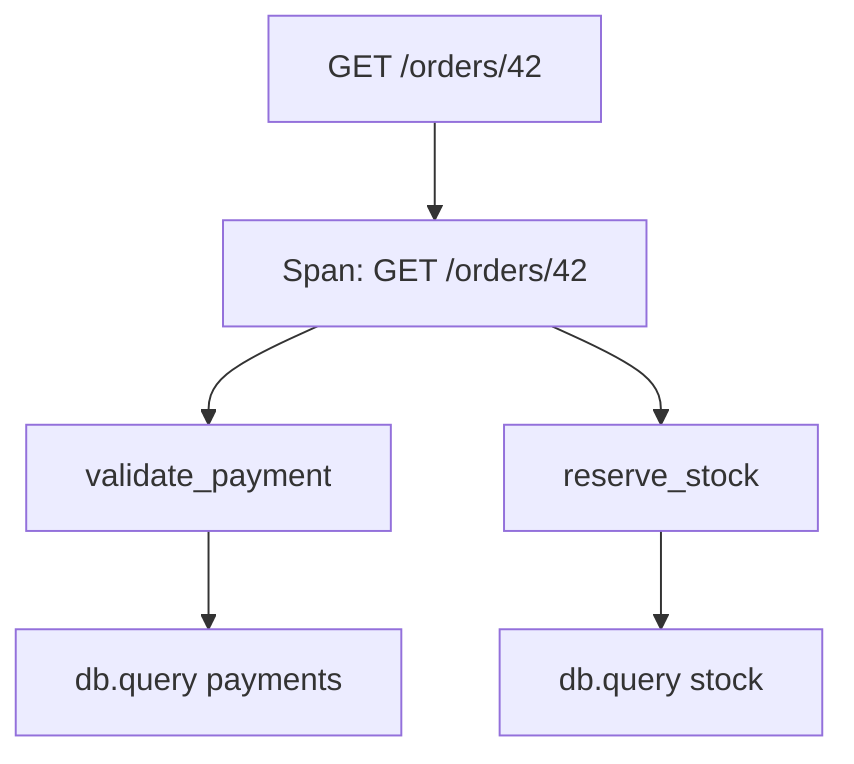

Логи отвечают на вопрос «что происходило», метрики — «сколько и как часто», а вот на вопрос «почему именно этот запрос был медленным или упал» логи отвечают плохо. В распределённой системе запрос проходит через шлюз, сервис заказов, базу данных и очередь. Когда всё работает медленно, неясно, где именно теряется время. Для этого существует **трейсинг** — а стандарт де-факто здесь называется **OpenTelemetry (OTel)**.

## Что такое OpenTelemetry

OpenTelemetry — это открытый проект (продолжение OpenTracing и OpenCensus), который даёт единый стандарт для трёх «сигналов» наблюдаемости: **traces** (трейсы), **metrics** (метрики) и **logs** (логи). Он состоит из набора API, SDK и библиотек инструментации для всех популярных языков. Ты пишешь код один раз по стандарту OTel, а дальше можешь подключать любую бэкенд-систему: Jaeger, Zipkin, Grafana Tempo, Datadog, Honeycomb и другие — через **экспортёры**.

Ключевые понятия:

- **Trace** — цельность операция, например «обработка HTTP-запроса». У неё есть уникальный `trace_id`.
- **Span** — один шаг внутри трейса: «запрос в БД», «вызов сервиса заказов», «сериализация ответа». Каждый спаn имеет родителя — так образуется дерево. У спана свой `span_id`.
- **Span context** — набор полей (`trace_id`, `span_id`, флаги), который передаётся между сервисами в заголовках. Стандарт — **W3C Trace Context**: заголовок `traceparent`.
- **Resource** — описание источника данных: имя сервиса, версия, окружение.
- **Attributes** — пары «ключ-значение» на спане (например, `http.method`, `http.route`).
- **Events** — точки во времени внутри спана (например, «началась ретрай-попытка»).

## Установка и базовая настройка SDK

Для Python нужны пакеты `opentelemetry-sdk` и (для интеграций) `opentelemetry-instrumentation-fastapi`:

```bash
pip install opentelemetry-sdk opentelemetry-instrumentation-fastapi
```

Минимальная настройка с выводом спанов в консоль:

```python
from opentelemetry import trace
from opentelemetry.sdk.trace import TracerProvider
from opentelemetry.sdk.trace.export import BatchSpanProcessor, ConsoleSpanExporter
from opentelemetry.sdk.resources import Resource

resource = Resource.create({"service.name": "orders-service"})

provider = TracerProvider(resource=resource)
provider.add_span_processor(BatchSpanProcessor(ConsoleSpanExporter()))
trace.set_tracer_provider(provider)

tracer = trace.get_tracer("app.orders")
```

`TracerProvider` — фабрика трейсеров. `SpanProcessor` получает завершённые спаны и передаёт их **экспортёру**. `BatchSpanProcessor` накапливает спаны и отправляет их пакетами (эффективнее, чем по одному), а `ConsoleSpanExporter` печатает их в консоль — отлично для разработки. `Resource` описывает сервис; имя `service.name` обязательно для фильтрации в бэкенде.

## Ручные спаны

Создадим спан с атрибутами и событием:

```python
import time

with tracer.start_as_current_span("create_order") as span:
    span.set_attribute("order.id", 1024)
    span.set_attribute("user.id", 77)
    span.add_event("db.query_started", {"table": "orders"})
    time.sleep(0.05)  # имитация работы
    span.add_event("db.query_finished")
    span.set_status(trace.Status(trace.StatusCode.OK))
```

`start_as_current_span` не только создаёт спан, но и делает его «текущим» в контексте — все вложенные спаны автоматически станут его детьми. `set_attribute` добавляет пары «ключ-значение» (используй семантические конвенции OTel: `http.method`, `http.route`, `http.status_code`...). `add_event` фиксирует событие с временем и атрибутами. `set_status` сообщает об успехе или ошибке. Спан завершается при выходе из `with`-блока.

Вложенные спаны:

```python
with tracer.start_as_current_span("process_order") as outer:
    with tracer.start_as_current_span("validate_payment") as inner:
        inner.set_attribute("payment.provider", "stripe")
        # что-то делаем
    with tracer.start_as_current_span("reserve_stock") as inner2:
        inner2.set_attribute("stock.sku", "A-42")
```

Дерево спанов можно представить так:

```
process_order
├── validate_payment
└── reserve_stock
```

## Автоматическая инструментация FastAPI

Писать ручные спаны для каждого эндпоинта утомительно. OTel предоставляет готовую библиотеку инструментации, которая сама создаёт спан на каждый HTTP-запрос, заполняет стандартные атрибуты (`http.method`, `http.route`, `http.status_code`, `http.user_agent`) и связывает их с контекстом входящего запроса:

```python
from fastapi import FastAPI
from opentelemetry.instrumentation.fastapi import FastAPIInstrumentor

app = FastAPI(title="Orders API")

# ... настройка TracerProvider, как выше ...

FastAPIInstrumentor.instrument_app(app)

@app.get("/health")
def health():
    return {"status": "ok"}
```

После этого каждый запрос к `/health` породит спан с именем `GET /health`, атрибутами `http.method=GET`, `http.route=/health`, `http.status_code=200` и т. д. Если клиент прислал заголовок `traceparent`, спан автоматически продолжит существующий трейс — так трейс «прошивается» через сервисы.

## Экспорт в OTLP

В проде спаны отправляются в коллектор или бэкенд по протоколу **OTLP**. Чтобы писать в OpenTelemetry Collector:

```python
from opentelemetry.exporter.otlp.proto.http.trace_exporter import OTLPSpanExporter

provider.add_span_processor(BatchSpanProcessor(OTLPSpanExporter(endpoint="http://collector:4318/v1/traces")))
```

Точно так же подключаются экспортёры для Jaeger и Zipkin. Меняя один экспортёр, ты меняешь бэкенд — код приложения не трогается.

## Как читать трейс

Трейс — это дерево, а не список. Один HTTP-запрос порождает корневой спан, а внутри него появляются дочерние спаны для каждого шага. Смотри на диаграмму: если `reserve_stock` занимает 800 мс, а `validate_payment` — 20 мс, виновник найден без чтения логов.



У всех узлов один `trace_id`, но разные `span_id`; связь «родитель-ребёнок» хранится в поле `parent_id`. Именно поэтому в бэкенде можно развернуть запрос в дерево и увидеть, какой шаг съел время.

## Лучшие практики

- Именуй спаны существительными-операциями: `create_order`, `process_payment`, `GET /health`.
- Не допускай бесконечного роста кардинальности атрибутов: не клади в атрибуты уникальные id пользователей без необходимости — это раздувает индексы.
- Используй `set_status` с `StatusCode.ERROR` и атрибутом `exception.type` при падении.
- Включай `BatchSpanProcessor` в проде, `SimpleSpanProcessor` — в тестах и локальной отладке.

<!--TASK-->
### Задача 1
Создай файл `trace_basics.py`. Настрой `TracerProvider` с `Resource` (`service.name="demo-service"`), `BatchSpanProcessor` и `ConsoleSpanExporter`. Создай трейсер, затем в `with tracer.start_as_current_span("do_work")` выполни две операции: внутри создай дочерний спан `"step_one"` с атрибутом `step="1"` и дочерний спан `"step_two"` с атрибутом `step="2"`. После выхода из `with` добавь `span.set_status(trace.Status(trace.StatusCode.OK))`. Запусти скрипт и убедись, что в консоли появились все три спана с правильной иерархией (родитель и два ребёнка).

### Задача 2
Расширь `trace_basics.py`: после создания спана `"do_work"` добавь событие `add_event("started", {"attempt": 1})`, затем `time.sleep(0.1)`, затем событие `add_event("finished")`. Выведи в консоль `trace_id` и `span_id` текущего спана (`trace.get_current_span().get_span_context().trace_id`). Объясни, что такое `trace_id` и `span_id`, и запусти скрипт.

### Задача 3
Напиши файл `test_traces.py` с pytest-тестами. Используй `InMemorySpanExporter` из `opentelemetry.sdk.trace.export.in_memory_span_exporter` и `SimpleSpanProcessor`, чтобы не отправлять спаны в консоль. Тест 1: создай `TracerProvider`, добавь `SimpleSpanProcessor(InMemorySpanExporter())`, создай спан с именем `"test_span"` и атрибутом `{"foo": "bar"}`, заверши его, затем получи экспортированные спаны и проверь, что имя и атрибут совпадают. Тест 2: внутри родительского спана создай дочерний, заверши оба и проверь, что дочерний спан имеет `parent` с `span_id` родителя. Используй фикстуру `pytest.fixture` для создания свежего провайдера в каждом тесте.

### Задача 4
Создай FastAPI-приложение в файле `app.py` с двумя эндпоинтами: `GET /health` (возвращает `{"status": "ok"}`) и `GET /orders/{order_id}` (возвращает `{"order_id": order_id}`). Подключи `FastAPIInstrumentor.instrument_app(app)`. В `test_app.py` напиши pytest-тесты с `TestClient` (из `fastapi.testclient`): тест 1 — проверь, что `GET /health` возвращает 200; тест 2 — подключи `InMemorySpanExporter` с `SimpleSpanProcessor` к провайдеру до вызовов, сделай запрос через `TestClient`, затем проверь, что экспортирован хотя бы один спан и что в его атрибутах есть `http.method` и `http.status_code`. Запусти `pytest test_app.py -v`.

### Задача 5
Реализуй ручную передачу контекста между «сервисами» без сети: функция `handle_request(user_id)` создаёт спан `"handle_request"` с атрибутом `user.id`, внутри вызывает функцию `process_payment(user_id)`, которая создаёт дочерний спан `"process_payment"`. Если `user_id` больше 1000, в спане `process_payment` установи статус `StatusCode.ERROR` и добавь атрибут `error.reason="limit_exceeded"`. Напиши тест в `test_traces.py`, который проверяет, что при `user_id=2000` дочерний спан имеет статус `ERROR` и атрибут `error.reason`.
### Задача 6
Смоделируй передачу контекста между двумя сервисами без сети. В `propagation_demo.py` настрой `TracerProvider` с `SimpleSpanProcessor(ConsoleSpanExporter())`. В «сервисе A» открой спан `"gateway"`, внутри него сформируй `carrier: dict[str, str] = {}` и вызови `TraceContextTextMapPropagator().inject(carrier)`. Выведи `carrier` — там появится заголовок `traceparent`. В «сервисе B» вызови `ctx = TraceContextTextMapPropagator().extract(carrier)` и открой спан `"orders"` через `tracer.start_as_current_span("orders", context=ctx)`. Сравни `trace_id` обоих спанов и проверь, что `parent_id` спана `orders` равен `span_id` спана `gateway`. Ожидаемый вывод: одинаковый `trace_id` у двух спанов и строка `parent ok`.

### Задача 7
Научись фиксировать исключения в спане. Напиши функцию `charge_card(amount: int)`, которая при `amount <= 0` бросает `ValueError("amount must be positive")`. В `test_exceptions.py` настрой `InMemorySpanExporter` с `SimpleSpanProcessor`, оберни вызов в `with tracer.start_as_current_span("charge_card") as span:` и в `except ValueError as exc:` вызови `span.record_exception(exc)` и `span.set_status(trace.Status(trace.StatusCode.ERROR, str(exc)))`. Проверь три вещи: статус экспортированного спана — `ERROR`, среди событий есть `exception` с атрибутом `exception.type == "ValueError"`, а `status.description` содержит текст ошибки. Ожидаемый вывод: `1 passed` и одно событие `exception` в спане.
<!--/TASK-->

<!--HINT-->
### Подсказка 1
Настройка: `provider = TracerProvider(resource=Resource.create({"service.name": "demo-service"}))`, затем `provider.add_span_processor(BatchSpanProcessor(ConsoleSpanExporter()))`, `trace.set_tracer_provider(provider)`, `tracer = trace.get_tracer("app")`. Вложенные `with tracer.start_as_current_span("step_one")` внутри внешнего `with tracer.start_as_current_span("do_work")` автоматически станут дочерними.

### Подсказка 2
`trace.get_current_span()` возвращает текущий спан; `get_span_context()` даёт `trace_id` и `span_id`. Обрати внимание: `trace_id` — это 128-битное число; чтобы его удобно показать, можно использовать `format(span_context.trace_id, '032x')`.

### Подсказка 3
`InMemorySpanExporter` импортируется так: `from opentelemetry.sdk.trace.export.in_memory_span_exporter import InMemorySpanExporter`. В тесте не забудь `provider.shutdown()` в фикстуре или в конце теста — иначе данные могут не экспортироваться. Дочерний спан: `with tracer.start_as_current_span("parent") as parent: with tracer.start_as_current_span("child") as child: pass`; потом `child.parent.span_id == parent.context.span_id`.

### Подсказка 4
Используй `TestClient(app)` — он не требует запуска сервера. В тесте 2: `from fastapi.testclient import TestClient`; перед запросом создай провайдер с InMemorySpanExporter и установи его через `trace.set_tracer_provider(provider)`. После `client.get("/health")` подожди, пока спаны экспортируются (SimpleSpanProcessor делает это синхронно), и проверь атрибуты.

### Подсказка 5
Статус спана: `span.set_status(trace.Status(trace.StatusCode.ERROR))`. Проверка: `assert exported[1].status.status_code == trace.StatusCode.ERROR` (или `span.status.status_code`). Имя дочернего спана — `"process_payment"`, атрибут — `span.set_attribute("error.reason", "limit_exceeded")`.
### Подсказка 6
Пропагатор берётся из `opentelemetry.trace.propagation.tracecontext.TraceContextTextMapPropagator`. `inject(carrier)` нужно вызывать **внутри** `with`-блока спана `gateway`, иначе текущего контекста нет и заголовок не запишется. `extract(carrier)` возвращает `Context`, который передаётся в `start_as_current_span(..., context=ctx)`; без этого параметра спан `orders` станет новым корневым трейсом.

### Подсказка 7
`record_exception` добавляет событие с именем `exception` и атрибутами `exception.type`, `exception.message`, `exception.stacktrace`. Статус проверяй как `span.status.status_code == StatusCode.ERROR`, а описание — `span.status.description`. В тесте не забудь `force_flush()` у провайдера или используй `SimpleSpanProcessor`, который экспортирует спан сразу при завершении.
<!--/HINT-->

<!--SOLUTION-->
### Разбор 1
Решение:

```python
import time
from opentelemetry import trace
from opentelemetry.sdk.trace import TracerProvider
from opentelemetry.sdk.trace.export import BatchSpanProcessor, ConsoleSpanExporter
from opentelemetry.sdk.resources import Resource

provider = TracerProvider(resource=Resource.create({"service.name": "demo-service"}))
provider.add_span_processor(BatchSpanProcessor(ConsoleSpanExporter()))
trace.set_tracer_provider(provider)

tracer = trace.get_tracer("app")

with tracer.start_as_current_span("do_work") as span:
    with tracer.start_as_current_span("step_one") as step1:
        step1.set_attribute("step", "1")
        time.sleep(0.01)
    with tracer.start_as_current_span("step_two") as step2:
        step2.set_attribute("step", "2")
        time.sleep(0.01)
    span.set_status(trace.Status(trace.StatusCode.OK))
```

В выводе ConsoleSpanExporter появятся три спана: `do_work` (родитель) и два дочерних — `step_one`, `step_two`. Что здесь происходит? `start_as_current_span` работает как контекст-менеджер: пока активен внешний блок, внутренние `with`-блоки создают спаны с родителем, равным текущему спану. `BatchSpanProcessor` соберёт завершённые спаны и отправит их в консоль пакетами. Обрати внимание: статус `OK` у родителя стоит после завершения дочерних — это нормально, статус родителя отражает общий итог.

### Разбор 2
Решение:

```python
import time
from opentelemetry import trace

with tracer.start_as_current_span("do_work") as span:
    span.add_event("started", {"attempt": 1})
    time.sleep(0.1)
    span.add_event("finished")

    ctx = trace.get_current_span().get_span_context()
    print("trace_id =", format(ctx.trace_id, "032x"))
    print("span_id  =", format(ctx.span_id, "016x"))
```

Что здесь происходит? `add_event` фиксирует событие с меткой времени — это полезно для отладки долгих операций. `get_span_context()` возвращает контекст текущего спана: `trace_id` — идентификатор всего трейса (у всех спанов одного трейса он совпадает), `span_id` — идентификатор конкретного спана. В распределённой системе именно `trace_id` позволяет собрать все спаны запроса из разных сервисов.

### Разбор 3
Решение:

```python
import pytest
from opentelemetry import trace
from opentelemetry.sdk.trace import TracerProvider
from opentelemetry.sdk.trace.export import SimpleSpanProcessor
from opentelemetry.sdk.trace.export.in_memory_span_exporter import InMemorySpanExporter

@pytest.fixture
def exporter():
    provider = TracerProvider()
    exp = InMemorySpanExporter()
    provider.add_span_processor(SimpleSpanProcessor(exp))
    trace.set_tracer_provider(provider)
    yield exp
    provider.shutdown()

def test_single_span(exporter):
    tracer = trace.get_tracer("test")
    with tracer.start_as_current_span("test_span") as span:
        span.set_attribute("foo", "bar")
    spans = exporter.get_finished_spans()
    assert len(spans) == 1
    assert spans[0].name == "test_span"
    assert spans[0].attributes["foo"] == "bar"

def test_parent_child_relation(exporter):
    tracer = trace.get_tracer("test")
    with tracer.start_as_current_span("parent") as parent:
        with tracer.start_as_current_span("child") as child:
            pass
    spans = exporter.get_finished_spans()
    parent_span = next(s for s in spans if s.name == "parent")
    child_span = next(s for s in spans if s.name == "child")
    assert child_span.parent.span_id == parent_span.context.span_id
```

Что здесь происходит? `InMemorySpanExporter` хранит спаны в памяти — это идеальный инструмент для тестов: ничего не уходит в сеть. `SimpleSpanProcessor` экспортирует спан сразу после завершения, поэтому не нужно ждать пачки. `provider.shutdown()` в фикстуре корректно закрывает провайдер. В тесте 2 мы проверяем ключевое свойство: `child_span.parent.span_id` совпадает с `parent_span.context.span_id` — именно так строится дерево спанов.

### Разбор 4
Решение (`app.py`):

```python
from fastapi import FastAPI
from opentelemetry import trace
from opentelemetry.instrumentation.fastapi import FastAPIInstrumentor
from opentelemetry.sdk.trace import TracerProvider
from opentelemetry.sdk.trace.export import BatchSpanProcessor, ConsoleSpanExporter
from opentelemetry.sdk.resources import Resource

provider = TracerProvider(resource=Resource.create({"service.name": "orders-api"}))
provider.add_span_processor(BatchSpanProcessor(ConsoleSpanExporter()))
trace.set_tracer_provider(provider)

app = FastAPI(title="Orders API")
FastAPIInstrumentor.instrument_app(app)

@app.get("/health")
def health():
    return {"status": "ok"}

@app.get("/orders/{order_id}")
def get_order(order_id: int):
    return {"order_id": order_id}
```

Тесты (`test_app.py`):

```python
from fastapi.testclient import TestClient
from opentelemetry import trace
from opentelemetry.sdk.trace import TracerProvider
from opentelemetry.sdk.trace.export import SimpleSpanProcessor
from opentelemetry.sdk.trace.export.in_memory_span_exporter import InMemorySpanExporter
from app import app

def test_health_ok():
    client = TestClient(app)
    resp = client.get("/health")
    assert resp.status_code == 200
    assert resp.json() == {"status": "ok"}

def test_request_span_attributes():
    provider = TracerProvider()
    exporter = InMemorySpanExporter()
    provider.add_span_processor(SimpleSpanProcessor(exporter))
    trace.set_tracer_provider(provider)

    client = TestClient(app)
    client.get("/health")

    spans = exporter.get_finished_spans()
    assert len(spans) >= 1
    attributes = spans[0].attributes
    assert attributes.get("http.method") == "GET"
    assert attributes.get("http.status_code") == 200
```

Что здесь происходит? `FastAPIInstrumentor.instrument_app(app)` оборачивает приложение: каждый запрос начинает новый спан, в который автоматически записываются `http.method`, `http.route`, `http.status_code` и другие атрибуты. В тесте мы подменяем глобальный провайдер на «тестовый» с InMemorySpanExporter — после запроса спаны экспортированы и доступны для проверки. Обрати внимание на порядок: `set_tracer_provider` выполняется до запроса, иначе `FastAPIInstrumentor` использует старый провайдер.

### Разбор 5
Решение:

```python
from opentelemetry import trace
from opentelemetry.sdk.trace import TracerProvider
from opentelemetry.sdk.trace.export import SimpleSpanProcessor
from opentelemetry.sdk.trace.export.in_memory_span_exporter import InMemorySpanExporter

trace.set_tracer_provider(TracerProvider())
tracer = trace.get_tracer("app")

def process_payment(user_id: int) -> None:
    with tracer.start_as_current_span("process_payment") as span:
        if user_id > 1000:
            span.set_attribute("error.reason", "limit_exceeded")
            span.set_status(trace.Status(trace.StatusCode.ERROR))

def handle_request(user_id: int) -> None:
    with tracer.start_as_current_span("handle_request") as span:
        span.set_attribute("user.id", user_id)
        process_payment(user_id)
```

Тест:

```python
def test_error_status():
    exporter = InMemorySpanExporter()
    trace.set_tracer_provider(TracerProvider())
    trace.get_tracer_provider().add_span_processor(SimpleSpanProcessor(exporter))
    handle_request(2000)
    spans = exporter.get_finished_spans()
    payment = next(s for s in spans if s.name == "process_payment")
    assert payment.status.status_code == trace.StatusCode.ERROR
    assert payment.attributes["error.reason"] == "limit_exceeded"
```

Что здесь происходит? Функция `process_payment` создаёт дочерний спан. Так как он создаётся внутри спана `handle_request`, он автоматически становится его ребёнком — родительская связь определяется текущим контекстом, а не аргументами. Статус `ERROR` — это не исключение, а явное сообщение о неудаче, которое можно использовать для алертов. В тесте мы проверяем и статус, и атрибут причины — такой спан сразу виден в трейсе.
### Разбор 6
Решение (`propagation_demo.py`):

```python
from opentelemetry import trace
from opentelemetry.sdk.resources import Resource
from opentelemetry.sdk.trace import TracerProvider
from opentelemetry.sdk.trace.export import ConsoleSpanExporter, SimpleSpanProcessor
from opentelemetry.trace.propagation.tracecontext import TraceContextTextMapPropagator

provider = TracerProvider(resource=Resource.create({"service.name": "demo"}))
provider.add_span_processor(SimpleSpanProcessor(ConsoleSpanExporter()))
trace.set_tracer_provider(provider)
tracer = trace.get_tracer("app")
propagator = TraceContextTextMapPropagator()

with tracer.start_as_current_span("gateway") as gateway:
    carrier: dict[str, str] = {}
    propagator.inject(carrier)
    print("carrier:", carrier)
    gateway_ctx = gateway.get_span_context()

ctx = propagator.extract(carrier)
with tracer.start_as_current_span("orders", context=ctx) as orders:
    orders_ctx = orders.get_span_context()

print("same trace:", gateway_ctx.trace_id == orders_ctx.trace_id)
print("parent ok:", orders.parent.span_id == gateway_ctx.span_id)
```

Пример вывода:

```text
carrier: {'traceparent': '00-4bf92f3577b34da6a3ce929d0e0e4736-00f067aa0ba902b7-01'}
same trace: True
parent ok: True
```

Что здесь происходит? Заголовок `traceparent` — это компактная упаковка трёх полей: версия, `trace_id`, `span_id` и флаги. `inject` читает текущий контекст и записывает строку в обычный словарь; в реальном сервисе этот словарь стал бы HTTP-заголовками. `extract` делает обратную операцию и возвращает `Context`, а `start_as_current_span(..., context=ctx)` строит спан так, будто он родился внутри чужого процесса. Обрати внимание: без `context=ctx` спан `orders` получил бы новый `trace_id`, и в бэкенде мы увидели бы два несвязанных трейса вместо одного сквозного. Сравнение `orders.parent.span_id` с `gateway_ctx.span_id` — самая надёжная проверка, что связь восстановлена.

### Разбор 7
Решение (`test_exceptions.py`):

```python
import pytest
from opentelemetry import trace
from opentelemetry.sdk.trace import TracerProvider
from opentelemetry.sdk.trace.export import SimpleSpanProcessor
from opentelemetry.sdk.trace.export.in_memory_span_exporter import InMemorySpanExporter

from billing import charge_card

def test_exception_is_recorded():
    exporter = InMemorySpanExporter()
    provider = TracerProvider()
    provider.add_span_processor(SimpleSpanProcessor(exporter))
    tracer = provider.get_tracer("test")

    with tracer.start_as_current_span("charge_card") as span:
        try:
            charge_card(0)
        except ValueError as exc:
            span.record_exception(exc)
            span.set_status(trace.Status(trace.StatusCode.ERROR, str(exc)))

    finished = exporter.get_finished_spans()[0]
    assert finished.status.status_code == trace.StatusCode.ERROR
    assert finished.status.description == "amount must be positive"
    assert finished.events[0].name == "exception"
    assert finished.events[0].attributes["exception.type"] == "ValueError"
```

Что здесь происходит? `record_exception` не «глотает» ошибку и не мешает ей распространяться — он просто добавляет в спан событие с типом, сообщением и stacktrace. `set_status` отдельно помечает весь спан как неуспешный: без него спан останется `UNSET`, и алерты по доле ошибок его не увидят. `SimpleSpanProcessor` экспортирует спан сразу после `end()`, поэтому `get_finished_spans()` уже содержит запись, и вызывать `force_flush()` не нужно. В проде ту же информацию можно получить, если настроен `BatchSpanProcessor`: главное — не забыть корректно завершить провайдер при остановке приложения, иначе буфер потеряется.
<!--/SOLUTION-->

<!--QUIZ-->
Что такое Span в OpenTelemetry?
- Отдельная строка лога
- Один шаг операции внутри трейса, имеющий родителя
- Метрика количества запросов
* Правильный ответ: Один шаг операции внутри трейса, имеющий родителя
Span — это работа с именем, атрибутами и родителем; вместе они образуют дерево трейса.

Какой заголовок используется для передачи контекста трейса по стандарту W3C?
- X-Correlation-Id
- traceparent
- X-Request-Id
* Правильный ответ: traceparent
traceparent — стандартный заголовок W3C Trace Context, содержащий trace_id и span_id.

Что делает TracerProvider?
- Создаёт трейсеры
- Сохраняет спаны в базу
- Форматирует логи
* Правильный ответ: Создаёт трейсеры
TracerProvider — это фабрика трейсеров; трейсеры в свою очередь создают спаны.

Зачем нужен SpanProcessor?
- Чтобы переименовывать спаны
- Чтобы получать завершённые спаны и передавать их экспортёрам
- Чтобы фильтровать спаны по имени
* Правильный ответ: Чтобы получать завершённые спаны и передавать их экспортёрам
SpanProcessor — точка подключения между SDK и экспортёром; BatchSpanProcessor накапливает спаны и отправляет пакетами.

Чем SimpleSpanProcessor отличается от BatchSpanProcessor?
- Simple отправляет каждый спан сразу, Batch накапливает и отправляет пакетами
- Simple хранит спаны вечно
- Batch не может работать с консолью
* Правильный ответ: Simple отправляет каждый спан сразу, Batch накапливает и отправляет пакетами
SimpleSpanProcessor удобен в тестах, BatchSpanProcessor — в проде, где важна производительность.

Какой класс хранит спаны в памяти для тестов?
- ConsoleSpanExporter
- InMemorySpanExporter
- SpanMemoryExporter
* Правильный ответ: InMemorySpanExporter
InMemorySpanExporter из opentelemetry.sdk.trace.export.in_memory_span_exporter сохраняет завершённые спаны, которые потом можно проверить в тестах.

Что делает FastAPIInstrumentor.instrument_app(app)?
- Добавляет /metrics эндпоинт
- Автоматически создаёт спан на каждый HTTP-запрос
- Включает логирование запросов
* Правильный ответ: Автоматически создаёт спан на каждый HTTP-запрос
Инструментация оборачивает приложение и наполняет спан стандартными HTTP-атрибутами.

Как добавить атрибут на спан?
- span.add_attribute("key", "value")
- span.set_attribute("key", "value")
- span.set_property("key", "value")
* Правильный ответ: span.set_attribute("key", "value")
set_attribute добавляет пару «ключ-значение» в спан.

Если внутри `with tracer.start_as_current_span("parent")` создать ещё один спан, каким будет его родитель?
- Никаким, это корневой спан
- Спан "parent"
- Ошибка
* Правильный ответ: Спан "parent"
start_as_current_span делает спан текущим, и все вложенные спаны автоматически становятся его детьми.

Что делает span.set_status(trace.Status(trace.StatusCode.ERROR))?
- Выбрасывает исключение
- Помечает спан как завершившийся с ошибкой
- Удаляет спан из трейса
* Правильный ответ: Помечает спан как завершившийся с ошибкой
Статус ERROR сигнализирует о неудаче без сообщения исключения.
Что записывает TraceContextTextMapPropagator().inject(carrier)?
- Заголовок traceparent с trace_id и span_id
- Тело HTTP-запроса
- JSON со всеми атрибутами спана
* Правильный ответ: Заголовок traceparent с trace_id и span_id
inject упаковывает текущий контекст в carrier, обычно это dict с ключом traceparent.

Зачем передавать context=ctx в start_as_current_span при приёме запроса?
- Чтобы спан продолжил существующий трейс, а не начал новый
- Чтобы ускорить экспорт
- Чтобы отключить сэмплирование
* Правильный ответ: Чтобы спан продолжил существующий трейс, а не начал новый
Без переданного контекста спан станет корневым и получит новый trace_id.

Что делает span.record_exception(exc)?
- Пробрасывает исключение дальше
- Добавляет в спан событие exception с типом и stacktrace
- Меняет статус спана на ERROR автоматически
* Правильный ответ: Добавляет в спан событие exception с типом и stacktrace
Статус нужно выставлять отдельно через set_status.

Почему в проде важно корректно завершать TracerProvider?
- Иначе BatchSpanProcessor не отправит накопленные спаны
- Иначе изменится trace_id
- Иначе перестанут работать атрибуты
* Правильный ответ: Иначе BatchSpanProcessor не отправит накопленные спаны
Буфер отправляется пакетами; при резкой остановке процесса последние спаны теряются.
<!--/QUIZ-->
