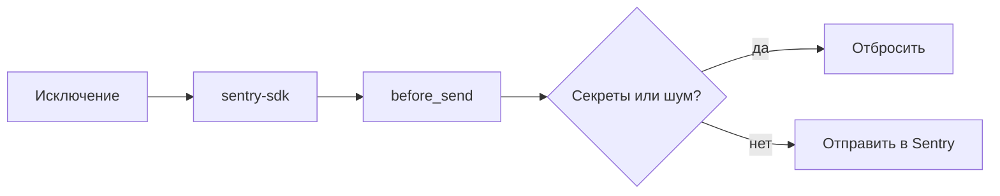

Когда приложение падает локально, traceback в терминале — всё, что нужно. В проде всё сложнее: ошибки случаются у реальных пользователей, и ты не видишь их консоль. Обычные логи не показывают ни состояния приложения in момент ошибки, ни путь пользователя до неё. Задача **error tracking** — собрать все исключения в одном месте, сгруппировать одинаковые, показать окружение и стек вызовов, и привязать к релизу кода. Стандарт де-факто для Python — **Sentry** и его SDK **sentry-sdk**.

## Что даёт Sentry

- **Автоматический захват исключений** — необработанные ошибки в веб-приложениях попадают в Sentry сами, без try/except.
- **Группировку** — тысячи одинаковых ошибок становятся одной записью с количеством вхождений.
- **Контекст** — окружение (production/staging), версия кода, сведения о пользователе, breadcrumbs (предшествующие события).
- **Алерты и интеграции** — уведомления в Slack/Telegram/почту, связка с CI/CD.

## Установка и инициализация

```bash
pip install sentry-sdk
```

```python
import sentry_sdk

sentry_sdk.init(
    dsn="https://examplePublicKey@o0.ingest.us.sentry.io/0",
    environment="production",
    release="orders@1.0.0",
    traces_sample_rate=1.0,
)
```

- `dsn` — адрес проекта Sentry. Храни его в переменной окружения `SENTRY_DSN` и не коммить в репозиторий. Если DSN пустой — SDK молча отключается, что удобно для локальной разработки.
- `environment` — обязательное разделение проду и стейджинга.
- `release` — формат `имя_проекта@версия`; позволяет видеть, в каком релизе впервые появилась ошибка.
- `traces_sample_rate` — вероятности сэмплирования транзакций производительности (0.1–1.0). Сэмплирование снижает трафик в Sentry.

Современные версии sentry-sdk **автоматически** инструментируют FastAPI/Starlette (и Flask): достаточно `init()` — и исключения, всплывающие из эндпоинтов, будут пойманы. Раньше приходилось оборачивать приложение в `SentryAsgiMiddleware`; сейчас SDK выводит предупреждение, если ты делаешь это вручную.

## Ручной захват

Иногда нужно отправить ошибку явно:

```python
try:
    result = 1 / 0
except ZeroDivisionError as exc:
    sentry_sdk.capture_exception(exc)
```

`capture_exception` берёт текущее исключение и отправляет полный traceback. Для просто сообщений:

```python
sentry_sdk.capture_message("disk space below 10%")
```

## Контекст: пользователь, теги, breadcrumbs

Чтобы понять, кто и как пострадал, добавь контекст:

```python
sentry_sdk.set_user({"id": 77, "email": "user@example.com"})
sentry_sdk.set_tag("plan", "pro")
sentry_sdk.set_context("request", {"path": "/orders/1024", "method": "GET"})
sentry_sdk.add_breadcrumb(category="db", message="queried orders", level="info")
```

`set_user` привязывает ошибку к пользователю, `set_tag` — ключевые метки для фильтрации, `set_context` — произвольный словарь, `add_breadcrumb` добавляет «хлебные крошки» — события перед ошибкой. Всё это работает в рамках одной **scope** (контекста) — на каждый запрос SDK создаёт изолированную scope, так что данные одного запроса не протекают в другой. Можно использовать и `with sentry_sdk.isolation_scope() as scope:` для явной группировки.

## before_send: последний страж

Перед отправкой каждое событие проходит через функцию `before_send`. Это идеальное место, чтобы вычистить чувствительные данные или отбросить событие вовсе:

```python
def before_send(event, hint):
    # маскируем секреты в extra-полях
    extra = event.get("extra", {})
    for key in list(extra):
        if "password" in key.lower() or "token" in key.lower():
            extra[key] = "***"
    # отбрасываем ожидаемые 404
    if event.get("level") == "error" and "HTTP 404" in event.get("message", ""):
        return None
    return event

sentry_sdk.init(dsn=..., before_send=before_send)
```

Вернуть `None` — значит отбросить событие, вернуть `event` — отправить. Второй параметр `hint` содержит технические детали (например, оригинальное исключение).

## Тестирование без сети

Sentry SDK позволяет подменить транспорт. Для pytest удобно определить «собирающий» транспорт — подкласс `Transport`, который перехватывает `capture_envelope` и складывает события в список:

```python
from sentry_sdk.transport import Transport

class CollectingTransport(Transport):
    def __init__(self, options=None):
        super().__init__(options)
        self.events = []

    def capture_envelope(self, envelope):
        event = envelope.get_event()
        if event is not None:
            self.events.append(event)
```

Передав такой транспорт в `init(transport=CollectingTransport())`, ты получаешь детерминированные тесты без сети.

## Путь события до Sentry

Любое исключение или сообщение проходит один и тот же конвейер. Понимание этого пути объясняет, зачем нужны `before_send`, транспорт и `flush()`:



`before_send` — единственная точка, где можно изменить или отменить событие до отправки. Транспорт же отвечает за доставку: подменив его в тестах, мы получаем события локально и не зависим от сети.

## Лучшие практики

- Не отправляй в Sentry чувствительные данные: PII, пароли, токены. Используй `before_send` и не клади секреты в `set_context`.
- `traces_sample_rate` в проде обычно ≤ 0.1 — иначе дорого.
- Для «ожидаемых» ошибок (например, 404) настрой фильтрацию — иначе они зашумят алерты.
- Сочетай с релизами: пометь `release` при деплое, чтобы связать ошибки с версией кода.

<!--TASK-->
### Задача 1
Создай файл `sentry_setup.py`. В нём функция `init_sentry(dsn: str = "")`, которая вызывает `sentry_sdk.init(dsn=dsn, environment="production", release="orders@1.0.0", traces_sample_rate=0.5)`. Напиши функцию `divide(a, b)`, которая при `b == 0` ловит `ZeroDivisionError` и вызывает `sentry_sdk.capture_exception(exc)`, а затем пробрасывает исключение дальше (`raise`). В `main()` вызови `init_sentry()` и `divide(1, 0)`, обернув вызов в try/except. Запусти — на экране должен появиться traceback, но приложение не должно упасть с необработанным исключением. Объясни в комментарии, что произойдёт, если передать реальный DSN.

### Задача 2
Добавь в `sentry_setup.py` функцию `mask_secrets(event: dict) -> dict | None`, которая будет использоваться как `before_send`. Она должна: (1) пройтись по `event.get("extra", {})` и заменить значения ключей, содержащих `password` или `token` (без учёта регистра), на `"***"`; (2) вернуть `None`, если `event.get("level") == "error"` и в `event.get("message", "")` встречается подстрока `"HTTP 404"`; (3) в остальных случаях вернуть неизменённый `event`. Подключи её в `init_sentry` через параметр `before_send`.

### Задача 3
Напиши pytest-тесты для `mask_secrets` в файле `test_mask.py`. Тест 1: передай событие с `extra={"password": "hunter2", "token": "abc", "order_id": 7}` и проверь, что после вызова `extra["password"] == "***"`, `extra["token"] == "***"`, а `extra["order_id"]` не изменился. Тест 2: передай событие с `level="error"` и `message="HTTP 404: Not Found"` и проверь, что функция вернула `None`. Тест 3: передай обычное событие (`level="info"`, `message="ok"`) и проверь, что функция вернула его как есть (тот же объект). Запусти `pytest test_mask.py -v` — все тесты должны пройти без сети и без init.

### Задача 4
Создай FastAPI-приложение в `sentry_app.py` с эндпоинтом `GET /divide?b=0`, который вызывает `divide(10, b)` из `sentry_setup`, и эндпоинтом `GET /ok`, возвращающим `{"status": "ok"}`. В `main()` вызови `init_sentry(dsn="https://public@o0.ingest.us.sentry.io/0")`. В `test_sentry_app.py` напиши pytest-тест: создай `CollectingTransport`, вызови `init_sentry(dsn="https://public@o0.ingest.us.sentry.io/0", transport=CollectingTransport())` (добавь параметр `transport` в `init_sentry`), сделай запрос `GET /divide?b=0`, затем проверь, что в `transport.events` есть событие с исключением (поле `exception` присутствует) и что `GET /ok` не создаёт событий. Используй `TestClient`.

### Задача 5
Добавь в `sentry_app.py` эндпоинт `GET /profile`, который добавляет пользователя (`sentry_sdk.set_user({"id": 42, "email": "x@example.com"})`) и тег `plan="pro"`, а затем вызывает `sentry_sdk.capture_message("profile viewed")`. В тесте проверь, что после запроса в `transport.events` появилось событие с `user.id == 42` и `tags["plan"] == "pro"`. Запусти `pytest test_sentry_app.py -v`.
### Задача 6
Расширь маскирование на вложенные структуры. Напиши `scrub_event(event: dict) -> dict`, которая рекурсивно обходит `event["extra"]`, `event["request"]["data"]`, `event["contexts"]` и `event["breadcrumbs"]["values"]`, заменяя на `"***"` значения ключей, содержащих `password`, `token`, `secret` или `card` (без учёта регистра). Функция должна корректно обрабатывать списки и вложенные словари, не падать на `None` и не менять исходный объект. В `test_scrub.py` проверь событие с `extra={"user": {"password": "x"}}`, `request={"data": {"card_number": "4111"}}` и breadcrumb с `token`; убедись, что все секреты заменены, а остальные поля сохранились. Ожидаемый вывод: `3 passed`.

### Задача 7
Проверь изоляцию контекста между запросами. Настрой `sentry_sdk.init(dsn="https://public@o0.ingest.us.sentry.io/0", transport=CollectingTransport())`. В тесте открой `with sentry_sdk.isolation_scope():`, внутри установи `set_user({"id": 42})` и вызови `capture_message("inside")`. Затем открой новую `isolation_scope()` без `set_user` и вызови `capture_message("outside")`. После `sentry_sdk.flush()` проверь, что у первого события `user["id"] == 42`, а у второго ключа `user` нет вовсе. Ожидаемый вывод: `1 passed` — контекст не протекает между scope.
<!--/TASK-->

<!--HINT-->
### Подсказка 1
В `except` блоке тебе доступна переменная исключения: `except ZeroDivisionError as exc: sentry_sdk.capture_exception(exc); raise`. Для наглядности можно добавить `sentry_sdk.capture_message("division by zero attempt")` перед `capture_exception`.

### Подсказка 2
`before_send(event, hint)` получает словарь события. `event.get("extra", {})` — словарь кастомных полей. Обрати внимание: ключи `extra` могут быть в любом регистре — используй `key.lower()`. Возврат `None` означает «не отправлять».

### Подсказка 3
`mask_secrets` — чистая функция, ей не нужен никакой SDK. В тесте 1 не забудь, что словарь `extra` — это вложенный словарь: `event["extra"]["password"]` должен стать `"***"`. В тесте 3 проверь идентичность через `is` (или `==`).

### Подсказка 4
Класс `CollectingTransport` определи прямо в тестовом файле. Не забудь изменить `init_sentry`, чтобы она принимала `transport=None` и передавала его в `sentry_sdk.init(transport=transport)`. После запроса `transport.events` должен содержать event с ключом `exception` (это автоматический захват исключения ASGI-интеграцией). Обрати внимание: `GET /divide?b=0` вернёт 500 — это ок, но TestClient не должен бросить исключение; если он бросает — оберни в try/except или используй `raise_server_exceptions=False`.

### Подсказка 5
`set_user` и `set_tag` применяются к scope запроса. Проверяй `event["user"]["id"] == 42` и `event["tags"]["plan"] == "pro"`. Если событие не появилось — проверь, что `capture_message` вызывается внутри обработчика (это синхронная функция, она должна попасть в транспорт сразу).
### Подсказка 6
Рекурсивная функция удобнее всего выглядит так: если значение — `dict`, верни новый словарь, в котором «секретные» ключи заменены, а остальные обработаны рекурсивно; если `list` — список из рекурсивных вызовов; иначе верни значение как есть. Для проверки ключа используй `any(word in key.lower() for word in ("password", "token", "secret", "card"))`. Не мутируй вход: создавай новый объект, иначе тест «исходный словарь не изменился» не пройдёт.

### Подсказка 7
`isolation_scope()` создаёт дочернюю scope и восстанавливает предыдущую при выходе — это аналог `ContextVar` с токеном. События складывай в `CollectingTransport`, так как без транспорта SDK попытается идти в сеть. `flush()` дожидается отправки; без него список может остаться пустым.
<!--/HINT-->

<!--SOLUTION-->
### Разбор 1
Решение:

```python
import sentry_sdk

def init_sentry(dsn: str = "") -> None:
    sentry_sdk.init(
        dsn=dsn,
        environment="production",
        release="orders@1.0.0",
        traces_sample_rate=0.5,
    )

def divide(a: int, b: int) -> float:
    try:
        return a / b
    except ZeroDivisionError as exc:
        sentry_sdk.capture_exception(exc)
        raise

if __name__ == "__main__":
    init_sentry()
    try:
        divide(1, 0)
    except ZeroDivisionError:
        print("caught: division by zero")
```

Что здесь происходит? `capture_exception` отправляет текущее исключение в Sentry (или в отключённый клиент, если DSN пуст — тогда ничего не происходит, но ошибок нет). Затем `raise` пробрасывает исключение выше — так мы и залогировали, и не проглотили ошибку. В `main` мы ловим исключение, чтобы программа не упала. Если передать реальный DSN, исключение уйдёт в Sentry и появится в дашборде.

### Разбор 2
Решение:

```python
def mask_secrets(event: dict):
    extra = event.get("extra", {})
    for key in list(extra):
        if "password" in key.lower() or "token" in key.lower():
            extra[key] = "***"
    if event.get("level") == "error" and "HTTP 404" in event.get("message", ""):
        return None
    return event

def init_sentry(dsn: str = "", transport=None) -> None:
    sentry_sdk.init(
        dsn=dsn,
        environment="production",
        release="orders@1.0.0",
        traces_sample_rate=0.5,
        before_send=mask_secrets,
        transport=transport,
    )
```

Что здесь происходит? `before_send` вызывается перед отправкой каждого события. Мы модифицируем `extra` — копию менять не нужно, потому что событие уже является копией, собранной SDK. `list(extra)` — копия ключей, чтобы не ловить `RuntimeError: dictionary changed size during iteration`. Возврат `None` отбрасывает 404-ошибки — их не стоит слать в Sentry, потому что это «ожидаемое» поведение, а не сбой.

### Разбор 3
Решение:

```python
from sentry_setup import mask_secrets

def test_mask_secret_values():
    event = {"extra": {"password": "hunter2", "token": "abc", "order_id": 7}}
    result = mask_secrets(event)
    assert result["extra"]["password"] == "***"
    assert result["extra"]["token"] == "***"
    assert result["extra"]["order_id"] == 7

def test_drops_404_errors():
    event = {"level": "error", "message": "HTTP 404: Not Found"}
    assert mask_secrets(event) is None

def test_passthrough():
    event = {"level": "info", "message": "ok"}
    assert mask_secrets(event) is event
```

Что здесь происходит? Мы тестируем чистую функцию без всякого SDK — это быстро и детерминированно. Тест 1 проверяет маскирование, тест 2 — отбрасывание 404, тест 3 — что обычные события проходят без изменений (проверка через `is` убеждается, что возвращается тот же объект, а не копия). Такие тесты — первый рубеж защиты от утечек данных.

### Разбор 4
Решение (`sentry_app.py`):

```python
from fastapi import FastAPI
from sentry_setup import divide, init_sentry

app = FastAPI()
init_sentry(dsn="https://public@o0.ingest.us.sentry.io/0")

@app.get("/divide")
def divide_endpoint(b: int):
    return {"result": divide(10, b)}

@app.get("/ok")
def ok():
    return {"status": "ok"}
```

Тест (`test_sentry_app.py`):

```python
from fastapi.testclient import TestClient
from sentry_sdk.transport import Transport
from sentry_app import app

class CollectingTransport(Transport):
    def __init__(self, options=None):
        super().__init__(options)
        self.events = []

    def capture_envelope(self, envelope):
        event = envelope.get_event()
        if event is not None:
            self.events.append(event)

def test_exception_captured():
    transport = CollectingTransport()
    init_sentry(dsn="https://public@o0.ingest.us.sentry.io/0", transport=transport)
    client = TestClient(app, raise_server_exceptions=False)
    resp = client.get("/divide?b=0")
    assert resp.status_code == 500
    assert len(transport.events) == 1
    assert "exception" in transport.events[0]

def test_no_events_on_ok():
    transport = CollectingTransport()
    init_sentry(dsn="https://public@o0.ingest.us.sentry.io/0", transport=transport)
    client = TestClient(app)
    client.get("/ok")
    assert transport.events == []
```

Что здесь происходит? `CollectingTransport` — подкласс `Transport` с переопределённым `capture_envelope`: он не ходит в сеть, а извлекает событие через `envelope.get_event()` и складывает его в список. ASGI-интеграция Sentry автоматически ловит исключение из эндпоинта, конструирует событие и передаёт его транспорту. `raise_server_exceptions=False` нужен, чтобы TestClient не бросал исключение, а вернул 500. Второй тест подтверждает: успешные запросы не создают событий.

### Разбор 5
Решение:

```python
import sentry_sdk
from fastapi import FastAPI

app = FastAPI()

@app.get("/profile")
def profile():
    sentry_sdk.set_user({"id": 42, "email": "x@example.com"})
    sentry_sdk.set_tag("plan", "pro")
    sentry_sdk.capture_message("profile viewed")
    return {"profile": "ok"}
```

Тест:

```python
def test_profile_user_context():
    transport = CollectingTransport()
    init_sentry(dsn="https://public@o0.ingest.us.sentry.io/0", transport=transport)
    client = TestClient(app)
    client.get("/profile")
    event = transport.events[0]
    assert event["user"]["id"] == 42
    assert event["tags"]["plan"] == "pro"
```

Что здесь происходит? Пока обрабатывается запрос, SDK держит scope: `set_user` и `set_tag` записываются в неё и попадают в событие. Это и есть «контекст» — без него ошибка выглядит как анонимный traceback, а с ним видно, какой пользователь и с каким тарифом пострадал. Именно такие поля позволяют отвечать на вопрос «кого это задело».
### Разбор 6
Решение (`scrub.py`):

```python
SECRET_WORDS = ("password", "token", "secret", "card")

def scrub_value(value):
    if isinstance(value, dict):
        result = {}
        for key, item in value.items():
            if any(word in key.lower() for word in SECRET_WORDS):
                result[key] = "***"
            else:
                result[key] = scrub_value(item)
        return result
    if isinstance(value, list):
        return [scrub_value(item) for item in value]
    return value

def scrub_event(event: dict) -> dict:
    cleaned = dict(event)
    if "extra" in cleaned:
        cleaned["extra"] = scrub_value(cleaned["extra"])
    if "request" in cleaned:
        cleaned["request"] = scrub_value(cleaned["request"])
    if "contexts" in cleaned:
        cleaned["contexts"] = scrub_value(cleaned["contexts"])
    if "breadcrumbs" in cleaned:
        cleaned["breadcrumbs"] = scrub_value(cleaned["breadcrumbs"])
    return cleaned
```

Тест (`test_scrub.py`):

```python
from scrub import scrub_event

def test_nested_extra():
    event = {"extra": {"user": {"password": "x", "name": "ann"}}}
    cleaned = scrub_event(event)
    assert cleaned["extra"]["user"]["password"] == "***"
    assert cleaned["extra"]["user"]["name"] == "ann"
    assert event["extra"]["user"]["password"] == "x"

def test_request_card():
    event = {"request": {"data": {"card_number": "4111", "amount": 100}}}
    assert scrub_event(event)["request"]["data"]["card_number"] == "***"

def test_breadcrumb_token():
    event = {"breadcrumbs": {"values": [{"message": "login", "token": "abc"}]}}
    assert scrub_event(event)["breadcrumbs"]["values"][0]["token"] == "***"
```

Что здесь происходит? Плоский фильтр из задачи 2 пропускает секреты, если они лежат глубже первого уровня: например, в `request.data` или в breadcrumb. Рекурсивный обход решает эту проблему, но требует аккуратности с типами: `None`, числа и строки должны возвращаться без изменений, а списки — обходиться поэлементно. Мы намеренно создаём новые словари вместо мутации входа: `before_send` может быть вызван несколько раз, и побочные эффекты в исходном событии затрудняют отладку. Такой «scrubber» стоит держать в отдельном модуле и покрывать тестами, потому что цена ошибки — утечка платёжных данных в сторонний сервис.

### Разбор 7
Решение (`test_scopes.py`):

```python
import sentry_sdk
from sentry_sdk.transport import Transport

class CollectingTransport(Transport):
    def __init__(self, options=None):
        super().__init__(options)
        self.events = []

    def capture_envelope(self, envelope):
        event = envelope.get_event()
        if event is not None:
            self.events.append(event)

def test_scope_isolation():
    transport = CollectingTransport()
    sentry_sdk.init(
        dsn="https://public@o0.ingest.us.sentry.io/0",
        transport=transport,
        default_integrations=False,
    )

    with sentry_sdk.isolation_scope():
        sentry_sdk.set_user({"id": 42})
        sentry_sdk.capture_message("inside")

    with sentry_sdk.isolation_scope():
        sentry_sdk.capture_message("outside")

    sentry_sdk.flush()
    assert transport.events[0]["user"]["id"] == 42
    assert "user" not in transport.events[1]
```

Что здесь происходит? Scope — это стек контекста Sentry: пользователь, теги, breadcrumbs и уровень. `isolation_scope()` делает новый слой и при выходе возвращает предыдущий, поэтому данные первого блока не видны во втором. Это критично для веб-сервера: без изоляции пользователь одного запроса «прилип» бы к событиям другого, и вы бы получили ложную привязку ошибок. `default_integrations=False` отключает автоинтеграции, чтобы тест не зависел от установленных библиотек, а `flush()` гарантирует, что транспорт получил все конверты до проверок. Обрати внимание: `capture_message` возвращает идентификатор события, но проверять удобнее сам список — он детерминирован и не требует сети.
<!--/SOLUTION-->

<!--QUIZ-->
Что делает sentry_sdk.capture_exception(exc)?
- Печатает traceback в консоль
- Отправляет текущее исключение в Sentry как событие
- Игнорирует исключение
* Правильный ответ: Отправляет текущее исключение в Sentry как событие
capture_exception формирует событие с traceback и передаёт его транспорту.

Какой параметр init() задаёт окружение?
- release
- environment
- server_name
* Правильный ответ: environment
environment разделяет production/staging/development в дашборде.

Что делает before_send(event, hint) при возврате None?
- Отправляет событие без hint
- Отбрасывает событие
- Меняет hint
* Правильный ответ: Отбрасывает событие
Возврат None означает «не отправлять это событие».

Для чего нужен traces_sample_rate?
- Для сэмплирования транзакций производительности
- Для ограничения размера события
- Для фильтрации ошибок
* Правильный ответ: Для сэмплирования транзакций производительности
Это вероятность, с которой транзакции отправляются в Sentry.

Как добавить информацию о пользователе в событие?
- sentry_sdk.set_user({...})
- sentry_sdk.user({...})
- sentry_sdk.context({...})
* Правильный ответ: sentry_sdk.set_user({...})
set_user привязывает ошибку к пользователю в рамках текущей scope.

Что такое breadcrumbs в Sentry?
- События перед ошибкой, помогающие восстановить последовательность действий
- Ссылки на документацию
- Комментарии разработчиков
* Правильный ответ: События перед ошибкой, помогающие восстановить последовательность действий
Breadcrumbs — «хлебные крошки»: что происходило до ошибки.

Чем опасна отправка паролей через capture_message?
- Замедлит отправку
- Пароль попадёт в Sentry и доступен всем с правами проекта
- Пароль будет обрезан
* Правильный ответ: Пароль попадёт в Sentry и доступен всем с правами проекта
Секреты нужно маскировать в before_send или не логировать вовсе.

Зачем подкласс Transport в тестах?
- Чтобы ускорить отправку
- Чтобы перехватывать события без сети и проверять их
- Чтобы шифровать события
* Правильный ответ: Чтобы перехватывать события без сети и проверять их
Подкласс с capture_envelope собирает события в список — детерминированный тест.

Что возвращает envelope.get_event()?
- Список событий
- Событие из конверта (event dict) или None
- Размер конверта
* Правильный ответ: Событие из конверта (event dict) или None
get_event() извлекает объект события из Envelope.

Что произойдёт, если передать в init() пустой DSN?
- Ошибка при старте
- SDK отключится и не будет отправлять события
- SDK будет писать события в файл
* Правильный ответ: SDK отключится и не будет отправлять события
Пустой DSN — режим локальной разработки без отправки.
Что делает параметр ignore_errors в sentry_sdk.init()?
- Игнорирует ошибки самого SDK
- Не отправляет события для указанных типов исключений
- Понижает уровень всех событий
* Правильный ответ: Не отправляет события для указанных типов исключений
Это удобно для ожидаемых исключений, которые не должны шуметь в алертах.

Зачем нужен параметр release?
- Чтобы связать ошибки с версией кода
- Чтобы ускорить отправку
- Чтобы включить breadcrumbs
* Правильный ответ: Чтобы связать ошибки с версией кода
Формат имя_проекта@версия позволяет увидеть, в каком релизе появилась ошибка.

Что делает with sentry_sdk.isolation_scope()?
- Создаёт изолированный контекст и восстанавливает предыдущий при выходе
- Отключает отправку событий
- Очищает все события проекта
* Правильный ответ: Создаёт изолированный контекст и восстанавливает предыдущий при выходе
Именно так данные пользователя одного запроса не попадают в события другого.

Что произойдёт, если before_send вернёт изменённый event?
- Изменения будут проигнорированы
- В Sentry уйдёт изменённое событие
- SDK выбросит исключение
* Правильный ответ: В Sentry уйдёт изменённое событие
Возвращённый словарь — это финальный payload, который отправит транспорт.
<!--/QUIZ-->
