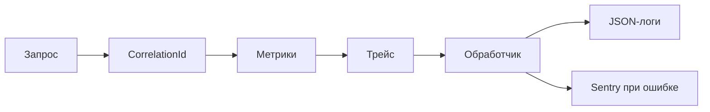

Это финальный урок модуля: ты соберёшь небольшой, но законченный сервис, в котором объединены все четыре столпа наблюдаемости — логи, трейсы, метрики и обработка ошибок — плюс healthchecks и тесты. Такой каркас — то, что ты будешь строить в каждом проде-сервисе.

## Архитектура проекта

Проект называется `orders_service`. Структура:

```
orders_service/
├── app/
│   ├── __init__.py
│   ├── main.py            # FastAPI, middleware, endpoints
│   ├── config.py          # настройки из переменных окружения
│   ├── logging_setup.py   # JSON-логи + correlation id
│   ├── telemetry.py       # OpenTelemetry: провайдер, инструментация
│   ├── metrics.py         # Prometheus: Counter/Gauge/Histogram, /metrics
│   ├── sentry_setup.py    # Sentry: init, before_send
│   └── health.py          # liveness/readiness
├── tests/
│   ├── test_health.py
│   ├── test_metrics.py
│   └── test_app.py
├── requirements.txt
└── pytest.ini
```

Каждый модуль отвечает за одно. Такой стиль («по одному ответственности») сильно упрощает отладку: если метрики не появились — проверяем `metrics.py`, если логи без correlation id — `logging_setup.py`.

## Конфигурация через окружение

Все настройки — из переменных окружения, без «захардкоженных» значений (иначе прод-конфиг попадёт в репозиторий):

```python
import os

LOG_LEVEL = os.getenv("LOG_LEVEL", "INFO")
OTEL_EXPORTER = os.getenv("OTEL_EXPORTER", "console")  # console | otlp
SENTRY_DSN = os.getenv("SENTRY_DSN", "")
```

В тестах эти же переменные позволяют выключить Sentry и экспорт трейсов в сеть.

## Порядок сборки

1. **Config** — читаем переменные окружения.
2. **Logging** — JSON-логи с `correlation_id` (contextvars + фильтр).
3. **Telemetry** — `TracerProvider` с `ConsoleSpanExporter` (в проде — OTLP), `FastAPIInstrumentor.instrument_app(app)`.
4. **Metrics** — счётчики запросов, гистограмма длительности, эндпоинт `/metrics`.
5. **Sentry** — `init()` с `before_send` (маскирование секретов).
6. **Health** — `/healthz` и `/readyz`.

Middleware-цепочка в `main.py` — по одному middleware на каждый сигнал. `correlation_id` ставится в `logging_setup`, чтобы все логи запроса имели общий id.

## Что будет проверяться

Тесты не трогают сеть: `InMemorySpanExporter` вместо OTLP, `CollectingTransport` для Sentry, `DummyChecker` для readiness. Это позволяет запускать `pytest` в CI без внешних сервисов — и именно так проверяется «наблюдаемое» приложение.

## Поток запроса через слои наблюдаемости

В готовом сервисе каждый запрос проходит через несколько независимых слоёв. Важно, чтобы они не дублировали работу и были связаны общим идентификатором:



`correlation_id` связывает логи между собой, `trace_id` — логи с трейсом, а метрики дают агрегаты по тем же запросам. Именно поэтому в проекте порядок middleware и фильтров так важен.

## Лучшие практики

- **Один сигнал — один модуль**: логи, трейсы, метрики и ошибки не должны быть перемешаны в коде приложения.
- **Все внешние системы — за интерфейсом**: checker'ы, экспортёры и транспорты можно подменить в тестах.
- **Конфиг через окружение**: без секретов в коде.
- **Тесты должны проходить без сети и без реальных DSN**: иначе CI станет нестабильным.

<!--TASK-->
### Задача 1
Создай структуру проекта `orders_service` с файлами из теории: `app/config.py` (переменные `LOG_LEVEL`, `OTEL_EXPORTER`, `SENTRY_DSN` через `os.getenv`), `app/main.py` (FastAPI с эндпоинтом `GET /orders` возвращающим `{"orders": []}`), `app/logging_setup.py` (функция `setup_logging()` с JSON-форматтером и фильтром `CorrelationIdFilter`), `requirements.txt` с перечнем: `fastapi`, `uvicorn`, `opentelemetry-sdk`, `opentelemetry-instrumentation-fastapi`, `prometheus-client`, `sentry-sdk`, `python-json-logger`, `pytest`, `httpx`. Проверь, что `uvicorn app.main:app` запускается и `/orders` отвечает 200.

### Задача 2
Добавь в `app/main.py` middleware `CorrelationIdMiddleware`: он читает заголовок `X-Request-ID`, если его нет — создаёт новый через `uuid4().hex`, сохраняет в `correlation_id` (contextvars), и кладёт его в заголовок ответа. В `app/logging_setup.py` подключи `CorrelationIdFilter` (как в уроке 1). Напиши pytest-тест в `tests/test_app.py`: создай `TestClient(app)`, сделай запрос с заголовком `X-Request-ID: req-123`, затем проверь, что ответ содержит заголовок `X-Request-ID: req-123`, а в логах (через StringIO-хендлер) последняя запись содержит `correlation_id == "req-123"`. Запусти `pytest tests/ -v`.

### Задача 3
Добавь в `app/telemetry.py` настройку OpenTelemetry: `TracerProvider` с `Resource(service.name="orders-service")`, `BatchSpanProcessor`, экспортёр выбирается по `OTEL_EXPORTER`: если `console` — `ConsoleSpanExporter`, если `otlp` — `OTLPSpanExporter(endpoint=...)` (можно заглушку). В `app/main.py` вызови `FastAPIInstrumentor.instrument_app(app)` после создания приложения. Проверь, что при `OTEL_EXPORTER=console` после запроса к `/orders` в консоли появляется спан с именем `GET /orders`.

### Задача 4
Добавь в `app/metrics.py` метрики (Counter `http_requests_total` с метками `method`, `status`; Histogram `http_request_duration_seconds` с бакетами из урока 3; Gauge `http_inflight_requests`) и эндпоинт `/metrics` в `main.py`. Добавь в `app/health.py` `HealthChecker`, `DummyChecker`, `CachedHealthChecker` и эндпоинты `/healthz`, `/readyz`. Затем напиши pytest-тесты в `tests/test_integration.py`: тест 1 — `GET /healthz` → 200; тест 2 — `GET /metrics` → 200 и содержит строку `http_requests_total`; тест 3 — после двух запросов к `/orders` в `/metrics` есть `http_requests_total{method="GET",status="200"} 2.0`. Запусти `pytest tests/ -v`.

### Задача 5
Добавь в `app/sentry_setup.py` функцию `init_sentry()` (SENTRY_DSN из config, `before_send=mask_secrets` из урока 4, `transport=None` для тестов) и подключи её в `main.py`. Напиши финальный тест: `CollectingTransport` (из урока 4), запрос к `/orders`, проверь, что транспорт пуст (ошибок нет), а затем `GET /orders?fail=1` (добавь эндпоинт, который бросает `RuntimeError`) — проверь, что `transport.events` содержит событие с `exception`. Запусти всю серию `pytest tests/ -v` и убедись, что все тесты проходят без сети.
### Задача 6
Свяжи логи с трейсами. Добавь в `app/logging_setup.py` фильтр `TraceContextFilter`, который берёт `trace.get_current_span().get_span_context()` и, если `span_context.is_valid`, кладёт в запись `trace_id` и `span_id` в hex-виде (`format(span_context.trace_id, "032x")`, `format(span_context.span_id, "016x")`), иначе ставит `"-"`. Подключи фильтр к обработчику вместе с `CorrelationIdFilter`. В `tests/test_trace_logs.py` настрой `InMemorySpanExporter`, открой спан `"checkout"`, внутри него залогируй событие и проверь, что `record["trace_id"]` совпадает с `format(span.get_span_context().trace_id, "032x")`, а вне спана поле равно `"-"`. Ожидаемый вывод: `1 passed`, в каждой строке лога есть `trace_id`.

### Задача 7
Собери отчёт SLO из exposition-текста. В `app/slo.py` напиши функции `sum_counter(text: str, name: str) -> float`, которая суммирует значения всех серий указанного счётчика (игнорируя `# HELP` и `# TYPE`), и `error_ratio(text: str, threshold: float = 0.05) -> dict`, возвращающую `{"requests": ..., "errors": ..., "ratio": ..., "burning": bool}`. Считай `requests` по `http_requests_total`, `errors` — по `http_errors_total`; если запросов ноль, `ratio` равен 0.0. В `tests/test_slo.py` подай текст с двумя сериями запросов (`5.0` и `3.0`) и одной серией ошибок (`0.4`) и проверь `ratio == 0.05` и `burning is False`, а затем текст с `0.5` ошибок — `burning is True`. Ожидаемый вывод: `2 passed`.
<!--/TASK-->

<!--HINT-->
### Подсказка 1
`config.py`: `import os; LOG_LEVEL = os.getenv("LOG_LEVEL", "INFO")`. `main.py`: `from fastapi import FastAPI; app = FastAPI()`. Не забудь, что `uvicorn app.main:app` запускается из папки `orders_service` (там, где лежит `app/`). `requirements.txt` — просто список, без версий.

### Подсказка 2
Middleware: `@app.middleware("http")`; `request.headers.get("X-Request-ID") or uuid4().hex`; `correlation_id.set(value)`; `response.headers["X-Request-ID"] = value`. Для логов: `StringIO`-хендлер в тесте, фильтр должен быть добавлен к обработчику. Помни: `TestClient` требует, чтобы `app` был импортирован до теста.

### Подсказка 3
`OTLPSpanExporter` импортируется из `opentelemetry.exporter.otlp.proto.http.trace_exporter`. В тесте не нужно ничего проверять автоматически — достаточно, что при `console` спан печатается в stdout. Если `OTEL_EXPORTER=otlp` без реального коллектора — экспортёр будет молча переотправлять; это ок для демонстрации.

### Подсказка 4
В `metrics.py` создай метрики на уровне модуля. Не забудь `CONTENT_TYPE_LATEST` и `generate_latest()`. `CachedHealthChecker` бери из урока 5. В тесте проверяй через `client.get("/metrics").text`.

### Подсказка 5
`CollectingTransport` определи в `tests/conftest.py` или прямо в тесте. `init_sentry` должна принимать `transport=None`, чтобы тест подставил `CollectingTransport()`. Для `/orders?fail=1` — `raise RuntimeError("boom")` в обработчике; `TestClient` вернёт 500, а Sentry поймает исключение автоматически. Не забудь в тесте вызвать `init_sentry(..., transport=transport)` **до** создания `TestClient`.
### Подсказка 6
Импорт: `from opentelemetry import trace`. Валидный контекст — это `span_context.is_valid`, а не проверка на `None`: у «пустого» спана контекст существует, но невалиден. Форматируй идентификаторы с ведущими нулями через `format(..., "032x")` и `format(..., "016x")` — иначе строки будут разной длины и не совпадут с ожиданием. Фильтр должен возвращать `True` всегда, иначе запись пропадёт.

### Подсказка 7
Разбирай строки построчно: пропускай пустые и начинающиеся с `#`, затем отделяй имя метрики от значения через `rsplit(" ", 1)`. Имя серии может содержать метки в фигурных скобках — сравнивай часть до `{`. Суммируй все серии, чтобы получить общий итог по всем статусам и методам; `ratio` считай как `errors / requests`, а `burning` — как `ratio > threshold`.
<!--/HINT-->

<!--SOLUTION-->
### Разбор 1
Решение (`app/config.py`):

```python
import os

LOG_LEVEL = os.getenv("LOG_LEVEL", "INFO")
OTEL_EXPORTER = os.getenv("OTEL_EXPORTER", "console")
SENTRY_DSN = os.getenv("SENTRY_DSN", "")
```

Решение (`app/main.py`):

```python
from fastapi import FastAPI

app = FastAPI(title="Orders Service")

@app.get("/orders")
def list_orders():
    return {"orders": []}
```

`requirements.txt`:

```
fastapi
uvicorn
opentelemetry-sdk
opentelemetry-instrumentation-fastapi
prometheus-client
sentry-sdk
python-json-logger
pytest
httpx
```

Что здесь происходит? Это каркас: конфиг читает окружение, приложение минимально, зависимости явные. `httpx` нужен для `TestClient` (он внутри использует httpx). Проверка запуска: `uvicorn app.main:app --reload` → `http://127.0.0.1:8000/orders` → `{"orders":[]}`. С этого момента весь дальнейший код будет наращиваться вокруг этих файлов.

### Разбор 2
Решение (`app/logging_setup.py`):

```python
import contextvars
import logging
from pythonjsonlogger import jsonlogger

correlation_id: contextvars.ContextVar[str] = contextvars.ContextVar("correlation_id", default="-")

class CorrelationIdFilter(logging.Filter):
    def filter(self, record: logging.LogRecord) -> bool:
        record.correlation_id = correlation_id.get()
        return True

def setup_logging(stream=None) -> logging.Logger:
    logger = logging.getLogger("orders")
    logger.handlers = []
    handler = logging.StreamHandler(stream)
    handler.setFormatter(jsonlogger.JsonFormatter(
        "%(asctime)s %(levelname)s %(message)s",
        rename_fields={"asctime": "timestamp", "levelname": "level"},
    ))
    handler.addFilter(CorrelationIdFilter())
    logger.addHandler(handler)
    logger.setLevel(logging.INFO)
    logger.propagate = False
    return logger
```

В `main.py`:

```python
import uuid
from fastapi import Request
from app.logging_setup import correlation_id, setup_logging

logger = setup_logging()

@app.middleware("http")
async def correlation_id_middleware(request: Request, call_next):
    value = request.headers.get("X-Request-ID") or uuid4().hex
    token = correlation_id.set(value)
    try:
        response = await call_next(request)
        response.headers["X-Request-ID"] = value
        return response
    finally:
        correlation_id.reset(token)
```

Тест (`tests/test_app.py`):

```python
import io
import json
from fastapi.testclient import TestClient
from app.main import app

def test_correlation_id_in_logs():
    buf = io.StringIO()
    setup_logging(stream=buf)
    client = TestClient(app)
    resp = client.get("/orders", headers={"X-Request-ID": "req-123"})
    assert resp.headers["X-Request-ID"] == "req-123"
    record = json.loads(buf.getvalue().strip().splitlines()[-1])
    assert record["correlation_id"] == "req-123"
```

Что здесь происходит? Middleware забирает или создаёт id, кладёт его в `contextvars`, а фильтр подхватывает его в каждую запись. Тест проверяет сквозную корреляцию: id из заголовка запроса дошёл до JSON-лога.

### Разбор 3
Решение (`app/telemetry.py`):

```python
from opentelemetry import trace
from opentelemetry.sdk.resources import Resource
from opentelemetry.sdk.trace import TracerProvider
from opentelemetry.sdk.trace.export import BatchSpanProcessor, ConsoleSpanExporter

from app.config import OTEL_EXPORTER

def setup_telemetry():
    provider = TracerProvider(resource=Resource.create({"service.name": "orders-service"}))
    if OTEL_EXPORTER == "console":
        exporter = ConsoleSpanExporter()
    else:
        from opentelemetry.exporter.otlp.proto.http.trace_exporter import OTLPSpanExporter
        exporter = OTLPSpanExporter(endpoint="http://collector:4318/v1/traces")
    provider.add_span_processor(BatchSpanProcessor(exporter))
    trace.set_tracer_provider(provider)
```

В `main.py`:

```python
from opentelemetry.instrumentation.fastapi import FastAPIInstrumentor
from app.telemetry import setup_telemetry

setup_telemetry()
FastAPIInstrumentor.instrument_app(app)
```

Что здесь происходит? Выбор экспортёра вынесен в конфиг. В проде ставишь `OTEL_EXPORTER=otlp`, в разработке — `console`. `FastAPIInstrumentor` добавляет спан на каждый запрос. Проверка: с `OTEL_EXPORTER=console` после запроса в stdout появляется JSON-описание спана `GET /orders`.

### Разбор 4
Решение (`app/metrics.py`):

```python
from prometheus_client import CONTENT_TYPE_LATEST, Counter, Gauge, Histogram, generate_latest

HTTP_REQUESTS = Counter("http_requests_total", "Total HTTP requests", ["method", "status"])
HTTP_ERRORS = Counter("http_errors_total", "Total error responses", ["status"])
INFLIGHT = Gauge("http_inflight_requests", "Requests currently being processed")
REQUEST_DURATION = Histogram(
    "http_request_duration_seconds", "Request duration in seconds",
    buckets=(0.05, 0.1, 0.25, 0.5, 1.0, 2.5, 5.0),
)

def metrics_response():
    from fastapi.responses import Response
    return Response(content=generate_latest(), media_type=CONTENT_TYPE_LATEST)
```

В `main.py`:

```python
import time
from app.metrics import (HTTP_ERRORS, HTTP_REQUESTS, INFLIGHT,
                         REQUEST_DURATION, metrics_response)

@app.middleware("http")
async def metrics_middleware(request: Request, call_next):
    INFLIGHT.inc()
    start = time.perf_counter()
    try:
        response = await call_next(request)
    finally:
        REQUEST_DURATION.observe(time.perf_counter() - start)
        INFLIGHT.dec()
    if response.status_code >= 400:
        HTTP_ERRORS.labels(status=str(response.status_code)).inc()
    HTTP_REQUESTS.labels(method=request.method, status=str(response.status_code)).inc()
    return response

@app.get("/metrics")
def metrics():
    return metrics_response()
```

Тест (`tests/test_integration.py`):

```python
from fastapi.testclient import TestClient
from app.main import app

def test_healthz():
    assert TestClient(app).get("/healthz").status_code == 200

def test_metrics_endpoint():
    client = TestClient(app)
    resp = client.get("/metrics")
    assert resp.status_code == 200
    assert "http_requests_total" in resp.text

def test_metrics_counts_requests():
    client = TestClient(app)
    client.get("/orders")
    client.get("/orders")
    text = client.get("/metrics").text
    assert 'http_requests_total{method="GET",status="200"} 2.0' in text
```

Что здесь происходит? Метрики считают только реальные запросы: два вызова `/orders` дают 2.0 в счётчике. Обрати внимание: запрос к самому `/metrics` тоже увеличивает счётчик, поэтому проверка делается **после** чтения текста — а точнее, читается уже готовый текст с уже учтённым последним запросом.

### Разбор 5
Решение (`app/sentry_setup.py`):

```python
import sentry_sdk
from app.config import SENTRY_DSN

def mask_secrets(event: dict):
    extra = event.get("extra", {})
    for key in list(extra):
        if "password" in key.lower() or "token" in key.lower():
            extra[key] = "***"
    return event

def init_sentry(transport=None):
    sentry_sdk.init(
        dsn=SENTRY_DSN,
        environment="production",
        release="orders@1.0.0",
        traces_sample_rate=0.5,
        before_send=mask_secrets,
        transport=transport,
    )
```

В `main.py`:

```python
@app.get("/orders")
def list_orders(fail: int = 0):
    if fail:
        raise RuntimeError("boom")
    return {"orders": []}
```

Тест:

```python
from sentry_sdk.transport import Transport
from app.sentry_setup import init_sentry

class CollectingTransport(Transport):
    def __init__(self, options=None):
        super().__init__(options)
        self.events = []
    def capture_envelope(self, envelope):
        event = envelope.get_event()
        if event is not None:
            self.events.append(event)

def test_no_errors_on_ok():
    transport = CollectingTransport()
    init_sentry(dsn="https://public@o0.ingest.us.sentry.io/0", transport=transport)
    TestClient(app).get("/orders")
    assert transport.events == []

def test_error_captured():
    transport = CollectingTransport()
    init_sentry(dsn="https://public@o0.ingest.us.sentry.io/0", transport=transport)
    client = TestClient(app, raise_server_exceptions=False)
    client.get("/orders?fail=1")
    assert len(transport.events) == 1
    assert "exception" in transport.events[0]
```

Что здесь происходит? Успешный запрос не порождает событий. Ошибочный — автоматически захватывается ASGI-интеграцией и попадает в `CollectingTransport`. Тесты полностью автономны: ни один из них не ходит в сеть, а значит, `pytest tests/ -v` проходит в CI без внешних сервисов. Это и есть финальная проверка «наблюдаемого» приложения.
### Разбор 6
Решение (`app/logging_setup.py`, фрагмент):

```python
import logging

from opentelemetry import trace

class TraceContextFilter(logging.Filter):
    def filter(self, record: logging.LogRecord) -> bool:
        span_context = trace.get_current_span().get_span_context()
        if span_context.is_valid:
            record.trace_id = format(span_context.trace_id, "032x")
            record.span_id = format(span_context.span_id, "016x")
        else:
            record.trace_id = "-"
            record.span_id = "-"
        return True

# при настройке handler:
# handler.addFilter(CorrelationIdFilter())
# handler.addFilter(TraceContextFilter())
```

Тест (`tests/test_trace_logs.py`):

```python
import io
import json
import logging

from opentelemetry import trace
from opentelemetry.sdk.trace import TracerProvider
from opentelemetry.sdk.trace.export import SimpleSpanProcessor
from opentelemetry.sdk.trace.export.in_memory_span_exporter import InMemorySpanExporter

from app.logging_setup import TraceContextFilter

def test_trace_id_in_logs():
    exporter = InMemorySpanExporter()
    provider = TracerProvider()
    provider.add_span_processor(SimpleSpanProcessor(exporter))
    tracer = provider.get_tracer("test")

    stream = io.StringIO()
    handler = logging.StreamHandler(stream)
    handler.setFormatter(logging.Formatter("%(trace_id)s"))
    handler.addFilter(TraceContextFilter())
    logger = logging.getLogger("trace-test")
    logger.handlers = [handler]
    logger.setLevel(logging.INFO)
    logger.propagate = False

    with tracer.start_as_current_span("checkout") as span:
        expected = format(span.get_span_context().trace_id, "032x")
        logger.info("inside span")

    logger.info("outside span")
    lines = stream.getvalue().strip().splitlines()
    assert lines[0] == expected
    assert lines[1] == "-"
```

Что здесь происходит? Логи и трейсы — разные сигналы, но без общей связи они бесполезны: вы видите медленный спан, но не знаете, какие записи к нему относятся. `TraceContextFilter` берёт текущий спан из контекста OTel (тот же `contextvars`-механизм, что и у correlation id) и добавляет два поля в каждую запись. `is_valid` — правильная проверка: у неактивного спана `trace_id` равен нулю, и без неё в логах появились бы «нулевые» идентификаторы, которые никуда не ведут. Форматирование в hex с фиксированной шириной совпадает с тем, что показывает Jaeger или Tempo, поэтому идентификатор можно просто скопировать из лога в поиск по трейсам. В проде такой фильтр ставится на тот же handler, что и JSON-форматтер, и не добавляет заметных накладных расходов.

### Разбор 7
Решение (`app/slo.py`):

```python
def sum_counter(text: str, name: str) -> float:
    total = 0.0
    for line in text.splitlines():
        line = line.strip()
        if not line or line.startswith("#"):
            continue
        series, _, raw_value = line.rpartition(" ")
        metric_name = series.split("{", 1)[0]
        if metric_name == name:
            total += float(raw_value)
    return total

def error_ratio(text: str, threshold: float = 0.05) -> dict:
    requests = sum_counter(text, "http_requests_total")
    errors = sum_counter(text, "http_errors_total")
    ratio = errors / requests if requests else 0.0
    return {
        "requests": requests,
        "errors": errors,
        "ratio": ratio,
        "burning": ratio > threshold,
    }
```

Тест (`tests/test_slo.py`):

```python
from app.slo import error_ratio

SAMPLE = """
# HELP http_requests_total Total requests
# TYPE http_requests_total counter
http_requests_total{method="GET",status="200"} 5.0
http_requests_total{method="GET",status="500"} 3.0
http_errors_total{status="500"} 0.4
"""

def test_ratio_at_threshold():
    report = error_ratio(SAMPLE)
    assert report["requests"] == 8.0
    assert report["errors"] == 0.4
    assert report["ratio"] == 0.05
    assert report["burning"] is False

def test_ratio_above_threshold():
    text = SAMPLE.replace("0.4", "0.5")
    assert error_ratio(text)["burning"] is True
```

Что здесь происходит? Exposition-формат — обычный текст, поэтому отчёт SLO можно построить без Prometheus и без сети, например в CI после нагрузочного теста. `sum_counter` суммирует все серии с данным именем: нас интересует общая доля ошибок, а не отдельная комбинация меток. `rpartition(" ")` отделяет значение справа, а `split("{", 1)[0]` отрезает метки от имени — так один и тот же код работает и для `http_requests_total 10.0`, и для серии с метками. Проверка `requests == 0` защищает от деления на ноль в момент старта, когда счётчиков ещё нет. Порог `0.05` — это те же 5%, что в правиле алерта из урока 5: расчёт и алерт должны использовать одну формулу, иначе дашборд и тревога будут расходиться.
<!--/SOLUTION-->

<!--QUIZ-->
Почему конфигурация выносится в переменные окружения?
- Чтобы код был короче
- Чтобы прод-настройки и секреты не попадали в репозиторий
- Чтобы ускорить запуск
* Правильный ответ: Чтобы прод-настройки и секреты не попадали в репозиторий
Окружение позволяет менять поведение без правки кода.

Что делает FastAPIInstrumentor.instrument_app(app)?
- Добавляет /metrics
- Включает трейсинг для каждого запроса
- Включает логирование
* Правильный ответ: Включает трейсинг для каждого запроса
Инструментация оборачивает приложение, чтобы создавать спаны.

Какой эндпоинт отдаёт метрики?
- /healthz
- /metrics
- /readyz
* Правильный ответ: /metrics
Prometheus опрашивает /metrics в exposition format.

Что делает CorrelationIdMiddleware?
- Читает/создаёт X-Request-ID и кладёт его в contextvars
- Считает метрики
- Отправляет исключения в Sentry
* Правильный ответ: Читает/создаёт X-Request-ID и кладёт его в contextvars
Так лог и трейс связываются с конкретным запросом.

Зачем в тестах CollectingTransport?
- Чтобы ускорить отправку
- Чтобы проверить события Sentry без сети
- Чтобы шифровать события
* Правильный ответ: Чтобы проверить события Sentry без сети
Транспорт перехватывает события вместо отправки в сеть.

Что делает CachedHealthChecker?
- Проверяет кеш Redis
- Кеширует результат readiness-проверки на ttl секунд
- Отправляет метрики
* Правильный ответ: Кеширует результат readiness-проверки на ttl секунд
Повторные запросы не дёргают зависимость.

Что из перечисленного НЕ является сигналом наблюдаемости?
- Логи
- Трейсы
- Снимки экрана
* Правильный ответ: Снимки экрана
Сигналы — traces, metrics, logs.

Почему в тестах важно «не ходить в сеть»?
- Это быстрее
- Это делает тесты детерминированными и стабильными в CI
- Это обязательное требование pytest
* Правильный ответ: Это делает тесты детерминированными и стабильными в CI
Внешние сервисы недоступны в CI и делают тесты нестабильными.

Что проверяет финальный интеграционный тест с /orders?fail=1?
- Что приложение отвечает 200
- Что Sentry автоматически захватил исключение
- Что метрики обнулились
* Правильный ответ: Что Sentry автоматически захватил исключение
Авто-захват исключений ASGI-интеграцией — ключевая проверка.

Зачем нужен отдельный модуль на каждый сигнал наблюдаемости?
- Чтобы код был красивее
- Чтобы можно было менять и отлаживать каждый сигнал независимо
- Чтобы уменьшить число файлов
* Правильный ответ: Чтобы можно было менять и отлаживать каждый сигнал независимо
Разделение ответственности упрощает сопровождение.
Зачем добавлять trace_id в JSON-логи?
- Чтобы связать запись лога с конкретным трейсом
- Чтобы уменьшить размер логов
- Чтобы заменить correlation_id
* Правильный ответ: Чтобы связать запись лога с конкретным трейсом
Идентификатор можно скопировать в Jaeger или Tempo и увидеть весь путь запроса.

Как проверить, что текущий спан активен?
- span_context.is_valid
- span is None
- trace_id == 0
* Правильный ответ: span_context.is_valid
У неактивного спана контекст существует, но невалиден.

Зачем валидировать конфигурацию на старте?
- Чтобы приложение упало сразу с понятной ошибкой, а не в первом запросе
- Чтобы ускорить импорт модулей
- Чтобы отключить логирование
* Правильный ответ: Чтобы приложение упало сразу с понятной ошибкой, а не в первом запросе
Fail-fast экономит время на диагностику в проде.

Почему отчёт SLO считает сумму всех серий http_requests_total?
- Нас интересует общая доля ошибок по сервису, а не по отдельной метке
- Так быстрее работает Python
- Иначе Prometheus не соберёт метрики
* Правильный ответ: Нас интересует общая доля ошибок по сервису, а не по отдельной метке
Суммирование по сериям даёт корректный знаменатель для ratio.
<!--/QUIZ-->
