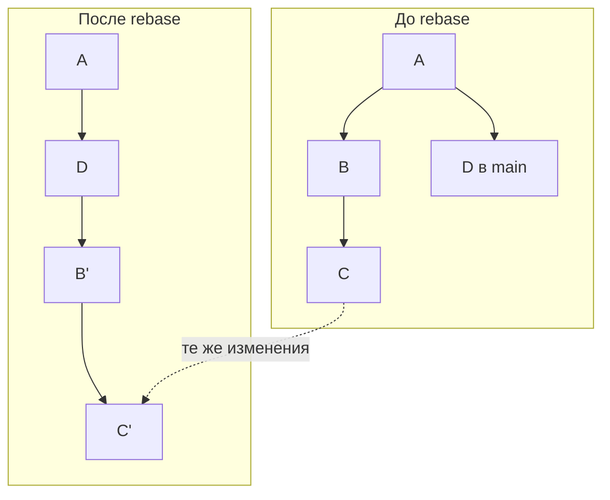

`git merge` и `git rebase` решают одну и ту же задачу — соединить две ветки, — но по-разному. Merge создаёт отдельный «сливочный» коммит и сохраняет ветвление. Rebase **переписывает** коммиты одной ветки и кладёт их поверх новой базы, делая историю идеально линейной. Для open-source и командной работы это золотой стандарт: по линейной истории легко читать, легко делать код-ревью и легко находить первый сломавший что-то коммит через `git bisect` (подробно — в уроке 3).

## Как устроен rebase

Представь, что у тебя есть `main` с коммитом `A`, и ветка `feature`, где поверх `A` лежат `B` и `C`:

```
main:   A
feature: A -> B -> C
```

После `git rebase main` (находясь на `feature`) Git берёт коммиты `B` и `C`, «срезает» их с ветки и применяет заново поверх последнего коммита `main`. Если в `main` появился новый коммит `D`, история станет такой:

```
main:    A -> D
feature:  A -> D -> B' -> C'
```

`B'` и `C'` — это **новые** коммиты с новыми хэшами и новым родителем, хотя содержательно они те же. Поэтому правило номер один: **никогда не делай rebase коммитов, которые кто-то уже пушил в общий репозиторий** — ты перепишешь общую историю, и коллеги получат разъехавшиеся репозитории.

В чём преимущество перед merge? История без «мусорных» merge-коммитов, и каждый коммит в `feature` выглядит так, будто он сделан сразу поверх актуального `main`. Это упрощает ревью: коллега видит только твои реальные изменения.

## Что происходит с историей

Полезно один раз увидеть две картинки рядом: до rebase ветка `feature` ответвляется от старого `A`, после — её коммиты лежат поверх свежего `D`. Старые `B` и `C` остаются в reflog, но в истории ветки их заменяют `B'` и `C'`.



Именно смена родителя меняет хэш: содержимое `B'` и `B` может совпадать, но `parent` другой, а значит, и SHA другой.

## Практика: базовый rebase

```bash
# стартуем от актуального main
git checkout main
git pull --rebase

# создаём ветку и работаем
git checkout -b feature/login-form
# ... вносим изменения ...
git add .
git commit -m "feat: добавить форму логина"

# когда main ушёл вперёд — перебазируемся
git checkout main
git pull --rebase          # обновили main
git checkout feature/login-form
git rebase main
```

Если конфликтов нет, Git молча переложит коммиты. Посмотреть результат:

```bash
git log --graph --oneline --all --decorate
```

Заметь: `log` показывает одну линию, без «вилок».

## Интерактивный rebase

`git rebase -i HEAD~3` открывает редактор со списком коммитов:

```
pick 1a2b3c feat: добавить форму логина
pick 4d5e6f fix: исправить валидацию
pick 7g8h9i docs: комментарии к форме
```

Меняя первое слово в строке, можно:

- `pick` — оставить коммит как есть;
- `reword` — поменять сообщение коммита;
- `squash` — влить коммит в предыдущий (объединить);
- `fixup` — то же, но без запроса сообщения (использется для мелких правок);
- `drop` — удалить коммит;
- `edit` — остановиться, чтобы изменить содержимое.

Склеить два коммита в один: второму поставь `squash`:

```
pick 1a2b3c feat: добавить форму логина
squash 4d5e6f fix: исправить валидацию
```

После сохранения Git предложит ввести новое объединённое сообщение. Итог: вместо двух коммитов — один, содержащий изменения обоих.

Внимание: `-i` переписывает и **последний** коммит тоже — если его уже пушили, такое запрещено правилом выше.

## cherry-pick: перенести коммит в другую ветку

Иногда нужно применить **конкретный** коммит в другую ветку, не таща всю ветку. Например, исправление бага на `main` нужно продублировать в релизную ветку:

```bash
git log --oneline main -5     # найти хэш нужного коммита
git checkout release/1.4
git cherry-pick 3f2a1b
```

Git применит изменения этого коммита как новый коммит поверх `release/1.4`. Несколько подряд:

```bash
git cherry-pick ab12cd3 de4ef56
```

Или целый диапазон от `old` (не включая) до `new` (включая):

```bash
git cherry-pick old..new
```

Если возник конфликт, Git остановится: реши его (урок 2) и продолжи либо `git cherry-pick --continue`, либо отмени всё затею — `git cherry-pick --abort`. Флаг `--no-commit` (`-n`) применяет изменения, но не создаёт коммит — удобно, когда нужно влить несколько правок в один коммит.

## Когда что выбирать

- **Публичная общая ветка** (`main`, `develop`) — только merge или squash-merge через PR, никаких переписываний.
- **Личная фича-ветка** — смело rebase и squash, она ещё не опубликована.
- **Перенос отдельного фикса** в релиз — cherry-pick.
- **Порядок коммитов в своей ветке** — интерактивный rebase.

Rebase не удаляет старые коммиты навсегда: Git ещё ~90 дней хранит их в `reflog` (урок 3), так что «сломанный» rebase почти всегда можно откатить.

<!--TASK-->
### Задача 1
Создай в пустой папке временный репозиторий и разыграй сценарий «грязного» расхождения веток:

1. `git init`; настрой `user.name` и `user.email`.
2. На `main` создай файл `app.py` с одной строкой `VERSION = "1.0"` и закоммить его.
3. Создай ветку `feature`, добавь в `app.py` строку `FEATURE = True` и сделай коммит.
4. Вернись на `main`, добавь строку `BUGFIX = True` и тоже закоммить.
5. Перейди на `feature` и выполни `git rebase main`.
6. Выполни `git log --oneline --graph --all` и проверь: история линейна, оба наших коммита на месте, а первым идёт коммит с `BUGFIX`.

Ожидаемый результат: в выводе `git log --graph` нет символа `|/` (вилок), и видно ровно три коммита в одну линию. Запиши вывод `git log --oneline -5` в блокнот — он понадобится в задаче 5.

### Задача 2
Напиши pytest-тест `test_rebase.py`, который на временном репозитории проверяет, что rebase переносит коммиты ветки поверх новой базы `main`. Используй `tempfile.TemporaryDirectory`, `subprocess.run` и хелпер `git(*args, cwd=repo)`. Сценарий: `main` — коммит `A`; ветка `feature` от `A` — коммиты `B`, `C`; затем на `main` добавляется коммит `D`; после `git rebase main` в `feature` должно быть: (а) коммит с сообщением `D` в истории, (б) коммиты `B` и `C` с теми же сообщениями, (в) первый родитель верхнего коммита `feature` — верхний коммит `main`. Запусти `pytest test_rebase.py -v`: ожидаемый результат — `1 passed` без пропусков.

### Задача 3
Интерактивный rebase. В репозитории из задачи 1 (или новом) сделай **три** коммита подряд на одной ветке: `feat: каркас`, `fix: опечатка`, `docs: пояснение`. Затем выполни `git rebase -i HEAD~3` и:

- объедини `fix` и `docs` с `feat` через `squash` (итог — один коммит `feat: каркас`);
- затем `git rebase -i HEAD~1` с `reword`, чтобы переименовать его в `feat: каркас с правками`.

Проверь `git log --oneline`: должна быть ровно одна строка. Ожидаемый результат: `git log --oneline` выводит один коммит с новым сообщением, а `git status` — «nothing to commit» (рабочее дерево чистое).

### Задача 4
Напиши pytest-тест `test_cherry_pick.py`: создай временный репозиторий, ветку `feature` с коммитом, меняющим файл (например, добавляющим строку `C = 3`), затем вернись на `main`, добавь другой коммит, и выполни `git cherry-pick <sha_feature>`. Проверь: (а) `main` теперь содержит изменение `C = 3`, (б) хэш нового коммита не равен оригинальному, (в) сообщение коммита совпадает с исходным, (г) `feature` осталась нетронутой (содержит оригинальный коммит). Запусти `pytest test_cherry_pick.py -v`: ожидаемый результат — `1 passed`.

### Задача 5
Возьми вывод `git log --oneline -5` из задачи 1 и представь, что `feature` — это релизная ветка, а на `main` нашлись два бага. Выполни cherry-pick **диапазона** коммитов:

```bash
git checkout -b hotfix
git cherry-pick <sha_бага1>..<sha_бага2>
```

(где `<sha_бага1>` и `<sha_бага2>` — хэши коммитов из вывода лога). Проверь `git log --oneline`. Ожидаемый результат: в `hotfix` появились два новых коммита с теми же сообщениями, что и баги, и их количество равно числу коммитов в диапазоне.
### Задача 6
Освой `git rebase --onto`, когда нужно перенести не всю ветку, а только её хвост. Во временном репозитории создай на `main` коммит `A` (`base.py`), затем ветку `feature` с коммитами `B` (`b.py`), `C` (`c.py`) и `D` (`d.py`). Вернись на `main` и добавь коммит `E` (`main.py`). Запомни хэш `B` и выполни `git rebase --onto main <sha_B> feature`. Проверь через `git log --format=%s feature`, что в ветке остались `D`, `C`, `E`, `A`, а коммита `B` нет. Ожидаемый вывод: четыре сообщения в обратном хронологическом порядке и отсутствие `B`.

### Задача 7
Разбери два флага cherry-pick. В репозитории с ветками `main` и `release` сделай на `main` коммит `fix: округление` и перенеси его в `release` командой `git cherry-pick -x <sha>`. Проверь, что `git log -1 --format=%B` содержит строку `(cherry picked from commit <sha>)`. Затем сделай второй фикс на `main`, примени его через `git cherry-pick -n <sha>`, убедись, что `HEAD` не изменился, а `git status --porcelain` показывает изменённый файл, и только потом закоммить оба изменения одним коммитом `release: фиксы округления`. Ожидаемый вывод: в `release` два коммита, первый содержит ссылку на оригинал.
<!--/TASK-->

<!--HINT-->
### Подсказка 1
После `git rebase main` смотри на `git log --oneline --graph --all`. Линейная история — это когда в первом столбце графа нет ни одной «вилки». Если она есть — значит rebase не выполнился или ты оказался не на `feature`. Проверить текущую ветку: `git branch --show-current`.

### Подсказка 2
Хелпер: `def git(*args, cwd): subprocess.run(["git", *args], cwd=cwd, check=True, capture_output=True, text=True)`. Хэш коммита бери через `git rev-parse main`; первого родителя — через `git rev-parse feature~1`. Для создания ветки с коммитами иди по шагам: `git checkout -b feature`, правь файл, `git add`, `git commit`. Не забудь настроить `user.name`/`user.email` в тесте, иначе коммиты упадут.

### Подсказка 3
В редакторе rebase строки идут сверху вниз: первая — самый старый коммит. Чтобы объединить, замени `pick` на `squash` у строк `fix` и `docs`. После сохранения Git откроет редактор сообщения — оставь первое или впиши своё и сохрани. Для `reword` в `-i HEAD~1` просто поменяй строку с `pick` на `reword`, затем правь сообщение.

### Подсказка 4
После `git cherry-pick` проверь содержимое файла `read_text()`, а хэш — через `git rev-parse HEAD` до и после cherry-pick. Сравни сообщения через `git log -1 --format=%s`. Чтобы получить sha фичи до перехода на main, сохрани его в переменную заранее: `sha_feature = git("rev-parse", "feature")`.

### Подсказка 5
Диапазон `A..B` включает коммиты после `A` вплоть до `B`. Если в `hotfix` оказалось больше коммитов, чем ожидалось, проверь, что `A` — ровно тот коммит, после которого должны идти переносимые. Отменить ошибочный cherry-pick можно `git cherry-pick --abort`.
### Подсказка 6
Синтаксис: `git rebase --onto <новая_база> <коммит_после_которого> <ветка>` — переносятся коммиты, которые есть в `<ветка>`, но нет в `<коммит_после_которого>`, то есть сам `B` не переносится. Хэш `B` получи через `git rev-parse feature~2` или `git log --format=%H --grep="^B$"`. Если перепутать аргументы, Git может сказать `fatal: invalid upstream`, поэтому проверяй порядок: сначала `main`, потом `B`, потом `feature`.

### Подсказка 7
`-x` дописывает в сообщение строку `(cherry picked from commit ...)` — это удобно для аудита релизной ветки. `-n` (`--no-commit`) применяет изменения в индекс и рабочее дерево, но не создаёт коммит: `HEAD` остаётся прежним, а `git status` покажет staged-файлы. После `-n` можно добавить ещё изменения и сделать один общий коммит.
<!--/HINT-->

<!--SOLUTION-->
### Разбор 1
Рабочий сценарий:

```bash
mkdir rebase-demo && cd rebase-demo
git init
git config user.name "Тест"
git config user.email "test@example.com"

echo 'VERSION = "1.0"' > app.py
git add app.py && git commit -m "feat: базовая версия"

git checkout -b feature
echo 'FEATURE = True' >> app.py
git add app.py && git commit -m "feat: фича"

git checkout main
echo 'BUGFIX = True' >> app.py
git add app.py && git commit -m "fix: баг"

git checkout feature
git rebase main
git log --oneline --graph --all
```

Первые два коммита (базовая версия и фича) делаются на `feature`; затем `main` уходит вперёд на один коммит. После `git rebase main` Git берёт коммит фичи с ветки `feature` и накладывает его поверх `main`. Итоговый граф — одна прямая линия:

```
* (feature) feat: фича
* (main) fix: баг
* feat: базовая версия
```

Обрати внимание: интересно, что коммит фичи теперь «выглядит» так, будто был создан после исправления бага, хотя хронологически он старше. Это и есть суть rebase — история становится линейной, а не хронологической. Если бы мы сделали merge, появился бы третий коммит слияния и вилка в графе.

### Разбор 2
Полное решение:

```python
import subprocess
import tempfile
from pathlib import Path

import pytest


def git(*args, cwd):
    return subprocess.run(
        ["git", *args], cwd=cwd, check=True,
        capture_output=True, text=True,
    ).stdout.strip()


def commit_file(repo, name, content, message):
    (Path(repo) / name).write_text(content)
    git("add", name, cwd=repo)
    git("commit", "-m", message, cwd=repo)


def test_rebase_moves_commits():
    with tempfile.TemporaryDirectory() as repo:
        git("init", cwd=repo)
        git("config", "user.name", "Тест", cwd=repo)
        git("config", "user.email", "test@example.com", cwd=repo)

        commit_file(repo, "a.txt", "A\n", "A")
        git("checkout", "-b", "feature", cwd=repo)
        commit_file(repo, "a.txt", "A\nB\n", "B")
        commit_file(repo, "b.txt", "C\n", "C")

        git("checkout", "main", cwd=repo)
        commit_file(repo, "a.txt", "A\nD\n", "D")

        git("checkout", "feature", cwd=repo)
        git("rebase", "main", cwd=repo)

        main_head = git("rev-parse", "main", cwd=repo)
        feature_head = git("rev-parse", "feature", cwd=repo)
        parent = git("rev-parse", "feature~1", cwd=repo)

        assert parent == main_head
        messages = git("log", "--format=%s", "main..feature", cwd=repo)
        assert "B" in messages and "C" in messages
        assert "D" not in messages
```

Что здесь происходит: тест создаёт репозиторий в временной папке, хелпер `commit_file` делает коммиты (содержимое файла пишется целиком, поэтому `A\nB\n` означает «добавить строку B»). Проверки: верхний коммит `feature` первым родителем указывает на верхний коммит `main` — значит история линейна, без merge-коммита. Диапазон `main..feature` показывает только коммиты, которых нет в `main`, — там должны лежать B и C, но не D. Запуск: `pytest test_rebase.py -v` → `1 passed`.

### Разбор 3
Команды:

```bash
echo 'x = 1' > step1.py && git add step1.py
git commit -m "feat: каркас"
echo 'x = 2' >> step1.py && git add step1.py
git commit -m "fix: опечатка"
echo '# см. документацию' >> step1.py && git add step1.py
git commit -m "docs: пояснение"

git rebase -i HEAD~3
```

В редакторе:

```
pick f111111 feat: каркас
squash f222222 fix: опечатка
squash f333333 docs: пояснение
```

Сохраняем; Git просит итоговое сообщение — пишем `feat: каркас с правками`. Затем:

```bash
git rebase -i HEAD~1   # reword
```

Меняем `pick` на `reword` и сообщение на `feat: каркас с правками`. Проверка:

```bash
git log --oneline
# feat: каркас с правками
```

Почему `squash` работает: Git последовательно применяет выбранные коммиты поверх предыдущего и после каждого «вплавляет» его содержимое в один итоговый коммит. Важно: `squash` сам по себе не меняет содержимое — меняется только количество коммитов и сообщение. `reword` — чисто косметическая операция: хэш меняется, потому что сообщение участвует в вычислении хэша, но содержимое файлов не трогается.

### Разбор 4
Решение:

```python
import subprocess
import tempfile
from pathlib import Path

import pytest


def git(*args, cwd):
    return subprocess.run(
        ["git", *args], cwd=cwd, check=True,
        capture_output=True, text=True,
    ).stdout.strip()


def commit_file(repo, name, content, message):
    (Path(repo) / name).write_text(content)
    git("add", name, cwd=repo)
    git("commit", "-m", message, cwd=repo)


def test_cherry_pick_applies_single_commit():
    with tempfile.TemporaryDirectory() as repo:
        git("init", cwd=repo)
        git("config", "user.name", "Тест", cwd=repo)
        git("config", "user.email", "test@example.com", cwd=repo)

        commit_file(repo, "app.py", "A = 1\n", "base")
        sha_feature = git("rev-parse", "HEAD", cwd=repo)

        git("checkout", "-b", "feature", cwd=repo)
        commit_file(repo, "app.py", "A = 1\nC = 3\n", "feat: добавить C")
        sha_orig = git("rev-parse", "feature", cwd=repo)

        git("checkout", "main", cwd=repo)
        commit_file(repo, "app.py", "A = 1\nB = 2\n", "feat: добавить B")

        git("cherry-pick", sha_orig, cwd=repo)

        content = (Path(repo) / "app.py").read_text()
        assert "C = 3" in content
        sha_new = git("rev-parse", "HEAD", cwd=repo)
        assert sha_new != sha_orig
        assert git("log", "-1", "--format=%s", cwd=repo) == "feat: добавить C"
        assert git("rev-parse", "feature", cwd=repo) == sha_orig
```

Ключевые моменты: `sha_feature` сохраняется до создания других коммитов, чтобы cherry-pick не захватил лишнего; после операции проверяем содержимое файла (изменение реально применилось), новый хэш (коммит — новый объект), сообщение (оно переносится) и что `feature` не тронута. Если бы cherry-pick применил изменения, но не создал коммит, `HEAD` остался бы прежним — поэтому проверка `sha_new != sha_orig` ловит и эту ошибку. Запуск: `pytest test_cherry_pick.py -v` → `1 passed`.

### Разбор 5
Рабочий пример (хэши из твоего лога):

```bash
git checkout -b hotfix
git cherry-pick a1b2c3d4e5f6a7b8c9d0e1f2a3b4c5d6e7f8..b2c3d4e5f6a7b8c9d0e1f2a3b4c5d6e7f8a9
git log --oneline
```

Диапазон `A..B` в cherry-pick означает: «применить все коммиты, которые есть после `A` и вплоть до `B`». Важная деталь: `A` не включается, `B` включается. Если нужно включить и `A`, можно передать его родителя: `A~1..B`. Количество применённых коммитов равно `git rev-list --count A..B`. Итог: в `hotfix` появится столько же новых коммитов, сколько было в диапазоне, с теми же сообщениями, но новыми хэшами. Это стандартный сценарий backport: берём несколько исправлений с `main` и переносим их в релизную ветку, не дожидаясь всей остальной разработки.
### Разбор 6
Решение (`test_rebase_onto.py`):

```python
import subprocess

def git(*args, cwd):
    return subprocess.run(
        ["git", *args], cwd=cwd, check=True, capture_output=True, text=True
    ).stdout.strip()

def commit(repo, filename, message):
    (repo / filename).write_text(message, encoding="utf-8")
    git("add", filename, cwd=repo)
    git("commit", "-m", message, cwd=repo)

def test_rebase_onto_moves_only_tail(tmp_path):
    repo = tmp_path
    git("init", cwd=repo)
    git("config", "user.name", "Test", cwd=repo)
    git("config", "user.email", "test@example.com", cwd=repo)

    commit(repo, "base.py", "A")
    git("checkout", "-b", "feature", cwd=repo)
    commit(repo, "b.py", "B")
    commit(repo, "c.py", "C")
    commit(repo, "d.py", "D")
    sha_b = git("rev-parse", "HEAD~2", cwd=repo)

    git("checkout", "main", cwd=repo)
    commit(repo, "main.py", "E")

    git("rebase", "--onto", "main", sha_b, "feature", cwd=repo)
    messages = git("log", "--format=%s", "feature", cwd=repo).splitlines()
    assert messages == ["D", "C", "E", "A"]
```

Что здесь происходит? Обычный `git rebase main` перенёс бы **все** коммиты, которых нет в `main`, включая `B`. Но `B` может быть, например, экспериментальным коммитом, который не нужен в релизе. `--onto` отделяет «базу» от «того, что переносим»: Git берёт коммиты из диапазона `B..feature` (то есть `C` и `D`) и применяет их поверх `main`. Проверка `messages == ["D", "C", "E", "A"]` фиксирует и порядок, и отсутствие `B`. Такой приём часто используют, когда ветку ответвили не от той базовой ветки и нужно «перевесить» её хвост на другую.

### Разбор 7
Решение (`test_cherry_flags.py`):

```python
import subprocess

def git(*args, cwd):
    return subprocess.run(
        ["git", *args], cwd=cwd, check=True, capture_output=True, text=True
    ).stdout.strip()

def make_repo(tmp_path):
    git("init", cwd=tmp_path)
    git("config", "user.name", "Test", cwd=tmp_path)
    git("config", "user.email", "test@example.com", cwd=tmp_path)
    (tmp_path / "calc.py").write_text("def round_price(x):\n    return x\n", encoding="utf-8")
    git("add", ".", cwd=tmp_path)
    git("commit", "-m", "init", cwd=tmp_path)
    git("checkout", "-b", "release", cwd=tmp_path)
    git("checkout", "main", cwd=tmp_path)

def test_cherry_pick_x_records_origin(tmp_path):
    make_repo(tmp_path)
    (tmp_path / "calc.py").write_text("def round_price(x):\n    return round(x, 2)\n", encoding="utf-8")
    git("commit", "-am", "fix: округление", cwd=tmp_path)
    sha = git("rev-parse", "HEAD", cwd=tmp_path)

    git("checkout", "release", cwd=tmp_path)
    git("cherry-pick", "-x", sha, cwd=tmp_path)
    message = git("log", "-1", "--format=%B", cwd=tmp_path)
    assert f"(cherry picked from commit {sha})" in message

def test_cherry_pick_no_commit_keeps_head(tmp_path):
    make_repo(tmp_path)
    (tmp_path / "calc.py").write_text("def round_price(x):\n    return round(x, 2)\n", encoding="utf-8")
    git("commit", "-am", "fix: округление", cwd=tmp_path)
    sha = git("rev-parse", "HEAD", cwd=tmp_path)

    git("checkout", "release", cwd=tmp_path)
    head_before = git("rev-parse", "HEAD", cwd=tmp_path)
    git("cherry-pick", "-n", sha, cwd=tmp_path)

    assert git("rev-parse", "HEAD", cwd=tmp_path) == head_before
    assert "calc.py" in git("status", "--porcelain", cwd=tmp_path)
```

Что здесь происходит? `-x` не меняет сами изменения, но добавляет в сообщение трассируемую ссылку на оригинальный коммит. Это спасает при разборе релиза: видно, откуда пришёл фикс и не потерялся ли он при следующем мерже. `-n` останавливается на полпути: изменения уже в индексе, но коммит не создан, поэтому `HEAD` не двигается. Так удобно собрать несколько мелких фиксов в один осмысленный коммит релизной ветки. Обрати внимание на `git commit -am` в подготовке: он коммитит только отслеживаемые файлы, поэтому `calc.py` должен уже существовать в `init`. В тестах мы проверяем не только наличие строки, но и неизменность `HEAD` — иначе легко перепутать `-n` с обычным cherry-pick.
<!--/SOLUTION-->

<!--QUIZ-->
Что делает git rebase main (находясь на branch feature)?
- Создаёт merge-коммит
- Переносит коммиты feature поверх верхушки main
- Удаляет ветку main
- Копирует файлы из main в feature
* Правильный ответ: Переносит коммиты feature поверх верхушки main
Rebase срезает коммиты текущей ветки и применяет их заново поверх заданной базы, делая историю линейной.

Почему нельзя делать rebase уже опубликованных коммитов?
- Потому что это медленно
- Потому что другие участники получат расходящиеся истории и конфликты
- Потому что Git запрещает это навсегда
- Потому что коммиты пропадут из reflog
* Правильный ответ: Потому что другие участники получат расходящиеся истории и конфликты
Переписывание общих коммитов ломает историю у тех, кто их уже скачал: их копии нельзя будет применить обычным pull.

Что делает команда squash в интерактивном rebase?
- Удаляет коммит
- Объединяет коммит с предыдущим
- Переименовывает коммит
- Останавливает rebase
* Правильный ответ: Объединяет коммит с предыдущим
squash вливает содержимое выбранного коммита в коммит выше и предлагает ввести общее сообщение.

Что делает reword?
- Меняет сообщение коммита
- Меняет содержимое файлов
- Удаляет коммит
- Разбивает коммит на несколько
* Правильный ответ: Меняет сообщение коммита
reword открывает редактор для нового сообщения; хэш коммита меняется, потому что сообщение участвует в его вычислении.

Какая команда применяет один конкретный коммит в другую ветку?
- git merge <sha>
- git cherry-pick <sha>
- git apply <sha>
- git checkout <sha>
* Правильный ответ: git cherry-pick <sha>
cherry-pick берёт изменения указанного коммита и создаёт новый коммит на текущей ветке.

Что произойдёт после git cherry-pick --abort?
- Cherry-pick завершится и создаст коммит
- Все изменения cherry-pick отменятся, ветка вернётся в исходное состояние
- Репозиторий будет удалён
- Все коммиты ветки будут сжаты
* Правильный ответ: Все изменения cherry-pick отменятся, ветка вернётся в исходное состояние
--abort откатывает операцию целиком, включая частично применённые изменения.

Какая команда показывает историю в виде графа?
- git log --graph --oneline --all
- git status --graph
- git diff --graph
- git fetch --graph
* Правильный ответ: git log --graph --oneline --all
Флаг --graph рисует связи коммитов, --oneline сокращает вывод, --all включает все ветки.

Что происходит с хэшами коммитов после rebase?
- Они не меняются
- Они меняются, потому что меняется родитель
- Они меняются только у последнего коммита
- Они становятся короче
* Правильный ответ: Они меняются, потому что меняется родитель
Хэш коммита вычисляется из его родителей, сообщения и содержимого — при смене родителя хэш обязательно изменится.

Какая команда отменяет незавершённый rebase?
- git rebase --abort
- git rebase --stop
- git reset --cancel
- git rebase --undo
* Правильный ответ: git rebase --abort
--abort полностью откатывает rebase и возвращает ветку в состояние до его начала.

Для какого сценария лучше всего подходит cherry-pick?
- Для переноса отдельного исправления в релизную ветку
- Для полного переписывания истории репозитория
- Для удаления всех коммитов ветки
- Для сравнения двух веток
* Правильный ответ: Для переноса отдельного исправления в релизную ветку
Когда нужно продублировать один фикс в другой ветке, cherry-pick — самый точечный инструмент.
Что делает git rebase --onto main B feature?
- Переносит коммиты после B (не включая B) на main
- Переносит все коммиты feature, включая B
- Сливает main и feature в один коммит
- Удаляет коммит B из истории
* Правильный ответ: Переносит коммиты после B (не включая B) на main
Диапазон B..feature не включает сам B, поэтому переносится только хвост ветки.

Что добавляет флаг -x в git cherry-pick?
- Строку (cherry picked from commit ...) в сообщение коммита
- Подпись GPG
- Удаление исходного коммита
- Сжатие нескольких коммитов в один
* Правильный ответ: Строку (cherry picked from commit ...) в сообщение коммита
Это удобно для аудита: видно, откуда пришёл фикс в релизную ветку.

Чем fixup отличается от squash в интерактивном rebase?
- fixup объединяет коммит с предыдущим, но не открывает редактор сообщения
- fixup удаляет коммит
- fixup меняет только автора
- Ничем, это синонимы
* Правильный ответ: fixup объединяет коммит с предыдущим, но не открывает редактор сообщения
fixup сохраняет сообщение предыдущего коммита, squash даёт его отредактировать.

Куда указывает ORIG_HEAD сразу после rebase?
- На позицию ветки до начала rebase
- На первый коммит репозитория
- На удалённую ветку origin/main
- На stash
* Правильный ответ: На позицию ветки до начала rebase
Поэтому git reset --hard ORIG_HEAD — быстрый способ отменить неудачный rebase.
<!--/QUIZ-->
