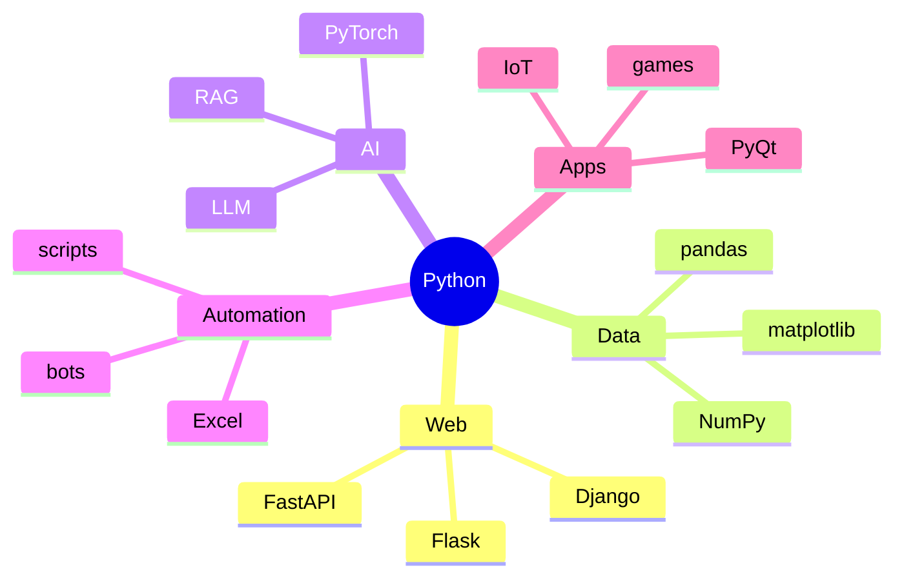

## Welcome to the world of superpowers

Imagine you've got a tool that can build almost anything: a site, a bot, a game, a neural network, a smart home system, even spacecraft control. Sounds like science fiction? But it's real — and this tool is called Python.

This module is not about boring syntax. It's about answering the main question: **why should I learn Python at all?** We'll walk through all the language's superpowers, see live examples, and at the end set a goal that will keep you learning. Inspiration is the fuel, and Python is the rocket.

## Map of possibilities

Here's what you can do in Python — and this is only the tip of the iceberg:



Each direction is a separate track in the course. You don't need to learn everything at once: choose what ignites you and follow it.

## What makes Python a superpower

Python has several qualities that make it one of the most popular languages in the world:

- **It reads like English text.** Code `if age >= 18: print("You can vote")` is understandable even to someone who has never programmed. Less magic — more clarity.
- **"Batteries included."** Python's standard library already contains hundreds of ready-made tools: working with files, dates, networks, graphics, archives, math. Much can be done without installing anything extra.
- **A huge community.** Any question has an answer; any task has a ready example. Millions of developers share their work.
- **Market demand.** Python is consistently among the top three most in-demand languages: it's used in web, science, AI, automation, and finance.
- **From beginner to professional.** You can start with three lines of code, and a couple of years later write distributed systems for millions of users.

## Your first lightning

Let's not hold back. Create a file `first.py` and write in it:

```python
print("Hello, world!")
print("I choose Python as my superpower")
```

Run it with `python first.py` and you'll see two lines. Congratulations — you just wrote a real program! `print()` is a function that outputs text to the screen. Text must be wrapped in quotes.

Python can also count:

```python
print(2 + 2)
print(10 * 5)
print("2 + 2 =", 2 + 2)
```

The third line is more interesting: inside one `print()` a string and an expression are passed, and Python prints them separated by a space. This makes the code "speaking": `2 + 2 = 4`.

## The Zen of Python

Python has a philosophy — a set of principles called the "Zen of Python". Print it right now:

```python
import this
```

You'll see beautiful lines: "Beautiful is better than ugly", "Explicit is better than implicit", "Simple is better than complex". This is not poetry but practical guidance: Python is deliberately designed so that code is readable and understandable. That's why it's so comfortable to learn.

## Date and time — your first helper

Right now you can write a program that knows today's date. The `datetime` module is for this:

```python
from datetime import datetime

now = datetime.now()
print("Today:", now.strftime("%d.%m.%Y"))
print("Now:", now.strftime("%H:%M"))
```

`datetime.now()` gets the current date and time, and `strftime()` turns them into a nice string. `%d` is the day, `%m` the month, `%Y` the year, `%H` and `%M` the hours and minutes.

## How the lessons of this module are structured

Each lesson is a short journey: theory with live examples, seven tasks for practice (with hints and solutions), and a quiz. Don't skip the tasks — it's with your hands, not your eyes, that you'll level up your superpower. If something doesn't work, read the error text: it almost always says what's wrong.

## Lesson summary

Today we learned:

- why Python is called a superpower: readability, standard library, community, demand;
- how to write and run your first program with `print()`;
- that Python can calculate right in the code;
- what the Zen of Python is and how to see it with `import this`;
- how to print the current date and time via `datetime`.

The superpower is already in your hands. Now let's lock it in with practice.

<!--TASK-->
### Task 1
Create a file `first_step.py` and write a program that prints three lines: your name, your favorite superpower (any, even "making dumplings"), and the phrase `I am starting my path as a Python developer`. Run the program with `python first_step.py` and make sure all three lines appear on the screen. If you see an error, read its text and try to understand what it means.

### Task 2
Run `import this` in your program and carefully read the Zen of Python. Choose one phrase closest to you and do two things: add it as a comment (a line starting with `#`) to your file, then print it to the screen with `print()`. In the end the program should print your favorite Zen phrase, and the comment should stay in the code as a "note for the future".

### Task 3
Write a program `super_power.py` that prints five facts about Python separated by empty lines. Use the newline character `\n` inside a string, e.g.: `print("Fact 1\n\nFact 2")`. Come up with facts yourself or take them from the lesson: readability, built-in library, community, market demand, ease for beginners. After running, the screen should show five separate paragraphs.

### Task 4
Write a program that calculates and prints: how many minutes are in a year (`365 * 24 * 60`), how many hours in a week (`7 * 24`), how many seconds in a day (`24 * 60 * 60`). Print each result with a label, as in the example: `print("Minutes in a year:", 365 * 24 * 60)`. Run the program and check the result: a year should give 525600.

### Task 5
Write a program `my_year.py` that prints the current year (via `datetime.now().year`) and the message: `N years have passed since the start of the 21st century`, where N is the current year minus 2000. For example, in 2026 N = 26. The program should compute N itself, not store a ready number. Run it and make sure both lines print correctly.

### Task 6
Write a program `budget_week.py` that calculates a weekly budget. Set three variables: `money = 2000` (how much money you have), `lunch = 250 * 5` (lunch five days a week), and `travel = 40 * 10` (round trips ten times). Compute total expenses `spent = lunch + travel` and the remainder `left = money - spent`. Print four lines with labels: `Had: 2000`, `Lunches: 1250`, `Travel: 400`, `Left: 350`. The program must compute all numbers itself — don't hardcode ready values.

### Task 7
Write a program `day_of_year.py` that prints today's date in three formats and the day-of-year number. Use `datetime.now()` and `strftime()`: the `%d.%m.%Y` pattern gives `21.11.2026`, `%Y-%m-%d` gives `2026-11-21`, and `%j` gives the day of the year as three digits, e.g. `325`. Print three lines: `Today: ...`, `ISO format: ...`, `Day of year: ...`. Run the program and verify all three lines refer to today's date, not the example date.
<!--/TASK-->

<!--HINT-->
### Hint 1
For each line use a separate `print()` call with text in quotes. Remember: running a file is the command `python filename.py` from the terminal. If a `SyntaxError` appears, look for the line and the `^` symbol in the message — that's where Python "stumbled".

### Hint 2
A comment starts with `#` and goes to the end of the line — Python ignores it. To print a phrase, write `print("Your phrase")`. Don't worry that the comment "does nothing" — that's exactly how it should be, it's for people.

### Hint 3
The `\n` character inside a string is a newline. If you write `print("A\n\nB")`, there will be an empty line between the letters. This way you can get five paragraphs by passing one string with several `\n` to `print()`.

### Hint 4
Expressions like `365 * 24 * 60` are computed by Python itself, right inside `print()`. Just substitute them instead of numbers. Note: multiplication is the `*` symbol, not `x`.

### Hint 5
To get the year, write `from datetime import datetime` at the top of the file, then use `datetime.now().year` — it returns a number, e.g. `2026`. Subtracting 2000 can be done right in `print()`: `datetime.now().year - 2000`.

### Hint 6
First compute expenses in separate variables: `lunch = 250 * 5`, `travel = 40 * 10`, then `spent = lunch + travel` and `left = money - spent`. In `print()` pass a label and a value separated by a comma — Python prints them with a space, e.g. `print("Lunches:", lunch)`. Don't hardcode numbers: let the machine compute.

### Hint 7
Add `from datetime import datetime` and save `now = datetime.now()`. Call `now.strftime(...)` three times with different patterns: `%d.%m.%Y`, `%Y-%m-%d`, and `%j`. Remember that `%j` returns a three-character string with leading zeros: for January 5 it will be `005`, not `5`.
<!--/HINT-->

<!--SOLUTION-->
### Solution 1
One possible solution:

```python
print("My name is Anna")
print("My favorite superpower is learning new things")
print("I am starting my path as a Python developer")
```

Run `python first_step.py` and see:

```
My name is Anna
My favorite superpower is learning new things
I am starting my path as a Python developer
```

What happens here? Each line is a call of `print()` with a string in quotes. Python reads the file top-to-bottom and executes each command in turn. If you forget a quote or a bracket, you'll get a `SyntaxError` — a syntax error where the program won't run at all. The error message will point to the line where things went wrong. This is a normal part of programming: errors are not failure, they are information.

### Solution 2
Solution:

```python
import this

# My favorite phrase from the Zen of Python
print("Beautiful is better than ugly")
```

Run — first the whole Zen appears, then our phrase. What happens here? `import this` prints Python's philosophy to the screen. Then Python ignores the line with `#` (that's a comment) and executes `print()`. Notice the order: the comment doesn't interfere with execution; it just helps the code reader understand the intent. This habit — writing why a step was made — will make your code professional from the first days.

### Solution 3
Solution:

```python
print("Python reads almost like English text\n\nPython has a huge built-in library\n\nPython has a huge community\n\nPython is in demand on the job market\n\nIt's easy for a beginner to start with Python")
```

Run and see five paragraphs separated by empty lines. What happens here? The `\n` character is a newline. When Python meets it inside a string, it moves to a new line on output. Two `\n` in a row give an empty line between paragraphs. So we learned to "style" output: text can be structured inside one string without calling `print()` a hundred times.

### Solution 4
Solution:

```python
print("Minutes in a year:", 365 * 24 * 60)
print("Hours in a week:", 7 * 24)
print("Seconds in a day:", 24 * 60 * 60)
```

Result:

```
Minutes in a year: 525600
Hours in a week: 168
Seconds in a day: 86400
```

What happens here? Inside `print()` two values are passed separated by a comma: a label string and an arithmetic expression. Python first computes the expression (multiplication left to right), then prints both values with a space. So the code works both as a calculator and as a "speaking" report. Notice: we didn't count anything by hand — Python did it for us, and this is your first little automation in life.

### Solution 5
Solution:

```python
from datetime import datetime

year = datetime.now().year
print("Current year:", year)
print(year - 2000, "years have passed since the start of the 21st century")
```

Result (in 2026):

```
Current year: 2026
26 years have passed since the start of the 21st century
```

What happens here? The line `from datetime import datetime` imports the `datetime` module, which works with dates. `datetime.now()` creates a "now" object, and `.year` extracts the year as a regular number. Then we put this number into the variable `year` and use it in `print()`: insert it into text and subtract 2000. A variable is a "box" with a name that holds a value. This is a fundamental idea of programming you'll work with throughout the course.

### Solution 6
One possible solution:

```python
money = 2000
lunch = 250 * 5
travel = 40 * 10
spent = lunch + travel
left = money - spent

print("Had:", money)
print("Lunches:", lunch)
print("Travel:", travel)
print("Left:", left)
```

Result:

```
Had: 2000
Lunches: 1250
Travel: 400
Left: 350
```

What happens here? Each line with `=` creates a variable — a "box" with a name that holds a value. Python first computes the expression on the right (`250 * 5` becomes `1250`), then puts the result into the variable. Then we use names, not numbers: `spent = lunch + travel` adds already computed values, and `left = money - spent` subtracts expenses from the budget. In `print()` two values are passed with a comma, and Python prints them with a space. The main benefit is that the report recalculates itself: change `money` to 1500, and all four lines will honestly show the new remainder without a single edit in the formulas.

### Solution 7
One possible solution:

```python
from datetime import datetime

now = datetime.now()

print("Today:", now.strftime("%d.%m.%Y"))
print("ISO format:", now.strftime("%Y-%m-%d"))
print("Day of year:", now.strftime("%j"))
```

Result (for November 21, 2026):

```
Today: 21.11.2026
ISO format: 2026-11-21
Day of year: 325
```

What happens here? `datetime.now()` creates an object with the current date and time, and `strftime()` turns it into a string by a pattern. In the pattern `%d` is the day as two digits, `%m` the month, `%Y` the year as four digits, so `%d.%m.%Y` gives the familiar `21.11.2026`, and `%Y-%m-%d` gives the international format that's easy to sort. The separate `%j` pattern shows the ordinal day of the year: November 21 is the 325th day, since January (31), February (28), March (31), April (30), May (31), June (30), July (31), August (31), September (30), and October (31) have passed, plus 21 more days of November. The same `now` object is used three times — we don't request the time again, so all three lines are guaranteed to describe one moment.
<!--/SOLUTION-->

<!--QUIZ-->
What is Python?
- A programming language
- A text editor
- An operating system
* Correct answer: A programming language
Python is a programming language used to write programs for a huge variety of tasks.

Why is Python often recommended to beginners?
- It's the only language in the world
- Its code reads almost like English text
- It doesn't require a computer
* Correct answer: Its code reads almost like English text
Readable syntax and a huge community make Python the ideal first language.

What does the command import this print?
- The Python version
- Python's philosophy (the "Zen of Python")
- A list of installed libraries
* Correct answer: Python's philosophy (the "Zen of Python")
import this prints a set of Python's design principles.

What does print("Python" + " is power") print?
- Python is power
- Python is  power
- An error
* Correct answer: Python is power
The + sign joins strings exactly as written, without adding spaces.

How many minutes are in a year? Compute: 365 * 24 * 60.
- 525600
- 8760
- 52560
* Correct answer: 525600
365 days times 24 hours times 60 minutes gives 525600 minutes.

Which command runs the file hello.py?
- python hello.py
- run hello.py
- start hello.py
* Correct answer: python hello.py
Python files are run with the command python filename.py from the terminal.

What does print(7 + 8) print?
- 78
- 15
- An error
* Correct answer: 15
Python computes the expression 7 + 8 and prints the result 15.

Why do you need quotes around text in print()?
- To indicate that it's a string, not code
- For beauty
- They are optional
* Correct answer: To indicate that it's a string, not code
Quotes tell Python: "this is text, don't try to execute it as a command".

What does datetime.now() do?
- Returns the current date and time
- Sets the system clock
- Prints a year calendar
* Correct answer: Returns the current date and time
datetime.now() creates an object with the current date and time, from which you can get the year, month, day, and hours.

What does the comma in print("Left:", left) do?
- Prints two values separated by a space
- Joins values without a space
- Prints only the second value
* Correct answer: Prints two values separated by a space
print() accepts several arguments and separates them with a space.

What does the %m pattern in strftime mean?
- The month number as two digits
- The month name as a word
- The number of minutes
* Correct answer: The month number as two digits
In strftime %m is the month from 01 to 12, while minutes are %M (uppercase).

What does print("2 + 2") print?
- 4
- 2 + 2
- An error
* Correct answer: 2 + 2
Inside quotes there is a string, so Python prints it as text and adds nothing.

What does Python do with a line starting with #?
- Ignores it to the end of the line
- Prints it to the screen
- Treats it as a syntax error
* Correct answer: Ignores it to the end of the line
The # character opens a comment: Python neither executes nor prints such text.
<!--/QUIZ-->
