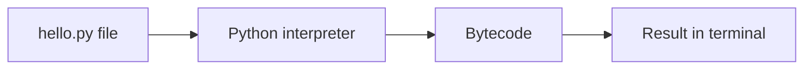

Hello! This is the first lesson of the course. We will start from absolute zero: understand what Python is, how to install it, and how to write your first program.

## What is Python

Python is a programming language in which you can do almost everything:

- simple scripts and automation;
- websites and web applications (Flask, FastAPI, Django);
- data analysis (Pandas, NumPy);
- neural networks and artificial intelligence (PyTorch);
- games, bots, utilities.

Why Python? It reads almost like English text, it has a huge community and thousands of ready-made libraries. That is why it is recommended as the first language for beginners — and it is also one of the most in-demand languages in the industry.

## Installing Python

1. Go to [python.org](https://www.python.org/) and download the latest version.
2. Install it, and be sure to check **"Add Python to PATH"** during installation (this is important!).
3. Verify: open a terminal and type:

```bash
python --version
```

If you see something like `Python 3.13.x` — great, Python is installed!

## Two ways to work with Python

**1. Interactive mode.** Type `python` in the terminal and you will see the `>>>` prompt. You can write commands directly:

```bash
>>> 2 + 2
4
>>> print("Hello, world!")
Hello, world!
```

To exit interactive mode, type `exit()`.

**2. Files with programs.** Real programs are stored in files with the `.py` extension. Create `hello.py` with the following content:

```python
print("Hello, world!")
```

Run it:

```bash
python hello.py
```

You will see `Hello, world!` — congratulations, this is your first Python program! 🎉

## The print() function

`print()` is a built-in function that outputs text to the screen. It is placed in parentheses:

```python
print("Hello, world!")
print("I am learning Python!")
```

You can print several values separated by commas — they will be printed with a space:

```python
print("My name is", "Anna")
```

Text in Python must be enclosed in quotes — single `'...'` or double `"..."`. They are equivalent; just don't mix them in one string.

## Comments

Comments are notes for people reading the code. Python ignores them. A comment starts with `#`:

```python
# This is a comment — Python will not execute it
print("This will run")  # and this is a comment after code
```

Comments help explain why a piece of code exists. A good habit is to comment unclear places, but not every single line.

## Reading errors

Do not be afraid of errors — they are normal. For example, if you forget a closing quote:

```python
print("Hello)
```

Python will show something like:

```
  File "hello.py", line 1
    print("Hello)
                 ^
SyntaxError: unterminated string literal
```

Reading errors: `File "hello.py", line 1` — where the error is; `SyntaxError` — the type of error; the `^` arrow points at the problem place.

**The main rule: read the error text** — in 90% of cases it says exactly what is wrong.

## Lesson summary

We learned: what Python is and why it is needed; how to install and check it; how to run code interactively and from a file; what `print()` is; why comments are useful; how to read errors.

## How the program runs



<!--TASK-->
### Task 1 — Hello, three lines
Create the file `about_me.py` and write a program that prints three lines: your name, your favorite programming language, and the phrase `I will make my first project!`. Run it and make sure all three lines appear.

### Task 2 — Calculations
Write a program that calculates four expressions and prints each with a label: `2 + 2 = 4`, `10 * 5 = 50`, `7 / 2 = 3.5`, `2 ** 10 = 1024`. Use a separate `print()` for each line.

### Task 3 — Name with commas and plus
Print one line using several values separated by commas: `print("My name is", "Anna")`. Then print the same text using `+`: `print("My name is " + "Anna")`. Explain the difference in spaces.

### Task 4 — Comments in code
Write a program where each command is accompanied by a comment starting with `#`. The program should print two lines. Make sure comments do not affect the result.

### Task 5 — Fix the error
The code below will not run: `print("Hello)` . Copy it to `bug.py`, run it, read the error message, fix the line so both lines print correctly.

### Task 6 — Data types
Print the types of the values: `42`, `3.14`, `"Python"`, `True`. Use `print(type(value))`. Expected output: `<class 'int'>`, `<class 'float'>`, `<class 'str'>`, `<class 'bool'>`.

### Task 7 — Interactive question
Write a program that asks the user for their name using `input("What is your name? ")` and prints `Hello, <name>!`.
<!--/TASK-->

<!--HINT-->
### Hint 1
Use one `print()` call for each line and don't forget the quotes.

### Hint 2
Numbers do not need quotes; text does. For decimal output, `7 / 2` gives `3.5` automatically.

### Hint 3
With commas, print adds spaces between values; with `+` it concatenates exactly as written.

### Hint 4
The `#` symbol starts a comment; everything after it on the line is ignored.

### Hint 5
Look carefully at the error: it points at the line with the missing closing quote. Add `"` at the end of the string.

### Hint 6
`type(x)` returns the type of the value x; `print(type(...))` displays it.

### Hint 7
`input(...)` returns a string; assign it to a variable and use it in `print()`.
<!--/HINT-->

<!--SOLUTION-->
### Solution 1
```python
print("My name is Anna")
print("My favorite language is Python")
print("I will make my first project!")
```
Each line is a separate `print()` call.

### Solution 2
```python
print("2 + 2 =", 2 + 2)
print("10 * 5 =", 10 * 5)
print("7 / 2 =", 7 / 2)
print("2 ** 10 =", 2 ** 10)
```
Python computes the expressions before printing.

### Solution 3
```python
print("My name is", "Anna")      # My name is Anna
print("My name is " + "Anna")     # My name is Anna
```
Commas add a space between arguments; `+` concatenates strings exactly.

### Solution 4
```python
# Print greeting
print("Hello!")
# Print a fact
print("Python is fun")
```
Comments are ignored by Python but help readers.

### Solution 5
```python
print("Hello")      # fixed: added the closing quote
print("World!")
```
The original line `print("Hello)` caused a SyntaxError because the string was not terminated.

### Solution 6
```python
print(type(42))        # <class 'int'>
print(type(3.14))      # <class 'float'>
print(type("Python"))  # <class 'str'>
print(type(True))      # <class 'bool'>
```

### Solution 7
```python
name = input("What is your name? ")
print("Hello, " + name + "!")
```
`input()` reads a line from the user, `print` composes the greeting.
<!--/SOLUTION-->

<!--QUIZ-->
What does print() do?
- It outputs text to the screen
- It reads text from the keyboard
- It creates a variable
* Correct answer: It outputs text to the screen
print() writes the passed values to the terminal.

Which symbol starts a comment in Python?
- #
- //
- /* */
* Correct answer: #
Everything after # to the end of the line is ignored.

What will appear after running a file with print("Hello, world!")?
- Hello, world!
- hello.py
- Nothing
* Correct answer: Hello, world!
The program executes print() and outputs the text.

What is the type of 3.14?
- int
- float
- str
* Correct answer: float
Numbers with a decimal point have type float.

How to exit interactive mode?
- exit()
- quit program
- close()
- stop
* Correct answer: exit()
Type exit() in the `>>>` prompt.

What does `#` do in code?
- Starts a comment
- Multiplies
- Ends a string
- Nothing
* Correct answer: Starts a comment
Everything after # is ignored.

Which command shows the Python version?
- python --version
- python version
- print version
- check python
* Correct answer: python --version
Run it in the terminal.

What is the result of print(2 + 2)?
- 4
- 22
- Error
- 2+2
* Correct answer: 4
Python evaluates the expression first.

Which quotes are valid for strings?
- Both '...' and "..."
- Only '...'
- Only "..."
- No quotes
* Correct answer: Both '...' and "..."
They are equivalent; don't mix them.

What type does input() return?
- str
- int
- float
- bool
* Correct answer: str
Always a string — convert if you need a number.

Which file extension do Python programs have?
- .py
- .txt
- .exe
- .doc
* Correct answer: .py
Python source files use .py.

What does SyntaxError mean?
- The interpreter could not understand the code
- The network failed
- The file is missing
- The number is too big
* Correct answer: The interpreter could not understand the code
Usually a quote, bracket, or indentation mistake.
<!--/QUIZ-->
