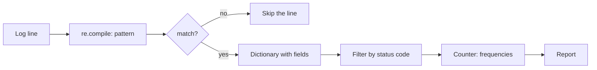

## What logs are and why parse them

Logs (journals) are records of what happened in the system: who accessed the server, what errors occurred, how long requests took. Each log line usually encodes one event. When there are few services, you can read logs with your eyes. When there are millions per day, you need automatic analysis: how many requests per hour, which IP addresses are the most active, how often 500 errors occur.

Log parsing is turning unstructured text into structured data (dicts, lists) that can be counted and aggregated. The main tool for this is **regular expressions** from the `re` module.

## Regular expressions: the basics

A regular expression (regex) is a pattern that describes a string. For example, `\d+` finds a sequence of digits, and `\d{1,3}\.\d{1,3}\.\d{1,3}\.\d{1,3}` matches something like an IP address. Let's look at a typical Nginx log line:

```
192.168.1.10 - - [01/Nov/2026:10:15:32 +0300] "GET /api/users HTTP/1.1" 200 512
```

Here: IP, two hyphens (user and login), date in square brackets, request in quotes, response code, and response size. Let's extract the IP and the response code:

```python
import re

line = '192.168.1.10 - - [01/Nov/2026:10:15:32 +0300] "GET /api/users HTTP/1.1" 200 512'

ip_pattern = re.compile(r"(\d{1,3}\.){3}\d{1,3}")
status_pattern = re.compile(r'" \d{3}')

print(ip_pattern.search(line).group())      # 192.168.1.10
print(status_pattern.search(line).group()[1:])  # 200
```

The `search` method finds the first match, `findall` returns a list of all matches, and `group()` returns the matched text itself.

## The reliable way: match and groups

It's simpler and more reliable to parse a line with a single expression, capturing the needed parts into `(...)` groups:

```python
import re

pattern = re.compile(
    r"^(?P<ip>[\d.]+) \S+ \S+ \[(?P<time>[^\]]+)\] "
    r'"(?P<request>[^"]+)" (?P<status>\d{3}) (?P<size>\d+)'
)

line = '192.168.1.10 - - [01/Nov/2026:10:15:32 +0300] "GET /api/users HTTP/1.1" 200 512'
m = pattern.match(line)
if m:
    print(m.group("ip"))       # 192.168.1.10
    print(m.group("status"))   # 200
```

`(?P<name>...)` gives a group a name, and you can access it via `m.group("name")`. If a line doesn't fit the pattern, `match` returns `None` — and we see that the record differs from what we expected.

## Counting and aggregation

Once records are parsed, it's time for counters. The perfect tool is `collections.Counter`:

```python
from collections import Counter

statuses = ["200", "200", "500", "404", "200", "500"]
counter = Counter(statuses)
print(counter.most_common(2))  # [('200', 3), ('500', 2)]
```

`Counter` counts the frequency of elements, and `most_common` sorts in descending order. That's exactly what you need for log analysis: who accesses most often, which response codes dominate.

## Filtering errors

A common task is finding all error records. 5xx codes mean server-side problems, 4xx mean client errors. Let's collect only lines with 5xx:

```python
import re

pattern = re.compile(r"\s5\d{2}\s")
with open("access.log", encoding="utf-8") as f:
    errors = [line for line in f if pattern.search(line)]
print(f"Found 5xx errors: {len(errors)}")
```

Notice: `f` in the `for line in f` loop yields file lines one at a time — this is efficient even for gigabyte logs, because the file is not loaded into memory entirely.

## The log-line pipeline

Any log analysis is a pipeline: text becomes fields, fields are filtered, counters collect statistics.



## Summary

To analyze logs you need three techniques: regular expressions for extracting fields (`re.compile`, `match`, `group`), `Counter` for counting frequencies, and reading the file line by line. Let's combine them in the tasks.

<!--TASK-->
### Task 1
Write a script `count_lines.py` that reads `access.log` line by line and prints the total number of lines, the number of non-empty lines, and the number of lines containing the substring `GET`. Use a plain `for line in f` and `in` to check the substring. Create a test file `access.log` with 5–7 lines of different content and verify the counts on it.

### Task 2
Create a script `top_ips.py` that finds all IP addresses in `access.log` (pattern `(\d{1,3}\.){3}\d{1,3}`), counts their frequency with `collections.Counter`, and prints the top three most frequent in the format `IP: count`. Pre-fill the file with lines containing repeated IPs.

### Task 3
Write a script `status_codes.py` that, for each log line, determines the response code (the last three digits after the closing quote of the request) and counts how many times each code appears. Print the codes in descending order of frequency. Use the regular expression `r'" \d{3}'` and `Counter`. The result should look like: `200: 5`, `404: 2`.

### Task 4
Create a script `parse_line.py` with a function `parse_line(line)` that takes a log line and returns a dictionary with keys `ip`, `time`, `request`, `status`, `size`, or `None` if the line does not match the pattern. Use `re.compile` with named groups `(?P<...>...)`. Demonstrate it on both a valid and an invalid line.

### Task 5
Write a script `five_xx.py` that finds all log lines with 5xx error codes, reads them into a list, and saves them to a file `errors.log`. At the end, print how many errors were found and saved. Create a log containing lines with codes 200, 404, 500, and 503, and verify that only 500 and 503 end up in `errors.log`.

### Task 6
Write a script `per_minute.py` that measures load per minute. From each log line extract the time in square brackets (e.g., `01/Nov/2026:10:15:32 +0300`), drop the time zone, and parse the value with `datetime.datetime.strptime(raw, "%d/%b/%Y:%H:%M:%S")`. Round the timestamp down to the minute with `strftime("%Y-%m-%d %H:%M")` and count frequencies with `Counter`. Print the minutes in chronological order in the format `<minute> — <count>`. Lines where the time is not found or cannot be parsed should be skipped and counted separately. Expected output for a log with six valid lines and one broken line: `2026-11-01 10:15 — 1`, `2026-11-01 10:16 — 2`, `2026-11-01 10:17 — 3`, then `Skipped lines: 1`.

### Task 7
Write a script `endpoint_errors.py` that builds a report by endpoint. Take the request in quotes and the response code from the line, split the request on spaces and take the path — the second element; drop the query string with `path.split("?")[0]`. For each path, count the total number of requests and the number of 5xx responses. Print only endpoints that have errors, sorted by decreasing error ratio, in the format `/api/orders: total 4, errors 2 (50.0%)`. At the end print `Total endpoints: N` — counting those without errors too. Expected output: two lines `/api/orders` and `/api/users`, then `Total endpoints: 2`.

<!--/TASK-->

<!--HINT-->
### Hint 1
Open the file via `with open("access.log", encoding="utf-8") as f:`. Inside the `for line in f:` loop, increment the total counter, and for non-empty lines (`if line.strip():`) and lines with `GET` (`if "GET" in line:`) use separate ones. Print all three numbers at the end.

### Hint 2
Collect all IPs with `re.findall(r"(\d{1,3}\.){3}\d{1,3}", ...)` — but careful: with groups, `findall` returns only the last group. It's simpler to use `re.findall(r"\d{1,3}(?:\.\d{1,3}){3}", text)`, where `(?:...)` is a non-capturing group. Then `Counter(ips).most_common(3)`.

### Hint 3
For each line, search for a match `re.search(r'" \d{3}', line)`. If it exists, take `match.group()[1:]` — cut off the extra space. Add the code to a list and at the end count with `Counter(codes).most_common()`.

### Hint 4
Use this pattern: `r"^(?P<ip>[\d.]+) \S+ \S+ \[(?P<time>[^\]]+)\] \"(?P<request>[^\""]+)\" (?P<status>\d{3}) (?P<size>\d+)"`. Check with `pattern.match(line)` — it returns `None` for non-matching lines. Convert `status` and `size` to `int` with `int(m.group("status"))`.

### Hint 5
To find errors use `re.search(r"\s5\d{2}\s", line)` — spaces around guarantee we don't catch random digits inside the request. Collect matching lines into a list and write them to `errors.log` via `f.write(line)` in a loop.

### Hint 6
The pattern for time: `re.compile(r"\[([^\]]+)\]")` — the first group will capture `01/Nov/2026:10:15:32 +0300`. Split on space and take `[0]` to remove `+0300`. Wrap `strptime` in `try/except ValueError`: a broken date should not crash the whole analysis. Fill `Counter` right in the loop: `per_minute[key] += 1`, and print via `sorted(per_minute)`.

### Hint 7
Find the request and status with one pattern: `r'"(?P<request>[^"]+)" (?P<status>\d{3})'`. The path is `m.group("request").split()[1]`; check `len(parts) >= 2`, otherwise the line is broken. Two counters: `total` and `errors`; add to `errors` only if `status.startswith("5")`. Sort with `rows.sort(key=lambda r: r[2] / r[1], reverse=True)`, ratio — `100 * err / cnt`.

<!--/HINT-->

<!--SOLUTION-->
### Solution 1
Solution:

```python
total = 0
non_empty = 0
get_count = 0

with open("access.log", encoding="utf-8") as f:
    for line in f:
        total += 1
        if line.strip():
            non_empty += 1
        if "GET" in line:
            get_count += 1

print(f"Total lines: {total}")
print(f"Non-empty: {non_empty}")
print(f"With GET: {get_count}")
```

What's happening here? The `for line in f` loop reads the file line by line and does not load it into memory entirely — that's important for large logs. `line.strip()` removes spaces and the newline, so empty lines (from which `strip()` produces an empty string) are not counted in `non_empty`. The check `"GET" in line` is the simplest substring search; it doesn't require regular expressions. Results accumulate in three variables and are printed at the end.

### Solution 2
Solution:

```python
import re
from collections import Counter

with open("access.log", encoding="utf-8") as f:
    text = f.read()

ips = re.findall(r"\d{1,3}(?:\.\d{1,3}){3}", text)
for ip, count in Counter(ips).most_common(3):
    print(f"{ip}: {count}")
```

What's happening here? Notice the difference from an explicit group: `re.findall` with a `(...)` group returns only the group's contents, so the IP would have to be taken from `(?:\d{1,3}\.){3}\d{1,3}` — a non-capturing group. `(?:...)` works like `(...)` but does not save the result, and `findall` returns the full match. Then `Counter(ips)` counts each address's frequency, and `most_common(3)` returns the top three most frequent "IP, count" pairs. The loop unpacks each pair into `ip` and `count`.

### Solution 3
Solution:

```python
import re
from collections import Counter

codes = []
with open("access.log", encoding="utf-8") as f:
    for line in f:
        m = re.search(r'" \d{3}', line)
        if m:
            codes.append(m.group().split()[1])

for code, count in Counter(codes).most_common():
    print(f"{code}: {count}")
```

What's happening here? The expression `r'" \d{3}'` looks for a quote, a space, and three digits — that's the end of the request and the response code. `m.group()` will return, for example, the string `" 200` containing a quote, a space, and the code. We only need the code, so we split the string with `m.group().split()` — we get the list `['"', '200']`, from which we take the second element `[1]`. That way we get the clean code without extra characters. Then `Counter(codes)` counts frequencies, and `most_common()` sorts in descending order.

### Solution 4
Solution:

```python
import re

pattern = re.compile(
    r"^(?P<ip>[\d.]+) \S+ \S+ \[(?P<time>[^\]]+)\] "
    r'"(?P<request>[^"]+)" (?P<status>\d{3}) (?P<size>\d+)'
)

def parse_line(line):
    m = pattern.match(line)
    if not m:
        return None
    return {
        "ip": m.group("ip"),
        "time": m.group("time"),
        "request": m.group("request"),
        "status": int(m.group("status")),
        "size": int(m.group("size")),
    }

good = '192.168.1.10 - - [01/Nov/2026:10:15:32 +0300] "GET /api/users HTTP/1.1" 200 512'
bad = "This is not a log at all"

print(parse_line(good))
print(parse_line(bad))
```

Output:

```python
{'ip': '192.168.1.10', 'time': '01/Nov/2026:10:15:32 +0300',
 'request': 'GET /api/users HTTP/1.1', 'status': 200, 'size': 512}
None
```

What's happening here? Named groups `(?P<name>...)` make the pattern readable: `m.group("ip")` always gets the IP, `m.group("status")` — the response code. `^\S+ \S+` skips the two fields between the IP and the date. `[^\]]+` inside `[...]` means "any characters except the closing bracket". `\d{3}` — exactly three digits of the code, `\d+` — the size. If the line doesn't match, `pattern.match` returns `None`, and we return `None`. Finally, `int(...)` converts the code and size to numbers — handy for further computations.

### Solution 5
Solution:

```python
import re

error_line = re.compile(r"\s5\d{2}\s")
errors = []

with open("access.log", encoding="utf-8") as f:
    for line in f:
        if error_line.search(line):
            errors.append(line)

with open("errors.log", "w", encoding="utf-8") as f:
    f.writelines(errors)

print(f"Found 5xx errors: {len(errors)}")
print("Saved to errors.log")
```

What's happening here? The pattern `\s5\d{2}\s` looks for a space, a five, two more digits, and another space. The spaces on the sides are not accidental: they stop the expression from catching `500` inside some long number or URL. Each matching line is added to the `errors` list. Writing to the file is done with `f.writelines(errors)`, which writes a list of lines in one call. This way we filtered out only serious server errors (500, 501, 502, 503...) and saved them separately for analysis.

### Solution 6
Solution:

```python
import datetime
import re
from collections import Counter

TIME_RE = re.compile(r"\[([^\]]+)\]")

per_minute = Counter()
skipped = 0

with open("access.log", encoding="utf-8") as f:
    for line in f:
        m = TIME_RE.search(line)
        if not m:
            skipped += 1
            continue
        raw = m.group(1).split()[0]        # strip the +0300 offset
        try:
            moment = datetime.datetime.strptime(raw, "%d/%b/%Y:%H:%M:%S")
        except ValueError:
            skipped += 1
            continue
        per_minute[moment.strftime("%Y-%m-%d %H:%M")] += 1

for minute in sorted(per_minute):
    print(f"{minute} — {per_minute[minute]}")
print(f"Skipped lines: {skipped}")
```

Output:

```
2026-11-01 10:15 — 1
2026-11-01 10:16 — 2
2026-11-01 10:17 — 3
Skipped lines: 1
```

What's happening here? `[^\]]+` inside square brackets captures everything up to the closing bracket — that's the timestamp with the time zone. `split()[0]` keeps only `01/Nov/2026:10:15:32`: `strptime` cannot parse the `+0300` offset in this format. The `%b` specifier expects an English month abbreviation (`Nov`), so under a non-standard process locale parsing may fail — in such cases the locale is fixed to `C` or `email.utils.parsedate_to_datetime` is used. `strftime("%Y-%m-%d %H:%M")` cuts off seconds, so all requests in the same minute fall into one key. `Counter` counts them without manual conditions, and `sorted` over keys gives chronological order — importantly, we sort ISO-format strings, where lexicographic order matches time order. Broken lines are not silently lost: the `skipped` counter shows how many records failed to parse.

### Solution 7
Solution:

```python
import re
from collections import Counter

pattern = re.compile(r'"(?P<request>[^"]+)" (?P<status>\d{3})')

total = Counter()
errors = Counter()

with open("access.log", encoding="utf-8") as f:
    for line in f:
        m = pattern.search(line)
        if not m:
            continue
        parts = m.group("request").split()
        if len(parts) < 2:
            continue
        path = parts[1].split("?")[0]
        total[path] += 1
        if m.group("status").startswith("5"):
            errors[path] += 1

rows = [(p, total[p], errors[p]) for p in errors]
rows.sort(key=lambda r: r[2] / r[1], reverse=True)

for path, cnt, err in rows:
    print(f"{path}: total {cnt}, errors {err} ({100 * err / cnt:.1f}%)")
print(f"Total endpoints: {len(total)}")
```

Output:

```
/api/orders: total 4, errors 2 (50.0%)
/api/users: total 5, errors 1 (20.0%)
Total endpoints: 2
```

What's happening here? The pattern finds the request in quotes and the three digits of the code that follow — that's enough to avoid parsing the whole line. `request` looks like `GET /api/orders?id=7 HTTP/1.1`, so `split()` gives the method, path, and version; we take the second element. `split("?")[0]` cuts off the query string: otherwise `/api/orders?id=7` and `/api/orders?id=8` would count as different endpoints and the report would scatter into hundreds of lines. Two independent `Counter`s let us count both the total number of requests and the number of errors, and the ratio is computed at print time. Sorting by `err / cnt` puts the most problematic endpoints on top — those are looked at first. `len(total)` shows all paths, including healthy ones, and that's useful: if the number of endpoints suddenly triples, scanning bots may have gotten into the log.

<!--/SOLUTION-->

<!--QUIZ-->
Which re method finds the first match?
- re.search
- re.findall
- re.split
* Correct answer: re.search
re.search returns the first match or None if there is none.

What will re.findall(r"\d+", "a1b22") return?
- ['1', '22']
- '122'
- 3
* Correct answer: ['1', '22']
findall returns a list of all non-overlapping matches.

What does (?:...) mean in a regular expression?
- A non-capturing group
- A named group
- A required group
* Correct answer: A non-capturing group
(?:...) groups but does not save the match for group().

Which class from collections is convenient for counting frequencies?
- Counter
- deque
- OrderedDict
* Correct answer: Counter
Counter counts the number of occurrences of elements and supports most_common().

What will pattern.match(line) return if the line does not match the pattern?
- None
- An empty string
- An exception
* Correct answer: None
match returns None when no match is found.

Why read a file line by line instead of using read()?
- Because read() does not exist
- To avoid holding the whole file in memory
- So that lines have no spaces
* Correct answer: To avoid holding the whole file in memory
Line-by-line reading saves memory on gigabyte logs.

What does re.compile(pattern) return?
- A compiled regex object with search/match/findall methods
- A list of matches
- A pattern string
* Correct answer: A compiled regex object with search/match/findall methods
A compiled pattern can be reused many times without recompiling.

What does Counter(list).most_common(3) do?
- Returns the three most frequent elements with their counts
- Deletes three rare elements
- Sorts the list alphabetically
* Correct answer: Returns the three most frequent elements with their counts
most_common sorts by descending frequency and takes the first N pairs.

What does m.group(1) of a regex match do?
- Returns the text captured by the first group
- Returns the whole match
- Returns the group number
* Correct answer: Returns the text captured by the first group
group() with no argument gives the whole match; group(1) gives only the first parenthesized group.

What will Counter(...).most_common() return without an argument?
- All "element, count" pairs sorted by descending frequency
- Only the most frequent element
- An empty list
* Correct answer: All "element, count" pairs sorted by descending frequency
The argument limits the number of pairs; without it, all are returned.

What does + mean in the pattern \d+?
- One or more characters
- Zero or more characters
- Exactly one character
* Correct answer: One or more characters
The quantifier + requires at least one occurrence; * allows zero.

What happens if you open a log without encoding="utf-8" on a system with a different encoding?
- A decoding error or corrupted Cyrillic text is possible
- The file will never open
- Python always detects UTF-8 itself
* Correct answer: A decoding error or corrupted Cyrillic text is possible
It's better to specify the encoding explicitly; otherwise the result depends on the system locale.
<!--/QUIZ-->
