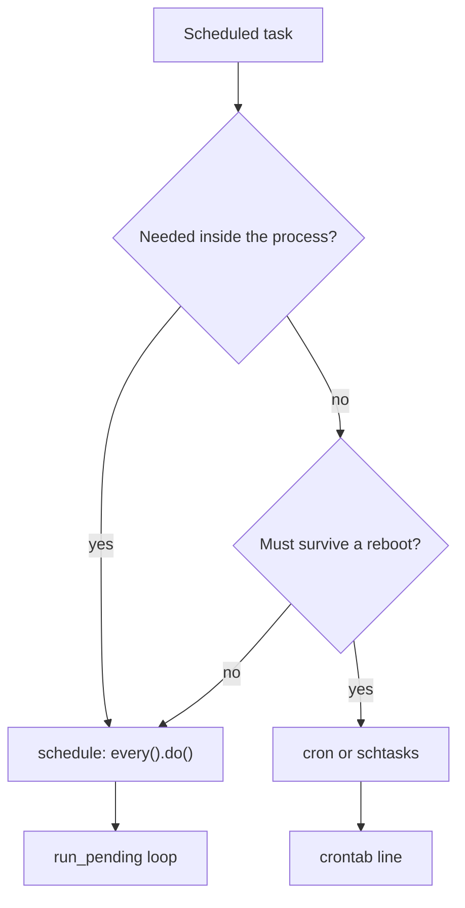

## Why schedulers are needed

Many operations must run on their own: database backups at 3 AM, log rotation every Monday, monitoring every five minutes. Doing this manually is impossible, so schedulers exist — programs that launch our scripts on a schedule.

In the world of Python and DevOps there are two levels of scheduling. The first is **in-process**: the `schedule` library lets you run functions on a schedule right inside a running Python script. The second is **system-level**: cron (on Linux/macOS) or Windows Task Scheduler runs whole commands and scripts at the operating-system level.

## The schedule library

`schedule` is a simple, expressive library for scheduling tasks in Python. Install it with `pip install schedule`. Here's a basic example:

```python
import schedule
import time

def backup():
    print("Making a backup...")

def ping():
    print("Pinging...")

schedule.every(10).minutes.do(ping)
schedule.every().day.at("03:00").do(backup)
schedule.every().monday.at("09:30").do(backup)

while True:
    schedule.run_pending()
    time.sleep(1)
```

The key idea: `schedule.every(...)....do(function)` registers a task, and the `while True` loop with `schedule.run_pending()` checks whether the time has come and runs the due functions. While the loop lives, tasks run. `time.sleep(1)` keeps the loop from spinning the CPU for nothing.

## Syntax in schedule

The library supports many scenarios:

```python
schedule.every(5).minutes.do(task)           # every 5 minutes
schedule.every().hour.do(task)               # every hour
schedule.every().day.at("08:30").do(task)    # daily at 08:30
schedule.every().wednesday.at("14:00").do(task)  # every Wednesday
schedule.every().minute.at(":17").do(task)   # at second 17 of every minute
```

The `at` method sets an exact time; the weekday is given by its English name (`monday`, `wednesday`). Tasks can take arguments: `do(fn, arg1, arg2)`. You can cancel a task with `schedule.cancel_job(job)` or clear everything with `schedule.clear()`.

## System cron

`schedule` works only while the process is alive. If the script crashes or the server reboots — the schedule is gone. Serious systems use cron. It reads schedules from `crontab` — a file with five fields:

```
minute hour day_of_month month day_of_week command
```

Example crontab line:

```
0 3 * * * /usr/bin/python3 /opt/scripts/backup.py
```

This means: at 03:00 every day run `backup.py`. An asterisk means "every value", so `* * * * *` means every minute. cron also supports more complex expressions: `*/10 * * * *` — every 10 minutes; `0 9 * * 1-5` — at 9:00 on weekdays. On Windows the counterpart is Task Scheduler; tasks can be created via `schtasks`.

## What to choose

Cheat sheet: inside a script with background tasks (for example, a web app periodically clearing its cache) — `schedule`. For system tasks that must live independently of your script — cron. Often a combination is used: cron runs a Python script every 5 minutes, and the script itself decides whether it's time to do something.

## Isolation and logging

Scripts launched by cron run in a clean environment: without your environment variables and with an empty current directory. So always use full paths to scripts and files, and redirect error output to a log. In crontab that looks like this:

```
0 3 * * * cd /opt/scripts && ./backup.py >> backup.log 2>&1
```

`>> backup.log` appends standard output to a file, and `2>&1` sends errors there too. Otherwise error emails will land in your mailbox.

## How to pick a scheduler

The decision tree is short: does it need to survive a reboot — and do you need access to the current process's objects.



## Summary

We covered two levels of scheduling: the `schedule` library for in-process tasks and cron for system-level ones. The main thing is to understand the difference and pick the right tool — after that, both use functions you already know. On to the tasks.

<!--TASK-->
### Task 1
Write a script `basic_schedule.py` that schedules two tasks: print `Every 2 seconds` every 2 seconds and print `Once every 5 seconds` every 5 seconds. Run the `schedule.run_pending()` loop with `time.sleep(0.5)` and let the program run for 12 seconds (for example, with an external timer or just stopping it). The output should alternate with the correct periodicity. Remember: in production code the loop is infinite, but for testing you can limit the number of iterations.

### Task 2
Create a script `daily_at.py` that schedules a task `remind()` at `08:30` daily. Inside the function, print `Time to exercise!`. Demonstrate that the task does not run immediately but waits for the scheduled time: for testing, set the time a few seconds later than the current time (via `datetime.timedelta` and `strftime`).

### Task 3
Write a script `jobs_with_args.py` where the same function `report(service, ok)` is called with different arguments: every 3 seconds `report("web", True)`, every 7 seconds `report("db", False)`. The function prints `Service <service> is up` or `Service <service> is down`. Verify that the output shows both tasks with different arguments.

### Task 4
Create a script `cancel_job.py` that schedules a task `job()` every 2 seconds, but after the fifth run cancels it via `schedule.cancel_job(job)` and prints `Task stopped`. Store the run counter in a list or a global variable. After cancellation, the program should keep looping, but the task no longer prints.

### Task 5
Write a script `cron_reader.py` that reads a file `crontab.txt` (lines of the form `0 3 * * * backup.py`) and prints the schedule in a human-readable form: for each line — "Command backup.py runs at 03:00 every day". For the fields, use a simple mapping table: a number — "at HH:MM" (if minute and hour are given as numbers), `*` in the weekday field — "every day", otherwise — the day name. Handle comment lines starting with `#`.

### Task 6
Write a function `check_cron(expr)` that validates a crontab string without the command. Split it on spaces and check that there are exactly five fields. Each field may contain `*`, a number, a range `1-5`, a list `1,15,30`, and a step `*/10`. Field bounds: minute 0–59, hour 0–23, day of month 1–31, month 1–12, day of week 0–6. Return a list of errors like `field 2 (hour): 25 out of range 0-23`; for a valid expression return an empty list. Invalid formats like `abc` or `*/0` should also end up in the errors. Check two expressions: `"*/15 0-23 * * 1-5"` and `"0 25 * * *"`. Expected output: `[]` for the first and exactly one error about the hour for the second.

### Task 7
Write a function `should_run(now)` that decides whether a task may run at moment `now` (type `datetime.datetime`). Rule: only on weekdays from 09:00 to 18:00. Saturday and Sunday — always `False`; on workdays — `True` when `9 <= now.hour < 18`. Then write `report(moments)` that prints for each moment a line `2026-11-23 09:00 — run` or `... — skip`. Test three moments: Saturday `2026-11-21 10:00`, Monday `2026-11-23 08:00`, and Monday `2026-11-23 09:00`. Expected output: two `skip` lines and one `run` — in that order.

<!--/TASK-->

<!--HINT-->
### Hint 1
Register the tasks: `schedule.every(2).seconds.do(lambda: print("Every 2 seconds"))` and similarly for 5 seconds. Then the loop: `for _ in range(24): schedule.run_pending(); time.sleep(0.5)` — 24 iterations of half a second = 12 seconds.

### Hint 2
Use `schedule.every().day.at("08:30").do(remind)`. To demonstrate waiting, create a future time: `next_time = (datetime.datetime.now() + datetime.timedelta(seconds=5)).strftime("%H:%M:%S")` and pass it to `at()`. Spin the `schedule.run_pending()` loop with `time.sleep(1)` for about 10 seconds.

### Hint 3
Define the function `def report(service, ok): ...`. Then `schedule.every(3).seconds.do(report, "web", True)` — arguments after the function are passed to it when called. For `ok`, use `if ok:` to choose the message.

### Hint 4
Save the job object: `job = schedule.every(2).seconds.do(task)`. Counter — `count = [0]` (a list, so it can be changed inside the function). Inside the function increment the counter; when `count[0] >= 5`, call `schedule.cancel_job(job)` — but not directly inside the function; check in the loop instead.

### Hint 5
Split the line with `line.split()` — you get 5 fields and the command. Check `line.startswith("#")` to skip comments. For translating the fields use dictionaries: months and weekdays by index. For time: if minute and hour are numbers, format `f"{hh}:{mm}"` with leading zeros.

### Hint 6
First handle the step: if a field starts with `*/`, check that the remainder is a positive number (`step.isdigit() and int(step) > 0`). For all other cases, split the field by commas and process each piece: expand a range `a-b` into `range(int(a), int(b) + 1)`, add a number as is, treat everything else as a format error. Compare against bounds after parsing: `[v for v in values if not lo <= v <= hi]`. Take the field name and bounds from lists by index.

### Hint 7
`datetime.weekday()` returns 0 for Monday and 6 for Sunday, so weekends are `now.weekday() >= 5`. Make the evening bound non-inclusive: `9 <= now.hour < 18`. In `report` there's no need to complicate: a loop over the list, a ternary expression for the status, and an f-string with the format `{now:%Y-%m-%d %H:%M}`. Build moments with `datetime.datetime(2026, 11, 23, 9, 0)` — so the test doesn't depend on the current time.

<!--/HINT-->

<!--SOLUTION-->
### Solution 1
Solution:

```python
import schedule
import time

schedule.every(2).seconds.do(lambda: print("Every 2 seconds"))
schedule.every(5).seconds.do(lambda: print("Once every 5 seconds"))

for _ in range(24):   # 24 * 0.5 s = 12 seconds
    schedule.run_pending()
    time.sleep(0.5)
```

Output (fragment):

```
Every 2 seconds
Every 2 seconds
Once every 5 seconds
Every 2 seconds
Every 2 seconds
Once every 5 seconds
```

What's happening here? `schedule.every(2).seconds.do(...)` registers a task that will run every 2 seconds. Lambda functions are convenient for simple prints. The `for _ in range(24)` loop limits the run to 12 seconds (24 × 0.5 s) — in a real script the loop would be infinite: `while True: schedule.run_pending(); time.sleep(1)`. Importantly, `run_pending()` doesn't sleep itself; it only runs tasks whose time has come; the pause is provided by `time.sleep`. So by changing `time.sleep` you can control precision, but you shouldn't make the pause longer than the task interval.

### Solution 2
Solution:

```python
import schedule
import time
import datetime

def remind():
    print("Time to exercise!")

next_time = (datetime.datetime.now() + datetime.timedelta(seconds=5)).strftime("%H:%M:%S")
schedule.every().day.at(next_time).do(remind)
print(f"Task scheduled for {next_time}")

for _ in range(10):
    schedule.run_pending()
    time.sleep(1)
```

Output:

```
Task scheduled for 14:05:03
Time to exercise!
```

What's happening here? `datetime.timedelta(seconds=5)` shifts the current time forward by 5 seconds, and `strftime("%H:%M:%S")` formats it into a string for `at()`. The task is registered but does not run immediately — it waits for the second to arrive. That's exactly what demonstrates the essence of a scheduler: `run_pending()` in the loop checks whether the moment has come and runs the task right when it should. If we passed a past time, the library could run the task on the next loop iteration — that's why we take a time in the future.

### Solution 3
Solution:

```python
import schedule
import time

def report(service, ok):
    if ok:
        print(f"Service {service} is up")
    else:
        print(f"Service {service} is down")

schedule.every(3).seconds.do(report, "web", True)
schedule.every(7).seconds.do(report, "db", False)

for _ in range(21):
    schedule.run_pending()
    time.sleep(1)
```

Output (fragment):

```
Service web is up
Service web is up
Service db is down
...
```

What's happening here? `do(report, "web", True)` passes extra arguments to the function on every call — handy when several tasks share one logic but different parameters. So a single `report` function serves both the web server and the database. The loop runs for 21 seconds (21 × 1 s) so that both intervals (3 and 7 seconds) fit several times. Notice: the library doesn't interfere with tasks on different intervals — each lives by its own schedule, and `run_pending()` in the loop runs all due ones.

### Solution 4
Solution:

```python
import schedule
import time

count = [0]
job = schedule.every(2).seconds.do(lambda: print("Working..."))

for _ in range(20):
    schedule.run_pending()
    count[0] += 1
    if count[0] >= 5:
        schedule.cancel_job(job)
        print("Task stopped")
        break
    time.sleep(1)
```

Output:

```
Working...
Working...
Working...
Working...
Working...
Task stopped
```

What's happening here? The `job` object returned by `schedule.every(...).do(...)` is the task's identifier. `schedule.cancel_job(job)` removes the task from the scheduler, and it no longer runs. The counter in the list `count` is a trick: lists are mutable, so the function (behind the lambda) can change its contents even without using `global` (though here the counter is changed not inside the task but in the loop). After the fifth run we stop the task and exit the loop. In a real system, this is how misbehaving tasks are stopped or restarted with new parameters.

### Solution 5
Solution:

```python
days = ["Monday", "Tuesday", "Wednesday", "Thursday",
        "Friday", "Saturday", "Sunday"]

with open("crontab.txt", encoding="utf-8") as f:
    for line in f:
        line = line.strip()
        if not line or line.startswith("#"):
            continue
        parts = line.split()
        minute, hour, _, _, weekday, command = parts
        if minute == "*" and hour == "*":
            time_str = "every minute"
        elif hour == "*":
            time_str = f"at minute {minute} of every hour"
        else:
            time_str = f"at {hour.zfill(2)}:{minute.zfill(2)}"
        day_str = days[int(weekday) - 1] if weekday != "*" else "every day"
        print(f"Command {command} runs {time_str} {day_str}")
```

What's happening here? A crontab line consists of five fields: minute, hour, day of month, month, day of week — and a command. We unpack them into variables and build a human-readable description. `zfill(2)` pads a number with zeros to two digits (`3` → `03`). If `weekday` is a number from 0 to 6 (0 = Sunday in cron, but in our example we accept 1–7), we take the name from the list; otherwise — "every day". Comments and empty lines are skipped. Such a script is useful for auditing: it's easy to show colleagues what runs on the server and when.

### Solution 6
Solution:

```python
FIELD_NAMES = ["minute", "hour", "day of month", "month", "day of week"]
LIMITS = [(0, 59), (0, 23), (1, 31), (1, 12), (0, 6)]

def parse_part(part):
    """Returns a list of numbers, or None if the part is invalid."""
    if part == "*":
        return []
    if part.startswith("*/"):
        step = part[2:]
        if step.isdigit() and int(step) > 0:
            return [int(step)]
        return None
    values = []
    for chunk in part.split(","):
        if "-" in chunk:
            a, b = chunk.split("-", 1)
            if not (a.isdigit() and b.isdigit()):
                return None
            values.extend(range(int(a), int(b) + 1))
        elif chunk.isdigit():
            values.append(int(chunk))
        else:
            return None
    return values

def check_cron(expr):
    fields = expr.split()
    if len(fields) != 5:
        return [f"expected 5 fields, got {len(fields)}"]
    errors = []
    for i, (field, name, (lo, hi)) in enumerate(
            zip(fields, FIELD_NAMES, LIMITS), start=1):
        values = parse_part(field)
        if values is None:
            errors.append(f"field {i} ({name}): invalid format {field}")
            continue
        bad = [v for v in values if not lo <= v <= hi]
        if bad:
            errors.append(f"field {i} ({name}): {bad[0]} out of range {lo}-{hi}")
    return errors

print(check_cron("*/15 0-23 * * 1-5"))
print(check_cron("0 25 * * *"))
```

Output:

```
[]
['field 2 (hour): 25 out of range 0-23']
```

What's happening here? The validator mirrors cron's own logic: five positions, each with its own range. The `parse_part` function first handles two special cases — the asterisk and the step — then parses a comma-separated list, where an element can be a number or a range. A range is expanded into concrete values, so the bound check stays one simple operation for all notation forms. An important detail: the step is checked separately, because `*/15` is not the value 15 but "every 15 units"; the main thing is to ensure the step is positive, otherwise cron would consider the expression invalid. The error contains the field number, its human-readable name, and the concrete value — such a string can be shown straight to the user. Returning a list rather than raising an exception lets you collect all problems of an expression in one call and explain them at once.

### Solution 7
Solution:

```python
import datetime

def should_run(now):
    if now.weekday() >= 5:          # 5 = Saturday, 6 = Sunday
        return False
    return 9 <= now.hour < 18

def report(moments):
    for now in moments:
        status = "run" if should_run(now) else "skip"
        print(f"{now:%Y-%m-%d %H:%M} — {status}")

moments = [
    datetime.datetime(2026, 11, 21, 10, 0),   # Saturday
    datetime.datetime(2026, 11, 23, 8, 0),    # Monday, before opening hours
    datetime.datetime(2026, 11, 23, 9, 0),    # Monday, opening hours
]
report(moments)
```

Output:

```
2026-11-21 10:00 — skip
2026-11-23 08:00 — skip
2026-11-23 09:00 — run
```

What's happening here? `weekday()` returns the day-of-week number starting from zero, so the `>= 5` check cuts off Saturday and Sunday without name lists and without locale dependence. The second condition describes the working interval as a half-open range: 09:00 is included, 18:00 is not — so the task won't run exactly at closing time. In a real project, `should_run` is called inside a task registered as `schedule.every().minute.do(guarded_job)`: the scheduler wakes the function every minute, and it decides whether to work now. Testing such behavior with sleep and real clocks is impossible — the test would become slow and flaky, so the function takes `now` as a parameter and the test substitutes fixed dates. The `report` function is separated from the logic: it can be reused for a dry run of the schedule a week ahead.

<!--/SOLUTION-->

<!--QUIZ-->
Which schedule method registers a task?
- every().do()
- run_pending()
- cancel_job()
* Correct answer: every().do()
every(interval).do(function) is the main way to create a task.

What does schedule.run_pending() do?
- Runs tasks whose time has come
- Stops all tasks
- Sleeps for a given second
* Correct answer: Runs tasks whose time has come
run_pending() must be called in a loop for tasks to execute.

How to stop one task in schedule?
- schedule.cancel_job(job)
- job.stop()
- schedule.clear()
* Correct answer: schedule.cancel_job(job)
cancel_job takes the task object saved at registration.

What does * * * * * mean in crontab?
- Runs every minute
- Runs once an hour
- Runs once a day
* Correct answer: Runs every minute
Each asterisk means "every value" of its field.

Which fields does a crontab line have?
- Minute, hour, day of month, month, day of week
- Second, minute, hour, month, year
- Hour, day, week, command, log
* Correct answer: Minute, hour, day of month, month, day of week
These 5 fields define the schedule; the command follows.

Why is cron better than schedule alone for critical tasks?
- Because cron survives reboots and script crashes
- Because schedule can't handle weekdays
- Because cron is faster
* Correct answer: Because cron survives reboots and script crashes
schedule lives inside the process: process dies — schedule is gone.

What does schedule.every().day.at("08:30").do(task) mean?
- Task daily at 08:30
- Task every 8 minutes 30 seconds
- Task once a day at a random time
* Correct answer: Task daily at 08:30
at sets the exact time of day, and every().day is the daily interval.

What does 0 9 * * 1-5 mean in crontab?
- At 09:00 on weekdays (Monday through Friday)
- Every 9 hours on weekdays
- At 09:00 every Sunday
* Correct answer: At 09:00 on weekdays (Monday through Friday)
The range 1-5 in the weekday field means Monday–Friday.

What will datetime.weekday() return for Sunday?
- 6
- 0
- 7
* Correct answer: 6
Counting starts at zero: Monday — 0, Sunday — 6.

What does */10 mean in the minute field?
- Every 10 minutes
- Run at minute 10 of every hour
- 10 runs per day
* Correct answer: Every 10 minutes
The step */n means "every n units" starting from zero.

What does schedule.clear() do?
- Removes all registered tasks
- Clears the terminal screen
- Resets the system time
* Correct answer: Removes all registered tasks
After clear() the run_pending() loop runs nothing.

Why do cron scripts specify full paths?
- Because cron has an empty working directory and a trimmed environment
- Because cron doesn't understand relative paths at all
- Otherwise the script won't get permission to run
* Correct answer: Because cron has an empty working directory and a trimmed environment
That's why crontab uses cd /opt/scripts && ./backup.py and full paths to files.
<!--/QUIZ-->
