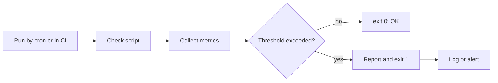

## What is monitoring

Monitoring is watching the state of a system: is the server alive, how much disk space is left, has the service crashed, how fast the API responds. Without monitoring, a team hears about problems from users — and that's the worst way.

Python is great for writing monitoring scripts: they run on a schedule (from the previous lesson) or as part of a CI pipeline, and the result can be sent to a log, a file, or a messenger.

## The check script: collecting data

A typical monitoring script collects data from several sources. For system metrics, external commands via `subprocess` are often used:

```python
import subprocess

result = subprocess.run(
    ["df", "-h", "/"],
    capture_output=True,
    text=True,
    check=True,
)
print(result.stdout)
```

`df -h /` shows disk usage. `check=True` makes `subprocess` raise `CalledProcessError` if the command fails. This way the script doesn't stay silent about problems — it fails loudly.

## Service health check

Often you need to check whether a web service responds. The simplest way is to send an HTTP request to a health endpoint. The standard-library `urllib` handles this perfectly:

```python
import urllib.request

try:
    with urllib.request.urlopen("http://localhost:8000/health", timeout=5) as resp:
        print("Status:", resp.status)
        print("Response:", resp.read().decode())
except urllib.error.URLError as e:
    print("Service unavailable:", e)
```

`urlopen` opens a URL, `resp.status` is the response code, and the timeout prevents the script from hanging forever. `urllib` is enough for this example — it ships with the standard library.

## Building a report

Monitoring data is convenient to collect into a dict and serialize, for example, to JSON — such a report is easy to read and forward:

```python
import json

report = {
    "host": "web-01",
    "disk_free_gb": 42.5,
    "service": "up",
    "healthy": True,
}
print(json.dumps(report, indent=2, ensure_ascii=False))
```

## Scripts for CI

Continuous Integration (CI) is the practice where every commit is automatically run through checks: tests, linters, build. CI systems (GitHub Actions, GitLab CI, Jenkins) run commands in fresh environments, and Python scripts in those pipelines solve hundreds of tasks: running tests, checking formatting, building reports.

The main rule for scripts in CI: **a correct exit code**. If a script finishes with code 0 — the pipeline is considered successful; with a non-zero code it fails. So at the end of a script it's important to exit explicitly with `sys.exit(0)` or `sys.exit(1)` depending on the check results.

## A simple CI script

Imagine you need to check that the project has no files larger than 1 MB, and then run tests:

```python
import subprocess
import sys
from pathlib import Path

big_files = [p for p in Path(".").rglob("*")
             if p.is_file() and p.stat().st_size > 1_000_000]
if big_files:
    print("Found large files:", [p.name for p in big_files])
    sys.exit(1)

result = subprocess.run(["python", "-m", "pytest", "-q"], capture_output=True, text=True)
print(result.stdout)
if result.returncode != 0:
    print(result.stderr)
    sys.exit(result.returncode)
```

This is exactly what happens in real CI: a script checks conditions and either passes on (code 0) or fails with a message.

## Verification pipeline

Monitoring in a script is a short chain: collect a metric, compare it with a threshold, return a code that CI or cron understands.



## Summary

We learned to collect system data via `subprocess`, check service health via `urllib`, format reports as JSON, and build scripts that correctly signal results through exit codes. That's all you need for simple monitoring and embedding into CI. Let's consolidate with tasks.

<!--TASK-->
### Task 1
Write a script `df_check.py` that runs the command `df -h /` via `subprocess.run` with `capture_output=True`, `text=True`, and `check=True`, then prints the output. Add handling for `subprocess.CalledProcessError`: if the command fails, print `Error getting disk data` and exit with code 1.

### Task 2
Create a script `healthcheck.py` that checks the availability of `http://localhost:8000/health` via `urllib.request.urlopen` with a 5-second timeout. If the service responded — print `OK, code 200` (or the actual code) and exit with code 0. If the service is unavailable (catch `urllib.error.URLError`) — print `Service unavailable` and exit with code 1.

### Task 3
Write a script `report_json.py` that collects a system status report into a dict: hostname (via `subprocess` and the command `hostname`), current time (the `datetime` module), the number of files in the current directory (via `pathlib`), and saves the report to a file `report.json` via `json.dump` with `indent=2`. Then read the file back and print its contents.

### Task 4
Create a script `check_large.py` that walks the current directory via `Path(".").rglob("*")` and finds all files larger than 1 MB (1_000_000 bytes). If any exist — print their names one per line and exit with code 1. If not — print `All good` and exit with code 0. This is a classic CI guard script.

### Task 5
Write a script `ci_summary.py` that "runs" three checks (plain functions returning True/False: `check_tests()`, `check_lint()`, `check_build()`), collects results into a list, prints a summary like `check_tests: PASS` / `check_lint: FAIL`, and at the end exits with code 0 if all passed and code 1 if at least one failed. Model one failing check and make sure the exit code is 1.

### Task 6
Write a script `check_endpoints.py` that checks a list of addresses: `["http://localhost:8000/health", "http://localhost:8000/api/items"]`. For each one, measure the response time with `time.perf_counter()` before and after `urllib.request.urlopen(url, timeout=3)`, and catch `urllib.error.URLError` as unavailability. Print a line in the format `http://localhost:8000/health — 200 — 0.031 c` (three decimal places) or `... — FAIL — 3.002 c` on error. At the end exit with code `1` if at least one address did not respond, otherwise `0`. Expected output with the first address alive and the second dead: a line with code 200, a line with `FAIL`, and exit code `1`.

### Task 7
Write a script `disk_threshold.py` with an argument `--max-percent` (integer, default 80) and a function `parse_disk(output, max_percent)`. The function finds the percentage in the `df -h /` output via `re.search(r"(\d+)%", output)` and returns `(percent, status)`, where status is `OK` or `ALERT`; if the percentage is not found — `(None, "UNKNOWN")`. The main part runs `subprocess.run(["df", "-h", "/"], capture_output=True, text=True)`, prints `Disk: 78% (threshold 80%) — OK`, and exits with code `1` on `ALERT`, code `2` on `UNKNOWN`, and `0` on `OK`. Expected output for 78% and threshold 80: the line `Disk: 78% (threshold 80%) — OK` and code `0`.

<!--/TASK-->

<!--HINT-->
### Hint 1
Call `subprocess.run(["df", "-h", "/"], capture_output=True, text=True, check=True)` inside `try`. Catch `subprocess.CalledProcessError as e:`. On error — `print(...)` and `sys.exit(1)`. Don't forget `import sys`.

### Hint 2
Open the URL via `with urllib.request.urlopen(url, timeout=5) as resp:` inside `try`. The response code — `resp.status`. In `except urllib.error.URLError:` print a message and exit with `sys.exit(1)`.

### Hint 3
Get the host like this: `subprocess.run(["hostname"], capture_output=True, text=True).stdout.strip()`. Time: `datetime.datetime.now().isoformat()`. Files: `sum(1 for p in Path(".").rglob("*") if p.is_file())`. Write — `json.dump(report, f, indent=2, ensure_ascii=False)`.

### Hint 4
Use a list comprehension: `big = [p for p in Path(".").rglob("*") if p.is_file() and p.stat().st_size > 1_000_000]`. If `big` is non-empty — loop-print `p.name`, then `sys.exit(1)`. Otherwise — `sys.exit(0)`.

### Hint 5
Define a list of checks: `checks = [("check_tests", check_tests), ...]`. In the loop call the function, compare with True, print PASS/FAIL, and accumulate `all_ok = all_ok and ok`. At the end: `sys.exit(0 if all_ok else 1)`.

### Hint 6
Start timing before `try`: `start = time.perf_counter()`, and after the block compute `elapsed = time.perf_counter() - start`. Store the status as a string: `str(resp.status)` on success and `"FAIL"` in `except`. Raise the `failed` flag only in `except`; at the end — `sys.exit(1 if failed else 0)`. `perf_counter` beats `time.time()`: it's monotonic and doesn't jump when the system clock changes.

### Hint 7
Separate parsing from execution: `parse_disk` should not print anything and should not know about subprocess — so it's easy to test on a sample line. In the main part, use `argparse.ArgumentParser()`, add `--max-percent` with `type=int`, run `df`, and pass `result.stdout` to the function. Three outcomes — three codes: `1` for ALERT, `2` for UNKNOWN, `0` for OK.

<!--/HINT-->

<!--SOLUTION-->
### Solution 1
Solution:

```python
import subprocess
import sys

try:
    result = subprocess.run(
        ["df", "-h", "/"],
        capture_output=True,
        text=True,
        check=True,
    )
    print(result.stdout)
except subprocess.CalledProcessError as e:
    print("Error getting disk data")
    print(e.stderr)
    sys.exit(1)
```

What's happening here? `df -h /` prints information about the disk where the root is mounted. `check=True` turns a command error into the `CalledProcessError` exception — so we won't miss the failure. In the `except` block we print a human-readable message and the command's stderr, then exit with code 1. This is an important pattern: a monitoring script should not just "crash" but explain what happened. In the success case we print `df`'s output — there you can see the size, usage, and disk usage percentage.

### Solution 2
Solution:

```python
import sys
import urllib.request
import urllib.error

url = "http://localhost:8000/health"

try:
    with urllib.request.urlopen(url, timeout=5) as resp:
        print(f"OK, code {resp.status}")
    sys.exit(0)
except urllib.error.URLError:
    print("Service unavailable")
    sys.exit(1)
```

What's happening here? `urlopen` sends a GET request and opens the connection. The `with` context manager guarantees the connection closes. `timeout=5` is critical: without it the script can hang for a long time waiting for a response from a dead server. If the service works, we print the response code (200 is normal) and exit with 0. If `urlopen` raises `URLError` (server not responding, DNS not resolving, connection refused) — we report it and exit with 1. Such a healthcheck can be put into cron every couple of minutes: the exit code itself tells whether everything is fine.

### Solution 3
Solution:

```python
import datetime
import json
import subprocess
from pathlib import Path

host = subprocess.run(["hostname"], capture_output=True, text=True).stdout.strip()

report = {
    "host": host,
    "time": datetime.datetime.now().isoformat(),
    "files_count": sum(1 for p in Path(".").rglob("*") if p.is_file()),
}

with open("report.json", "w", encoding="utf-8") as f:
    json.dump(report, f, indent=2, ensure_ascii=False)

with open("report.json", encoding="utf-8") as f:
    print(f.read())
```

Output (example):

```json
{
  "host": "web-01",
  "time": "2026-11-01T14:25:00.123456",
  "files_count": 142
}
```

What's happening here? Data collection is split into independent parts: the host comes from `hostname`, time from `datetime`, and the file count is computed with a generator: `sum(1 for p in ... if p.is_file())` walks the directory tree and counts only files. `isoformat()` gives the time in the standard ISO format, convenient for storage. Then the report is serialized to JSON and written, and immediately read back and printed. Such a report can be stored one per check to compare changes.

### Solution 4
Solution:

```python
import sys
from pathlib import Path

big = [
    p for p in Path(".").rglob("*")
    if p.is_file() and p.stat().st_size > 1_000_000
]

if big:
    for p in big:
        print(p.name)
    sys.exit(1)
else:
    print("All good")
    sys.exit(0)
```

What's happening here? `rglob("*")` recursively walks the whole directory, including subfolders. In the list comprehension we filter immediately: only files (`is_file()`) larger than a megabyte. If the `big` list is non-empty — we print the offenders' names and exit with code 1. If empty — "All good" and code 0. This is a classic "guard" in CI: if someone commits a 500 MB binary to the repository, the pipeline fails with a clear file list, and the developer quickly understands the cause.

### Solution 5
Solution:

```python
import sys

def check_tests():
    return True

def check_lint():
    return False   # simulated failing check

def check_build():
    return True

checks = [
    ("check_tests", check_tests),
    ("check_lint", check_lint),
    ("check_build", check_build),
]

all_ok = True
for name, fn in checks:
    ok = fn()
    print(f"{name}: {'PASS' if ok else 'FAIL'}")
    all_ok = all_ok and ok

sys.exit(0 if all_ok else 1)
```

Output:

```
check_tests: PASS
check_lint: FAIL
check_build: PASS
```

What's happening here? The `checks` list stores "name, function" pairs. The loop calls each check, prints the result, and accumulates the overall `all_ok` flag. The expression `sys.exit(0 if all_ok else 1)` is a ternary: code 0 on full success, 1 otherwise. In real CI, instead of stubs there would be real checks: `pytest`, `flake8`, build. And this skeleton is universal: add a pair to the list — and the new check is already in the report and affects the build result.

### Solution 6
Solution:

```python
import sys
import time
import urllib.error
import urllib.request

URLS = [
    "http://localhost:8000/health",
    "http://localhost:8000/api/items",
]

failed = False

for url in URLS:
    start = time.perf_counter()
    try:
        with urllib.request.urlopen(url, timeout=3) as resp:
            status = str(resp.status)
    except urllib.error.URLError:
        status = "FAIL"
        failed = True
    elapsed = time.perf_counter() - start
    print(f"{url} — {status} — {elapsed:.3f} c")

sys.exit(1 if failed else 0)
```

Output (example):

```
http://localhost:8000/health — 200 — 0.031 c
http://localhost:8000/api/items — FAIL — 3.002 c
```

What's happening here? `perf_counter()` gives a monotonic, high-resolution counter — an ideal tool for measuring duration because it doesn't depend on clock changes. Time is taken before the request and read after exception handling, so both successful and failed calls go into the report. `urlopen` with `timeout=3` keeps the check from hanging: a dead address fails in about three seconds, and that's visible in the time column. The `failed` flag accumulates the overall result: the script checks all addresses to the end and shows the full picture, and the exit code at the end tells CI whether there was any problem. This format is easy to read by eye and easy to parse: the separator is the same, and the time always has three decimals.

### Solution 7
Solution:

```python
import argparse
import re
import subprocess
import sys

def parse_disk(output, max_percent):
    m = re.search(r"(\d+)%", output)
    if not m:
        return (None, "UNKNOWN")
    percent = int(m.group(1))
    return (percent, "ALERT" if percent >= max_percent else "OK")

parser = argparse.ArgumentParser(description="Disk usage control")
parser.add_argument("--max-percent", type=int, default=80)
args = parser.parse_args()

result = subprocess.run(["df", "-h", "/"], capture_output=True, text=True)
percent, status = parse_disk(result.stdout, args.max_percent)

if status == "UNKNOWN":
    print("Could not determine disk usage")
    sys.exit(2)

print(f"Disk: {percent}% (threshold {args.max_percent}%) — {status}")
sys.exit(1 if status == "ALERT" else 0)
```

Output (example):

```
Disk: 78% (threshold 80%) — OK
```

What's happening here? `parse_disk` is a pure function: string in, number and status out, no side effects. Thanks to that, you can test it on any saved `df` output without running the command. `re.search(r"(\d+)%")` finds the first number before a percent sign — in typical output that's the `Use%` column. The comparison is non-strict: exactly 80% with threshold 80 is already an alert, because the headroom is gone. The main part separates three outcomes: unclear output (code 2), threshold exceeded (code 1), and normal (code 0). Different codes matter in CI: they show whether the check failed due to a real disk problem or because the script couldn't parse the output — and those are different actions for the on-call engineer.

<!--/SOLUTION-->

<!--QUIZ-->
What does the parameter check=True do in subprocess.run?
- Raises CalledProcessError on a non-zero exit code
- Checks that the command exists
- Waits for the command to finish
* Correct answer: Raises CalledProcessError on a non-zero exit code
Without check=True a command error would go unnoticed.

Which standard-library module makes HTTP requests?
- urllib.request
- requests
- urllib.parse
* Correct answer: urllib.request
urllib.request.urlopen is a simple way to fetch a URL from the standard library.

Which exit code means success in CI?
- 0
- 1
- 2
* Correct answer: 0
CI considers the pipeline successful when the command returns 0.

What does sys.exit(1) do?
- Terminates the program with exit code 1
- Prints an error
- Skips the rest of the code
* Correct answer: Terminates the program with exit code 1
sys.exit(code) ends the process with the given code.

Which of these is an example of a CI check?
- Running pytest tests
- Installing fonts
- Configuring a browser
* Correct answer: Running pytest tests
CI automatically runs tests, linters, and builds on every commit.

Which pathlib method walks a directory recursively?
- rglob("*")
- glob("*")
- iterdir()
* Correct answer: rglob("*")
rglob finds files in all nested folders; glob only in the current one.

Which exception will subprocess.run with check=True raise when a command fails?
- subprocess.CalledProcessError
- FileNotFoundError
- ValueError
* Correct answer: subprocess.CalledProcessError
check=True turns a non-zero exit code into an exception.

What is in resp.status after urlopen?
- The server's HTTP response code
- The response body
- The request headers
* Correct answer: The server's HTTP response code
For example, 200 — success, 404 — page not found.

What does time.perf_counter() give for measuring duration?
- Monotonic high-resolution time unaffected by clock changes
- The current date and time
- The process's CPU time
* Correct answer: Monotonic high-resolution time unaffected by clock changes
That's why perf_counter suits benchmarks, while time.time() is for calendar timestamps.

What will subprocess.run with check=False return if the command fails?
- A CompletedProcess object with a non-zero returncode
- A CalledProcessError exception
- None
* Correct answer: A CompletedProcess object with a non-zero returncode
The exception appears only with check=True.

Why does a healthcheck need a timeout?
- Otherwise the check may hang on an unavailable service
- Otherwise the server will respond too fast
- To disable logging
* Correct answer: Otherwise the check may hang on an unavailable service
Without a timeout urlopen waits for a response indefinitely.

What does exit code 2 from a check script mean?
- A different error: for example, wrong usage or unparsed output
- Success
- A warning that CI ignores
* Correct answer: A different error: for example, wrong usage or unparsed output
Any non-zero code is a failure for CI, but different codes help the on-call engineer understand the cause.
<!--/QUIZ-->
