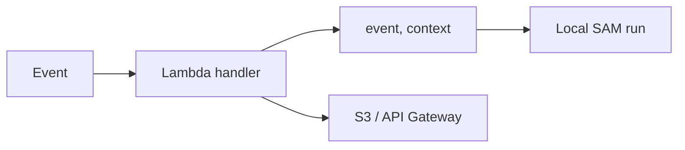

The serverless approach lets you run code without managing servers: infrastructure is provisioned on demand. In Python the most popular scenario is AWS Lambda.

## What is Lambda

A Lambda function runs on an event: an HTTP request (API Gateway), a file appearing in S3, a message in a queue. You pay for execution time and the number of invocations.

## Function structure

```python
def handler(event, context):
    name = event.get("name", "world")
    return {"statusCode": 200, "body": f"Hello, {name}"}
```

`event` — a dict with event data; `context` — the environment (timeouts, memory).

## Local development

AWS SAM (`sam local start-api`) and `aws-lambda-ric` let you run functions locally. The AWS Toolkit for VS Code is also convenient.

## Limits

- Memory up to 10 GB, timeout up to 15 minutes.
- Cold start: the container is created on demand.
- No persistent local state — use S3 or a database.

## S3 integration

The "S3 → Lambda" trigger runs a function when an object is uploaded (for example, for image resizing).

## Packaging strategy

Lambda supports layers and container images; dependencies are packed into a zip with `--python-path`.

## Lesson summary

Serverless is a way to simply run code without thinking about servers. Lambda is great for event-driven tasks: file processing, webhooks, small APIs.




## When to choose Lambda

Lambda fits event-driven, short-lived tasks well: processing S3 uploads, webhooks, periodic reports, simple APIs with variable load. You pay only for actual execution — that's profitable with irregular traffic. On the other hand, long heavy jobs and steady high traffic are often cheaper to keep on regular servers or containers. It's important to account for timeout limits, package size, and cold starts.


<!--TASK-->
### Task 1 — A simple function
Write a handler returning `{"statusCode": 200, "body": "OK"}`. Call it manually with `event = {}` and show the result.

### Task 2 — Handling an HTTP event
Write an API Gateway handler: it takes `event["queryStringParameters"]` and returns a greeting with the name from the name parameter. Show a call with an event.

### Task 3 — Local run via SAM
Install the AWS SAM CLI, describe `template.yaml` (Resources: MyFunction, Properties: Runtime python3.13, Handler). Run `sam local invoke "MyFunction" -e event.json` and show the output.

### Task 4 — Reading a file from S3
Write a handler with an S3 event: by bucket/key fetch the object via boto3, read the first 100 characters and return them. Add a comment about which IAM permissions are needed.

### Task 5 — Error handling
In the handler add try/except: on an exception return `{"statusCode": 500, "body": "Error"}` and log via print. Test with a wrong key.

### Task 6 — Testing the function with a boto3 mock
Write a pytest test that uses monkeypatch to replace boto3.client("s3").get_object and verifies that the handler returns the content. Make sure the test doesn't touch the cloud.

### Task 7 — Cost comparison
Describe (in a comment) the pricing model: roughly how much 1M invocations of a function with 128 MB and 200 ms execution would cost. Estimate based on the price per 1M requests and per GB-second.
<!--/TASK-->

<!--HINT-->
### Hint 1
A handler takes (event, context); the return is a dict.

### Hint 2
queryStringParameters can be None — use .get() with a default.

### Hint 3
template.yaml: AWSTemplateFormatVersion, Resources, MyFunction: {Type: AWS::Serverless::Function, Properties: {CodeUri: ., Handler: app.handler, Runtime: python3.13}}.

### Hint 4
boto3.client("s3").get_object(Bucket=b, Key=k)["Body"].read().decode()[:100].

### Hint 5
In except: print("ERROR", e); return 500.

### Hint 6
Mock: monkeypatch.setattr("boto3.client", lambda *a, **k: FakeClient()) — return a dict with Body.

### Hint 7
Formula: cost = requests × price/1M + (GB-seconds) × price/GB-s.
<!--/HINT-->

<!--SOLUTION-->
### Solution 1
```python
def handler(event, context):
    return {"statusCode": 200, "body": "OK"}

print(handler({}, None))
```
Output: {'statusCode': 200, 'body': 'OK'}.

### Solution 2
```python
def handler(event, context):
    params = event.get("queryStringParameters") or {}
    name = params.get("name", "world")
    return {"statusCode": 200, "body": f"Hello, {name}"}

event = {"queryStringParameters": {"name": "Anna"}}
print(handler(event, None))
```
Output: a greeting with the name.

### Solution 3
```yaml
AWSTemplateFormatVersion: "2010-09-09"
Transform: AWS::Serverless-2016-10-31
Resources:
  MyFunction:
    Type: AWS::Serverless::Function
    Properties:
      CodeUri: .
      Handler: app.handler
      Runtime: python3.13
```
```bash
sam local invoke "MyFunction" -e event.json
```
SAM builds the function locally and runs it with the supplied event.

### Solution 4
```python
import boto3

def handler(event, context):
    bucket = event["Records"][0]["s3"]["bucket"]["name"]
    key = event["Records"][0]["s3"]["object"]["key"]
    body = boto3.client("s3").get_object(Bucket=bucket, Key=key)["Body"].read().decode()
    return body[:100]
```
The function needs s3:GetObject permission (IAM role).

### Solution 5
```python
def handler(event, context):
    try:
        data = event["key"]
        return {"statusCode": 200, "body": str(data)}
    except Exception as e:
        print("ERROR", e)
        return {"statusCode": 500, "body": "Error"}
```
Missing key → 500 and a log entry.

### Solution 6
```python
import pytest

class FakeS3:
    def get_object(self, **kwargs):
        return {"Body": type("B", (), {"read": lambda self: "text".encode()})()}

def test_handler(monkeypatch):
    import boto3
    monkeypatch.setattr(boto3, "client", lambda *a, **k: FakeS3())
    from app import handler
    event = {"Records": [{"s3": {"bucket": {"name": "b"}, "object": {"key": "k"}}}]}
    assert handler(event, None) == "text"
```
The test doesn't touch the cloud — boto3 is replaced.

### Solution 7
```python
# Assume: 1M invocations = $0.20, 1 GB-s = $0.0000166667
# 128 MB = 0.125 GB, 200 ms = 0.2 s per invocation
# 1M × 0.2 s = 200000 s → 200000 × 0.125 = 25000 GB-s
# total ≈ 0.20 + 25000 × 0.0000166667 ≈ $0.62
```
The pricing model: requests + time × memory. For small functions — pennies.
<!--/SOLUTION-->

<!--QUIZ-->
What is AWS Lambda?
- A function that runs on an event without server management
- A virtual machine
- A container
- A database
* Correct answer: A function that runs on an event without server management
Serverless computing.

What is a "cold start"?
- Creating the environment on the first invocation
- Stopping the function
- Rebooting the DB
- Warming up the network
* Correct answer: Creating the environment on the first invocation
It adds latency.

How to pass a name into a handler?
- Via event["queryStringParameters"]
- Via a global variable
- Via context
- Via a file
* Correct answer: Via event["queryStringParameters"]
For API Gateway data arrives in event.

Which permissions are needed to read S3?
- s3:GetObject
- s3:ListBuckets
- ec2:DescribeInstances
- None
* Correct answer: s3:GetObject
The IAM role assigns permissions.

How to test a handler without the cloud?
- By replacing boto3 with monkeypatch
- Expecting a real S3
- Through real requests
- No way
* Correct answer: By replacing boto3 with monkeypatch
A fake client returns data.

What does SAM CLI do?
- Lets you run Lambda locally
- Creates tables
- Deploys websites
- Writes tests
* Correct answer: Lets you run Lambda locally
sam local invoke emulates execution.

What is Lambda's maximum duration?
- 15 minutes
- 1 hour
- 5 minutes
- Unlimited
* Correct answer: 15 minutes
The timeout is configurable.

Why layers?
- To reuse dependencies across functions
- To speed up the network
- For encryption
- For logging
* Correct answer: To reuse dependencies across functions
Layers contain libraries.

What does a handler return?
- A dict (JSON response)
- Always a string
- Must be None
- A list
* Correct answer: A dict (JSON response)
The expected shape for API Gateway.

How to reduce cold starts?
- Increase memory, use provisioned concurrency
- Ban invocations
- Delete the function
- Less code
* Correct answer: Increase memory, use provisioned concurrency
Reserved environments eliminate waiting.

What is provisioned concurrency?
- Pre-warmed environments without cold starts
- An invocation limit
- A paid cap
- Deleting functions
* Correct answer: Pre-warmed environments without cold starts
Reserved capacity avoids waiting.

How to pass dependencies to Lambda?
- Via a layer or container image
- requirements.txt doesn't work
- A manual pip command
- Via static assets
* Correct answer: Via a layer or container image
Layers are reused across functions.


<!--/QUIZ-->
