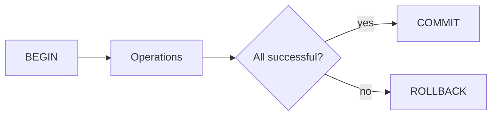

## What is a transaction

A transaction is a group of database operations that execute as a single unit: either all succeed (COMMIT) or none do (ROLLBACK). The classic example is transferring money between accounts:

```python
import sqlite3

conn = sqlite3.connect(":memory:")
cur = conn.cursor()
cur.executescript("""
CREATE TABLE accounts (
    id INTEGER PRIMARY KEY,
    owner TEXT,
    balance REAL NOT NULL CHECK (balance >= 0)
);
INSERT INTO accounts VALUES (1, 'Anya', 5000), (2, 'Boris', 1000);
""")
conn.commit()

def transfer(from_id, to_id, amount):
    try:
        with conn:
            a = cur.execute(
                "SELECT balance FROM accounts WHERE id = ?", (from_id,)
            ).fetchone()[0]
            if a < amount:
                raise ValueError("Insufficient funds")
            cur.execute(
                "UPDATE accounts SET balance = balance - ? WHERE id = ?",
                (amount, from_id),
            )
            cur.execute(
                "UPDATE accounts SET balance = balance + ? WHERE id = ?",
                (amount, to_id),
            )
            return True
    except ValueError:
        return False

print(transfer(1, 2, 700))
print(cur.execute("SELECT owner, balance FROM accounts ORDER BY id").fetchall())
```

The `with conn:` context opens a transaction itself and commits on success or rolls back on an exception. After the transfer the balances are: `[('Anya', 4300.0), ('Boris', 1700.0)]`.

Why does atomicity matter? If the first UPDATE debited the money and the second UPDATE failed because of a network glitch, the money would "evaporate". A transaction guarantees: either both changes are saved, or neither.

## ACID

- **Atomicity** — either all operations of a transaction execute, or none.
- **Consistency** — after a transaction the database stays in a valid state: CHECK constraints, foreign keys, triggers are not violated.
- **Isolation** — concurrent transactions do not see each other's intermediate states.
- **Durability** — committed data survives a power failure or a database restart.

## Concurrency problems

When two transactions work on the same data, classic problems arise:

- **Dirty read**: a transaction sees uncommitted changes of another transaction. If the latter rolls back, the first one read data that never existed.
- **Non-repeatable read**: within one transaction the same row is read with different values because another transaction changed and committed it.
- **Phantoms**: a repeated SELECT returns new rows added by other transactions in the meantime.

To combat these, there are isolation levels:

| Level | Dirty read | Non-repeatable read | Phantoms |
|---|---|---|---|
| READ UNCOMMITTED | possible | possible | possible |
| READ COMMITTED | no | possible | possible |
| REPEATABLE READ | no | no | possible |
| SERIALIZABLE | no | no | no |

The higher the level, the more locks and the lower the concurrency. SERIALIZABLE is the safest, but also the slowest.

## Transactions in SQLite

SQLite uses DEFERRED transactions by default and serializes writes through a file lock: only one process can write at a time. This can't be ignored — two processes writing simultaneously get the `database is locked` error. It is treated with `PRAGMA busy_timeout` and retries:

```python
conn.execute("PRAGMA busy_timeout = 5000")  # wait up to 5 seconds
```

To manage rollback points explicitly, there are savepoints:

```python
conn.execute("SAVEPOINT sp1")
cur.execute("UPDATE accounts SET balance = balance - 100 WHERE id = 1")
conn.execute("ROLLBACK TO sp1")   # roll back only the changes after the savepoint
conn.execute("RELEASE sp1")
```

After that the change is rolled back, but the transaction itself continues to live and can be finished with COMMIT.

## Locks and deadlocks

**Pessimistic locking** grabs rows in advance (`SELECT ... FOR UPDATE` in PostgreSQL) — a deadlock risk, but a stability guarantee. **Optimistic** locking locks nothing, but on save it checks the row version: if it changed — a conflict; the query is retried. A deadlock is when two transactions wait for each other: A locked row 1 and waits for row 2, B — the other way around. Countermeasures: a consistent order of accessing tables, short transactions, timeouts.



## Summary

Transactions are the foundation of data reliability. Three rules: keep transactions short, don't make slow external calls inside them (network, files), and always handle exceptions so that ROLLBACK fires.

<!--TASK-->
### Task 1
Write a function `transfer(from_id, to_id, amount)` that moves money between accounts strictly inside a transaction and returns `True` on success or `False` if there are insufficient funds. Schema: `accounts(id, owner, balance)` with CHECK (balance >= 0); initial data: Anya — 5000, Boris — 1000. Make sure that after a failed transfer the balances are unchanged. Print the results of three calls: `transfer(1, 2, 700)`, `transfer(1, 2, 9000)` and the final balances. Expected output: `True`, `False`, `[('Anya', 4300.0), ('Boris', 1700.0)]`.

### Task 2
Write a function `atomic_batch(conn)` that creates an `items(id INTEGER PRIMARY KEY, qty INTEGER CHECK (qty > 0))` table, inserts three valid rows and commits them. Then, in one transaction, it tries to insert three more rows, one of which violates CHECK (qty = 0). The function should return the tuple `(count_before, count_after)` — the number of rows before and after the failed attempt. Expected output: `(3, 3)` — the whole batch rolled back entirely.

### Task 3
Write a script that demonstrates a savepoint: inside one transaction set `SAVEPOINT sp1`, decrease Anya's balance by 100, then `ROLLBACK TO sp1`, then increase Boris's balance by 50 and commit. Print the final balances. Expected output: `[('Anya', 5000.0), ('Boris', 1050.0)]` — the rollback affected only the first change.

### Task 4
Write a script with two connections to the same database (use the URI `file:shareddb?mode=memory&cache=shared` with `uri=True`). The first connection opens a `BEGIN IMMEDIATE` transaction and does an UPDATE without COMMIT. The second connection with `PRAGMA busy_timeout = 0` tries its own UPDATE — catch `sqlite3.OperationalError` and print the error text. Then commit the first connection, set `busy_timeout = 2000` on the second, repeat the UPDATE — it should succeed. Expected output: a line with `database is locked`, then a successful execution.

### Task 5
Write a function `withdraw(conn, user_id, amount)` that debits money from an account inside a transaction and returns `("ok", new_balance)` or `("error", None)` if the balance would go negative. Rely on the CHECK constraint: catch `sqlite3.IntegrityError` and let the transaction roll back. Test: `withdraw(conn, 1, 3000)` → `('ok', 2000.0)`; `withdraw(conn, 1, 9000)` → `('error', None)`; the total balance of all accounts after all operations must remain 6000.
### Task 6 — Savepoint
In SQLite, inside one transaction create `SAVEPOINT sp1`, perform a failing insert, roll back to sp1 (`ROLLBACK TO sp1`) and continue. Prove that the successful rows before the savepoint survived, and those after did not.
### Task 7 — Isolation: two connections
Open two connections to SQLite. In the first one do BEGIN, insert a row, but don't commit; in the second try to read that row. Record that it is not visible (or is visible depending on the mode) and explain the notion of an "unfinished transaction".

<!--/TASK-->

<!--HINT-->
### Hint 1
Use `with conn:` — it commits on success and rolls back on an exception. Inside, first read the balance with `SELECT`, check `amount`, then two `UPDATE`s. Check an amount that is too large with `if a < amount: raise ValueError(...)`.

### Hint 2
Insert with `cur.executemany("INSERT INTO items (qty) VALUES (?)", rows)` inside `with conn:`. Count rows with `SELECT COUNT(*) FROM items` before and after the block. The IntegrityError must happen inside the block so that the rollback fires automatically.

### Hint 3
Order: `BEGIN` (or just the first statement), `SAVEPOINT sp1`, UPDATE Anya, `ROLLBACK TO sp1`, `RELEASE sp1`, UPDATE Boris, `COMMIT`. Look at the final balances: Anya's change must be gone, Boris's must remain.

### Hint 4
Both connections must use the same URI, otherwise they are two different databases and there will be no locking. `BEGIN IMMEDIATE` grabs the write lock immediately. For the second connection run `conn2.execute("PRAGMA busy_timeout = 0")` before the first attempt and `conn2.execute("PRAGMA busy_timeout = 2000")` before the second. Don't forget to close the connections at the end.

### Hint 5
Inside `with conn:` run `UPDATE accounts SET balance = balance - ? WHERE id = ?` and immediately read the new balance. Catch IntegrityError around the block and return `("error", None)`. Check the final balance: the sum over all accounts must remain 6000 — that's Consistency.
### Hint 6
`SAVEPOINT sp1; INSERT ...; ROLLBACK TO sp1;` — rolls back only to the point.
### Hint 7
Uncommitted changes of another connection are usually not visible — that's the basis of isolation.

<!--/HINT-->

<!--SOLUTION-->
### Solution 1
Solution:

```python
import sqlite3

conn = sqlite3.connect(":memory:")
cur = conn.cursor()
cur.executescript("""
CREATE TABLE accounts (
    id INTEGER PRIMARY KEY,
    owner TEXT,
    balance REAL NOT NULL CHECK (balance >= 0)
);
INSERT INTO accounts VALUES (1, 'Anya', 5000), (2, 'Boris', 1000);
""")
conn.commit()

def transfer(from_id, to_id, amount):
    try:
        with conn:
            a = cur.execute(
                "SELECT balance FROM accounts WHERE id = ?", (from_id,)
            ).fetchone()[0]
            if a < amount:
                raise ValueError("Insufficient funds")
            cur.execute(
                "UPDATE accounts SET balance = balance - ? WHERE id = ?",
                (amount, from_id),
            )
            cur.execute(
                "UPDATE accounts SET balance = balance + ? WHERE id = ?",
                (amount, to_id),
            )
            return True
    except ValueError:
        return False

print(transfer(1, 2, 700))
print(transfer(1, 2, 9000))
print(cur.execute("SELECT owner, balance FROM accounts ORDER BY id").fetchall())
```

Result:

```
True
False
[('Anya', 4300.0), ('Boris', 1700.0)]
```

What's happening here? `with conn:` is a context manager: it starts a transaction and on exit either commits (if there was no exception) or rolls back. The first transfer decreases Anya's balance and increases Boris's — both changes are saved together. The second transfer checks the balance, sees that 5000 is less than 9000, raises ValueError; the context rolls back the transaction, and none of the changes reach the database. That's exactly what atomic money transfers look like in real systems.

### Solution 2
Solution:

```python
import sqlite3

def atomic_batch(conn):
    cur = conn.cursor()
    cur.executescript("""
    CREATE TABLE items (
        id INTEGER PRIMARY KEY,
        qty INTEGER CHECK (qty > 0)
    );
    """)
    cur.executemany("INSERT INTO items (qty) VALUES (?)", [(5,), (10,), (7,)])
    conn.commit()
    count_before = cur.execute("SELECT COUNT(*) FROM items").fetchone()[0]
    try:
        with conn:
            cur.executemany(
                "INSERT INTO items (qty) VALUES (?)",
                [(3,), (0,), (12,)],   # (0,) violates CHECK
            )
    except sqlite3.IntegrityError:
        pass
    count_after = cur.execute("SELECT COUNT(*) FROM items").fetchone()[0]
    return (count_before, count_after)

conn = sqlite3.connect(":memory:")
print(atomic_batch(conn))
```

Result:

```
(3, 3)
```

What's happening here? Inside `with conn:` three inserts run. The third row with qty = 0 violates the CHECK constraint, and SQLite raises IntegrityError. The context manager sees the exception and rolls back the whole transaction — including the two valid rows that were already inserted. After the rollback the table still has three rows. That's atomicity: partial success is impossible. Note: outside a transaction each insert would be committed separately, and the first two would stick "forever".

### Solution 3
Solution:

```python
import sqlite3

conn = sqlite3.connect(":memory:")
cur = conn.cursor()
cur.executescript("""
CREATE TABLE accounts (
    id INTEGER PRIMARY KEY,
    owner TEXT,
    balance REAL NOT NULL
);
INSERT INTO accounts VALUES (1, 'Anya', 5000), (2, 'Boris', 1000);
""")
conn.commit()

cur.execute("BEGIN")
cur.execute("SAVEPOINT sp1")
cur.execute("UPDATE accounts SET balance = balance - 100 WHERE id = 1")
cur.execute("ROLLBACK TO sp1")
cur.execute("RELEASE sp1")
cur.execute("UPDATE accounts SET balance = balance + 50 WHERE id = 2")
conn.commit()

print(cur.execute("SELECT owner, balance FROM accounts ORDER BY id").fetchall())
```

Result:

```
[('Anya', 5000.0), ('Boris', 1050.0)]
```

What's happening here? SAVEPOINT marks a point inside a transaction. All changes after this mark can be rolled back with `ROLLBACK TO sp1` without touching earlier changes and without ending the whole transaction. Here the 100 debit from Anya is rolled back, while the 50 credit to Boris remains. `RELEASE sp1` removes the savepoint — after it, you can no longer roll back to this point. The result: Anya's balance is unchanged, Boris received 50. Savepoints are handy in long operations where some steps can safely be undone.

### Solution 4
Solution:

```python
import sqlite3

URI = "file:shareddb?mode=memory&cache=shared"

conn1 = sqlite3.connect(URI, uri=True)
conn2 = sqlite3.connect(URI, uri=True)
c1, c2 = conn1.cursor(), conn2.cursor()
c1.executescript("""
CREATE TABLE accounts (id INTEGER PRIMARY KEY, owner TEXT, balance REAL);
INSERT INTO accounts VALUES (1, 'Anya', 5000), (2, 'Boris', 1000);
""")
conn1.commit()

c1.execute("BEGIN IMMEDIATE")
c1.execute("UPDATE accounts SET balance = balance - 100 WHERE id = 1")

conn2.execute("PRAGMA busy_timeout = 0")
try:
    c2.execute("UPDATE accounts SET balance = balance + 100 WHERE id = 2")
except sqlite3.OperationalError as e:
    print("First attempt:", e)

conn1.commit()
conn2.execute("PRAGMA busy_timeout = 2000")
c2.execute("UPDATE accounts SET balance = balance + 100 WHERE id = 2")
conn2.commit()
print(c2.execute("SELECT owner, balance FROM accounts ORDER BY id").fetchall())
```

Result:

```
First attempt: database is locked
[('Anya', 4900.0), ('Boris', 1100.0)]
```

What's happening here? BEGIN IMMEDIATE grabs an exclusive write lock right away. The second connection with busy_timeout = 0 waits zero seconds and gets `database is locked`. After the first connection's COMMIT the lock is released; the second connection with busy_timeout = 2000 waits up to two seconds and successfully runs its UPDATE. This is how real services resolve writer conflicts: set a reasonable timeout and retry the operation instead of failing immediately.

### Solution 5
Solution:

```python
import sqlite3

conn = sqlite3.connect(":memory:")
cur = conn.cursor()
cur.executescript("""
CREATE TABLE accounts (
    id INTEGER PRIMARY KEY,
    owner TEXT,
    balance REAL NOT NULL CHECK (balance >= 0)
);
INSERT INTO accounts VALUES (1, 'Anya', 5000), (2, 'Boris', 1000);
""")
conn.commit()

def withdraw(conn, user_id, amount):
    cur = conn.cursor()
    try:
        with conn:
            cur.execute(
                "UPDATE accounts SET balance = balance - ? WHERE id = ?",
                (amount, user_id),
            )
            new_balance = cur.execute(
                "SELECT balance FROM accounts WHERE id = ?", (user_id,)
            ).fetchone()[0]
            return ("ok", new_balance)
    except sqlite3.IntegrityError:
        return ("error", None)

print(withdraw(conn, 1, 3000))
print(withdraw(conn, 1, 9000))
print(cur.execute("SELECT SUM(balance) FROM accounts").fetchone()[0])
```

Result:

```
('ok', 2000.0)
('error', None)
6000.0
```

What's happening here? The first withdrawal debits 3000: the balance becomes 2000, the transaction commits. The second withdrawal tries to debit 9000 from a balance of 2000 — CHECK (balance >= 0) prevents the balance from going negative, SQLite raises IntegrityError, the context rolls back the transaction, and we return ("error", None). The total balance of all accounts stays 6000: the database is consistent. Notice: we relied on a database constraint, not just a check in Python — that's more reliable, because the constraint applies to any code that writes to the table.
### Solution 6
```python
import sqlite3
con = sqlite3.connect(":memory:")
cur = con.cursor()
cur.execute("CREATE TABLE t(x)")
con.execute("SAVEPOINT sp1")
cur.execute("INSERT INTO t VALUES (1)")
con.execute("ROLLBACK TO sp1")
cur.execute("INSERT INTO t VALUES (2)")
con.commit()
print(cur.execute("SELECT COUNT(*) FROM t").fetchone()[0])  # 1
```
Row "2" survived, "1" was rolled back. A savepoint is a "bookmark" inside a transaction.
### Solution 7
```python
con1 = sqlite3.connect(":memory:")
con2 = sqlite3.connect(":memory:")
con1.execute("CREATE TABLE t(x)")
con1.execute("BEGIN")
con1.execute("INSERT INTO t VALUES (1)")
print(con2.execute("SELECT COUNT(*) FROM t").fetchone()[0])  # 0
con1.commit()
```
Until con1 commits, con2 does not see the row — classic isolation behavior.

<!--/SOLUTION-->

<!--QUIZ-->
What does transaction atomicity guarantee?
- Each operation runs independently
- Either all operations are applied, or none
- Data survives a database restart
- Operations run simultaneously
* Correct answer: Either all operations are applied, or none
Atomicity means "all or nothing": partial success is impossible.

Which problem occurs when a transaction reads uncommitted changes of another transaction?
- Phantoms
- Dirty read
- Non-repeatable read
- Deadlock
* Correct answer: Dirty read
If the other transaction rolls back, the read data turns out to have never existed.

Which isolation level forbids dirty reads but allows non-repeatable reads?
- READ UNCOMMITTED
- READ COMMITTED
- SERIALIZABLE
- None
* Correct answer: READ COMMITTED
READ COMMITTED sees only committed data, but two identical queries inside one transaction can return different values.

What does ROLLBACK TO sp1 do?
- Rolls back the whole transaction
- Rolls back only the changes made after savepoint sp1
- Deletes the table
- Closes the connection
* Correct answer: Rolls back only the changes made after savepoint sp1
A savepoint is a rollback point inside a transaction; ROLLBACK TO returns the database to that point without ending the transaction.

Why does "database is locked" occur on concurrent writes in SQLite?
- Because of a database size limit
- Because of the exclusive write lock — only one process can write at a time
- Because of missing indexes
- Because of an old Python version
* Correct answer: Because of the exclusive write lock — only one process can write at a time
SQLite serializes writers; the rest wait (busy_timeout) or get an error.

What does Consistency mean in ACID?
- The data after a transaction satisfies all database constraints
- The data is encrypted
- The data is stored in one file
- The data is available to only one user
* Correct answer: The data after a transaction satisfies all database constraints
CHECK, foreign keys and triggers must not be violated after COMMIT.

What does Durability mean?
- Committed data survives a power failure and a database restart
- The data is stored in one file
- The data is available to all users simultaneously
* Correct answer: Committed data survives a power failure and a database restart
After COMMIT the record is considered durable even if the system shuts down immediately.

What does BEGIN IMMEDIATE do in SQLite?
- Grabs the write lock immediately
- Starts a transaction only at the first UPDATE
- Opens a connection to the database
* Correct answer: Grabs the write lock immediately
BEGIN IMMEDIATE reserves the right to write in advance, preventing "database is locked" at later steps.
What does COMMIT do?
- Finalizes the transaction's changes
- Cancels them
- Opens a new transaction
- Reads data
* Correct answer: Finalizes the transaction's changes
After COMMIT the changes are visible to other connections.

What does ROLLBACK do?
- Cancels all the transaction's changes
- Confirms them
- Creates a point
- Closes the database
* Correct answer: Cancels all the transaction's changes
A rollback returns the state to before BEGIN.

What is a SAVEPOINT?
- A point inside a transaction you can partially roll back to
- A commit
- A new database
- An index
* Correct answer: A point inside a transaction you can partially roll back to
ROLLBACK TO sp undoes only the changes after the point.

Why are uncommitted changes invisible to other connections?
- Because of transaction isolation
- Because of indexes
- Because of the schema
- Because of permissions
* Correct answer: Because of transaction isolation
Each transaction works with a "snapshot" of the data.

# 
<!--/QUIZ-->
