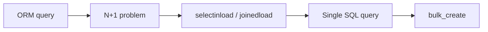

## What is an ORM

ORM (Object-Relational Mapping) is a bridge between database tables and Python objects. You work with classes and methods instead of SQL strings, and the ORM converts your calls into queries. The most popular options in Python are SQLAlchemy (flexible, used in FastAPI and many applications) and the built-in Django ORM. Before running the examples, install the library: `pip install sqlalchemy`.

## SQLAlchemy: model and session

```python
from sqlalchemy import create_engine, Column, Integer, String, ForeignKey, Float
from sqlalchemy.orm import declarative_base, Session, relationship

Base = declarative_base()

class Author(Base):
    __tablename__ = "authors"
    id = Column(Integer, primary_key=True)
    name = Column(String)
    books = relationship("Book", back_populates="author")

class Book(Base):
    __tablename__ = "books"
    id = Column(Integer, primary_key=True)
    title = Column(String)
    price = Column(Float)
    author_id = Column(Integer, ForeignKey("authors.id"))
    author = relationship("Author", back_populates="books")

engine = create_engine("sqlite:///:memory:")
Base.metadata.create_all(engine)
```

A session is the working area where objects live, and a query factory:

```python
with Session(engine) as session:
    a = Author(name="Anya")
    session.add(a)
    session.flush()          # assign an id without committing
    session.add_all([
        Book(title="Book 1", price=500, author=a),
        Book(title="Book 2", price=700, author=a),
    ])
    session.commit()
```

Objects reach the database only after flush/commit. Until committed, the changes are visible only inside the session.

## The N+1 problem

This is the main ORM trap. It occurs when we first load N parents, then in a loop access each one's children — each such access becomes a separate SQL query.

```python
with Session(engine) as session:
    authors = session.query(Author).all()      # 1 query
    for auth in authors:
        _ = auth.books                        # 1 more query per author
```

The result: 1 + N queries. For 200 authors — 201 database round trips instead of two. On a local database this is invisible, but in production with a network every latency adds up.

## Eager loading: selectinload / joinedload

The fix — load the relationships right away, in one or two queries:

```python
from sqlalchemy.orm import selectinload

with Session(engine) as session:
    authors = session.query(Author).options(
        selectinload(Author.books)
    ).all()
```

`selectinload` makes a second query that fetches the books of all authors at once (an IN condition). `joinedload` uses JOIN and makes one query, but multiplies rows — that is dangerous with pagination. The rule: for collections usually use selectinload, for scalar relationships (ForeignKey) — joinedload.

## Django ORM: select_related and prefetch_related

In Django the equivalents are:

- `select_related()` — for ForeignKey and OneToOne (via JOIN, one query);
- `prefetch_related()` — for ManyToMany and reverse relationships (in a separate query with IN).

```python
users = User.objects.select_related("profile").prefetch_related("orders")
```

Plus useful techniques: `iterator()` for streaming reads of large result sets and `only()`/`defer()` for loading only some columns.

## Bulk operations

Adding thousands of objects one by one is painful: every add + flush is a separate query. The economical option:

```python
from sqlalchemy.orm import bulk_insert_mappings

rows = [{"title": f"Book {i}", "price": 100.0, "author_id": 1}
        for i in range(5000)]
with Session(engine) as session:
    session.bulk_insert_mappings(Book, rows)
    session.commit()
```

`bulk_insert_mappings` packs thousands of rows into a few INSERTs. In Django the equivalent is `Model.objects.bulk_create([...])`, and for updating — `bulk_update`. Important: bulk operations bypass the ORM lifecycle — they don't fire events (signals in Django) and don't synchronize objects already in memory. Use them where speed matters, not business logic.

## When the ORM gets in the way

An ORM is great for 95% of tasks, but complex reports, window functions and mass data transformation are often simpler and faster in raw SQL. The compromise — `session.execute(text("..."))` with parameters, which returns Row objects.



## Summary

The main rules of advanced ORM usage: watch the number of queries (N+1), eagerly load relationships where they are needed, and use bulk for batches of data. Measure the number of queries before and after optimizations.

<!--TASK-->
### Task 1
Write a script with `Author` and `Book` models (as in the lesson, with the price column). Fill the database: 5 authors, 3 books each. Attach an SQL query counter via the event `event.listen(engine, "before_cursor_execute", counter)`. Then in one session run `session.query(Author).all()` and in a loop read `len(author.books)` for each. Return the tuple `(n_authors, n_queries)`. Expected output: `(5, 6)` — one query for authors plus five queries for books.

### Task 2
Modify the script from Task 1: load the authors with `selectinload(Author.books)` and count the queries again. Return `(n_authors, n_queries)`. Expected output: `(5, 2)` — one query for authors and one bulk query for all authors' books.

### Task 3
Write a function `bulk_fill(session, n)` that inserts `n` books via `bulk_insert_mappings` (author_id = 1, price 100.0). Return the tuple `(n, count_in_db)`, where count_in_db is the number of rows in the books table after the insert. For `n=2000` expected output: `(2000, 2000)`.

### Task 4
Write a function `bulk_update_prices(session)` that raises the price of all books by author 1 by 10% via `bulk_update_mappings`. Return the tuple `(updated, total_price)`, where updated is the number of updated rows and total_price is the sum of all book prices after the update. Fill the database: author 1 with books at 100, 200, 300 (total after update — 660.0). Expected output: `(3, 660.0)`.

### Task 5
Write a function `authors_with_book_counts(session)` that returns, in a single query (without N+1), a list of tuples `(name, book_count)` for all authors, sorted by name. Use `session.query(Author, func.count(Book.id)).outerjoin(Book).group_by(Author.id).order_by(Author.name)`. Expected output: `[('Anya', 3), ('Boris', 3), ('Vera', 3), ('Gleb', 3), ('Dima', 3)]` — with a database of 5 authors with 3 books each.
### Task 6 — Curing N+1 with selectinload
Create Author and Book models (ForeignKey). Load 10 authors with their books via `selectinload(Author.books)` and count the number of SQL queries (intercept with an event listener or just print). Expected result: 2 queries instead of 11.
### Task 7 — bulk_create
Create 1000 `Book` objects via `session.bulk_save_objects` or `session.add_all` in one batch and measure the time against inserting one by one. Expected result: the batch is noticeably faster.

<!--/TASK-->

<!--HINT-->
### Hint 1
Counter: `count = {"n": 0}`; `event.listen(engine, "before_cursor_execute", lambda conn, cur, stmt, params, context, executemany: count.__setitem__("n", count["n"] + 1))`. Create authors in a loop: `for i in range(5): a = Author(name=["Anya","Boris","Vera","Gleb","Dima"][i]); session.add(a); session.flush(); session.add_all([Book(...)] for j in range(3))`. Important: reading `author.books` in the loop must happen after the authors query has finished.

### Hint 2
Add `.options(selectinload(Author.books))` to the authors query. The number of queries should drop to two: the authors themselves + all authors' books in one query with IN. Check that no "lazy" accesses remain in the session.

### Hint 3
Use `session.bulk_insert_mappings(Book, rows)` — rows is a list of dicts `{"title": ..., "price": 100.0, "author_id": 1}`. After commit count with `session.query(func.count(Book.id)).scalar()`. Note: bulk_insert_mappings does not return the ids of inserted rows.

### Hint 4
First read the list of `(id, price)` for author 1's books. Then build a list of dicts `{"id": row_id, "price": price * 1.1}` and pass it to `session.bulk_update_mappings(Book, rows)`. Compute the sum with a `SELECT SUM(price) FROM books` query. Remember: after bulk_update_mappings the session doesn't know the new prices — read from the database again.

### Hint 5
`session.query(Author, func.count(Book.id)).outerjoin(Book, Book.author_id == Author.id).group_by(Author.id).order_by(Author.name)` returns pairs (Author, count). Turn them into tuples `(name, count)`. outerjoin is needed so authors without books also appear in the result with zero.
### Hint 6
`from sqlalchemy.orm import selectinload`; `select(Author).options(selectinload(Author.books))`.
### Hint 7
`session.add_all(books)` + one commit — one save of the whole set.

<!--/HINT-->

<!--SOLUTION-->
### Solution 1
Solution:

```python
from sqlalchemy import create_engine, Column, Integer, String, ForeignKey, Float, event
from sqlalchemy.orm import declarative_base, Session, relationship

Base = declarative_base()

class Author(Base):
    __tablename__ = "authors"
    id = Column(Integer, primary_key=True)
    name = Column(String)
    books = relationship("Book", back_populates="author")

class Book(Base):
    __tablename__ = "books"
    id = Column(Integer, primary_key=True)
    title = Column(String)
    price = Column(Float)
    author_id = Column(Integer, ForeignKey("authors.id"))
    author = relationship("Author", back_populates="books")

engine = create_engine("sqlite:///:memory:")
Base.metadata.create_all(engine)

count = {"n": 0}
event.listen(engine, "before_cursor_execute",
            lambda conn, cur, stmt, params, context, executemany:
            count.__setitem__("n", count["n"] + 1))

names = ["Anya", "Boris", "Vera", "Gleb", "Dima"]
with Session(engine) as session:
    for i in range(5):
        a = Author(name=names[i])
        session.add(a)
        session.flush()
        session.add_all([
            Book(title=f"Book {j}", price=100.0 * (j + 1), author=a)
            for j in range(3)
        ])
    session.commit()

    authors = session.query(Author).all()
    for auth in authors:
        _ = len(auth.books)
    print((len(authors), count["n"]))
```

Result:

```
(5, 6)
```

What's happening here? The query `session.query(Author).all()` is one database round trip. But `author.books` is a lazy relationship: on first access the ORM runs a separate query for each author. Five authors — five extra queries. The total is 1 + 5 = 6. The before_cursor_execute event counts every actually executed SQL statement, including auxiliary ones. Note the flush: without it authors would have no id, and inserting books would reference non-existent authors.

### Solution 2
Solution:

```python
from sqlalchemy.orm import selectinload

# ... models, engine, counter and database filling as in Task 1 ...

with Session(engine) as session:
    authors = session.query(Author).options(
        selectinload(Author.books)
    ).all()
    for auth in authors:
        _ = len(auth.books)
    print((len(authors), count["n"]))
```

Result:

```
(5, 2)
```

What's happening here? `selectinload` changes the loading strategy of the books relationship from lazy to eager: the ORM first loads the authors, then fetches all five authors' books at once with a single `WHERE author_id IN (...)` query. `len(auth.books)` no longer generates queries — the books are already on the objects. Total: 2 queries instead of 6. For collections, selectinload is preferable to joinedload: it doesn't multiply author rows and doesn't break pagination. In Django the same effect comes from prefetch_related, and for ForeignKey — from select_related.

### Solution 3
Solution:

```python
from sqlalchemy.orm import bulk_insert_mappings
from sqlalchemy import func

# ... models, engine and database filling (at least one author) ...

def bulk_fill(session, n):
    rows = [
        {"title": f"Book {i}", "price": 100.0, "author_id": 1}
        for i in range(n)
    ]
    session.bulk_insert_mappings(Book, rows)
    session.commit()
    count_in_db = session.query(func.count(Book.id)).scalar()
    return (n, count_in_db)

with Session(engine) as session:
    print(bulk_fill(session, 2000))
```

Result:

```
(2000, 2000)
```

What's happening here? `bulk_insert_mappings` takes a list of dicts and packs them into a few INSERTs — by default in chunks of 1000 rows. That is radically faster than 2000 loops with add and flush: each loop is a separate network round trip and a separate query compilation. The number of rows in the database after the insert matches what was requested: 2000. Limitation: bulk does not return generated ids and does not update session objects, so we read count_in_db with a fresh query.

### Solution 4
Solution:

```python
from sqlalchemy.orm import bulk_update_mappings
from sqlalchemy import func

# ... models, engine, database filling: author 1 with books 100, 200, 300 ...

def bulk_update_prices(session):
    rows = session.query(Book.id, Book.price).filter(
        Book.author_id == 1
    ).all()
    updates = [
        {"id": row_id, "price": price * 1.1}
        for row_id, price in rows
    ]
    session.bulk_update_mappings(Book, updates)
    session.commit()
    total = session.query(func.sum(Book.price)).scalar()
    return (len(updates), total)

with Session(engine) as session:
    print(bulk_update_prices(session))
```

Result:

```
(3, 660.0)
```

What's happening here? First we read the current ids and prices of author 1's books: 100, 200, 300. We build a list of dicts with the new prices: 110, 220, 330. `bulk_update_mappings` runs an UPDATE per id — again in a batch, not one by one. The sum of prices after the update is 660.0. An important detail: bulk_update_mappings doesn't synchronize in-memory objects, so after it we read the sum straight from the database, not from local objects. This is the fastest way to update many rows with computed values.

### Solution 5
Solution:

```python
from sqlalchemy import func

# ... models, engine, database filling: 5 authors with 3 books ...

def authors_with_book_counts(session):
    result = (
        session.query(Author.name, func.count(Book.id))
        .outerjoin(Book, Book.author_id == Author.id)
        .group_by(Author.id)
        .order_by(Author.name)
        .all()
    )
    return [(name, cnt) for name, cnt in result]

with Session(engine) as session:
    print(authors_with_book_counts(session))
```

Result:

```
[('Anya', 3), ('Boris', 3), ('Vera', 3), ('Gleb', 3), ('Dima', 3)]
```

What's happening here? One query joins the authors and books tables, groups by author and counts the books in each group — no N+1 and no loading of extra objects. `outerjoin` guarantees that an author without books appears in the result with a count of 0. The join condition is passed as an outerjoin argument because the two tables have no natural FK match by column name. This pattern is the standard for "light" reports: compute aggregates in the database, not in Python.
### Solution 6
```python
from sqlalchemy.orm import selectinload, select

authors = session.execute(
    select(Author).options(selectinload(Author.books))
).scalars().all()
for a in authors:
    print(a.name, len(a.books))
```
Without options, each `a.books` generates a separate query — N+1. selectinload makes a second query with IN(...) and fills the relationships once.
### Solution 7
```python
books = [Book(title=f"Book {i}", author_id=1) for i in range(1000)]
session.add_all(books)
session.commit()
```
add_all+commit saves everything in one batch, not 1000 separate flushes. This noticeably cuts the time for mass filling.

<!--/SOLUTION-->

<!--QUIZ-->
What is the essence of the N+1 problem in an ORM?
- The database answers N+1 times to one query because of replication
- First N parents are loaded, then one more query runs for each
- Queries run sequentially instead of in parallel
- Indexes slow down retrieval
* Correct answer: First N parents are loaded, then one more query runs for each
Every access to a lazy relationship generates a separate query: 1 + N round trips total.

How is selectinload different from joinedload?
- selectinload makes a second query with IN; joinedload uses JOIN (multiplying rows)
- selectinload works only in Django
- joinedload does not support collections
- There is no difference
* Correct answer: selectinload makes a second query with IN; joinedload uses JOIN (multiplying rows)
For collections, selectinload is usually preferred — it doesn't break pagination, unlike JOIN's row multiplication.

What in the Django ORM corresponds to selectinload for ManyToMany?
- select_related
- prefetch_related
- only()
- filter()
* Correct answer: prefetch_related
prefetch_related loads the relationship in a separate query with IN; select_related works via JOIN for ForeignKey/OneToOne.

Why is bulk_insert_mappings faster than a loop with add()?
- Because it skips database checks
- Because it packs many rows into one INSERT, reducing the number of queries
- Because it doesn't write to the database
- Because it uses a separate connection
* Correct answer: Because it packs many rows into one INSERT, reducing the number of queries
The main costs are network round trips and query compilation; bulk reduces them.

What limitation do bulk operations have?
- They work only with PostgreSQL
- They bypass the ORM lifecycle: events and object synchronization
- They don't support INSERT
- They are always slower than regular ones
* Correct answer: They bypass the ORM lifecycle: events and object synchronization
For example, in Django bulk_create does not fire signals, and new objects don't appear in the session.

What will session.query(Author, func.count(Book.id)).outerjoin(Book).group_by(Author.id) return?
- Pairs (author, number of their books), including authors without books
- Only authors with books
- A list of all books
- An error, because outerjoin doesn't work with aggregates
* Correct answer: Pairs (author, number of their books), including authors without books
outerjoin keeps authors without books with a count of 0; GROUP BY groups by author.

What is a session in SQLAlchemy?
- The working area where objects live, and a query factory
- A table in the database
- A connection to the database server
* Correct answer: The working area where objects live, and a query factory
Objects are added to the session and reach the database only after flush/commit.

For which relationships is joinedload usually used?
- For scalar relationships (ForeignKey, OneToOne)
- For ManyToMany collections
- Only for inheritance
* Correct answer: For scalar relationships (ForeignKey, OneToOne)
JOIN multiplies rows, so for collections selectinload is safer.
What is the N+1 problem?
- N queries per row + 1 main
- N rows without queries
- One query for everything
- N sessions
* Correct answer: N queries per row + 1 main
Lazy relationship loading causes a query per object.

What does selectinload do?
- Preloads relationships with one additional query
- Sorts
- Deletes
- Paginates
* Correct answer: Preloads relationships with one additional query
Relationships are filled via IN(...).

What does bulk_save_objects do?
- Saves many objects in one batch
- Deletes objects
- Reads objects
- Creates tables
* Correct answer: Saves many objects in one batch
Bulk inserts are faster than individual ones.

What is session.add_all(books)?
- Adds a list of objects to the session for saving
- Commits immediately
- Deletes
- Reads
* Correct answer: Adds a list of objects to the session for saving
Commit once at the end.

# 
<!--/QUIZ-->
