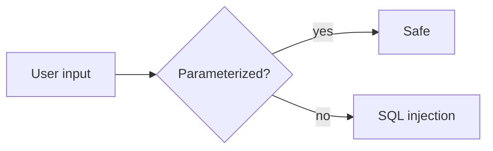

## What is SQL injection

SQL injection is an attack in which an attacker "mixes" their SQL into your query. It happens when you build an SQL string by concatenating user input:

```python
# VULNERABLE CODE — never do this!
def login_vulnerable(username, password):
    cur.execute(
        "SELECT id FROM users WHERE username = '" + username +
        "' AND password=[redacted]"
    )
    return cur.fetchone()
```

What happens if you enter `' OR '1'='1' --` in the username field? The query becomes:

```sql
SELECT id FROM users WHERE username = '' OR '1'='1' --' AND password = ''
```

The `--` comment cuts off the rest of the condition, and `OR '1'='1'` is always true — the attacker "logged in" without a password. Even worse: entering `'; DROP TABLE users; --` would delete the table.

## Parameterized queries — the main defense

Never insert values into SQL by concatenation. Pass them as parameters: the driver sends the values separately from the query text, and they are interpreted as data, not as code.

```python
def login_safe(username, password):
    cur.execute(
        "SELECT id FROM users WHERE username = ? AND password=[redacted]",
        (username, password),
    )
    return cur.fetchone()
```

The `?` character is the sqlite3 placeholder. In psycopg (PostgreSQL) `%s` is used, and named placeholders are `:name`:

```python
import psycopg2
conn = psycopg2.connect("dbname=shop user=postgres")
cur = conn.cursor()
cur.execute(
    "SELECT id FROM users WHERE username = %s AND password = %s",
    (username, password),
)
```

The approach is the same everywhere: the database receives the query text and the values separately, and cannot let the values change the meaning of the query.

## Traps that are not defenses

- **Manually escaping quotes** — easy to get wrong; parameters are better.
- **Blacklisting words** (forbidding `DROP`, `SELECT`, etc.) — bypassed with spelling variants, comments and encodings.
- **f-strings "for numbers only"** — a number like `1; DROP TABLE users; --` is also a string.

## ORM and security

SQLAlchemy and the Django ORM parameterize queries themselves, so typical ORM code is safe. But there are traps here too: raw SQL via `text()` must be parameterized with bindparams:

```python
from sqlalchemy import text
result = session.execute(
    text("SELECT id FROM users WHERE username = :u"),
    {"u": username},
)
```

## Input validation and the principle of least privilege

Parameterization closes injections, but it is not the whole defensive perimeter:

- **Validate the type and length of input**: an email must contain @, an age must be a number from 0 to 120.
- **The DBMS user should have the minimum necessary rights**: a web app usually only needs SELECT/INSERT/UPDATE/DELETE on its own tables, not DROP/CREATE.
- **Don't expose database error messages** to the user — they help an attacker understand the database structure.
- Take regular backups — but better not to have to restore them.

## Demonstrating the attack

```python
import sqlite3

conn = sqlite3.connect(":memory:")
cur = conn.cursor()
cur.executescript("""
CREATE TABLE users (id INTEGER PRIMARY KEY, username TEXT, password TEXT);
INSERT INTO users VALUES (1, 'admin', 'secret123'), (2, 'anya', 'qwerty');
""")

attack = "' OR '1'='1' --"
cur.execute("SELECT id FROM users WHERE username = '" + attack + "'")
print("Vulnerable:", cur.fetchall())    # [(1,), (2,)] — the whole database!

cur.execute("SELECT id FROM users WHERE username = ?", (attack,))
print("Safe:", cur.fetchall())  # []
```



## Summary

SQL injection has been in the top web application vulnerability lists for years. It is defeated simply: no concatenation, only parameters, plus validation and least privilege. An ORM helps, but doesn't remove the need for vigilance with raw SQL.

<!--TASK-->
### Task 1
Write a function `login_vulnerable(cur, username)` that runs a vulnerable query via concatenation: `"SELECT id FROM users WHERE username = '" + username + "'"`. Use the database from the lesson: admin/secret123 and anya/qwerty. Call it with the attack `"' OR '1'='1' --"` and print the result. Expected output: `[(1,), (2,)]` — the attack returned all users.

### Task 2
Write a safe version `login_safe(cur, username)` that uses the `?` placeholder. Call it with the same attack and print the result. Expected output: `[]` — the injection failed, and the value itself is interpreted as a string.

### Task 3
Write a function `search_products(conn, pattern)` that searches for products by substring with LIKE, but correctly escapes the `%` and `_` special characters in user input. Schema: `products(id, name)` with names `'Keyboard 100% mechanical'`, `'Wired keyboard'`, `'Optical mouse'`. For pattern=`"100%"` the function must return only the first record. Use `ESCAPE '\'` in SQL. Expected output: `['Keyboard 100% mechanical']`.

### Task 4
Write a function `get_products_sorted(cur, sort_key)` that sorts products by a column whose name comes from the user. Column names cannot be passed as parameters — use a whitelist: `{"price": "price", "name": "name"}`. If the key is not in the list, raise ValueError. Demonstrate that `sort_key="price; DROP TABLE products"` does not break the database. Print the names sorted by price.

### Task 5
Write a function `safe_query(cur, query, params)` that runs a parameterized query and returns the rows, and on any SQL error returns the neutral message `"Query error"` — without the text of the original exception. Demonstrate it on a deliberately erroneous query (for example, referencing a non-existent column). Print the call result. Expected output: `Query error`.
### Task 6 — Injection via f-string
Create a search function that builds the query with an f-string: `SELECT * FROM users WHERE login = '{login}'`. Pass `login = "admin' --"` and show that the query fetches the admin. Expected result: the "hack" works.
### Task 7 — Parameterization as the defense
Rewrite the same query as parameterized: `SELECT * FROM users WHERE login = ?` and pass a tuple. Show that the same string no longer breaks the query.

<!--/TASK-->

<!--HINT-->
### Hint 1
The database is created with `sqlite3.connect(":memory:")` and `executescript` with CREATE TABLE and INSERT. Notice how the quotes in the attack string close the string literal in SQL, and `--` turns the rest into a comment.

### Hint 2
In the safe version, values are passed as a second argument to `execute` as a tuple: `cur.execute("... WHERE username = ?", (username,))`. The driver passes the attack string as an ordinary value, and it doesn't change the query.

### Hint 3
First replace `%` with `\%` and `_` with `\_` in the input (via replace). Then add `%` on both sides for substring search and pass it as a parameter. In SQL add `ESCAPE '\'` so `\` works as an escape character. In the Python SQL string write a backslash as `\\`.

### Hint 4
A whitelist is a dict where keys are safe "public" names and values are real column names. Pick the value with `.get(sort_key)` and check for `None`. Then build `ORDER BY <col>` with the already-checked value — no user input in the query.

### Hint 5
Wrap `cur.execute(query, params)` and `cur.fetchall()` in `try/except Exception`. In except return the string `"Query error"`. Do not print `repr(e)` or `str(e)` anywhere — only log it on your own server.
### Hint 6
The `'` character closes the string, `--` comments out the rest of the condition.
### Hint 7
`cur.execute(sql, (login,))` — the value goes separately from the SQL.

<!--/HINT-->

<!--SOLUTION-->
### Solution 1
Solution:

```python
import sqlite3

conn = sqlite3.connect(":memory:")
cur = conn.cursor()
cur.executescript("""
CREATE TABLE users (id INTEGER PRIMARY KEY, username TEXT, password TEXT);
INSERT INTO users VALUES (1, 'admin', 'secret123'), (2, 'anya', 'qwerty');
""")

def login_vulnerable(cur, username):
    cur.execute(
        "SELECT id FROM users WHERE username = '" + username + "'"
    )
    return cur.fetchall()

attack = "' OR '1'='1' --"
print(login_vulnerable(cur, attack))
```

Result:

```
[(1,), (2,)]
```

What's happening here? The user input is inserted straight into the SQL string. The attack `' OR '1'='1' --` closes the string literal with the first quote, adds the always-true condition `OR '1'='1'` and silences the rest of the condition with the `--` comment. The query becomes `SELECT id FROM users WHERE username = '' OR '1'='1' --'`, which returns every row in the table. This is exactly what real authorization bypasses look like. If we had inserted `'; DROP TABLE users; --` — the consequences would be devastating.

### Solution 2
Solution:

```python
import sqlite3

conn = sqlite3.connect(":memory:")
cur = conn.cursor()
cur.executescript("""
CREATE TABLE users (id INTEGER PRIMARY KEY, username TEXT, password TEXT);
INSERT INTO users VALUES (1, 'admin', 'secret123'), (2, 'anya', 'qwerty');
""")

def login_safe(cur, username):
    cur.execute(
        "SELECT id FROM users WHERE username = ?", (username,)
    )
    return cur.fetchall()

attack = "' OR '1'='1' --"
print(login_safe(cur, attack))
```

Result:

```
[]
```

What's happening here? Instead of concatenation, the value is passed separately through the `?` placeholder. The driver sends the query text and the value separately to SQLite, and SQLite interprets the string `' OR '1'='1' --` as plain data — as text to compare against the username column. There are no matches, so the result is empty. In psycopg2 the placeholder is `%s`, in SQLAlchemy text() — `:name`, but the principle is the same: values never become part of the query text. This is the main defense against injection.

### Solution 3
Solution:

```python
import sqlite3

conn = sqlite3.connect(":memory:")
cur = conn.cursor()
cur.executescript("""
CREATE TABLE products (id INTEGER PRIMARY KEY, name TEXT);
INSERT INTO products (name) VALUES
    ('Keyboard 100% mechanical'),
    ('Wired keyboard'),
    ('Optical mouse');
""")

def search_products(conn, pattern):
    escaped = pattern.replace("%", "\\%").replace("_", "\\_")
    cur = conn.cursor()
    cur.execute(
        "SELECT name FROM products WHERE name LIKE ? ESCAPE '\\'",
        (f"%{escaped}%",),
    )
    return [row[0] for row in cur.fetchall()]

print(search_products(conn, "100%"))
```

Result:

```
['Keyboard 100% mechanical']
```

What's happening here? In LIKE, the characters `%` and `_` are special: `%` means "any sequence", `_` means "any single character". Without escaping, a search for `"100%"` would find everything containing "100" with any continuation — for example, "100500" too. We replace `%` with `\%` and `_` with `\_`, and the `ESCAPE '\'` clause tells the database that backslash is the escape character. Note the double backslash in Python strings: `"\\%"` is a two-character string `\` and `%`. The input is still passed as a parameter, so injection is impossible.

### Solution 4
Solution:

```python
import sqlite3

conn = sqlite3.connect(":memory:")
cur = conn.cursor()
cur.executescript("""
CREATE TABLE products (id INTEGER PRIMARY KEY, name TEXT, price REAL);
INSERT INTO products (name, price) VALUES
    ('Keyboard', 1500),
    ('Mouse', 800),
    ('Monitor', 12000);
""")

ALLOWED = {"price": "price", "name": "name"}

def get_products_sorted(cur, sort_key):
    col = ALLOWED.get(sort_key)
    if col is None:
        raise ValueError("Invalid sort key")
    cur.execute(f"SELECT name, price FROM products ORDER BY {col}")
    return cur.fetchall()

print(get_products_sorted(cur, "price"))
try:
    get_products_sorted(cur, "price; DROP TABLE products")
except ValueError as e:
    print("Blocked:", e)
print(cur.execute("SELECT COUNT(*) FROM products").fetchone()[0])
```

Result:

```
[('Mouse', 800.0), ('Keyboard', 1500.0), ('Monitor', 12000.0)]
Blocked: Invalid sort key
3
```

What's happening here? Column names cannot be passed as parameters — parameters are substituted where a value is expected, not an identifier. That's why ORDER BY uses a whitelist: the user picks from safe keys, and the real column name comes from the dict. The input `price; DROP TABLE products` is not in the dict, so the function immediately raises ValueError, and the malicious SQL never even reaches the database. The products table is intact: it still has three rows.

### Solution 5
Solution:

```python
import sqlite3

conn = sqlite3.connect(":memory:")
cur = conn.cursor()
cur.executescript("""
CREATE TABLE products (id INTEGER PRIMARY KEY, name TEXT);
INSERT INTO products (name) VALUES ('Keyboard'), ('Mouse');
""")

def safe_query(cur, query, params):
    try:
        cur.execute(query, params)
        return cur.fetchall()
    except Exception:
        return "Query error"

print(safe_query(cur, "SELECT name FROM products WHERE no_such_column = ?", (1,)))
```

Result:

```
Query error
```

What's happening here? The query references a non-existent column, and SQLite raises OperationalError. The function catches any exception and returns a neutral message without revealing details: neither the SQL text, nor column names, nor the database type. In a real application, the error text can be logged on your own server, but it must not be shown to the user — attackers use such messages to understand the database structure and plan the next step of an attack. Remember: security is layered — parameterization + validation + hiding details + least privilege.
### Solution 6
```python
login = "admin' --"
sql = f"SELECT * FROM users WHERE login = '{login}'"
# SELECT * FROM users WHERE login = 'admin' --'
cur.execute(sql)
```
The comment cuts off the password check — the injection returns the admin. This is a critical vulnerability.
### Solution 7
```python
login = "admin' --"
cur.execute("SELECT * FROM users WHERE login = ?", (login,))
```
The parameter is passed as data; quotes and comments inside it don't affect the SQL. This is rule #1 of database security.

<!--/SOLUTION-->

<!--QUIZ-->
What is SQL injection?
- A virus that infects database files
- An attack in which user input changes the meaning of an SQL query
- A syntax error in SQL
- A way to speed up queries
* Correct answer: An attack in which user input changes the meaning of an SQL query
Input like `' OR '1'='1' --` becomes part of the query text and changes the condition.

Why do parameterized queries protect against injection?
- They encrypt the data
- Values are sent separately from the query text and are interpreted as data
- They forbid SQL commands
- They only use SELECT
* Correct answer: Values are sent separately from the query text and are interpreted as data
The driver does not let values change the structure of the query.

What is not a defense against injection?
- Parameterized queries
- Manually escaping quotes and blacklisting words
- Passing values through placeholders
- Validating input types
* Correct answer: Manually escaping quotes and blacklisting words
Manual escaping is easy to get wrong, and blacklists are bypassed with spelling variants.

Why can't a column name be passed as a parameter in ORDER BY?
- Parameters are substituted only where a value is expected, not an identifier
- ORDER BY doesn't support parameters at all
- It would slow down the query
- Column names are always safe
* Correct answer: Parameters are substituted only where a value is expected, not an identifier
Column and table names must be taken from a whitelist.

Why shouldn't an SQL error message be shown to the user?
- It's too long
- It reveals the database structure and helps the attacker
- It violates the license
- It contains other users' personal data
* Correct answer: It reveals the database structure and helps the attacker
Error messages are reconnaissance data for planning a further attack.

What does an ORM (SQLAlchemy, Django) do with ordinary queries?
- Disables all checks
- Automatically parameterizes them, making them safe
- Turns them into stored procedures
- Changes nothing
* Correct answer: Automatically parameterizes them, making them safe
But raw SQL via text() still needs to be parameterized manually.

Which placeholder is used in psycopg2 (PostgreSQL)?
- %s
- ?
- :name
* Correct answer: %s
In sqlite3 — ?, in psycopg2 — %s, named ones — :name.

Why don't f-strings "for numbers only" protect against injection?
- Because a number like 1; DROP TABLE users; -- is also a string
- Because f-strings are slow
- Because they don't work in SQL
* Correct answer: Because a number like 1; DROP TABLE users; -- is also a string
User input always arrives as a string, and it can't be trusted without parameterization.
What is SQL injection?
- Injecting malicious SQL through user input
- A network error
- A slow query
- An incorrect index
* Correct answer: Injecting malicious SQL through user input
If input gets into SQL as code, that's injection.

How do you correctly insert values into a query?
- Through placeholders (?) and a separate tuple
- Through f-strings
- Through +
- Through %(name)s only
* Correct answer: Through placeholders (?) and a separate tuple
Values are not interpreted as SQL.

What does the -- character do in SQL?
- Starts a comment to the end of the line
- Deletes a row
- Joins tables
- Nothing
* Correct answer: Starts a comment to the end of the line
Injection uses it to "cut off" part of the condition.

How do you test for vulnerability in practice?
- Pass quotes and observe the error/behavior
- Read logs
- Look at indexes
- Run EXPLAIN
* Correct answer: Pass quotes and observe the error/behavior
Changing behavior with quotes is a marker of injection.

# 
<!--/QUIZ-->
