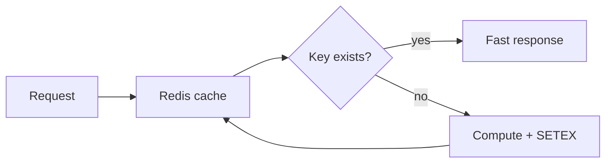

## What is Redis

Redis is a fast in-memory data structure server. Most often it is used as a cache in front of a database: hot data lives in RAM and is served in microseconds, while the heavy database is protected from extra load. Redis's key structures are strings, lists, sets, hashes and sorted sets. Install the client and connect:

```bash
pip install redis
```

```python
import redis

r = redis.Redis(host="localhost", port=6379, db=0)
r.set("greeting", "Hello!")
print(r.get("greeting"))   # b'Hello!'
r.delete("greeting")
```

Redis stores bytes, so `get` returns `bytes` — `b'Hello!'`. If you prefer strings, pass `decode_responses=True` when creating the client. For local experiments without a server you can use `fakeredis` — a library with the same API (install: `pip install fakeredis`, client: `fakeredis.FakeRedis()`).

## Basic commands

- `SET key value` / `GET key` — write/read a string.
- `SETEX key seconds value` — write a string with a time to live (TTL).
- `EXPIRE key seconds` — set a TTL for an existing key.
- `TTL key` — how many seconds remain: -1 — no expiry, -2 — the key doesn't exist.
- `INCR key` / `DECR key` — atomic increment/decrement.
- `DEL key` — delete a key.

```python
r.setex("profile:42", 60, "{...}")   # lives for 60 seconds
print(r.ttl("profile:42"))            # about 60
```

## The cache-aside pattern (lazy caching)

The most common caching pattern. The scheme:

1. Read the key from Redis.
2. The key exists — return the value (hit).
3. The key doesn't exist (miss) — read from the database, put it into Redis with a TTL, return.

```python
def get_user(user_id):
    key = f"user:{user_id}"
    cached = r.get(key)
    if cached is not None:
        return cached.decode()
    row = cur.execute("SELECT name FROM users WHERE id = ?", (user_id,)).fetchone()
    value = row[0] if row else None
    if value is not None:
        r.setex(key, 300, value)   # cache for 5 minutes
    return value
```

## TTL and invalidation

A cache always risks going stale. There are two levers:

- **TTL** — data disappears automatically after N seconds, and the next request computes it again.
- **Active invalidation** — when a record is updated in the database, delete the key (DEL or EXPIRE) so the next request re-reads fresh data.

The rule: TTL is the basic protection against staleness, and write-time invalidation is for data that changes often and must be fresh immediately.

## Cache stampede

If a key expires and 1000 requests hit it at the same time, all of them will go to the database. Protection: "one writes, the rest wait" via a lock with `SETNX` (set if not exists), or refreshing the key in the background before expiry. A separate problem is "cache penetration": requests for keys that don't exist in the database are not cached, and each such request hits the database. The solution — cache the negative result for a short time.

## Pipeline

Each command is a separate network round trip; for 1000 commands that's expensive. A pipeline packs commands into one network exchange:

```python
pipe = r.pipeline()
for i in range(1000):
    pipe.incr(f"counter:{i}")
pipe.execute()
```

## What if Redis goes down?

The code should not crash along with Redis. Wrap the calls in try/except and simply read the database when the cache is unavailable — this is called graceful degradation. For tests without a server, use `fakeredis` — the same API, the same tests.



## Summary

Redis is a powerful tool, but a cache is always a trade-off: it speeds up reads at the cost of stale-data risk and code complexity. Cache only heavy, frequently-read data, always set a TTL, and design for degradation.

<!--TASK-->
### Task 1
Write a function `string_roundtrip(r)` that takes a redis client (real `redis.Redis` or `fakeredis.FakeRedis()`) and performs: `SET` of the key `"city"` with the value `"Moscow"`, then `GET`, `TTL`, `EXPIRE` for 100 seconds, `TTL` again, and `DEL`. Return the tuple: `(city_value, ttl_before, ttl_after, exists_after_delete)`, where ttl_before is the TTL right after SET (expected -1), ttl_after is after EXPIRE (1–100), exists_after_delete is the GET result after DEL (None). Print the tuple.

### Task 2
Write a decorator `cached(ttl)` that wraps any function and caches its result in Redis: the key is `"cache:" + function_name + ":" + str(argument)`. If there is no value — the call computes, saves via `setex` and returns; if there is — returns from the cache without computing. The function `slow(x)` computes `x * x` and prints `"compute"` on each real computation. Return the tuple `(a, b, compute_count)`, where a, b are the results of two calls to `slow(5)`, and compute_count is how many times "compute" was printed. Expected output: `(25, 25, 1)`.

### Task 3
Write a function `pipeline_incr(r)` that increments 500 keys `counter:0` ... `counter:499` (initial values 0) via a pipeline and returns the tuple `(n_commands, total_sum)`, where n_commands is the number of commands in the pipeline and total_sum is the sum of all resulting values. Expected output: `(500, 500)`.

### Task 4
Write a function `get_user_cached(r, cur, user_id)` implementing the cache-aside pattern: first Redis (key `user:<id>`), on a miss — the sqlite3 table `users(id, name)` (in memory), then `setex` for 300 seconds. Return the tuple `(value, from_cache)`, where from_cache is True if the value came from Redis. Test: first call for user_id=1 → `('Anya', False)`, second → `('Anya', True)`.

### Task 5
Write a function `invalidate_on_update(r, cur, user_id, new_name)` that updates a user's name in the database and deletes their key from the cache (invalidation). Then call `get_user_cached` again and return the tuple `(fresh_value, from_cache)`. First fill the cache with a call to `get_user_cached(r, cur, 1)` (it returns "Anya"), then update the name to "Anna". Expected output: `('Anna', False)` — the value is fresh because the old cache was deleted.
### Task 6 — SETEX and TTL
Through redis-py set a value: `r.setex("page:1", 60, html)`. Check `r.ttl("page:1")` — about 60; after `r.expire("page:1", 1)` and sleep(1.2) verify the key is gone (get → None).
### Task 7 — Rate limit on Redis
Implement a request counter: `incr` on the key `rl:{ip}` + `expire` 60 seconds. If the value > 10 — return "too many requests". Verify that after the 11th call the limit kicks in.

<!--/TASK-->

<!--HINT-->
### Hint 1
`r.set("city", "Moscow")` returns True. `r.get` returns bytes, so compare with `b"Moscow"` or decode: `value.decode()`. `r.ttl("city")` after SET gives -1, after EXPIRE — a number of seconds from 1 to 100. `r.delete("city")` returns 1 (one key deleted), and GET after that — None.

### Hint 2
Inside the decorator: `key = f"cache:{func.__name__}:{arg}"`; try `r.get(key)` — if not None, return `float(value)` (or decode). If None — compute `result = func(arg)`, save `r.setex(key, ttl, str(result))` and return. The "compute" counter is an ordinary global variable; increment it inside slow() before printing.

### Hint 3
`pipe = r.pipeline()`; loop `for i in range(500): pipe.incr(f"counter:{i}")`; `pipe.execute()` returns a list of results (all will be 1). The sum of results = 500, the number of commands = 500. You can verify `len(results) == 500`.

### Hint 4
First `cached = r.get(f"user:{user_id}")`. If it exists — `return (cached.decode(), True)`. If not — the query `SELECT name FROM users WHERE id = ?` via cur, then `r.setex(f"user:{user_id}", 300, name)` and `(name, False)`. Create a users table with one row (1, 'Anya').

### Hint 5
After `UPDATE users SET name = ? WHERE id = ?` in the database, do `r.delete(f"user:{user_id}")`. Then call `get_user_cached` — it will see a miss, read the new name from the database and cache it again.
### Hint 6
`pip install redis`; client `redis.Redis(host="127.0.0.1", port=6379)`.
### Hint 7
`r.incr(key)` creates the key if it doesn't exist; then `r.expire(key, 60)`.

<!--/HINT-->

<!--SOLUTION-->
### Solution 1
Solution:

```python
import fakeredis

def string_roundtrip(r):
    r.set("city", "Moscow")
    city_value = r.get("city").decode()
    ttl_before = r.ttl("city")
    r.expire("city", 100)
    ttl_after = r.ttl("city")
    r.delete("city")
    exists_after_delete = r.get("city")
    return (city_value, ttl_before, ttl_after, exists_after_delete)

r = fakeredis.FakeRedis()
print(string_roundtrip(r))
```

Result (approximately):

```
('Moscow', -1, 100, None)
```

What's happening here? `SET` creates a key without an expiry, so the TTL right after writing is -1. `EXPIRE` assigns a lifetime — 100 seconds — and now TTL returns a number from 1 to 100 (the exact value depends on the moment of the check). After `DEL` the key disappears, and `GET` returns None. Note: `get` returns bytes, so we decode the value into a string. fakeredis was used for the test — the same API as the real client, but without a server.

### Solution 2
Solution:

```python
import fakeredis

r = fakeredis.FakeRedis()
compute_count = {"n": 0}

def cached(ttl):
    def decorator(func):
        def wrapper(arg):
            key = f"cache:{func.__name__}:{arg}"
            value = r.get(key)
            if value is not None:
                return float(value)
            result = func(arg)
            r.setex(key, ttl, str(result))
            return result
        return wrapper
    return decorator

@cached(ttl=60)
def slow(x):
    compute_count["n"] += 1
    print("compute")
    return x * x

a = slow(5)
b = slow(5)
print((a, b, compute_count["n"]))
```

Result:

```
compute
(25, 25, 1)
```

What's happening here? The first call to `slow(5)` finds no cache, computes 25, saves the value in Redis for 60 seconds and prints "compute". The second call with the same argument finds the key `cache:slow:5` and returns the cached value without executing the function body. So "compute" is printed once. This is how caching decorators work in production services: expensive computations run once, and repeated requests are served from Redis in microseconds.

### Solution 3
Solution:

```python
import fakeredis

def pipeline_incr(r):
    pipe = r.pipeline()
    for i in range(500):
        pipe.incr(f"counter:{i}")
    results = pipe.execute()
    return (len(results), sum(results))

r = fakeredis.FakeRedis()
print(pipeline_incr(r))
```

Result:

```
(500, 500)
```

What's happening here? Each `INCR` command on its own is a network exchange with the server; 500 commands without a pipeline are 500 round trips. A pipeline collects all commands into one buffer and sends them as a single packet, and `execute()` returns the list of results in the same order. Here each INCR result is 1 (initial value 0, increment gives 1), so the sum is 500. In real systems a pipeline cuts latency by dozens of times when many simple commands need to run.

### Solution 4
Solution:

```python
import sqlite3
import fakeredis

conn = sqlite3.connect(":memory:")
cur = conn.cursor()
cur.executescript("""
CREATE TABLE users (id INTEGER PRIMARY KEY, name TEXT);
INSERT INTO users VALUES (1, 'Anya');
""")
conn.commit()

r = fakeredis.FakeRedis()

def get_user_cached(r, cur, user_id):
    key = f"user:{user_id}"
    cached = r.get(key)
    if cached is not None:
        return (cached.decode(), True)
    row = cur.execute(
        "SELECT name FROM users WHERE id = ?", (user_id,)
    ).fetchone()
    name = row[0]
    r.setex(key, 300, name)
    return (name, False)

print(get_user_cached(r, cur, 1))
print(get_user_cached(r, cur, 1))
```

Result:

```
('Anya', False)
('Anya', True)
```

What's happening here? This is classic cache-aside. The first call is a miss: there is no value in Redis, so we read the database, save the name in Redis for 300 seconds and return it with the False flag. The second call is a hit: the key is already in the cache, and we return it without touching the database, with the True flag. This is how hot records gradually "warm up" the cache, and the database only sees real misses.

### Solution 5
Solution:

```python
import sqlite3
import fakeredis

conn = sqlite3.connect(":memory:")
cur = conn.cursor()
cur.executescript("""
CREATE TABLE users (id INTEGER PRIMARY KEY, name TEXT);
INSERT INTO users VALUES (1, 'Anya');
""")
conn.commit()

r = fakeredis.FakeRedis()

def get_user_cached(r, cur, user_id):
    key = f"user:{user_id}"
    cached = r.get(key)
    if cached is not None:
        return (cached.decode(), True)
    row = cur.execute(
        "SELECT name FROM users WHERE id = ?", (user_id,)
    ).fetchone()
    name = row[0]
    r.setex(key, 300, name)
    return (name, False)

def invalidate_on_update(r, cur, user_id, new_name):
    cur.execute("UPDATE users SET name = ? WHERE id = ?",
                (new_name, user_id))
    conn.commit()
    r.delete(f"user:{user_id}")

print(get_user_cached(r, cur, 1))      # cache "Anya"
invalidate_on_update(r, cur, 1, "Anna")
print(get_user_cached(r, cur, 1))      # fresh name from the database
```

Result:

```
('Anya', False)
('Anna', False)
```

What's happening here? First we fill the cache with the name "Anya". Then we update the record in the database to "Anna" and delete the key from Redis — that's cache invalidation. The next `get_user_cached` call sees a miss, reads the fresh name from the database, caches it again and returns "Anna" with the False flag. If we hadn't deleted the key, the next request would return the stale "Anya" from the cache. This is how the TTL + write-time invalidation combo keeps the balance between speed and data freshness.
### Solution 6
```python
import redis, time
r = redis.Redis(host="127.0.0.1", port=6379)

html = "<h1>Hello</h1>"
r.setex("page:1", 60, html)
print(r.ttl("page:1"))          # ~60
r.expire("page:1", 1)
time.sleep(1.2)
print(r.get("page:1"))          # None
```
SETEX = SET + expire. After the TTL expires the key disappears automatically.
### Solution 7
```python
def rate_limit(ip):
    key = f"rl:{ip}"
    count = r.incr(key)
    if count == 1:
        r.expire(key, 60)
    if count > 10:
        return "too many requests"
    return "ok"

for _ in range(12):
    print(rate_limit("1.2.3.4"))
```
The first call sets the TTL, then the counter grows; the 11th returns the refusal.

<!--/SOLUTION-->

<!--QUIZ-->
What does the command SETEX key 60 value do?
- Writes the value and gives it a lifetime of 60 seconds
- Writes the value forever
- Deletes the key after 60 seconds
- Increases the value by 60
* Correct answer: Writes the value and gives it a lifetime of 60 seconds
SETEX is SET + EXPIRE in one command.

What will TTL return for a key without an expiry?
- 0
- -1
- 60
- An error
* Correct answer: -1
-1 means "no expiry", -2 means "the key doesn't exist".

What is the first step of the cache-aside pattern?
- Write data to the database
- Read the key from Redis; on a miss — read the database
- Restart Redis
- Delete all keys
* Correct answer: Read the key from Redis; on a miss — read the database
On a miss, the data is taken from the database and put into the cache with a TTL.

What is a cache stampede?
- When many requests simultaneously hit an expired key and all go to the database
- When Redis overflows
- When the cache stores too many keys
- When the database crashes from lack of memory
* Correct answer: When many requests simultaneously hit an expired key and all go to the database
Protection: a lock via SETNX or background key refresh.

Why is a pipeline needed?
- To encrypt data
- To send many commands in one network exchange
- To clear the cache
- To set TTL automatically
* Correct answer: To send many commands in one network exchange
A pipeline reduces the number of network round trips and greatly speeds up batch operations.

What to do if Redis is unavailable?
- Crash the application
- Read the database directly — graceful degradation
- Restart Redis automatically
- Ignore the errors and return empty
* Correct answer: Read the database directly — graceful degradation
The Redis calls are wrapped in try/except, and on failure the data is read from the database.

What does INCR key do?
- Atomically increases the key's numeric value by 1
- Creates the key with the value 1
- Decodes the key's value
* Correct answer: Atomically increases the key's numeric value by 1
INCR is atomic: parallel calls won't lose increments.

What is "cache penetration"?
- When requests for non-existent keys hit the database every time
- When Redis overflows
- When the TTL is too long
* Correct answer: When requests for non-existent keys hit the database every time
The solution — cache the negative result for a short time.
What does SETEX key seconds value do?
- Sets a value with a lifetime
- Reads a value
- Deletes a key
- Increments
* Correct answer: Sets a value with a lifetime
The ttl is counted from the moment of setting.

What does TTL return?
- The remaining seconds of the key's life
- The key's value
- The size
- The type
* Correct answer: The remaining seconds of the key's life
-2 — the key doesn't exist, -1 — no expiry.

Why is Redis used as a cache?
- For fast access to frequently requested data
- For permanent storage of everything
- For SQL
- For files
* Correct answer: For fast access to frequently requested data
A cache relieves the main database.

How do you implement a rate limit on Redis?
- Via INCR + EXPIRE
- Via SET only
- Via GET
- Via DEL
* Correct answer: Via INCR + EXPIRE
A counter in a time window limits the number of requests.

# 
<!--/QUIZ-->
