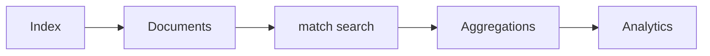

Elasticsearch is a distributed search engine built on Lucene. It is used for full-text search, logs and analytics. In this lesson we work through the official `elasticsearch-py` client.

## Key concepts

- An index is the analogue of a "table"/"database" for documents.
- A document is a JSON object with fields.
- A mapping is a schema of field types (text, keyword, integer...).

## Client and index creation

```python
from elasticsearch import Elasticsearch

es = Elasticsearch("http://localhost:9200")
es.indices.create(index="books", ignore=400)
```

## Writing documents

```python
es.index(index="books", id=1, document={"title": "Python for Beginners", "year": 2020})
```

## Search

```python
resp = es.search(index="books", query={"match": {"title": "Python"}})
```

## Aggregations

```python
resp = es.search(index="books", aggs={"by_year": {"terms": {"field": "year"}}})
```

## Lesson summary

Elasticsearch gives lightning-fast full-text search and grouping; the Python client mirrors the REST API one to one.




## Practical use

Elasticsearch is used for catalog search, log analytics and monitoring. Aggregations let you build dashboards without exporting raw data. The ability to build indexes and queries is an in-demand skill for backend and data engineers. The Python client makes integration with the rest of the ecosystem simple.


Besides search, Elasticsearch is often used for log monitoring: agents write events to an index, and dashboards collect aggregations in real time. When designing an index it is important to decide in advance which fields will be keyword (exact filters) and which text (search). Updating a mapping after index creation is limited, so the schema is thought through before writing data.


Additionally, it's worth mastering `multi_match` — search across several fields with weights — and `fuzzy` search, which forgives typos. Result pagination is done via `from`/`size`, and sorting via `sort`. For safe integration with user input, you must not build queries with string interpolation — use query DSL structures: this guards against errors and unexpected interpretations.


<!--TASK-->
### Task 1 — Connection and check
Connect to Elasticsearch and check availability via es.ping() or GET /. If there is no instance — describe starting it via Docker (elasticsearch:8.x).

### Task 2 — Creating an index
Create a books index with a mapping: title text, year integer, in_stock boolean. Show the API response.

### Task 3 — Adding documents
Add 3 documents (different book titles). Verify that id 1 is returned via es.get.

### Task 4 — Match search
Find books where "Python" appears in title, via match. Print the hits: score and source.

### Task 5 — Phrase search
Find the exact phrase "for beginners" via match_phrase. Explain the difference from match.

### Task 6 — Filters and range
Find books with year >= 2019 via bool filter range. Print the number found.

### Task 7 — Aggregation by year
Group books by year via aggs terms. Print the buckets with counts.
<!--/TASK-->

<!--HINT-->
### Hint 1
`docker run -p 9200:9200 -e "discovery.type=single-node" docker.elastic.co/elasticsearch/elasticsearch:8.14.3`.

### Hint 2
`es.indices.create(index="books", mappings={...})`.

### Hint 3
`es.index(index="books", id=N, document={...})`.

### Hint 4
`query={"match": {"title": "Python"}}`.

### Hint 5
`query={"match_phrase": {"title": "for beginners"}}`.

### Hint 6
`query={"bool": {"filter": [{"range": {"year": {"gte": 2019}}}]}}`.

### Hint 7
`aggs={"by_year": {"terms": {"field": "year"}}}`.
<!--/HINT-->

<!--SOLUTION-->
### Solution 1
```python
from elasticsearch import Elasticsearch

es = Elasticsearch("http://localhost:9200")
print(es.ping())
```
If True — the server is reachable.

### Solution 2
```python
mappings = {
    "properties": {
        "title": {"type": "text"},
        "year": {"type": "integer"},
        "in_stock": {"type": "boolean"},
    }
}
print(es.indices.create(index="books", mappings=mappings))
```
A mapping sets the field types.

### Solution 3
```python
books = [
    {"title": "Python for Beginners", "year": 2020, "in_stock": True},
    {"title": "Deep Learning", "year": 2021, "in_stock": False},
    {"title": "Python in Science", "year": 2019, "in_stock": True},
]
for i, b in enumerate(books, start=1):
    es.index(index="books", id=i, document=b)

print(es.get(index="books", id=1)["_source"])
```
Documents added.

### Solution 4
```python
resp = es.search(index="books", query={"match": {"title": "Python"}})
for hit in resp["hits"]["hits"]:
    print(hit["_score"], hit["_source"]["title"])
```
Match works on analyzed fields.

### Solution 5
```python
resp = es.search(index="books", query={"match_phrase": {"title": "for beginners"}})
print([h["_source"]["title"] for h in resp["hits"]["hits"]])
```
match_phrase requires the sequence of words.

### Solution 6
```python
resp = es.search(index="books", query={
    "bool": {"filter": [{"range": {"year": {"gte": 2019}}}]}
})
print(resp["hits"]["total"]["value"])
```
Filters don't affect relevance.

### Solution 7
```python
resp = es.search(index="books", aggs={"by_year": {"terms": {"field": "year"}}})
for bucket in resp["aggregations"]["by_year"]["buckets"]:
    print(bucket["key"], bucket["doc_count"])
```
Aggregations group documents.
<!--/SOLUTION-->

<!--QUIZ-->
What is an index in Elasticsearch?
- A collection of documents with a mapping
- A database table
- A string
- A cluster
* Correct answer: A collection of documents with a mapping
The analogue of a database/table.

Which field type is for full-text search?
- text
- keyword
- integer
- boolean
* Correct answer: text
text is analyzed, keyword is an exact match.

What does match do?
- Analyzes the query and searches the field
- Exact match
- Phrase
- Rating
* Correct answer: Analyzes the query and searches the field
Token-based search.

How is match_phrase different from match?
- It requires the exact sequence of words
- It's faster
- It searches only by id
- It works with numbers
* Correct answer: It requires the exact sequence of words
This is phrase search.

What is a filter in a bool query?
- A condition without an effect on score
- Full search
- Sorting
- Pagination
* Correct answer: A condition without an effect on score
Filters are cached.

What does aggregations do?
- Groups and counts by fields
- Sorts
- Deletes documents
- Changes the mapping
* Correct answer: Groups and counts by fields
Analytics on a query.

How do you add a document?
- es.index(index=..., id=..., document=...)
- es.create_index
- es.put
- es.append
* Correct answer: es.index(index=..., id=..., document=...)
The index method writes/updates.

What will es.get(index, id) return?
- A dict with _source
- A list
- A number
- A string
* Correct answer: A dict with _source
The document in JSON.

Which parameter means "greater than or equal"?
- gte
- lte
- gt
- eq
* Correct answer: gte
greater than or equal.

What is score?
- A measure of a document's relevance
- The file size
- The time
- The version number
* Correct answer: A measure of a document's relevance
The higher, the more accurate the match.
What is a mapping?
- The schema of an index's field types
- A list of documents
- A log
- A cluster
* Correct answer: The schema of an index's field types
It determines how fields are analyzed.

Which client version works with ES 8?
- elasticsearch-py 8.x
- 5.x
- 1.x
- Any
* Correct answer: elasticsearch-py 8.x
Version compatibility.


<!--/QUIZ-->
