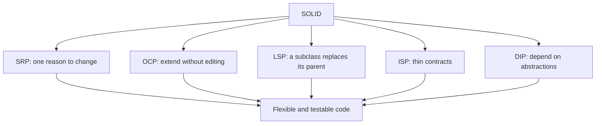

SOLID is an acronym for five principles of class design that help you write code that is flexible, testable, and easy to understand. They were formulated by Robert Martin, and today they form the basic vocabulary for discussing architecture quality in any interview and any code review. The principles are not strict rules; rather, they are symptoms of "code smells": if a class keeps changing for different reasons, or if adding a new feature forces you to rewrite old code — chances are one of the principles is being violated. Let's go through each one with a working example.

## S — Single Responsibility Principle

A class should have exactly one reason to change. If a class does too much, any change to one part risks breaking the rest. Here's a classic violator — a class that simultaneously calculates a salary, saves data, and sends emails:

```python
class Employee:
    def __init__(self, name, base_salary):
        self.name = name
        self.base_salary = base_salary

    def salary(self):
        return self.base_salary * 1.13  # taxes

    def save_to_db(self):
        print(f"INSERT INTO employees VALUES ('{self.name}')")

    def send_report(self):
        print(f"Sending report to email: {self.name}")
```

Changing the report format would affect a class that is also responsible for accounting and the database. The right move is to split the responsibilities across three classes — and that will be your first task.

## O — Open/Closed Principle

Classes should be open for extension but closed for modification: new behavior is added with new code, not by editing existing code. A typical violator is an `if/elif` chain keyed on the shape type:

```python
def area(shape):
    if isinstance(shape, Square):
        return shape.side ** 2
    elif isinstance(shape, Circle):
        return 3.14159 * shape.radius ** 2
    raise ValueError("Unknown shape")
```

Every new shape requires changing this function. The solution is polymorphism: let each shape know its own area through a common base class:

```python
from abc import ABC, abstractmethod

class Shape(ABC):
    @abstractmethod
    def area(self):
        ...

class Square(Shape):
    def __init__(self, side):
        self.side = side

    def area(self):
        return self.side ** 2

class Circle(Shape):
    def __init__(self, radius):
        self.radius = radius

    def area(self):
        return 3.14159 * self.radius ** 2
```

Now `total_area(shapes)` works with any new shape unchanged, and `Shape` defines the contract.

## L — Liskov Substitution Principle

If `B` is a subclass of `A`, then objects of `B` should be able to substitute anywhere `A` is expected without breaking behavior. The famous violation is `Square` inheriting from `Rectangle`: a square cannot change width and height independently, but a rectangle can. If code sets the width and then expects the height to stay the same, the square breaks the logic. It's fixed by having the square not inherit from the rectangle at all — both inherit from an abstract shape — or by making the shapes immutable, which removes the substitution problem.

## I — Interface Segregation Principle

Clients should not depend on methods they don't use. You can't force a chef to implement a cleaning method just because they're an "employee." Instead of one fat interface, use several thin ones:

```python
from typing import Protocol, runtime_checkable

@runtime_checkable
class Cookable(Protocol):
    def cook(self) -> None: ...

@runtime_checkable
class Cleanable(Protocol):
    def clean(self) -> None: ...
```

The `Chef` class implements only `Cookable`, `Cleaner` only `Cleanable`. That's interface segregation.

## D — Dependency Inversion Principle

High-level modules should not depend on low-level modules — both should depend on abstractions. Simply put, a class should not create its own concrete dependencies; it should receive them from outside. Compare: a class that constructs `EmailSender()` internally cannot be reused with SMS, while a class that accepts a `Sender` abstraction can. This is called dependency injection, and we'll see it in code.

SOLID isn't magic; it's a set of diagnostic questions: "why would this class change?", "what will I have to touch for a new feature?", "can a subclass be substituted?" The answers determine how well the architecture will survive the project's growth.

It's handy to keep the five principles in front of you as one diagram: each answers its own question, but all lead to the same result — code that is cheaper to change.



<!--TASK-->
### Task 1
You're given a class that violates the single responsibility principle:

```python
class Employee:
    def __init__(self, name, base_salary):
        self.name = name
        self.base_salary = base_salary

    def salary(self):
        return self.base_salary * 1.13

    def save_to_db(self):
        print(f"INSERT INTO employees VALUES ('{self.name}')")

    def send_report(self):
        print(f"Sending report to email: {self.name}")
```

Split it into three classes: `SalaryCalculator` (computes the salary), `EmployeeRepository` (saves to the database) and `EmailService` (sends emails). Then write code that creates an employee, computes the salary, saves them to the "database" and sends the report. The expected output should contain the line `Salary: ...` (substitute the real value), a line with `INSERT INTO` and the line `Sending report to email: Ivan`.

### Task 2
Implement the open/closed principle. Take the base class `Shape` with the abstract method `area()`, plus the `Square` and `Circle` classes (as in the theory). Write a function `total_area(shapes)` that takes a list of shapes and sums their areas. Then add a third class `Triangle` (area: `0.5 * base * height`) **without** modifying `total_area`. Expected output: the sum of the areas of a square of side 4, a circle of radius 1 (π ≈ 3.14159) and a triangle with base 3 and height 4, printed to 2 decimal places: `Total: 25.14`.

### Task 3
Fix the Liskov substitution violation. Given code:

```python
class Rectangle:
    def __init__(self, width, height):
        self.width = width
        self.height = height

    def area(self):
        return self.width * self.height

class Square(Rectangle):
    def __init__(self, side):
        super().__init__(side, side)

    @property
    def width(self):
        return self._side

    @width.setter
    def width(self, value):
        self._side = value
        self._height = value

    @property
    def height(self):
        return self._side

    @height.setter
    def height(self, value):
        self._side = value
        self._width = value
```

Show that the square breaks rectangle behavior: write a function `resize(rect)` that sets `width = 10` and then prints `rect.area()` — for a 5×7 rectangle it should be 70, while for a "square" with side 5 the same code gives a surprising result. Then rework the model (for example, `Square` is no longer a subclass of `Rectangle`; both inherit from `Shape`) so that the area of a shape cannot be broken. Print the areas of a 5×7 rectangle and a square with side 5.

### Task 4
Apply the interface segregation principle. Create two thin protocols `Cookable` and `Cleanable` (as in the theory) and classes `Chef` and `Cleaner` implementing only the protocol they need. Write a function `hire_for_cooking(staff)` that takes a list of employees and calls `cook()` only on those implementing `Cookable` (use `isinstance` or `hasattr`). Expected output: the line `Chef is cooking...` for the chef and nothing for the cleaner, then the line `Cleaner is cleaning...` when calling `clean()` directly.

### Task 5
Implement the dependency inversion principle. Create a protocol `Sender` with method `send(message)`. The class `NotificationService` should accept a `Sender` in its constructor (not create one internally). Write two adapters: `EmailSender` (prints `EMAIL: <message>`) and `SmsSender` (prints `SMS: <message>`). Create the service first with `EmailSender`, then with `SmsSender`, and send the message `Hello!` through both. Expected output: `EMAIL: Hello!` and `SMS: Hello!`.

### Task 6
Report export should be extensible without editing the dispatcher. Create a protocol `Exporter` with attribute `format` and method `export(rows) -> str`. Implement two exporters: `CsvExporter` (format `csv`, each row is `name;age`) and `JsonExporter` (format `json`, result `json.dumps(rows, ensure_ascii=False)`). The function `export_report(rows, fmt, registry)` must not contain `if/elif` on format: it looks up the exporter in the `registry` dictionary by key `fmt` and calls it, returning `Unknown format: <fmt>` for an unknown format. Then add a third exporter `TsvExporter` (format `tsv`, tab delimiter) to the same dictionary: the `export_report` code must not change. Expected output: lines `CSV:`, `Anya;30`, `JSON:`, `[{"name": "Anya", "age": 30}]`, `TSV:`, a line with a tab, and `Unknown format: xml`.

### Task 7
Write a contract test that catches the Liskov substitution violation automatically. You're given a base class `Account` with methods `deposit(amount)` and `withdraw(amount)`; withdrawing more than the balance raises `ValueError`. The subclass `SavingsAccount` forbids dropping below a minimum balance of 1000 and raises `ValueError` even where the base account would have completed the operation. Write a function `check_contract(factory)` that creates an account via the factory, deposits 500, withdraws 400 and returns `OK` or `VIOLATION: <error text>`. Run the check against both classes and print `Account: OK` and `SavingsAccount: VIOLATION: ...`. The scenario is identical for all implementations — that's exactly what makes the test contractual.
<!--/TASK-->

<!--HINT-->
### Hint 1
Three classes — three responsibilities. `SalaryCalculator` takes a base salary and returns a number; `EmployeeRepository` contains a save method; `EmailService` — a send method. Wire them together in the main code, creating each separately and passing data between them.

### Hint 2
`total_area` should work only with the `Shape` abstraction and call `area()` on each object. To verify you haven't broken "openness", add `Triangle` after writing the function and make sure the function didn't change. For output use `print(f"Total: {total:.2f}")`.

### Hint 3
The problem is that the square's `width` and `height` setters change both sides — unexpected for a rectangle. Verify this by calling `resize()` and comparing the expected area with the actual one. In the fixed model, avoid overriding setters: let `Square` and `Rectangle` not inherit from each other, but both inherit from `Shape` with an `area()` method.

### Hint 4
Protocols from `typing` with the `@runtime_checkable` decorator can be used with `isinstance`. In `hire_for_cooking`, check each employee: `if isinstance(person, Cookable): person.cook()`. `Chef` has `cook`, `Cleaner` has `clean`.

### Hint 5
`NotificationService` should accept `sender` in `__init__` and store it. Method `notify(message)` calls `self.sender.send(message)`. Adapters are plain classes with a `send` method, each printing its own prefix. Create the service with either adapter and call `notify("Hello!")`.

### Hint 6
An exporter is an object with a `format` attribute and an `export` method. Build the registry as a dict `{exporter.format: exporter}` and pass it into `export_report` as a parameter: then adding `TsvExporter` requires no edits to the function. Fetch unknown keys with `registry.get(fmt)` and return the error string. For JSON don't forget `ensure_ascii=False`, otherwise non-ASCII characters turn into `\uXXXX`.

### Hint 7
A contract test is one and the same scenario run against all implementations. Fix the scenario allowed by the base class: `deposit(500)`, then `withdraw(400)`. Wrap it in `try/except ValueError` and return the violation text. Catch `ValueError` specifically, not any exception — otherwise the test would treat a plain typo in the code as a contract violation.
<!--/HINT-->

<!--SOLUTION-->
### Solution 1
Solution:

```python
class SalaryCalculator:
    def __init__(self, base_salary):
        self.base_salary = base_salary

    def salary(self):
        return self.base_salary * 1.13

class EmployeeRepository:
    def save(self, name):
        print(f"INSERT INTO employees VALUES ('{name}')")

class EmailService:
    def send_report(self, name):
        print(f"Sending report to email: {name}")

calculator = SalaryCalculator(100000)
repo = EmployeeRepository()
email = EmailService()
print(f"Salary: {calculator.salary()}")
repo.save("Ivan")
email.send_report("Ivan")
```

Output:

```
Salary: 113000.0
INSERT INTO employees VALUES ('Ivan')
Sending report to email: Ivan
```

What's happening here? Each class now has exactly one reason to change: `SalaryCalculator` handles computation, `EmployeeRepository` handles storage, `EmailService` handles notifications. If the way taxes are computed changes, the email-sending code stays untouched. Note: `Employee` remains a simple data holder (such classes are usually called models), while all the logic lives in separate classes.

### Solution 2
Solution:

```python
from abc import ABC, abstractmethod

class Shape(ABC):
    @abstractmethod
    def area(self):
        ...

class Square(Shape):
    def __init__(self, side):
        self.side = side

    def area(self):
        return self.side ** 2

class Circle(Shape):
    def __init__(self, radius):
        self.radius = radius

    def area(self):
        return 3.14159 * self.radius ** 2

def total_area(shapes):
    return sum(shape.area() for shape in shapes)

class Triangle(Shape):
    def __init__(self, base, height):
        self.base = base
        self.height = height

    def area(self):
        return 0.5 * self.base * self.height

shapes = [Square(4), Circle(1), Triangle(3, 4)]
print(f"Total: {total_area(shapes):.2f}")
```

Output: `Total: 25.14`.

What's happening here? The function `total_area` depends only on the `Shape` abstraction, so adding `Triangle` required no changes to it — that's "open for extension, closed for modification". The math: 4² = 16, π·1² ≈ 3.14159, 0.5·3·4 = 6; the sum ≈ 25.14159, which prints as 25.14 with two decimal places. The main takeaway is the architecture: polymorphism instead of branching.

### Solution 3
First, show the breakage:

```python
def resize(rect):
    rect.width = 10
    print(f"Area: {rect.area()}")

r = Rectangle(5, 7)
resize(r)            # Area: 70
s = Square(5)
resize(s)            # Area: 100 (expected 50?)
```

Why 100? `resize` set `width = 10`, but the square's setter also changed the height to 10, so the area became 10·10 = 100. The rectangle client expected the height to stay the same after the width changed — the subclass behaves differently from its parent, which is an LSP violation. The fixed model:

```python
class Shape(ABC):
    @abstractmethod
    def area(self):
        ...

class Rectangle(Shape):
    def __init__(self, width, height):
        self.width = width
        self.height = height

    def area(self):
        return self.width * self.height

class Square(Shape):
    def __init__(self, side):
        self.side = side

    def area(self):
        return self.side ** 2

print(Rectangle(5, 7).area())   # 70
print(Square(5).area())          # 25
```

What's happening here? The square is no longer a subclass of the rectangle: it has no setters that could silently change both sides. Both shapes inherit from `Shape` and are guaranteed to implement `area()`. The program prints `70` and `25`, and no substitution can now produce a surprising result.

### Solution 4
Solution:

```python
from typing import Protocol, runtime_checkable

@runtime_checkable
class Cookable(Protocol):
    def cook(self) -> None: ...

@runtime_checkable
class Cleanable(Protocol):
    def clean(self) -> None: ...

class Chef:
    def cook(self):
        print("Chef is cooking...")

class Cleaner:
    def clean(self):
        print("Cleaner is cleaning...")

def hire_for_cooking(staff):
    for person in staff:
        if isinstance(person, Cookable):
            person.cook()

staff = [Chef(), Cleaner()]
hire_for_cooking(staff)   # Chef is cooking...
staff[1].clean()          # Cleaner is cleaning...
```

Output:

```
Chef is cooking...
Cleaner is cleaning...
```

What's happening here? `Cookable` and `Cleanable` are thin protocols; `Chef` implements cooking only, `Cleaner` cleaning only. The function `hire_for_cooking` checks `isinstance(person, Cookable)` and calls `cook()` only for the chef. That's interface segregation: nobody is forced to implement unneeded methods, and protocol checks work thanks to `@runtime_checkable`.

### Solution 5
Solution:

```python
from typing import Protocol, runtime_checkable

@runtime_checkable
class Sender(Protocol):
    def send(self, message: str) -> None: ...

class EmailSender:
    def send(self, message):
        print(f"EMAIL: {message}")

class SmsSender:
    def send(self, message):
        print(f"SMS: {message}")

class NotificationService:
    def __init__(self, sender):
        self.sender = sender

    def notify(self, message):
        self.sender.send(message)

NotificationService(EmailSender()).notify("Hello!")
NotificationService(SmsSender()).notify("Hello!")
```

Output:

```
EMAIL: Hello!
SMS: Hello!
```

What's happening here? `NotificationService` doesn't instantiate a concrete adapter inside; it receives one through the constructor — that's dependency injection. The high-level service depends on the `Sender` abstraction, and the concrete senders depend on it too, so both modules depend on an abstraction rather than on each other. Adding a Telegram sender now requires no changes to the service — that's dependency inversion.

### Solution 6
Solution:

```python
import json
from typing import Protocol

class Exporter(Protocol):
    format: str

    def export(self, rows: list) -> str:
        ...

class CsvExporter:
    format = "csv"

    def export(self, rows):
        return "\n".join(f"{row['name']};{row['age']}" for row in rows)

class JsonExporter:
    format = "json"

    def export(self, rows):
        return json.dumps(rows, ensure_ascii=False)

class TsvExporter:
    format = "tsv"

    def export(self, rows):
        return "\n".join(f"{row['name']}\t{row['age']}" for row in rows)

def export_report(rows, fmt, registry):
    exporter = registry.get(fmt)
    if exporter is None:
        return f"Unknown format: {fmt}"
    return exporter.export(rows)

rows = [{"name": "Anya", "age": 30}]
registry = {exporter.format: exporter for exporter in (CsvExporter(), JsonExporter())}

print("CSV:")
print(export_report(rows, "csv", registry))
print("JSON:")
print(export_report(rows, "json", registry))

registry["tsv"] = TsvExporter()          # extension without editing export_report
print("TSV:")
print(export_report(rows, "tsv", registry))
print(export_report(rows, "xml", registry))
```

Output:

```
CSV:
Anya;30
JSON:
[{"name": "Anya", "age": 30}]
TSV:
Anya	30
Unknown format: xml
```

What's happening here? `export_report` doesn't know which formats exist at all: it receives the registry and does a single lookup by key. Adding `TsvExporter` is one registration line, and the dispatcher body stays untouched — the class is closed for modification and open for extension. Notice how this trick differs from the polymorphism in Task 2: there extension came through a new `Shape` subclass; here it comes through registering a strategy object. A registry is more convenient when there are many variants coming from configuration or plugins; inheritance fits when variants share a common set of operations. The `Exporter` protocol defines a minimal contract — the `format` attribute and the `export` method — so the registry is built uniformly and without branching.

### Solution 7
Solution:

```python
class Account:
    def __init__(self):
        self.balance = 0

    def deposit(self, amount):
        self.balance += amount

    def withdraw(self, amount):
        if amount > self.balance:
            raise ValueError("insufficient funds")
        self.balance -= amount

class SavingsAccount(Account):
    MIN_BALANCE = 1000

    def withdraw(self, amount):
        if self.balance - amount < self.MIN_BALANCE:
            raise ValueError(f"cannot go below {self.MIN_BALANCE}")
        self.balance -= amount

def check_contract(factory):
    try:
        account = factory()
        account.deposit(500)
        account.withdraw(400)
    except ValueError as exc:
        return f"VIOLATION: {exc}"
    return "OK"

for cls in (Account, SavingsAccount):
    print(f"{cls.__name__}: {check_contract(cls)}")
```

Output:

```
Account: OK
SavingsAccount: VIOLATION: cannot go below 1000
```

What's happening here? The test pins a scenario the base class considers valid: deposit 500, withdraw 400. `Account` passes; `SavingsAccount` fails on the same scenario because it strengthened the precondition — added a balance requirement the parent didn't have. A client working with `Account` knows nothing about the minimum balance, so such a subclass cannot be substituted for its parent: this is a classic LSP violation, and the contract test caught it automatically, without eyeballing the code. The fix is not to weaken the check but to change the model: `SavingsAccount` should not inherit from `Account`, or the minimum balance should be part of the base contract, or the constrained account is built by composition — a wrapper around a plain account. The practical value is that one scenario runs against every implementation, and adding a new implementation is just adding it to the list — the test will tell whether it honors the contract.
<!--/SOLUTION-->

<!--QUIZ-->
What does the letter S stand for in SOLID?
- Single Responsibility: a class has one reason to change
- Simple Architecture
- Execution Speed
- Serialization
* Correct answer: Single Responsibility: a class has one reason to change
S — Single Responsibility: one class, one responsibility, one reason to change.

Which principle does the "if/elif chain by shape type" violate?
- SRP
- OCP
- LSP
- ISP
* Correct answer: OCP
Adding a new shape requires changing existing code — the class is not open for extension without modification.

What does the Liskov substitution principle check?
- That a subclass doesn't delete parent methods
- That subclass objects can safely be used wherever the parent is expected
- That interfaces don't contain extra methods
- That a class has only one responsibility
* Correct answer: That subclass objects can safely be used wherever the parent is expected
If a subclass behaves differently from its parent (e.g., a square's setters change both sides), the program behaves unexpectedly.

Which Python tool is handy for interface segregation?
- The dict class
- Protocols from typing with runtime_checkable
- The == operator
- The math module
* Correct answer: Protocols from typing with runtime_checkable
Protocols describe a minimal contract, and runtime_checkable lets you use them in isinstance.

What does "dependency inversion" mean?
- High-level modules depend on abstractions, not concrete implementations
- Dependencies are declared at the end of the file
- A class inherits from itself
- All classes are made abstract
* Correct answer: High-level modules depend on abstractions, not concrete implementations
Concrete implementations are passed in from outside (dependency injection), and high-level code works with an abstraction.

What does constructor dependency injection give you?
- The ability to swap implementations without changing the class
- Doubling the program's speed
- Automatic serialization
- A ban on inheritance
* Correct answer: The ability to swap implementations without changing the class
The class accepts an abstraction, so any adapter (Email, SMS) can be plugged in without editing the service.

What does the open/closed principle (OCP) mean?
- Classes should be closed for modification but open for extension
- Classes must be public
- Classes cannot have subclasses
- Classes must live in separate files
* Correct answer: Classes should be closed for modification but open for extension
New behavior is added with new code — subclasses or composition — not by editing existing code.

How do you check whether a class honors SRP?
- Ask "how many reasons does this class have to change?"
- Count the methods
- Make sure the class is long
- Check that the class uses one data type
* Correct answer: Ask "how many reasons does this class have to change?"
If a class has more than one reason to change, it carries several responsibilities.

The class `Report` computes data itself, renders HTML and writes a file to disk. Which principle is violated first?
- SRP
- OCP
- LSP
- DIP
* Correct answer: SRP
The class has three reasons to change — computation, rendering and file writing; these are different responsibilities.

Why is a strategy registry (a "format → exporter" dict) more convenient than an `if/elif` chain when adding a new format?
- A new format is registered without editing the dispatcher
- The code runs ten times faster
- Tests become unnecessary
- Formats stop being strings
* Correct answer: A new format is registered without editing the dispatcher
The dispatcher does one lookup by key, so extension doesn't touch existing code.

What most often indicates an interface segregation violation?
- A class implements stub methods with `pass` or `raise NotImplementedError`
- A class has more than one public method
- A class has a `__init__` constructor
- A class inherits from `object`
* Correct answer: A class implements stub methods with `pass` or `raise NotImplementedError`
Stubs mean the interface imposed methods the class doesn't need — it should have been split.

A subclass requires the balance to be at least 1000 before `withdraw`, although the base class had no such condition. Why is that bad?
- LSP is violated: the subclass strengthened the precondition and cannot substitute for the parent
- SRP is violated: the class has two responsibilities
- It's a normal contract extension
- ISP is violated: the interface is too wide
* Correct answer: LSP is violated: the subclass strengthened the precondition and cannot substitute for the parent
A client of the parent doesn't know about the new restriction and gets an error where things used to work.
<!--/QUIZ-->
