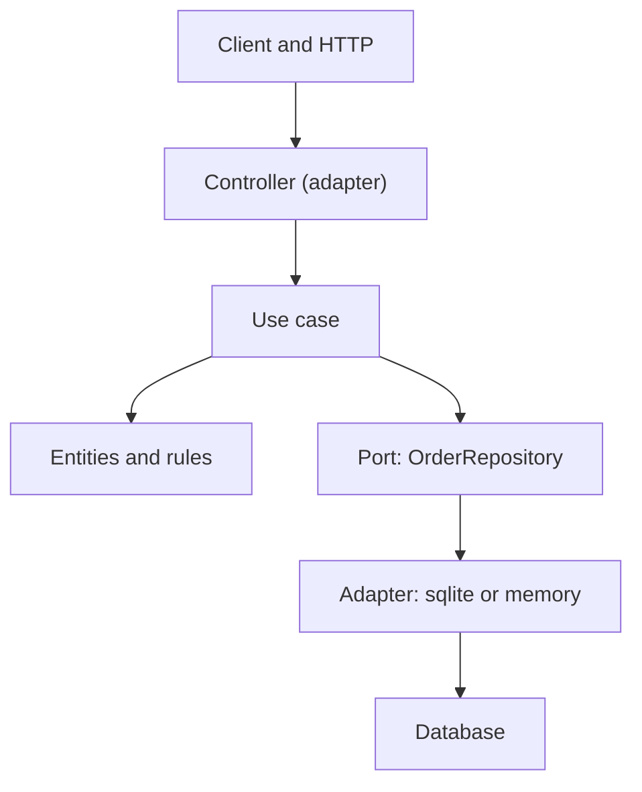

Clean Architecture is an approach that answers the question "how do you organize code so that business logic doesn't depend on frameworks, databases, and UI". The idea is that the most important things — business rules — should be in the center, and everything else (the database, HTTP, the interface) revolves around them as interchangeable details.

## Layers and dependency direction

Let's draw concentric circles: on the inside are entities and use cases, outside them are interface adapters (controllers, presenters), and on the outermost ring are frameworks and drivers (FastAPI, sqlite3, email). The key rule: **dependencies point inward** — inner layers know nothing about outer ones. An outer layer may depend on an inner one, but not the other way around. The domain doesn't import sqlite3, because the database is a detail that can be swapped out.

Practically this means: business logic should compile and run even without a database and without a web server. The check is simple — imagine you deleted all FastAPI and sqlite3 imports. If the code still makes sense, the layers are separated correctly.

## Ports and adapters

To keep the inner layer from depending on a specific database, we declare a **port** — an abstraction (in Python, a protocol) that an **adapter** implements on the outside. The domain says: "I need a repository that can save an order." The concrete implementation — in-memory, sqlite, PostgreSQL — is plugged in from outside.

```python
from abc import ABC, abstractmethod

class OrderRepository(ABC):
    @abstractmethod
    def save(self, order):
        ...

class InMemoryOrderRepository(OrderRepository):
    def __init__(self):
        self.orders = []

    def save(self, order):
        self.orders.append(order)
        print(f"Saved in memory: {order}")
```

Now the use case depends on `OrderRepository`, not on a specific storage.

## Use case

A use case is a system usage scenario: "place an order", "update a profile". It contains orchestration: pull data, apply rules, save the result. Take a look at a simple order placement use case:

```python
class OrderUseCase:
    def __init__(self, repo: OrderRepository):
        self.repo = repo

    def place(self, items):
        total = sum(price for _, price in items)
        order = {"items": items, "total": total}
        self.repo.save(order)
        return order
```

There's no HTTP and no SQL here — only pure logic. The FastAPI controller just calls `place()` and hands the result to the client.

## Why this works

This architecture gives three practical benefits. First, **testability**: a use case is verified without a database — we plug in a fake repository. Second, **the ability to swap external details**: moving from SQLite to PostgreSQL doesn't touch the domain. Third, **clarity**: looking at the use cases, you see what the system actually does, without being distracted by frameworks.

It's important not to overdo it: for a simple 50-line script, Clean Architecture is overkill. It pays off when a project lives for years, has many developers, and external technologies change more often than business rules. A sign of the "right" amount of layers: you can explain the benefit of each layer — otherwise the layer is redundant.

Dependency direction and where the port sits are visible in a single diagram:



The arrows go only inward: the controller knows about the use case, the use case knows about the port, but no inner element knows about sqlite and HTTP.

<!--TASK-->
### Task 1
Create a port `Catalog` (protocol) with method `price_of(sku) -> float`, a use case `cart_total(catalog, items)` that sums item prices, and two adapters: `DictCatalog` (prices in a dict) and `SqliteCatalog` (prices in a sqlite3 database via the standard module). Plug in both adapters in turn and print the cost of a cart with two items. Expected output: `Cart cost: 110.0` in both cases.

### Task 2
Given code that violates the dependency direction — the domain imports sqlite3 directly:

```python
import sqlite3

def list_products():
    conn = sqlite3.connect("shop.db")
    return conn.execute("SELECT name FROM products").fetchall()
```

Rework it: create a protocol `ProductRepository` with method `list_products()`, an implementation `SqliteProductRepository` (outer layer) and a use case that calls `list_products()` through the protocol. The use case code must not import sqlite3. The program should print the list of products from the database (to verify, first create a `shop.db` file with a `products` table and several rows).

### Task 3
Add a new adapter for delivery. The domain declares a port `Notifier` with method `send(message)`. Write two adapters: `ConsoleNotifier` (prints `Notification: <message>`) and `EmailNotifier` (prints `EMAIL: <message>`). Create a use case `order_delivered(order_id, notifier)` that sends the message `Order {order_id} delivered`. Run both variants. Expected output: lines `Notification: Order 42 delivered` and `EMAIL: Order 42 delivered`.

### Task 4
Move a business rule into the domain. Create a class `Cart` (entity) with method `shipping_cost()` that returns `0.0` if the total of items is ≥ 3000, otherwise `199.0`. Write a use case that takes a cart, computes the total (`sum of items + shipping`) and returns it. Test it on two carts: one of 2500 (total 2699.0) and one of 3000 (total 3000.0). The program prints both totals.

### Task 5
Assemble a vertical slice: the "controller" (a plain function `cli`) takes a filename and calls the use case `load_and_report(repo, path)`, which reads the file's lines through a repository and returns their count, then prints `File <path>: N lines`. The port `FileReader` with method `read_lines(path)`. Implement `RealFileReader` (a wrapper around `open`). Create a temporary file with three lines and verify that the program prints `File data.txt: 3 lines`.

### Task 6
Demonstrate the testability of Clean Architecture. Given a use case `place_order(repo, items)`: it rejects an empty cart (returns `None` and saves nothing), and saves a non-empty one through the port `OrderRepository` with status `new`. Write a fake repository `FakeRepo` that records `save` calls in a list `saved` but writes nothing to a database. Then write two checks: an empty cart must not call `save`, and a cart of two items priced 100 and 150 must produce an order with total 250 and exactly one `save` call. Each check prints `Test 1: OK` or `Test 1: FAIL` (likewise for the second). At the end print `Passed: 2 of 2`. Expected output — three lines, both checks green.

### Task 7
Write an architectural test — a check that the domain doesn't pull in infrastructure. The function `check_imports(source)` parses the source with `ast.parse`, walks the tree and collects the names of all imported modules (for `import a.b` and `from a.b import c` take the first segment — `a`). Define the forbidden modules as a set `{"sqlite3", "fastapi", "requests", "redis"}`. Check two sources: a clean domain (imports only `typing` and `dataclasses`) and a dirty one with `import sqlite3` and `import fastapi`. For each print `<path>: clean` or `<path>: forbidden imports: <list>`. Expected output: one "clean" line and one line with two violators in alphabetical order.
<!--/TASK-->

<!--HINT-->
### Hint 1
Declare the port with `Protocol` from `typing`. `cart_total` takes a `catalog` and a list of `(sku, quantity)`. `DictCatalog` stores a dict `{sku: price}`; `SqliteCatalog` executes `SELECT price FROM products WHERE sku = ?`. The use case code must not know which adapter is plugged in.

### Hint 2
Split the code into layers: `SqliteProductRepository` lives in the outer layer and contains the sqlite3 import, while the use case and protocol live in the inner layer, without importing sqlite3. The inner code only calls `repo.list_products()`.

### Hint 3
`Notifier` is a protocol with a `send` method. Both adapters are plain classes. The use case `order_delivered` takes `notifier` as a parameter and calls `notifier.send(...)`. Create two service instances with different adapters.

### Hint 4
`Cart` stores the list of item prices and has a `subtotal()` method. `shipping_cost()` is pure logic with a condition. The use case `checkout(cart)` returns `cart.subtotal() + cart.shipping_cost()`. To verify, create carts as price lists.

### Hint 5
`FileReader` is a protocol with `read_lines(path)`. `RealFileReader` uses `with open(path, encoding="utf-8")` and returns a list of lines. The use case counts `len(lines)`. In `cli`, create a repository and call the use case. Don't forget to create the test file before running.

### Hint 6
Declare the port with `Protocol` and a `save` method. `FakeRepo` keeps a list `saved` and in `save` just does `append` — no database. Write the check as a separate function `check(name, condition)` that prints `OK` or `FAIL`. For the second check compare `order["total"]` with 250 and `len(repo.saved)` with 1; for the first — `result is None` and an empty `saved`.

### Hint 7
`ast.parse(source)` gives a tree; walk it with `ast.walk` and handle two node types: `ast.Import` (list `node.names`, each alias has `alias.name`) and `ast.ImportFrom` (field `node.module`). Cut the module name at the dot: `name.split(".")[0]`. Collect violations in a list and print them via `sorted(set(...))` so the order is predictable.
<!--/HINT-->

<!--SOLUTION-->
### Solution 1
Solution:

```python
from typing import Protocol
import sqlite3

class Catalog(Protocol):
    def price_of(self, sku: str) -> float:
        ...

def cart_total(catalog, items):
    return sum(catalog.price_of(sku) * qty for sku, qty in items)

class DictCatalog:
    def __init__(self, prices):
        self.prices = prices

    def price_of(self, sku):
        return self.prices[sku]

class SqliteCatalog:
    def __init__(self, db_path):
        self.conn = sqlite3.connect(db_path)

    def price_of(self, sku):
        row = self.conn.execute("SELECT price FROM products WHERE sku = ?", (sku,)).fetchone()
        return row[0]

# database preparation
conn = sqlite3.connect("shop.db")
conn.execute("CREATE TABLE IF NOT EXISTS products (sku TEXT, price REAL)")
conn.execute("INSERT OR REPLACE INTO products VALUES ('milk', 50.0)")
conn.execute("INSERT OR REPLACE INTO products VALUES ('bread', 60.0)")
conn.commit()

items = [("milk", 1), ("bread", 1)]
print(f"Cart cost: {cart_total(DictCatalog({'milk': 50.0, 'bread': 60.0}), items)}")
print(f"Cart cost: {cart_total(SqliteCatalog('shop.db'), items)}")
```

Output: `Cart cost: 110.0` twice. What's happening here? `cart_total` depends on the `Catalog` abstraction, and concrete data sources are plugged in from outside. The same use case works with both a dict and a database — that's a port and an adapter.

### Solution 2
Solution:

```python
from typing import Protocol
import sqlite3

class ProductRepository(Protocol):
    def list_products(self):
        ...

class SqliteProductRepository:
    def __init__(self, db_path):
        self.conn = sqlite3.connect(db_path)

    def list_products(self):
        return [row[0] for row in self.conn.execute("SELECT name FROM products")]

def list_all_products(repo: ProductRepository):
    return repo.list_products()

repo = SqliteProductRepository("shop.db")
for name in list_all_products(repo):
    print(name)
```

What's happening here? The inner layer (protocol and use case `list_all_products`) knows nothing about sqlite3 — the import lives only in the adapter. The dependency direction: the outer `SqliteProductRepository` depends on the inner protocol, not vice versa. The database can be swapped without changing the use case.

### Solution 3
Solution:

```python
from typing import Protocol

class Notifier(Protocol):
    def send(self, message: str) -> None:
        ...

class ConsoleNotifier:
    def send(self, message):
        print(f"Notification: {message}")

class EmailNotifier:
    def send(self, message):
        print(f"EMAIL: {message}")

def order_delivered(order_id, notifier: Notifier):
    notifier.send(f"Order {order_id} delivered")

order_delivered(42, ConsoleNotifier())
order_delivered(42, EmailNotifier())
```

Output:

```
Notification: Order 42 delivered
EMAIL: Order 42 delivered
```

What's happening here? The use case `order_delivered` doesn't know which channel delivers the message — it works with the `Notifier` port. The adapters are interchangeable, and the domain stays clean.

### Solution 4
Solution:

```python
class Cart:
    def __init__(self, prices):
        self.prices = prices

    def subtotal(self):
        return sum(self.prices)

    def shipping_cost(self):
        return 0.0 if self.subtotal() >= 3000 else 199.0

def checkout(cart):
    return cart.subtotal() + cart.shipping_cost()

print(checkout(Cart([2500.0])))   # 2699.0
print(checkout(Cart([3000.0])))   # 3000.0
```

Output:

```
2699.0
3000.0
```

What's happening here? The shipping rule lives in the `Cart` entity — pure business logic with no dependencies on the outside world. The use case `checkout` only combines the entity's methods. Both totals print correctly: 2500 + 199 = 2699, and 3000 ≥ 3000, so shipping is free.

### Solution 5
Solution:

```python
from typing import Protocol

class FileReader(Protocol):
    def read_lines(self, path: str) -> list:
        ...

class RealFileReader:
    def read_lines(self, path):
        with open(path, encoding="utf-8") as f:
            return f.readlines()

def load_and_report(repo: FileReader, path):
    lines = repo.read_lines(path)
    return len(lines)

def cli(path):
    count = load_and_report(RealFileReader(), path)
    print(f"File {path}: {count} lines")

with open("data.txt", "w", encoding="utf-8") as f:
    f.write("one\ntwo\nthree\n")

cli("data.txt")
```

Output: `File data.txt: 3 lines`. What's happening here? The controller `cli` calls the use case `load_and_report`, which reads lines through the `FileReader` port. The inner layer doesn't depend on a specific way of reading. Such a vertical slice — from the controller through the use case to the adapter — shows how layers connect into a working application.

### Solution 6
Solution:

```python
from typing import Protocol

class OrderRepository(Protocol):
    def save(self, order) -> None:
        ...

class FakeRepo:
    def __init__(self):
        self.saved = []

    def save(self, order):
        self.saved.append(order)

def place_order(repo, items):
    if not items:
        return None
    total = sum(price for _, price in items)
    order = {"items": items, "total": total, "status": "new"}
    repo.save(order)
    return order

def check(name, condition):
    print(f"{name}: {'OK' if condition else 'FAIL'}")
    return condition

repo = FakeRepo()
check("Test 1", place_order(repo, []) is None and repo.saved == [])

repo2 = FakeRepo()
order = place_order(repo2, [("bread", 100), ("cheese", 150)])
check("Test 2", order is not None and order["total"] == 250 and len(repo2.saved) == 1)
print("Passed: 2 of 2")
```

Output:

```
Test 1: OK
Test 2: OK
Passed: 2 of 2
```

What's happening here? The use case is verified without a database, without migrations and without starting a process — because it depends on a protocol, not on `sqlite3`. `FakeRepo` implements the same `save` contract, but instead of writing to a file it collects orders in a list, and the test can look into that list to confirm the rejected cart saved nothing. This is the main practical benefit of layers: logic tests run in milliseconds and require no infrastructure. Note two things. First, the test checks behavior (empty cart → `None` and zero calls), not the class's internals, so refactoring inside the use case won't break it. Second, the fake doesn't mock methods via a library; it simply implements the port — this approach is more robust, because a mock is tied to specific calls, while a fake is tied to the contract.

### Solution 7
Solution:

```python
import ast

FORBIDDEN = {"sqlite3", "fastapi", "requests", "redis"}

def check_imports(source):
    tree = ast.parse(source)
    found = []
    for node in ast.walk(tree):
        if isinstance(node, ast.Import):
            for alias in node.names:
                name = alias.name.split(".")[0]
                if name in FORBIDDEN:
                    found.append(name)
        elif isinstance(node, ast.ImportFrom):
            if node.module:
                name = node.module.split(".")[0]
                if name in FORBIDDEN:
                    found.append(name)
    return sorted(set(found))

CLEAN = '''
from typing import Protocol
from dataclasses import dataclass
'''

DIRTY = '''
import sqlite3
import fastapi
from typing import Protocol
'''

for path, source in (("domain/orders.py", CLEAN), ("domain/reports.py", DIRTY)):
    bad = check_imports(source)
    if bad:
        print(f"{path}: forbidden imports: {', '.join(bad)}")
    else:
        print(f"{path}: clean")
```

Output:

```
domain/orders.py: clean
domain/reports.py: forbidden imports: fastapi, sqlite3
```

What's happening here? The rule "the domain doesn't import infrastructure" stops being an informal agreement and becomes an executable check — such checks are called architectural tests or fitness functions. Parsing with `ast` is more reliable than substring search in text: it sees real import statements and doesn't fire on the word `sqlite3` in a comment or docstring. `ast.ImportFrom` must be handled separately, because there the module sits in the `node.module` field, not in `names`; the `if node.module` check guards against relative imports without a module. In practice such a script is run in CI: if someone adds `import fastapi` to the domain folder, the build fails before review. A natural evolution of the idea is to put the rules in a config (what each layer may import) and check not one file but the whole package tree.
<!--/SOLUTION-->

<!--QUIZ-->
Where are dependencies directed in Clean Architecture?
- From outer layers inward
- From inner layers outward
- The same everywhere
- Cyclically
* Correct answer: From outer layers inward
Outer layers (databases, frameworks) depend on inner ones, but the domain knows nothing about outer details.

What is a port in Clean Architecture terms?
- A server's network port
- An abstraction (e.g., a protocol) that adapters implement
- A configuration file
- A controller class
* Correct answer: An abstraction (e.g., a protocol) that adapters implement
A port describes what the domain needs; an adapter describes how to provide it with a specific technology.

What of the following should live in the inner layer?
- sqlite3.connect
- FastAPI routes
- Use cases and entities
- HTML templates
* Correct answer: Use cases and entities
Business rules are in the center; technologies are outside.

Why plug a fake repository into tests?
- To speed up production
- To test a use case without a real database
- To hide data from users
- To avoid protocols
* Correct answer: To test a use case without a real database
A port lets you test logic in isolation from infrastructure.

What is a sign that there are too many layers?
- A layer cannot be justified by a concrete benefit
- The code compiles
- There are protocols
- The project is small
* Correct answer: A layer cannot be justified by a concrete benefit
Each layer must justify its existence; otherwise it's redundant.

What does "the domain doesn't import sqlite3" mean?
- The domain doesn't store data in a database
- Business logic doesn't depend on a specific database
- sqlite3 isn't used in the project
- Databases are forbidden by law
* Correct answer: Business logic doesn't depend on a specific database
The database is a detail; it can be replaced without changing the domain.

What is an adapter in Clean Architecture?
- A concrete implementation of a port for a technology (SQLAlchemy, FastAPI)
- An inner domain layer
- An automated test
- A table in a database
* Correct answer: A concrete implementation of a port for a technology (SQLAlchemy, FastAPI)
An adapter implements a port and knows the technology details; the domain doesn't.

Why are frameworks put in the outer layer?
- So the domain stays reusable and independent of technologies
- Because code runs faster that way
- Because otherwise there's no database
- It's not required
* Correct answer: So the domain stays reusable and independent of technologies
Technologies change more often than business rules, so dependency points only inward.

In the "controller and use case" pair, who should import whom?
- The controller imports the use case
- The use case imports the controller
- Both import each other
- Imports are forbidden in both directions
* Correct answer: The controller imports the use case
Dependency goes from outside inward: the transport knows about the scenario, the scenario doesn't know about the transport.

Why check the domain's imports automatically, with an architectural test?
- So the dependency rule doesn't rest only on developer discipline
- To speed up the program
- To replace type checking
- To reduce file sizes
* Correct answer: So the dependency rule doesn't rest only on developer discipline
A CI check catches a violation immediately, before it becomes a domain dependency on a framework.

What happens if an entity starts parsing HTTP requests?
- The domain becomes tied to the transport and can no longer be tested without a server
- The program runs faster
- There are fewer layers
- Nothing changes
* Correct answer: The domain becomes tied to the transport and can no longer be tested without a server
Parsing requests is an adapter's job; in the domain it drags in a web framework and its objects.

Why is the port declared in the domain, not in the adapter?
- The contract is dictated by whoever needs the service, and the adapter adapts to it
- The code is shorter that way
- So the adapter can change without tests
- Because protocols can't be declared outside
* Correct answer: The contract is dictated by whoever needs the service, and the adapter adapts to it
If the adapter declared the port, the domain would start depending on a specific technology's convenience.
<!--/QUIZ-->
