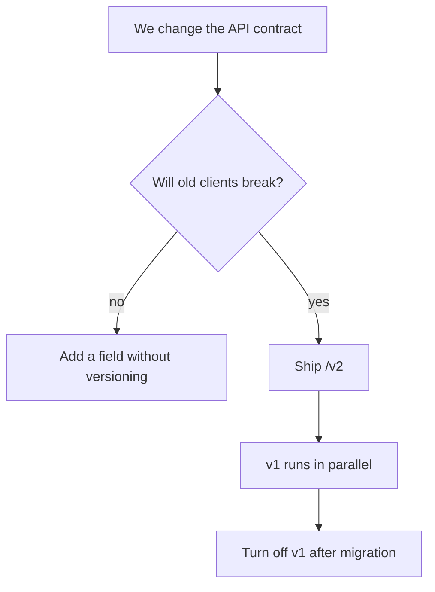

An API is a contract between a client and a server. If the contract is poorly designed, every server change breaks something for clients. Let's look at the two main approaches — REST and GraphQL — and the rules of versioning.

## REST: resources and methods

REST builds APIs around **resources** — nouns (`/users`, `/orders`) — and standard HTTP methods. Each method carries meaning: `GET` reads, `POST` creates, `PUT` fully replaces, `PATCH` partially updates, `DELETE` removes. Status codes signal the result: `200` for success, `201` for a created resource, `400` for a bad client request, `401/403` for permission problems, `404` for a missing resource, `429` for exceeding limits, `5xx` for server errors.

Here's a minimal CRUD in FastAPI:

```python
from fastapi import FastAPI, HTTPException
from pydantic import BaseModel

app = FastAPI()
books = {}

class Book(BaseModel):
    id: int
    title: str
    author: str

@app.post("/books", status_code=201)
def create_book(book: Book):
    books[book.id] = book
    return book

@app.get("/books/{book_id}")
def get_book(book_id: int):
    if book_id not in books:
        raise HTTPException(status_code=404, detail="Book not found")
    return books[book_id]

@app.delete("/books/{book_id}", status_code=204)
def delete_book(book_id: int):
    books.pop(book_id, None)
```

Notice idempotency: `GET`, `PUT`, `DELETE` can safely be repeated — a repeated `DELETE` doesn't break state. `POST` is not considered idempotent, so repeated `POST`s may create duplicates (more on this in the idempotency lesson).

## GraphQL: one endpoint, schema, and queries

GraphQL gives the client a **schema** — a description of types and possible operations. The client requests exactly the fields it needs, in one query to a single `/graphql` endpoint. The schema is built from types:

```graphql
type Book {
  id: ID!
  title: String!
  author: Author!
}

type Author {
  id: ID!
  name: String!
  books: [Book!]!
}

type Query {
  book(id: ID!): Book
  books: [Book!]!
}
```

A query selects fields:

```graphql
query {
  book(id: 1) {
    title
    author {
      name
    }
  }
}
```

The main advantages of GraphQL: the client decides which fields to get (no "extra data" or "missing data"), one query combines several resources, and the schema documents the API. Downsides: caching is harder (no URLs to serve as cache keys), it's harder to limit load (deep nested queries), and the learning curve is steeper.

## When to choose what

REST is good for most public APIs: simple resources, HTTP caching, familiar semantics. GraphQL is justified when there are many different clients with different data needs (mobile apps, widgets), when you need to aggregate several services in one query, and when precise field selection matters. A sign of over-engineering: if you have one client and simple resources — GraphQL is usually redundant.

## API versioning

Clients are almost certainly in production, so breaking changes must be introduced without stopping old clients. The main strategies:

1. **URI versions**: `/v1/users` and `/v2/users` — the most explicit and common; the old address keeps living.
2. **Accept header**: the client asks for `application/vnd.api+json;version=2` — the version doesn't clutter the URL, but it's less visible.
3. **Continuous evolution**: add fields and methods without removing old ones; remove only after agreeing with client owners.

The rule is simple: **non-breaking changes (a new option, a new field) go in without a version; breaking ones go through a version**. And always document what changed in each version.

Choosing a strategy comes down to one fork — does the change break existing clients:



<!--TASK-->
### Task 1
Design a REST API for a blog: posts and comments. Write out the resources, methods, paths and status codes for these actions: create a post, get a list of posts, get one post, add a comment to a post, delete a comment, get a post's comments. Format it as a Markdown table with columns "Method", "Path", "Status on success" and "Purpose". Expected result — a table with at least 6 rows.

### Task 2
Write a function `status_for(operation)` that returns the correct status code for an operation string: `"create"` → 201, `"read"` → 200, `"delete"` → 204, `"invalid"` → 400, `"not_found"` → 404, `"forbidden"` → 403. The program should print all "operation → code" pairs to the screen, e.g. `create -> 201`.

### Task 3
Implement a mini library API with FastAPI (or with a simple dict of functions): `create_book(book)` returns 201 and adds a book, `get_book(book_id)` returns the book or 404. Use a Pydantic model `Book` (id, title, author). Write calls demonstrating: a successful creation (print `201`), a successful read (print the book title), reading a non-existent book (print `404`). Expected output: `201`, `War and Peace`, `404`.

### Task 4
Write a GraphQL schema for an online store: type `Product` (id, name, price), type `Category` (id, name, products — a list of the category's products) and `Query` with queries `product(id)`, `products`, `category(id)`. Then compose two example queries: get the name and price of the product with id=1; get the category name and the names of its products. Expected result — the schema text and two queries in code blocks.

### Task 5
Design versioning. Suppose in `/v1/users/{id}` the field `name` is split into `first_name` and `last_name`. Explain what changes for clients (is it a breaking change or not) and propose a plan: what stays in v1, what appears in v2, how long to keep serving v1. Write the answer as text of 4–6 sentences and at the end a code fragment of the `/v2/users/{id}` path showing the new JSON response format.

### Task 6
Implement cursor pagination for `GET /posts`. The function `page(items, limit, cursor=None)` takes a list of posts (each has an `id`), a page size and a cursor — the `id` of the last element of the previous page. It returns a dict `{"items": [...], "next_cursor": <id or None>}`: take elements starting from the first whose `id` is greater than the cursor, give at most `limit` of them, and set `next_cursor` to the `id` of the last returned element or `None` if nothing remains after it. Test on five posts with `id` from 1 to 5 and `limit=2`: the first call returns posts 1 and 2 with cursor 2, the second returns posts 3 and 4 with cursor 4, the third returns post 5 with `next_cursor: None`. Expected output — three lines with ids and cursor. Explain why such a cursor doesn't "drift" when new posts are inserted.

### Task 7
GraphQL lets one query go deep into nesting, and such a query can overload the server. Write a validator `max_depth(query)` that computes the maximum brace depth in the query string: each `{` increments the counter, each `}` decrements it, and the result is the highest level reached. Then write `check_query(query, limit=3)` that returns `OK: depth N` or `Rejected: depth N greater than limit L`. Check two queries: `query { book { title } }` and the deep `query { book { author { books { title } } } }`. Expected output: for the first — `OK: depth 2`, for the second — `Rejected: depth 4 greater than limit 3`. Note in a comment which attack this check prevents.
<!--/TASK-->

<!--HINT-->
### Hint 1
Resources: `/posts` and `/posts/{post_id}/comments`. For the list of posts — `GET /posts` (200); for creating a post — `POST /posts` (201); for one post — `GET /posts/{id}` (200). Comments are a nested resource: `POST /posts/{id}/comments`, `DELETE /comments/{id}`, `GET /posts/{id}/comments`.

### Hint 2
Use a dict `{operation: code}` and a loop `for op, code in mapping.items(): print(f"{op} -> {code}")` — the code stays compact and easy to extend.

### Hint 3
Work with a `books` dict. To simulate statuses, just print the codes: on creation — `print(201)`, when the book is missing — `print(404)`. If you want more precision, use FastAPI and `HTTPException(status_code=404)`.

### Hint 4
In GraphQL relationships are described by types: `Category` has the field `products: [Product!]!`. `Query` declares entry points: `product(id: ID!): Product`, `products: [Product!]!`, `category(id: ID!): Category`. In queries list only the fields you need.

### Hint 5
Splitting `name` into two fields is a breaking change: clients reading `name` will stop receiving it. Plan: v1 keeps returning `name` (the server joins the names), v2 returns `first_name`/`last_name`, and after all clients migrate, v1 is retired. Show v2's JSON.

### Hint 6
Start by finding the starting position: if `cursor is None`, it's index 0, otherwise — the position of the first element with `id > cursor`. It's convenient to do this with `next((i for i, it in enumerate(items) if it["id"] > cursor), len(items))`. Then take the slice `items[start:start + limit]`. Set the next page cursor only when the page is completely full and something remains after it; otherwise return `None`.

### Hint 7
Keep `depth = 0` and `best = 0`, go through the characters: on `'{'` increment `depth` and update `best = max(best, depth)`, on `'}'` decrement `depth`. The filter should return `best`. In `check_query` compare `best` with the limit and build one of the two strings. Don't forget that the counter must not go negative on "extra" closing braces — that's a sign of an invalid query.
<!--/HINT-->

<!--SOLUTION-->
### Solution 1
Example table:

| Method | Path | Status on success | Purpose |
|---|---|---|---|
| POST | `/posts` | 201 | Create a post |
| GET | `/posts` | 200 | List of posts |
| GET | `/posts/{id}` | 200 | One post |
| GET | `/posts/{id}/comments` | 200 | Post comments |
| POST | `/posts/{id}/comments` | 201 | Add a comment |
| DELETE | `/comments/{id}` | 204 | Delete a comment |

What's happening here? Comments are a nested resource, so their path starts with `/posts/{id}`. Deletion returns 204 without a response body. Such a table is the contract: the client sees all operations and expected statuses, and the server commits to following them.

### Solution 2
Solution:

```python
def status_for(operation):
    codes = {
        "create": 201,
        "read": 200,
        "delete": 204,
        "invalid": 400,
        "not_found": 404,
        "forbidden": 403,
    }
    return codes.get(operation, 500)

for op in ["create", "read", "delete", "invalid", "not_found", "forbidden"]:
    print(f"{op} -> {status_for(op)}")
```

Output:

```
create -> 201
read -> 200
delete -> 204
invalid -> 400
not_found -> 404
forbidden -> 403
```

What's happening here? An unknown operation gets 500 — this explicitly shows we don't know how to handle it. Status codes are part of the contract, so it matters that the same error always has one code.

### Solution 3
Solution:

```python
from pydantic import BaseModel

class Book(BaseModel):
    id: int
    title: str
    author: str

books = {}

def create_book(book):
    books[book.id] = book
    return 201

def get_book(book_id):
    return books.get(book_id)

print(create_book(Book(id=1, title="War and Peace", author="Tolstoy")))
print(get_book(1).title)
print(404 if get_book(999) is None else 200)
```

Output:

```
201
War and Peace
404
```

What's happening here? The functions imitate endpoint behavior: creation returns 201, reading an existing book returns its data, reading a missing one returns 404. In real FastAPI, `status_code=201` and `HTTPException(status_code=404)` would be used instead of printing codes.

### Solution 4
Schema:

```graphql
type Product {
  id: ID!
  name: String!
  price: Float!
}

type Category {
  id: ID!
  name: String!
  products: [Product!]!
}

type Query {
  product(id: ID!): Product
  products: [Product!]!
  category(id: ID!): Category
}
```

Queries:

```graphql
query {
  product(id: 1) {
    name
    price
  }
}

query {
  category(id: 2) {
    name
    products {
      name
    }
  }
}
```

What's happening here? The schema is the GraphQL contract: the client sees all types and relationships. The `products` field inside `Category` lets you get a category's products without separate queries. In the first query we take only the product's name and price; in the second, the category name and the names of its products.

### Solution 5
Splitting `name` into `first_name` and `last_name` is a breaking change: v1 clients read the `name` field, and its disappearance will break their parsing. Plan: v1 keeps working unchanged — the server joins `first_name` and `last_name` into `name` for the old format; v2 returns the new fields; in parallel we notify client owners, give them time to move to v2, and only when v1 traffic hits zero do we turn v1 off. Continuous evolution is impossible here because the old field disappears.

```json
{
  "id": 7,
  "first_name": "Leo",
  "last_name": "Tolstoy",
  "email": "leo@example.com"
}
```

What's happening here? The version in the URI makes coexistence of contracts obvious: `/v1/users/{id}` and `/v2/users/{id}` live side by side until old clients migrate.

### Solution 6
Solution:

```python
def page(items, limit, cursor=None):
    if cursor is None:
        start = 0
    else:
        start = next(
            (i for i, item in enumerate(items) if item["id"] > cursor),
            len(items),
        )
    chunk = items[start:start + limit]
    has_more = start + limit < len(items)
    next_cursor = chunk[-1]["id"] if chunk and has_more else None
    return {"items": chunk, "next_cursor": next_cursor}

posts = [{"id": i} for i in range(1, 6)]
cursor = None
for _ in range(3):
    result = page(posts, 2, cursor)
    ids = [post["id"] for post in result["items"]]
    print(f"Posts: {ids}, next_cursor: {result['next_cursor']}")
    cursor = result["next_cursor"]
```

Output:

```
Posts: [1, 2], next_cursor: 2
Posts: [3, 4], next_cursor: 4
Posts: [5], next_cursor: None
```

What's happening here? The cursor is not a page number but an anchor point in the data: "give me what comes after id=2". That's why inserting a new post at the beginning doesn't shift the results or make the client skip or duplicate a record — unlike `offset`, where `?page=2` after an insert would return different rows. The `has_more` condition protects against an extra request: if the page is the last one, the cursor is `None`, and the client knows there's nowhere further to go. In a real API the cursor is often made opaque (base64 of an id and a date) so the client can't build it and the server can change the internal representation. Note `next(...)` with the fallback `len(items)`: if the cursor points past the end of the list, the slice is empty instead of crashing.

### Solution 7
Solution:

```python
def max_depth(query):
    depth = 0
    best = 0
    for char in query:
        if char == "{":
            depth += 1
            best = max(best, depth)
        elif char == "}":
            depth -= 1
    return best

def check_query(query, limit=3):
    depth = max_depth(query)
    if depth > limit:
        return f"Rejected: depth {depth} greater than limit {limit}"
    return f"OK: depth {depth}"

first = "query { book { title } }"
deep = "query { book { author { books { title } } } }"

print(check_query(first))
print(check_query(deep))
```

Output:

```
OK: depth 2
Rejected: depth 4 greater than limit 3
```

What's happening here? Each nesting level makes the server call the resolvers of the next level, and those go to the database or another service. A query like "books → authors → books → reviews" on wide data turns into thousands of calls, and one client can take the service down — this is a variant of the expensive-query attack. Depth limiting is the cheapest barrier: it rejects such queries before execution, at the validation stage, and costs a few microseconds. In practice it's complemented by query cost estimation and a complexity limit based on the number of fields. Note the implementation's limitation: the counter doesn't distinguish braces inside string literals and fragments, so a production validator parses the schema AST rather than doing character-level scanning; for a learning task, the character-level pass is enough.
<!--/SOLUTION-->

<!--QUIZ-->
Which HTTP method is considered idempotent?
- POST
- GET
- PATCH (generally no)
- Any
* Correct answer: GET
GET, PUT and DELETE can safely be repeated; POST creates a new resource on every call.

Which status code is returned on successful resource creation?
- 200
- 201
- 204
- 400
* Correct answer: 201
201 Created is the standard response to a successful POST that created a resource.

What is GraphQL's main feature?
- Many endpoints
- The client itself selects the needed fields in one query
- Mandatory XML
- No schema
* Correct answer: The client itself selects the needed fields in one query
The schema describes types, and the query selects exactly the needed fields.

What is a downside of GraphQL compared to REST?
- Harder to cache responses
- No clients
- Doesn't work with JSON
- Can't make queries
* Correct answer: Harder to cache responses
GraphQL has one endpoint, so classic URL-based caching doesn't work directly.

What is a breaking API change?
- A change after which old clients stop working correctly
- Adding a new field to a response
- Fixing a typo in documentation
- Increasing the request limit
* Correct answer: A change after which old clients stop working correctly
An example is removing a field or changing its type; such changes require a version.

What is the best way to introduce a breaking change?
- Immediately remove the old behavior
- Introduce a version (e.g., /v2) and keep serving the old one in parallel
- Just restart the server
- Change without notification
* Correct answer: Introduce a version (e.g., /v2) and keep serving the old one in parallel
A version lets clients migrate gradually.

How do PUT and PATCH differ?
- PUT replaces the resource entirely, PATCH partially
- PATCH replaces entirely, PUT partially
- They are synonyms
- PUT works only with XML
* Correct answer: PUT replaces the resource entirely, PATCH partially
PUT is idempotent and sends the full resource representation; PATCH is a targeted change.

What is a GraphQL schema?
- A description of types and relationships used to validate queries
- A list of API endpoints
- A server configuration file
- A way to version URLs
* Correct answer: A description of types and relationships used to validate queries
The schema is the contract: the client sees the available types and fields before sending a query.

What does status code 204 mean?
- Success without a response body
- A new resource was created
- Client error
- Redirect
* Correct answer: Success without a response body
204 No Content is typical for DELETE: the operation succeeded, but there's nothing to return.

What is the main advantage of cursor pagination over `offset`?
- Results don't shift when new records are inserted
- It works without a database
- It needs no parameters
- It returns all records at once
* Correct answer: Results don't shift when new records are inserted
A cursor is an anchor point in the data, while `offset` counts positions that change on insertion.

How is 401 different from 403?
- 401 — the client isn't authenticated, 403 — authenticated but lacks permission
- 401 — no permission, 403 — not authenticated
- They are synonyms
- 401 — server error, 403 — client error
* Correct answer: 401 — the client isn't authenticated, 403 — authenticated but lacks permission
401 means "identify yourself", 403 means "you're known, but you can't come in".

Why is a deeply nested GraphQL query dangerous for a server?
- Each nesting level multiplies the number of data calls
- It's always syntactically invalid
- It's not supported by the schema
- It returns too few fields
* Correct answer: Each nesting level multiplies the number of data calls
One query can invoke thousands of resolvers and take the service down; that's why depth and cost are limited.
<!--/QUIZ-->
