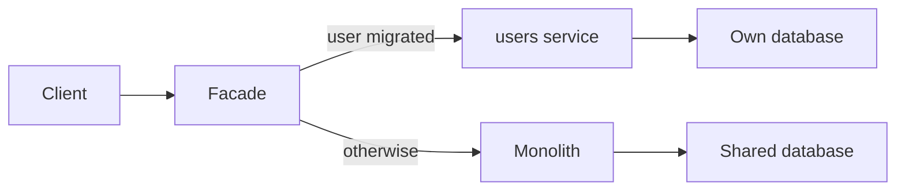

Choosing between a monolith and microservices is one of the most discussed architectural decisions. It's important to understand: this isn't "good/bad", but "what fits the specific circumstances".

## Monolith

A monolith is a single application where all functions (orders, users, payments) live in one deployment. Its strengths: simplicity of development (one repository, one build), simplicity of transactions (one database, ACID works out of the box), simplicity of debugging and testing (everything is local), low operational costs. Weaknesses: any change requires restarting the whole application, you can only scale it as a whole, teams are forced to synchronize, and over time the code turns into a "big ball of mud".

## Microservices

A microservice is a small independent service responsible for one business capability: `orders`, `users`, `payments`. A service owns its data (its own database, its own vocabulary) and communicates with others over the network via an explicit contract. Pros: independent deployment and scaling (a loaded service is replicated separately), context boundaries are visible in the code, teams can work independently. The cons are serious:

- **Distributed transactions** — ACID doesn't work across services; sagas and compensations are needed.
- **Network failures** — any call can fail or hang; retries, timeouts, and circuit breakers are needed.
- **Operational complexity** — dozens of services, logging, tracing, service discovery.
- **Data consistency** — events arrive with a delay.

## Decomposition

You should cut a monolith into services along **business context boundaries** (bounded contexts): a service should correspond to one domain capability, not one technical function. For example, "order" and "warehouse" are different contexts: the warehouse changes stock, the order assembles a cart. If a service "creates users" and "computes analytics" — those are two different worlds, and it's better to separate them.

## Contracts

Between services there is an explicit contract: a message schema (e.g., a Pydantic model or JSON Schema), a version format, error semantics. A contract is the public API between teams:

```python
from pydantic import BaseModel

class OrderCreated(BaseModel):
    order_id: int
    user_id: int
    total: float
    version: int = 1
```

If a contract changes, that's a breaking change, and it requires versioning (as in the API lesson).

## Transition strategy

A popular pattern is **strangler fig**: the monolith gradually grows services around itself, and new functionality is routed to new services through a facade until the monolith "dries up". The facade still looks like a single API to the client. This reduces risk: each service is introduced in small steps.

```python
# Facade: first the monolith, then a proxy to the service
def get_order(order_id):
    if order_id in MIGRATED_ORDERS:
        return orders_service_client.fetch(order_id)   # microservice
    return monolith_db.fetch_order(order_id)          # old monolith
```

Takeaway: a monolith is an excellent start for almost any product; moving to microservices makes sense when the pain comes from scale and speed (not from "trendiness"). For many companies, a "modular monolith" is the sweet spot: one deployment, but clear internal boundaries.

The gradual transition with the strangler fig pattern looks like this:



The facade stays the single entry point, so the client doesn't know that part of the requests have already gone to a new service.

<!--TASK-->
### Task 1
Given a list of company functions. Split them into microservice candidates along business context boundaries: "user registration and login", "cart and order placement", "payment processing", "delivery tracking", "sending notifications", "sales analytics". Propose 4–5 services, explicitly stating which functions belong to which service, and explain why "analytics" should not live in the orders service. Format the answer as a list: for each service — its name and functions.

### Task 2
Design a contract between the "orders" and "warehouse" services. Write Pydantic models: `ReserveRequest` (order_id, sku, quantity) and `ReserveResponse` (order_id, success: bool, reason: str | None). The orders service calls the warehouse to reserve items. Write code showing how an order forms a request and prints the warehouse's response. Use `from pydantic import BaseModel`. Expected output: `Reservation for order 101: success=True, reason=None`.

### Task 3
Implement a facade using the strangler fig pattern. The function `get_user(user_id)` should return a user: if `user_id` is in the set `MIGRATED_USERS` (e.g., `{2, 5}`), call `new_users_service(user_id)` — a simulation of a microservice (a function returning the dict `{"id": id, "name": "New service"}`), otherwise — `monolith_get_user(user_id)` (returns `{"id": id, "name": "Monolith"}`). The program prints the names for users 1, 2 and 5. Expected output: `Monolith`, `New service`, `New service`, one per line.

### Task 4
Write a function `call_with_retry(func, attempts=3, base_delay=0.1)` that calls `func()` and on exception retries with exponential backoff (`base_delay * 2 ** attempt`), and after the attempts are exhausted returns the string `"Service unavailable"`. Test it on a function that fails the first two times and succeeds on the third. Expected output: the number of attempts and `"Success"` or `"Service unavailable"` depending on the outcome. The program should print `Attempts: 3` and `Success`.

### Task 5
Implement a mini circuit breaker. The class `CircuitBreaker` has state `closed` (initial), `open` (after 3 consecutive errors) and `half_open` (after a timeout of 0.2 s). Method `call(func)` tries to call `func`, increments the counter on error, and when it reaches 3 errors transitions to `open` and immediately returns `"Open"` without calling `func`. Write a demonstration: a function that always fails; three calls — `"Error"`, then the fourth — `"Open"`. Expected output: `Error`, `Error`, `Error`, `Open`, one per line.

### Task 6
Implement an order placement saga with compensations. The saga runs three steps: `reserve_stock(order_id)` prints `Step 1: reserve stock`, `charge_payment(order_id)` — `Step 2: payment`, `create_shipment(order_id)` — `Step 3: delivery`. If a step fails, compensations for the already completed steps run in reverse order: `release_stock(order_id)` prints `Compensation: stock released`, `refund(order_id)` — `Compensation: money refunded`. Simulate a payment failure (the function raises `RuntimeError("bank rejected the payment")`). The function `run_saga(order_id)` returns `True` on success and `False` on rollback. Expected output: both steps before the failure, the line `Compensation: stock released`, the line `Saga cancelled: bank rejected the payment` and `False`. Explain why a compensation is not the same as a transaction rollback.

### Task 7
An inter-service call must have a timeout, otherwise a hung neighbor will take the whole service down with it. Write a function `call_with_timeout(func, timeout)` that runs `func` in a separate thread via `concurrent.futures.ThreadPoolExecutor` and waits for the result for no longer than `timeout` seconds. On timeout return the string `Timeout: service did not respond within <timeout> s`; on success return the function's result; on exception return `Error: <text>`. Test on three functions: a fast one (returns `data`), a slow one (`time.sleep(0.5)`) and a failing one (`RuntimeError("500")`). Call them with a timeout of 0.2 s and print the three results. Expected output: `data`, `Timeout: service did not respond within 0.2 s`, `Error: 500`.
<!--/TASK-->

<!--HINT-->
### Hint 1
Think about where data and meaning form a single owner. Registration and login are one "identity" service. Cart and checkout are one "orders" service. Payments are separate, delivery separate, notifications separate, analytics separate (it reads facts rather than owning them).

### Hint 2
The `reason` field must have a default of `None`, so that `ReserveResponse(order_id=101, success=True)` works without it. Build `ReserveRequest` from the order data, "call" the warehouse with a simple function that returns a `ReserveResponse`.

### Hint 3
Write both source functions and the condition: `if user_id in MIGRATED_USERS: return new_users_service(user_id)`. A list `user_ids = [1, 2, 5]` and a loop with `print(get_user(uid)["name"])`.

### Hint 4
Use `time.sleep(base_delay * 2 ** attempt)`. Increment the attempt counter at the start of each iteration. To make the function fail the first two times, use a closure with a counter that raises `RuntimeError` while the counter < 2.

### Hint 5
Store `failures`, `failure_limit=3`, `state`. In `call`: if `state == "open"`, return `"Open"`. Otherwise `try: func(); failures = 0; return "Success"` — on success reset and return `"Success"`; on exception increment `failures`; if `failures >= failure_limit`, set `state = "open"`; return `"Error"`. To simulate an always-failing function use `lambda: (_ for _ in ()).throw(RuntimeError("boom"))`.

### Hint 6
Describe the steps as a list of `(action, compensation)` pairs and iterate over it, pushing the compensations of completed steps onto a stack (e.g., a list `done`). On exception, go through `reversed(done)` and call each compensation, then print the reason and return `False`. The compensation for the last step may be `None` — skip such entries.

### Hint 7
Create `pool = ThreadPoolExecutor(max_workers=1)`, submit the task via `pool.submit(func)` and call `future.result(timeout=timeout)`. Exceeding the time raises `concurrent.futures.TimeoutError` — import it as `TimeoutError as FutureTimeout` so you don't confuse it with the built-in. In `finally`, call `pool.shutdown(wait=False)`, otherwise leaving the block will wait for the slow function to finish.
<!--/HINT-->

<!--SOLUTION-->
### Solution 1
Example split:

- **Identity service**: registration, login, profile.
- **Orders service**: cart, order placement.
- **Payments service**: transaction processing, refunds.
- **Delivery service**: tracking, delivery statuses.
- **Notifications service**: sending emails and push.
- **Analytics service**: collecting facts and reports.

Why isn't analytics in the orders service? Because it has a different owner and a different life cycle: it reads event snapshots rather than owning orders. If analytics lives inside orders, any analytics release restarts the critical sales service, and heavy reports querying the orders DB degrade sales. Different contexts — different services.

### Solution 2
Solution:

```python
from pydantic import BaseModel

class ReserveRequest(BaseModel):
    order_id: int
    sku: str
    quantity: int

class ReserveResponse(BaseModel):
    order_id: int
    success: bool
    reason: str | None = None

def warehouse_reserve(req: ReserveRequest) -> ReserveResponse:
    if req.quantity > 10:
        return ReserveResponse(order_id=req.order_id, success=False, reason="insufficient stock")
    return ReserveResponse(order_id=req.order_id, success=True)

req = ReserveRequest(order_id=101, sku="SKU-1", quantity=3)
resp = warehouse_reserve(req)
print(f"Reservation for order {resp.order_id}: success={resp.success}, reason={resp.reason}")
```

Output: `Reservation for order 101: success=True, reason=None`. What's happening here? The models are an explicit contract between services: fields, types, and required-ness are fixed. `reason` is optional, so a successful response doesn't need to specify it. When the contract changes, only the schema changes and both sides update consistently.

### Solution 3
Solution:

```python
MIGRATED_USERS = {2, 5}

def new_users_service(user_id):
    return {"id": user_id, "name": "New service"}

def monolith_get_user(user_id):
    return {"id": user_id, "name": "Monolith"}

def get_user(user_id):
    if user_id in MIGRATED_USERS:
        return new_users_service(user_id)
    return monolith_get_user(user_id)

for uid in [1, 2, 5]:
    print(get_user(uid)["name"])
```

Output:

```
Monolith
New service
New service
```

What's happening here? The facade `get_user` looks like a single entry point to the client, but internally it routes requests: some users are already served by the new service, some by the old monolith. Migration proceeds gradually, without a "big bang".

### Solution 4
Solution:

```python
import time

def call_with_retry(func, attempts=3, base_delay=0.1):
    for attempt in range(attempts):
        try:
            return func()
        except Exception:
            if attempt == attempts - 1:
                return "Service unavailable"
            time.sleep(base_delay * 2 ** attempt)
    return "Service unavailable"

state = {"calls": 0}

def flaky():
    state["calls"] += 1
    if state["calls"] < 3:
        raise RuntimeError("boom")
    return "Success"

print(f"Attempts: {state['calls'] + 1}")  # will be 3
print(call_with_retry(flaky))
```

Output:

```
Attempts: 3
Success
```

What's happening here? The function fails on the first two calls and succeeds on the third. `call_with_retry` repeats the call with a growing delay: 0.1 s, then 0.2 s. Note: the counter in `print` shows 1 before the call, so the line "Attempts: 3" means "there will be 3 calls". In practice, retry with backoff is the standard defense against transient network failures, but it doesn't help if the service is down for a long time — that's what a circuit breaker is for.

### Solution 5
Solution:

```python
import time

class CircuitBreaker:
    def __init__(self, failure_limit=3, timeout=0.2):
        self.failure_limit = failure_limit
        self.timeout = timeout
        self.failures = 0
        self.state = "closed"
        self.opened_at = None

    def call(self, func):
        if self.state == "open":
            if time.time() - self.opened_at >= self.timeout:
                self.state = "half_open"
            else:
                return "Open"
        try:
            result = func()
            self.failures = 0
            self.state = "closed"
            return result
        except Exception:
            self.failures += 1
            if self.failures >= self.failure_limit:
                self.state = "open"
                self.opened_at = time.time()
            return "Error"

breaker = CircuitBreaker()
boom = lambda: (_ for _ in ()).throw(RuntimeError("boom"))

for _ in range(4):
    print(breaker.call(boom))
```

Output:

```
Error
Error
Error
Open
```

What's happening here? After three consecutive errors the breaker opens, and the fourth call immediately returns `"Open"` without touching the failing function. After the timeout it transitions to `half_open` and tries again. A circuit breaker protects the system from cascading failures: a broken service doesn't make all clients wait for timeouts.

### Solution 6
Solution:

```python
def reserve_stock(order_id):
    print("Step 1: reserve stock")

def release_stock(order_id):
    print("Compensation: stock released")

def charge_payment(order_id):
    print("Step 2: payment")
    raise RuntimeError("bank rejected the payment")

def refund(order_id):
    print("Compensation: money refunded")

def create_shipment(order_id):
    print("Step 3: delivery")

STEPS = [
    (reserve_stock, release_stock),
    (charge_payment, refund),
    (create_shipment, None),
]

def run_saga(order_id):
    done = []
    for action, compensation in STEPS:
        try:
            action(order_id)
            done.append(compensation)
        except Exception as exc:
            for comp in reversed([c for c in done if c is not None]):
                comp(order_id)
            print(f"Saga cancelled: {exc}")
            return False
    return True

print(run_saga(101))
```

Output:

```
Step 1: reserve stock
Step 2: payment
Compensation: stock released
Saga cancelled: bank rejected the payment
False
```

What's happening here? A saga is a sequence of local transactions, each already committed in its own database, so "rolling everything back" is impossible: the money in the payment service and the stock reservation live in different stores, and no shared transaction exists between them. Instead of a rollback, a compensation runs — a new action with the opposite effect: the reservation is released by a separate operation that can also fail. Two consequences follow, both important for interviews. First: compensations must be idempotent, because a saga may be restarted after a coordinator failure. Second: the system passes through intermediate states (the order is created but not paid), and that's normal — they should be explicitly modeled with statuses, not hidden. If a compensation fails, manual investigation or retry with backoff is needed: a saga gives eventual consistency, not instant atomicity.

### Solution 7
Solution:

```python
import time
from concurrent.futures import ThreadPoolExecutor, TimeoutError as FutureTimeout

def call_with_timeout(func, timeout):
    pool = ThreadPoolExecutor(max_workers=1)
    future = pool.submit(func)
    try:
        return future.result(timeout=timeout)
    except FutureTimeout:
        return f"Timeout: service did not respond within {timeout} s"
    except Exception as exc:
        return f"Error: {exc}"
    finally:
        pool.shutdown(wait=False)

def fast():
    return "data"

def slow():
    time.sleep(0.5)
    return "late"

def broken():
    raise RuntimeError("500")

print(call_with_timeout(fast, 0.2))
print(call_with_timeout(slow, 0.2))
print(call_with_timeout(broken, 0.2))
```

Output:

```
data
Timeout: service did not respond within 0.2 s
Error: 500
```

What's happening here? `future.result(timeout=...)` waits no longer than the given time and raises `TimeoutError` from `concurrent.futures` without waiting for the function. The client gets a fast, predictable failure instead of a hang, and the calling code frees the request-handling thread. A timeout isn't an "optimization" but a survivability requirement: if a neighbor service hangs without a timeout, your threads run out before you notice the problem, and the failure propagates up the call chain. Two limitations of the example are worth knowing. First: `shutdown(wait=False)` doesn't kill an already-running thread — Python can't interrupt a thread from outside, so the slow function finishes in the background, and real cancellation needs a client that supports it (asyncio, httpx) or a deadline in the protocol. Second: the timeout at each step should be reduced by the remainder of the request's total budget, otherwise three one-second calls give three seconds instead of one.
<!--/SOLUTION-->

<!--QUIZ-->
What is the monolith's main advantage?
- Simplicity of transactions and development
- Full independence of teams
- Instant scaling of a single service
- No database
* Correct answer: Simplicity of transactions and development
In a monolith there is one database, and ACID transactions work inside one process.

Why are distributed transactions a pain point of microservices?
- Because the network is always fast
- Because ACID doesn't work across services; sagas and compensations are needed
- Because there are no databases
- Because services can't send HTTP
* Correct answer: Because ACID doesn't work across services; sagas and compensations are needed
Data is spread across different databases, so "all or nothing" atomicity is unreachable without coordination.

Along which boundaries should a monolith be cut into services?
- Along technical functions (models, controllers)
- Along business context boundaries
- Alphabetically
- By lines of code
* Correct answer: Along business context boundaries
A service corresponds to one domain capability, not a technical layer.

What does the strangler fig pattern do?
- Abruptly stops all services
- Gradually replaces parts of a monolith with microservices through a facade
- Doubles the load
- Turns off monitoring
* Correct answer: Gradually replaces parts of a monolith with microservices through a facade
The facade hides the transition; the client sees a single API.

What is a contract between services?
- An agreement between developers
- A message schema (e.g., a Pydantic model) and exchange rules
- A login and password
- The monolith's URL
* Correct answer: A message schema (e.g., a Pydantic model) and exchange rules
A contract is a public API, and its changes require versioning.

When should you choose microservices?
- When the product is small and there's one developer
- When the pain is caused by scale and team independence, not fashion
- Never
- Only for games
* Correct answer: When the pain is caused by scale and team independence, not fashion
The overhead of distributed systems must pay off.

What is a saga?
- A sequence of local transactions with compensations on failure
- A single ACID transaction across services
- A database backup
- A message queue
* Correct answer: A sequence of local transactions with compensations on failure
A saga coordinates steps between services, and a failure is rolled back with compensating actions.

What is service discovery?
- A mechanism that lets services find each other's addresses without manual configuration
- A load balancer
- A monitoring system
- A logging service
* Correct answer: A mechanism that lets services find each other's addresses without manual configuration
Addresses change when scaling, so a service registry updates automatically.

What is a bounded context?
- A boundary within which terms and the model have a single meaning
- The maximum service size in lines of code
- A set of servers in one data center
- A list of allowed libraries
* Correct answer: A boundary within which terms and the model have a single meaning
In different contexts "order" can mean different things, so you cut by meaning, not by layers.

What is a modular monolith?
- One deployment with clear internal module boundaries
- Several independent deployments without shared data
- A monolith without tests
- A set of microservices in one repository
* Correct answer: One deployment with clear internal module boundaries
It keeps operational simplicity but disciplines boundaries and prepares the ground for splitting.

What is a compensation in a saga?
- An action with the opposite effect that cancels the result of an already completed step
- A database transaction rollback
- Retrying a step
- A database backup
* Correct answer: An action with the opposite effect that cancels the result of an already completed step
A step is already committed, so it can't be "rolled back" — only compensated.

What is dangerous about a "distributed monolith"?
- Services are deployed separately but coupled by synchronous calls and shared releases
- It always fails on the first release
- It can't use databases
- It doesn't support HTTP
* Correct answer: Services are deployed separately but coupled by synchronous calls and shared releases
Formally these are microservices, but team and deployment independence are lost — only the overhead remains.
<!--/QUIZ-->
