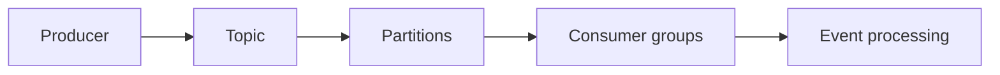

Apache Kafka is a distributed streaming platform. It is used as an "event bus" between services, reliably storing messages and letting multiple consumers read them.

## Key terms

- Topic — a named stream of messages.
- Partitions — physical segments of a topic; they provide parallelism.
- Producer — the sender of messages.
- Consumer — the receiver; a consumer group shares partitions among its members.
- Offset — the read position within a partition.

## Producer

```python
from kafka import KafkaProducer

producer = KafkaProducer(bootstrap_servers="localhost:9092")
producer.send("orders", key=b"user-1", value=b"order-42")
producer.flush()
```

## Consumer in a group

```python
from kafka import KafkaConsumer

consumer = KafkaConsumer("orders", group_id="workers",
                         bootstrap_servers="localhost:9092")
for msg in consumer:
    print(msg.key, msg.value, msg.offset)
```

## Guarantees

- at-most-once — a message may be lost;
- at-least-once — it won't be lost, but may be duplicated;
- exactly-once — exactly once (transactions).

## Lesson summary

Kafka decouples producers from consumers and scales with partitions. For Python there are the kafka-python and confluent-kafka libraries.




## Practical application

Kafka is the standard for event-driven architecture: microservice integration, collecting user events, stream processing. Producers and consumers decouple services: the source doesn't know the consumers. Partitions allow horizontal scaling of processing. Understanding delivery guarantees helps design reliable systems.


For fault tolerance, topics are given a replication factor: partition copies are stored on different brokers. Consumers can store offsets in Kafka, which lets you restart processing without losing position. When planning an event system, it's important to choose the number of partitions in advance: you can increase it, but not decrease it.


<!--TASK-->
### Task 1 — Running Kafka locally
Describe running Kafka via Docker compose (zookeeper + broker). Provide the commands for creating a topic with kafka-topics.sh.

### Task 2 — Simplest producer
Via KafkaProducer send 5 messages to the topic quickstart, flush and close. Describe what blocking flush means.

### Task 3 — Consumer
Write a KafkaConsumer for the topic quickstart that reads 5 messages and prints them. Describe what an offset is.

### Task 4 — Consumer group
Start two consumers with the same group_id on a topic with 2 partitions. Explain how the partitions are distributed between them.

### Task 5 — Keys and order
Send 10 messages with keys user-1/user-2. Explain why messages with the same key land in one partition and keep order.

### Task 6 — Error handling
Write a consumer with try/except around processing and a manual commit on success. Describe what happens if it fails before the commit.

### Task 7 — Partitions
Split the keys across 3 partitions; send messages and print the partition numbers for each key. Show how the keys are distributed.
<!--/TASK-->

<!--HINT-->
### Hint 1
docker-compose.yml: image bitnami/kafka or confluentinc/cp-kafka.

### Hint 2
producer.send(topic, key=..., value=...) is non-blocking; flush() waits for the send to complete.

### Hint 3
Cursor: msg.offset — the position within the partition.

### Hint 4
The group distributes partitions; with 2 consumers and 2 partitions — one each.

### Hint 5
The same key always lands in the same partition.

### Hint 6
Without committing the offset, the message will be re-read after a restart.

### Hint 7
Each partition is an independent queue; order is guaranteed within a partition.
<!--/HINT-->

<!--SOLUTION-->
### Solution 1
```yaml
services:
  zookeeper:
    image: confluentinc/cp-zookeeper:latest
    environment:
      ZOOKEEPER_CLIENT_PORT: 2181
  kafka:
    image: confluentinc/cp-kafka:latest
    ports: ["9092:9092"]
    environment:
      KAFKA_ZOOKEEPER_CONNECT: zookeeper:2181
      KAFKA_ADVERTISED_LISTENERS: PLAINTEXT://localhost:9092
```
Creating the topic:
```bash
kafka-topics.sh --create --topic quickstart --partitions 2 --replication-factor 1 --bootstrap-server localhost:9092
```

### Solution 2
```python
from kafka import KafkaProducer

producer = KafkaProducer(bootstrap_servers="localhost:9092")
for i in range(5):
    producer.send("quickstart", key=b"key", value=f"msg-{i}".encode())
producer.flush()
producer.close()
```
flush() waits for all buffered messages to be sent.

### Solution 3
```python
from kafka import KafkaConsumer

consumer = KafkaConsumer("quickstart", bootstrap_servers="localhost:9092")
for i, msg in enumerate(consumer):
    print(msg.key, msg.value, msg.offset)
    if i == 4:
        break
```
An offset is a message's number in the partition; reading continues from the next one.

### Solution 4
With one group and 2 partitions, each consumer gets exactly one partition; if there are more partitions than consumers — some read several; if fewer — some consumers sit idle.

### Solution 5
```python
for user in (b"user-1", b"user-2"):
    for i in range(5):
        producer.send("orders", key=user, value=str(i).encode())
```
The key's hash determines the partition: identical keys → one partition → order within it is preserved.

### Solution 6
```python
from kafka import KafkaConsumer, TopicPartition

consumer = KafkaConsumer("quickstart", bootstrap_servers="localhost:9092",
                         enable_auto_commit=False)
for msg in consumer:
    try:
        process(msg)
        consumer.commit()
    except Exception as e:
        logging.exception(e)
```
Manual commit after processing guarantees at-least-once; without a commit the message will be re-read.

### Solution 7
```python
producer = KafkaProducer(bootstrap_servers="localhost:9092",
                         key_serializer=str.encode)
keys = ["a", "b", "c", "d", "e"]
for i, k in enumerate(keys):
    future = producer.send("users", key=k, value=str(i).encode())
    print(future.get().partition)
```
future.get() gives the metadata (partition) — you can see how keys are distributed across partitions.
<!--/SOLUTION-->

<!--QUIZ-->
What is a topic?
- A named stream of messages
- A Docker container
- A database table
- A server
* Correct answer: A named stream of messages
Messages are grouped into topics.

What do partitions give?
- Parallelism and order within a partition
- Only replication
- Compression
- Encryption
* Correct answer: Parallelism and order within a partition
Scaling.

Who sends messages?
- Producer
- Consumer
- Broker
- Cluster
* Correct answer: Producer
The producer writes to a topic.

What is a consumer group?
- Several consumers sharing partitions
- One consumer
- A cluster
- A server
* Correct answer: Several consumers sharing partitions
Each message is read by one member of the group.

What is an offset?
- The read position within a partition
- A key
- Message size
- Time
* Correct answer: The read position within a partition
Tracking progress.

What does at-least-once mean?
- The message won't be lost but may be duplicated
- The message may be lost
- Exactly once
- Zero times
* Correct answer: The message won't be lost but may be duplicated
Achieved by committing after processing.

Why is flush() needed?
- To wait for all messages to be sent
- To close the consumer
- To create a topic
- To delete messages
* Correct answer: To wait for all messages to be sent
Without flush, sending may be delayed.

Why is the key important?
- The same key lands in one partition, so order is preserved
- It sets the format
- It encrypts
- It speeds up
* Correct answer: The same key lands in one partition, so order is preserved
An order guarantee for related events.

What does commit() do?
- Commits the processed offset
- Deletes the topic
- Creates a partition
- Restarts
* Correct answer: Commits the processed offset
On restart, reading continues from it.

Which library is used to work with Kafka?
- kafka-python or confluent-kafka
- requests
- flask
- sqlalchemy
* Correct answer: kafka-python or confluent-kafka
Official/popular clients.

What happens when a consumer joins a group?
- Partitions are rebalanced among all members
- An error
- All messages are duplicated
- A stop
* Correct answer: Partitions are rebalanced among all members
The new member gets its share.

What is a broker?
- A Kafka server that stores partitions
- A client
- A producer
- A topic
* Correct answer: A Kafka server that stores partitions
A cluster consists of brokers.


<!--/QUIZ-->
