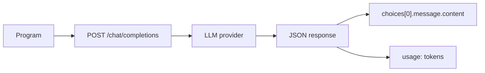

Modern language models are not just chatbots in a browser. For a developer, the key thing is the API: the interface through which your program sends text to the model and receives a reply. This lesson will teach you to work with the LLM API in pure Python with the `requests` library.

## What is an LLM API

LLM (Large Language Model) is a large language model trained on huge volumes of text. Such models live on the servers of the provider company, and you access them over HTTP. That is what an API (Application Programming Interface) is — a programmatic interface.

The most popular format is **chat completions**. It is supported by OpenAI and many other providers (DeepSeek, Qwen, local servers like vLLM or Ollama), because it has become the de facto standard. Once you master one API, you can switch to another almost unchanged.

A request is a `POST` request to the `/v1/chat/completions` endpoint. The body is JSON with fields:

- `model` — the name of the model (for example, `gpt-4o-mini`);
- `messages` — a list of conversation messages;
- `temperature`, `max_tokens`, `top_p` — generation parameters.

The API key is passed in the header `Authorization=[redacted]`. Never insert the key directly into code — store it in an environment variable.

## First request

Here is a minimal program that asks the model about Python dictionaries:

```python
import os
import requests

API_KEY = os.environ["OPENAI_API_KEY"]  # set the environment variable in advance

resp = requests.post(
    "https://api.openai.com/v1/chat/completions",
    headers={"Authorization": f"Bearer {API_KEY}"},
    json={
        "model": "gpt-4o-mini",
        "messages": [
            {"role": "system", "content": "You are an experienced Python mentor."},
            {"role": "user", "content": "What is a dictionary in Python?"},
        ],
        "temperature": 0.7,
        "max_tokens": 300,
    },
    timeout=60,
)
resp.raise_for_status()

data = resp.json()
answer = data["choices"][0]["message"]["content"]
print(answer)
print("Tokens spent:", data["usage"]["total_tokens"])
```

Let's break it down step by step:

- `requests.post` sends the request; `json=` turns the dict into the request body;
- the `Authorization` header carries the API key;
- `messages` is a list of role-based messages;
- `timeout=60` protects against infinite waiting;
- `resp.raise_for_status()` raises an exception on an HTTP error;
- the answer lives in `data["choices"][0]["message"]["content"]`, and usage statistics are in `data["usage"]`.

## Message roles

Each message has a role:

- `system` — sets the model's behavior (tone, rules, boundaries);
- `user` — what the user writes;
- `assistant` — the model's previous answers (needed for conversation history).

A good system prompt is often more important than the question itself. For example: "You are a translator from Russian into English. Reply only with the translation, without explanations." We'll dive into prompts in detail in the next lesson.

## Generation parameters

- `temperature` (0–2) — the level of "creativity". `0` — almost deterministic answers, higher values — more variety.
- `max_tokens` — the maximum number of tokens in the response (keep in mind these are not characters!).
- `top_p` — nucleus sampling, an alternative way to control randomness.
- `presence_penalty` / `frequency_penalty` — penalties for repetition.

Count tokens: they are billed, so save them — don't ask for long answers without need.

## Errors and reliability

Typical status codes:

- `401 Unauthorized` — invalid or missing key;
- `429 Too Many Requests` — request limit exceeded (usually you should wait and retry);
- `500`/`503` — a temporary problem on the provider's side;
- `400 Bad Request` — invalid request body (for example, a misspelled model name).

Failures happen on the network, so professional code always handles errors: it catches `requests.exceptions.Timeout`, retries on `429` with a delay (exponential backoff), and logs problems.

## Streaming

For long responses, streaming is used: `stream=True` in `requests` lets you receive and print the response piece by piece, the way chatbots do. We'll skip parsing SSE events, but know that this mode exists and noticeably improves the perceived speed.

A diagram of a single LLM API request:



## Summary

You learned: what an LLM API is and the chat completions format; how to send requests via `requests`; what message roles exist; how to control generation with `temperature` and `max_tokens`; how to handle errors. Now let's solidify this with practice.

<!--TASK-->
### Task 1
Write a function `send_chat(messages)` that takes a list of messages, sends it to the chat completions endpoint of the `gpt-4o-mini` model, and returns the assistant's reply text. Use the parameters `temperature=0.5` and `max_tokens=200`. Call the function with two messages: a system message "Reply briefly, at most two sentences" and a user message "What is the GIL in Python?". Print the answer. Expected result: a short meaningful answer about the GIL appears on screen.

### Task 2
Write a translator program. System message: "You are a translator from Russian into English. Reply only with the translation, one sentence, no explanations." The user gives three phrases in turn: "I like learning Python", "The weather is nice today", "Where is the nearest metro station?". Each translation should be printed on a new line. Expected result: three lines in English, with no extra comments from the model.

### Task 3
Run a temperature experiment. Send the same question "Come up with a short startup idea" four times: twice with `temperature=0` and twice with `temperature=1.2`. Each time print the answer and the number of tokens spent (`total_tokens`). After running, compare the answers: at zero temperature they should be almost identical, at high temperature noticeably different.

### Task 4
Write a resilient function `ask_with_retry(messages, max_attempts=3)` that sends a request with `timeout=30` and retries on errors. If the server returned status `429`, wait `2 ** attempt` seconds (attempt is the attempt number) and try again. For any other status except `200`, print the error code. If all attempts are exhausted, return `None`. Test the function with a working key — it should return the model's answer.

### Task 5
Create a class `Conversation` to maintain a dialogue. In `__init__`, put the system message "You are a helpful assistant, reply briefly" into `self.messages`. The `say(text)` method adds a user message, sends the whole dialogue, adds the assistant's answer to `self.messages`, and returns its text. Have a dialogue of at least two user turns, for example: "Explain what a for loop is" and then "How is for different from while?". Expected result: two meaningful answers, with the model remembering the first part of the dialogue in the second one.

### Task 6
Write a function `chat_with_usage(messages)` that sends a request to `gpt-4o-mini` with `temperature=0.3` and returns a tuple of the answer text and the `usage` dict from the `data["usage"]` field. Run the function on three requests of different lengths: "What is PEP 8?", "List three differences between a list and a tuple and briefly explain each", and "Explain in five sentences how the garbage collector works in Python". For each run, print `prompt_tokens`, `completion_tokens`, and `total_tokens`. At the end, sum the tokens and estimate the cost at hypothetical prices of $0.15 per million input and $0.60 per million output tokens. Expected result: three lines of statistics and a final cost printed with six decimal places.

### Task 7
Write a function `safe_chat(messages, max_tokens=300)` that validates the input before sending the request. Requirements: `messages` must be a non-empty list; each message's role must be in the set `system`, `user`, `assistant`; `content` must be a non-empty string. On violation, the function raises `ValueError` with a clear message and makes no network request. If there are more than ten messages, keep the system one (if present) and the last nine. On HTTP status `400`, print `resp.text` and return `None`. Test the function with a valid dialogue, an empty list, and a message with the `tool` role. Expected result: a meaningful answer in the first case and two `ValueError`s without extra requests in the others.

<!--/TASK-->

<!--HINT-->
### Hint 1
The function should make a `requests.post` to `https://api.openai.com/v1/chat/completions` with the header `Authorization=[redacted]` and body `{"model": ..., "messages": messages, "temperature": 0.5, "max_tokens": 200}`. The answer is in `data["choices"][0]["message"]["content"]`.

### Hint 2
Reuse the `send_chat` function from Task 1. Pass the system message as the first element of the list and the user phrase as the second. Run a loop over the three phrases and print the result of each call.

### Hint 3
Temperature parameters can be iterated with a loop: `for temp in (0, 0, 1.2, 1.2):`. Build the request body anew each time with the current `temp`. Don't forget to print `data["usage"]["total_tokens"]` from the response.

### Hint 4
Wrap `requests.post` in a `try/except requests.exceptions.Timeout` block. Check `resp.status_code`: if `429` — `time.sleep(2 ** attempt)` and `continue`; if `200` — return `resp.json()["choices"][0]["message"]["content"]`; otherwise print the code and keep trying.

### Hint 5
In `say()`, first do `self.messages.append({"role": "user", "content": text})`, then send the whole list, then append `{"role": "assistant", "content": answer}` and return `answer`. Storing history is the key to a coherent dialogue.

### Hint 6
Return two values from the function: `content` and `data["usage"]`. Compute the sums in a loop, adding `prompt_tokens` and `completion_tokens` separately. The cost is `prompt_tokens / 1_000_000 * 0.15 + completion_tokens / 1_000_000 * 0.60`; print it via `f"{cost:.6f}"`.

### Hint 7
First run validation over the message list, and only then build the request body. To trim history, use a slice: the system message plus `messages[-9:]`. It is convenient to raise `ValueError` with a message that includes the index of the problematic message. Check status `400` before `raise_for_status()`.

<!--/HINT-->

<!--SOLUTION-->
### Solution 1
```python
import os
import requests

def send_chat(messages):
    resp = requests.post(
        "https://api.openai.com/v1/chat/completions",
        headers={"Authorization": f"Bearer {os.environ['OPENAI_API_KEY']}"},
        json={
            "model": "gpt-4o-mini",
            "messages": messages,
            "temperature": 0.5,
            "max_tokens": 200,
        },
        timeout=60,
    )
    resp.raise_for_status()
    return resp.json()["choices"][0]["message"]["content"]

print(send_chat([
    {"role": "system", "content": "Reply briefly, at most two sentences."},
    {"role": "user", "content": "What is the GIL in Python?"},
]))
```

The key point here is careful request construction. `messages` is passed as-is, and each message's role is set in the dict. After the request, we immediately check the status via `raise_for_status()`: if something is wrong, the program fails with a clear error. The answer is extracted from the `choices[0].message.content` chain — that is exactly where the model puts the generated text. Note the `.env` variable: the key is read from the environment, not hardcoded.

### Solution 2
```python
import os
import requests

def translate(phrase):
    resp = requests.post(
        "https://api.openai.com/v1/chat/completions",
        headers={"Authorization": f"Bearer {os.environ['OPENAI_API_KEY']}"},
        json={
            "model": "gpt-4o-mini",
            "messages": [
                {"role": "system",
                 "content": "You are a translator from Russian into English. "
                            "Reply only with the translation, one sentence, no explanations."},
                {"role": "user", "content": phrase},
            ],
            "temperature": 0.2,
        },
        timeout=60,
    )
    resp.raise_for_status()
    return resp.json()["choices"][0]["message"]["content"]

phrases = [
    "I like learning Python",
    "The weather is nice today",
    "Where is the nearest metro station?",
]
for p in phrases:
    print(translate(p))
```

The system message is the main control tool: we explicitly forbade explanations and demanded exactly one translation. Thanks to that, the answers are clean strings without "Sure! Here's the translation: ...". We also lowered the temperature to `0.2` so the model doesn't hallucinate. This technique — "strict format specification in the system prompt" — you'll use all the time.

### Solution 3
```python
import os
import requests

def ask(temperature):
    resp = requests.post(
        "https://api.openai.com/v1/chat/completions",
        headers={"Authorization": f"Bearer {os.environ['OPENAI_API_KEY']}"},
        json={
            "model": "gpt-4o-mini",
            "messages": [
                {"role": "user", "content": "Come up with a short startup idea."}
            ],
            "temperature": temperature,
            "max_tokens": 100,
        },
        timeout=60,
    )
    resp.raise_for_status()
    data = resp.json()
    return data["choices"][0]["message"]["content"], data["usage"]["total_tokens"]

for temp in (0, 0, 1.2, 1.2):
    text, tokens = ask(temp)
    print(f"temperature={temp} | tokens={tokens}")
    print(text)
    print("-" * 40)
```

At `temperature=0` the model almost always chooses the most likely next token — so two runs give almost identical text. At `temperature=1.2` the probability distribution is "smoothed", and the model more often picks less likely continuations — the answers diverge. This is not a bug but a feature: zero temperature is for extracting facts, high temperature is for generating ideas. Token usage may differ slightly because of different answer lengths.

### Solution 4
```python
import os
import time
import requests

def ask_with_retry(messages, max_attempts=3):
    for attempt in range(max_attempts):
        try:
            resp = requests.post(
                "https://api.openai.com/v1/chat/completions",
                headers={"Authorization": f"Bearer {os.environ['OPENAI_API_KEY']}"},
                json={"model": "gpt-4o-mini", "messages": messages},
                timeout=30,
            )
            if resp.status_code == 429:
                wait = 2 ** attempt
                print(f"429: waiting {wait} s")
                time.sleep(wait)
                continue
            resp.raise_for_status()
            return resp.json()["choices"][0]["message"]["content"]
        except requests.exceptions.Timeout:
            print(f"Timeout, attempt {attempt + 1}")
    return None

print(ask_with_retry([
    {"role": "user", "content": "Say \"hi\"."}
]))
```

The key point is **exponential backoff**: after the first `429` we wait 1 second, after the second — 2, after the third — 4. This is standard practice: the server most often tells you itself when to retry (the `Retry-After` header). The timeout protects against hanging, and `return None` after failures lets the calling code decide what to do next. This skeleton is the base of any production LLM API integration.

### Solution 5
```python
import os
import requests

class Conversation:
    def __init__(self):
        self.messages = [
            {"role": "system", "content": "You are a helpful assistant, reply briefly."}
        ]

    def say(self, text):
        self.messages.append({"role": "user", "content": text})
        resp = requests.post(
            "https://api.openai.com/v1/chat/completions",
            headers={"Authorization": f"Bearer {os.environ['OPENAI_API_KEY']}"},
            json={
                "model": "gpt-4o-mini",
                "messages": self.messages,
                "temperature": 0.3,
            },
            timeout=60,
        )
        resp.raise_for_status()
        answer = resp.json()["choices"][0]["message"]["content"]
        self.messages.append({"role": "assistant", "content": answer})
        return answer

conv = Conversation()
print(conv.say("Explain what a for loop is"))
print(conv.say("How is for different from while?"))
```

The model does not remember past requests — context is provided anew each time. That is why we store the whole history in `self.messages` and send it entirely. The second question "How is for different from while?" is understandable to the model precisely because the history contains the first message and the assistant's answer. Note: as the dialogue grows, so does the token count — in production, history is truncated or summarized to avoid overpaying.

### Solution 6
```python
import os
import requests

INPUT_PRICE = 0.15 / 1_000_000   # hypothetical price per input token
OUTPUT_PRICE = 0.60 / 1_000_000  # hypothetical price per output token

def chat_with_usage(messages):
    resp = requests.post(
        "https://api.openai.com/v1/chat/completions",
        headers={"Authorization": f"Bearer {os.environ['OPENAI_API_KEY']}"},
        json={
            "model": "gpt-4o-mini",
            "messages": messages,
            "temperature": 0.3,
        },
        timeout=60,
    )
    resp.raise_for_status()
    data = resp.json()
    return data["choices"][0]["message"]["content"], data["usage"]

prompts = [
    "What is PEP 8?",
    "List three differences between a list and a tuple and briefly explain each.",
    "Explain in five sentences how the garbage collector works in Python.",
]

total_in = total_out = 0
for text in prompts:
    answer, usage = chat_with_usage([{"role": "user", "content": text}])
    print(f"prompt={usage['prompt_tokens']} "
          f"completion={usage['completion_tokens']} "
          f"total={usage['total_tokens']}")
    print(answer[:80], "...")
    total_in += usage["prompt_tokens"]
    total_out += usage["completion_tokens"]

cost = total_in * INPUT_PRICE + total_out * OUTPUT_PRICE
print(f"Total tokens: {total_in + total_out}, cost: {cost:.6f} $")
```

`usage` is the only honest source of spend data: the provider counts tokens with its own tokenizer, and "by eye" estimates from characters almost always lie. Note that input and output tokens are billed differently, so we sum them separately rather than using `total_tokens` for both rates. Three requests of different lengths show the main thing: `prompt_tokens` grows with the wording and dialogue history, while `completion_tokens` grows with the answer length. Such measurement is useful before production: multiply the average consumption by the number of requests and you will estimate your budget. Don't forget the prices in the task are hypothetical — see the provider's current rates for real numbers.

### Solution 7
```python
import os
import requests

ALLOWED_ROLES = {"system", "user", "assistant"}

def safe_chat(messages, max_tokens=300):
    if not messages:
        raise ValueError("messages cannot be empty")

    for index, message in enumerate(messages):
        role = message.get("role")
        content = message.get("content")
        if role not in ALLOWED_ROLES:
            raise ValueError(f"Message {index}: invalid role {role!r}")
        if not isinstance(content, str) or not content.strip():
            raise ValueError(f"Message {index}: empty content")

    if len(messages) > 10:
        system = [m for m in messages if m["role"] == "system"][:1]
        messages = system + messages[-9:]

    resp = requests.post(
        "https://api.openai.com/v1/chat/completions",
        headers={"Authorization": f"Bearer {os.environ['OPENAI_API_KEY']}"},
        json={
            "model": "gpt-4o-mini",
            "messages": messages,
            "max_tokens": max_tokens,
            "temperature": 0.3,
        },
        timeout=60,
    )
    if resp.status_code == 400:
        print("Request error:", resp.text)
        return None
    resp.raise_for_status()
    return resp.json()["choices"][0]["message"]["content"]

print(safe_chat([{"role": "user", "content": "What is a virtual environment?"}]))

for bad in ([], [{"role": "tool", "content": "x"}]):
    try:
        safe_chat(bad)
    except ValueError as error:
        print("ValueError:", error)
```

Validation before the network is not bureaucracy but saving: every rejected request spends no tokens and takes no quota. The role set is deliberately limited: the `tool` role is only allowed together with `tool_call_id`, and without it the API returns `400`, so it is better to cut such dialogues off ourselves. The history slice solves another problem — the context window and cost: a long dialogue gets more expensive with every turn, and the system message must not be lost during truncation, otherwise the model will forget the rules. A separate branch for `400` matters because it is a data error, not a network failure: retrying is pointless; you need to show the response body and fix the request.

<!--/SOLUTION-->

<!--QUIZ-->
Which HTTP method is used to send a request to the chat completions endpoint?
- GET
- POST
- PUT
* Correct answer: POST
New messages are sent with POST, since it creates generation on the server side.

Where is the API key passed?
- In the JSON body under the field key
- In the Authorization header
- In the URL address
* Correct answer: In the Authorization header
The key is passed in the `Authorization` header (`Authorization=[redacted]`).

What controls the "creativity" of the model's answers?
- max_tokens
- temperature
- model
* Correct answer: temperature
The higher the temperature, the more diverse and "random" the token choice.

Which message role sets the model's behavior?
- user
- system
- assistant
* Correct answer: system
The system message describes the rules, tone, and boundaries of the model's answers.

What does HTTP status 429 mean?
- Invalid key
- Request rate limit exceeded
- Error in JSON
* Correct answer: Request rate limit exceeded
429 Too Many Requests means you need to wait and retry the request.

Where in the response does the text of the generated message live?
- data["message"]["content"]
- data["choices"][0]["message"]["content"]
- data["text"]
* Correct answer: data["choices"][0]["message"]["content"]
The response is a list of choices; the first element holds the message, which has a content field.

What happens to a request if you don't specify the timeout parameter in requests.post()?
- The request will only run at night
- The request may hang forever, waiting for the server's response
- The request becomes twice as fast
* Correct answer: The request may hang forever, waiting for the server's response
Without a timeout, the program may hang forever if the server doesn't respond.

Why is the API key stored in an environment variable instead of directly in code?
- This way the key works faster
- To avoid hardcoding a secret in code: code can end up in git or on public resources
- The environment variable generates the key itself
* Correct answer: To avoid hardcoding a secret in code: code can end up in git or on public resources
Secrets must not be stored in code — read them from the environment or a secret store.

What does HTTP status 401 mean?
- Invalid or missing API key
- Request rate limit exceeded
- Prompt too long
* Correct answer: Invalid or missing API key
401 Unauthorized means the key was not accepted: check or renew it.

Which prefix is usually placed before the key in the Authorization header?
- Bearer
- Basic
- Token
* Correct answer: Bearer
The Bearer scheme means "bearer of the token"; the key itself follows this word.

What does the stream=True mode include?
- Streaming the response in parts as it is generated
- Disabling status checking
- Automatic request retry
* Correct answer: Streaming the response in parts as it is generated
The server sends events as tokens appear, so the answer prints gradually.

What does the completion_tokens field show in the usage object?
- The number of tokens spent on the generated response
- The number of characters in the request
- The number of messages in the dialogue
* Correct answer: The number of tokens spent on the generated response
usage separates input and output tokens, which are billed differently.

<!--/QUIZ-->
