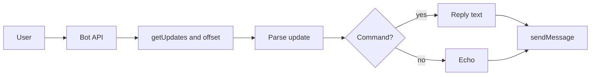

A Telegram bot is a program that talks to users through Telegram's servers. You don't need your own server or a public IP address: Telegram delivers events itself, and the bot just answers HTTP requests. In this lesson we'll write a working bot using the official Bot API and the `requests` library you already know.

## Getting a Token

A bot is controlled by a token — a secret string like `123456:ABC-DEF...`. To get one, message @BotFather in Telegram, send the `/newbot` command, come up with a name and username — and you'll receive a token. Keep the token in an environment variable or a separate file, but never publish it in code.

## First Check: getMe

Any Bot API method is called at `https://api.telegram.org/bot<TOKEN>/<method>`. The simplest method is `getMe`: it tells you about the bot itself:

```python
import requests

TOKEN=[redacted]
url = f"https://api.telegram.org/bot{TOKEN}/getMe"
response = requests.get(url).json()
print(response["result"]["username"])
```

If everything is right, you'll see your bot's username.

## Getting Messages: getUpdates

Any event (a message, a button press) lands in "updates". The `getUpdates` method returns them as a list:

```python
updates = requests.get(url.replace("getMe", "getUpdates")).json()
for u in updates["result"]:
    message = u.get("message", {})
    print(u["update_id"], message.get("chat", {}).get("first_name"),
          message.get("text"))
```

Each update has an `update_id`, and inside there's a `message` with `chat.id` and `text` fields. An important point: for Telegram to treat an update as read, you must pass the `offset` parameter equal to the last processed `update_id` plus one.

## Replying: sendMessage

To send text, call the `sendMessage` method with `chat_id` and `text` parameters:

```python
def send_message(chat_id, text):
    url = f"https://api.telegram.org/bot{TOKEN}/sendMessage"
    payload = {"chat_id": chat_id, "text": text}
    requests.post(url, data=payload)
```

## The Bot Loop

Let's put it all together: the bot polls `getUpdates` with `offset` forever and replies to every message. This is exactly the loop running in millions of bots:

```python
offset = 0
while True:
    r = requests.get(base_url + "getUpdates",
                     params={"offset": offset}).json()
    for u in r["result"]:
        offset = u["update_id"] + 1
        chat_id = u["message"]["chat"]["id"]
        text = u["message"].get("text", "")
        send_message(chat_id, f"You wrote: {text}")
```

Such a bot is called an "echo": it repeats the interlocutor's words. Don't forget pauses: there's no need to poll the server a hundred times per second — add `time.sleep(1)` at the end of the loop, and Telegram will be happy. One more tip: before replying, always check that the message has text (photos or stickers have none), otherwise the bot will crash with a `KeyError`. The scheme is ready — now let's build the bot for real.

The full path of a message through the bot looks like this:



<!--TASK-->
### Task 1
Write a program that calls the `getMe` method of the Bot API and prints two lines: `Name: <first_name>` and `Username: <username>`. Put the token in a `TOKEN` variable (use yours or a placeholder for practice). Use `requests.get(...).json()` and access the `["result"]` key. Expected result: two lines with your bot's name and username, without errors.

### Task 2
Get a list of updates via `getUpdates` and for each update that contains a message text, print a line `update_id: text`. Skip updates without text (e.g., from photos). Expected result: lines like `123456789: Hi!` — one per text message you sent the bot.

### Task 3
Write a function `send_message(chat_id, text)` that sends a message via `sendMessage`. Then take the `chat_id` from the last update (`updates[-1]["message"]["chat"]["id"]`) and send the message `Hi! I'm a bot.` to that chat. Expected result: the message appears in the chat with the bot, and the program prints `Sent to chat <id>`.

### Task 4
Build a full echo bot: a `while True` loop, `getUpdates` with the `offset` parameter, a reply to each message via `send_message`, advancing `offset`, and a `time.sleep(1)` pause. Expected result: every message you write to the bot comes back as `Echo: <your text>`, and no message is processed twice.

### Task 5
Add command handling to the echo bot. On `/start` the bot replies `Hi! I'm a study bot. Type /help`; on `/help` — `Commands: /start, /help. Everything else I repeat as an echo.`; on any other text — an echo. Use `if`/`elif` to route the message text. Expected result: the bot reacts correctly to commands and echoes ordinary messages.

### Task 6
Add inline buttons to the bot. On the `/menu` command, send the message `Choose an action:` with a keyboard of two buttons — `Weather` and `Time` (the `reply_markup` parameter with an `inline_keyboard` field). Handle the press: it arrives not in `message` but in a `callback_query` object with a `data` field (`weather` or `time`). Reply to the press with the `answerCallbackQuery` method, then send `It's sunny today` or the current time. Expected result: `/menu` brings a message with two buttons, and pressing each sends the corresponding answer.

### Task 7
Teach the bot to keep statistics. For every text message, increment a counter in the "username → message count" dictionary, and on `/stats` send a report: the line `Total messages: N` plus one line per user. Save the statistics to `stats.json` after each message and load it at startup (the `json` and `pathlib` modules) so data survives restarts. Expected result: after a restart, `/stats` shows the same numbers as before.
<!--/TASK-->

<!--HINT-->
### Hint 1
Set up `base_url = f"https://api.telegram.org/bot{TOKEN}/"` and append the method name: `requests.get(base_url + "getMe")`. Parse the response with `.json()`, and the needed fields live in `["result"]`: `first_name` and `username`.

### Hint 2
`updates = requests.get(base_url + "getUpdates").json()["result"]` — a list of updates. For each, check `u.get("message", {}).get("text")`: if there's text, print `u["update_id"]` and the text. The `.get()` method with a default protects against updates without a message.

### Hint 3
In `send_message`, send a POST request: `requests.post(base_url + "sendMessage", data={"chat_id": chat_id, "text": text})`. To take the last chat, first get `updates`, then `chat_id = updates[-1]["message"]["chat"]["id"]`.

### Hint 4
Keep an `offset = 0` variable outside the loop. Inside: `requests.get(base_url + "getUpdates", params={"offset": offset})`, then for each update immediately advance `offset = u["update_id"] + 1`. Put the pause at the end of the loop body: `time.sleep(1)` — import `time`.

### Hint 5
First get `text`, then `if text == "/start": ... elif text == "/help": ... else: ...`. In each case call `send_message(chat_id, reply)`. Command logic lives right inside the loop, before the echo branch.

### Hint 6
The keyboard is an ordinary dict: `{"inline_keyboard": [[{"text": "Weather", "callback_data": "weather"}, {"text": "Time", "callback_data": "time"}]]}`. Send it via `requests.post(base_url + "sendMessage", json={"chat_id": chat_id, "text": "Choose an action:", "reply_markup": keyboard})`. The press is in `u.get("callback_query")`: it has `id`, `data`, and `message.chat.id`.

### Hint 7
Load stats like this: `stats = json.loads(Path("stats.json").read_text(encoding="utf-8")) if Path("stats.json").exists() else {}`. After changes call `Path("stats.json").write_text(json.dumps(stats, ensure_ascii=False), encoding="utf-8")`. For the report sort the dict: `sorted(stats.items(), key=lambda kv: -kv[1])`.
<!--/HINT-->

<!--SOLUTION-->
### Solution 1
Solution:

```python
import requests

TOKEN=[redacted]
base_url = f"https://api.telegram.org/bot{TOKEN}/"

data = requests.get(base_url + "getMe").json()["result"]
print("Name:", data["first_name"])
print("Username:", data["username"])
```

Result (example):

```
Name: MyFirstBot
Username: my_first_bot_bot
```

What's going on here? We build the URL from the base address, the token, and the method name. `requests.get(...)` performs an HTTP request, `.json()` turns the response from JSON into a Python dict. The `["result"]` key holds the bot's data: `first_name` and `username`. If the token is wrong, the API returns `ok: false` and an error description — a good way to verify the token works.

### Solution 2
Solution:

```python
import requests

TOKEN=[redacted]
base_url = f"https://api.telegram.org/bot{TOKEN}/"

updates = requests.get(base_url + "getUpdates").json()["result"]
for u in updates:
    message = u.get("message", {})
    text = message.get("text")
    if text:
        print(u["update_id"], ":", text)
```

Result (example):

```
123456789 : Hi!
123456790 : How are you?
```

What's going on here? `getUpdates` returns all accumulated updates. We loop over them, but not all contain a `message` (for example, an edit update), so `u.get("message", {})` gives an empty dict instead of an error. `message.get("text")` returns `None` when there's no text — and in `if text:` both an empty string and `None` are falsy, so they're skipped automatically. This reliably avoids `KeyError`.

### Solution 3
Solution:

```python
import requests

TOKEN=[redacted]
base_url = f"https://api.telegram.org/bot{TOKEN}/"

def send_message(chat_id, text):
    payload = {"chat_id": chat_id, "text": text}
    requests.post(base_url + "sendMessage", data=payload)

updates = requests.get(base_url + "getUpdates").json()["result"]
chat_id = updates[-1]["message"]["chat"]["id"]
send_message(chat_id, "Hi! I'm a bot.")
print("Sent to chat", chat_id)
```

What's going on here? The `send_message` function takes a chat id and text and sends a POST request with those parameters. POST, not GET, because we're creating a message, not reading data. `updates[-1]` is the last update, and we take `chat.id` from it. Note: if there are no updates yet (you haven't written to the bot), `updates` will be empty — write the bot at least one message before running.

### Solution 4
Solution:

```python
import time
import requests

TOKEN=[redacted]
base_url = f"https://api.telegram.org/bot{TOKEN}/"
offset = 0

def send_message(chat_id, text):
    requests.post(base_url + "sendMessage",
                  data={"chat_id": chat_id, "text": text})

while True:
    r = requests.get(base_url + "getUpdates",
                     params={"offset": offset}).json()
    for u in r["result"]:
        offset = u["update_id"] + 1
        chat_id = u["message"]["chat"]["id"]
        text = u["message"].get("text", "")
        send_message(chat_id, f"Echo: {text}")
    time.sleep(1)
```

What's going on here? The `offset` parameter is the key to correct operation. We pass it in the request, and Telegram immediately marks the received updates as read, so the next request won't resend them. After processing each update we immediately advance `offset`, so even an error in the middle of the loop won't process the same message twice. `time.sleep(1)` gives the server a breather. Run it and write the bot a couple of messages — each comes back with the "Echo:" prefix.

### Solution 5
Solution:

```python
import time
import requests

TOKEN=[redacted]
base_url = f"https://api.telegram.org/bot{TOKEN}/"
offset = 0

def send_message(chat_id, text):
    requests.post(base_url + "sendMessage",
                  data={"chat_id": chat_id, "text": text})

while True:
    r = requests.get(base_url + "getUpdates",
                     params={"offset": offset}).json()
    for u in r["result"]:
        offset = u["update_id"] + 1
        chat_id = u["message"]["chat"]["id"]
        text = u["message"].get("text", "")

        if text == "/start":
            reply = "Hi! I'm a study bot. Type /help"
        elif text == "/help":
            reply = "Commands: /start, /help. Everything else I repeat as an echo."
        else:
            reply = f"Echo: {text}"

        send_message(chat_id, reply)
    time.sleep(1)
```

What's going on here? Before sending, we pick the reply with `if`/`elif`/`else`: commands get special texts, everything else goes to the echo. This is the simplest form of message routing — much more complex bots work exactly this way, just with more branches and wrappers. Note that `offset` advances before the reply is sent: even if `send_message` fails, the bot won't loop on the same message. Run the bot and test all three reactions.

### Solution 6
Solution:

```python
import time
import requests

TOKEN=[redacted]
base_url = f"https://api.telegram.org/bot{TOKEN}/"

MENU = {"inline_keyboard": [[
    {"text": "Weather", "callback_data": "weather"},
    {"text": "Time", "callback_data": "time"},
]]}

def send_message(chat_id, text, markup=None):
    payload = {"chat_id": chat_id, "text": text}
    if markup:
        payload["reply_markup"] = markup
    requests.post(base_url + "sendMessage", json=payload)

offset = 0
while True:
    r = requests.get(base_url + "getUpdates", params={"offset": offset}).json()
    for u in r["result"]:
        offset = u["update_id"] + 1

        if "callback_query" in u:
            cb = u["callback_query"]
            chat_id = cb["message"]["chat"]["id"]
            requests.post(base_url + "answerCallbackQuery",
                          data={"callback_query_id": cb["id"]})
            if cb["data"] == "weather":
                send_message(chat_id, "It's sunny today")
            else:
                send_message(chat_id, "It's " + time.strftime("%H:%M"))
            continue

        msg = u.get("message", {})
        chat_id = msg.get("chat", {}).get("id")
        text = msg.get("text", "")
        if chat_id is None or not text:
            continue
        if text == "/menu":
            send_message(chat_id, "Choose an action:", MENU)
        else:
            send_message(chat_id, f"Echo: {text}")

    time.sleep(1)
```

What's going on here? Inline buttons aren't sent by a separate method: they travel together with the message in the `reply_markup` parameter. It's important that we send POST with `json=payload` rather than `data=`: the nested keyboard dict must be serialized to JSON in full, otherwise Telegram won't parse the structure. A press arrives as a separate update type — `callback_query`, which has no `text` field but does have `data` and `id`. Until the bot calls `answerCallbackQuery`, the button shows a loading spinner, so this call goes first. `continue` prevents the press from falling through into ordinary-message handling, where `msg.get("text")` would return an empty string.

### Solution 7
Solution:

```python
import json
import time
import requests
from pathlib import Path

TOKEN=[redacted]
base_url = f"https://api.telegram.org/bot{TOKEN}/"
STATS = Path("stats.json")

def load_stats():
    if STATS.exists():
        return json.loads(STATS.read_text(encoding="utf-8"))
    return {}

def save_stats(stats):
    STATS.write_text(json.dumps(stats, ensure_ascii=False, indent=2),
                     encoding="utf-8")

def send_message(chat_id, text):
    requests.post(base_url + "sendMessage",
                  data={"chat_id": chat_id, "text": text})

stats = load_stats()
offset = 0

while True:
    r = requests.get(base_url + "getUpdates", params={"offset": offset}).json()
    for u in r["result"]:
        offset = u["update_id"] + 1
        msg = u.get("message", {})
        text = msg.get("text", "")
        chat_id = msg.get("chat", {}).get("id")
        if not text or chat_id is None:
            continue

        if text == "/stats":
            lines = [f"Total messages: {sum(stats.values())}"]
            for name, count in sorted(stats.items(), key=lambda kv: -kv[1]):
                lines.append(f"{name}: {count}")
            send_message(chat_id, "\n".join(lines))
            continue

        name = msg["from"].get("first_name", "guest")
        stats[name] = stats.get(name, 0) + 1
        save_stats(stats)
        send_message(chat_id, f"Recorded, {name}. Total: {stats[name]}")

    time.sleep(1)
```

Result (example reply to `/stats`):

```
Total messages: 7
Anna: 5
Igor: 2
```

What's going on here? The counter lives in an ordinary dict, but the dict disappears on restart — so after every change it's written to `stats.json`. The `load_stats` function checks at startup whether the file exists: `Path.exists()` prevents a crash on the first run, when the file doesn't exist yet. `ensure_ascii=False` keeps non-Latin names readable, and `indent=2` makes the file pleasant to look at. The `/stats` command is handled before the increment, and `continue` guarantees the command itself never enters the statistics. Sorting by `-kv[1]` puts the most active users on top, and `sum(stats.values())` gives the total. Such a file is easy to open, edit by hand, and move to another machine — it's the bot's simplest database.
<!--/SOLUTION-->

<!--QUIZ-->
How do you get a token for a Telegram bot?
- Write /start to the bot
- Create a bot via @BotFather and get a token
- Download it from Telegram settings
- No token is needed
* Correct answer: Create a bot via @BotFather and get a token
@BotFather issues a token when you create a new bot with the /newbot command.

Which Bot API method returns incoming messages?
- getMessages
- getUpdates
- receiveMessage
- getChat
* Correct answer: getUpdates
getUpdates returns a list of updates, including new messages.

Why pass the offset parameter to getUpdates?
- To set the message language
- To mark updates as read and avoid receiving them again
- To limit the text length
- To select a chat
* Correct answer: To mark updates as read and avoid receiving them again
offset = last processed update_id + 1, and Telegram won't send those updates again.

Which method sends text to the user?
- sendMessage
- sendText
- replyMessage
- pushMessage
* Correct answer: sendMessage
sendMessage takes chat_id and text and delivers the message to the chat.

Where do you get the id of the chat to reply to?
- From the bot's token
- From the message.chat.id field of an update
- From the username
- The server passes it itself
* Correct answer: From the message.chat.id field of an update
Every message contains chat.id — the chat's address for the reply.

What happens if you poll Telegram without pauses?
- Nothing bad
- You can hit limits and get blocked for flooding
- Replies become faster
- Messages arrive twice
* Correct answer: You can hit limits and get blocked for flooding
A reasonable time.sleep(1) pause between polls is good manners and protection from blocking.

Where should the bot's token be stored?
- In an environment variable or a separate file, not published in code
- Right in the program text
- In the bot's username
- In the page URL
* Correct answer: In an environment variable or a separate file, not published in code
A publicly exposed token lets strangers control your bot.

Why check for text before accessing u["message"]["text"]?
- Photos and stickers have no text, and without the check you can hit a KeyError
- To speed up message processing
- Because the text field is always present
- To save Telegram traffic
* Correct answer: Photos and stickers have no text, and without the check you can hit a KeyError
Use message.get("text", "") or an if text: check — then the bot won't crash on service events.

Which HTTP method sends a message through the Bot API?
- GET
- POST
- PUT
- DELETE
* Correct answer: POST
sendMessage creates a message on Telegram's side, so POST is used with chat_id and text parameters.

What does the "ok": false field in a Bot API response mean?
- The message was delivered
- The request failed; the reason is described in the description field
- The bot is blocked forever
- The request needs to be repeated without a token
* Correct answer: The request failed; the reason is described in the description field
Bot API always returns ok, and when it's false it's useful to print description — otherwise the error looks like an "empty" response.

Where in an update does an inline button press live?
- In the message.text field
- In the callback_query object
- In the offset field
- In the result field
* Correct answer: In the callback_query object
A press arrives as a callback_query with id, data, and message.chat.id fields — you answer it with answerCallbackQuery.

How is a webhook different from getUpdates?
- A webhook delivers updates to a specified URL by itself, while getUpdates requires constant polling
- A webhook only works in a browser
- getUpdates is faster and has no limits
- They are the same thing
* Correct answer: A webhook delivers updates to a specified URL by itself, while getUpdates requires constant polling
setWebhook removes the polling loop but requires a public HTTPS address reachable from the internet.
<!--/QUIZ-->
