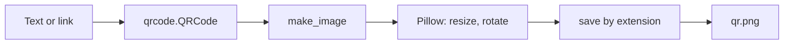

A QR code is a square picture of black and white modules with information encoded inside: a link, text, contacts. The world around us is full of QR codes: cafe menus, tickets, payments. Today we'll learn to generate them ourselves, and along the way master basic image-processing operations.

## Installing Libraries

We need two libraries:

```bash
pip install qrcode pillow
```

`qrcode` handles QR, and Pillow (PIL) handles images.

## Generating a QR Code

The simplest thing is the `make()` function, which immediately returns a finished picture:

```python
import qrcode

img = qrcode.make("https://example.com")
img.save("qr.png")
```

That's it! The file `qr.png` will appear next to the script. It's already scannable with a phone — try it.

## Customization

The library lets you control size, border, colors, and the level of damage protection:

```python
qr = qrcode.QRCode(
    version=1,            # size (1–40), 1 is the smallest
    box_size=10,          # size of one module in pixels
    border=4,             # width of the white border
    error_correction=qrcode.constants.ERROR_CORRECT_H,  # high reliability
)
qr.add_data("https://example.com")
qr.make(fit=True)

img = qr.make_image(fill_color="darkblue", back_color="white")
img.save("qr_styled.png")
```

## Learning Pillow

Pillow is the de facto standard for "heavy" image work. Open a picture and look at its properties:

```python
from PIL import Image

img = Image.open("qr.png")
print(img.format, img.size, img.mode)   # PNG (290, 290) RGB
```

- `format` — the file format (PNG, JPEG...);
- `size` — size in pixels (width, height);
- `mode` — color model (RGB, L — grayscale, etc.).

Resize and save in another format:

```python
small = img.resize((150, 150))
small.save("qr_small.jpg")
```

Here's the smart way to shrink a picture while keeping proportions — `thumbnail()`:

```python
thumb = img.copy()
thumb.thumbnail((100, 100))
thumb.save("qr_thumb.png")
```

The difference: `resize()` stretches exactly to the given size, while `thumbnail()` shrinks while preserving proportions and never enlarges. We can also convert the image to grayscale and rotate it:

```python
gray = img.convert("L")
gray.save("qr_gray.png")

rotated = img.rotate(90, expand=True)
rotated.save("qr_rotated.png")
```

This is the minimal set of operations covering most everyday image tasks.

The route of a picture from a string to a file on disk:



<!--TASK-->
### Task 1
Generate a QR code with any text or link (for example, `https://python.org`) and save it to `qr.png` via `qrcode.make(...).save(...)`. Check that the file appeared next to the script. Expected result: a successfully created `qr.png` that scans with a phone.

### Task 2
Create a stylized QR code: a `QRCode` object with `box_size=12`, `border=6`, `error_correction=ERROR_CORRECT_H`, and data `https://example.com`. Make an image with `fill_color="darkblue"` and `back_color="white"`, save it as `qr_styled.png`. Expected result: a new file with a blue code and a wide border, clearly different from the regular one.

### Task 3
Open `qr.png` via `PIL.Image.open` and print its format, size, and mode, plus the absolute path via `Path("qr.png").resolve()`. Expected result: lines like `Format: PNG`, `Size: (290, 290)`, `Mode: RGB`, and the full path.

### Task 4
Make a thumbnail of the QR code: open `qr.png`, copy the image with `copy()`, apply `thumbnail((150, 150))`, and save it as `qr_thumb.png`. Check that the proportions are preserved. Expected result: a new file no larger than 150×150 pixels, and the code still reads.

### Task 5
Create a transformed QR code: open `qr.png`, convert to grayscale with `convert("L")`, rotate 45° with `expand=True`, and save the result as `qr_gray_rotated.png`. Expected result: a grayscale tilted code whose corners aren't cut off.

### Task 6
Insert a logo into the center of the QR code. Generate a code with `error_correction=ERROR_CORRECT_H` and a size of at least 400×400 pixels, open the `logo.png` image, shrink it to 80×80, and paste it in the center via `img.paste(logo, (x, y), logo)`, using the image itself as the transparency mask. Calculate the center coordinates from the sizes rather than hardcoding numbers. Save the result as `qr_logo.png`. Expected result: the code with a centered logo still scans with a phone, and the logo doesn't overflow the bounds.

### Task 7
Make a batch processor: go through all `*.png` files in the `source` folder, create a thumbnail with a maximum side of 128 pixels for each, and save it into a `thumbs` subfolder with the same name. Skip files that fail to open and print `Skipping: <name>`. At the end print `Processed: N, skipped: M`. Expected result: `thumbs` gets reduced copies of all normal pictures, and a broken file doesn't crash the program.
<!--/TASK-->

<!--HINT-->
### Hint 1
In one line: `qrcode.make("https://python.org").save("qr.png")`. Don't forget `import qrcode`. If the file was created but you have nothing to open it with — just look into the script's folder.

### Hint 2
Create a `QRCode` object with parameters: `qr = qrcode.QRCode(version=1, box_size=12, border=6, error_correction=qrcode.constants.ERROR_CORRECT_H)`. Then `qr.add_data("https://example.com")`, `qr.make(fit=True)`, and `img = qr.make_image(fill_color="darkblue", back_color="white")`, then `img.save("qr_styled.png")`.

### Hint 3
`img = Image.open("qr.png")` — then read three attributes: `img.format`, `img.size`, `img.mode`. Path: `from pathlib import Path; print(Path("qr.png").resolve())`.

### Hint 4
Important: `thumbnail()` modifies the object in place and returns nothing, so first make a copy: `thumb = img.copy()`, then `thumb.thumbnail((150, 150))` and `thumb.save("qr_thumb.png")`. Don't call thumbnail on the original if you still need it.

### Hint 5
Work in a chain: `img = Image.open("qr.png").convert("L")`, then `gray = img.rotate(45, expand=True)` and `gray.save("qr_gray_rotated.png")`. `expand=True` enlarges the canvas so the corners aren't cut off when rotating.

### Hint 6
First bring the code to the needed size: `img = qr.make_image(...).convert("RGB")`, then `img = img.resize((400, 400), Image.NEAREST)` — `NEAREST` doesn't blur the module edges. Logo: `logo = Image.open("logo.png")`, `logo.thumbnail((80, 80))`. Center coordinates: `((400 - logo.width) // 2, (400 - logo.height) // 2)`. The third `paste` argument is a mask; for a PNG with transparency `logo` itself works.

### Hint 7
`for path in Path("source").glob("*.png")` — walking through files. Inside, `try: img = Image.open(path); img.load()`, and in `except (OSError, ValueError)` — skip. Make the copy via `img.copy()`, because `thumbnail()` modifies the object in place. Create the folder in advance: `Path("thumbs").mkdir(exist_ok=True)`.
<!--/HINT-->

<!--SOLUTION-->
### Solution 1
Solution:

```python
import qrcode

qrcode.make("https://python.org").save("qr.png")
```

What's going on here? `qrcode.make(data)` is a handy shortcut function: it creates a `QRCode` object with default parameters, adds the data, builds the code, and returns a ready image (a Pillow object). Then the `save()` method writes it to a file, and the format is determined by the extension: `qr.png` — PNG. You can pass any string: a URL, text, a vCard business card. Note: `make_img` is a real function of the qrcode library, and it's exactly this one-liner that thousands of projects use.

### Solution 2
Solution:

```python
import qrcode

qr = qrcode.QRCode(
    version=1,
    box_size=12,
    border=6,
    error_correction=qrcode.constants.ERROR_CORRECT_H,
)
qr.add_data("https://example.com")
qr.make(fit=True)

img = qr.make_image(fill_color="darkblue", back_color="white")
img.save("qr_styled.png")
```

What's going on here? Constructor parameters control the look: `box_size` — the size of one module (square) in pixels, `border` — the width of the white border around the code, `error_correction` — the amount of redundant data for recovery from damage (H — maximum reliability). `make(fit=True)` picks the code version automatically to fit the data volume. `make_image` accepts colors: `fill_color` — the color of the modules themselves, `back_color` — the background. This is how you match a QR to a brand style.

### Solution 3
Solution:

```python
from pathlib import Path
from PIL import Image

img = Image.open("qr.png")
print("Format:", img.format)
print("Size:", img.size)
print("Mode:", img.mode)
print("Path:", Path("qr.png").resolve())
```

Result (example):

```
Format: PNG
Size: (290, 290)
Mode: RGB
Path: D:\projects\qr.png
```

What's going on here? `Image.open()` doesn't load the whole image into memory right away — it only opens the file and reads the header, so format and size are known instantly even for huge photos. `size` is a `(width, height)` tuple. `mode` reports the color model: `RGB` — color, `L` — grayscale. And `Path.resolve()` turns a relative path into an absolute one, removing `..` and symlinks.

### Solution 4
Solution:

```python
from PIL import Image

img = Image.open("qr.png")
thumb = img.copy()
thumb.thumbnail((150, 150))
thumb.save("qr_thumb.png")

print("Original:", img.size)
print("Thumbnail:", thumb.size)
```

Result (example):

```
Original: (290, 290)
Thumbnail: (150, 150)
```

What's going on here? `copy()` makes an independent copy so the original isn't spoiled, because `thumbnail()` modifies the object in place and returns nothing. The `(150, 150)` parameter is the maximum footprint: the method shrinks the image down to 150×150 while preserving proportions, and if the source is already smaller it simply does nothing. Unlike `resize()`, it never stretches or distorts. A QR code tolerates this kind of shrinking perfectly and stays scannable.

### Solution 5
Solution:

```python
from PIL import Image

img = Image.open("qr.png").convert("L")
rotated = img.rotate(45, expand=True)
rotated.save("qr_gray_rotated.png")
print("New file saved:", rotated.size)
```

What's going on here? `convert("L")` converts the image to grayscale: each pixel gets one brightness channel from 0 (black) to 255 (white). `rotate(45, expand=True)` rotates the picture 45° counterclockwise; with `expand=True` the canvas grows so the rotated image fits entirely without cutting corners. Without `expand`, the size would stay the same and the code's corners would vanish. We save the result under a new name — the original `qr.png` is untouched.

### Solution 6
Solution:

```python
import qrcode
from PIL import Image

qr = qrcode.QRCode(
    box_size=10,
    border=4,
    error_correction=qrcode.constants.ERROR_CORRECT_H,
)
qr.add_data("https://python.org")
qr.make(fit=True)

img = qr.make_image(fill_color="black", back_color="white").convert("RGB")
img = img.resize((400, 400), Image.NEAREST)

logo = Image.open("logo.png")
logo.thumbnail((80, 80))

x = (img.width - logo.width) // 2
y = (img.height - logo.height) // 2
img.paste(logo, (x, y), logo)
img.save("qr_logo.png")
print("Done:", img.size)
```

What's going on here? The `ERROR_CORRECT_H` level reserves about 30% of the area for recovery data — this margin is exactly what lets you cover the center with a logo without losing readability. `convert("RGB")` is needed because `make_image` returns a palette image, while `paste` with a mask requires RGB or RGBA. `resize(..., Image.NEAREST)` enlarges the picture with the nearest-neighbor method: module edges stay sharp, whereas smoothing would blur the squares and confuse the scanner. `thumbnail((80, 80))` fits the logo into an 80×80 square while preserving proportions. Coordinates are computed from the sizes, so the code works for any image dimensions. The third `paste` argument is a mask: transparent logo pixels don't erase the code underneath them.

### Solution 7
Solution:

```python
from pathlib import Path
from PIL import Image

source = Path("source")
thumbs = Path("thumbs")
thumbs.mkdir(exist_ok=True)

done = 0
skipped = 0

for path in sorted(source.glob("*.png")):
    try:
        img = Image.open(path)
        img.load()          # force-decode the file
    except (OSError, ValueError):
        print("Skipping:", path.name)
        skipped += 1
        continue

    small = img.copy()
    small.thumbnail((128, 128))
    small.save(thumbs / path.name)
    done += 1
    print("Done:", path.name, small.size)

print(f"Processed: {done}, skipped: {skipped}")
```

Result (example):

```
Done: qr.png (128, 128)
Skipping: broken.png
Processed: 1, skipped: 1
```

What's going on here? `Image.open` is lazy: it reads only the header and doesn't validate the contents, so a broken file may "open" without an error. The `img.load()` call forces Pillow to decode the pixels — this is exactly where a broken file raises `OSError`. `glob("*.png")` takes only files of this type, and `sorted` gives a predictable output order. `copy()` is mandatory: `thumbnail()` modifies the object in place and returns `None`. Saving to `thumbs / path.name` keeps the names, so results are easy to match with sources. The `done` and `skipped` counters give a short report showing at a glance whether everything went smoothly.
<!--/SOLUTION-->

<!--QUIZ-->
What does qrcode.make("text") do?
- Prints the text to the console
- Returns a QR code image
- Creates a text file
- Checks a link
* Correct answer: Returns a QR code image
make() builds the code and returns an image object that you can save with save().

What does version=1 in QRCode mean?
- The smallest code size
- The largest code size
- The library version
- The number of colors
* Correct answer: The smallest code size
version sets the code size from 1 (small) to 40 (large).

How is thumbnail() different from resize() in Pillow?
- thumbnail() preserves proportions and doesn't enlarge the image
- thumbnail() only enlarges the image
- resize() preserves proportions
- It isn't
* Correct answer: thumbnail() preserves proportions and doesn't enlarge the image
resize() stretches exactly to the given size, while thumbnail() fits within a maximum, preserving proportions.

What does img.size return?
- A string with the file name
- A (width, height) tuple
- The number of colors
- The file format
* Correct answer: A (width, height) tuple
size is a tuple of two numbers: width and height in pixels.

What does convert("L") do?
- Converts the image to grayscale
- Rotates the image
- Enlarges the image
- Changes the file format
* Correct answer: Converts the image to grayscale
Mode L means luminance: one channel from 0 to 255.

Why does rotate() need the expand=True parameter?
- To rotate clockwise
- So the canvas grows and corners aren't cut off
- To save as JPEG
- To speed things up
* Correct answer: So the canvas grows and corners aren't cut off
With expand=True the canvas size adapts to the rotated image.

What does error_correction=ERROR_CORRECT_H mean?
- A high level of code protection from damage
- The maximum possible code size
- A colored code image
- Automatic version selection
* Correct answer: A high level of code protection from damage
The higher the correction level, the more redundant data and the more robust the QR is against damage.

Why does the format become JPEG after img.resize((150, 150)) and saving to qr_small.jpg?
- Because save() picks the format by the file extension
- Because resize() changes the image format
- Because Pillow always saves JPEG
- Because the format is set in Image.open()
* Correct answer: Because save() picks the format by the file extension
The .jpg and .jpeg extensions mean JPEG, .png means PNG; the file format is determined by it.

What does img.copy() do in Pillow?
- Creates an independent copy of the image
- Copies the file to disk
- Changes the image size
- Reopens the file
* Correct answer: Creates an independent copy of the image
The copy is needed because thumbnail() and paste() modify the object in place, and the original is often still needed.

What happens when trying to save an RGBA image as JPEG?
- The file saves with transparency
- Pillow raises an error because JPEG doesn't support an alpha channel
- The image becomes grayscale
- Nothing; the format is determined automatically
* Correct answer: Pillow raises an error because JPEG doesn't support an alpha channel
Before saving as JPEG, remove transparency: img.convert("RGB") or paste onto a white background.

What is the box_size parameter in qrcode.QRCode responsible for?
- The size of one code module in pixels
- The width of the white border
- The correction level
- The number of characters
* Correct answer: The size of one code module in pixels
The final size is the number of modules times box_size, plus the border.

Why pass a third argument in img.paste(logo, (x, y), logo)?
- To specify a transparency mask
- To specify the file format
- To rotate the logo
- To change the logo size
* Correct answer: To specify a transparency mask
The mask decides which logo pixels are applied and which stay transparent.
<!--/QUIZ-->
