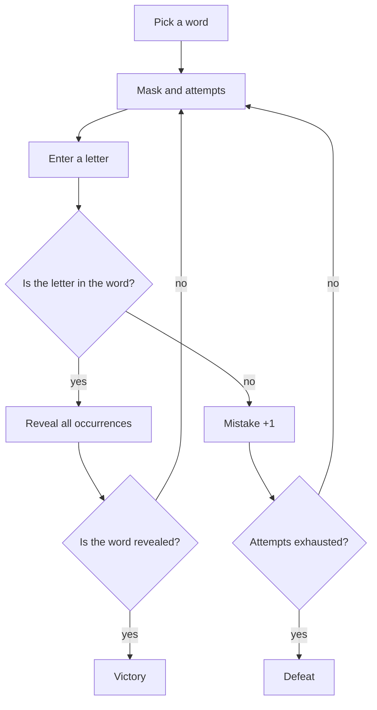

This lesson has no regular material presentation — this is an independent work assignment. You already know the basics: variables and types, conditions, loops, lists and strings, functions, and the `random` module. Now you need to put all of it together into one real program — the game "Hangman". The goal is to complete five stages, and at each stage you get a small, complete, checkable piece of the program. Do not move to the next stage until the current one works: this way you will never drown in debugging a large system all at once.

## Problem statement

The classic "Hangman": the computer picks a word, and the player names letters. If the letter is in the word, it is revealed in all its positions; if not, the player loses an attempt. The game ends when all letters are revealed (victory) or when attempts run out (defeat). The game's name comes from the traditional drawing that is added to with each mistake; we don't have to draw the stick figure — counting mistakes and showing their number is enough.

What you will learn. First, decomposition: a big task is broken into independent functions, each easy to check on its own. Second, careful handling of user input: the player may enter a digit, an empty string, a letter in a different case, or a letter that was already named. A good program politely handles all these cases. Third, you will practice checking your own code: after each stage, run the program and deliberately try to "break" it with unexpected inputs.

## Program requirements

- A word list — at least 20 nouns in the nominative case; the hidden word is chosen randomly on each run.
- The player enters one letter at a time. Case does not matter: "а" and "А" are the same letter. Only Russian alphabet letters are expected.
- After each move, the screen shows: the current word mask (revealed letters in their places, the rest as underscores), a list of already named letters, and the number of remaining attempts.
- A repeated letter does not cost an attempt — the game only reports that this letter was already named.
- 7 attempts total. All 7 lost — defeat and a reveal of the hidden word; all letters revealed — victory.
- After a game ends, the program offers to play again (y/n) and terminates correctly on "n".
- The program must be split into functions: at minimum word selection, state display, letter handling, and the main game loop. This requirement is checked during grading.

The game loop diagram — handy for checking your code against it:



## How to work on the assignment

Complete the stages in order in a single `hangman.py` file, gradually adding to it. Save a working version after each stage. If something breaks — return to the last working version and find the change that broke everything. Before submitting, run the full set of scenarios: victory, defeat, a repeated letter, entering a digit, and an empty string.

## Assessment criteria (10 points)

| Criterion | Points |
|---|---|
| The program runs without errors and terminates correctly | 2 |
| Random selection from a list of at least 20 words | 1 |
| Mask and its update, list of named letters, attempt counter | 2 |
| Handling of repeats, invalid and empty input | 2 |
| Victory and defeat conditions, showing the word, replay | 2 |
| Code split into functions, readable, with comments | 1 |

Passing grade — from 7 points.

## What to submit

- The file `hangman.py` (full working version after stage 5).
- A comment at the top of the file: how to run the program, what functions it has, what you would improve.
- Example output of two games (as text in `examples.txt` or in comments): one win and one loss.
- The lesson quiz on the platform (8 questions).

<!--TASK-->
### Task 1

Start with the foundation. Create a list `words` of at least 20 Russian nouns (for example, «питон», «окно», «гора», «лампа», «река»). Write a function `choose_word(words)` that returns a random word using `random.choice`. In the main part of the program, print the hidden word and its mask: `N` underscores separated by spaces. Run the program several times and make sure the word changes. Expected output: `Слово из 5 букв: _ _ _ _ _`.

### Task 2

Implement two display functions. `word_to_mask(word, guessed)` returns a string like `п и _ _ _`: revealed letters sit in their places, the rest are replaced with `_`. `show_status(word, guessed, mistakes, max_mistakes)` prints the mask, the sorted named letters, and the number of remaining attempts. Store letters in a set `guessed` (type `set`) — this eliminates duplicates. Check manually: for the word «питон» and the set `{"п", "и"}` the mask must be `п и _ _ _`, and with `mistakes=2` and `max_mistakes=7` the remaining attempts are 5.

### Task 3

Make input handling. The function `process_input(raw)` returns a tuple `(ok, letter)`: it strips spaces, lowercases, and checks that it is exactly one Russian alphabet letter (`'а' <= ch <= 'я'`); otherwise it returns `(False, "")` with an error message. The function `apply_letter(letter, word, guessed)` returns `False` if the letter is already in `guessed` (message «Такая буква уже была»), otherwise adds it and returns `True`. Test the inputs: `"А"`, `"а"`, `"0"`, `""`, `"аб"`.

### Task 4

Add the game logic: while not won and `mistakes < max_mistakes`, print the status, get a letter, handle the input (invalid — re-ask), on a repeat just continue; if the letter is not in the word — increase `mistakes`. Victory occurs when all letters of the word are in `guessed` (check `set(word) <= guessed`). After exiting the loop, print the result and the hidden word. Test both branches: guess all letters; make 7 mistakes.

### Task 5

Put everything together into a single program. The function `play_game()` plays one game and returns `(won, attempts)`. The main block, in a loop, asks «Сыграем ещё раз? (д/н)»: «д» — new game, «н» — exit, any other answer — re-ask. At the end, print session statistics: how many games were played, how many wins, and the average number of moves per game. Make sure the program does not crash on any input.

### Task 6

Show the player how much they have already lost. Create a list `GALLOWS` of eight frames — from an empty post to a fully drawn stick figure. Each frame is a list of strings from which `draw_gallows(mistakes)` assembles a multi-line drawing via `"\n".join(...)`: at `mistakes=0` only the post and base are visible, at `mistakes=3` the crossbar, rope, and head are added, at `mistakes=7` — arms and legs. Call the function from `show_status` before the word mask. Expected output at three mistakes: a drawing of six lines, then `Слово: п и _ _ _` and `Осталось попыток: 4`.

### Task 7

Make game results persistent. After each game, save a record `{"word": ..., "won": ..., "attempts": ..., "date": ...}` into `stats.json` with the structure `{"games": [...]}`. Write `load_stats(path)` (no file or broken JSON — empty stats), `save_stats(stats, path)` (write with `ensure_ascii=False` and `indent=2`), and `best_games(stats, n=3)` — the three best wins ordered by the number of moves ascending. At the end of the session, print a leaderboard table with place, word, moves, and date. Expected output: `1. гора — 4 хода (12.11.2026)`, two more lines below; on the next run, previous games are already accounted for.

<!--/TASK-->

<!--HINT-->
### Hint 1

A list is created with an ordinary literal: `words = ["питон", "окно", ...]`. For random selection, import the module: `import random`, then `random.choice(words)`. It's convenient to build the mask with a list comprehension: `"_" if letter not in guessed else letter for letter in word`, and join it with `" ".join(...)`.

### Hint 2

A set is declared like this: `guessed = set()`, adding — `guessed.add("п")`. For sorting letters when printing, use `sorted(guessed)`. The remaining attempts are computed as `max_mistakes - mistakes`. Don't forget: `word_to_mask` must return a string, while `show_status` must print it.

### Hint 3

First normalize the input: `raw.strip().lower()`. Then check the length: `len(ch) != 1` — error. For Cyrillic, compare with the range: `'а' <= ch <= 'я'` — this works because letters have consecutive code points. Check for a repeat with the `in` operator on the set.

### Hint 4

The game loop: `while not won and mistakes < max_mistakes:`. The victory check is `set(word) <= guessed` (all letters of the word are contained in the set of named ones). Don't forget to print the result after the loop, for example: `"Вы выиграли! Слово: ..."` or `"Вы проиграли. Было загадано: ..."`.

### Hint 5

The main loop: `while True:` with the prompt «Сыграем ещё раз? (д/н)» and `break` on «н». Collect statistics in variables outside the loop: `games += 1`, `wins += int(won)`, `total_attempts += attempts`. The average number of moves is `total_attempts / games`.

### Hint 6

Store a frame as a list of strings rather than one long string: `GALLOWS = [[...], [...]]`, then `"\n".join(GALLOWS[i])` gives a ready-made drawing without manual line breaks. The frame index is the number of mistakes: `GALLOWS[min(mistakes, len(GALLOWS) - 1)]`. `min` protects against going out of bounds if you later change the number of attempts. Print the drawing with a separate `print(draw_gallows(mistakes))` — the lines are already separated by newlines.

### Hint 7

Reading with a default: `try: json.load(f) except (FileNotFoundError, json.JSONDecodeError): return {"games": []}`. Filter wins with a list comprehension: `wins = [g for g in stats["games"] if g["won"]]`, then `sorted(wins, key=lambda g: g["attempts"])[:n]`. Take the date with `datetime.now().strftime("%d.%m.%Y")`. Writing — `json.dump(stats, f, ensure_ascii=False, indent=2)`; open the file in mode `"w"` so you don't append a second JSON to the same file.

<!--/HINT-->

<!--SOLUTION-->
### Solution 1

```python
import random

words = [
    "питон", "окно", "гора", "лампа", "река",
    "берёза", "океан", "город", "зима", "книга",
    "луна", "молоко", "песок", "радуга", "солнце",
    "туман", "фонарь", "холод", "цветок", "школа",
]

def choose_word(words):
    return random.choice(words)

word = choose_word(words)
print(f"Слово из {len(word)} букв: {'_ ' * len(word)}")
```

A list of 20 words guarantees variety across games. `random.choice` returns one random element — that is the hidden word. At this stage the mask is just a string of `_` repeated as many times as there are letters in the word: `"_ " * len(word)` yields `_ _ _ _ _` with a trailing space.

### Solution 2

```python
def word_to_mask(word, guessed):
    return " ".join("_" if letter not in guessed else letter for letter in word)

def show_status(word, guessed, mistakes, max_mistakes):
    print("Слово:", word_to_mask(word, guessed))
    print("Буквы:", " ".join(sorted(guessed)))
    print(f"Осталось попыток: {max_mistakes - mistakes}")

# Проверка
guessed = {"п", "и"}
show_status("питон", guessed, 2, 7)
```

The list comprehension iterates over each letter of the word and substitutes it if it is in `guessed`, otherwise `_`. `" ".join(...)` joins the characters with spaces. `sorted(guessed)` sorts the named letters alphabetically so the list has order. `show_status` collects all output in one place — this will come in handy in the game loop.

### Solution 3

```python
def process_input(raw):
    ch = raw.strip().lower()
    if len(ch) != 1 or not ('а' <= ch <= 'я'):
        print("Введи одну букву русского алфавита.")
        return False, ""
    return True, ch

def apply_letter(letter, word, guessed):
    if letter in guessed:
        print("Такая буква уже была.")
        return False
    guessed.add(letter)
    return True
```

`strip()` removes stray spaces, `lower()` handles case, so «А» and «а» are treated the same. The check `len(ch) != 1` rejects the empty string and multi-character inputs like «аб», and the range `'а' <= ch <= 'я'` rejects digits and Latin letters. `apply_letter` first checks for a repeat: if the letter is already in the set, we return `False` and don't change state; otherwise we add the letter.

### Solution 4

```python
def play_game():
    word = choose_word(words)
    guessed = set()
    mistakes = 0
    max_mistakes = 7

    while set(word) > guessed and mistakes < max_mistakes:
        show_status(word, guessed, mistakes, max_mistakes)
        ok, letter = process_input(input("Твоя буква: "))
        if not ok:
            continue
        if not apply_letter(letter, word, guessed):
            continue
        if letter not in word:
            mistakes += 1

    if set(word) <= guessed:
        print(f"Победа! Слово: {word}")
    else:
        print(f"Поражение. Было загадано: {word}")
```

The loop condition: play while not all letters are revealed and attempts remain. `process_input` returns `(False, "")` on bad input — just `continue`, without punishment. If the letter is a repeat — also `continue`. Only if the letter is not in the word does `mistakes` grow. The check `set(word) <= guessed` is strict inclusion: victory when every letter of the word is among the named ones.

### Solution 5

```python
def play_game():
    # ... код из предыдущего этапа, только добавим подсчёт ходов
    attempts = 0
    while set(word) > guessed and mistakes < max_mistakes:
        attempts += 1
        # ...
    return set(word) <= guessed, attempts

games = 0
wins = 0
total_attempts = 0

while True:
    won, attempts = play_game()
    games += 1
    wins += int(won)
    total_attempts += attempts
    answer = input("Сыграем ещё раз? (д/н) ").strip().lower()
    if answer == "н":
        break
    if answer != "д":
        print("Ответь д или н.")

print(f"Сыграно партий: {games}, побед: {wins}, среднее число ходов: {total_attempts / games:.1f}")
```

`play_game()` now returns the game result and the number of moves — this makes the function pure and testable. The main loop handles any answer: strictly «н» ends the game, «д» starts a new game, anything else gets a re-prompt. The final statistics draw the line: you see both the last session's result and your overall skill.

### Solution 6

```python
GALLOWS = [
    ["  |", "  |", "  |", "  |", "  |", "====="],
    ["  +---+", "  |", "  |", "  |", "  |", "====="],
    ["  +---+", "  |   |", "  |", "  |", "  |", "====="],
    ["  +---+", "  |   |", "  O   |", "  |", "  |", "====="],
    ["  +---+", "  |   |", "  O   |", "  |   |", "  |", "====="],
    ["  +---+", "  |   |", "  O   |", " -|-  |", "  |", "====="],
    ["  +---+", "  |   |", "  O   |", " -|-  |", "  |   |", "====="],
    ["  +---+", "  |   |", "  O   |", " -|-  |", "  | | |", "====="],
]


def draw_gallows(mistakes):
    frame = GALLOWS[min(mistakes, len(GALLOWS) - 1)]
    return "\n".join(frame)


def show_status(word, guessed, mistakes, max_mistakes):
    print(draw_gallows(mistakes))
    print("Слово:", word_to_mask(word, guessed))
    print("Буквы:", " ".join(sorted(guessed)))
    print(f"Осталось попыток: {max_mistakes - mistakes}")


show_status("питон", {"п", "и"}, 3, 7)
```

Eight frames — exactly for the "seven attempts" rule: index 0 corresponds to the start of the game, index 7 to the last mistake. Storing a frame as a list of strings is more convenient than one string with line breaks: individual drawing elements are easier to edit, and `"\n".join(...)` assembles them into a ready block. `min(...)` is a safeguard: if mistakes exceed the number of frames, the function returns the last frame instead of an `IndexError`. Calling it inside `show_status` gives the player feedback: they see that each mistake adds something, and the drawing itself works as a counter. Note the equal line widths: the drawing doesn't "jitter" when frames change. Check all eight values in a loop `for m in range(8)` — the whole sequence from post to stick figure should pass on screen.

### Solution 7

```python
import json
from datetime import datetime

STATS_PATH = "stats.json"


def load_stats(path=STATS_PATH):
    try:
        with open(path, encoding="utf-8") as f:
            return json.load(f)
    except (FileNotFoundError, json.JSONDecodeError):
        return {"games": []}


def save_stats(stats, path=STATS_PATH):
    with open(path, "w", encoding="utf-8") as f:
        json.dump(stats, f, ensure_ascii=False, indent=2)


def plural(n, one, few, many):
    if n % 10 == 1 and n % 100 != 11:
        return one
    if 2 <= n % 10 <= 4 and not 12 <= n % 100 <= 14:
        return few
    return many


def best_games(stats, n=3):
    wins = [g for g in stats["games"] if g["won"]]
    return sorted(wins, key=lambda g: g["attempts"])[:n]


def record_game(word, won, attempts, path=STATS_PATH):
    stats = load_stats(path)
    stats["games"].append({
        "word": word,
        "won": won,
        "attempts": attempts,
        "date": datetime.now().strftime("%d.%m.%Y"),
    })
    save_stats(stats, path)


def print_records(stats):
    print("Таблица рекордов:")
    for i, game in enumerate(best_games(stats), 1):
        word = plural(game["attempts"], "ход", "хода", "ходов")
        print(f"{i}. {game['word']} — {game['attempts']} {word} ({game['date']})")


record_game("гора", True, 4)
record_game("лампа", True, 6)
record_game("окно", False, 7)
print_records(load_stats())
```

`stats.json` stores a single object with the key `games`, not a bare list: this way you can later add settings or a session counter without breaking the format. `load_stats` returns default stats when the file is missing and when the JSON is corrupted — the first run must not crash. `save_stats` opens the file in mode `"w"`: we write the whole object each time, otherwise two JSONs would end up in the file one after another. `record_game` first reads, then appends a record and saves — data survives the program closing. `best_games` selects only wins and sorts by the number of moves: a record is a fast guess, not a long game. The `plural` function picks the right word form so the table reads naturally in Russian: «4 хода», «6 ходов».

<!--/SOLUTION-->

<!--QUIZ-->
What does random.choice(["питон", "окно"]) return?
- «питон»
- «окно»
- Any single element of the list
- Both words as a list
* Correct answer: Any single element of the list
random.choice returns one random element of a sequence — exactly which one is unknown in advance.

What does the expression "Питон".lower() do?
- Returns «питон»
- Returns «ПИТОН»
- Raises an error: no such method
- Modifies the string in place
* Correct answer: Returns «питон»
The lower() method returns a lowercase copy of the string; the original string does not change, since strings in Python are immutable.

Which condition checks that string ch is exactly one Russian alphabet letter?
- len(ch) == 1 and 'а' <= ch <= 'я'
- ch.isalpha()
- ord(ch) > 1000
- len(ch) >= 1
* Correct answer: len(ch) == 1 and 'а' <= ch <= 'я'
isalpha() would let both «яя» and Latin through; only the combination of length and range gives an exact check.

Why store named letters in a set rather than a list?
- A set automatically discards duplicates
- A set preserves insertion order
- Iteration is faster in a set
- It doesn't matter
* Correct answer: A set automatically discards duplicates
Adding an already existing letter to a set again changes nothing, so the repeat check becomes trivial.

How to check that all letters of the word are guessed?
- all(b in guessed for b in word)
- any(b in guessed for b in word)
- len(word) == len(guessed)
- word == ''.join(sorted(guessed))
* Correct answer: all(b in guessed for b in word)
all() returns True only if every letter of the word is present in the set of named letters.

What will print("питон".count("н")) output?
- 1
- 2
- 0
- An error
* Correct answer: 1
The letter «н» occurs in the word «питон» exactly once, and that is the number count() returns.

What happens when the letter «б», which is not in the word «питон», is entered?
- A program error
- The letter is added to the named ones, mistakes increase
- Nothing happens
- The game ends instantly
* Correct answer: The letter is added to the named ones, mistakes increase
The letter is recorded among the named ones, and the mistake counter grows — the player sees their failed attempts.

How to end the program after the answer «н» to the question «Сыграем ещё раз?»?
- break out of the game loop
- sys.exit(0)
- exit()
- quit()
* Correct answer: break out of the game loop
The answer «н» is a normal exit condition for the while loop; exit() is not needed here — the program simply reaches the end.

What will print("п" + "и" + "__") output?
- "пи__"
- "п и __"
- An error
- "пи_"
* Correct answer: "пи__"
Concatenation joins strings without spaces, so the result is «пи__».

How many attempts is the player given per the requirements of this work?
- 5
- 6
- 7
- 10
* Correct answer: 7
According to the problem statement, the player is given 7 attempts.

How many frames are needed in the `GALLOWS` list if the player is given 7 attempts?
- 6
- 7
- 8
- 10
* Correct answer: 8
Frames are needed for 0, 1, 2, …, 7 mistakes — that is eight states, and the last index is 7.

Which frame index will `draw_gallows(7)` return if `GALLOWS` has eight elements?
- 6
- 7
- 8
- An IndexError
* Correct answer: 7
Indices start at zero, so the eighth frame is index 7; going out of bounds would start only at 8.

Why is `min(mistakes, len(GALLOWS) - 1)` called in `draw_gallows`?
- So the drawing is always the last frame
- To avoid going out of the list bounds when mistakes exceed the number of frames
- To round the number of mistakes
- To speed up printing
* Correct answer: To avoid going out of the list bounds when mistakes exceed the number of frames
`min` returns the last valid index instead of an IndexError.

What will `sorted(wins, key=lambda g: g["attempts"])[0]` return?
- The game with the most moves
- The game with the fewest moves
- The word with the greatest length
- A list of all wins
* Correct answer: The game with the fewest moves
Sorting ascending puts the fastest guess first — that is the record.

How to read `stats.json` if the file may not exist yet?
- Open the file and don't handle the error
- Wrap the read in `try/except FileNotFoundError` and return default stats
- Delete the file before reading
- Write the file before reading
* Correct answer: Wrap the read in `try/except FileNotFoundError` and return default stats
The first run must not crash: a missing file is a normal situation, not an error.
<!--/QUIZ-->
