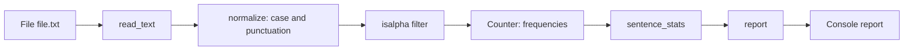

This independent work will teach you to work with text data: read files, clean text, count word frequencies, and produce tidy reports. You already know loops, strings, dictionaries, and functions; now you will assemble them into a complete tool — a text analyzer that will be useful both in your studies and in real data-processing tasks.

## Problem statement

You need to write a program `text_analyzer.py` that takes a path to a text file, reads it, and prints a report: the number of words, the number of unique words, the number of sentences, the average word length, the average sentence length, the longest word, and the top-10 most frequent words with their occurrence counts. The program must work with Russian texts of any length — from a couple of paragraphs to a whole book.

What you will learn. First, working with files: opening, reading, closing (preferably via the `with` context manager). Second, text normalization: lowercasing and removing punctuation — without this, «Слово», «слово», and «слово,» would count as different words. Third, you will get to know the `collections.Counter` class — a convenient tool for counting frequencies that replaces manual dictionary loops.

## Program requirements

- The program runs as `python text_analyzer.py file.txt`, where `file.txt` is the path to the file being analyzed (use `sys.argv`).
- If the file is not found — a polite error message, no crash.
- The text is normalized: everything to lowercase, punctuation marks (both standard and typographic: quotes, dashes) do not end up in words.
- Words are sequences of letters; numbers like «2026» are not counted as words.
- The report is printed as a single block, aligned in columns.
- Frequencies are counted with `collections.Counter`.
- The program must be split into functions: reading the file, normalization, computing statistics, printing the report. This is checked during grading.

The text processing pipeline — from file to report:



## How to work on the assignment

Complete the stages in order in a single `text_analyzer.py` file, checking the work after each stage. For tests, create a small text file (for example, `sample.txt`) with 5–10 sentences, including punctuation, capital letters, and repeated words. Before submitting, run the program on this file, on an empty file, and on a non-existent path.

## Assessment criteria (10 points)

| Criterion | Points |
|---|---|
| The program runs from the command line without errors | 2 |
| Correct file reading and handling of a missing file | 2 |
| Text normalization: case, punctuation, excluding numbers | 2 |
| Correct computation of all metrics and top-10 via Counter | 3 |
| Code split into functions, readable, with comments | 1 |

Passing grade — from 7 points.

## What to submit

- The file `text_analyzer.py` (full working version after stage 5).
- The test file `sample.txt` on which the program was checked.
- An example report output for `sample.txt` (in `report.txt` or in a comment).
- A comment at the top of the file: how to run, what functions exist, what you would improve.
- The lesson quiz on the platform (8 questions).

<!--TASK-->
### Task 1

Implement the function `read_text(path)` that opens the file in UTF-8 encoding and returns its contents as a string. If the file is not found or cannot be read — catch `FileNotFoundError` (and optionally `PermissionError`) and return `None`, after printing a clear message. Test on an existing file and on a non-existent path: in the second case the program must not crash. Expected output for an existing file — a string with the text; for a missing file — «Файл не найден: D:/...» and returning `None`.

### Task 2

Write the function `normalize(text)` that lowercases the text and replaces all punctuation marks with spaces. Use `import string` and `string.punctuation` as the base; extend it with typographic characters: «» „ “ — … (dashes and quotes). Then split the text into words with `text.split()`. Test on the phrase «Привет, мир! Это — тест.»: you should get `["привет", "мир", "это", "тест"]` — without commas, exclamation marks, or dashes.

### Task 3

Make sure numbers do not get into words. Modify `normalize` so a word counts only if it consists of letters: check `word.isalpha()`. Then write the function `count_words(words)` that returns `collections.Counter(words)`. Print the three most frequent words via `counter.most_common(3)`. Expected output: `[('и', 5), ('в', 3), ('на', 3)]` (the numbers depend on your test file).

### Task 4

Add sentence statistics. The function `sentence_stats(text)` splits the text into sentences by `. ! ?` (you can use `re.split(r'[.!?]+', text)`), discards empty pieces, and computes: the number of sentences, the average sentence length in words (the sum of all sentence lengths divided by their count), and the average word length. Separately, find the longest word via `max(words, key=len)`. Print the results.

### Task 5

Assemble the final report in the function `report(stats)`: a single block aligned in columns (use f-strings with field widths, e.g. `f"{label:<25}{value:>8}"`). In the main part of the program, take the path from `sys.argv[1]`, read the file, compute all metrics, and print the whole report. Check: an empty file must produce a meaningful report with zeros, not a division-by-zero error.

### Task 6

Remove stop words from the top. In any Russian text, the first places are taken by «и», «в», «на» — they say nothing about the content. Create `STOPWORDS` (at least 15 prepositions, conjunctions, and pronouns) and the function `top_words(counter, n=10, min_len=4, stopwords=STOPWORDS)` that returns a list of pairs `(word, count)`, skipping stop words and everything shorter than `min_len`. Sort by count descending; on ties, alphabetically. Expected output for `sample.txt`: `[('книга', 7), ('текст', 5), ('герой', 4)]` — without «и», «в», «на».

### Task 7

Compare two texts. Write `compare_texts(path_a, path_b)`: read both files, normalize them with the same `normalize`, build word sets, and compute `common` (intersection), `only_a`, `only_b`, and `jaccard` = |A ∩ B| / |A ∪ B|, rounded to three digits. The function returns a dictionary and prints a report: `Общих слов: 120, только в A: 34, только в B: 51, Жаккар: 0.585`. An empty text must not lead to division by zero, and a missing file must not crash: return `None` and a message.

<!--/TASK-->

<!--HINT-->
### Hint 1

Use the context manager: `with open(path, encoding="utf-8") as f: return f.read()`. Wrap it in `try/except FileNotFoundError`. `sys.argv` is not needed yet — at this stage the path can be passed as a function argument or simply written into a variable.

### Hint 2

Build a translation table: `table = str.maketrans("", "", string.punctuation + "«»„“—…")`, then `text.translate(table)`. This replaces each punctuation mark with a space. After that, `text.split()` gives a clean list of words.

### Hint 3

`str.isalpha()` returns `True` only for strings made entirely of letters — numbers and mixed tokens are filtered out. `Counter` is created from a list and can count right away: `Counter(words)` is a dictionary where the key is a word and the value is the count. `most_common(n)` returns a list of pairs `(word, count)`.

### Hint 4

`re.split(r'[.!?]+', text)` splits the text by any combination of these marks; filter out empty strings: `[s for s in parts if s.strip()]`. The average sentence length is `sum(len(s.split()) for s in sentences) / len(sentences)`. Be careful: with zero sentences you cannot divide — check `if sentences`.

### Hint 5

Alignment: `print(f"{'Слов в тексте':<28}{stats['words']:>8}")` — `<` left-aligns, `>` right-aligns. To guard against empty text, add a condition: if there are no words, print «Текст пуст» and finish before computing averages.

### Hint 6

`Counter.most_common()` without an argument returns all pairs, already sorted descending. Filter them with a list comprehension: `[(w, c) for w, c in counter.most_common() if w not in stopwords and len(w) >= min_len][:n]`. For sorting on equal frequencies use the key `key=lambda p: (-p[1], p[0])` — the minus turns descending-by-count into ascending. The default `min_len` of 4 cuts off «но», «или», «как».

### Hint 7

Sets: `a = set(words_a)`, `b = set(words_b)`. Intersection — `a & b`, differences — `a - b` and `b - a`, union — `a | b`. Jaccard: `len(a & b) / len(a | b)`, but first check `if not (a | b): return 0.0`. Round with `round(value, 3)`. Don't forget to reuse `read_text` and `normalize` rather than writing reading logic again: this keeps the behavior of both scenarios identical.

<!--/HINT-->

<!--SOLUTION-->
### Solution 1

```python
def read_text(path):
    try:
        with open(path, encoding="utf-8") as f:
            return f.read()
    except FileNotFoundError:
        print(f"Файл не найден: {path}")
        return None
```

The `with` context manager closes the file itself, even if an error occurs inside — no "leaks" of open file descriptors. The `utf-8` encoding is mandatory for Russian texts: without it, Windows may try to read the file in cp1251 and corrupt the letters. `FileNotFoundError` is caught separately; the program prints a clear message and returns `None` instead of crashing with a traceback.

### Solution 2

```python
import string

def normalize(text):
    text = text.lower()
    extra = "«»„“—…"
    table = str.maketrans("", "", string.punctuation + extra)
    return text.translate(table).split()
```

`str.maketrans("", "", chars)` builds a table that maps each character from the third argument to `None` — that is, it deletes it. But deleting punctuation is wrong: otherwise words would "glue together", as in «Привет,мир». So first we replace each mark with a space — `translate` does this with a table where a character maps to a space: `str.maketrans(chars, " " * len(chars))`. Still, the most reliable approach is to iterate over characters and keep only letters and spaces. A simple variant:

```python
def normalize(text):
    text = text.lower()
    cleaned = []
    for ch in text:
        if ch.isalpha() or ch.isspace():
            cleaned.append(ch)
        else:
            cleaned.append(" ")
    return "".join(cleaned).split()
```

Such a loop is clear and easy to extend, and `split()` breaks the string on any whitespace.

### Solution 3

```python
from collections import Counter

def count_words(words):
    return Counter(words)

def filter_alpha(words):
    return [w for w in words if w.isalpha()]

words = filter_alpha(normalize(text))
counter = count_words(words)
print(counter.most_common(3))
```

`word.isalpha()` returns `True` only for words made of letters — «2026» and «привет123» are filtered out. `Counter` is a dict subclass: `Counter(words)` counts all occurrences in one pass. `most_common(3)` returns a list of the three most frequent pairs `(word, count)` — exactly what the top needs.

### Solution 4

```python
import re

def sentence_stats(text):
    parts = re.split(r'[.!?]+', text)
    sentences = [s.strip() for s in parts if s.strip()]
    if not sentences:
        return {"sentences": 0, "avg_sentence": 0.0}

    lengths = [len(s.split()) for s in sentences]
    avg_sentence = sum(lengths) / len(sentences)
    words = []
    for s in sentences:
        words.extend(s.split())
    avg_word = sum(len(w) for w in words) / len(words)
    longest = max(words, key=len)

    return {
        "sentences": len(sentences),
        "avg_sentence": avg_sentence,
        "avg_word": avg_word,
        "longest": longest,
    }
```

`re.split(r'[.!?]+', text)` cuts the text by any combination of periods, exclamation marks, and question marks. Empty pieces (for example, after a period at the end of the text) are filtered out. Average sentence length is computed in words, average word length in letters, and the longest word is found by `max(..., key=len)`. The check `if not sentences` guards against division by zero.

### Solution 5

```python
import sys

def report(stats):
    print("=" * 40)
    print(f"{'Слов в тексте':<28}{stats['words']:>8}")
    print(f"{'Уникальных слов':<28}{stats['unique']:>8}")
    print(f"{'Предложений':<28}{stats['sentences']:>8}")
    print(f"{'Средняя длина слова':<28}{stats['avg_word']:>8.2f}")
    print(f"{'Средняя длина предложения':<28}{stats['avg_sentence']:>8.2f}")
    print(f"{'Самое длинное слово':<28}{stats['longest']:>8}")
    print("=" * 40)
    print("Топ-10 самых частых слов:")
    for i, (word, count) in enumerate(stats["top"], 1):
        print(f"{i:>2}. {word:<20}{count:>4}")

if __name__ == "__main__":
    path = sys.argv[1] if len(sys.argv) > 1 else "sample.txt"
    text = read_text(path)
    if text is None:
        sys.exit(1)
    words = filter_alpha(normalize(text))
    if not words:
        print("Текст пуст.")
        sys.exit(0)
    # сбор stats: топ, уникальные и т.д.
    ...
```

`sys.argv[1]` is the first command-line argument after the script name; if it is absent, we use `sample.txt` by default. Column alignment makes the report readable. Empty text is handled separately — the program prints «Текст пуст» and exits without division by zero.

### Solution 6

```python
STOPWORDS = {
    "и", "в", "во", "на", "не", "что", "с", "со", "а", "но",
    "по", "это", "как", "к", "у", "из", "за", "для", "же", "ли",
}


def top_words(counter, n=10, min_len=4, stopwords=STOPWORDS):
    pairs = [
        (word, count)
        for word, count in counter.most_common()
        if word not in stopwords and len(word) >= min_len
    ]
    return sorted(pairs, key=lambda p: (-p[1], p[0]))[:n]


print(top_words(Counter(words), n=3))
```

`most_common()` without a number returns the whole frequency dictionary, already ordered descending — list filtering preserves this order. The check `word not in stopwords` runs in constant time because `STOPWORDS` is a set, not a list. `min_len=4` removes short function words that did not make it into the stop list. The additional sort with the key `(-p[1], p[0])` ensures predictability: at equal frequency, words go alphabetically, and the report doesn't "jump" between runs. Returning a list of pairs rather than a ready string is the right separation of concerns: printing stays in `report`, and the function can be checked in a test.

### Solution 7

```python
def compare_texts(path_a, path_b):
    text_a = read_text(path_a)
    text_b = read_text(path_b)
    if text_a is None or text_b is None:
        return None

    a = set(filter_alpha(normalize(text_a)))
    b = set(filter_alpha(normalize(text_b)))
    union = a | b
    jaccard = round(len(a & b) / len(union), 3) if union else 0.0

    result = {
        "common": len(a & b),
        "only_a": len(a - b),
        "only_b": len(b - a),
        "jaccard": jaccard,
    }
    print(f"Общих слов: {result['common']}, только в A: {result['only_a']}, "
          f"только в B: {result['only_b']}, Жаккар: {result['jaccard']}")
    return result


compare_texts("a.txt", "b.txt")
```

Sets discard repeats, so the comparison works on vocabulary, not frequencies: a text with a thousand «и» won't outweigh a meaningful overlap. The operators `&`, `-`, and `|` give intersection, differences, and union in one pass. The Jaccard coefficient is the share of common words among all encountered ones: 1.0 means identical vocabularies, 0.0 means no common words. The check `if union` guards against division by zero on two empty files; `read_text` already returned `None` when a file was missing, so we never reach the sets. Such a report is useful, for example, for comparing two editions of an article or two versions of a document.

<!--/SOLUTION-->

<!--QUIZ-->
Which context manager is used to close a file correctly?
- with open(path, encoding="utf-8") as f:
- f = open(path); f.close()
- file(path).read()
- open(path).read()
* Correct answer: with open(path, encoding="utf-8") as f:
The with context manager closes the file itself even if an error occurs inside the block.

What does the method "Привет".lower() do?
- Returns «привет»
- Returns «ПРИВЕТ»
- Modifies the string
- Returns the length
* Correct answer: Returns «привет»
lower() returns a new lowercase string; the original does not change.

What will "Привет, мир!".split() return?
- ["Привет,", "мир!"]
- ["Привет", "мир"]
- ["Привет, мир!"]
- An error
* Correct answer: ["Привет,", "мир!"]
split() without arguments splits on spaces, keeping attached punctuation marks.

Which method checks that a string consists only of letters?
- isalpha()
- isdigit()
- isalnum()
- isspace()
* Correct answer: isalpha()
isalpha() returns True only for strings made entirely of letters.

Which class in collections counts element frequencies with a single command?
- Counter
- defaultdict
- OrderedDict
- deque
* Correct answer: Counter
Counter(list) counts all element occurrences in one pass.

What will Counter(["а", "б", "а"]).most_common(1) return?
- [("а", 2)]
- {"а": 2}
- ("а", 2)
- [("а", 1)]
* Correct answer: [("а", 2)]
most_common returns a list of pairs (element, count) sorted descending.

Why is empty text dangerous in the average length counter?
- Division by zero
- Encoding error
- Infinite loop
- It is not dangerous
* Correct answer: Division by zero
If there are zero sentences or words, sum(...) / 0 leads to ZeroDivisionError — a check is needed.

Which regex splits text into sentences by . ! ?
?
- re.split(r'[.!?]+', text)
- text.split(".!?")
- re.split(".!?", text)
- text.split(" ")
* Correct answer: re.split(r'[.!?]+', text)
The character class [.!?] with a plus captures any combinations of end-of-sentence marks.

What will max(["река", "океан"], key=len) return?
- "океан"
- "река"
- 6
- ["океан"]
* Correct answer: "океан"
max with key=len selects the element with the maximum length — the word itself, not its length.

Why does the program use sys.argv?
- To get command-line arguments
- To terminate the program
- To import modules
- To read files
* Correct answer: To get command-line arguments
sys.argv is the argument list: sys.argv[0] is the script name, sys.argv[1] is the first passed path.

What will `Counter("ааб") - Counter("аб")` return?
- `Counter({'а': 1})`
- `Counter({'а': 2})`
- `Counter({'б': 1})`
- Empty `Counter()`
* Correct answer: `Counter({'а': 1})`
Subtracting counters removes one occurrence each and drops zero and negative values.

What will `set("абв") & set("бвг")` give?
- `{'б', 'в'}`
- `{'а', 'г'}`
- `{'а', 'б', 'в', 'г'}`
- An empty set
* Correct answer: `{'б', 'в'}`
The `&` operator keeps only elements present in both sets.

How is the Jaccard coefficient computed for two word sets?
- `len(a & b) / len(a | b)`
- `len(a) + len(b)`
- `len(a - b) / len(a)`
- `len(a & b) * 2`
* Correct answer: `len(a & b) / len(a | b)`
The numerator is common words, the denominator is all words of the union; the result is between 0 and 1.

Why does `top_words` have the `min_len` parameter?
- To cut off short function words that did not make it into the stop list
- To speed up file reading
- To count letters instead of words
- To sort words by length
* Correct answer: To cut off short function words that did not make it into the stop list
Prepositions and conjunctions are often shorter than four letters, so the length threshold complements the stop list.
<!--/QUIZ-->
