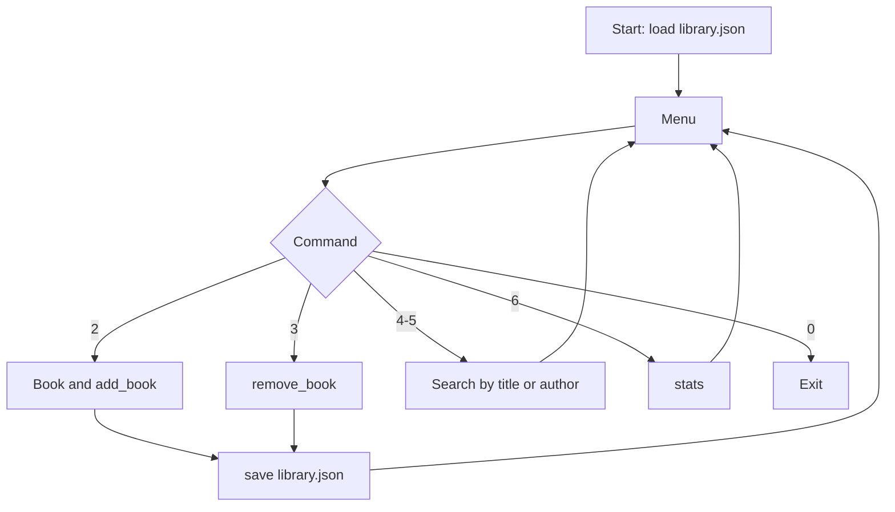

This work is your first real application in practice: not a "run and look" script, but an interactive program with a menu that stores data between runs. Here you will apply object-oriented programming (classes, methods, magic methods), JSON serialization, and careful user input handling.

## Problem statement

You need to write a console application `book_db.py` — a "personal library". It stores books with fields: title, author, year of publication, genre, status (read or not), and a rating on a 10-point scale (optional). Data is saved to a JSON file and loaded on the next run. The application works through a menu: the user enters a command number, the program performs the action and shows the menu again.

What you will learn. First, class design: the `Book` class describes one book, the `Library` class describes a collection of books and operations on it. Second, serialization: turning objects into JSON and back via dictionaries. Third, building a user interface: the "menu → action → menu" loop and resilience to invalid input.

## Program requirements

- Class `Book`: fields `title`, `author`, `year`, `genre`, `read` (bool), `rating` (int or None); a `__str__` method for nice output; methods `to_dict()` and `from_dict(data)`.
- The year must be a reasonable number (for example, 1450–2100); on an invalid value — raise `ValueError`.
- Class `Library`: methods `add_book(book)`, `remove_book(index)`, `find_title(substr)`, `find_author(substr)`, `stats()`, `__len__`, `__str__`.
- Search is by substring, case-insensitive; all matches are found.
- Saving to `library.json` automatically after every change; loading at startup; if the file is missing — an empty library.
- A menu with commands: 1 — show all books, 2 — add, 3 — delete by number, 4 — find by title, 5 — find by author, 6 — statistics, 0 — exit.
- The application must not crash on any input: an invalid command number, empty input, a letter instead of a number, etc.

How the application is organized:



## How to work on the assignment

Work through the stages in a single `book_db.py` file. After each stage, run the program and check its behavior. For testing, add 3–5 books, save them, restart the program, and make sure they are there. Before submitting, check all menu items and "awkward" inputs.

## Assessment criteria (10 points)

| Criterion | Points |
|---|---|
| Book class with correct fields, validation, and __str__ | 2 |
| Library class: add, delete, search, statistics | 3 |
| JSON save and load (auto-save after changes) | 2 |
| Menu works, the app does not crash on invalid input | 2 |
| Readable code, with comments, split into classes and functions | 1 |

Passing grade — from 7 points.

## What to submit

- The file `book_db.py` (full working version after stage 5).
- An example console session covering all menu items (in `examples.txt` or a comment).
- The file `library.json` with 3–5 saved books from your test.
- A comment at the top of the file: how to run, what classes exist, what you would improve.
- The lesson quiz on the platform (8 questions).

<!--TASK-->
### Task 1

Create the class `Book` with the constructor `__init__(self, title, author, year, genre, read=False, rating=None)`. Validate the year: if it is outside 1450–2100 or not a number — raise `ValueError`. Implement `__str__`, which returns a string like `«Пикник на обочине» — Стругацкие, 1972, фантастика, прочитана, оценка 9` (or `не прочитана`). Create 2–3 books manually and print them with `print`. Expected output — three lines with book descriptions.

### Task 2

Add serialization methods: `to_dict()` returns a dictionary `{"title": ..., "author": ..., "year": ..., "genre": ..., "read": ..., "rating": ...}`, and the class method `from_dict(data)` creates an instance from such a dictionary. Test the "round trip": create a book, turn it into a dictionary, then back — the fields must match. Also write `__eq__` (comparison by title and author) so books can be compared.

### Task 3

Create the class `Library` with a list of books. Methods: `add_book(book)` — duplicate check (same author and title) and addition; `remove_book(index)` — deletion by index with a bounds check (on an invalid index — a message, not an error); `__len__` returns the number of books; `find_title(substr)` and `find_author(substr)` return a list of matching books (search via `in` on lowercase). Test all methods manually.

### Task 4

Add saving and loading: the `save(path)` method writes a list of book dictionaries to JSON via `json.dump` (with `ensure_ascii=False` and `indent=2`); the class method `load(path)` reads the file and returns a `Library` (if the file is missing — an empty library; if the JSON is broken — a message and an empty library). Check: add books, save, create a new library from the file — the books are there.

### Task 5

Assemble the console application: the `print_menu()` function prints the items, the main loop reads a command, handles invalid numbers and letters (a `try/except ValueError` wrapper around `int()`), calls library methods, and auto-saves changes. Add the "Statistics" item — `stats()` prints: how many books total, how many are read, the average publication year, and the favorite genre (by maximum count). Test the whole program end to end.

### Task 6

Add filtering. Write `Library.filter_books(genre=None, read=None, year_from=None, sort_by="rating")`: filters combine with "AND"; `genre` is compared case-insensitively; `read` is boolean; `year_from` is the lower year bound. Sorting: `rating` — by rating descending, books without a rating at the end; `year` — ascending; `title` — alphabetically. Print the result as a table with numbers and ratings. Expected output: `1. «Пикник на обочине» — 9`, then books with lower ratings, and `rating=None` as the last rows.

### Task 7

Add table exchange. `export_csv(path)` writes all books to CSV with a header using `csv.DictWriter` (the same fields as in `to_dict`); the file is opened with `newline=""`. `import_csv(path)` reads it with `csv.DictReader`, creates books via `Book.from_dict`, skips rows with an invalid year, empty title, or broken rating, and returns a tuple `(added, skipped)`. Test on a file of five rows where one row has year `9999`: the program prints `Добавлено: 4, пропущено: 1`, and the library grows by four books.

<!--/TASK-->

<!--HINT-->
### Hint 1

Year range — check `if not (1450 <= year <= 2100): raise ValueError(...)`. Rating `rating` is a number from 1 to 10 or `None`. In `__str__` build string pieces with an f-string and a conditional expression: `"прочитана" if self.read else "не прочитана"`.

### Hint 2

`to_dict()` returns a dictionary with the same keys as the fields. `from_dict` is a class method: use the `@classmethod` decorator to create an instance: `return cls(...)` with unpacking: `Book.from_dict(data)` takes a dictionary and passes values to the constructor, for example `cls(title=data["title"], author=data["author"], year=data["year"], genre=data["genre"], read=data["read"], rating=data["rating"])`.

### Hint 3

`__len__` is `return len(self.books)`. For search: `[b for b in self.books if substr.lower() in b.title.lower()]`. Do the bounds check on deletion with a condition: `if 0 <= index < len(self.books):` — otherwise print «Неверный номер». Check duplicates with a loop over existing books — `__eq__` from stage 2 simplifies the comparison.

### Hint 4

`json.dump([b.to_dict() for b in self.books], f, ensure_ascii=False, indent=2)` — serializing a list of dictionaries. On load: `with open(path, encoding="utf-8") as f: data = json.load(f)` and `for item in data: lib.add_book(Book.from_dict(item))`. `try/except (FileNotFoundError, json.JSONDecodeError)` returns an empty library.

### Hint 5

The loop: `while True:` — print the menu, `choice = input("Выбери команду: ")`. Number handling: `try: choice = int(choice) except ValueError: print("Введи число"); continue`. Call save after every change (`lib.save("library.json")`). For the "favorite genre" use `Counter(genre for book in lib.books)` and `most_common(1)`.

### Hint 6

Start with a copy of the list: `result = list(self.books)`, then apply conditions with `if`. Compare genre as `book.genre.lower() == genre.lower()`, year as `book.year >= year_from`. For sorting by rating use the key `key=lambda b: (b.rating is None, -(b.rating or 0))`: `False` comes before `True`, so rated books end up on top, and the minus reverses the order. For year and title, `key=lambda b: b.year` and `key=lambda b: b.title.lower()` will do.

### Hint 7

List the fields for `DictWriter` explicitly: `["title", "author", "year", "genre", "read", "rating"]`. `writer.writeheader()` writes the header row, `writer.writerows(...)` writes all rows. On import remember: CSV values are strings, so year and rating must be converted with `int`, and an empty rating with `None`. Catch `(ValueError, KeyError, TypeError)` per row and increment the skip counter without aborting the whole import.

<!--/HINT-->

<!--SOLUTION-->
### Solution 1

```python
class Book:
    def __init__(self, title, author, year, genre, read=False, rating=None):
        if not (1450 <= year <= 2100):
            raise ValueError(f"Некорректный год: {year}")
        if rating is not None and not (1 <= rating <= 10):
            raise ValueError(f"Оценка должна быть от 1 до 10: {rating}")
        self.title = title
        self.author = author
        self.year = year
        self.genre = genre
        self.read = read
        self.rating = rating

    def __str__(self):
        status = "прочитана" if self.read else "не прочитана"
        rating = f", оценка {self.rating}" if self.rating else ""
        return (f"«{self.title}» — {self.author}, {self.year}, "
                f"{self.genre}, {status}{rating}")
```

The constructor validates data right away: an invalid year or rating raises `ValueError` — bad data never gets into the library. `__str__` is a magic method: it is called automatically on `print(book)`. Note: `if self.rating` works because `None` is falsy and numbers are truthy.

### Solution 2

```python
class Book:
    def __init__(self, title, author, year=2000, genre="", read=False, rating=None):
        self.title = title
        self.author = author
        self.year = year
        self.genre = genre
        self.read = read
        self.rating = rating

    def to_dict(self):
        return {
            "title": self.title,
            "author": self.author,
            "year": self.year,
            "genre": self.genre,
            "read": self.read,
            "rating": self.rating,
        }

    @classmethod
    def from_dict(cls, data):
        return cls(title=data["title"], author=data["author"], year=data["year"],
                   genre=data["genre"], read=data["read"], rating=data["rating"])

    def __eq__(self, other):
        return (self.title == other.title and self.author == other.author)
```


`to_dict` turns an object into a plain dictionary — exactly what can be written to JSON. `from_dict` is a class method (`@classmethod`): it creates an instance from a dictionary; `cls` here is the `Book` class itself. `__eq__` defines when two books count as equal: by title and author — this will be used for duplicate checks.

### Solution 3

```python
class Library:
    def __init__(self):
        self.books = []

    def add_book(self, book):
        for existing in self.books:
            if existing == book:
                print(f"Такая книга уже есть: {book.title}")
                return
        self.books.append(book)

    def remove_book(self, index):
        if 0 <= index < len(self.books):
            removed = self.books.pop(index)
            print(f"Удалено: {removed.title}")
        else:
            print("Неверный номер книги.")

    def __len__(self):
        return len(self.books)

    def find_title(self, substr):
        return [b for b in self.books if substr.lower() in b.title.lower()]

    def find_author(self, substr):
        return [b for b in self.books if substr.lower() in b.author.lower()]
```

`add_book` uses `__eq__` to check duplicates. `remove_book` is protected by a bounds check — an invalid index gives a message, not an exception. Search works by substring and is case-insensitive: `"СТРУГАЦКИЕ" in "Стругацкие".lower()` is `True`. A list is returned even if there are no matches — an empty list.

### Solution 4

```python
import json


class Library:
    def __init__(self):
        self.books = []

    def save(self, path):
        with open(path, "w", encoding="utf-8") as f:
            json.dump([b.to_dict() for b in self.books], f,
                      ensure_ascii=False, indent=2)

    @classmethod
    def load(cls, path):
        lib = cls()
        try:
            with open(path, encoding="utf-8") as f:
                data = json.load(f)
            for item in data:
                lib.add_book(Book.from_dict(item))
        except (FileNotFoundError, json.JSONDecodeError):
            pass
        return lib
```


`save` writes a list of dictionaries. `ensure_ascii=False` keeps Russian letters as is (otherwise the JSON would be full of `\u...` sequences); `indent=2` makes the file readable. `load` is a class method: it creates an empty library and fills it from the file. If the file is missing or corrupted, the program silently starts with an empty library — this is robust behavior.

### Solution 5

```python
from collections import Counter

def print_menu():
    print("\n--- Личная библиотека ---")
    print("1. Показать все книги")
    print("2. Добавить книгу")
    print("3. Удалить книгу по номеру")
    print("4. Найти по названию")
    print("5. Найти по автору")
    print("6. Статистика")
    print("0. Выход")

def main():
    lib = Library.load("library.json")
    while True:
        print_menu()
        choice = input("Выбери команду: ").strip()
        if choice == "0":
            break
        if choice == "1":
            for i, book in enumerate(lib.books, 1):
                print(f"{i}. {book}")
        elif choice == "2":
            title = input("Название: ")
            author = input("Автор: ")
            year = int(input("Год: "))
            genre = input("Жанр: ")
            lib.add_book(Book(title, author, year, genre))
            lib.save("library.json")
        elif choice == "3":
            index = int(input("Номер книги: ")) - 1
            lib.remove_book(index)
            lib.save("library.json")
        # 4, 5, 6 — аналогично
        else:
            print("Неизвестная команда.")

if __name__ == "__main__":
    main()
```

The main loop keeps the application alive until command "0". `int(input(...))` for the year and number can raise `ValueError` — wrap such places in `try/except` and re-ask. `enumerate(lib.books, 1)` gives numbers starting from 1 for the menu. Auto-save after changes is a key requirement: data survives restarts.

### Solution 6

```python
class Library:
    # ... add_book, remove_book, find_title, find_author, __len__ ...

    def filter_books(self, genre=None, read=None, year_from=None,
                     sort_by="rating"):
        result = list(self.books)
        if genre is not None:
            result = [b for b in result if b.genre.lower() == genre.lower()]
        if read is not None:
            result = [b for b in result if b.read == read]
        if year_from is not None:
            result = [b for b in result if b.year >= year_from]

        if sort_by == "rating":
            result.sort(key=lambda b: (b.rating is None, -(b.rating or 0)))
        elif sort_by == "year":
            result.sort(key=lambda b: b.year)
        elif sort_by == "title":
            result.sort(key=lambda b: b.title.lower())
        return result


lib = Library()
# ... книги добавлены ...
for i, book in enumerate(lib.filter_books(genre="фантастика", sort_by="rating"), 1):
    print(f"{i}. «{book.title}» — {book.rating}")
```

Each filter is a separate step: the list shrinks only if the parameter is passed, so a call without arguments returns all books. `list(self.books)` creates a copy — sorting won't shuffle the original storage order. The key `(b.rating is None, -(b.rating or 0))` solves two problems at once: `False` (0) comes before `True` (1), so rated books are on top, and the minus makes the order descending. The `or 0` expression guards against arithmetic with `None`. Comparing genre in lowercase saves you from "Фантастика" vs "фантастика" in different records. Such a method is the basis of any filter list in an interface.

### Solution 7

```python
import csv


class Library:
    FIELDS = ["title", "author", "year", "genre", "read", "rating"]

    def export_csv(self, path):
        with open(path, "w", encoding="utf-8", newline="") as f:
            writer = csv.DictWriter(f, fieldnames=self.FIELDS)
            writer.writeheader()
            writer.writerows(book.to_dict() for book in self.books)

    def import_csv(self, path):
        added = 0
        skipped = 0
        with open(path, encoding="utf-8", newline="") as f:
            for row in csv.DictReader(f):
                try:
                    data = {
                        "title": row["title"].strip(),
                        "author": row["author"].strip(),
                        "year": int(row["year"]),
                        "genre": row["genre"].strip(),
                        "read": row["read"].strip().lower() in ("1", "true", "да"),
                        "rating": int(row["rating"]) if row["rating"] else None,
                    }
                    if not data["title"]:
                        raise ValueError("пустое название")
                    self.add_book(Book.from_dict(data))
                    added += 1
                except (ValueError, KeyError, TypeError):
                    skipped += 1
        print(f"Добавлено: {added}, пропущено: {skipped}")
        return added, skipped
```

CSV is a flat text format, so all values arrive as strings: year and rating must be converted to `int` explicitly, and an empty rating to `None` — otherwise `Book` would receive the string `"None"` and fail validation. `newline=""` is mandatory when working with `csv` on Windows: without it, the module adds its own newline on top of the file's, producing blank lines. `DictWriter` takes dictionaries and lays them out across the `fieldnames` columns; `writeheader()` writes the header once. Import is built on "soft failure": one broken row doesn't cancel the rest — it increments the `skipped` counter, so real exports are processed without manual editing. `self.add_book` additionally filters duplicates.

<!--/SOLUTION-->

<!--QUIZ-->
What does the @classmethod decorator do?
- Allows calling the method on the class, not on an instance
- Makes the method private
- Speeds up the method
- Forbids inheritance
* Correct answer: Allows calling the method on the class, not on an instance
Such a method receives cls — the class itself — and can create instances, for example Book.from_dict(data).

Which magic method is called on print(книга)?
- __str__
- __repr__
- __call__
- __init__
* Correct answer: __str__
__str__ returns the string representation of an object, which is printed by print().

What will "Стругацкие".lower() return?
- "стругацкие"
- "СТРУГАЦКИЕ"
- An error
- The string length
* Correct answer: "стругацкие"
lower() returns a lowercase copy of the string.

What does json.dump(..., ensure_ascii=False) do?
- Keeps Russian letters as is
- Disables compression
- Checks JSON validity
- Adds indentation
* Correct answer: Keeps Russian letters as is
Without this flag, all non-ASCII characters become \u sequences.

What happens on json.load() of a corrupted file?
- A JSONDecodeError
- None is returned
- The file is repaired
- The program hangs
* Correct answer: A JSONDecodeError
That's why loading is wrapped in try/except, and on error the app starts with an empty library.

How to check that a string s contains the substring "пик" case-insensitively?
- "пик" in s.lower()
- s.find("пик") > 0
- s.contains("пик")
- s.index("пик")
* Correct answer: "пик" in s.lower()
Lowercasing both sides and using the in operator is the simplest correct way.

What will len(библиотека) return with 3 books if __len__ is defined?
- 3
- A list of books
- An error
- 0
* Correct answer: 3
__len__ overrides the behavior of the built-in len() function for class instances.

Which loop keeps the application open until the exit command?
- while True with break
- for i in range(100)
- repeat until
- do while
* Correct answer: while True with break
The loop runs forever until the user enters the exit command, after which break fires.

What does enumerate(lib.books, 1) do?
- Returns pairs (index from 1, book)
- Numbers books from zero
- Sorts books
- Removes empty records
* Correct answer: Returns pairs (index from 1, book)
The second argument sets the starting number — convenient for menus where numbering starts at 1.

What happens with int(input("Год: ")) if the user enters «abc»?
- A ValueError
- 0 is returned
- The program continues
- A TypeError
* Correct answer: A ValueError
That's why number input is wrapped in try/except and re-asked.

Why is a file for `csv` opened with `newline=""`?
- So the csv module doesn't add extra newlines itself
- So the file opens faster
- To preserve the UTF-8 encoding
- To forbid overwriting
* Correct answer: So the csv module doesn't add extra newlines itself
Otherwise blank lines appear between rows on Windows: csv adds its own newline and the file adds its own.

What does `writer.writeheader()` do?
- Writes the row with column names
- Writes the first book
- Creates the file
- Checks data types
* Correct answer: Writes the row with column names
`DictWriter` takes the names from `fieldnames` and writes them as the file's first row.

How to sort books by rating descending, putting unrated books at the end?
- `key=lambda b: b.rating`
- `key=lambda b: (b.rating is None, -(b.rating or 0))`
- `key=lambda b: -b.rating`
- `key=lambda b: b.title`
* Correct answer: `key=lambda b: (b.rating is None, -(b.rating or 0))`
The first key element sends `None` to the end; the second sets descending order among numbers.

What does `csv.DictReader` return when iterated?
- Dictionaries "column name → value"
- Lists of values
- Whole file lines
- Tuples of two elements
* Correct answer: Dictionaries "column name → value"
That's why fields are accessed by name: `row["title"]`, not by index.
<!--/QUIZ-->
