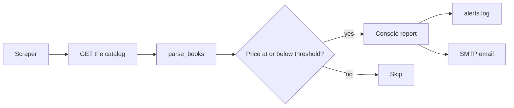

This is the hardest independent work in the module: a real little price monitoring service. You already know HTTP and parsing from module 17; now you will assemble these skills into a complete tool that can visit a website on its own, collect prices, compare them with a target, and notify you about good deals.

## Problem statement

You need to write a program `price_scraper.py` that periodically visits the practice shop site `https://books.toscrape.com/` (a book catalog with prices), collects prices, finds books cheaper than a given threshold, and notifies you: prints to the console, writes to a log file, and (optionally) sends an e-mail via SMTP. The program starts, runs in a loop with a pause, and terminates correctly on `Ctrl+C`.

What you will learn. First, confident work with `requests`: sessions, headers, timeouts, network error handling. Second, HTML parsing with `BeautifulSoup`: CSS selectors, extracting attributes and text. Third, sound architecture: separation into functions (fetching the page, parsing, comparing prices, notifications), configuration in a separate file, and politeness to the site (pauses between requests).

## Program requirements

- Site: `https://books.toscrape.com/` — the first catalog page, with 20 books priced in pounds (`£51.77`).
- Configuration lives in `config.json`: `threshold` (target price), `interval` (seconds between checks), `email_from`, `email_to`, `smtp_server`, `smtp_port`, `email_password` (can be empty — then no emails are sent).
- Requests: `User-Agent`, `timeout`, reusing `requests.Session()`, checking status via `raise_for_status()`.
- Parsing: the book title comes from the `title` attribute of the link in `h3 > a`, the price from `p.price_color`, normalized to `float` (remove `£`).
- Comparison: books with price ≤ `threshold` are considered bargains and go into the notification.
- Notifications: console (a report with a table), file `alerts.log` (each line is a record with time), e-mail via `smtplib` if the configuration is filled (otherwise skip).
- Politeness: a pause of at least 1 second between requests, an `interval` pause between check cycles.
- Network error handling: `requests.exceptions.RequestException` must not take down the program — after an error it waits for the next cycle.

The path of one check:



## How to work on the assignment

Work through the stages in a single `price_scraper.py` file. After each stage, run the program and check the result. Before submitting, check: running against the real site, writing to `alerts.log`, and correct termination via `Ctrl+C`. Don't forget `config.json` — the program must work even without email settings.

## Assessment criteria (10 points)

| Criterion | Points |
|---|---|
| HTTP client: sessions, headers, timeouts, raise_for_status | 2 |
| Catalog parsing with CSS selectors, correct float price | 3 |
| Comparison with the threshold and a tabular console report | 1 |
| Notifications: log file with time, e-mail if configured | 2 |
| Check loop with pause, network error handling, Ctrl+C | 2 |

Passing grade — from 7 points.

## What to submit

- The file `price_scraper.py` (full working version after stage 5).
- The file `config.json` (with empty email fields if there is no SMTP).
- The file `alerts.log` with several entries from your test.
- An example console output (in `examples.txt` or a comment).
- A comment at the top of the file: how to run, what functions exist, what you would improve.
- The lesson quiz on the platform (8 questions).

<!--TASK-->
### Task 1

Write the function `get_page(url, session)` with `requests.Session()`, a `User-Agent` header, and `timeout=15`. After the request, call `response.raise_for_status()` and return `response.text`. Wrap the call in `try/except requests.exceptions.RequestException` — on error print a message and return `None`. Test on `https://books.toscrape.com/`: the text must contain `books` and `toscrape`. Expected result — `len(page)` greater than 10,000 characters.

### Task 2

Write the function `parse_books(html)` that takes HTML and returns a list of dictionaries `{"title": str, "price": float}`. Use `BeautifulSoup(html, "html.parser")` and selectors: each item is `article.product_pod`, the title is `h3 > a` (the `title` attribute), the price is `p.price_color` (text like `£51.77`). Normalize the price: remove `£` and convert to `float`. Check: the first page must have 20 books, and all prices must be positive numbers.

### Task 3

Write the function `is_bargain(book, threshold)` that returns `True` if the book's price ≤ `threshold`. Then collect the list of bargain books and print it as a table: number, title, price. Align with f-strings and widths. Test with `threshold=50`: only books cheaper than 50 pounds must get into the report. Expected output — lines like `1. A Light in the Attic  £51.77` etc. for bargain books.

### Task 4

Add notifications. The function `notify(bargains, config)` does three things: prints the report to the console, appends to `alerts.log` line by line with a timestamp (`datetime.now().isoformat(timespec="seconds")`), and if `smtp_server` is present in the config, sends an email via `smtplib.SMTP` (definitely inside `try/except`, so an email failure doesn't crash the program). Check: after a run, `alerts.log` contains entries with real timestamps.

### Task 5

Assemble everything into a monitoring loop. Read `config.json` (with defaults if the file is missing: `threshold=50`, `interval=60`). Loop `while True`: fetch the page, parse, compare, notify, then `time.sleep(interval)`. Handle `KeyboardInterrupt` — on `Ctrl+C` print a message and exit cleanly. Keep a pause of at least 1 second between requests inside the loop. Check: run with `interval=10`, wait for 2–3 cycles, terminate via `Ctrl+C`.

### Task 6

Collect the whole catalog, not just the first page. Write `crawl_catalog(session, pages=3)`: start at `https://books.toscrape.com/`, parse books, then find the next-page link `li.next a` and join the URL with `urllib.parse.urljoin`. Repeat for `pages` pages, keeping a `time.sleep(1)` pause between requests, and de-duplicate by title using a set. Expected output: `Страница 1: 20 книг, всего 20`, `Страница 2: 20 книг, всего 40`, `Страница 3: 20 книг, всего 60`.

### Task 7

Keep a price history. The function `save_snapshot(books, path="history.csv")` appends `timestamp,title,price` rows, and writes the header only when the file is created. The function `price_changes(path, min_pct=5.0)` reads the history, compares the first and last price for each book, and returns a list of dictionaries with `old`, `new`, `delta_pct`, keeping only changes whose absolute value is at least `min_pct`. Expected output: `A Light in the Attic: 51.77 → 45.00 (-13.1%)` and the final line `Изменений: 3`.

<!--/TASK-->

<!--HINT-->
### Hint 1

Create the session once outside the function: `session = requests.Session()`, set the header like this: `session.headers.update({"User-Agent": "PriceScraper/1.0 (student@example.com)"})`. `raise_for_status()` throws `HTTPError` if the site responded with an error — this filters out "silent" failures. The `try/except` wrapper with `return None` lets the caller simply check `if page is None`.

### Hint 2

The item selector: `soup.select("article.product_pod")`. Title: `item.select_one("h3 > a")["title"]`. Price: `item.select_one("p.price_color").text` — for example `"£51.77"`. Normalization: `float(price_text.replace("£", ""))`. If a selector finds nothing, `select_one` returns `None` — check and skip such an item.

### Hint 3

Simple filtering: `[b for b in books if b["price"] <= threshold]`. For the table use `enumerate(bargains, 1)` and an f-string: `f"{i:>3}. {title:<40} £{price:>6.2f}"`. Note: the `<=` comparison includes a price equal to the threshold — this is documented in the requirements.

### Hint 4

Logging: `with open("alerts.log", "a", encoding="utf-8") as f: f.write(f"{ts} | {title} | £{price:.2f}\n")` — mode `"a"` appends to the end. For email: `with smtplib.SMTP(config["smtp_server"], config["smtp_port"]) as server:` then `server.sendmail(from_addr, to_addr, msg)`. Compose the message as a `string` in a simple format — `Subject`, `From`, `To` headers and the body after an empty line.

### Hint 5

Reading the config: `json.load(open("config.json", encoding="utf-8"))` with `try/except (FileNotFoundError, json.JSONDecodeError)` and defaults. Handling `Ctrl+C`: wrap the main loop in `try: ... except KeyboardInterrupt: print("Завершение работы.")`. Put the pause between requests right in the loop: `time.sleep(1)` after processing the page — this way you don't create extra load on the site.

### Hint 6

Page URL: `urljoin("https://books.toscrape.com/", "catalogue/page-2.html")` — string concatenation fails on relative links. On the last page `soup.select_one("li.next a")` returns `None`, so the loop should look like this: `next_link = soup.select_one("li.next a")`, `if next_link is None: break`, `url = urljoin(url, next_link["href"])`. It's convenient to accumulate duplicates in a set of titles and add a book only if its title is not there yet.

### Hint 7

Header only on creation: `need_header = not os.path.exists(path)`, then `open(path, "a", ...)` and `writer.writerow(...)` for each book. For analysis, collect the first and last snapshot per book: go through rows in order and remember `first[title]` and `last[title]`. Percent: `delta = (new - old) / old * 100`, filter — `abs(delta) >= min_pct`, output — `f"{title}: {old:.2f} → {new:.2f} ({delta:+.1f}%)"`.

<!--/HINT-->

<!--SOLUTION-->
### Solution 1

```python
import requests

def get_page(url, session):
    try:
        response = session.get(url, timeout=15)
        response.raise_for_status()
        return response.text
    except requests.exceptions.RequestException as e:
        print(f"Ошибка запроса: {e}")
        return None

session = requests.Session()
session.headers.update({"User-Agent": "PriceScraper/1.0 (student@example.com)"})
page = get_page("https://books.toscrape.com/", session)
print(len(page) if page else "Не удалось получить страницу")
```

A session keeps cookies and headers between requests — this is closer to how a real browser behaves. `timeout=15` guards against hanging. `raise_for_status()` turns 4xx/5xx responses into exceptions, so silent status failures don't slip through. The common `RequestException` wrapper catches network failures, timeouts, and HTTP errors alike.

### Solution 2

```python
from bs4 import BeautifulSoup

def parse_books(html):
    soup = BeautifulSoup(html, "html.parser")
    books = []
    for item in soup.select("article.product_pod"):
        title_tag = item.select_one("h3 > a")
        price_tag = item.select_one("p.price_color")
        if title_tag is None or price_tag is None:
            continue
        title = title_tag["title"]
        price = float(price_tag.text.replace("£", ""))
        books.append({"title": title, "price": price})
    return books
```

`BeautifulSoup` with the built-in `html.parser` parser is enough for practice pages. The selector `article.product_pod` selects all product cards; `h3 > a` selects the link with the title, and the `title` attribute contains the full book title (in the link text it may be truncated). `p.price_color` holds the string `£51.77`; after `replace("£", "")` and `float(...)` we get a number. The `is None` check protects against unexpected markup.

### Solution 3

```python
def is_bargain(book, threshold):
    return book["price"] <= threshold

def print_report(bargains):
    print(f"\nНайдено выгодных книг: {len(bargains)}")
    for i, book in enumerate(bargains, 1):
        print(f"{i:>3}. {book['title']:<40} £{book['price']:>6.2f}")

bargains = [b for b in parse_books(page) if is_bargain(b, 50)]
print_report(bargains)
```

`is_bargain` is a simple pure function: it gets a book and a threshold and returns a boolean. List filtering is idiomatic Python. `print_report` prints an aligned table: `:>3` right-aligns the number, `:<40` left-aligns the title (truncating too-long ones), `:>6.2f` formats the price with two decimal places.

### Solution 4

```python
from datetime import datetime
import smtplib

def log_alerts(bargains):
    ts = datetime.now().isoformat(timespec="seconds")
    with open("alerts.log", "a", encoding="utf-8") as f:
        for book in bargains:
            f.write(f"{ts} | {book['title']} | £{book['price']:.2f}\n")

def send_email(bargains, config):
    if not config.get("smtp_server"):
        return
    try:
        body = "\n".join(f"{b['title']} — £{b['price']:.2f}" for b in bargains)
        msg = f"Subject: Выгодные цены\nFrom: {config['email_from']}\nTo: {config['email_to']}\n\n{body}"
        with smtplib.SMTP(config["smtp_server"], config["smtp_port"]) as server:
            if config.get("email_password"):
                server.starttls()
                server.login(config["email_from"], config["email_password"])
            server.sendmail(config["email_from"], config["email_to"], msg)
    except Exception as e:
        print(f"Не удалось отправить письмо: {e}")

def notify(bargains, config):
    print_report(bargains)
    log_alerts(bargains)
    send_email(bargains, config)
```

The log file opens in mode `"a"` — appending to the end, so history accumulates. ISO time from `datetime.now().isoformat()` is easy to sort and read. Email is sent only if `smtp_server` is in the config; `starttls()` and login are used when a password is set, otherwise anonymous sending. Any email error is caught and doesn't crash the program.

### Solution 5

```python
import json
import time

def load_config(path="config.json"):
    defaults = {"threshold": 50, "interval": 60}
    try:
        with open(path, encoding="utf-8") as f:
            config = json.load(f)
        defaults.update(config)
    except (FileNotFoundError, json.JSONDecodeError):
        pass
    return defaults

def main():
    config = load_config()
    session = requests.Session()
    session.headers.update({"User-Agent": "PriceScraper/1.0 (student@example.com)"})
    print(f"Мониторинг цен: порог £{config['threshold']}, интервал {config['interval']} с. Ctrl+C — выход.")
    try:
        while True:
            page = get_page("https://books.toscrape.com/", session)
            if page is not None:
                books = parse_books(page)
                bargains = [b for b in books if is_bargain(b, config["threshold"])]
                if bargains:
                    notify(bargains, config)
                else:
                    print(f"{datetime.now().isoformat(timespec='seconds')}: выгодных цен нет")
            time.sleep(1)  # вежливость между запросами
            time.sleep(config["interval"])  # пауза между циклами
    except KeyboardInterrupt:
        print("\nЗавершение работы. Спасибо за использование!")

if __name__ == "__main__":
    main()
```

The config is read with defaults — the program works even without the file. The infinite loop lives until `Ctrl+C` is pressed: `KeyboardInterrupt` is caught, and the program says goodbye cleanly without leaving "half-alive" states. The two pauses ensure politeness: one second between requests and `interval` between check cycles — so the server is not overloaded.

### Solution 6

```python
import time
from urllib.parse import urljoin
from bs4 import BeautifulSoup


def crawl_catalog(session, pages=3):
    url = "https://books.toscrape.com/"
    books = []
    seen = set()

    for page in range(1, pages + 1):
        html = get_page(url, session)
        if html is None:
            break
        soup = BeautifulSoup(html, "html.parser")
        new_on_page = 0
        for book in parse_books(html):
            if book["title"] in seen:
                continue
            seen.add(book["title"])
            books.append(book)
            new_on_page += 1
        print(f"Страница {page}: {new_on_page} книг, всего {len(books)}")

        next_link = soup.select_one("li.next a")
        if next_link is None:
            break
        url = urljoin(url, next_link["href"])
        time.sleep(1)

    return books
```

`li.next a` is the "next" link in the catalog paginator; on the last page it doesn't exist, so the `is None` check is mandatory — otherwise we'd get a `TypeError` trying to take `["href"]` from `None`. `urljoin` takes the current address into account and correctly expands the relative `catalogue/page-2.html` into a full URL — manual concatenation would produce `.../catalogue/catalogue/page-2.html`. The set `seen` guards against duplicates: the catalog may show the same book on different pages, and the report needs a unique list. The one-second pause between pages is politeness to the practice site. The `new_on_page` counter prints exactly the books added, so the log immediately shows where the new items ended.

### Solution 7

```python
import csv
import os
from datetime import datetime


def save_snapshot(books, path="history.csv"):
    need_header = not os.path.exists(path)
    ts = datetime.now().isoformat(timespec="seconds")
    with open(path, "a", encoding="utf-8", newline="") as f:
        writer = csv.DictWriter(f, fieldnames=["timestamp", "title", "price"])
        if need_header:
            writer.writeheader()
        for book in books:
            writer.writerow({"timestamp": ts, "title": book["title"],
                             "price": book["price"]})


def price_changes(path, min_pct=5.0):
    with open(path, encoding="utf-8", newline="") as f:
        rows = list(csv.DictReader(f))

    first, last = {}, {}
    for row in rows:
        title = row["title"]
        price = float(row["price"])
        first.setdefault(title, price)
        last[title] = price

    changes = []
    for title, old in first.items():
        new = last[title]
        if old == 0:
            continue
        delta = (new - old) / old * 100
        if abs(delta) >= min_pct:
            changes.append({"title": title, "old": old, "new": new,
                            "delta_pct": round(delta, 1)})
    return sorted(changes, key=lambda c: c["delta_pct"])


for c in price_changes("history.csv"):
    print(f"{c['title']}: {c['old']:.2f} → {c['new']:.2f} ({c['delta_pct']:+.1f}%)")
print("Изменений:", len(price_changes("history.csv")))
```

History is a plain CSV appended on every run: rows are in chronological order, so the first price encountered for a book is the oldest and the last is the freshest. `os.path.exists` is needed so the header appears exactly once: calling `writeheader()` on every run would corrupt the file with repeated headers. `setdefault` records the price only on the book's first appearance, while the plain assignment to `last` always overwrites it with the latest value — one pass gives both bounds. The percent change normalizes the difference: a book dropping by £6.77 is a lot at a price of £51.77 but little at £500. The filter `abs(delta) >= min_pct` discards fluctuations within noise, and sorting by `delta_pct` puts the biggest drops first.

<!--/SOLUTION-->

<!--QUIZ-->
What does response.raise_for_status() do?
- Raises an exception on an HTTP error 4xx/5xx
- Returns the response text
- Checks the encoding
- Closes the connection
* Correct answer: Raises an exception on an HTTP error 4xx/5xx
This is protection against silent failures: a 404 status won't go unnoticed.

What will float("51.77".replace("£", "")) return?
- 51.77
- "51.77"
- 5177
- An error
* Correct answer: 51.77
replace removes the pound sign, and float turns the string into a floating-point number.

Which selector picks all product cards on books.toscrape.com?
- article.product_pod
- div.book
- li.product
- .price_color
* Correct answer: article.product_pod
That is exactly the class of the article element of each product on catalog pages.

What will item.select_one("h3 > a")["title"] return?
- The book title from the title attribute
- The link text
- The link's HTML
- The href attribute
* Correct answer: The book title from the title attribute
The link's title attribute contains the full book title.

Why reuse requests.Session()?
- To keep cookies and headers between requests
- To speed up parsing
- To bypass blocking
- It's optional
* Correct answer: To keep cookies and headers between requests
A session is a state container: headers, cookies, and settings apply to every request.

What does the "a" mode mean for alerts.log?
- Appending to the end of the file
- Overwriting the file
- Creating a new file
- Reading the file
* Correct answer: Appending to the end of the file
Mode "a" (append) preserves history: each check adds new lines.

What happens when Ctrl+C is pressed in a loop with try/except KeyboardInterrupt?
- The program runs the except block and terminates cleanly
- The program ignores Ctrl+C
- A program error
- The loop restarts
* Correct answer: The program runs the except block and terminates cleanly
This is the standard way to gracefully terminate background loops.

Why put a pause between requests to the site?
- To avoid overloading the server (politeness)
- To make the program run longer
- To avoid parsing errors
- It's not needed
* Correct answer: To avoid overloading the server (politeness)
Respecting a site's resources is part of scraping ethics; too-frequent requests can lead to blocking.

What does soup.select("article.product_pod") return?
- A list of all found elements
- The first found element
- A string of HTML
- None
* Correct answer: A list of all found elements
select() returns a list of all matches; select_one() returns only the first.

How to handle a missing config.json when loading?
- try/except FileNotFoundError with defaults
- Don't handle it — the program will crash
- Create an empty file
- Stop the program
* Correct answer: try/except FileNotFoundError with defaults
The program keeps working with default settings even if the config is not created.

Why use `urljoin` when strings could be concatenated?
- It correctly expands relative links taking the current address into account
- It speeds up page loading
- It removes duplicate books
- It checks the response status
* Correct answer: It correctly expands relative links taking the current address into account
Manual concatenation yields a wrong path, for example with a repeated catalog.

What will `soup.select_one("li.next a")` return on the last catalog page?
- `None`
- An empty string
- A link to the first page
- A parsing error
* Correct answer: `None`
`select_one` returns `None` if there are no matches; that is the signal to finish the crawl.

How to write the CSV header only when the file is created?
- Check `os.path.exists(path)` before opening
- Always call `writeheader()`
- Open the file in mode `"r"`
- Check the list length after writing
* Correct answer: Check `os.path.exists(path)` before opening
Otherwise a new header row would be added to the file on every run.

How to compute the price change percentage?
- `(new - old) / old * 100`
- `(new - old) * 100`
- `new / 100 - old`
- `old / new * 100`
* Correct answer: `(new - old) / old * 100`
The difference is divided by the old price — this gives the relative change in percent.
<!--/QUIZ-->
