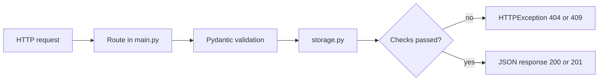

# Independent Work: FastAPI Library API Service

Hi! This is an advanced-level independent work. In 180 minutes you will walk the path of a real backend developer: design a data model, implement a REST API, add validation, search, statistics, and tests. Everything you do here is a ready-made foundation for a service you could hand to a client.

## Problem statement

The city library «Питон» asks you to automate its book checkout records. Today everything is kept in a paper journal, and the librarian spends hours searching for a record. You need to design and implement a REST API service that the librarian and readers will use.

The service must manage three entities:

- **Book**: `id`, `title`, `author`, `year`, `genre`, `isbn`, `copies` — the number of copies in the collection;
- **Reader**: `id`, `name`, `email`, `birth_year`, `registered_at`;
- **Borrow**: `id`, `book_id`, `reader_id`, `borrow_date`, `return_date` (`None` if the book has not been returned yet).

Functional requirements:

1. **Full CRUD** for books and readers: create, read as a list and by id, update, delete.
2. **Checkout**: the endpoint `POST /borrows` accepts `book_id` and `reader_id`, decreases the number of available copies, and records the checkout date. If there are no available copies — the service must refuse.
3. **Return**: the endpoint `POST /borrows/{id}/return` marks the borrow as returned and puts the copy back into the collection.
4. **Search and filtering**: search by title and author, filter by genre and availability, sorting, pagination.
5. **Statistics**: how many books total, how many available now, how many active borrows, how many readers, the top most popular books.
6. **Clear errors** with proper HTTP codes: 404 (resource missing), 409 (conflict, e.g. duplicate ISBN or borrowing an unavailable book), 422 (invalid data).
7. **Tests** of key scenarios.

Implementation requirements:

- all data models based on Pydantic, constraints set via `Field` and constraints;
- data is stored in memory (lists of dictionaries), the structure allows sequential `id` generation;
- dates are passed as ISO 8601 strings (`ГГГГ-ММ-ДД`), today's date comes from `datetime.date.today()`;
- each endpoint returns JSON and a correct status code;
- the app runs with `uvicorn main:app --reload`, and docs are available at `/docs`.

## What you will review

FastAPI and Pydantic, route decorators, query parameters, error handling via `HTTPException`, the "storage separate from routes" pattern, automatic Swagger UI docs, tests via `TestClient`.

The path of a request through the app layers:



## Work plan

The work is split into 5 stages. Go through them in order: each next one builds on the previous. Don't move to a new stage until the previous scenarios are verified to work in `/docs`.

<!--TASK-->
### Task 1
Create the project structure: a folder `library` with files `models.py`, `storage.py`, `main.py`. In `models.py`, describe Pydantic models `Book`, `Reader`, and `Borrow` with annotations and constraints: `title` and `author` are non-empty strings; `year` is between 1455 and the current year (use `Field(ge=1455, le=<текущий год>)`); `isbn` is a string; `copies` is an integer of at least 1; `email` is a valid address via `EmailStr`; `birth_year` is no earlier than 1900; `borrow_date` and `return_date` are `date | None`. In `storage.py`, set up empty lists for books, readers, borrows, and id counters. In `main.py`, create a FastAPI app with endpoints `GET /books` and `GET /readers` that return empty lists. Expected result: `uvicorn main:app --reload` starts without errors, the `/docs` page opens, and `GET /books` and `GET /readers` return `[]`.

### Task 2
Implement full CRUD for books: `POST /books` — creation with an ISBN uniqueness check (a repeated ISBN gives code 409); `GET /books/{book_id}` — get by id (no book — 404); `PUT /books/{book_id}` — update fields; `DELETE /books/{book_id}` — delete with code 204. Move data work into functions of the `storage.py` module, e.g. `get_books()`, `add_book(data)`, `book_by_id(book_id)`, `update_book(book_id, data)`, `delete_book(book_id)` — routes must stay thin. Expected result: all four operations work through `/docs`, a repeated `POST` with the same ISBN gives 409, accessing a non-existent id gives 404, `DELETE` returns 204.

### Task 3
Add checkout and return. The endpoint `POST /borrows` accepts a body like `{"book_id": 1, "reader_id": 1}`: check that the book and reader exist (otherwise 404), that there are available copies — `copies > 0` (otherwise 409 «Нет доступных экземпляров»), then decrease `copies` by 1 and create a record with `borrow_date` = today and `return_date = None`. The endpoint `POST /borrows/{borrow_id}/return` finds the borrow, and if it isn't closed yet, sets `return_date` = today and increases `copies` by 1. Also add `GET /borrows` with an optional `?active=true` parameter that keeps only open borrows. Expected result: checkout decreases the number of available copies; with zero free copies the checkout gives 409; the return restores `copies`.

### Task 4
Extend `GET /books` with search, filter, sort, and pagination parameters: `search` — a substring in `title` or `author`, case-insensitive; `genre` — exact genre match; `available=true` — only books with `copies > 0`; `sort` — values `year`, `-year` (descending), `title`; `limit` and `offset` — pagination. All parameters are optional. Expected result: parameter combinations work, e.g. `GET /books?search=python&available=true&sort=-year&limit=5` returns up to five books, filtered by search and availability, sorted by year descending.

### Task 5
Add the endpoint `GET /stats`, returning `{"total_books": ..., "available_books": ..., "active_borrows": ..., "total_readers": ..., "top_books": [{"title": ..., "borrow_count": ...}]}` — the top-5 books by number of borrows. Forbid deleting a book that has active borrows (code 409). Write tests in `test_app.py` via `TestClient`: at least 4 scenarios (creating a book; duplicate ISBN — 409; checkout then return; statistics). Expected result: `pytest test_app.py` passes fully, and stats correctly reflect the state of the "library".

### Task 6
Add renewal and deadline control. Extend the borrow record with `due_date` (the planned return date, `borrow_date + 14 дней`) and `renewals` (default 0). The endpoint `POST /borrows/{borrow_id}/renew` is allowed only if the book is not yet returned and renewals are fewer than two: `due_date` shifts by 14 days via `timedelta`, `renewals` grows by 1, otherwise — 409 with a clear `detail`. The endpoint `GET /borrows/overdue` returns active borrows with `due_date` in the past and the fields `borrow_id`, `book_id`, `reader_id`, `days_overdue`. Expected output: `{"borrow_id": 1, "days_overdue": 3}`; a third renewal gives 409.

### Task 7
Implement partial updates. Describe a `BookUpdate` model with optional fields (`title`, `author`, `year`, `genre`, `isbn`, `copies` — all `| None = None`) and the endpoint `PATCH /books/{book_id}`: it changes only the passed fields via `model_dump(exclude_unset=True)`, checks that the new ISBN is not taken by another book (409), responds 404 for an unknown id, and returns the updated book. Keep `PUT` as a full replacement. Expected result: `PATCH /books/1` with the body `{"copies": 5}` changes only `copies`, while `year` stays the same; changing the ISBN to a taken one gives 409.

<!--/TASK-->

<!--HINT-->
### Hint 1
Pydantic is imported like this: `from pydantic import BaseModel, Field, EmailStr`. `EmailStr` requires the `email-validator` package (`pip install email-validator`). For dates use `from datetime import date` and the annotation `date | None`. The current year can be obtained via `date.today().year` and plugged into `Field(le=...)`. The `Book` class inherits `BaseModel`; fields with `Field` get constraints: `Field(min_length=1, max_length=200)` for strings, `Field(ge=1455, le=date.today().year)` for the year. Set up the `books_db` list and the `next_book_id` counter in `storage.py` at module level.

### Hint 2
In `storage.py`, write functions that work with global lists: inside functions where you assign a new value to a counter, declare `global next_book_id`. ISBN duplicate check: `any(b["isbn"] == data["isbn"] for b in books_db)` — if `True`, raise `HTTPException(status_code=409, detail="Книга с таким ISBN уже существует")`. For 404, create a helper function `book_by_id` that either returns the dictionary or raises `HTTPException(status_code=404, detail="Книга не найдена")`. `PUT` updates via `old.update(data)`; `DELETE` via `books_db.remove(book)` with status 204.

### Hint 3
When creating a borrow, first find the book and reader via their "lookup" functions — if either is missing, 404 immediately. Then check `book["copies"] > 0`. If not — 409. Then decrease `copies`: `book["copies"] -= 1`. Form the borrow record as `{"id": ..., "book_id": ..., "reader_id": ..., "borrow_date": str(date.today()), "return_date": None}`. For the return, find the record by id, check `borrow["return_date"] is None`, otherwise return 409 (double return). Then set the date and increase `copies` on the book via `book_by_id(borrow["book_id"])`.

### Hint 4
All parameters get default values: `search: str | None = None`, `sort: str = "year"`, etc. — FastAPI turns them into query parameters itself. Build filtering as a chain: first search, then genre, then availability. For sorting use `sorted(result, key=lambda b: b["title"], reverse=(sort.startswith("-")))` and strip the key: `sort.lstrip("-")`. Pagination is a simple list slice: `result[offset:offset + limit]`. Don't forget the defaults `limit=10, offset=0`.

### Hint 5
For the book top, count `book_id` frequencies in `borrows_db` with or without `return_date` — it doesn't matter, all borrows can be counted: `Counter(b["book_id"] for b in borrows_db)` from `collections`. Do the delete-forbid check in `delete_book`: if `any(b["book_id"] == book_id and b["return_date"] is None for b in borrows_db)` — 409. Tests: `from fastapi.testclient import TestClient`, then `client = TestClient(app)` — the `client` object works like `requests`: `client.post("/books", json={...})`, `client.get("/books")`. Check `response.status_code` and `response.json()`. `TestClient` runs the app in memory; you don't need to start uvicorn for tests.

### Hint 6
When creating a record, compute the plan: `due_date = date.today() + timedelta(days=14)`. For renewal, find the record, check `return_date is None` and `renewals < 2`, then `borrow["due_date"] = str(date.fromisoformat(borrow["due_date"]) + timedelta(days=14))` — the date is stored as a string in the dictionary. Overdue: `(date.today() - date.fromisoformat(b["due_date"])).days`; keep only positive values and open borrows.

### Hint 7
Make `BookUpdate` inherit from `BaseModel` and keep all fields `str | None = None`; `Field` constraints can be kept. In the route, `data = payload.model_dump(exclude_unset=True)` — the dictionary contains only the keys the client actually sent. Do the ISBN check before `update`: `any(b["isbn"] == data["isbn"] and b["id"] != book_id for b in books_db)`. An empty body is a valid request that changes nothing.

<!--/HINT-->

<!--SOLUTION-->
### Solution 1
Let's start with the models. File `library/models.py`:

```python
from datetime import date
from pydantic import BaseModel, Field, EmailStr


class Book(BaseModel):
    title: str = Field(min_length=1, max_length=200)
    author: str = Field(min_length=1, max_length=100)
    year: int = Field(ge=1455, le=date.today().year)
    genre: str = Field(min_length=1, max_length=50)
    isbn: str = Field(min_length=10, max_length=17)
    copies: int = Field(ge=1)


class Reader(BaseModel):
    name: str = Field(min_length=1, max_length=100)
    email: EmailStr
    birth_year: int = Field(ge=1900, le=date.today().year)


class Borrow(BaseModel):
    book_id: int
    reader_id: int
    borrow_date: date | None = None
    return_date: date | None = None
```

`BaseModel` enables validation: type annotations define field types, and `Field` adds constraints — `min_length`/`max_length` for strings, `ge` (greater than or equal) and `le` for numbers. `EmailStr` checks that the string is a valid email address but requires the `email-validator` package (`pip install email-validator`). The `le=date.today().year` expression computes the current year when the class is defined — the constraint is always up to date. For the borrow date we use `date | None` because `return_date` is unknown when the record is created.

Now the storage — file `library/storage.py`:

```python
books_db = []
readers_db = []
borrows_db = []
next_book_id = 1
next_reader_id = 1
next_borrow_id = 1
```

And the minimal app — `library/main.py`:

```python
from fastapi import FastAPI
from storage import books_db, readers_db

app = FastAPI(title="Library API", description="Сервис библиотеки «Питон»")


@app.get("/books")
def list_books():
    return books_db


@app.get("/readers")
def list_readers():
    return readers_db
```

Splitting into modules is the key architectural idea: `models.py` owns the data contract, `storage.py` owns storage, `main.py` owns the HTTP layer. Such code is easy to evolve: replacing lists with a database is possible without touching routes. Run: `uvicorn main:app --reload` from the `library` folder. If uvicorn can't find the module, run from the project folder: `uvicorn library.main:app --reload`. Open http://127.0.0.1:8000/docs — interactive docs for both endpoints are built there automatically.

### Solution 2
We fill the storage with functions. `library/storage.py`:

```python
from fastapi import HTTPException

books_db = []
readers_db = []
borrows_db = []
next_book_id = 1
next_reader_id = 1
next_borrow_id = 1


def list_books():
    return books_db


def book_by_id(book_id: int):
    for book in books_db:
        if book["id"] == book_id:
            return book
    raise HTTPException(status_code=404, detail="Книга не найдена")


def add_book(data: dict):
    global next_book_id
    if any(b["isbn"] == data["isbn"] for b in books_db):
        raise HTTPException(status_code=409, detail="Книга с таким ISBN уже существует")
    book = {"id": next_book_id, **data}
    next_book_id += 1
    books_db.append(book)
    return book


def update_book(book_id: int, data: dict):
    book = book_by_id(book_id)
    book.update(data)
    return book


def delete_book(book_id: int):
    book = book_by_id(book_id)
    books_db.remove(book)
```

Routes in `library/main.py`:

```python
from fastapi import FastAPI, status
from models import Book
import storage

app = FastAPI(title="Library API")


@app.get("/books")
def list_books():
    return storage.list_books()


@app.post("/books", status_code=status.HTTP_201_CREATED)
def create_book(book: Book):
    return storage.add_book(book.model_dump())


@app.get("/books/{book_id}")
def get_book(book_id: int):
    return storage.book_by_id(book_id)


@app.put("/books/{book_id}")
def update_book(book_id: int, book: Book):
    return storage.update_book(book_id, book.model_dump())


@app.delete("/books/{book_id}", status_code=status.HTTP_204_NO_CONTENT)
def delete_book(book_id: int):
    storage.delete_book(book_id)
```

Key points: `book.model_dump()` turns a Pydantic object into a dictionary — that's what we store. `add_book` checks ISBN uniqueness via `any(...)` and raises `HTTPException` with code 409 if a duplicate is found. The function `book_by_id` centralizes "not found": any route gets a 404 automatically. Note `global next_book_id`: without it Python would treat the variable as local and crash. Status 204 for DELETE is the standard "success, no content".

### Solution 3
We add checkout and return. In `storage.py`:

```python
from datetime import date


def borrow_book(book_id: int, reader_id: int):
    global next_borrow_id
    book = book_by_id(book_id)
    if not any(r["id"] == reader_id for r in readers_db):
        raise HTTPException(status_code=404, detail="Читатель не найден")
    if book["copies"] <= 0:
        raise HTTPException(status_code=409, detail="Нет доступных экземпляров")
    book["copies"] -= 1
    record = {
        "id": next_borrow_id,
        "book_id": book_id,
        "reader_id": reader_id,
        "borrow_date": str(date.today()),
        "return_date": None,
    }
    next_borrow_id += 1
    borrows_db.append(record)
    return record


def return_book(borrow_id: int):
    for borrow in borrows_db:
        if borrow["id"] == borrow_id:
            if borrow["return_date"] is not None:
                raise HTTPException(status_code=409, detail="Книга уже возвращена")
            borrow["return_date"] = str(date.today())
            book_by_id(borrow["book_id"])["copies"] += 1
            return borrow
    raise HTTPException(status_code=404, detail="Выдача не найдена")
```

Routes:

```python
from models import Book, Borrow


@app.post("/borrows", status_code=status.HTTP_201_CREATED)
def create_borrow(payload: Borrow):
    return storage.borrow_book(payload.book_id, payload.reader_id)


@app.post("/borrows/{borrow_id}/return")
def return_borrow(borrow_id: int):
    return storage.return_book(borrow_id)


@app.get("/borrows")
def list_borrows(active: bool | None = None):
    if active is None:
        return storage.borrows_db
    return [b for b in storage.borrows_db if (b["return_date"] is None) == active]
```

Logic: `borrow_book` first finds the book and checks the reader (404 if either is missing), then looks at `copies` — if zero, 409. Only after all checks do we change state: decrease the counter and create the record. This is an important principle: all validations first, then mutations — otherwise you can easily end up with an "eaten" copy on error. `return_book` searches for the record, and if `return_date` is already set, responds 409 — a double return is impossible. The `?active=true` parameter filters by `return_date is None`; the expression `(b["return_date"] is None) == active` concisely covers both cases.

### Solution 4
We extend `GET /books`:

```python
@app.get("/books")
def list_books(search: str | None = None, genre: str | None = None,
               available: bool | None = None, sort: str = "year",
               limit: int = 10, offset: int = 0):
    result = storage.books_db
    if search:
        search = search.lower()
        result = [b for b in result
                  if search in b["title"].lower() or search in b["author"].lower()]
    if genre:
        result = [b for b in result if b["genre"].lower() == genre.lower()]
    if available is not None:
        result = [b for b in result if (b["copies"] > 0) == available]
    key = sort.lstrip("-")
    result = sorted(result, key=lambda b: b[key], reverse=sort.startswith("-"))
    return result[offset:offset + limit]
```

All parameters have default values, so FastAPI treats them as optional query parameters. Filtering is a chain of list comprehensions: each step narrows the result. Search compares lowercased substrings, so case doesn't matter. Sorting: `sort.lstrip("-")` gives the field name; `reverse=sort.startswith("-")` flips the order for values with a minus (e.g. `-year`). Pagination is a list slice `[offset:offset + limit]`. Check in `/docs`: parameter combinations, e.g. `?search=python&available=true&sort=-year&limit=5`, work independently.

### Solution 5
The final touch — statistics and tests. In `storage.py`:

```python
from collections import Counter


def get_stats():
    total_books = len(books_db)
    available_books = sum(1 for b in books_db if b["copies"] > 0)
    active_borrows = sum(1 for b in borrows_db if b["return_date"] is None)
    counts = Counter(b["book_id"] for b in borrows_db)
    top = []
    for book_id, count in counts.most_common(5):
        book = book_by_id(book_id)
        top.append({"title": book["title"], "borrow_count": count})
    return {
        "total_books": total_books,
        "available_books": available_books,
        "active_borrows": active_borrows,
        "total_readers": len(readers_db),
        "top_books": top,
    }
```

And the ban on deleting a book with active borrows — add the check to `delete_book`:

```python
def delete_book(book_id: int):
    book = book_by_id(book_id)
    if any(b["book_id"] == book_id and b["return_date"] is None for b in borrows_db):
        raise HTTPException(status_code=409, detail="Нельзя удалить книгу с активными выдачами")
    books_db.remove(book)
```

Tests `test_app.py`:

```python
from fastapi.testclient import TestClient
from main import app

client = TestClient(app)


def test_create_book():
    r = client.post("/books", json={
        "title": "Чистый код", "author": "Р. Мартин", "year": 2008,
        "genre": "Программирование", "isbn": "978-5-93286-146-9", "copies": 2,
    })
    assert r.status_code == 201
    assert r.json()["id"] == 1


def test_duplicate_isbn():
    payload = {
        "title": "Другая книга", "author": "Автор", "year": 2020,
        "genre": "Фантастика", "isbn": "978-5-93286-146-9", "copies": 1,
    }
    assert client.post("/books", json=payload).status_code == 409


def test_borrow_and_return():
    client.post("/books", json={
        "title": "Гарри Поттер", "author": "Дж. Роулинг", "year": 1997,
        "genre": "Фэнтези", "isbn": "978-5-389-00040-4", "copies": 1,
    })
    client.post("/readers", json={"name": "Иван", "email": "ivan@mail.ru", "birth_year": 1990})
    r = client.post("/borrows", json={"book_id": 1, "reader_id": 1})
    assert r.status_code == 201
    assert client.post("/borrows", json={"book_id": 1, "reader_id": 1}).status_code == 409
    borrow_id = r.json()["id"]
    assert client.post(f"/borrows/{borrow_id}/return").status_code == 200
    assert client.post(f"/borrows/{borrow_id}/return").status_code == 409


def test_stats():
    stats = client.get("/stats").json()
    assert stats["total_books"] == 2
    assert stats["active_borrows"] == 0
```

`TestClient` from `fastapi.testclient` runs the app in memory — no need to start a server. Note: tests share the global storage, so they must run in an order that doesn't break (we create books in the first tests and rely on them in `test_stats`). Run: `pytest test_app.py` from the `library` folder. `Counter` from `collections` conveniently counts frequencies; `most_common(5)` immediately gives the top-5. Statistics are computed on the fly — that's fine for an in-memory store. Check the delete ban: `DELETE /books/1` with an active borrow returns 409.

### Solution 6
We store the planned date in the record rather than computing it on the fly: renewal changes exactly that date, and without a separate field the history of promises cannot be reconstructed.

```python
from datetime import date, timedelta


def borrow_book(book_id: int, reader_id: int):
    global next_borrow_id
    book = book_by_id(book_id)
    if not any(r["id"] == reader_id for r in readers_db):
        raise HTTPException(status_code=404, detail="Читатель не найден")
    if book["copies"] <= 0:
        raise HTTPException(status_code=409, detail="Нет доступных экземпляров")
    book["copies"] -= 1
    today = date.today()
    record = {
        "id": next_borrow_id,
        "book_id": book_id,
        "reader_id": reader_id,
        "borrow_date": str(today),
        "due_date": str(today + timedelta(days=14)),
        "return_date": None,
        "renewals": 0,
    }
    next_borrow_id += 1
    borrows_db.append(record)
    return record


def borrow_by_id(borrow_id: int):
    for borrow in borrows_db:
        if borrow["id"] == borrow_id:
            return borrow
    raise HTTPException(status_code=404, detail="Выдача не найдена")


def renew_borrow(borrow_id: int):
    borrow = borrow_by_id(borrow_id)
    if borrow["return_date"] is not None:
        raise HTTPException(status_code=409, detail="Выдача уже закрыта")
    if borrow["renewals"] >= 2:
        raise HTTPException(status_code=409, detail="Лимит продлений исчерпан")
    due = date.fromisoformat(borrow["due_date"]) + timedelta(days=14)
    borrow["due_date"] = str(due)
    borrow["renewals"] += 1
    return borrow


def overdue_borrows():
    today = date.today()
    result = []
    for borrow in borrows_db:
        if borrow["return_date"] is not None:
            continue
        due = date.fromisoformat(borrow["due_date"])
        if due < today:
            result.append({
                "borrow_id": borrow["id"],
                "book_id": borrow["book_id"],
                "reader_id": borrow["reader_id"],
                "days_overdue": (today - due).days,
            })
    return result
```

```python
@app.post("/borrows/{borrow_id}/renew")
def renew(borrow_id: int):
    return storage.renew_borrow(borrow_id)


@app.get("/borrows/overdue")
def overdue():
    return storage.overdue_borrows()
```

`due_date` is a separate field because `return_date` means the fact of return and stays `None` until then. `timedelta(days=14)` is added to a `date`, not a string: first `date.fromisoformat`, then back to `str(...)` — otherwise we'd get string concatenation. The order of checks in `renew_borrow` matters: a closed borrow and an exhausted limit are both 409, but with different `detail` values so the client understands the reason. `overdue_borrows` filters open records and counts the difference in days; it is positive only for overdue ones. Declare the route `/borrows/overdue` before any `/borrows/{borrow_id}` with the same method, otherwise FastAPI will try to parse the word `overdue` as `int`.

### Solution 7
We separate "create" from "change": the full model requires all fields, the partial one only those that arrived.

```python
class BookUpdate(BaseModel):
    title: str | None = Field(default=None, min_length=1, max_length=200)
    author: str | None = Field(default=None, min_length=1, max_length=100)
    year: int | None = Field(default=None, ge=1455, le=date.today().year)
    genre: str | None = Field(default=None, min_length=1, max_length=50)
    isbn: str | None = Field(default=None, min_length=10, max_length=17)
    copies: int | None = Field(default=None, ge=0)
```

```python
def patch_book(book_id: int, data: dict):
    book = book_by_id(book_id)
    new_isbn = data.get("isbn")
    if new_isbn and any(b["isbn"] == new_isbn and b["id"] != book_id
                        for b in books_db):
        raise HTTPException(status_code=409, detail="Книга с таким ISBN уже существует")
    book.update(data)
    return book
```

```python
@app.patch("/books/{book_id}")
def patch_book(book_id: int, payload: BookUpdate):
    return storage.patch_book(book_id, payload.model_dump(exclude_unset=True))
```

`exclude_unset=True` is the key detail: without it, `model_dump()` would return all fields, and the unset ones would become `None`, wiping the book's data. With it, only the sent keys remain in the dictionary, and `book.update(data)` changes exactly those. The ISBN check excludes the book itself (`b["id"] != book_id`), otherwise saving the same ISBN would count as a conflict. `copies` in `BookUpdate` allows 0 because all copies may be checked out, whereas creating a book requires at least one. `PUT` stays a full replacement and still requires all fields — so the client explicitly chooses between "overwrite" and "tweak".

<!--/SOLUTION-->

## Assessment criteria

| Criterion | What is checked | Points |
|---|---|---|
| Models and validation | Correct Pydantic models, `Field` constraints, `EmailStr`, dates | 15 |
| Architecture | Split into `models.py` / `storage.py` / `main.py`, thin routes | 15 |
| Book CRUD | All 5 operations, codes 201/204/404/409 | 15 |
| Checkout and return | `copies` decrease/restore, protection against repeat checkout and return | 15 |
| Search, filter, sort, pagination | All parameters work together | 15 |
| Statistics and delete ban | Correct numbers, top-5, 409 with active borrows | 10 |
| Tests | At least 4 scenarios, `pytest` passes | 10 |
| Documentation and run | `/docs` opens, uvicorn starts without errors | 5 |

Total 100 points. Grade: 90+ — "excellent", 75–89 — "good", 60–74 — "satisfactory", below 60 — the work should be improved and resubmitted.

## What to submit

1. Project files: `library/models.py`, `library/storage.py`, `library/main.py`, `library/test_app.py`.
2. A short README (10–20 lines): how to install dependencies, how to start the server, how to run tests, a list of endpoints with examples.
3. Screenshots proving the work: the `/docs` page, successful `pytest`, one or two API response examples (can be via curl: `curl http://127.0.0.1:8000/books`).
4. Put everything into one archive or keep it in a repository — the whole `library` folder.

<!--QUIZ-->
What does the annotation `year: int = Field(ge=1455, le=2026)` do in Pydantic?
- Sets a default value of 1455
- Constrains the field to numbers from 1455 to 2026 inclusive
- Makes the field optional
- Forbids changing the field after creation
* Correct answer: Constrains the field to numbers from 1455 to 2026 inclusive
`ge` and `le` define the allowed range: a value below 1455 or above 2026 causes validation error 422.

Which response code will FastAPI return when trying to create a book with an existing ISBN, if `HTTPException(status_code=409, ...)` is raised in the code?
- 404
- 409
- 422
- 500
* Correct answer: 409
409 Conflict is the semantically correct code for a conflict with an existing resource, e.g. a duplicate unique field.

What is `model_dump()` on a Pydantic object for?
- To save the model to a database
- To turn the model object into a plain dictionary
- To check whether the object exists
- To generate a JSON schema
* Correct answer: To turn the model object into a plain dictionary
`model_dump()` returns a standard Python dictionary — exactly what is convenient to store in a list or pass on.

What happens if `book_by_id` doesn't find a book and raises `HTTPException(status_code=404, ...)`?
- The server crashes with an error
- FastAPI returns JSON to the client with code 404 and the detail text
- The request is silently ignored
- An application error page opens
* Correct answer: FastAPI returns JSON to the client with code 404 and the detail text
FastAPI catches `HTTPException` and turns it into an HTTP response with the specified status.

Why is the line `global next_book_id` needed inside `add_book`?
- Without it Python throws an error when accessing the variable
- Otherwise Python treats the variable as local and creates a new one, and the counter won't increase
- `global` is needed to declare the variable type
- Without it the books_db list won't be visible
* Correct answer: Otherwise Python treats the variable as local and creates a new one, and the counter won't increase
An assignment inside a function makes the variable local; `global` tells Python to work with the global version.

What will `GET /books/999` return if no book with id 999 exists?
- An empty list []
- Error 404 with the text «Книга не найдена»
- Error 422
- None
* Correct answer: Error 404 with the text «Книга не найдена»
`book_by_id` raises `HTTPException` with status 404 — this is the standard way to report a non-existent resource.

How to correctly define an optional search query parameter in FastAPI?
- `def list_books(search: str = "all")`
- `def list_books(search: str | None = None)`
- `def list_books(search)`
- `def list_books(search: str = None)`
* Correct answer: `def list_books(search: str | None = None)`
A parameter with the default `None` and the annotation `str | None` becomes an optional query parameter.

What does code 204 mean in the response to `DELETE /books/{book_id}`?
- Error — book not found
- Successful deletion with no body in the response
- Resource created
- Redirect
* Correct answer: Successful deletion with no body in the response
204 No Content is the standard code for successful deletion: the response body is empty.

What does `TestClient(app)` from `fastapi.testclient` do?
- Starts uvicorn on port 8000
- Creates an HTTP client for testing the app in memory
- Validates the OpenAPI schema
- Restarts the server after each request
* Correct answer: Creates an HTTP client for testing the app in memory
`TestClient` calls the app directly, without a real server — so tests are fast and need no ports.

How is `PATCH` different from `PUT` in this API?
- `PATCH` changes only the passed fields; `PUT` replaces the resource entirely
- `PATCH` works only with books
- `PUT` returns 204, while `PATCH` returns 201
- There is no difference
* Correct answer: `PATCH` changes only the passed fields; `PUT` replaces the resource entirely
Partial updates are convenient when you need to change one field without resending the whole book.

What does `model_dump(exclude_unset=True)` do?
- Returns only the fields the client explicitly sent
- Removes all fields with the value `None` from the model
- Checks field uniqueness
- Turns the model into a JSON string
* Correct answer: Returns only the fields the client explicitly sent
This is what protects the book's other fields from being wiped by default values.

How to get the planned return date 14 days from now?
- `date.today() + timedelta(days=14)`
- `date.today() + 14`
- `timedelta(days=14)`
- `date.today().replace(day=14)`
* Correct answer: `date.today() + timedelta(days=14)`
A `timedelta` is added to a date; a bare number of days gives a `TypeError`.

What will `(date(2026, 11, 21) - date(2026, 11, 1)).days` return?
- 20
- 21
- 19
- 22
* Correct answer: 20
The difference between November 1 and November 21 is exactly 20 days.
<!--/QUIZ-->
