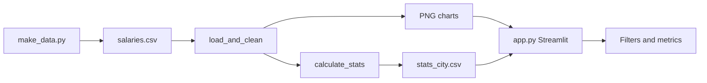

# Independent Work: Salary Analysis Dashboard

Hi! This is an advanced-level independent work. In 180 minutes you will go through the full data analyst pipeline: from data generation to an interactive dashboard you can show an employer. You will work with pandas, matplotlib, and Streamlit — the stack on which hundreds of real analytical products are built.

## Problem statement

The HR agency «Карьера» collects salary data of IT specialists across Russian cities. The data sits in a CSV file but in raw form: with missing values, outliers, and inconsistent entries. The agency wants an analytical report and an interactive dashboard to:

- understand how salaries are distributed by city and position;
- see the connection between salary, experience, and work format (office/remote);
- quickly filter data by the needed parameters.

You need to build a full pipeline: **data → cleaning → aggregation → visualization → dashboard**.

There is no source data — you will generate it yourself with a script. This is common practice: developing a pipeline needs a realistic dataset, and it can be created synthetically with a fixed seed (`random.seed(42)`) so the result is reproducible.

Requirements for the dataset `salaries.csv`:

- 600 records, columns: `city` (5 cities: Москва, Санкт-Петербург, Новосибирск, Екатеринбург, Казань), `position` (Программист, Аналитик, DevOps, Тестировщик, Дизайнер), `experience_years` (integer from 0 to 25), `salary_rub` (from 40,000 to 350,000), `remote` («да»/«нет»);
- ~5% of records must have missing `salary_rub`, ~5% missing `city`, plus a few duplicate rows;
- add 5–8 explicit outliers: salaries 10× above the norm or negative values.

Functional requirements:

1. The script `make_data.py` generates the CSV and prints `df.info()`.
2. Cleaning: missing values, outliers by the IQR method, duplicates, converting types and strings to a uniform form.
3. Aggregations: mean and median salaries by city and position, by experience buckets; results saved to separate CSVs.
4. Visualization: at least three charts (salary distribution, boxplot by city, bar chart of means by position), saved as PNG.
5. A Streamlit dashboard: title, filters (city, position, experience, remote), metrics, and interactive charts that recompute when filters change.

## What you will review

pandas: `read_csv`, `info`, `isna`, `dropna`, `fillna`, `drop_duplicates`, `groupby`, `agg`, `cut`, `quantile`, `to_csv`. matplotlib: `hist`, `boxplot`, `bar`, `savefig`, `subplots`. Streamlit: `title`, `selectbox`, `multiselect`, `slider`, `checkbox`, `metric`, `pyplot`, `dataframe`.

The data path in the project:



## Work plan

Go through the stages in order — each next one builds on the previous. In the end you'll have a standalone project of three scripts: `make_data.py`, `analysis.py`, `app.py`.

<!--TASK-->
### Task 1
Create the script `make_data.py` that generates the dataset `salaries.csv` and saves it. Use `random.seed(42)`, lists of cities and positions, and reasonable logic: salary depends on the city (Moscow is more expensive), the position, and experience. Add ~5% missing values in `salary_rub` and `city` (write an empty string or `NaN`), 3–5 full duplicate rows, and 5–8 outliers (negative values or salaries 10× above the norm). Set base salaries as integers from 40,000. At the end, print `df.info()` and the first 5 rows. Expected result: the file `salaries.csv` is created, and on run a table of 600 rows and 5 columns is printed.

### Task 2
Create the script `analysis.py` and write in it the function `load_and_clean(path)` that loads the CSV and fully cleans the data: removes duplicates (`drop_duplicates`), fills missing `salary_rub` with the column median and `city` with the mode (the most frequent city); removes outliers by the IQR method for `salary_rub` (below `Q1 - 1.5*IQR` and above `Q3 + 1.5*IQR`); lowercases `city`, `position`, `remote` with `strip()` and converts `remote` to boolean. Call the function with `sys.argv[1]` (or hardcode the path) and print how many rows there were and how many remain. Expected result: the report shows that after cleaning the row count decreased, there are no missing values, and `df.dtypes` shows the correct types.

### Task 3
In the same `analysis.py`, add the function `calculate_stats(df)` that computes aggregations: mean and median salary, record count, and remote share by city (`groupby("city").agg({...})`); the same by position; salary by experience buckets via `pd.cut(df["experience_years"], bins=[0, 2, 5, 10, 26], labels=["0-2", "3-5", "6-10", "11+"])`. Save the three result tables to CSV: `stats_city.csv`, `stats_position.csv`, `stats_experience.csv`. Expected result: the files are created, each with meaningful numbers (e.g., the mean programmer salary is above the dataset average, and Moscow's is above Kazan's).

### Task 4
In `analysis.py`, add visualization functions: `plot_salary_distribution(df)` — a salary histogram with 30 bins and labeled axes (save as `hist_salary.png`); `plot_salary_by_city(df)` — a boxplot of salaries by city (`savefig("boxplot_city.png")`); `plot_salary_by_position(df)` — a bar chart of mean salaries by position (`barplot_position.png`). Use `matplotlib` with `plt.figure(figsize=(10, 6))`, `plt.tight_layout()`, and `plt.savefig(...)`. Expected result: three PNG files appear in the folder; the charts are readable: axes labeled, titles present, and the boxplot shows whiskers and outliers.

### Task 5
Create `app.py` — a Streamlit dashboard. Inside: `st.title`, loading and cleaning data (reuse the functions from `analysis.py`), a sidebar with filters: `st.selectbox` for city (with an "All cities" option), `st.multiselect` for positions, `st.slider` for the experience range, `st.checkbox` "Only remote". Main area: three `st.metric` (mean salary, median, record count), `st.dataframe` with the filtered data, and three charts (histogram, boxplot, bar chart), recomputed on the filtered dataframe. Expected result: `streamlit run app.py` opens the dashboard in the browser, filters change the metric values and chart shapes.

### Task 6
Build a "city × position" pivot table. Add to `analysis.py` the function `pivot_salary(df)`: `pd.pivot_table` with values `salary_rub`, index `city`, columns `position`, aggfunc `median` and `fill_value=0`; round to integers and save to `pivot_city_position.csv`. Then draw a heatmap: `plt.imshow(matrix, cmap="YlOrRd")`, city labels on the Y axis, positions on X, values in cells, `plt.colorbar()`, saved as `heatmap_city_position.png`. Expected result: a 5×5 table, the "Москва / DevOps" cell holds the largest number, the PNG is readable, and labels are not clipped.

### Task 7
Make the dashboard fit for foreign data. Add `@st.cache_data` above the loading function so cleaning is not repeated on every filter movement; `st.sidebar.file_uploader` for your own CSV (if no file is uploaded — `salaries.csv` is used); `st.download_button` that serves the filtered rows as CSV (`index=False`, `mime="text/csv"`, name `filtered.csv`). Expected result: filters switch without a noticeable pause, an uploaded CSV replaces the data, and the download button serves exactly the rows visible in the table.

<!--/TASK-->

<!--HINT-->
### Hint 1
Use `random.randint` for salary with a base from city and position: e.g. the base for Moscow is 120000, for the rest 80000; multiply by a position coefficient (Программист 1.2, Аналитик 1.0, DevOps 1.3, Тестировщик 0.85, Дизайнер 0.9) and add `experience_years * 3500`. Missing values: after generation, walk over random indices (`random.sample(range(600), 30)`) and null the values. Outliers: just assign several rows values like 5000000 or -1000. Then `pd.DataFrame(...).to_csv("salaries.csv", index=False)`.

### Hint 2
The cleaning order matters: first `drop_duplicates()`, then types, then missing values, then outliers. Compute the median as `df["salary_rub"].median()`, the mode as `df["city"].mode()[0]`. For IQR: `q1 = df["salary_rub"].quantile(0.25)`, `q3 = df["salary_rub"].quantile(0.75)`, then `df[(df["salary_rub"] >= q1 - 1.5 * (q3 - q1)) & (df["salary_rub"] <= q3 + 1.5 * (q3 - q1))]`. Otherwise salaries of 5 million would destroy all statistics.

### Hint 3
`groupby("city").agg(salary_mean=("salary_rub", "mean"), salary_median=("salary_rub", "median"), count=("salary_rub", "size"), share_remote=("remote", "mean"))` — this gives named columns in one call. For experience buckets, don't forget that `pd.cut` with `labels` requires `include_lowest=True` to include zero: `pd.cut(df["experience_years"], bins=[0, 2, 5, 10, 26], labels=["0-2", "3-5", "6-10", "11+"], include_lowest=True)`.

### Hint 4
For the histogram: `plt.hist(df["salary_rub"], bins=30, edgecolor="white")`. For the boxplot: `df.boxplot(column="salary_rub", by="city", figsize=(10, 6))` — but better via `plt.subplots()` + `ax.boxplot([...])` or `df.boxplot(...)` and then `plt.savefig("boxplot_city.png")`. Don't forget `plt.title`, `plt.xlabel`, `plt.ylabel`, and `plt.tight_layout()` before `savefig`. Check that the charts are actually created and open.

### Hint 5
Build filtering as a chain of conditions: `mask = df["city"] == selected_city` (if not "All cities"), `mask &= df["position"].isin(selected_positions)` (if the list is non-empty), `mask &= df["experience_years"].between(exp_min, exp_max)`, `mask &= df["remote"]` (if the checkbox is on), then `filtered = df[mask]`. For charts, pass `filtered` to the functions from task 4, but instead of `savefig` show with `st.pyplot(plt.gcf())`. Metrics: `st.metric("Средняя зарплата", f"{filtered['salary_rub'].mean():,.0f} ₽")`.

### Hint 6
`pivot = pd.pivot_table(df, values="salary_rub", index="city", columns="position", aggfunc="median", fill_value=0)`. For the picture take `matrix = pivot.values`, draw `plt.imshow(matrix, cmap="YlOrRd", aspect="auto")`, then `plt.xticks(range(len(pivot.columns)), pivot.columns, rotation=45, ha="right")` and `plt.yticks(range(len(pivot.index)), pivot.index)`. Numbers in cells — a nested loop with `plt.text(j, i, int(matrix[i, j]), ha="center", va="center")`; choose text color by background brightness.

### Hint 7
Put the cache decorator on the function that returns data: `@st.cache_data` and `def load_data(file): ...`. `st.file_uploader("CSV", type="csv")` returns a file object or `None` — pass either the object itself or the path `"salaries.csv"` to `pd.read_csv`. For download: `st.download_button("Скачать CSV", data=filtered.to_csv(index=False).encode("utf-8"), file_name="filtered.csv", mime="text/csv")`. Encode the string to bytes: this way Russian letters are not lost.

<!--/HINT-->

<!--SOLUTION-->
### Solution 1
File `make_data.py`:

```python
import random
import pandas as pd

random.seed(42)

CITIES = ["Москва", "Санкт-Петербург", "Новосибирск", "Екатеринбург", "Казань"]
POSITIONS = ["Программист", "Аналитик", "DevOps", "Тестировщик", "Дизайнер"]
CITY_BASE = {"Москва": 120000, "Санкт-Петербург": 100000,
             "Новосибирск": 85000, "Екатеринбург": 80000, "Казань": 75000}
POS_COEF = {"Программист": 1.2, "Аналитик": 1.0, "DevOps": 1.3,
            "Тестировщик": 0.85, "Дизайнер": 0.9}

rows = []
for _ in range(600):
    city = random.choice(CITIES)
    position = random.choice(POSITIONS)
    experience = random.randint(0, 25)
    salary = int(CITY_BASE[city] * POS_COEF[position] + experience * 3500
                 + random.randint(-8000, 8000))
    remote = "да" if random.random() < 0.4 else "нет"
    rows.append({"city": city, "position": position,
                 "experience_years": experience, "salary_rub": salary,
                 "remote": remote})

df = pd.DataFrame(rows)

# пропуски: 5% зарплат и 5% городов
for idx in random.sample(range(600), 30):
    df.at[idx, "salary_rub"] = None
for idx in random.sample(range(600), 30):
    df.at[idx, "city"] = None

# дубликаты
df = pd.concat([df, df.iloc[:4]], ignore_index=True)

# выбросы
df.at[500, "salary_rub"] = 5_000_000
df.at[501, "salary_rub"] = -1000
df.at[502, "salary_rub"] = 4_200_000
df.at[503, "salary_rub"] = -500
df.at[504, "salary_rub"] = 950_000

df.to_csv("salaries.csv", index=False)
print(df.info())
print(df.head())
```

The key idea is determinism: `random.seed(42)` guarantees the same dataset on every run. This matters for reproducibility: anyone who runs your script sees the same numbers. Generation logic: the base depends on the city, the coefficient on the position, and the result gets experience's contribution plus a small noise `random.randint(-8000, 8000)`. Missing values are injected by assigning `None` to random rows — pandas writes them as empty cells in the CSV. Creating duplicates via `pd.concat` with the first four rows mimics "multiplied" records. Outliers are set explicitly — so we know there are exactly five of them.

### Solution 2
File `analysis.py`:

```python
import sys
import pandas as pd


def load_and_clean(path):
    df = pd.read_csv(path)
    original = len(df)

    df = df.drop_duplicates()

    df["city"] = df["city"].fillna(df["city"].mode()[0]).str.strip().str.lower()
    df["position"] = df["position"].str.strip()
    df["salary_rub"] = pd.to_numeric(df["salary_rub"], errors="coerce")
    df["salary_rub"] = df["salary_rub"].fillna(df["salary_rub"].median())
    df["remote"] = df["remote"].str.strip().str.lower().map({"да": True, "нет": False})

    q1 = df["salary_rub"].quantile(0.25)
    q3 = df["salary_rub"].quantile(0.75)
    iqr = q3 - q1
    df = df[(df["salary_rub"] >= q1 - 1.5 * iqr) &
            (df["salary_rub"] <= q3 + 1.5 * iqr)]

    print(f"Было строк: {original}, стало: {len(df)}")
    print(df.dtypes)
    return df


if __name__ == "__main__":
    path = sys.argv[1] if len(sys.argv) > 1 else "salaries.csv"
    load_and_clean(path)
```

The order of operations is fundamental. First `drop_duplicates` — otherwise duplicates double the weight of some records. Then types: `pd.to_numeric(..., errors="coerce")` turns garbage values into `NaN`, and median filling (`fillna`) replaces all missing values — including broken strings. The median is more robust than the mean for "plugging" holes. The mode for city: `df["city"].mode()[0]` — the most frequent city. Strings are lowercased with `strip()`: this protects against "москва" vs "Москва". Outliers are removed by IQR — a standard statistical method: anything further than 1.5 interquartile ranges from the quartiles is considered an anomaly. The filter shown does this in one line with `&` (don't forget the parentheses — `&` on Series binds looser than comparisons). Run: `python analysis.py salaries.csv`.

### Solution 3
We add aggregations to `analysis.py`:

```python
def calculate_stats(df):
    by_city = df.groupby("city").agg(
        salary_mean=("salary_rub", "mean"),
        salary_median=("salary_rub", "median"),
        count=("salary_rub", "size"),
        share_remote=("remote", "mean"),
    ).round(0).sort_values("salary_mean", ascending=False)
    by_city.to_csv("stats_city.csv")

    by_position = df.groupby("position").agg(
        salary_mean=("salary_rub", "mean"),
        salary_median=("salary_rub", "median"),
        count=("salary_rub", "size"),
    ).round(0).sort_values("salary_mean", ascending=False)
    by_position.to_csv("stats_position.csv")

    df = df.copy()
    df["experience_group"] = pd.cut(
        df["experience_years"],
        bins=[0, 2, 5, 10, 26],
        labels=["0-2", "3-5", "6-10", "11+"],
        include_lowest=True,
    )
    by_experience = df.groupby("experience_group", observed=True).agg(
        salary_mean=("salary_rub", "mean"),
        salary_median=("salary_rub", "median"),
        count=("salary_rub", "size"),
    ).round(0)
    by_experience.to_csv("stats_experience.csv")

    print(by_city)
    print(by_position)
    print(by_experience)
    return by_city, by_position, by_experience
```

`groupby().agg()` with named aggregators is the most expressive way to build a summary table: `salary_mean=("salary_rub", "mean")` means "column salary_mean = mean of salary_rub". `size` counts records; `mean` on the boolean `remote` column automatically gives the remote share (False = 0, True = 1). Sorting by mean salary makes the table immediately readable. `pd.cut` splits continuous experience into buckets; `include_lowest=True` includes zero in the first interval, and `observed=True` silences pandas' warning about categorical groups. Saving to CSV is via `to_csv`; these files will be input for the dashboard and report.

### Solution 4
We add visualization to `analysis.py`:

```python
import matplotlib.pyplot as plt


def plot_salary_distribution(df):
    plt.figure(figsize=(10, 6))
    plt.hist(df["salary_rub"], bins=30, edgecolor="white", color="#4C72B0")
    plt.title("Распределение зарплат")
    plt.xlabel("Зарплата, ₽")
    plt.ylabel("Количество записей")
    plt.tight_layout()
    plt.savefig("hist_salary.png")
    plt.close()


def plot_salary_by_city(df):
    plt.figure(figsize=(10, 6))
    df.boxplot(column="salary_rub", by="city")
    plt.title("Зарплаты по городам")
    plt.xlabel("Город")
    plt.ylabel("Зарплата, ₽")
    plt.tight_layout()
    plt.savefig("boxplot_city.png")
    plt.close()


def plot_salary_by_position(df):
    means = df.groupby("position")["salary_rub"].mean().sort_values()
    plt.figure(figsize=(10, 6))
    means.plot(kind="bar", color="#55A868")
    plt.title("Средняя зарплата по должностям")
    plt.xlabel("Должность")
    plt.ylabel("Средняя зарплата, ₽")
    plt.tight_layout()
    plt.savefig("barplot_position.png")
    plt.close()
```

A histogram with 30 bins shows the shape of the distribution — after cleaning it should be unimodal, without "tails" from outliers. The boxplot by city clearly compares medians (the line inside the box), the interquartile range (the box), and the whiskers (spread). The bar chart sorts positions by mean salary; `sort_values()` immediately gives ascending order. `plt.close()` is called everywhere after `savefig`: without it, in Jupyter/Streamlit charts overlap. `tight_layout` prevents labels from being clipped.

### Solution 5
File `app.py`:

```python
import pandas as pd
import streamlit as st
import matplotlib.pyplot as plt
from analysis import load_and_clean, plot_salary_distribution, \
    plot_salary_by_city, plot_salary_by_position

st.set_page_config(page_title="Зарплаты IT", layout="wide")
st.title("💼 Анализ зарплат IT-специалистов")

df = load_and_clean("salaries.csv")

st.sidebar.header("Фильтры")
cities = ["Все города"] + sorted(df["city"].unique().tolist())
selected_city = st.sidebar.selectbox("Город", cities)
positions = sorted(df["position"].unique().tolist())
selected_positions = st.sidebar.multiselect("Должности", positions, default=positions)
exp_min, exp_max = st.sidebar.slider(
    "Опыт, лет", 0, 25, (0, 25))
only_remote = st.sidebar.checkbox("Только удалёнка")

mask = pd.Series(True, index=df.index)
if selected_city != "Все города":
    mask &= df["city"] == selected_city.lower()
if selected_positions:
    mask &= df["position"].isin(selected_positions)
mask &= df["experience_years"].between(exp_min, exp_max)
if only_remote:
    mask &= df["remote"]

filtered = df[mask]

col1, col2, col3 = st.columns(3)
col1.metric("Средняя зарплата", f"{filtered['salary_rub'].mean():,.0f} ₽")
col2.metric("Медианная зарплата", f"{filtered['salary_rub'].median():,.0f} ₽")
col3.metric("Записей в выборке", f"{len(filtered)}")

st.dataframe(filtered)

fig1, ax1 = plt.subplots(figsize=(8, 4))
ax1.hist(filtered["salary_rub"], bins=30, edgecolor="white")
ax1.set_title("Распределение зарплат")
ax1.set_xlabel("Зарплата, ₽")
st.pyplot(fig1)

fig2, ax2 = plt.subplots(figsize=(8, 4))
filtered.boxplot(column="salary_rub", by="city", ax=ax2)
st.pyplot(fig2)

fig3, ax3 = plt.subplots(figsize=(8, 4))
filtered.groupby("position")["salary_rub"].mean().sort_values().plot(
    kind="bar", ax=ax3)
ax3.set_title("Средняя зарплата по должностям")
st.pyplot(fig3)
```

The dashboard reuses the functions from `analysis.py` — so we don't duplicate cleaning code. Filters are built as a chain: the initial mask is all `True`, then `&=` adds conditions. `st.sidebar` groups controls on the left; `st.columns` lays metrics out in a row; `st.dataframe` shows the raw filtered table. Charts are drawn on their own `subplots` and shown via `st.pyplot(fig)`. Note: the city mask compares with `selected_city.lower()` — because cleaning lowercased the cities. Run: `streamlit run app.py`; the browser opens http://localhost:8501. Move the filters — metrics and charts recompute instantly.

### Solution 6

```python
import matplotlib.pyplot as plt
import pandas as pd


def pivot_salary(df):
    pivot = pd.pivot_table(
        df,
        values="salary_rub",
        index="city",
        columns="position",
        aggfunc="median",
        fill_value=0,
    ).round(0)
    pivot.to_csv("pivot_city_position.csv")

    matrix = pivot.values
    plt.figure(figsize=(10, 6))
    plt.imshow(matrix, cmap="YlOrRd", aspect="auto")
    plt.colorbar(label="Медианная зарплата, ₽")
    plt.xticks(range(len(pivot.columns)), pivot.columns,
               rotation=45, ha="right")
    plt.yticks(range(len(pivot.index)), pivot.index)

    for i in range(matrix.shape[0]):
        for j in range(matrix.shape[1]):
            value = int(matrix[i, j])
            color = "white" if value > matrix.max() * 0.6 else "black"
            plt.text(j, i, value, ha="center", va="center", color=color)

    plt.title("Медианная зарплата: город и должность")
    plt.tight_layout()
    plt.savefig("heatmap_city_position.png")
    plt.close()
    return pivot
```

`pivot_table` builds a two-dimensional summary: rows are cities, columns are positions, and cells hold the median salary. The median is more robust than the mean, so one anomalous record doesn't "inflate" a cell. `fill_value=0` closes empty combinations: if a city has no such position, showing a zero is more honest than `NaN`, which breaks `imshow`. `matrix = pivot.values` is a plain NumPy array, which `shape` and `[i, j]` indexing work with. Axis labels are set manually via `xticks`/`yticks`: by default `imshow` numbers the cells, but we need names. `ha="right"` and a 45° rotation save long position names from overlapping. Text color switches by background brightness, otherwise numbers vanish on dark cells.

### Solution 7

```python
import pandas as pd
import streamlit as st

from analysis import load_and_clean


@st.cache_data
def load_data(file):
    return load_and_clean(file)


st.title("💼 Анализ зарплат IT-специалистов")

uploaded = st.sidebar.file_uploader("Свой CSV", type="csv")
source = uploaded if uploaded is not None else "salaries.csv"
df = load_data(source)

cities = ["Все города"] + sorted(df["city"].unique().tolist())
selected_city = st.sidebar.selectbox("Город", cities)
positions = sorted(df["position"].unique().tolist())
selected_positions = st.sidebar.multiselect("Должности", positions, default=positions)
exp_min, exp_max = st.sidebar.slider("Опыт, лет", 0, 25, (0, 25))
only_remote = st.sidebar.checkbox("Только удалёнка")

mask = pd.Series(True, index=df.index)
if selected_city != "Все города":
    mask &= df["city"] == selected_city.lower()
if selected_positions:
    mask &= df["position"].isin(selected_positions)
mask &= df["experience_years"].between(exp_min, exp_max)
if only_remote:
    mask &= df["remote"]

filtered = df[mask]

col1, col2, col3 = st.columns(3)
col1.metric("Средняя зарплата", f"{filtered['salary_rub'].mean():,.0f} ₽")
col2.metric("Медианная зарплата", f"{filtered['salary_rub'].median():,.0f} ₽")
col3.metric("Записей", len(filtered))

st.dataframe(filtered)
st.download_button(
    "Скачать отфильтрованные данные",
    data=filtered.to_csv(index=False).encode("utf-8"),
    file_name="filtered.csv",
    mime="text/csv",
)
```

`@st.cache_data` remembers a function's result by its arguments: while the file is the same, cleaning is not re-run, and switching filters doesn't wait for recomputation. The decorator works only with hashable arguments, so we pass the path or the uploaded file itself — Streamlit can hash its contents too. `file_uploader` returns `None` until the user selects something — hence the branch with `salaries.csv` by default. `download_button` takes ready bytes: `to_csv(index=False)` removes the service index column, and `.encode("utf-8")` turns the string into data the browser saves as a file. `mime="text/csv"` tells the browser the file type. In the end, the user downloads exactly what they see in the table after filtering.

<!--/SOLUTION-->

## Assessment criteria

| Criterion | What is checked | Points |
|---|---|---|
| Data generation | `salaries.csv` with 600 records, missing values, duplicates, and outliers; `seed(42)` | 15 |
| Cleaning | Duplicates, missing values, IQR, lowercase, correct types; "before/after" report | 20 |
| Aggregations | Three CSVs: by city, position, experience buckets; correct means/medians | 20 |
| Visualization | Three PNGs, labeled axes, readable titles | 15 |
| Dashboard | Filters work, metrics and charts recompute | 25 |
| Code neatness | Functions separated, no repeated code, meaningful names | 5 |

Total 100 points. Grade: 90+ — "excellent", 75–89 — "good", 60–74 — "satisfactory", below 60 — the work needs refinement.

## What to submit

1. Scripts: `make_data.py`, `analysis.py`, `app.py` (or one project folder).
2. Generated files: `salaries.csv`, three statistics CSVs, three PNG charts.
3. A dashboard screenshot with filters enabled (e.g., "Москва + Программист + опыт 5–10 лет") and a console screenshot with the `load_and_clean` output (before/after).
4. A short README: how to run generation, analysis, and the dashboard, which dependencies to install (`pip install pandas matplotlib streamlit`).

<!--QUIZ-->
What does `random.seed(42)` do in the data generation script?
- Ensures randomness on every run
- Makes generation reproducible: the same dataset on every run
- Sets the dataset size
- Speeds up generation
* Correct answer: Makes generation reproducible: the same dataset on every run
`seed` fixes the state of the random number generator — any rerun gives exactly the same data.

Why was the data in task 1 created with outliers and missing values on purpose?
- To make the task harder
- To check whether you can bring real "dirty" data to a working form
- To make the data look nice
- It's generator randomness
* Correct answer: To check whether you can bring real "dirty" data to a working form
Real data almost always contains missing values, duplicates, and anomalies — handling such cases is the analyst's job.

Which method removes outliers in the task?
- `drop_duplicates`
- The interquartile range (IQR) method: bounds Q1 − 1.5·IQR and Q3 + 1.5·IQR
- `fillna`
- `groupby`
* Correct answer: The interquartile range (IQR) method: bounds Q1 − 1.5·IQR and Q3 + 1.5·IQR
Everything beyond these bounds is considered an anomaly and is removed from the sample.

Why fill salary gaps with the median rather than the mean?
- The median is faster to compute
- The median is robust to outliers and isn't skewed by anomalous values
- The mean can't work with NaN
- The median is always greater than the mean
* Correct answer: The median is robust to outliers and isn't skewed by anomalous values
If the data contains giant outliers, the mean gets "inflated", while the median stays a stable measure of center.

What will `df["city"].mode()[0]` return if the column has missing values?
- The first city in the list
- The most frequent city (the distribution's mode)
- The last city in the list
- None
* Correct answer: The most frequent city (the distribution's mode)
`mode()` returns an array of the most frequent values; `[0]` takes the first — the standard way to fill gaps in a categorical column.

Which aggregator in `groupby().agg()` counts records in a group?
- `"mean"`
- `"size"`
- `"first"`
- `"count"`
* Correct answer: `"size"`
`"size"` returns the number of rows in each group, including rows with NaN; `"count"` counts only non-empty values.

What does `pd.cut(df["experience_years"], bins=[0, 2, 5, 10, 26], labels=["0-2", "3-5", "6-10", "11+"], include_lowest=True)` do?
- Splits experience into 4 intervals and assigns each row an interval label
- Computes average experience
- Removes experience over 26 years
- Sorts rows by experience
* Correct answer: Splits experience into 4 intervals and assigns each row an interval label
`cut` turns a continuous variable into a categorical one; `include_lowest=True` includes the 0 boundary in the first interval.

Which Streamlit widget selects several positions at once?
- `st.selectbox`
- `st.multiselect`
- `st.slider`
- `st.radio`
* Correct answer: `st.multiselect`
`multiselect` lets you choose an arbitrary subset of options — ideal for a position filter.

What happens to charts if filters haven't changed and `st.pyplot(fig)` is called after `plt.savefig`?
- The chart won't show
- Nothing bad: `st.pyplot` shows the current matplotlib figure
- A runtime error
- A new window opens
* Correct answer: Nothing bad: `st.pyplot` shows the current matplotlib figure
`st.pyplot` displays the active figure; in the dashboard we create `subplots` and pass the figure to `st.pyplot(fig)`.

What does `pd.pivot_table(df, values="salary_rub", index="city", columns="position", aggfunc="median")` build?
- A table where rows are cities, columns are positions, and cells hold median salaries
- A list of all salaries descending
- A distribution histogram
- Only city means
* Correct answer: A table where rows are cities, columns are positions, and cells hold median salaries
`index` sets rows, `columns` sets columns, `values` and `aggfunc` define what to compute in cells.

Why specify `fill_value=0` in `pivot_table`?
- So empty city-position combinations become zeros instead of `NaN`
- To speed up aggregation
- To sort columns
- To round salaries
* Correct answer: So empty city-position combinations become zeros instead of `NaN`
`NaN` in a matrix breaks the heatmap and spoils arithmetic.

What does the `@st.cache_data` decorator give?
- Caches the function result so it isn't recomputed on every interaction
- Cleans data of gaps
- Saves the file to disk
- Speeds up the browser
* Correct answer: Caches the function result so it isn't recomputed on every interaction
While the arguments haven't changed, Streamlit takes the ready result from cache.

What will `st.file_uploader` return if the user hasn't selected a file?
- `None`
- An empty string
- An empty DataFrame
- An error
* Correct answer: `None`
That's why a branch with a default file is needed: `source = uploaded if uploaded is not None else "salaries.csv"`.
<!--/QUIZ-->
