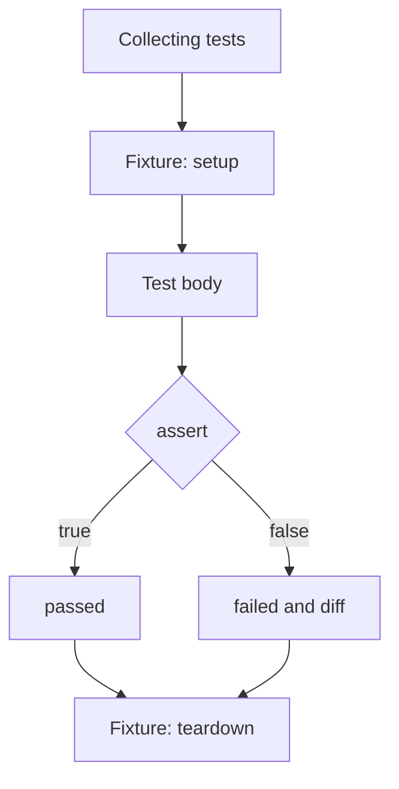

In this lesson we'll cover **pytest**, the most popular testing tool in Python. You already know how to write simple tests; now we'll learn how to make them truly powerful: preparing data with fixtures, running one test against dozens of inputs, and capturing program output.

## Tests with plain assert

The main difference between pytest and unittest is that there are no classes or special methods. A test is simply a function whose name starts with `test_`, and checks are written with the built-in `assert`:

```python
def add(a, b):
    return a + b

def test_add():
    assert add(2, 3) == 5
    assert add(-1, 1) == 0
```

Save the code to a file named `test_math.py` and run it from the same folder:

```bash
python -m pytest
```

pytest will find files matching `test_*.py` and functions named `test_*` on its own. At the end you'll see a summary: `3 passed` (if there are three tests) or `1 failed` with a detailed diff of what was expected and what was actually produced. Note that a single `assert` can hold several checks at once, and when it fails pytest shows the values of both sides of the expression.

## Fixtures: preparing the environment

When tests share common data (a database object, a temporary file, a user), you shouldn't copy the setup into every test. For that, pytest has **fixtures** — functions decorated with `@pytest.fixture`. A test simply declares the fixture's name as a parameter, and pytest calls the fixture and passes its result:

```python
import pytest

@pytest.fixture
def user():
    return {"name": "Anna", "age": 30}

def test_user(user):
    assert user["name"] == "Anna"
    assert user["age"] == 30
```

Fixtures have a `scope` parameter that controls their lifetime:

- `function` — recreated for every test (default);
- `class` — once per class;
- `module` — once per file;
- `session` — once for the whole run.

If a fixture is heavy (opening a database connection, loading a big file), raise the scope to `module` or `session` so the resource isn't created hundreds of times:

```python
@pytest.fixture(scope="module")
def db():
    return connect_to_database()
```

## Yield fixtures: setup and teardown

Often a resource must not only be created but also cleaned up after the test: close a connection, delete a file. For that, use `yield` inside the fixture: everything before `yield` is setup, and everything after it is teardown that runs after the test finishes:

```python
@pytest.fixture
def temp_file(tmp_path):
    f = tmp_path / "data.txt"
    f.write_text("hello")
    yield f
    f.unlink(missing_ok=True)
```

## Parametrization

Sometimes you need to run the same test against many sets of input data. Writing ten separate tests is tedious. `@pytest.mark.parametrize` comes to the rescue:

```python
@pytest.mark.parametrize("a,b,expected", [
    (1, 2, 3),
    (0, 0, 0),
    (-1, 1, 0),
])
def test_add_parametrized(a, b, expected):
    assert add(a, b) == expected
```

pytest turns this into three separate tests and shows the input data in the report. If one run fails, the others still execute — you'll immediately see which data triggers the problem.

## Built-in fixtures

pytest ships with ready-made fixtures: `tmp_path` — a temporary directory for each test, `capsys` — captures the output of `print()` and `sys.stdout`, `monkeypatch` — swaps objects (more on that in the next lesson). Markers are also useful: `@pytest.mark.skip` skips a test, `@pytest.mark.xfail` marks a test that is expected to fail.



## Summary

We learned: writing tests with `assert`, extracting data preparation into fixtures, setting their scope, cleaning up via `yield`, parametrizing tests, and using built-in fixtures. This is the foundation of all pytest work in real projects.

Now let's put it all into practice.

<!--TASK-->
### Task 1
Create a file `test_math.py`. Define a function `multiply(a, b)` in it that returns the product, and write at least three tests: regular positive numbers (for example, `3 * 4 == 12`), multiplication by zero (`5 * 0 == 0`), and multiplication of fractional numbers (`1.5 * 2 == 3.0`). Run `python -m pytest` and make sure all three tests pass. The end of the output should show `3 passed`.

### Task 2
Add a function `rect_area(width, height)` to `test_math.py` that returns the area of a rectangle, and one test `test_rect_area` parametrized with `@pytest.mark.parametrize`. Check three combinations: `3 × 4 = 12`, `0 × 5 = 0`, `2.5 × 4 = 10.0`. Run pytest: the report should show three runs with different data, and the file total should be `6 passed`.

### Task 3
Write a fixture `users` that returns a list of three dictionaries (for example, with keys `"name"` and `"active"`), where the second user has `"active": True`. Write a test `test_users` that takes this fixture and verifies: the list length equals 3 and the second user's `active` key is `True`. Run it and make sure the test passes.

### Task 4
Write a yield fixture `log_file(tmp_path)` that creates a temporary file `log.txt` in the `tmp_path` folder, writes the string `"started"` into it, hands the path over via `yield`, deletes the file after the test (use `unlink(missing_ok=True)`) and verifies with `assert` that the file no longer exists. The test `test_log_file` should accept the fixture and check that the file exists and contains `"started"`. Run it — there should be `1 passed`.

### Task 5
Write a function `greet(name)` that prints `"Hello, {name}!"` via `print()`. Create a test `test_greet` that uses the built-in `capsys` fixture and checks that the output matches the expectation — access the captured output via `capsys.readouterr()` (the `out` attribute). Make sure the test passes.
### Task 6
Move the data preparation into a shared file `conftest.py`. Create a fixture `books` in it with `module` scope that returns a list of two dictionaries: `{"title": "War and Peace", "pages": 1300}` and `{"title": "Anna Karenina", "pages": 800}`. Then create two files — `test_titles.py` and `test_pages.py` — each with one test that accepts `books`. The first checks that all titles are non-empty; the second checks that the total number of pages is 2100. There is no need to import the fixture: pytest finds it itself. Run `python -m pytest` — expected output `2 passed`, and both tests use the same list.

### Task 7
Write a function `parse_age(text)` that converts a string into an age: trims whitespace with `strip()`, converts to `int`, and raises `ValueError("Invalid age")` for non-numeric values or negative numbers. Test it with one parametrized test `test_parse_age`, where each set is a triple `(input, expected result, whether an exception is expected)`. Cover five cases: `"42"` → `42`, `" 7 "` → `7`, `"abc"` → `ValueError`, `"-3"` → `ValueError`, `""` → `ValueError`. Inside the test, use `with pytest.raises(ValueError)` when expecting an exception. Run pytest — expected output `5 passed`.
<!--/TASK-->

<!--HINT-->
### Hint 1
The file name must start with `test_` so pytest finds it automatically. Each test is a function named `test_...` with `assert` checks. Don't forget to run `python -m pytest` from the same folder where the file lives.

### Hint 2
The decorator goes directly above the test function: `@pytest.mark.parametrize("width,height,expected", [(3, 4, 12), (0, 5, 0), (2.5, 4, 10.0)])`. The parameter names in the string must match the function's argument names. Inside the test, use a single `assert rect_area(width, height) == expected`.

### Hint 3
A fixture is a regular function decorated with `@pytest.fixture` that returns data via `return`. The test declares the fixture's name in its parameters: `def test_users(users):`. Inside, just use `users` like a normal list.

### Hint 4
In a fixture, code before `yield` is setup, after it — teardown. `tmp_path` gives the path to the temporary folder; to get a file inside it, use the `/` operator: `tmp_path / "log.txt"`. To delete the file, call `f.unlink(missing_ok=True)`.

### Hint 5
`capsys` is a built-in fixture. After calling the function, get the result like this: `captured = capsys.readouterr()` and compare `captured.out` with the expected string, including the newline character `\n`. Remember: `assert` compares strings exactly.
### Hint 6
The file `conftest.py` lives in the same folder as the test files; pytest picks it up automatically, no imports needed. The fixture is declared as usual: `@pytest.fixture(scope="module")` above the `books()` function. In tests, just declare the `books` parameter — pytest finds the fixture by name. Note: `module` scope means the list is created once per file, so changes made in one test would be visible in the next one.

### Hint 7
Decorator: `@pytest.mark.parametrize("text,expected,raises", [...])`. Inside the test, split into two paths: `if raises: with pytest.raises(ValueError): parse_age(text)` and `else: assert parse_age(text) == expected`. For an empty string, `int("")` raises `ValueError` on its own, but it's better to check this explicitly and return your own message.
<!--/HINT-->

<!--SOLUTION-->
### Walkthrough 1
Solution:

```python
def multiply(a, b):
    return a * b

def test_multiply_positive():
    assert multiply(3, 4) == 12

def test_multiply_zero():
    assert multiply(5, 0) == 0

def test_multiply_float():
    assert multiply(1.5, 2) == 3.0
```

Run: `python -m pytest`. Result: `3 passed`.

What's happening here? pytest finds the file `test_math.py` by its `test_` prefix, then collects all functions starting with `test_` and runs each one in turn. The `multiply` function is defined in the same file, so it's available to the tests. Every check is an `assert`; if the expression is false, pytest stops the test and shows what value was expected and what was actually produced. Note that tests are independent — if one fails, the others still run, and you get the full picture.

### Walkthrough 2
Solution:

```python
import pytest

def rect_area(width, height):
    return width * height

@pytest.mark.parametrize("width,height,expected", [
    (3, 4, 12),
    (0, 5, 0),
    (2.5, 4, 10.0),
])
def test_rect_area(width, height, expected):
    assert rect_area(width, height) == expected
```

Run: `python -m pytest`. Result: `6 passed` (3 previous + 3 parametrized runs).

What's happening here? The decorator `@pytest.mark.parametrize` takes a string with parameter names and a list of value tuples. pytest expands this into three separate tests, substituting each tuple into the function's arguments. In the report, each run is shown separately: `test_rect_area[3-4-12]`, `test_rect_area[0-5-0]`, `test_rect_area[2.5-4-10.0]`. If one of the examples were wrong, pytest would point exactly at it and the others would keep working — that's the core value of parametrization. Note that in the decorator's first line the parameter names are comma-separated and must match the function's arguments exactly.

### Walkthrough 3
Solution:

```python
import pytest

@pytest.fixture
def users():
    return [
        {"name": "Ivan", "active": False},
        {"name": "Anna", "active": True},
        {"name": "Peter", "active": False},
    ]

def test_users(users):
    assert len(users) == 3
    assert users[1]["active"] is True
```

Run: `python -m pytest`. Result: `1 passed`.

What's happening here? pytest sees that the test `test_users` declares a parameter `users`, looks up a fixture with that name, calls it before the test, and passes the returned list. For each test, a `function`-scoped fixture is created anew — this guarantees tests don't affect each other's data. Note: booleans are compared with `is True`, not `== True`, although both work. If a fixture is needed by several files, it's moved into `conftest.py` — pytest picks it up automatically.

### Walkthrough 4
Solution:

```python
import pytest

@pytest.fixture
def log_file(tmp_path):
    f = tmp_path / "log.txt"
    f.write_text("started")
    yield f
    f.unlink(missing_ok=True)
    assert not f.exists()

def test_log_file(log_file):
    assert log_file.exists()
    assert log_file.read_text() == "started"
```

Run: `python -m pytest`. Result: `1 passed`.

What's happening here? The code before `yield` runs as setup: a file is created in the unique temporary folder `tmp_path` and a string is written into it. The test receives the path `log_file` and checks that the file exists and contains the expected text. After the test finishes, control returns to the fixture right after `yield`: the file is deleted, and `assert not f.exists()` confirms the cleanup worked. This is the classic "setup → test → teardown" pattern. If the test failed, the cleanup would still run — that's an important advantage of yield fixtures over manual cleanup at the end of a test, which you might never reach.

### Walkthrough 5
Solution:

```python
def greet(name):
    print(f"Hello, {name}!")

def test_greet(capsys):
    greet("Anna")
    captured = capsys.readouterr()
    assert captured.out == "Hello, Anna!\n"
```

Run: `python -m pytest`. Result: `1 passed`.

What's happening here? The `capsys` fixture captures all `print()` and `sys.stdout` output during the test. After calling `greet("Anna")`, we read the captured output via `capsys.readouterr()` — it returns an object with `out` (regular output) and `err` (stderr output) attributes. We compare `captured.out` with the expected string. Notice the `\n` at the end: `print()` appends a newline automatically, so the expected string must include it. Such checks are useful for functions that don't return a value but print a result — for example, CLI utilities.
### Walkthrough 6
Solution:

```python
# conftest.py
import pytest

@pytest.fixture(scope="module")
def books():
    return [
        {"title": "War and Peace", "pages": 1300},
        {"title": "Anna Karenina", "pages": 800},
    ]
```

```python
# test_titles.py
def test_titles_not_empty(books):
    assert all(book["title"] for book in books)
```

```python
# test_pages.py
def test_total_pages(books):
    assert sum(book["pages"] for book in books) == 2100
```

Run: `python -m pytest`. Result: `2 passed`.

What's happening here? While collecting tests, pytest scans the folder and finds `conftest.py` — a special file whose fixtures are available to all tests in that folder and nested directories without a single import. The test declares the `books` parameter, pytest looks up the fixture by name and passes the result. `module` scope means the list is created once per file: `test_titles.py` gets its own instance, `test_pages.py` its own. This is a compromise between isolation and speed — if the fixture were heavy (say, it populated a database), the savings would be noticeable. It's important to remember the flip side: tests within one module share data, so you shouldn't mutate the list in a test.

### Walkthrough 7
Solution:

```python
import pytest

def parse_age(text):
    cleaned = text.strip()
    if not cleaned or not cleaned.isdigit():
        raise ValueError("Invalid age")
    age = int(cleaned)
    if age < 0:
        raise ValueError("Invalid age")
    return age

@pytest.mark.parametrize("text,expected,raises", [
    ("42", 42, False),
    (" 7 ", 7, False),
    ("abc", None, True),
    ("-3", None, True),
    ("", None, True),
])
def test_parse_age(text, expected, raises):
    if raises:
        with pytest.raises(ValueError):
            parse_age(text)
    else:
        assert parse_age(text) == expected
```

Run: `python -m pytest`. Result: `5 passed`.

What's happening here? Parametrization expands one test into five independent runs, visible in the report as `test_parse_age[42-42-False]` and so on. The third column `raises` acts as a mode switch: for valid data the test compares the result, for invalid data it expects an exception. `pytest.raises` only passes if the specified exception actually occurs inside the block; if the function silently returns a value, the test fails with `DID NOT RAISE`. The `cleaned.isdigit()` check filters out empty strings, minus signs, and letters, so the separate `age < 0` branch is effectively unreachable here — but it stays as a safety net in case the parsing logic changes. This pattern suits functions where half of the contract is input-error handling.
<!--/SOLUTION-->

<!--QUIZ-->
Which command runs pytest tests from the current folder?
- python -m pytest
- pytest run
- python test
* Correct answer: python -m pytest
Running python -m pytest as a module automatically finds test_*.py files and test_* functions.

What does the @pytest.fixture decorator do?
- Marks a function as a test
- Turns a function into a fixture that prepares data for tests
- Disables the test
* Correct answer: Turns a function into a fixture
A test can accept the fixture's name as a parameter, and pytest will call it and pass the result.

What is the default scope of a fixture?
- function
- module
- session
* Correct answer: function
Without an explicit scope, a fixture is created anew for every test.

What does @pytest.mark.parametrize do?
- Marks a test as slow
- Runs one test against several data sets
- Skips a test
* Correct answer: Runs one test against several data sets
The decorator expands a test into several runs with different arguments.

Why is yield used in a fixture?
- To make the fixture a generator of random data
- To separate resource setup from teardown
- To make the test asynchronous
* Correct answer: To separate resource setup from teardown
Code before yield is preparation; code after yield is teardown that runs even if the test fails.

Which built-in fixture creates a unique temporary directory for each test?
- tmp_path
- tempfile
- temp_dir
* Correct answer: tmp_path
tmp_path provides the path to a temporary folder that exists only for the duration of the test.

What does the capsys fixture do?
- Limits the test execution time
- Captures the output of print() and sys.stdout
- Runs the test in a separate process
* Correct answer: Captures the output of print() and sys.stdout
Via capsys.readouterr() you can get the captured output and check it.

What will you see in the pytest report if an assert inside a test fails?
- The test will be skipped
- The test fails with a detailed diff of what was expected and what was produced
- pytest only outputs an error code
* Correct answer: The test fails with a detailed diff
pytest compares the parts of the assert expression and shows actual values to make finding the cause easier.
Where does pytest look for common fixtures available to all tests in a folder without imports?
- In the conftest.py file
- In the fixtures.py file
- In the setup.py file
* Correct answer: In the conftest.py file
conftest.py is a special file whose fixtures pytest picks up automatically.

What does scope="session" mean for a fixture?
- The fixture is created once for the entire test run
- The fixture is created for every test
- The fixture is created for every module
* Correct answer: The fixture is created once for the entire test run
session is the longest-lived scope: the resource is reused by all tests.

How do you check inside a parametrized test that a function raises an exception?
- Wrap the call in with pytest.raises(ValueError)
- Compare the result with None
- Add the @pytest.mark.raises decorator
* Correct answer: Wrap the call in with pytest.raises(ValueError)
pytest.raises passes only if the specified exception occurs inside the block.

What does the @pytest.mark.xfail marker do?
- Marks a test as expected to fail without breaking the whole run
- Skips the test forever
- Speeds up test execution
* Correct answer: Marks a test as expected to fail without breaking the whole run
If an xfail test fails, the report marks it as expected; an unexpected pass is reported as XPASS.
<!--/QUIZ-->
