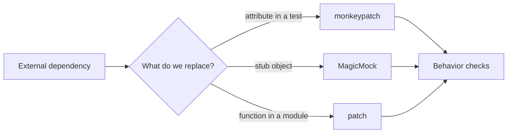

When code talks to the network, clocks, random numbers, or the file system, tests become unpredictable: today the API responds fast, tomorrow it's gone. The solution is **mocking**: replacing the real "external" object with a stub that behaves the way we need it to for the test. In this lesson we'll cover the two main tools: the `monkeypatch` fixture from pytest and the `unittest.mock` module.

## monkeypatch: replacing attributes

`monkeypatch` is a built-in pytest fixture. It can replace object attributes (including those of built-in modules) for the duration of a test, then automatically restore everything afterward.

A classic example is a function that rolls a die:

```python
import random

def roll_dice():
    return random.randint(1, 6)

def test_roll_dice(monkeypatch):
    monkeypatch.setattr(random, "randint", lambda a, b: 3)
    assert roll_dice() == 3
```

Now the test doesn't depend on randomness: we reliably get 3. After the test, `randint` is restored. `monkeypatch` also has `delattr` (delete an attribute) and `setenv` / `delenv` (swap environment variables).

## unittest.mock: Mock and MagicMock

The `unittest.mock` module provides full-featured mock objects. `MagicMock` is a universal stub: **any** of its attributes or methods is also a mock, so you can build chains as deep as you like:

```python
from unittest.mock import MagicMock

def test_mock():
    api = MagicMock()
    api.get_data.return_value = [1, 2, 3]
    assert api.get_data() == [1, 2, 3]
```

Key settings:

- `return_value` — what a call returns;
- `side_effect` — a sequence of return values or a callable that runs instead of the mock; if you pass an exception class or an exception object, the call raises it;
- `call_count` — how many times it was called;
- `assert_called_once_with(...)`, `assert_called_with(...)`, `assert_called()` — assertions about how it was called.

Example with `side_effect`:

```python
mock = MagicMock()
mock.roll.side_effect = [1, 2, 3]  # three calls return 1, 2, 3
assert mock.roll() == 1
assert mock.roll() == 2
assert mock.roll() == 3
```

If `side_effect` is an exception, every call raises it:

```python
mock.fetch.side_effect = TimeoutError("net is down")
```

## patch: patching code

To replace a function inside another module, use `patch` from `unittest.mock`. It works both as a decorator and as a context manager:

```python
from unittest.mock import patch

# example module app.py:  import requests
#  def get_rate():
#      resp = requests.get("https://api.example.com/rate")
#      return resp.json()["rate"]

@patch("app.requests.get")
def test_get_rate(mock_get):
    mock_get.return_value.json.return_value = {"rate": 90}
    from app import get_rate
    assert get_rate() == 90
    mock_get.assert_called_once_with("https://api.example.com/rate")
```

The context manager is handy when the mock is only needed for one stretch of code:

```python
def test_with_patch():
    with patch("app.requests.get") as mock_get:
        mock_get.return_value.json.return_value = {"rate": 90}
        # ... code that uses requests.get
```

Important: we patch the **place of use**, not the source. If `app` wrote `from requests import get`, you patch `app.get`, not `requests.get`.

## Verifying calls

Mocks don't just replace behavior — they also let you verify that the code calls its dependency correctly:

```python
def send_report(api, data):
    api.post(data)

def test_send_report():
    api = MagicMock()
    send_report(api, {"ok": True})
    api.post.assert_called_once_with({"ok": True})
    assert api.post.call_count == 1
```



## Summary

`monkeypatch` is for quickly swapping attributes in a test, `MagicMock` is for creating stub objects with configurable behavior, `patch` is for replacing functions in target modules, and call assertions let you confirm the code uses its dependencies correctly.

Now let's put it all into practice.

<!--TASK-->
### Task 1
Write a function `get_rate()` in a file `app.py` that fetches a currency rate: `resp = requests.get("https://api.example.com/rate")`, `return resp.json()["rate"]`. Then write a test `test_get_rate` in `test_app.py` using the `monkeypatch` fixture: replace `requests.get` with a function that returns an object with a `.json()` method returning the dictionary `{"rate": 75}`. Verify that `get_rate()` returns 75. Run pytest — there should be `1 passed`.

### Task 2
Create a test where `MagicMock` imitates an HTTP client: set `client.get.return_value` to the string `"ok"`, then call `client.get("https://api.example.com/health")` and check that the result equals `"ok"`. Add the assertion `assert_called_once_with("https://api.example.com/health")`. Run it — there should be `1 passed`.

### Task 3
Rewrite the test from Task 1 using `patch` from `unittest.mock` as a context manager: `with patch("app.requests.get") as mock_get:`. Set `mock_get.return_value.json.return_value = {"rate": 90}`, check that `get_rate()` returns 90, and that `mock_get` was called exactly once with the correct URL. Run it — `1 passed`.

### Task 4
Write a function `get_with_retry(fetch, tries=2)` that calls `fetch()`; if it raises `TimeoutError`, it retries, and if attempts run out — it propagates the exception. Then write a test: a `MagicMock` with `side_effect = [TimeoutError(), {"ok": True}]`, pass it to `get_with_retry` and verify: the result equals `{"ok": True}` and `fetch.call_count == 2`. Run it — `1 passed`.

### Task 5
Imagine a component that sends a report: the function `send_report(api, data)` calls `api.post(data)`. Write a test with `MagicMock` that verifies: `post` was called exactly once with the passed dictionary, and the return value contains the key `"status"` with value `"sent"` (set `api.post.return_value = {"status": "sent"}`). Run it — `1 passed`.
### Task 6
Write a function `is_weekend()` that returns `True` if today is Saturday or Sunday: use `datetime.now().weekday()` and check `>= 5`. Create a test `test_is_weekend_true` with the `monkeypatch` fixture: replace `datetime` in the module containing the function with a stub class `FakeSaturday` whose class method `now()` returns a fixed Saturday — `datetime(2026, 11, 21, 12, 0)`. A second test replaces the date with a Wednesday and expects `False`. Run pytest — expected output `2 passed`, and neither test depends on the real day of the week.

### Task 7
Write a function `notify(user, email_service, sms_service)` that first calls `email_service.send(user, "Welcome")`, then `sms_service.send(user, "Code 1234")`, and finally returns `{"sent": 2}`. Write a test with `MagicMock`: check the result and the order of calls. For the order, use a parent mock `services = MagicMock()`, pass `services.email` and `services.sms` to the function, then compare `services.mock_calls` with the list of `call(...)`. Additionally verify that `services.push.send` was never called (`assert_not_called()`). Run pytest — expected output `1 passed`.
<!--/TASK-->

<!--HINT-->
### Hint 1
The `monkeypatch` fixture is passed to the test as a parameter. Replacement: `monkeypatch.setattr(requests, "get", lambda url: FakeResponse())`. `FakeResponse` is a tiny class with a `json(self)` method returning `{"rate": 75}`. Don't forget `import requests` in `app.py`.

### Hint 2
`MagicMock()` creates a mock. Setup: `client.get.return_value = "ok"`. Call check: `client.get.assert_called_once_with("https://api.example.com/health")`. First call the mock, then assert.

### Hint 3
Inside `with patch("app.requests.get") as mock_get:` the name `requests.get` is patched in the namespace of module `app`. Set `mock_get.return_value.json.return_value = {"rate": 90}` and call `app.get_rate()`. Verify `mock_get.assert_called_once_with("https://api.example.com/rate")`.

### Hint 4
`side_effect` with a list hands out values one per call: the first call raises `TimeoutError()`, the second returns `{"ok": True}`. Inside `get_with_retry`, wrap the call in `try/except TimeoutError` and continue the loop. Check `fetch.call_count == 2`.

### Hint 5
`api` is a `MagicMock()`. Set `api.post.return_value = {"status": "sent"}`. After calling `send_report(api, {"text": "hello"})`, check `api.post.assert_called_once_with({"text": "hello"})` and that the returned dictionary contains `"status"` with value `"sent"`.
### Hint 6
Don't replace `datetime.now` directly — replace the whole class in the module: `monkeypatch.setattr(app, "datetime", FakeSaturday)`. The stub looks like this: `class FakeSaturday: @classmethod def now(cls): return real_datetime(2026, 11, 21, 12, 0)`. Saturday is `weekday() == 5`, Sunday is `6`. Import the real class separately: `from datetime import datetime as real_datetime`, otherwise the stub would reference itself.

### Hint 7
Imports: `from unittest.mock import MagicMock, call`. With child mocks, the parent records calls in `mock_calls` in the format `call.email.send(...)`. Compare the whole list: `assert services.mock_calls == [call.email.send("anna", "Welcome"), call.sms.send("anna", "Code 1234")]` — this checks both the composition and the order. For the absence of calls — `services.push.send.assert_not_called()`.
<!--/HINT-->

<!--SOLUTION-->
### Walkthrough 1
Solution:

```python
# app.py
import requests

def get_rate():
    resp = requests.get("https://api.example.com/rate")
    return resp.json()["rate"]
```

```python
# test_app.py
import requests
from app import get_rate

class FakeResponse:
    def json(self):
        return {"rate": 75}

def test_get_rate(monkeypatch):
    monkeypatch.setattr(requests, "get", lambda url: FakeResponse())
    assert get_rate() == 75
```

Run: `python -m pytest`. Result: `1 passed`.

What's happening here? The test replaces `requests.get` with a lambda that always returns `FakeResponse` with a `.json()` method. Since the real `get_rate` calls `resp.json()["rate"]`, the replacement fully isolates the test from the network: no request leaves the machine, and speed and stability depend only on us. After the test, `monkeypatch` automatically restores the original `requests.get`. That's the main advantage of this fixture: you don't have to remember and restore the originals manually.

### Walkthrough 2
Solution:

```python
from unittest.mock import MagicMock

def test_client():
    client = MagicMock()
    client.get.return_value = "ok"
    result = client.get("https://api.example.com/health")
    assert result == "ok"
    client.get.assert_called_once_with("https://api.example.com/health")
```

Run: `python -m pytest`. Result: `1 passed`.

What's happening here? `MagicMock` is a chameleon object: any of its attributes and methods are created on the fly and are also mocks. `client.get.return_value = "ok"` configures what the `client.get(...)` call returns. Then we make the call and check the result. The `assert_called_once_with` method verifies that `get` was called exactly once and with exactly the URL we specified — such a check guards against the code silently calling the wrong address.

### Walkthrough 3
Solution:

```python
from unittest.mock import patch
from app import get_rate

def test_get_rate_with_patch():
    with patch("app.requests.get") as mock_get:
        mock_get.return_value.json.return_value = {"rate": 90}
        assert get_rate() == 90
        mock_get.assert_called_once_with("https://api.example.com/rate")
```

Run: `python -m pytest`. Result: `1 passed`.

What's happening here? When entering the context, `patch("app.requests.get")` replaces `requests.get` inside module `app` with a mock, and restores the original on exit. Note that we patch `app.requests.get`, not `requests.get`, because we need to replace the name the module `app`'s code actually uses. The chain `mock_get.return_value.json.return_value` means: calling `mock_get(...)` returns an object whose `.json()` method returns `{"rate": 90}` — exactly what `get_rate` expects. The context manager is convenient when the mock is only needed for a few lines of code.

### Walkthrough 4
Solution:

```python
from unittest.mock import MagicMock

def get_with_retry(fetch, tries=2):
    for _ in range(tries):
        try:
            return fetch()
        except TimeoutError:
            continue
    raise TimeoutError("all attempts failed")

def test_retry():
    fetch = MagicMock()
    fetch.side_effect = [TimeoutError(), {"ok": True}]
    assert get_with_retry(fetch) == {"ok": True}
    assert fetch.call_count == 2
```

Run: `python -m pytest`. Result: `1 passed`.

What's happening here? `side_effect` with a list hands out values one per call: the first `fetch()` call raises `TimeoutError`, the second returns `{"ok": True}`. `get_with_retry` catches `TimeoutError` and continues the loop, so the second attempt succeeds. The check `fetch.call_count == 2` confirms retries actually happened. This test models a real scenario: a temporary network glitch followed by a successful response. If `side_effect` contained only exceptions, the function would exhaust its attempts and propagate the error — worth checking that case yourself too.

### Walkthrough 5
Solution:

```python
from unittest.mock import MagicMock

def send_report(api, data):
    return api.post(data)

def test_send_report():
    api = MagicMock()
    api.post.return_value = {"status": "sent"}
    result = send_report(api, {"text": "hello"})
    assert result["status"] == "sent"
    api.post.assert_called_once_with({"text": "hello"})
```

Run: `python -m pytest`. Result: `1 passed`.

What's happening here? The `send_report` component doesn't know what a real API is — it works with any object that has a `post` method. In the test we pass a `MagicMock`, set `api.post.return_value = {"status": "sent"}`, and check two things: the return value is correct and `post` was called exactly once with the right argument. That's the essence of mocking: we verify the *behavior* of our code — that it reaches out to the dependency with what's needed and uses the result correctly — without depending on the dependency's implementation.
### Walkthrough 6
Solution:

```python
# app.py
from datetime import datetime

def is_weekend():
    return datetime.now().weekday() >= 5
```

```python
# test_app.py
from datetime import datetime as real_datetime
import app


class FakeSaturday:
    @classmethod
    def now(cls):
        return real_datetime(2026, 11, 21, 12, 0)  # Saturday


class FakeWednesday:
    @classmethod
    def now(cls):
        return real_datetime(2026, 11, 18, 12, 0)  # Wednesday


def test_is_weekend_true(monkeypatch):
    monkeypatch.setattr(app, "datetime", FakeSaturday)
    assert app.is_weekend() is True


def test_is_weekend_false(monkeypatch):
    monkeypatch.setattr(app, "datetime", FakeWednesday)
    assert app.is_weekend() is False
```

Run: `python -m pytest`. Result: `2 passed`.

What's happening here? `is_weekend` takes the current time from the `datetime` class imported into module `app`. So we must replace not `datetime.now` globally, but the name `datetime` in `app`'s namespace — exactly as we patched the place of use rather than the source in the theory. The stub only needs to do one thing: return an object with a `weekday()` method, and the real `datetime` is perfect for that. The first test pins down a Saturday and gets `True`; the second pins down a Wednesday and gets `False`. Monkeypatch restores the original class after each test, so the tests don't affect each other and don't depend on the day they run.

### Walkthrough 7
Solution:

```python
from unittest.mock import MagicMock, call

def notify(user, email_service, sms_service):
    email_service.send(user, "Welcome")
    sms_service.send(user, "Code 1234")
    return {"sent": 2}

def test_notify_order():
    services = MagicMock()
    result = notify("anna", services.email, services.sms)
    assert result == {"sent": 2}
    assert services.mock_calls == [
        call.email.send("anna", "Welcome"),
        call.sms.send("anna", "Code 1234"),
    ]
    services.push.send.assert_not_called()
```

Run: `python -m pytest`. Result: `1 passed`.

What's happening here? One parent `MagicMock` creates the child mocks `email`, `sms`, and `push` automatically, and records all accesses to them in `mock_calls`. Comparing against an exact list of `call(...)` checks three things at once: exactly these methods were called, the arguments match, and the order is correct. If the function sent the SMS first and the email second, the test would fail even though `assert_called_once_with` on each individual mock would stay green — that's the value of an order check. `assert_not_called()` on `push` guards against an extra side-effect notification. Such a test fixes the interaction contract: not just "what came back", but also "how exactly we treated the dependencies".
<!--/SOLUTION-->

<!--QUIZ-->
What does the monkeypatch fixture from pytest do?
- Runs the test in a separate process
- Replaces object attributes for the duration of a test and restores them afterward
- Speeds up test execution
* Correct answer: Replaces object attributes for the duration of a test and restores them afterward
monkeypatch replaces, for example, requests.get with a stub and automatically restores the original after the test.

What will a MagicMock method call return if you set mock.get.return_value = 42?
- 42
- A new MagicMock
- None
* Correct answer: 42
return_value sets the value a mock call returns.

What does side_effect do with a list of values?
- Returns a random value from the list
- Hands out values one per call
- Replaces all mock methods
* Correct answer: Hands out values one per call
The first call returns the first item, the second returns the second, and so on.

How do you make a mock call raise an exception?
- Pass an exception class to side_effect
- Pass a string with the exception name
- No way; mocks cannot raise exceptions
* Correct answer: Pass an exception class to side_effect
If side_effect is an exception class or an exception object, every call raises it.

What does assert_called_once_with(arg) verify?
- That the mock was called at least once
- That the mock was called exactly once with arg
- That the mock was never called
* Correct answer: That the mock was called exactly once with arg
This assertion combines a call count with an argument comparison.

What exactly should you patch when using patch?
- The place where the function was created and defined
- The place where the function is used, in the target module's namespace
- Any place; patch will figure it out
* Correct answer: The place where the function is used
If module app wrote from requests import get, you patch app.get, not requests.get.

Why is mocking needed in tests?
- To make tests faster by skipping checks
- To isolate tests from external dependencies: network, time, randomness
- To bypass all asserts in the code
* Correct answer: To isolate tests from external dependencies
Replacing unstable external objects makes tests deterministic.

What does unittest.mock.patch do as a context manager?
- Replaces the object only inside the with block, then restores it
- Creates a temporary folder
- Runs the patch in a separate thread
* Correct answer: Replaces the object only inside the with block, then restores it
On entering with, the object is replaced by a mock; on exit, the original is restored.
What does patch.object(obj, "attr") do?
- Replaces an attribute of a specific object, then restores it
- Creates a copy of the object
- Removes the object from memory
* Correct answer: Replaces an attribute of a specific object, then restores it
patch.object is convenient when you need to replace a method on an already-created instance.

What does assert_not_called() verify?
- That the mock was never called
- That the mock returned None
- That the mock was created without arguments
* Correct answer: That the mock was never called
The assertion fails if there was at least one call.

What happens if you pass a function to side_effect?
- It will be called with the mock's arguments, and its result becomes the return value
- The mock returns the function itself
- The function runs only once when the mock is created
* Correct answer: It will be called with the mock's arguments, and its result becomes the return value
This way side_effect can compute answers dynamically or raise an exception from the function.

Why is autospec=True useful when patching?
- The mock mirrors the original's signature and catches invalid arguments
- It speeds up the test
- It forbids any mock calls
* Correct answer: The mock mirrors the original's signature and catches invalid arguments
With autospec, a call with the wrong number or names of arguments immediately raises an error.
<!--/QUIZ-->
