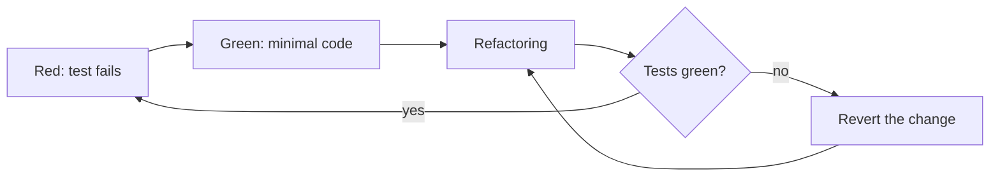

**TDD** (Test-Driven Development) is a methodology where tests are written **before** the implementation, not after. It sounds strange, but this order forces you to think about the code's behavior before it exists.

## The red–green–refactor cycle

TDD consists of three phases repeated in a loop:

1. **Red.** Write a test that reflects the desired behavior and run it. It must **fail** — either because the function doesn't exist yet, or because the result is wrong. Red is a signal that the test actually checks something.
2. **Green.** Write a minimal implementation that makes the test green. No "pretty" code is needed here — only enough to make the test pass.
3. **Refactor.** Improve the code: remove duplication, rename things, extract logic. The tests stay green throughout — they protect us from breaking something during refactoring.

Let's look at an example. We need a function that, given a number, returns "Fizz" if the number is divisible by 3, "Buzz" if divisible by 5, "FizzBuzz" if divisible by both, and the number itself as a string otherwise. We start with a test:

```python
def test_fizz_buzz():
    assert fizz_buzz(3) == "Fizz"
    assert fizz_buzz(5) == "Buzz"
    assert fizz_buzz(15) == "FizzBuzz"
    assert fizz_buzz(7) == "7"
```

We run it and get red: `NameError: name 'fizz_buzz' is not defined`. That's normal: the test honestly shows the function is missing. Now the minimal implementation:

```python
def fizz_buzz(n):
    if n % 15 == 0:
        return "FizzBuzz"
    if n % 3 == 0:
        return "Fizz"
    if n % 5 == 0:
        return "Buzz"
    return str(n)
```

Run it — green. Next, refactoring: for example, extract the divisibility check into a separate function or replace the magic number 15 with a comment (better — with an explicit check `n % 3 == 0 and n % 5 == 0`). After each change, run the tests: they must stay green.

## Why it works

- **A test is a specification.** By writing behavior before code, you pin down the contract: what the function accepts and what it returns.
- **Minimal implementation** prevents writing extra code. You do exactly as much as the test asks.
- **Safe refactoring.** You can change internals boldly: if the tests are green, the behavior is preserved.
- **Parametrization helps TDD.** One test with `@pytest.mark.parametrize` covers many examples at once.

## When TDD is awkward

TDD works great for business logic, algorithms, and parsers. But for UI, layout, and integrations with external services it's often too expensive — smoke tests and manual checks matter more there. That's fine: TDD is a tool, not a dogma.



## Summary

The "red → green → refactor" cycle is a discipline: first the test, then the minimal implementation, then cleanup. Tests are always green except for the moment when you honestly write a new test.

Now let's put it all into practice.

<!--TASK-->
### Task 1
Start developing the function `fizz_buzz(n)` with TDD. The first step is a red test. Create a file `test_fizz_buzz.py` with a test that verifies: `fizz_buzz(3) == "Fizz"`, `fizz_buzz(5) == "Buzz"`, `fizz_buzz(15) == "FizzBuzz"`, `fizz_buzz(7) == "7"`. Run pytest and make sure the test fails with `NameError`, because the function doesn't exist yet. Write down which name is missing in the error.

### Task 2
Now make the test green: implement `fizz_buzz(n)` in `test_fizz_buzz.py` (or in a separate module and import it). The implementation should be minimal but correct. Run pytest — all checks must pass (`1 passed`). Pay attention to the order of checks: first divisibility by 15 (or by 3 and 5 together), otherwise 15 would return a wrong result.

### Task 3
Extend the behavior with parametrization. Replace the four separate checks with one test `test_fizz_buzz` using `@pytest.mark.parametrize` that covers at least five examples: 3, 5, 15, 7, and 30 (30 should give `"FizzBuzz"`). Run pytest — the report should show five runs.

### Task 4
Refactor the `fizz_buzz` implementation. Extract the divisibility check into a separate function `is_divisible(n, divisor)` (return `n % divisor == 0`) and use it in `fizz_buzz`. Replace the check `n % 15 == 0` with the combination `is_divisible(n, 3) and is_divisible(n, 5)` — the code reads more clearly this way. After refactoring, all tests must stay green.

### Task 5
Apply the full TDD cycle to a `Calculator` class. First write tests: `add(2, 3) == 5`, `subtract(10, 4) == 6`, `multiply(3, 4) == 12`, and `divide(10, 2)` returns `5.0` and raises `ValueError` on division by zero. Make sure the tests fail (the class doesn't exist yet). Then implement the class so the tests pass. Run pytest — there should be `1 passed` (all checks inside one test or several tests).
### Task 6
Go through the full TDD cycle for the function `parse_duration(text)`, which converts a string like `"1h 30m"` into minutes. First write tests and make sure they fail with `NameError`: `"90m"` → `90`, `"2h"` → `120`, `"1h 30m"` → `90`, `"0m"` → `0`. Then write a minimal implementation: find the parts of the string with the regex `re.findall(r"(\d+)([hm])", text)` and sum hours and minutes. After the green run, add a test for invalid input `"abc"` — the function should raise `ValueError`. Run pytest: expected output `5 passed`.

### Task 7
Develop a `BankAccount` class with a balance via TDD. Start with red tests: a new account has a balance of `0`; `deposit(500)` increases the balance to `500`; `withdraw(200)` decreases it to `300`; `withdraw(1000)` raises `ValueError`; after a failed attempt, `balance` stays unchanged. Only after the tests fail, implement the class with a `balance` attribute and `deposit` and `withdraw` methods. Run pytest — expected output `5 passed`, and no test changes another test's data.
<!--/TASK-->

<!--HINT-->
### Hint 1
Don't write the function before running the test — that's the essence of the red phase. The error will look like `NameError: name 'fizz_buzz' is not defined`. That's exactly what we want: the test shows the behavior isn't implemented yet.

### Hint 2
Start with the simplest implementation that passes the test: check divisibility by 15 first (or `n % 3 == 0 and n % 5 == 0`), then by 3, then by 5, otherwise return `str(n)`. The order of checks is critical: if you check divisibility by 3 first, 15 will return "Fizz" instead of "FizzBuzz".

### Hint 3
Decorator: `@pytest.mark.parametrize("n,expected", [(3, "Fizz"), (5, "Buzz"), (15, "FizzBuzz"), (7, "7"), (30, "FizzBuzz")])`. Test function: `def test_fizz_buzz(n, expected):` with a single `assert fizz_buzz(n) == expected`.

### Hint 4
Helper function: `def is_divisible(n, divisor): return n % divisor == 0`. In `fizz_buzz`, replace every `n % X == 0` with a call to `is_divisible(n, X)`, and the 15 check with `is_divisible(n, 3) and is_divisible(n, 5)`. After the changes, be sure to rerun pytest.

### Hint 5
The class can live in a separate file `calculator.py` and be imported into the test: `from calculator import Calculator`. For division, write: `if divisor == 0: raise ValueError("division by zero")`. Remember the order: first red (tests without the class), then the implementation.
### Hint 6
First run the tests without the function — you'll see `NameError`; that's the red phase. To parse the string, `re.findall` is enough: it returns a list of pairs like `[("1", "h"), ("30", "m")]`. Convert the value with `int` and multiply by 60 for hours. If the list is empty — raise `ValueError`. Don't forget `import re` and `import pytest`.

### Hint 7
First write the tests in `test_bank.py` and run them — you'll get `NameError` or `ImportError`; that's normal. The class: `class BankAccount: def __init__(self): self.balance = 0`. In `withdraw`, first compare the amount with the balance and only then subtract — otherwise the balance would change on error. For the exception check — `with pytest.raises(ValueError): account.withdraw(1000)`.
<!--/HINT-->

<!--SOLUTION-->
### Walkthrough 1
Create the file `test_fizz_buzz.py`:

```python
def test_fizz_buzz():
    assert fizz_buzz(3) == "Fizz"
    assert fizz_buzz(5) == "Buzz"
    assert fizz_buzz(15) == "FizzBuzz"
    assert fizz_buzz(7) == "7"
```

Run: `python -m pytest`. Result: `1 failed`, error `NameError: name 'fizz_buzz' is not defined`.

What's happening here? This is the red phase. We haven't written the function yet, so pytest fails on the very first check, reporting that the name `fizz_buzz` is not defined. This isn't a "bad" result — on the contrary, it confirms the test is alive: it genuinely checks the function's existence and behavior. If the test passed without an implementation, we wouldn't know whether it checks anything at all. In TDD, red is a mandatory starting point for every new behavior.

### Walkthrough 2
Add the implementation to the same file:

```python
def fizz_buzz(n):
    if n % 15 == 0:
        return "FizzBuzz"
    if n % 3 == 0:
        return "Fizz"
    if n % 5 == 0:
        return "Buzz"
    return str(n)

def test_fizz_buzz():
    assert fizz_buzz(3) == "Fizz"
    assert fizz_buzz(5) == "Buzz"
    assert fizz_buzz(15) == "FizzBuzz"
    assert fizz_buzz(7) == "7"
```

Run: `python -m pytest`. Result: `1 passed`.

What's happening here? This is the green phase. The implementation is minimal and passes the test. The key point is the order of checks: first `n % 15 == 0`. If we started with `n % 3 == 0`, then 15 would match the first check and return "Fizz" — the test would fail. Note that `str(n)` is needed because the function promised to return a string even for ordinary numbers. The minimal implementation solves exactly the posed problem, without embellishments.

### Walkthrough 3
Parametrization:

```python
import pytest

def fizz_buzz(n):
    if n % 15 == 0:
        return "FizzBuzz"
    if n % 3 == 0:
        return "Fizz"
    if n % 5 == 0:
        return "Buzz"
    return str(n)

@pytest.mark.parametrize("n,expected", [
    (3, "Fizz"),
    (5, "Buzz"),
    (15, "FizzBuzz"),
    (7, "7"),
    (30, "FizzBuzz"),
])
def test_fizz_buzz(n, expected):
    assert fizz_buzz(n) == expected
```

Run: `python -m pytest`. Result: `5 passed` (five runs of one test).

What's happening here? We extended the behavior without touching the implementation — just added data. Parametrization turns one test into five runs, each with its own name in the report. The 30 example is a good safety net: it checks that "FizzBuzz" is returned not only for 15 but also for other numbers divisible by both 3 and 5. If the implementation changes in the future, all five examples will protect it from regressions.

### Walkthrough 4
Refactoring:

```python
import pytest

def is_divisible(n, divisor):
    return n % divisor == 0

def fizz_buzz(n):
    if is_divisible(n, 3) and is_divisible(n, 5):
        return "FizzBuzz"
    if is_divisible(n, 3):
        return "Fizz"
    if is_divisible(n, 5):
        return "Buzz"
    return str(n)

@pytest.mark.parametrize("n,expected", [
    (3, "Fizz"),
    (5, "Buzz"),
    (15, "FizzBuzz"),
    (7, "7"),
    (30, "FizzBuzz"),
])
def test_fizz_buzz(n, expected):
    assert fizz_buzz(n) == expected
```

Run: `python -m pytest`. Result: `5 passed`.

What's happening here? The helper function `is_divisible` makes the code self-documenting. The check `n % 15 == 0` is replaced with the explicit combination `is_divisible(n, 3) and is_divisible(n, 5)` — now you don't need to remember that 15 is the product of 3 and 5. The behavior didn't change, so all tests stayed green. That's the power of TDD: fear-free refactoring, because the tests instantly catch any accidental breakage.

### Walkthrough 5
Solution:

```python
# calculator.py
class Calculator:
    def add(self, a, b):
        return a + b

    def subtract(self, a, b):
        return a - b

    def multiply(self, a, b):
        return a * b

    def divide(self, a, b):
        if b == 0:
            raise ValueError("division by zero")
        return a / b
```

```python
# test_calculator.py
import pytest
from calculator import Calculator

def test_calculator():
    calc = Calculator()
    assert calc.add(2, 3) == 5
    assert calc.subtract(10, 4) == 6
    assert calc.multiply(3, 4) == 12
    assert calc.divide(10, 2) == 5.0
    with pytest.raises(ValueError):
        calc.divide(10, 0)
```

Run: `python -m pytest`. Result: `1 passed`.

What's happening here? First we wrote the tests and confirmed they fail (the class is missing) — the red phase. Then we implemented `Calculator` — the green phase. Note the division: the test requires division by zero to raise `ValueError`, so the implementation explicitly raises it. The value of `10 / 2` is `5.0` because `/` in Python always yields a float. In TDD, the test dictates the behavior, including error handling: if we'd forgotten about zero, the test would have stayed red.
### Walkthrough 6
Solution:

```python
import re
import pytest

def parse_duration(text):
    parts = re.findall(r"(\d+)([hm])", text)
    if not parts:
        raise ValueError("Invalid duration")
    minutes = 0
    for value, unit in parts:
        minutes += int(value) * (60 if unit == "h" else 1)
    return minutes

@pytest.mark.parametrize("text,expected", [
    ("90m", 90),
    ("2h", 120),
    ("1h 30m", 90),
    ("0m", 0),
])
def test_parse_duration(text, expected):
    assert parse_duration(text) == expected

def test_parse_duration_invalid():
    with pytest.raises(ValueError):
        parse_duration("abc")
```

Run: `python -m pytest`. Result: `5 passed`.

What's happening here? We went through all three phases. In red, the tests failed with `NameError` because the function didn't exist. In green, a minimal implementation appeared: the regex extracts all "number + unit" pairs, an empty list means garbage on input and yields `ValueError`. In refactoring, you could extract the parsing of a single pair into a separate function or replace the magic `60` with a constant `MINUTES_IN_HOUR`. Note `"1h 30m"`: `findall` finds both pairs regardless of the space between them, so the format doesn't need manual parsing. Parametrization expands four examples into four runs, and the fifth test checks the error contract — it's worth writing before the implementation so you don't forget about invalid input.

### Walkthrough 7
Solution:

```python
# bank.py
class BankAccount:
    def __init__(self):
        self.balance = 0

    def deposit(self, amount):
        if amount <= 0:
            raise ValueError("Amount must be positive")
        self.balance += amount
        return self.balance

    def withdraw(self, amount):
        if amount > self.balance:
            raise ValueError("Insufficient funds")
        self.balance -= amount
        return self.balance
```

```python
# test_bank.py
import pytest
from bank import BankAccount

def test_new_account_is_empty():
    assert BankAccount().balance == 0

def test_deposit():
    account = BankAccount()
    account.deposit(500)
    assert account.balance == 500

def test_withdraw():
    account = BankAccount()
    account.deposit(500)
    account.withdraw(200)
    assert account.balance == 300

def test_withdraw_too_much():
    account = BankAccount()
    account.deposit(100)
    with pytest.raises(ValueError):
        account.withdraw(1000)

def test_balance_unchanged_after_error():
    account = BankAccount()
    account.deposit(100)
    with pytest.raises(ValueError):
        account.withdraw(500)
    assert account.balance == 100
```

Run: `python -m pytest`. Result: `5 passed`.

What's happening here? Five tests describe the contract before the class exists: the initial state, two successful operations, and two error situations. The implementation grew out of these requirements, not the other way around. The key detail is the order of operations in `withdraw`: the check `amount > self.balance` happens before subtraction, so when an exception occurs the balance stays untouched. If you swapped the lines, four tests would still pass but the fifth would fail — and that's exactly the kind of bug that's easy to miss without TDD. The last test is also methodologically important: it fixes not just the fact of the exception but the absence of side effects, i.e., the atomicity of the operation.
<!--/SOLUTION-->

<!--QUIZ-->
Which TDD phase comes first?
- Refactoring
- Writing a failing test
- Implementing the function
* Correct answer: Writing a failing test
First we write the test and confirm it fails (red) — only then the implementation.

What does the "red" phase in TDD mean?
- The test fails because the behavior isn't implemented yet
- The test passes successfully
- The code contains a syntax error
* Correct answer: The test fails because the behavior isn't implemented yet
Red shows the test is alive and genuinely checks the missing behavior.

What should you do in the green phase?
- Write beautiful, complete code
- Write a minimal implementation so the test passes
- Delete the test
* Correct answer: Write a minimal implementation so the test passes
The green phase requires exactly as much code as needed to pass the test.

Why is the refactoring phase needed in TDD?
- To speed up the tests
- To improve the code while keeping the tests green
- To add new features
* Correct answer: To improve the code while keeping the tests green
The tests are the safety net: if refactoring breaks something, they fail immediately.

Why is the test written before the implementation?
- It's faster to write code this way
- The test fixes the behavior contract and dictates the API design
- So the test cannot fail
* Correct answer: The test fixes the behavior contract and dictates the API design
Writing behavior before code determines what the function accepts and returns.

What happens if fizz_buzz checks divisibility by 3 first and then by 15?
- The number 15 returns "Fizz" instead of "FizzBuzz"
- The number 15 still returns "FizzBuzz"
- The test keeps working without errors
* Correct answer: The number 15 returns "Fizz" instead of "FizzBuzz"
The 15 check must come first, otherwise the first matching condition catches the number.

What does pytest.raises(ValueError) do in a test?
- Checks that the code raises a ValueError exception
- Ignores the error
- Stops the test
* Correct answer: Checks that the code raises a ValueError exception
The pytest.raises context only succeeds if the specified exception occurs inside it.

Which tasks fit TDD best?
- Business logic, algorithms, parsers
- Layout and interface design
- Manual design checking
* Correct answer: Business logic, algorithms, parsers
There, behavior can be clearly described by tests; for UI and external integrations TDD is often too expensive.
What should you do if a freshly written test immediately turned green?
- Doubt the test: it may not be checking the new behavior
- Move on to the next function right away
- Delete the test as unnecessary
* Correct answer: Doubt the test: it may not be checking the new behavior
In TDD a new test must fail first; instant green is a reason to inspect the test itself.

Why does TDD run tests after every small step?
- To immediately see which step broke the behavior
- To make the tests faster
- To avoid writing the implementation
* Correct answer: To immediately see which step broke the behavior
Frequent runs narrow the error search down to the last change.

How does TDD suggest fixing a bug?
- First write a test that reproduces the bug, then fix the code
- First fix the code, then add a test
- Fix the bug without a test
* Correct answer: First write a test that reproduces the bug, then fix the code
A reproducing test confirms the cause and guards against the bug reappearing.

What remains after a TDD cycle and protects the code from regressions?
- A suite of automated tests
- Only the final implementation
- A class diagram
* Correct answer: A suite of automated tests
Tests accumulate and keep verifying behavior on every change.
<!--/QUIZ-->
