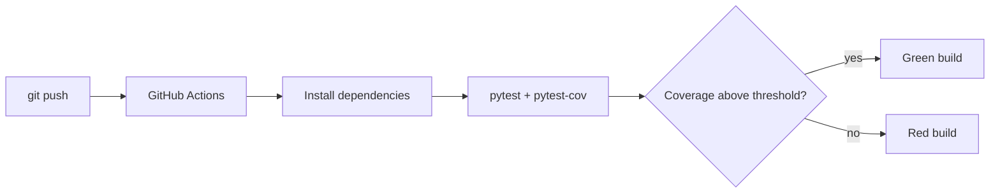

Tests exist — but how much code do they actually exercise? Untested lines can hide serious bugs. In this lesson we'll learn to measure **coverage** and integrate tests into continuous integration (CI) so quality is checked automatically on every code change.

## What is coverage

Coverage is the percentage of code lines that were executed at least once during the test run. If a module has 100 lines and the tests executed 75, coverage is 75%. The logic is simple: code that never runs is untested — errors can live in it.

It's important to understand the limitations: coverage only says that a line *was executed*, not that its result *was verified*. 100% coverage doesn't guarantee the absence of bugs, but low coverage is a reliable signal of holes in the tests.

## pytest-cov: measuring coverage

The tool is the `pytest-cov` package. Installation:

```bash
pip install pytest-cov
```

Run with coverage measurement for the `calc` module:

```bash
python -m pytest --cov=calc --cov-report=term-missing
```

What we'll see:

- `Stmts` — the number of executable lines;
- `Miss` — uncovered lines;
- `Cover` — coverage percentage;
- the `Missing` column — the numbers of lines that were not executed.

The `--cov-report=term-missing` flag adds the `Missing` column. Other report formats exist: `html`, `xml` (handy for CI), `json`.

## Quality threshold

Measuring alone isn't enough — set a minimum threshold. If coverage drops below it, CI should stop the build:

```bash
python -m pytest --cov=calc --cov-fail-under=80
```

If coverage is below 80%, pytest exits with an error. The threshold is team discipline: the more responsible the project, the higher the threshold.

## Branch coverage

By default, line coverage is measured. But you can also measure **branch** coverage (`if`/`else`, ternary operators). A branch counts as covered if both of its sides were taken:

```bash
python -m pytest --cov=calc --cov-branch --cov-report=term-missing
```

Without `--cov-branch`, code where `if` is always true will show 100% lines — but the `else` branch will remain untested.

## Excluding lines

Not all code needs coverage: for example, the `if __name__ == "__main__":` block is an entry point that isn't tested. It can be excluded from the count:

```python
if __name__ == "__main__":
    main()  # pragma: no cover
```

The comment `# pragma: no cover` tells the coverage tool to skip the line. You can also exclude whole files via the `.coveragerc` configuration file.

## CI integration

CI (Continuous Integration) is the practice of automatically running checks on every code change. The most common tool is GitHub Actions. A workflow is described in a YAML file `.github/workflows/ci.yml`:

```yaml
name: CI

on: [push, pull_request]

jobs:
  test:
    runs-on: ubuntu-latest
    steps:
      - uses: actions/checkout@v4
      - uses: actions/setup-python@v5
        with:
          python-version: "3.12"
      - run: pip install pytest pytest-cov
      - run: python -m pytest --cov=calc --cov-fail-under=80
```

Every push to the repository runs the `test` job: clones the code, installs Python, installs dependencies, and runs tests with the coverage threshold. If a test fails or coverage is below the threshold, CI turns red, and the team learns about the problem before the user does.



## Summary

Coverage answers "how much code is verified", and CI makes the check automatic and permanent. Together they form the baseline quality loop of any serious Python project.

Now let's put it all into practice.

<!--TASK-->
### Task 1
Create a file `calc.py` with two functions: `add(a, b)` and `subtract(a, b)`. Install `pytest-cov` (`pip install pytest-cov`). Write a test only for `add` in `test_calc.py`. Run the measurement: `python -m pytest --cov=calc --cov-report=term-missing`. Look at the report: what coverage percentage did you get and which lines landed in the `Missing` column? Expected: coverage around 50%, with the `subtract` line uncovered.

### Task 2
Add a test for `subtract` so coverage reaches 100%. Run the same command and confirm `Missing` is empty and `Cover` is `100%`. Then add the `--cov-fail-under=100` threshold to the command and confirm the run finishes successfully.

### Task 3
Add a function `sign(x)` to `calc.py` that returns `-1` if `x < 0`, `1` if `x > 0`, and `0` if `x == 0`. Run tests with the `--cov-branch` flag: `python -m pytest --cov=calc --cov-branch --cov-report=term-missing`. See how many branches are uncovered, then add tests so branch coverage becomes 100%.

### Task 4
Add this block to `calc.py`:

```python
if __name__ == "__main__":
    print(add(2, 3))
```

Run the coverage measurement — the `print` and `if` lines will land in `Missing`. Add the comment `# pragma: no cover` to the lines of this block and rerun: now the block shouldn't count toward coverage, and `Cover` should be 100% again (with all the tests from previous tasks).

### Task 5
Create a file `.github/workflows/ci.yml` for GitHub Actions: a workflow named `CI` triggered on `push` and `pull_request`, a `test` job on `ubuntu-latest`, steps: `actions/checkout@v4`, `actions/setup-python@v5` with Python 3.12, install `pip install pytest pytest-cov`, and run `python -m pytest --cov=calc --cov-fail-under=90`. Verify the YAML syntax is correct (indentation — two spaces).
### Task 6
Move the coverage settings into a file `.coveragerc`: a `[run]` section with `branch = True` and `source = calc`, a `[report]` section with `omit` for the paths `*/migrations/*` and `*/tests/*`, `exclude_lines` for `pragma: no cover`, and `fail_under = 90`. Remove all flags from the command line and run just `python -m pytest --cov`. Make sure pytest-cov read the configuration: branches are counted in the report, and the 90% threshold applies automatically. With full coverage, the expected result is a report showing `Cover 100%` and a successful run.

### Task 7
Extend the `ci.yml` workflow: add a matrix strategy with Python `3.11` and `3.12`, and save the coverage report to `coverage.xml` via `--cov-report=xml`. In a separate step, upload the file as an artifact with `actions/upload-artifact@v4` named `coverage-${{ matrix.python-version }}`. Make sure the YAML is correct and the job runs twice — once for each Python version. Expected result: two green jobs and two XML report artifacts.
<!--/TASK-->

<!--HINT-->
### Hint 1
Coverage is counted over lines that executed. The `add` test doesn't call `subtract`, so its line lands in `Missing`. Look at the `Missing` column at the end of the report — it will contain line numbers.

### Hint 2
Add `def test_subtract():` with the check `assert subtract(10, 4) == 6`. After that, `Missing` should be empty. The `--cov-fail-under=100` flag finishes the run successfully only at 100% coverage.

### Hint 3
The `sign` function has three branches: `x < 0`, `x > 0`, and `x == 0`. To cover all branches you need tests with all three variants: negative, positive, and zero. Look at the `Missing` column — with `--cov-branch` it shows both uncovered lines and branches.

### Hint 4
The comment `# pragma: no cover` goes at the end of a line and excludes it from the count: `if __name__ == "__main__":  # pragma: no cover`. Put it on both lines of the block: on `if` and on `print`. After that coverage should be 100% again.

### Hint 5
In YAML, two-space indentation matters. Each `-` under `steps:` is a new step. Parameters are given via `with:` with indentation. Check that `on:` is at the same level as `jobs:`, and `test:` is under `jobs:`.
### Hint 6
The `.coveragerc` format is an INI file without an extension. In `[run]`, the `branch = True` flag enables branch coverage, and `source = calc` limits measurement to one module. In `[report]`, the `omit` list is written on a new line with indentation. `fail_under = 90` is the same threshold as `--cov-fail-under`, but without a flag in the command.

### Hint 7
The matrix is described inside the job: `strategy: matrix: python-version: ["3.11", "3.12"]`, and in the setup step — `python-version: ${{ matrix.python-version }}`. The artifact upload step comes last and gets `path: coverage.xml`. The artifact name must be unique for each matrix branch, otherwise the jobs would overwrite each other.
<!--/HINT-->

<!--SOLUTION-->
### Walkthrough 1
Solution:

```python
# calc.py
def add(a, b):
    return a + b

def subtract(a, b):
    return a - b
```

```python
# test_calc.py
from calc import add

def test_add():
    assert add(2, 3) == 5
```

Run: `python -m pytest --cov=calc --cov-report=term-missing`. Result: coverage around 50%, with the `subtract` line in `Missing` (for example, `5`).

What's happening here? Coverage is counted over lines that actually executed during the tests. The test only calls `add`, so the `subtract` line never ran and landed in `Missing`. The report shows: `Stmts` — how many executable lines are in the module, `Miss` — how many are uncovered, `Cover` — the percentage. The `Missing` column is the most valuable: it tells exactly which lines aren't verified. Now we see the hole: `subtract` is untested.

### Walkthrough 2
Solution:

```python
# test_calc.py
from calc import add, subtract

def test_add():
    assert add(2, 3) == 5

def test_subtract():
    assert subtract(10, 4) == 6
```

Run: `python -m pytest --cov=calc --cov-report=term-missing --cov-fail-under=100`. Result: `Cover` — 100%, `Missing` empty, run successful.

What's happening here? A test for `subtract` was added, and now both functions executed. Coverage reached 100%, `Missing` is empty. The `--cov-fail-under=100` flag adds a hard requirement: if coverage falls below 100%, pytest exits with an error — that's how thresholds work in CI. Note: 100% is achievable here because the module is small. In real projects the threshold is usually 70–90%, because hundred-percent coverage isn't always economically justified.

### Walkthrough 3
Solution:

```python
# calc.py
def sign(x):
    if x < 0:
        return -1
    if x > 0:
        return 1
    return 0
```

```python
# test_calc.py
from calc import sign

def test_sign_negative():
    assert sign(-5) == -1

def test_sign_positive():
    assert sign(5) == 1

def test_sign_zero():
    assert sign(0) == 0
```

Run: `python -m pytest --cov=calc --cov-branch --cov-report=term-missing`. Result: 100% branch coverage.

What's happening here? Without `--cov-branch`, one test would have been enough (for example, `sign(5) == 1`) — the line would execute. But the `x < 0` and `x == 0` branches would remain untested. With the `--cov-branch` flag, the tool tracks both sides of every condition: for a branch to be covered, both of its sides must run. Three tests — negative, positive, and zero — cover all branches, and the report shows 100% branches. This is an important practice: many bugs live precisely in branches that "never happen".

### Walkthrough 4
Solution:

```python
# calc.py
def add(a, b):
    return a + b

def subtract(a, b):
    return a - b

if __name__ == "__main__":
    print(add(2, 3))  # pragma: no cover
```

Run: `python -m pytest --cov=calc --cov-report=term-missing --cov-fail-under=100`. Result: `Cover` — 100%, no `Missing`.

What's happening here? The `if __name__ == "__main__":` block is the standard way to give a module an entry point, but tests don't run it, so its lines would land in `Missing`. The comment `# pragma: no cover` tells the coverage tool to exclude the line from the count. Attention: in the solution above the comment is only on `print` — but the `if` line also needs exclusion, so in the full solution you should mark both lines:

```python
if __name__ == "__main__":  # pragma: no cover
    print(add(2, 3))  # pragma: no cover
```

This way the entry point doesn't "spoil" coverage. It's an honest technique: a block not meant for testing is explicitly marked.

### Walkthrough 5
Solution — the file `.github/workflows/ci.yml`:

```yaml
name: CI

on: [push, pull_request]

jobs:
  test:
    runs-on: ubuntu-latest
    steps:
      - uses: actions/checkout@v4
      - uses: actions/setup-python@v5
        with:
          python-version: "3.12"
      - run: pip install pytest pytest-cov
      - run: python -m pytest --cov=calc --cov-fail-under=90
```

What's happening here? On every `push` and `pull_request`, GitHub spins up a virtual machine with Ubuntu and executes the steps in order: clones the repository (`checkout`), installs Python 3.12 (`setup-python`), installs pytest and pytest-cov, then runs the tests with a 90% coverage threshold. If a test fails or coverage falls below 90%, the job finishes with an error and a red check appears on GitHub. That's CI: all checks run automatically on every change, and the team immediately sees that the code is healthy and coverage is within bounds.
### Walkthrough 6
Solution — the file `.coveragerc` in the project root:

```ini
[run]
branch = True
source = calc

[report]
omit =
    */migrations/*
    */tests/*
exclude_lines =
    pragma: no cover
fail_under = 90
```

Run: `python -m pytest --cov`. Result: a report with the columns `Stmts`, `Miss`, `Branch`, `BrPart`, `Cover`, coverage 100%, run successful.

What's happening here? Previously all parameters were passed as flags on the command line, and every developer had to remember the set. `.coveragerc` makes the settings part of the project: coverage and pytest-cov read the file automatically. The `[run]` section enables branch analysis and limits measurement to the `calc` module so third-party files don't enter the report. The `[report]` section excludes migrations and the tests themselves — covering them is pointless — and `exclude_lines` pins down the rule for `pragma: no cover`. The `fail_under = 90` threshold turns coverage into a quality gate: CI fails if someone adds an unverified branch. One file instead of a long command — fewer chances that local and server runs diverge.

### Walkthrough 7
Solution — the file `.github/workflows/ci.yml`:

```yaml
name: CI

on: [push, pull_request]

jobs:
  test:
    runs-on: ubuntu-latest
    strategy:
      matrix:
        python-version: ["3.11", "3.12"]
    steps:
      - uses: actions/checkout@v4
      - uses: actions/setup-python@v5
        with:
          python-version: ${{ matrix.python-version }}
      - run: pip install pytest pytest-cov
      - run: python -m pytest --cov=calc --cov-report=xml --cov-fail-under=90
      - uses: actions/upload-artifact@v4
        with:
          name: coverage-${{ matrix.python-version }}
          path: coverage.xml
```

What's happening here? `strategy.matrix` makes GitHub create not one job but two — one per Python version from the list. Inside each job, the expression `${{ matrix.python-version }}` is substituted into the setup step, so tests genuinely run on 3.11 and 3.12: this catches code that only works on a newer version. The `--cov-report=xml` flag writes the report to `coverage.xml` — a machine-readable format accepted by Codecov, SonarQube, and GitHub's built-in viewer. The `upload-artifact` step saves the file after the job finishes; the name `coverage-${{ matrix.python-version }}` must be unique, otherwise the two matrix branches would try to write a single artifact. As a result, the Actions interface shows two green jobs and two downloadable reports.
<!--/SOLUTION-->

<!--QUIZ-->
What does code coverage show?
- How many lines of code were executed at least once during the tests
- How many bugs the tests found
- How long the tests take
* Correct answer: How many lines of code were executed at least once during the tests
Coverage measures the share of executed lines (and, optionally, branches).

Which flag adds uncovered lines to the pytest-cov report?
- --cov-report=term-missing
- --show-missing-only
- --verbose-missing
* Correct answer: --cov-report=term-missing
The flag adds a Missing column with the numbers of uncovered lines.

What does --cov-fail-under=80 do?
- Stops the run if coverage is below 80%
- Speeds up tests to 80 ms
- Counts only the first 80 lines
* Correct answer: Stops the run if coverage is below 80%
If coverage is below the threshold, pytest exits with an error — a "quality gate" mechanism.

What does branch coverage (--cov-branch) measure?
- Coverage of all lines, including comments
- Execution of both sides of every condition
- Coverage of functions with return only
* Correct answer: Execution of both sides of every condition
A branch is covered only if both of its sides ran: if and else.

How do you exclude a line from the coverage count?
- Add the comment # pragma: no cover
- Delete the line from the file
- Comment it out
* Correct answer: Add the comment # pragma: no cover
A comment at the end of the line excludes it from coverage evaluation.

What is CI (continuous integration)?
- Automatically running checks on every code change
- Manually running tests before a release
- A debugging tool
* Correct answer: Automatically running checks on every code change
CI runs tests, linters, and other checks on a server after every push.

In which file is a GitHub Actions workflow described?
- .github/workflows/ci.yml
- ci.yaml in the project root
- Makefile
* Correct answer: .github/workflows/ci.yml
A workflow lives in a YAML file in the .github/workflows directory.

Is it true that 100% coverage guarantees the absence of bugs?
- Yes, if coverage is 100% the code is always correct
- No, coverage only shows that lines executed, not that results were verified
- Yes, but only for small modules
* Correct answer: No, coverage only shows that lines executed, not that results were verified
Coverage doesn't speak to the correctness of checks — only to whether the code ran.
What does the --cov-report=xml flag do?
- Saves the coverage report to a coverage.xml file
- Shows the report only in the terminal
- Deletes the previous report
* Correct answer: Saves the coverage report to a coverage.xml file
XML reports are read by CI services and code quality analysis systems.

What does the fail_under parameter set in the [report] section of .coveragerc?
- The minimum acceptable coverage percentage
- The maximum number of tests
- The list of excluded files
* Correct answer: The minimum acceptable coverage percentage
If coverage is below the threshold, coverage exits with an error — same as the --cov-fail-under flag.

What does omit do in .coveragerc?
- Excludes the given paths from the coverage count
- Deletes files after tests
- Hides the whole report
* Correct answer: Excludes the given paths from the coverage count
This is how migrations, tests, and generated code are usually excluded.

Why is strategy.matrix needed in GitHub Actions?
- To run a job several times with different parameters, e.g., Python versions
- To speed up a single job
- To disable tests on some branches
* Correct answer: To run a job several times with different parameters
The matrix creates a separate job for each combination of values.
<!--/QUIZ-->
