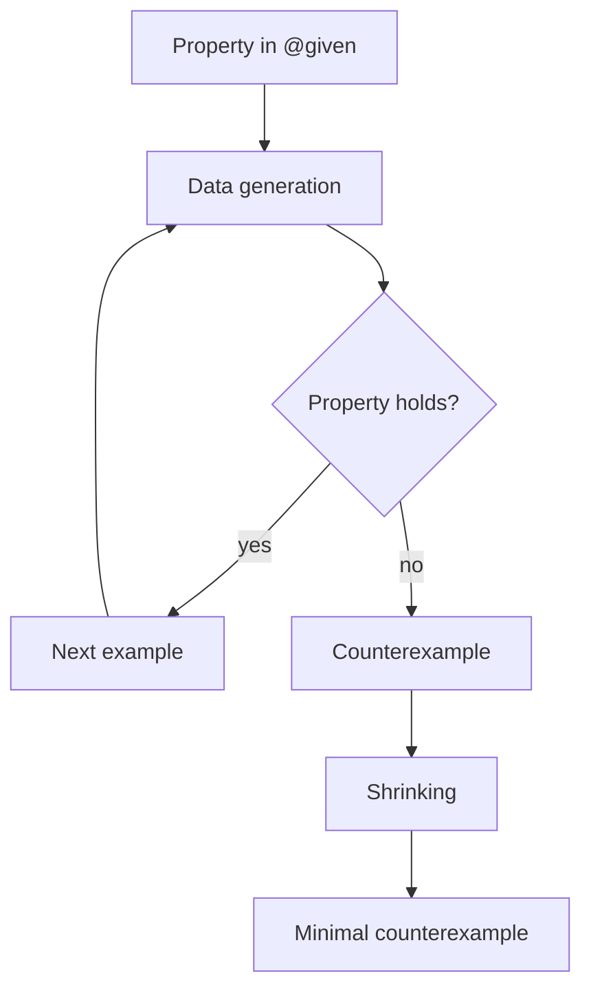

Regular tests check code against specific examples: `add(2, 3) == 5`. But what if a bug hides in `add(-0.001, 0.001)` or in a huge string? Writing examples for every case is impossible. **Property-based testing** solves this differently: we describe a *property* that must always hold, and the library itself generates hundreds of inputs and verifies it.

## The hypothesis library

Installation:

```bash
pip install hypothesis
```

The basic technique is the `@given` decorator and strategies from `hypothesis.strategies`:

```python
from hypothesis import given
from hypothesis import strategies as st

@given(st.integers(), st.integers())
def test_add_commutative(a, b):
    assert a + b == b + a
```

Hypothesis will generate hundreds of integer pairs (including zero, negatives, extremely large values) and check the property for each: `a + b == b + a`. If the property is violated, hypothesis finds a minimal counterexample.

## Strategies

Strategies are data generators:

- `st.integers()` — integers (can be bounded: `st.integers(min_value=1, max_value=1000)`);
- `st.floats()` — floats;
- `st.text()` — strings (there's also `st.text(alphabet="abc")`);
- `st.lists(st.integers())` — lists of numbers;
- `st.booleans()`, `st.dictionaries(st.text(), st.integers())`, `st.sampled_from([...])`.

Strategies can be combined to build complex structures:

```python
@given(st.lists(st.integers()))
def test_sorted_idempotent(lst):
    assert sorted(sorted(lst)) == sorted(lst)
```

## assume: filtering

Sometimes a property only makes sense for some inputs. For example, division is undefined for a zero denominator. The `assume` function discards uninteresting examples:

```python
@given(st.integers(), st.integers())
def test_division(a, b):
    assume(b != 0)
    result = a / b
    assert isinstance(result, float)
```

If `assume` discards inputs too often, hypothesis will tell you — a sign the strategy is too broad for the property.

## Finding a minimal counterexample

Suppose the property is false. Let's write an "almost right" function and a property for it:

```python
def bad_reverse(s):
    return s[:-1][::-1] if s else ""

@given(st.text())
def test_reverse_identity(s):
    assert bad_reverse(bad_reverse(s)) == s
```

Hypothesis will quickly find a counterexample: for example, `s = "a"`. But the key thing is it **shrinks** it to the minimum: instead of a long string it shows `"a"`, which is easier to reason about. Automatic shrinking is one of hypothesis's greatest values.

## Order: property first, then examples

Property-based tests don't replace regular ones — they complement them. Regular examples pin down known cases, while property tests hunt unknown breakages. Start with simple properties (idempotence, commutativity, invariance), then combine strategies.



## Summary

Property-based testing is a shift in thinking: not "check this example", but "check that this property holds for all data of this kind". Hypothesis handles generation and shrinking of counterexamples for you.

Now let's put it all into practice.

<!--TASK-->
### Task 1
Write a commutativity property for addition: `a + b == b + a` for any integers via `@given(st.integers(), st.integers())`. Add a second property: associativity `(a + b) + c == a + (b + c)`. Run the tests and make sure both properties pass on hundreds of generated examples.

### Task 2
Write a property for the `sorted()` function: a list sorted twice equals a list sorted once: `sorted(sorted(lst)) == sorted(lst)` — for any lists of integers. Add a second property: sorting doesn't change the length: `len(sorted(lst)) == len(lst)`. Run — both properties should pass.

### Task 3
Write a function `reverse_str(s)` that reverses a string (via the slice `s[::-1]`), and two properties: `reverse_str(reverse_str(s)) == s` (double reversal returns the original) and `len(reverse_str(s)) == len(s)` for any strings. Run the tests — the properties should pass.

### Task 4
Write a function `divide(a, b)` that returns `a / b`, and a property with `assume`: for any integers `a`, `b` where `b != 0`, the result of `divide(a, b)` is a `float`, and multiplying the result back by `b` equals `a` (within tolerance: use `pytest.approx`). Run — the property should pass.

### Task 5
Find a counterexample. Write a "broken" function `mystery(x)` that returns `x * 2` for odd numbers and `x * 3` for even ones, and a property: `mystery(x) % 2 == x % 2` for any integers `x`. Run the test and see what counterexample hypothesis finds and to what minimal value it shrinks it. Explain why the property is violated.
### Task 6
Write two properties for the built-in `min` and `max` on non-empty lists of integers. The strategy is `st.lists(st.integers(), min_size=1)`, otherwise both functions raise `ValueError` on an empty list. First property: `min(lst) <= max(lst)`. Second: each of `min(lst)` and `max(lst)` is actually present in the list — check with `in lst`. Run pytest — expected output `2 passed`, each test runs on hundreds of lists of varying lengths.

### Task 7
Write a recursive function `factorial(n)` and two properties: `factorial(n) >= 1` for `n >= 0` and `factorial(n) == n * factorial(n - 1)` for `n >= 1`. Bound the strategy with `st.integers(min_value=0, max_value=10)`. Add `@settings(max_examples=200)` and pin down the boundary case with the `@example(0)` decorator — zero must give `1`. Run pytest: expected output `2 passed`, and the example 0 is checked in every run regardless of the generator.
<!--/TASK-->

<!--HINT-->
### Hint 1
Imports: `from hypothesis import given` and `from hypothesis import strategies as st`. The `@given(st.integers(), st.integers())` decorator goes above a function with parameters `(a, b)`. For associativity you need a third parameter: `@given(st.integers(), st.integers(), st.integers())`.

### Hint 2
The list strategy is `st.lists(st.integers())`; it generates both empty and large lists. The test function takes one parameter `lst`. Comparing `sorted(sorted(lst)) == sorted(lst)` is the classic idempotence property.

### Hint 3
The string strategy is `st.text()`. For double reversal, just call `reverse_str` twice: `reverse_str(reverse_str(s))`. Make sure the function handles the empty string correctly.

### Hint 4
`from math import isclose` or `import pytest` and `pytest.approx`. Inside the test: `assume(b != 0)` must come before any computation. Check `isinstance(divide(a, b), float)` and `divide(a, b) * b == pytest.approx(a)`.

### Hint 5
The property is violated for even numbers: for them `mystery(x) = x * 3`, which changes parity. Think about the smallest even `x` where this shows. Hypothesis will display the shrunk counterexample in the failure message.
### Hint 6
`min_size=1` is the key parameter: without it hypothesis would generate an empty list and `min()` would fail with `ValueError`, even though the property has nothing to do with it. The second property is expressed as two `assert`s: `assert min(lst) in lst` and `assert max(lst) in lst`. Both tests take one parameter `lst`.

### Hint 7
`@settings` is imported from `hypothesis`: `from hypothesis import given, settings, example`. The `@example(0)` decorator goes next to `@given` and adds a concrete example to the generated ones. In the recursive function, don't forget the base case: `if n == 0: return 1`. For the second property, bound the strategy from below with 1, otherwise with `n = 0` you'd get `factorial(-1)`.
<!--/HINT-->

<!--SOLUTION-->
### Walkthrough 1
Solution:

```python
from hypothesis import given
from hypothesis import strategies as st

@given(st.integers(), st.integers())
def test_add_commutative(a, b):
    assert a + b == b + a

@given(st.integers(), st.integers(), st.integers())
def test_add_associative(a, b, c):
    assert (a + b) + c == a + (b + c)
```

Run: `python -m pytest`. Result: `2 passed` (each on hundreds of generated examples).

What's happening here? `st.integers()` generates integers from very small to very large, including zero and negatives. Hypothesis picks hundreds of examples for each property and runs the test on each. Commutativity and associativity are basic properties that must hold for any integers; if `add` (here — the built-in `+`) behaved incorrectly on some extreme values, hypothesis would find it. Note: the test describes a *rule*, not specific numbers — so it doesn't go stale when data changes.

### Walkthrough 2
Solution:

```python
from hypothesis import given
from hypothesis import strategies as st

@given(st.lists(st.integers()))
def test_sorted_idempotent(lst):
    assert sorted(sorted(lst)) == sorted(lst)

@given(st.lists(st.integers()))
def test_sorted_len(lst):
    assert len(sorted(lst)) == len(lst)
```

Run: `python -m pytest`. Result: `2 passed`.

What's happening here? `st.lists(st.integers())` generates lists of integers: empty, short, long, with duplicates. The idempotence property says: sorting again doesn't change the result — sorting an already-sorted list yields the same list. The length property guards against situations where a "sort" suddenly loses elements. Both properties are checked on hundreds of different lists. This is how property tests catch subtle bugs: for example, if `sorted` accidentally dropped duplicates, the length property would detect it instantly.

### Walkthrough 3
Solution:

```python
from hypothesis import given
from hypothesis import strategies as st

def reverse_str(s):
    return s[::-1]

@given(st.text())
def test_reverse_twice(s):
    assert reverse_str(reverse_str(s)) == s

@given(st.text())
def test_reverse_len(s):
    assert len(reverse_str(s)) == len(s)
```

Run: `python -m pytest`. Result: `2 passed`.

What's happening here? `st.text()` generates strings: empty, single-character, long, with Unicode characters. Double reversal must return the original — this is a strong property: if `reverse_str` lost a character or changed the order, it would immediately show a counterexample. The length property checks that no character is lost. Note that `s[::-1]` works with the empty string too — the property covers it. If you had written `reverse_str` by hand and erred on edge cases, hypothesis would find a minimal counterexample.

### Walkthrough 4
Solution:

```python
import pytest
from hypothesis import given, assume
from hypothesis import strategies as st

def divide(a, b):
    return a / b

@given(st.integers(), st.integers())
def test_divide(a, b):
    assume(b != 0)
    result = divide(a, b)
    assert isinstance(result, float)
    assert result * b == pytest.approx(a)
```

Run: `python -m pytest`. Result: `1 passed`.

What's happening here? `assume(b != 0)` discards examples with a zero denominator — the division property is undefined when `b == 0`. Without this filter, hypothesis would generate zeros and division would fail with `ZeroDivisionError`. The `isinstance(result, float)` check pins down that `/` returns a float, and `result * b == pytest.approx(a)` verifies division is the inverse of multiplication (accounting for floating-point tolerance). This is a strong property: it checks not a specific value but the *relationship* between operations.

### Walkthrough 5
Solution:

```python
from hypothesis import given
from hypothesis import strategies as st

def mystery(x):
    if x % 2 == 0:
        return x * 3
    return x * 2

@given(st.integers())
def test_mystery_parity(x):
    assert mystery(x) % 2 == x % 2
```

Run: `python -m pytest`. Result: the test fails, hypothesis finds and shrinks a counterexample.

What's happening here? For odd `x`, `mystery(x) = x * 2` — even, while `x % 2 == 1`, so the property is already violated for odds. For even numbers, `mystery(x) = x * 3` — also even, and `x % 2 == 0`, so the property holds there. Hypothesis will find a counterexample (for example, `x = 1`) and **shrink** it to the minimum: `1`. In the failure message you'll see the shrunk example and an explanation. The main lesson: the property was formulated incorrectly (it doesn't reflect the real behavior), and the property test proved it. This is how hypothesis helps find errors both in code and in the tests themselves.
### Walkthrough 6
Solution:

```python
from hypothesis import given
from hypothesis import strategies as st

@given(st.lists(st.integers(), min_size=1))
def test_min_not_greater_than_max(lst):
    assert min(lst) <= max(lst)

@given(st.lists(st.integers(), min_size=1))
def test_extremes_belong_to_list(lst):
    assert min(lst) in lst
    assert max(lst) in lst
```

Run: `python -m pytest`. Result: `2 passed`.

What's happening here? The strategy generates lists of integers from one element to several dozen, including negatives and duplicates. The first property is basic consistency: the minimum cannot be greater than the maximum. The second is stronger: it requires the extremum to be a real element of the list, not a value computed "out of thin air". If the `max` implementation returned, say, a sum, the second property would fail instantly while the first might stay green. The `min_size=1` parameter removes the empty list: without it hypothesis would honestly find `[]` as a counterexample, but the failure would relate to the function's precondition, not a violated property. This is a typical beginner mistake — confusing domain boundaries with a bug.

### Walkthrough 7
Solution:

```python
from hypothesis import given, settings, example
from hypothesis import strategies as st

def factorial(n):
    if n == 0:
        return 1
    return n * factorial(n - 1)

@settings(max_examples=200)
@given(st.integers(min_value=0, max_value=10))
@example(0)
def test_factorial_positive(n):
    assert factorial(n) >= 1

@settings(max_examples=200)
@given(st.integers(min_value=1, max_value=10))
@example(1)
def test_factorial_recurrence(n):
    assert factorial(n) == n * factorial(n - 1)
```

Run: `python -m pytest`. Result: `2 passed`.

What's happening here? `st.integers(min_value=0, max_value=10)` narrows the domain to values where recursion is guaranteed to terminate: on large numbers the function would quickly hit the recursion limit, and that would be an implementation problem rather than a property one. `@settings(max_examples=200)` sets the number of generated examples — by default it's one hundred; two hundred give more chances to hit a rare combination at a small run-time cost. `@example(0)` adds a fixed example on top of random ones: zero is the only case where the recursion base fires, and the generator might not pick it. The second property checks the recurrence relation, i.e., the link between neighboring values — such a property catches an error in the multiplier or the base even when individual values look plausible.
<!--/SOLUTION-->

<!--QUIZ-->
What is property-based testing?
- Checking code properties against hundreds of generated inputs
- Checking only specific examples
- Testing class properties
* Correct answer: Checking code properties against hundreds of generated inputs
We describe a rule, and hypothesis generates data and verifies it.

What does the @given decorator do?
- Marks a test as slow
- Passes generated data into the test according to strategies
- Skips a test
* Correct answer: Passes generated data into the test according to strategies
@given(st.integers()) generates hundreds of integers and runs the test on each.

What does st.lists(st.integers()) generate?
- A list of random numbers of fixed length
- Lists of integers: empty, short, long
- Only empty lists
* Correct answer: Lists of integers: empty, short, long
The strategy covers a wide class of lists, including edge cases.

What is assume(b != 0) for?
- To round the division result
- To discard examples where the property is undefined
- To speed up generation
* Correct answer: To discard examples where the property is undefined
assume filters inputs for which the property makes no sense.

What happens if a property is violated?
- The test is silently skipped
- Hypothesis finds a counterexample and shrinks it to the minimum
- The test stops working forever
* Correct answer: Hypothesis finds a counterexample and shrinks it to the minimum
Automatic shrinking is a key hypothesis feature: it shows the simplest example that breaks the property.

Which strategy should be used for strings?
- st.text()
- st.str()
- st.strings()
* Correct answer: st.text()
st.text() generates strings, including empty ones and those with Unicode characters.

Which Python operator reverses a string?
- s[::-1]
- s[-1]
- s.reverse()
* Correct answer: s[::-1]
A slice with step -1 returns the reversed string.

How are property tests different from regular ones?
- They don't use assert
- They check rules over a set of data rather than individual examples
- They only work with numbers
* Correct answer: They check rules over a set of data rather than individual examples
Regular tests pin down known cases; property tests hunt unknown breakages.
What does the strategy st.sampled_from(["a", "b", "c"]) do?
- Picks values from the given list
- Generates random strings of any length
- Returns the whole list
* Correct answer: Picks values from the given list
The strategy is useful when the domain is a small known set of options.

Why is the @example(0) decorator needed?
- Adds a fixed example to the generated data
- Disables generation
- Limits the number of examples to one
* Correct answer: Adds a fixed example to the generated data
This is how you pin down an important edge case the generator might miss.

How do you limit the number of generated examples?
- @settings(max_examples=200)
- @given(count=200)
- @example(200)
* Correct answer: @settings(max_examples=200)
The max_examples parameter sets the number of runs per property.

What does st.integers(min_value=1) mean?
- The strategy doesn't generate numbers below 1
- Generates only the number 1
- Generates exactly one value
* Correct answer: The strategy doesn't generate numbers below 1
Bounds define the domain inside which hypothesis searches for examples.
<!--/QUIZ-->
