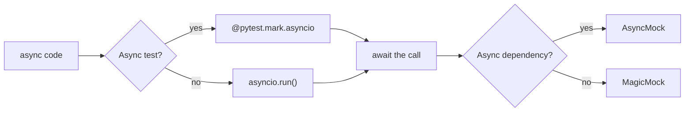

Code using `async`/`await` can't be tested like regular code: the test function must be asynchronous too, and the event loop must be prepared in advance. In this lesson we'll see how to do it with `pytest-asyncio` and `AsyncMock`.

## pytest-asyncio: async tests

Installation:

```bash
pip install pytest-asyncio
```

After that you can write tests declared as `async def` and marked with `@pytest.mark.asyncio`:

```python
import asyncio
import pytest

async def slow_add(a, b):
    await asyncio.sleep(0.01)
    return a + b

@pytest.mark.asyncio
async def test_slow_add():
    assert await slow_add(1, 2) == 3
```

pytest-asyncio creates an event loop itself, runs the coroutine-test in it, and tears the loop down afterwards. The `loop_scope` parameter in the marker lets you control the loop's lifetime: `@pytest.mark.asyncio(loop_scope="session")` reuses one loop for all tests in the session (handy for slow fixtures).

## Async functions without a marker

If the test is synchronous but you need to call one async function, use `asyncio.run()`:

```python
def test_slow_add_sync():
    assert asyncio.run(slow_add(1, 2)) == 3
```

`asyncio.run()` creates a new loop, runs the coroutine, and closes the loop. It's a simple technique for one-off checks.

## AsyncMock

For async dependencies (for example, `client.get` from an HTTP client), a regular `MagicMock` won't do: `await mock.get(url)` will fail because `MagicMock` doesn't return a coroutine. The solution is `AsyncMock` from `unittest.mock`:

```python
from unittest.mock import AsyncMock

async def fetch_data(client, url):
    return await client.get(url)

def test_fetch_data():
    client = AsyncMock()
    client.get.return_value = "ok"
    assert asyncio.run(fetch_data(client, "/data")) == "ok"
```

`AsyncMock` returns an awaitable, so `await client.get(url)` works. You can even set `side_effect` with exceptions — for example, to test network failure handling.

## Async fixtures

Fixtures can be asynchronous too — `async def` with `@pytest.fixture`, and pytest-asyncio will run them correctly:

```python
@pytest.fixture
async def client():
    c = make_client()
    yield c
    await c.close()
```

A test coroutine receives such a fixture as a regular parameter.

## Timeouts

Async code often talks to the network, and it's important to check behavior under hangs. The `asyncio.timeout` context manager (Python 3.11+) bounds execution time and raises `asyncio.TimeoutError`:

```python
async def hang():
    await asyncio.sleep(10)

@pytest.mark.asyncio
async def test_hang_timeout():
    with pytest.raises(asyncio.TimeoutError):
        async with asyncio.timeout(0.01):
            await hang()
```

If the code doesn't finish within the timeout, the test records it. This is the basis of checking "does our code hang".

## Parallelism: asyncio.gather

`asyncio.gather` runs coroutines in parallel. A property to check: results are collected in the same order as the coroutines were passed:

```python
async def collect(ids):
    return await asyncio.gather(*(fetch(i) for i in ids))
```

The test verifies the result order matches the order of `ids` — that's the `gather` contract.



## Summary

For async tests you need `pytest-asyncio` with the `@pytest.mark.asyncio` marker, `AsyncMock` for replacing async dependencies, and `asyncio.timeout` for checking timeouts.

Now let's put it all into practice.

<!--TASK-->
### Task 1
Write an async function `greet_async(name)` that does `await asyncio.sleep(0.01)` and returns `f"Hello, {name}!"`. Create a test `test_greet_async` with `@pytest.mark.asyncio` that verifies `await greet_async("Anna") == "Hello, Anna!"`. Install `pytest-asyncio`, run pytest — there should be `1 passed`.

### Task 2
Write a synchronous test `test_greet_sync` that calls `greet_async` via `asyncio.run()`, without the `@pytest.mark.asyncio` marker. Check the same result. Run it — there should be `2 passed` (two tests from tasks 1 and 2).

### Task 3
Write an async function `fetch_data(client, url)` that returns `await client.get(url)`. Create a test with `AsyncMock`: set `client.get.return_value = "ok"`, call `fetch_data` via `asyncio.run` and check the result equals `"ok"`, and `client.get.assert_called_once_with("/data")`. Run it — `3 passed` (all three tests).

### Task 4
Write an async function `fetch_with_timeout(client, url, timeout)` that wraps the call `await client.get(url)` in `async with asyncio.timeout(timeout)`. Create a test: an `AsyncMock` with `client.get.side_effect = asyncio.TimeoutError()`, and check via `pytest.raises(asyncio.TimeoutError)` that calling `fetch_with_timeout(client, "/data", 1)` raises a timeout. Run it — `4 passed`.

### Task 5
Write an async function `fetch_all(ids)` that gathers results via `asyncio.gather(*(fetch(i) for i in ids))`, where `fetch(i)` is an `async` function returning `f"data-{i}"`. Write a test: pass `[1, 2, 3]` and check the result equals `["data-1", "data-2", "data-3"]` — the order is preserved. Run it — `5 passed`.
### Task 6
Write an async fixture `api_client` that creates an `AsyncMock`, sets `client.get.return_value = {"status": "ok"}`, hands the client over via `yield`, and after the test sets `client.closed = True`. The test `test_ping` with the `@pytest.mark.asyncio` marker takes the fixture, does `await api_client.get("/ping")` and checks the result, plus `assert_awaited_once_with("/ping")`. Run pytest — expected output `1 passed`; make sure cleanup runs even if the test fails.

### Task 7
Write an async function `fetch_safe(ids)` that calls `fetch(i)` in parallel and collects results via `asyncio.gather(..., return_exceptions=True)`. The function `fetch(i)` returns `f"data-{i}"`, but for `i == 2` it raises `ValueError("bad id")`. Write a test with `@pytest.mark.asyncio`: for `[1, 2, 3]` the result must contain `"data-1"`, a `ValueError` object, and `"data-3"` — check the element types and that the other values weren't lost. Run pytest — expected output `1 passed`.
<!--/TASK-->

<!--HINT-->
### Hint 1
Don't forget `pip install pytest-asyncio`. The test is declared `async def test_greet_async():` with the `@pytest.mark.asyncio` decorator. Inside — `assert await greet_async("Anna") == "Hello, Anna!"`. pytest-asyncio creates the event loop automatically.

### Hint 2
A synchronous test is a regular `def` without a decorator. Inside, call `asyncio.run(greet_async("Anna"))`. Note: `asyncio.run` creates a new loop and closes it after execution.

### Hint 3
`from unittest.mock import AsyncMock`. Create `client = AsyncMock()`, set `client.get.return_value = "ok"`. Call `fetch_data` via `asyncio.run(fetch_data(client, "/data"))`, since the test is synchronous. After the call, check `client.get.assert_called_once_with("/data")`.

### Hint 4
`asyncio.timeout(timeout)` is a context manager: `async with asyncio.timeout(timeout):`. It raises `asyncio.TimeoutError` if the inner code doesn't finish in time. To check, use `with pytest.raises(asyncio.TimeoutError):` around the call via `asyncio.run`.

### Hint 5
`fetch` is a helper async function: `async def fetch(i): return f"data-{i}"`. `asyncio.gather(*(fetch(i) for i in ids))` takes coroutines via `*` unpacking. In the test, compare `asyncio.run(fetch_all([1, 2, 3]))` with `["data-1", "data-2", "data-3"]`.
### Hint 6
The fixture is declared as `async def` with `@pytest.fixture`. Inside: `client = AsyncMock()`, `client.get.return_value = {"status": "ok"}`, `yield client`, `client.closed = True`. Both the fixture and the test must be async — otherwise `yield` in an async function won't behave as expected. `AsyncMock` has an `assert_awaited_once_with(...)` check.

### Hint 7
`asyncio.gather(*(fetch(i) for i in ids), return_exceptions=True)` — the flag is passed as a keyword argument after the unpacking. With `return_exceptions=True`, an exception lands in the result as an object instead of being raised outward. Don't compare exceptions by value — check `isinstance(result[1], ValueError)`.
<!--/HINT-->

<!--SOLUTION-->
### Walkthrough 1
Solution:

```python
import asyncio
import pytest

async def greet_async(name):
    await asyncio.sleep(0.01)
    return f"Hello, {name}!"

@pytest.mark.asyncio
async def test_greet_async():
    assert await greet_async("Anna") == "Hello, Anna!"
```

Run: `python -m pytest`. Result: `1 passed`.

What's happening here? The `@pytest.mark.asyncio` marker tells pytest-asyncio that the test is a coroutine and must run in an event loop. pytest-asyncio creates the loop, runs the test in it, and tears it down after completion. `greet_async` imitates real async work with `asyncio.sleep(0.01)` — real I/O (network, disk) behaves similarly: the code waits without blocking the main thread. The test properly `await`s the call and compares the result.

### Walkthrough 2
Solution:

```python
import asyncio
import pytest

async def greet_async(name):
    await asyncio.sleep(0.01)
    return f"Hello, {name}!"

@pytest.mark.asyncio
async def test_greet_async():
    assert await greet_async("Anna") == "Hello, Anna!"

def test_greet_sync():
    assert asyncio.run(greet_async("Anna")) == "Hello, Anna!"
```

Run: `python -m pytest`. Result: `2 passed`.

What's happening here? The synchronous test `test_greet_sync` needs no marker: `asyncio.run()` creates a new event loop, runs the coroutine `greet_async("Anna")`, and closes the loop. This is convenient when you need to check an async function in passing from a regular test. Note the difference: `pytest.mark.asyncio` works with the loop already managed by pytest-asyncio, while `asyncio.run` manages the loop's lifecycle itself. You can mix both approaches in one file — as here.

### Walkthrough 3
Solution:

```python
import asyncio
from unittest.mock import AsyncMock

async def fetch_data(client, url):
    return await client.get(url)

def test_fetch_data():
    client = AsyncMock()
    client.get.return_value = "ok"
    result = asyncio.run(fetch_data(client, "/data"))
    assert result == "ok"
    client.get.assert_called_once_with("/data")
```

Run: `python -m pytest`. Result: `3 passed`.

What's happening here? `AsyncMock` is the async counterpart of `MagicMock`: its methods return awaitables, so `await client.get(url)` works. A regular `MagicMock` wouldn't fit here: `await` on a `MagicMock` result would fail with "object is not awaitable". `client.get.return_value = "ok"` configures the call result, and `assert_called_once_with("/data")` verifies the method was called exactly once with the right URL. This way we isolate the test from a real network client.

### Walkthrough 4
Solution:

```python
import asyncio
import pytest
from unittest.mock import AsyncMock

async def fetch_with_timeout(client, url, timeout):
    async with asyncio.timeout(timeout):
        return await client.get(url)

def test_fetch_timeout():
    client = AsyncMock()
    client.get.side_effect = asyncio.TimeoutError()
    with pytest.raises(asyncio.TimeoutError):
        asyncio.run(fetch_with_timeout(client, "/data", 1))
```

Run: `python -m pytest`. Result: `4 passed`.

What's happening here? `asyncio.timeout(timeout)` is a context manager: if the inner code doesn't finish within the allotted time, it raises `asyncio.TimeoutError`. In the test we imitate a network hang: `client.get.side_effect = asyncio.TimeoutError()` makes every call raise a timeout. The `pytest.raises(asyncio.TimeoutError)` wrapper verifies that `fetch_with_timeout` propagates the exception outward — meaning the calling code can handle it. This is the classic resilience check against hangs.

### Walkthrough 5
Solution:

```python
import asyncio
import pytest

async def fetch(i):
    return f"data-{i}"

async def fetch_all(ids):
    return await asyncio.gather(*(fetch(i) for i in ids))

@pytest.mark.asyncio
async def test_fetch_all():
    result = await fetch_all([1, 2, 3])
    assert result == ["data-1", "data-2", "data-3"]
```

Run: `python -m pytest`. Result: `5 passed`.

What's happening here? `asyncio.gather` takes coroutines and runs them in parallel. The unpacking `*(fetch(i) for i in ids)` turns the generator into separate arguments. An important property of `gather`: results are collected in the same order the coroutines were passed — regardless of which one finished first. The test checks exactly this contract: the list `["data-1", "data-2", "data-3"]` matches the order of `ids`. If you wrote your own version of parallel processing, such a property would catch an ordering bug.
### Walkthrough 6
Solution:

```python
import pytest
from unittest.mock import AsyncMock

@pytest.fixture
async def api_client():
    client = AsyncMock()
    client.get.return_value = {"status": "ok"}
    yield client
    client.closed = True

@pytest.mark.asyncio
async def test_ping(api_client):
    result = await api_client.get("/ping")
    assert result == {"status": "ok"}
    api_client.get.assert_awaited_once_with("/ping")
    assert api_client.closed is False
```

Run: `python -m pytest`. Result: `1 passed`.

What's happening here? An async fixture works like a regular yield fixture, but its body runs in the event loop: pytest-asyncio waits for the setup before the test and the cleanup after. In the setup, an `AsyncMock` with a preset response is created — no real HTTP client needed. The test checks both the result and the very fact of awaiting: `assert_awaited_once_with` confirms the coroutine was truly awaited exactly once with the right path. The line `assert api_client.closed is False` sits inside the test, i.e., before cleanup — after `yield` the fixture will set `closed = True`, and no assert will see that. Cleanup runs even if the test fails — the same benefit of yield fixtures as in synchronous pytest.

### Walkthrough 7
Solution:

```python
import asyncio
import pytest

async def fetch(i):
    if i == 2:
        raise ValueError("bad id")
    return f"data-{i}"

async def fetch_safe(ids):
    return await asyncio.gather(
        *(fetch(i) for i in ids), return_exceptions=True)

@pytest.mark.asyncio
async def test_fetch_safe():
    result = await fetch_safe([1, 2, 3])
    assert len(result) == 3
    assert result[0] == "data-1"
    assert isinstance(result[1], ValueError)
    assert str(result[1]) == "bad id"
    assert result[2] == "data-3"
```

Run: `python -m pytest`. Result: `1 passed`.

What's happening here? Without the `return_exceptions` flag, the first `ValueError` would cancel `gather`, and the other two results would be lost. With the flag set to `True`, each coroutine completes independently: successful values are returned as usual, and an exception arrives as an object in the corresponding position of the list. So the result length always equals the length of `ids`, and order is preserved. The test checks three things: the error didn't interrupt the other requests, it's exactly a `ValueError` with the right message in its slot, and the neighboring values survived. This pattern is useful for bulk operations where one failing item shouldn't bring down the whole batch — for example, syncing a product list with an external service.
<!--/SOLUTION-->

<!--QUIZ-->
Which marker is needed for an async test in pytest-asyncio?
- @pytest.mark.asyncio
- @pytest.mark.async
- @pytest.mark.coro
* Correct answer: @pytest.mark.asyncio
The marker tells pytest-asyncio that the test is a coroutine to be run in an event loop.

How do you call an async function from a synchronous test?
- Via asyncio.run()
- Via await without preparation
- Via asyncio.sleep()
* Correct answer: Via asyncio.run()
asyncio.run() creates a loop, runs the coroutine, and closes the loop.

Why do async dependencies need AsyncMock instead of MagicMock?
- MagicMock doesn't exist in Python
- A MagicMock result is not awaitable, and await will fail
- AsyncMock is faster
* Correct answer: A MagicMock result is not awaitable, and await will fail
AsyncMock returns an awaitable, so await client.get(url) works.

What does asyncio.timeout raise when the time is exceeded?
- TimeoutError from asyncio
- RuntimeError
- KeyboardInterrupt
* Correct answer: TimeoutError from asyncio
The asyncio.timeout context manager cancels execution and raises asyncio.TimeoutError.

In what order does asyncio.gather return results?
- In the order coroutines finish
- In the order coroutines were passed
- In random order
* Correct answer: In the order coroutines were passed
gather collects results in the same order the coroutines were passed.

What happens to a regular test (def) that contains await?
- It runs correctly
- A syntax error occurs, because await is only allowed inside async functions
- No error occurs, but await is ignored
* Correct answer: A syntax error occurs
await can only be used inside functions declared with async.

What does pytest-asyncio do under the hood?
- Creates an event loop, runs the test coroutine, and tears down the loop
- Converts async to sync
- Speeds up tests
* Correct answer: Creates an event loop, runs the test coroutine, and tears down the loop
The @pytest.mark.asyncio marker manages the loop's lifecycle around the test.

How do you verify that an async function raises an exception?
- Wrap the call in with pytest.raises(...)
- Add try/except inside the test
- Check the return code
* Correct answer: Wrap the call in with pytest.raises(...)
pytest.raises catches the exception and counts the test as successful only if it occurred.
What does assert_awaited_once_with("/ping") check on AsyncMock?
- That the coroutine was awaited exactly once with the argument "/ping"
- That the method returned the string "/ping"
- That the mock was created with the argument "/ping"
* Correct answer: That the coroutine was awaited exactly once with the argument "/ping"
The check accounts specifically for await calls, not ordinary accesses.

What does return_exceptions=True do in asyncio.gather?
- Returns exceptions as elements of the result without interrupting the other coroutines
- Propagates the first exception outward
- Ignores all exceptions
* Correct answer: Returns exceptions as elements of the result without interrupting the other coroutines
The result list preserves the length and order of the original coroutines.

Why specify loop_scope="session" in the asyncio marker?
- So all tests in the session run in one event loop
- So tests run in parallel
- To disable timeouts
* Correct answer: So all tests in the session run in one event loop
This is convenient for heavy fixtures created once per session.

What happens if you forget await before a coroutine call?
- A coroutine object is returned, and the code inside doesn't run
- The function runs synchronously
- A NameError occurs
* Correct answer: A coroutine object is returned, and the code inside doesn't run
Python only creates the coroutine; to run it you need await or asyncio.run.
<!--/QUIZ-->
