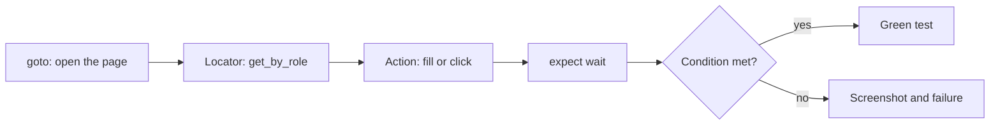

Unit tests check individual functions, but the user works with a finished interface. To be sure the whole application works "as intended" — from page load to a button click — you need E2E tests (end-to-end). Playwright is a modern library from Microsoft: it drives real browsers (Chromium, Firefox, WebKit) and is stable where older tools failed.

```bash
pip install playwright
playwright install chromium
```

## First scenario

```python
from playwright.sync_api import sync_playwright

with sync_playwright() as p:
    browser = p.chromium.launch(headless=True)
    page = browser.new_page()
    page.goto("https://example.com")
    print(page.title())          # Example Domain
    browser.close()
```

`page` is a tab. All commands are synchronous and wait for the needed state themselves: `goto` waits for the load, `click` waits for the element to be ready.

## Locators: how to find elements

The outdated way is CSS selectors like `#submit`. Playwright offers semantic locators that read like human instructions:

```python
page.get_by_text("Sign in")                  # text on the page
page.get_by_role("button", name="Submit")  # by role and name
page.get_by_label("Email")                 # by field label
page.get_by_placeholder("Enter your name")     # by placeholder
```

`get_by_role` is the most reliable: it uses the accessibility tree, i.e., it sees the element the way a screen reader does.

## Interaction and assertions

```python
page.goto("https://example.com")
page.get_by_label("Name").fill("Anna")
page.get_by_role("button", name="Submit").click()
page.wait_for_timeout(500)  # not recommended; better to wait for events
```

Instead of hard pauses, Playwright itself waits for the element before acting: before `fill` — that the field is available, before `click` — that the button is clickable. If the element doesn't appear within the timeout (30 seconds by default), the test fails with a clear error.

Assertions are made with the expectations library:

```python
from playwright.sync_api import expect

expect(page).to_have_title("Home")
expect(page.get_by_text("Thank you for your order!")).to_be_visible()
```

## Screenshots

```python
page.screenshot(path="home.png", full_page=True)
```

Screenshots are the best way to see what's actually rendered: layout, fonts, overlaps. In CI they become artifacts of a failed test.

## Network interception

Sometimes the external API is unavailable or slow. Playwright can substitute network responses via `page.route`:

```python
def fake_api(route):
    route.fulfill(json={"balance": 999})

page.route("**/api/balance", fake_api)
page.goto("https://my-app.example")
```

The test checks the interface in isolation from external dependencies.

## Tests in pytest

With `pytest-playwright`, the `page` fixture is created automatically:

```python
# test_app.py
def test_header(page):
    page.goto("https://example.com")
    expect(page).to_have_title("Example Domain")
```

Run: `pytest --headed` (with a browser window) or `pytest --browser firefox` (another browser). Each test gets a fresh context — nothing leaks between tests.



## Summary

- Playwright drives real browsers; `get_by_role`/`get_by_text` locators read like instructions.
- Actions wait for element readiness automatically; assertions go through `expect`.
- `page.route` isolates tests from external APIs; screenshots document the state.
- `pytest-playwright` provides the `page` fixture for an E2E suite.

<!--TASK-->
### Task 1
Write a scenario that opens `https://example.com`, prints the page title via `page.title()`, checks that the text "Example Domain" is visible, and takes a screenshot of the page to the file `example.png`. Close the browser properly with `with sync_playwright()` and `browser.close()`.

### Task 2
Write a function `login(page)` that fills in the login form: the field with the label "Email" — value `user@example.com`, the field with the label "Password" — `secret`, and clicks the button with role `button` and name "Sign in". After that, check with `expect` that the message "Welcome!" appears. Use `get_by_label` and `get_by_role`.

### Task 3
Implement a test with `page.route`: intercept the response to `**/api/balance`, returning `{"balance": 999}`, then open the page and check that the text "999" is visible on it. The route handler must use `route.fulfill(json=...)`. Also check that the text "0" is not visible.

### Task 4
Write a test scenario for checking the cart: open the page, add a product by clicking the "Add to cart" button, go to the cart via the link with text "Cart", and check that the product is visible in the list. Use `get_by_text` for links and buttons. Add `page.wait_for_selector` to wait for the list to load.

### Task 5
Write a pytest test with the `page` fixture that checks the page title and the presence of a "Submit" button, then takes a screenshot. Prepare the test so it runs with `pytest` without extra flags, and note in a comment how to run it with an open browser window.
### Task 6
Write a test `test_product_cards` that opens the catalog page, waits for the list to appear, and checks the number of product cards. Use `page.get_by_role("listitem")` and `expect(...).to_have_count(3)`. Additionally check that the first card contains the name "Python for Beginners" via `to_contain_text`, and that there are exactly three "Add to cart" buttons — `expect(page.get_by_role("button", name="Add to cart")).to_have_count(3)`. Run pytest — expected output `1 passed`.

### Task 7
Simulate a network error: in the test intercept `**/api/balance` via `page.route` and call `route.abort()` instead of `fulfill`. Open the page and check that the interface shows the message "Failed to load balance" and does not show a number. Also check that the request was indeed aborted: record a mark in a list inside the handler and make sure it ends up as `["aborted"]`. Run pytest — expected output `1 passed`.
<!--/TASK-->

<!--HINT-->
### Hint 1
`with sync_playwright() as p:` is a context manager; inside it launch `p.chromium.launch(headless=True)`. Visibility check: `expect(page.get_by_text("Example Domain")).to_be_visible()`.

### Hint 2
`page.get_by_label("Email").fill("user@example.com")` — by field label. Button: `page.get_by_role("button", name="Sign in").click()`. Check: `expect(page.get_by_text("Welcome!")).to_be_visible()`.

### Hint 3
`def fake_balance(route): route.fulfill(json={"balance": 999})` then `page.route("**/api/balance", fake_balance)` before `goto`. Look for the text "999" via `page.get_by_text("999")`. Absence check: `expect(page.get_by_text("0")).not_to_be_visible()` (make sure "0" really isn't on the page).

### Hint 4
`page.get_by_text("Add to cart").click()` — if it's a button, add `.first` when there are multiple matches. Waiting: `page.wait_for_selector("text=Product list")` or wait for a specific product to appear via expect.

### Hint 5
The fixture arrives as an argument: `def test_main(page):`. `page.goto(...)`, then `expect(page).to_have_title(...)` and `expect(page.get_by_role("button", name="Submit")).to_be_visible()`. Running with a window: `pytest --headed`.
### Hint 6
`page.get_by_role("listitem")` returns a locator for all list items at once — you can pass it to `expect` with the `to_have_count` matcher. For the first card use `cards.first` and check `to_contain_text("Python for Beginners")`. The `expect` matchers wait for the condition themselves, so `wait_for_timeout` isn't needed.

### Hint 7
Route handler: `def abort_balance(route): calls.append("aborted"); route.abort()`. `route.abort()` breaks the request without a response — to the page this looks like a network error. Register the route before `page.goto`. Number-absence check: `expect(page.get_by_text("999")).to_have_count(0)`.
<!--/HINT-->

<!--SOLUTION-->
### Walkthrough 1
```python
from playwright.sync_api import sync_playwright, expect

with sync_playwright() as p:
    browser = p.chromium.launch(headless=True)
    page = browser.new_page()
    page.goto("https://example.com")
    print(page.title())  # Example Domain
    expect(page.get_by_text("Example Domain")).to_be_visible()
    page.screenshot(path="example.png")
    browser.close()
```

`sync_playwright()` is a context manager: it shuts down browser processes correctly even on error. `launch(headless=True)` runs Chromium without a window — so you can run tests on CI. `page.title()` returns the `<title>`; the `expect` check fails with a clear message if the text isn't visible. The screenshot is saved to a file.

### Walkthrough 2
```python
from playwright.sync_api import expect

def login(page):
    page.get_by_label("Email").fill("user@example.com")
    page.get_by_label("Password").fill("secret")
    page.get_by_role("button", name="Sign in").click()

def test_login_flow(page):
    login(page)
    expect(page.get_by_text("Welcome!")).to_be_visible()
```

`get_by_label` finds a field by its associated `<label>` — this also accounts for `placeholder` and `aria-label`. `get_by_role("button", name="Sign in")` finds the button by its accessible name. `click()` waits for clickability: if the button is overlapped or locked, Playwright will wait and eventually fail with an explanation of what got in the way.

### Walkthrough 3
```python
from playwright.sync_api import expect

def fake_balance(route):
    route.fulfill(json={"balance": 999})

def test_balance_mock(page):
    page.route("**/api/balance", fake_balance)
    page.goto("https://example.com")  # any address: network is intercepted
    expect(page.get_by_text("999")).to_be_visible()
```

`page.route` intercepts requests matching the pattern `**/api/balance`. The handler calls `route.fulfill(json=...)` — the response is built right in the test, without the network. This lets you check the interface under any API state: balance 999, server error, empty list. Such a test doesn't depend on external services and doesn't "go green" because of their failures.

### Walkthrough 4
```python
from playwright.sync_api import expect

def test_cart(page):
    page.goto("https://example.com/shop")
    page.get_by_text("Add to cart").first.click()
    page.get_by_text("Cart").click()
    page.wait_for_selector("text=Python for Beginners")
    expect(page.get_by_text("Python for Beginners")).to_be_visible()
```

`.first` takes the first of several matches (for example, the "Add to cart" button repeats on every product card). After clicking the "Cart" link, `wait_for_selector` waits for the product row to appear — this is more reliable than a fixed pause. Then `expect` confirms visibility for good. This scenario follows a real user's path: selection, navigation, verification.

### Walkthrough 5
```python
# test_e2e.py
from playwright.sync_api import expect

def test_main_page(page):
    page.goto("https://example.com")
    expect(page).to_have_title("Example Domain")
    expect(page.get_by_role("button", name="Submit")).to_be_visible()
    page.screenshot(path="report.png")

# Run:
#   pytest                      — without a window (headless)
#   pytest --headed             — with a browser window
#   pytest --browser firefox    — in Firefox
```

The `page` fixture from `pytest-playwright` creates a fresh browser context for each test: no cookies or state remain between tests. `to_have_title` checks the title, `get_by_role` checks button accessibility, and the screenshot saves proof. `pytest` runs everything without flags; `--headed` shows the browser, handy for local debugging.
### Walkthrough 6
Solution:

```python
from playwright.sync_api import expect

def test_product_cards(page):
    page.goto("https://example.com/shop")
    cards = page.get_by_role("listitem")
    expect(cards).to_have_count(3)
    expect(cards.first).to_contain_text("Python for Beginners")
    expect(page.get_by_role("button", name="Add to cart")).to_have_count(3)
```

Run: `pytest`. Result: `1 passed`.

What's happening here? The `get_by_role("listitem")` locator describes a search rule rather than a specific element, so `expect(cards).to_have_count(3)` knows how to wait: Playwright repeats the check until the count reaches three or the timeout expires. This is fundamentally different from `len(cards.all())`, which would run once and fail on a slow load. `cards.first` is the same locator narrowed to the first match; `to_contain_text` checks a substring rather than exact equality, so the name may sit next to a price or rating. The separate button-count check catches the case where the cards rendered but the "Add to cart" button disappeared due to a template error.

### Walkthrough 7
Solution:

```python
from playwright.sync_api import expect

def test_balance_network_error(page):
    calls = []

    def abort_balance(route):
        calls.append("aborted")
        route.abort()

    page.route("**/api/balance", abort_balance)
    page.goto("https://example.com")
    expect(page.get_by_text("Failed to load balance")).to_be_visible()
    expect(page.get_by_text("999")).to_have_count(0)
    assert calls == ["aborted"]
```

Run: `pytest`. Result: `1 passed`.

What's happening here? `page.route` intercepts requests matching the pattern and hands control to our handler. Unlike `fulfill`, `route.abort()` doesn't deliver a response: the browser sees a network failure, and the application must show an error message instead of a number. The `calls` list is simple evidence: it confirms the interception actually happened, rather than the page simply not requesting the balance. The `to_have_count(0)` check makes sure a stale or planted value didn't leak into the interface. This test exercises exactly the error-handling branch — the one nobody sees with a normal "green" API, even though it fires more often in production than we'd like.
<!--/SOLUTION-->

<!--QUIZ-->
What does sync_playwright() do?
- Installs the browser
- Creates a context manager for managing browsers
- Opens a browser window
- Runs tests
* Correct answer: Creates a context manager for managing browsers
sync_playwright() is used as a with-block and shuts down browser processes correctly.

Which locator finds a button by its role and name?
- page.get_by_role("button", name="Sign in")
- page.get_by_text("Sign in")
- page.css("button")
- page.find("Sign in")
* Correct answer: page.get_by_role("button", name="Sign in")
get_by_role uses the accessibility tree: role button + accessible name.

What does page.goto(url) do?
- Opens a new tab
- Navigates to the address and waits for the page to load
- Returns the HTML
- Saves a screenshot
* Correct answer: Navigates to the address and waits for the page to load
goto opens the page and waits for the load event before continuing.

How are expectations checked in Playwright?
- With assert statements
- With the expect library
- With the wait function
- With locators
* Correct answer: With the expect library
expect(...).to_be_visible(), to_have_title(), and other matchers wait for the condition to hold within the timeout.

What does page.fill("...", "text") do?
- Clicks the field
- Types text into the field, clearing it first
- Reads the field value
- Sets focus
* Correct answer: Types text into the field, clearing it first
fill clears the field and types the new value, waiting for its availability.

How do you substitute an API response in a test?
- Via page.route and route.fulfill
- Via page.goto
- Via expect
- Via browser.close
* Correct answer: Via page.route and route.fulfill
page.route intercepts the request, and route.fulfill builds the response right in the test.

What does page.title() return?
- The page URL
- The text from the <title> tag
- The page HTML
- A screenshot
* Correct answer: The text from the <title> tag
page.title() returns the document title — handy for the to_have_title check.

What does page.screenshot(path="a.png") do?
- Opens an image
- Saves a snapshot of the page to a file
- Prints the page
- Uploads a screenshot
* Correct answer: Saves a snapshot of the page to a file
screenshot saves the current page state to a PNG file at the given path.

How do you run Playwright pytest tests with a visible browser window?
- pytest --headed
- pytest --visible
- pytest --browser
- pytest --window
* Correct answer: pytest --headed
The --headed flag disables headless mode — the browser is visible on screen.

Why is the page fixture needed in pytest-playwright?
- To install the browser
- So each test gets a fresh browser context
- To speed up tests
- To disable the network
* Correct answer: So each test gets a fresh browser context
The fixture creates a new context per test: no cookies or state remain between tests.
What does expect(locator).to_have_count(3) do?
- Waits until the number of matching elements equals 3
- Counts elements exactly once and immediately fails
- Limits the selection to three elements
* Correct answer: Waits until the number of matching elements equals 3
The matcher repeats the check until the timeout, so it's resilient to slow rendering.

What does route.abort() do in a page.route handler?
- Aborts the request, simulating a network error
- Returns an empty JSON
- Redirects the request to another address
* Correct answer: Aborts the request, simulating a network error
The page gets a failure instead of a response — this is how you test the error-handling branch.

Which locator finds an input field by the text of its associated <label>?
- page.get_by_label("Email")
- page.get_by_text("Email")
- page.get_by_role("input")
* Correct answer: page.get_by_label("Email")
get_by_label accounts for label, aria-label, and the field's caption.

Why create a new context via browser.new_context()?
- To get isolated cookies, storage, and window settings
- To speed up the browser
- To disable JavaScript
* Correct answer: To get isolated cookies, storage, and window settings
Each context is like a separate browser profile, so tests don't affect each other.
<!--/QUIZ-->
