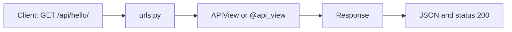

In this module, we'll learn how to build a backend API with **Django REST Framework** (DRF for short). It's the most popular tool for creating REST APIs in Python: a huge number of modern services run on it. By the end of this lesson, you'll have built your first working endpoint that returns a JSON response.

## What are API and REST

**API** (Application Programming Interface) is an interface through which programs communicate with each other. A web API is a set of addresses (URLs) through which a client (website, mobile app, bot) can request data or perform an action.

**REST** is a set of design principles for such APIs. The main ideas:

- resources are nouns: `/books`, `/users`, `/orders`;
- actions are expressed with HTTP methods: `GET` (fetch), `POST` (create), `PUT`/`PATCH` (update), `DELETE` (remove);
- responses are usually in JSON format;
- the API does not store state between requests (stateless).

Example: `GET /api/books/` — list of books, `POST /api/books/` — create a book, `GET /api/books/3/` — the book with id 3.

## Installation and setup

Install DRF and add it to the project:

```bash
pip install djangorestframework
```

```python
# settings.py
INSTALLED_APPS = [
    "django.contrib.admin",
    "django.contrib.auth",
    ...
    "rest_framework",
    "books",  # our app
]
```

Now let's create a `books` app with a model for books:

```bash
python manage.py startapp books
```

```python
# books/models.py
from django.db import models


class Book(models.Model):
    title = models.CharField(max_length=200)
    author = models.CharField(max_length=100)
    published = models.IntegerField(default=2000)

    def __str__(self):
        return self.title
```

Don't forget to run migrations:

```bash
python manage.py makemigrations books
python manage.py migrate
```

## Your first endpoint: APIView

DRF provides ready-made view classes. Let's start with **`APIView`** — a class that mirrors Django view logic but understands JSON and HTTP methods:

```python
# books/views.py
from rest_framework.views import APIView
from rest_framework.response import Response
from rest_framework import status


class HelloView(APIView):
    def get(self, request):
        return Response({"message": "Hello, world!"})
```

The `Response` class builds a JSON response and sets the correct `Content-Type: application/json` itself. That's convenient: we don't need to serialize the dictionary by hand.

Add the route in the project's `urls.py`:

```python
# urls.py
from django.urls import path, include
from books.views import HelloView

urlpatterns = [
    path("admin/", admin.site.urls),
    path("api/hello/", HelloView.as_view()),
]
```

Run the server and open `http://127.0.0.1:8000/api/hello/` — you'll see JSON:

```json
{"message": "Hello, world!"}
```

DRF even renders a nice browsable page for the API — handy for debugging.

## The @api_view decorator

If you don't need a whole class, DRF offers a functional style via the **`@api_view`** decorator:

```python
# books/views.py
from rest_framework.decorators import api_view
from rest_framework.response import Response
from rest_framework import status


@api_view(["GET", "POST"])
def books_count(request):
    if request.method == "GET":
        return Response({"count": 0})
    return Response({"error": "Method not supported"},
                    status=status.HTTP_405_METHOD_NOT_ALLOWED)
```

The decorator takes a list of allowed methods. If the client sends, say, `DELETE`, DRF itself returns `405 Method Not Allowed` — without any work on your part.

## Status codes (status)

HTTP responses always carry a **status code**. DRF wraps them in constants:

- `status.HTTP_200_OK` — success;
- `status.HTTP_201_CREATED` — resource created;
- `status.HTTP_400_BAD_REQUEST` — invalid data;
- `status.HTTP_401_UNAUTHORIZED` — not authenticated;
- `status.HTTP_404_NOT_FOUND` — not found;
- `status.HTTP_500_INTERNAL_SERVER_ERROR` — server error.

Example: when creating an object, it's customary to return `201` rather than `200`:

```python
@api_view(["POST"])
def create_book(request):
    # here we'll process the data
    return Response({"id": 1, "title": request.data.get("title")},
                    status=status.HTTP_201_CREATED)
```

Request data lives in `request.data` (for JSON, forms, `multipart`) and in `request.query_params` (for GET parameters from the URL).



## Summary

Today we figured out what a REST API is, installed DRF, created a model, wrote our first view with `APIView` and with the `@api_view` decorator, and learned about status codes. In the next lesson, you'll get acquainted with serializers — the heart of DRF, which turns model objects into JSON and back.

<!--TASK-->
### Task 1
Create a new `hello` app in your Django project (`python manage.py startapp hello`). In that app's `views.py`, write a class-based view using `APIView` that responds to a `GET` request with JSON like `{"message": "Hello, DRF!"}`. Register the route in the project's `urls.py` so the view is available at `/api/hello/`. Run the server and check that the JSON response opens at that address. Make sure `rest_framework` is added to `INSTALLED_APPS`.

### Task 2
Write an `APIView`-based view that returns the current server time as JSON. Use the `datetime` module (`datetime.now()`), plus `request` and `Response`. The response should look like `{"time": "2026-11-01 12:30:00"}`. Register the route `/api/time/`, run the server, and verify that the time arrives in the response.

### Task 3
Write a function view with the `@api_view` decorator that accepts only `GET` and `POST`. On `GET` it returns `{"method": "GET"}`, on `POST` — `{"method": "POST"}`. Register the route `/api/method/` and test both methods (you can use curl: `curl -X POST http://127.0.0.1:8000/api/method/`). Verify that a `DELETE` request returns 405.

### Task 4
Create a `Quote` model (a quotation) with `text` (TextField) and `author` (CharField) fields. Run migrations. Write an `APIView`-based view that on `GET` returns `{"count": N}`, where N is the number of rows in the `Quote` table (use `Quote.objects.count()`). Register the route `/api/quotes/count/`.

### Task 5
Write an `APIView`-based view with a `post` method that creates a `Quote` record from request data (`request.data["text"]` and `request.data["author"]`) and returns `201 Created` together with the data of the created record. If the `text` or `author` fields are missing, return `400 Bad Request` with an error message. Test both scenarios.
### Task 6
Write a function view with `@api_view(["GET"])` that reads the name from a query parameter: `name = request.query_params.get("name", "мир")`. The response should be `{"message": f"Привет, {name}!"}`. Register the route `/api/greet/`, run the server, and test two requests: `/api/greet/?name=Аня` returns `{"message": "Привет, Аня!"}`, while `/api/greet/` without the parameter returns `{"message": "Привет, мир!"}`. Note: `request.query_params` is DRF's counterpart of `request.GET`.

### Task 7
Add a `QuoteDetailView(APIView)` view with `get` and `delete` methods for a single quote by id. In `get`, fetch the object via `get_object_or_404(Quote, pk=pk)` and return a dict with `id`, `text`, and `author`; in `delete`, delete the object and return `204 No Content` with an empty body. Register the route `/api/quotes/<int:pk>/`. Test three scenarios: existing id → `200`, deletion → `204`, repeated GET → `404`.
<!--/TASK-->

<!--HINT-->
### Hint 1
An `APIView`-based view is a class with a `get(self, request)` method that returns `Response({...})`. In `urls.py`, use `path("api/hello/", HelloView.as_view())`. Don't forget to add `hello` to `INSTALLED_APPS`.

### Hint 2
Import `datetime`: `from datetime import datetime`. Inside `get`, call `datetime.now()` and return `Response({"time": str(now)})`. Note that the time object must be converted to a string, otherwise JSON won't be able to serialize it.

### Hint 3
The decorator is applied like this: `@api_view(["GET", "POST"])` above the function. Check the method with `if request.method == "GET":` and `elif request.method == "POST":`. To verify 405, use curl or DRF's browsable API.

### Hint 4
The model is declared in `models.py`, after which `makemigrations` and `migrate` are mandatory. The number of records is `Quote.objects.count()`. Don't forget to add the app to `INSTALLED_APPS` if you haven't already.

### Hint 5
Request data lives in `request.data` — it's a dict. Check key presence with `if "text" not in request.data:`. For an error, return `Response({"error": "..."}, status=status.HTTP_400_BAD_REQUEST)`.
### Hint 6
`request.query_params` is a dict of GET parameters. The `.get("name", "мир")` method returns the value or a fallback if the key is missing. The `@api_view(["GET"])` decorator goes above the function, and you return `Response({...})`. The route is `path("api/greet/", greet)` without `as_view()`, because it's a function.

### Hint 7
`get_object_or_404` is imported from `django.shortcuts`. In `delete`, after `quote.delete()` return `Response(status=status.HTTP_204_NO_CONTENT)` — the body is empty. Remember that class methods receive `self, request, pk`. On a repeated GET, `get_object_or_404` will raise `Http404` itself, and DRF will turn it into a JSON `404` response.
<!--/HINT-->

<!--SOLUTION-->
### Breakdown 1
Solution:

```python
# hello/views.py
from rest_framework.views import APIView
from rest_framework.response import Response


class HelloView(APIView):
    def get(self, request):
        return Response({"message": "Hello, DRF!"})
```

```python
# urls.py
from django.urls import path
from hello.views import HelloView

urlpatterns = [
    path("api/hello/", HelloView.as_view()),
]
```

What's happening here? The `HelloView` class inherits from `APIView`, and the `get` method handles GET requests. `Response({"message": ...})` turns the dict into JSON and sets the right headers. In `urls.py` we pass the view via `as_view()` — that's the standard way to wire up class-based views. Now you can run the server and open `http://127.0.0.1:8000/api/hello/` to see the JSON response.

### Breakdown 2
Solution:

```python
from datetime import datetime
from rest_framework.views import APIView
from rest_framework.response import Response


class TimeView(APIView):
    def get(self, request):
        now = datetime.now()
        return Response({"time": str(now)})
```

What's happening here? `datetime.now()` returns a `datetime` object. JSON can't directly serialize this object, so we convert it to a string with `str(now)`. The response will look like, e.g., `{"time": "2026-11-01 12:30:00"}`. If we tried to return the `datetime` object directly, DRF would throw an error saying the type isn't supported.

### Breakdown 3
Solution:

```python
from rest_framework.decorators import api_view
from rest_framework.response import Response


@api_view(["GET", "POST"])
def method_view(request):
    if request.method == "GET":
        return Response({"method": "GET"})
    return Response({"method": "POST"})
```

What's happening here? The `@api_view(["GET", "POST"])` decorator restricts the view to two methods. Inside, we check `request.method` and return the matching response. If the client sends `DELETE`, DRF itself returns `405 Method Not Allowed` — we don't need to write that code by hand. This is one of DRF's main advantages over plain Django views.

### Breakdown 4
Solution:

```python
# books/models.py
from django.db import models


class Quote(models.Model):
    text = models.TextField()
    author = models.CharField(max_length=100)

    def __str__(self):
        return self.text
```

```python
# books/views.py
from rest_framework.views import APIView
from rest_framework.response import Response
from .models import Quote


class QuoteCountView(APIView):
    def get(self, request):
        return Response({"count": Quote.objects.count()})
```

What's happening here? The `Quote` model describes a database table: `text` for the quote itself, `author` for the author. After creating the model, run `python manage.py makemigrations books` and `python manage.py migrate`. The view returns the number of records on a GET request via `Quote.objects.count()` — this counts rows right in the database without loading them into memory.

### Breakdown 5
Solution:

```python
from rest_framework.views import APIView
from rest_framework.response import Response
from rest_framework import status
from .models import Quote


class QuoteCreateView(APIView):
    def post(self, request):
        if "text" not in request.data or "author" not in request.data:
            return Response({"error": "Fields text and author are required"},
                            status=status.HTTP_400_BAD_REQUEST)
        quote = Quote.objects.create(
            text=request.data["text"],
            author=request.data["author"],
        )
        return Response(
            {"id": quote.id, "text": quote.text, "author": quote.author},
            status=status.HTTP_201_CREATED,
        )
```

What's happening here? The `post` method reads data from `request.data`. We check for the required keys: if they're missing, we return `400 Bad Request`. If everything is in place, we create the record via `Quote.objects.create(...)` and return `201 Created` with the created quote's data. Status 201 is the standard response for creating a resource, unlike 200, which just means a successful request.
### Breakdown 6
Solution:

```python
# books/views.py
from rest_framework.decorators import api_view
from rest_framework.response import Response


@api_view(["GET"])
def greet(request):
    name = request.query_params.get("name", "мир")
    return Response({"message": f"Привет, {name}!"})
```

```python
# urls.py
from django.urls import path
from books.views import greet

urlpatterns = [
    path("api/greet/", greet),
]
```

Run: `python manage.py runserver`. Result: `GET /api/greet/?name=Аня` → `{"message": "Привет, Аня!"}`, `GET /api/greet/` → `{"message": "Привет, мир!"}`.

What's happening here? `request.query_params` in DRF is a wrapper around `request.GET` that always returns strings and works with different parsers. The `.get` method with a second argument sets a default value, so a missing parameter doesn't lead to `None` in the greeting string. `@api_view(["GET"])` not only restricts the method but also prepares `request` for working with DRF: without the decorator, a plain Django view wouldn't have `query_params`, and `Response` wouldn't get the rendering context. Note the encoding: Cyrillic characters in the URL are percent-encoded, but DRF decodes the value automatically, so you see normal text in the response.

### Breakdown 7
Solution:

```python
# books/views.py
from django.shortcuts import get_object_or_404
from rest_framework.views import APIView
from rest_framework.response import Response
from rest_framework import status
from .models import Quote


class QuoteDetailView(APIView):
    def get(self, request, pk):
        quote = get_object_or_404(Quote, pk=pk)
        return Response({
            "id": quote.id,
            "text": quote.text,
            "author": quote.author,
        })

    def delete(self, request, pk):
        quote = get_object_or_404(Quote, pk=pk)
        quote.delete()
        return Response(status=status.HTTP_204_NO_CONTENT)
```

```python
# urls.py
from django.urls import path
from books.views import QuoteDetailView

urlpatterns = [
    path("api/quotes/<int:pk>/", QuoteDetailView.as_view()),
]
```

What's happening here? `APIView` calls the method matching the request's HTTP method and passes it named arguments from the URL — here `pk`. `get_object_or_404` tries to find the record and, if it's missing, raises `Http404`; DRF catches it and returns a JSON response with status `404` to the client instead of an HTML page. In `delete`, we first fetch the object so we don't delete a non-existent record "blindly", then return `204 No Content` — success without a response body. A repeated GET after deletion goes through `get_object_or_404` again and returns `404`, which confirms the actual deletion. Splitting into methods makes the contract explicit: one URL — two different actions with different response codes.
<!--/SOLUTION-->

<!--QUIZ-->
What is the Response class in DRF for?
- For building HTML pages
- For building a JSON response with correct headers
- For connecting to the database
* Correct answer: For building a JSON response with correct headers
Response turns a dict or another object into JSON and sets the correct HTTP headers.

Which HTTP method is used to create a resource?
- GET
- POST
- DELETE
* Correct answer: POST
POST sends data to the server to create a new resource.

What does the @api_view(["GET"]) decorator do?
- Restricts the view to GET only
- Speeds up the view's execution
- Adds authorization
* Correct answer: Restricts the view to GET only
The decorator specifies which HTTP methods are allowed; the rest return 405.

Which status code means "resource created successfully"?
- 200 OK
- 201 Created
- 404 Not Found
* Correct answer: 201 Created
201 Created is the standard response to successfully creating a new resource.

What will a view with @api_view(["GET"]) return for a POST request?
- 200 OK
- 400 Bad Request
- 405 Method Not Allowed
* Correct answer: 405 Method Not Allowed
DRF rejects disallowed methods with 405 on its own.

Where does POST request data live in DRF?
- In request.data
- In request.args
- In request.body_str
* Correct answer: In request.data
request.data contains the parsed request data (JSON, form, etc.).

Which is NOT a REST principle?
- Using nouns for resources
- Using HTTP methods for actions
- Storing state between requests
* Correct answer: Storing state between requests
REST is stateless: the server doesn't store client state between requests.

How do you wire up a class-based view in urls.py?
- path("api/", HelloView.as_view())
- path("api/", HelloView)
- url("api/", HelloView.run)
* Correct answer: path("api/", HelloView.as_view())
Class-based views are wired up via the as_view() method.

What happens if you return a datetime object in Response directly?
- It's serialized automatically
- DRF throws a serialization error
- It gets turned into a string
* Correct answer: DRF throws a serialization error
JSON doesn't support the datetime type, so you need to convert it to a string beforehand.

What file extension do Django projects typically use?
- .py
- .js
- .json
* Correct answer: .py
Django projects are written in Python and use the .py extension.
Where do GET parameters from the address bar live in DRF?
- In request.query_params
- In request.data
- In request.body
* Correct answer: In request.query_params
request.query_params is DRF's wrapper around GET parameters, e.g. ?name=Аня.

What does get_object_or_404(Quote, pk=5) do if the record doesn't exist?
- Raises Http404, which DRF returns as a JSON 404 response
- Returns None
- Creates a new record
* Correct answer: Raises Http404, which DRF returns as a JSON 404 response
DRF catches Http404 and gives the client a proper 404 response.

What will APIView return if the class only defines a get method and a POST arrives?
- 405 Method Not Allowed
- 200 OK with an empty body
- 500 Internal Server Error
* Correct answer: 405 Method Not Allowed
APIView matches the HTTP method to a class method and returns 405 if it's absent.

What does response code 204 No Content mean?
- The request succeeded, the response body is empty
- The resource was not found
- The data is invalid
* Correct answer: The request succeeded, the response body is empty
204 is often returned after a successful DELETE.
<!--/QUIZ-->
