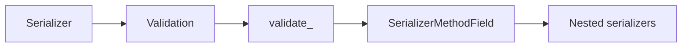

Serializers are the heart of Django REST Framework. They are what turns complex objects (models, querysets) into JSON for responses and, conversely, accepts JSON from the client and turns it into objects. In this lesson we will learn how to write serializers in two ways: the base `Serializer` and the fast `ModelSerializer`, and we will also sort out validation.

## Why serializers are needed

Imagine: you have a `Book` model. You need to give the client a list of books in JSON. Manually you would have to write:

```python
books = Book.objects.all()
data = [{"id": b.id, "title": b.title, "author": b.author} for b in books]
```

And what if there are twenty fields and there are also related models? Manually this turns into a nightmare. A serializer solves the task in one line:

```python
def book_list(request):
    serializer = BookSerializer(Book.objects.all(), many=True)
    return Response(serializer.data)
```


An additional bonus: serializers can **validate** incoming data and create/update objects.

## Serializer: the base class

Let us start with the base `Serializer` class. It declares fields and validation rules:

```python
# books/serializers.py
from rest_framework import serializers


class BookSerializer(serializers.Serializer):
    id = serializers.IntegerField(read_only=True)
    title = serializers.CharField(max_length=200)
    author = serializers.CharField(max_length=100)
    published = serializers.IntegerField(min_value=1500, max_value=2100)
```

Fields work like forms in Django: `CharField` checks string length, `IntegerField` checks that it is a number and that it is within the given limits. The `read_only=True` property means the field cannot be sent to the server, but can be returned in the response — handy for `id`, which the DB assigns.

We use the serializer in a view:

```python
# books/views.py
from rest_framework.views import APIView
from rest_framework.response import Response
from rest_framework import status
from .models import Book
from .serializers import BookSerializer


class BookListCreateView(APIView):
    def get(self, request):
        books = Book.objects.all()
        serializer = BookSerializer(books, many=True)
        return Response(serializer.data)

    def post(self, request):
        serializer = BookSerializer(data=request.data)
        if serializer.is_valid():
            # create() will be written below
            book = serializer.save()
            return Response(BookSerializer(book).data,
                            status=status.HTTP_201_CREATED)
        return Response(serializer.errors,
                        status=status.HTTP_400_BAD_REQUEST)
```

## The create and update methods

On its own, the base `Serializer` does not know how to save data. We have to write the `create()` and `update()` methods:

```python
class BookSerializer(serializers.Serializer):
    # ... fields ...

    def create(self, validated_data):
        return Book.objects.create(**validated_data)

    def update(self, instance, validated_data):
        instance.title = validated_data.get("title", instance.title)
        instance.author = validated_data.get("author", instance.author)
        instance.published = validated_data.get("published", instance.published)
        instance.save()
        return instance
```

`validated_data` is a dictionary with clean (validated) data. The `save()` method in the view calls `create()` if the object does not exist yet, and `update()` if it does.

## ModelSerializer: less code

In 90% of cases the serializer fields match the model fields. That is what **`ModelSerializer`** is for — it generates fields from the model itself:

```python
class BookSerializer(serializers.ModelSerializer):
    class Meta:
        model = Book
        fields = ["id", "title", "author", "published"]
```

You can use `fields = "__all__"` to include all model fields, or `exclude = ["id"]` to exclude unneeded ones. `ModelSerializer` itself creates `create()` and `update()` — no need to write them by hand.

Why is `ModelSerializer` better than the base one? It:

- takes field types from the model (for example, `CharField(max_length=200)` automatically);
- picks up model constraints (`unique=True`, `blank=True`);
- writes `create()` and `update()` itself;
- is less likely to contain errors because it does not diverge from the model.

## Validation: three levels

**1. Field validation.** A method named `validate_<field>`:

```python
def validate_published(self, value):
    if value > 2026:
        raise serializers.ValidationError("The year cannot be in the future")
    return value
```

**2. Object validation.** The `validate` method receives the whole data dictionary and checks fields together:

```python
def validate(self, attrs):
    if attrs.get("author") == attrs.get("title"):
        raise serializers.ValidationError("The author cannot match the title")
    return attrs
```

Any error from these methods lands in `serializer.errors` and will be returned to the client in a response with code `400`.

**3. Field-level validators.** The `validators` list:

```python
def no_profanity(value):
    if "forbidden" in value.lower():
        raise serializers.ValidationError("Incorrect word")

class BookSerializer(serializers.ModelSerializer):
    class Meta:
        model = Book
        fields = ["id", "title", "author", "published"]
        extra_kwargs = {
            "title": {"validators": [no_profanity]},
        }
```



## Summary

Serializers turn models into JSON and back. The base `Serializer` gives full control, while `ModelSerializer` saves time and reduces the chance of errors. Validation happens at the field level, the object level, and through separate validator functions. In the next lesson we will look at how to write ready-made views for working with models without manual code.

<!--TASK-->
### Task 1
For the `Book` model (fields `title`, `author`, `published`) create a serializer based on `ModelSerializer` with fields `["id", "title", "author", "published"]`. Write a view based on `APIView` that on `GET` returns a list of all books (with `many=True`), and on `POST` creates a book from `request.data` and returns `201`. Test both methods.

### Task 2
Create a serializer based on the `Serializer` class for the `Book` model (without `ModelSerializer`). Implement the `create()` and `update()` methods manually. Write a view that supports `GET` (list), `POST` (creation) and `PUT` (updating a book by id from `kwargs`). Make sure a PUT request updates an existing record.

### Task 3
Add a `validate_published` method to the `BookSerializer` based on `ModelSerializer` that forbids a year greater than the current one (use `datetime.now().year`). Make sure that when trying to create a book with year 2100 the serializer returns an error, and the view returns `400 Bad Request`.

### Task 4
Add a `validate` method to `BookSerializer` that forbids creating a book where `author` matches `title` (an ironic case). Check: when sending such data, `serializer.errors` should contain an error, and the view should return `400`.

### Task 5
Use `extra_kwargs` in `ModelSerializer` to make the `published` field optional (with default 2000) and add a validator that forbids an empty `title`. Hint: for the default you need `"default": 2000` in `extra_kwargs` for the `published` field. Verify that a book without `published` is created with year 2000.
### Task 6 — Field and object-level validator
Add to the `BookSerializer`: a `validate_year(value)` method — reject year > 2100 with the message «The year cannot be in the future», and a `validate(data)` method — check that `title` and `author` are not the same. Verify through `is_valid()` printing `errors`.
### Task 7 — SerializerMethodField
Add a computed field `revenue_status` (for example, "high"/"low" for a `price` value > 100), via `SerializerMethodField`, and a `get_revenue_status` method. Expected result: the field appears in `serializer.data` and is absent when creating.

<!--/TASK-->

<!--HINT-->
### Hint 1
`ModelSerializer` is declared like this: `class BookSerializer(serializers.ModelSerializer):` with a nested `class Meta:`. In the view for the list pass `many=True`: `BookSerializer(Book.objects.all(), many=True)`. For creation — `BookSerializer(data=request.data)`, then `is_valid()` and `save()`.

### Hint 2
The base `Serializer` cannot save — write `create(self, validated_data)` and `update(self, instance, validated_data)`. In the view for PUT use `kwargs.get("pk")` and `Book.objects.get(pk=pk)`; for `update` pass the object into the serializer: `BookSerializer(book, data=request.data, partial=False)`.

### Hint 3
The field validation method: `def validate_published(self, value):`. If `value > datetime.now().year` — raise `serializers.ValidationError("...")`. The error must be returned via `raise`, not via `return`.

### Hint 4
The `validate(self, attrs)` method receives the data dictionary. Compare `attrs.get("author")` and `attrs.get("title")`. If they are equal — `raise serializers.ValidationError("...")`. The error will appear in `serializer.errors` under the `non_field_errors` key.

### Hint 5
In `class Meta` add `extra_kwargs = {"published": {"default": 2000}}`. For the title validator create a validator function and specify it in `extra_kwargs` for `title`: `{"validators": [validate_title]}`.
### Hint 6
`validate_<name>` methods are called after the standard validators; `validate` — for the whole object.
### Hint 7
`SerializerMethodField` does not participate in input data, only in output.

<!--/HINT-->

<!--SOLUTION-->
### Solution 1
Solution:

```python
# books/serializers.py
from rest_framework import serializers
from .models import Book


class BookSerializer(serializers.ModelSerializer):
    class Meta:
        model = Book
        fields = ["id", "title", "author", "published"]
```

```python
# books/views.py
from rest_framework.views import APIView
from rest_framework.response import Response
from rest_framework import status
from .models import Book
from .serializers import BookSerializer


class BookListCreateView(APIView):
    def get(self, request):
        serializer = BookSerializer(Book.objects.all(), many=True)
        return Response(serializer.data)

    def post(self, request):
        serializer = BookSerializer(data=request.data)
        if serializer.is_valid():
            serializer.save()
            return Response(serializer.data,
                            status=status.HTTP_201_CREATED)
        return Response(serializer.errors,
                        status=status.HTTP_400_BAD_REQUEST)
```

What is going on here? `ModelSerializer` describes fields from the model itself and can also create and update objects. In the view we use `many=True` for the list, and for creation — check `is_valid()` and call `save()`. `serializer.data` contains data in a format ready for JSON.

### Solution 2
Solution:

```python
# books/serializers.py
from rest_framework import serializers
from .models import Book


class BookSerializer(serializers.Serializer):
    id = serializers.IntegerField(read_only=True)
    title = serializers.CharField(max_length=200)
    author = serializers.CharField(max_length=100)
    published = serializers.IntegerField()

    def create(self, validated_data):
        return Book.objects.create(**validated_data)

    def update(self, instance, validated_data):
        instance.title = validated_data.get("title", instance.title)
        instance.author = validated_data.get("author", instance.author)
        instance.published = validated_data.get("published", instance.published)
        instance.save()
        return instance
```

What is going on here? The base `Serializer` only describes the data format. The `create` method creates a new model object, `update` updates the existing one: `validated_data.get("title", instance.title)` takes the new value, and if it was not sent — keeps the old one. In the view we pass the object to the serializer when updating: `BookSerializer(book, data=request.data)`.

### Solution 3
Solution:

```python
from datetime import datetime
from rest_framework import serializers


class BookSerializer(serializers.ModelSerializer):
    class Meta:
        model = Book
        fields = ["id", "title", "author", "published"]

    def validate_published(self, value):
        if value > datetime.now().year:
            raise serializers.ValidationError(
                "The year cannot be in the future")
        return value
```

What is going on here? DRF calls the `validate_published` method after the basic field check. If `raise serializers.ValidationError(...)` — the serializer puts the error text into `errors` and `is_valid()` returns `False`. The view returns `400 Bad Request` with that list of errors.

### Solution 4
Solution:

```python
class BookSerializer(serializers.ModelSerializer):
    class Meta:
        model = Book
        fields = ["id", "title", "author", "published"]

    def validate(self, attrs):
        if attrs.get("author") == attrs.get("title"):
            raise serializers.ValidationError(
                "The author cannot match the title")
        return attrs
```

What is going on here? The `validate` method is called after all fields have been checked individually. It receives the whole `attrs` dictionary. An error raised here lands in `errors["non_field_errors"]`, because it refers to the whole object rather than a specific field. Such validation is needed when fields depend on each other.

### Solution 5
Solution:

```python
def validate_title(value):
    if not value.strip():
        raise serializers.ValidationError("The title cannot be empty")


class BookSerializer(serializers.ModelSerializer):
    class Meta:
        model = Book
        fields = ["id", "title", "author", "published"]
        extra_kwargs = {
            "title": {"validators": [validate_title]},
            "published": {"default": 2000},
        }
```

What is going on here? `extra_kwargs` lets you override field settings without describing them manually. `default` substitutes a value if the client did not send the field. `validators` adds a validator function that is called when checking data. Now a book without `published` will be created with year 2000, and an empty title will be rejected.
### Solution 6
```python
class BookSerializer(serializers.ModelSerializer):
    class Meta:
        model = Book
        fields = ["id", "title", "author", "year", "price"]

    def validate_year(self, value):
        if value > 2100:
            raise serializers.ValidationError("The year cannot be in the future")
        return value

    def validate(self, attrs):
        if attrs.get("title") == attrs.get("author"):
            raise serializers.ValidationError("The title and author must not match")
        return attrs
```
`validate_year` fires on a specific field; `validate` — at the level of all data.
### Solution 7
```python
class BookSerializer(serializers.ModelSerializer):
    revenue_status = serializers.SerializerMethodField()

    class Meta:
        model = Book
        fields = ["id", "title", "author", "price", "revenue_status"]

    def get_revenue_status(self, obj):
        return "high" if obj.price > 100 else "low"
```
The `get_<name>` method computes the value for output — the data does not come from the client.

<!--/SOLUTION-->

<!--QUIZ-->
What does ModelSerializer do?
- Generates fields from the model automatically
- Only checks data for correctness
- Replaces the database
* Correct answer: Generates fields from the model automatically
ModelSerializer creates fields, create() and update() itself based on the model.

Which method must be implemented in the base Serializer to save a new object?
- create()
- save_all()
- commit()
* Correct answer: create()
The create(validated_data) method is called from save() when the object does not exist yet.

What does read_only=True mean for a field?
- The field cannot be sent to the server, but can be returned in the response
- The field cannot be output in the response
- The field can only be read from disk
* Correct answer: The field cannot be sent to the server, but can be returned in the response
read_only fields are ignored when validating incoming data, but appear in the response.

Where will an error from the validate() method end up?
- In errors["non_field_errors"]
- In errors["title"]
- In a separate log file
* Correct answer: In errors["non_field_errors"]
Object-level errors go into the non_field_errors key.

Which code does the view return for invalid serializer data?
- 200 OK
- 400 Bad Request
- 500 Internal Server Error
* Correct answer: 400 Bad Request
Invalid data is a client error, which maps to 400.

What will serializer.errors return after failed validation?
- A list of field errors
- An empty string
- The model object itself
* Correct answer: A list of field errors
errors is a dictionary where the key is the field name and the value is a list of errors.

What is the many=True parameter for?
- To serialize several objects at once (a list)
- To allow only the GET method
- To enable debugging
* Correct answer: To serialize several objects at once (a list)
With many=True the serializer works with a queryset rather than a single object.

How to turn a list of model fields into "__all__"?
- fields = "__all__"
- all = True
- include = "*"
* Correct answer: fields = "__all__"
The value "__all__" includes all model fields in the serializer.

What does the save() method of a serializer do?
- Calls create() or update() depending on whether an object exists
- Saves data to a file
- Checks the password
* Correct answer: Calls create() or update() depending on whether an object exists
If an object is passed — update(), if not — create().

What is the validation method for a specific field title called?
- validate_title
- check_title
- field_title
* Correct answer: validate_title
DRF looks for the validate_<field_name> method and calls it after the basic check.
What does the validate_year(value) method do?
- Custom validation of a single field
- Formatting output
- Creating a record
- Deleting a field
* Correct answer: Custom validation of a single field
It is called after the standard validators.

What is SerializerMethodField?
- A read-only field computed by the get_<name> method
- A regular model field
- An input field
- A validator
* Correct answer: A read-only field computed by the get_<name> method
It appears in output, but is not expected on input.

Which exception do DRF validators raise?
- serializers.ValidationError
- ValueError
- TypeError
- DjangoValidationError
* Correct answer: serializers.ValidationError
It is collected in serializer.errors.

What will is_valid() return if the data is valid?
- True
- False
- None
- An error
* Correct answer: True
After is_valid() the data is in validated_data.

# 
<!--/QUIZ-->
