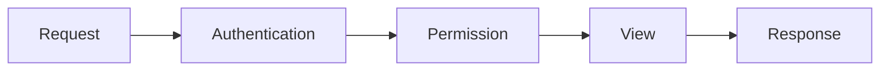

Almost no API publishes data to everyone. You need to understand who is contacting the server, and restrict access. In this lesson we will look at two authentication mechanisms in DRF — **Token Authentication** and **JWT** — and learn how to manage permissions.

## Authentication vs permissions

- **Authentication** answers the question "who are you?" — checks credentials and identifies the user.
- **Authorization (permissions)** answers the question "what are you allowed to do?" — checks whether the user has access to the action.

In DRF these are two independent layers: authentication puts the user into `request.user`, and permissions decide whether to let the request through.

## Token Authentication

A simple way: on login give the client a token — a random string. The client sends it in the `Authorization: Token <token>` header.

Setup:

```python
# settings.py
INSTALLED_APPS = [
    ...
    "rest_framework",
    "rest_framework.authtoken",
]

REST_FRAMEWORK = {
    "DEFAULT_AUTHENTICATION_CLASSES": [
        "rest_framework.authentication.TokenAuthentication",
    ],
}
```

Apply migrations (`python manage.py migrate`) — a `authtoken_token` table appears. A token can be created in the console:

```python
from rest_framework.authtoken.models import Token
from django.contrib.auth.models import User

user = User.objects.create_user("anna", password=[redacted])
token, created = Token.objects.get_or_create(user=user)
print(token.key)  # e.g., "b8f3a1c9..."
```

The official way to get a token via the API is the `obtain_auth_token` view:

```python
# urls.py
from rest_framework.authtoken.views import obtain_auth_token

urlpatterns = [
    path("api-token-auth/", obtain_auth_token),
]
```

Now the client sends POST with `username` and `password` and gets a token in response.

## JWT via SimpleJWT

**JWT** (JSON Web Token) is a compact token with three parts: header, payload and signature. Unlike a regular token, JWT stores data (for example, the user id) right inside itself, and the server signs it with a secret key. This makes it possible not to store tokens in the database.

Install and configure:

```bash
pip install djangorestframework-simplejwt
```

```python
# settings.py
from datetime import timedelta

REST_FRAMEWORK = {
    "DEFAULT_AUTHENTICATION_CLASSES": [
        "rest_framework_simplejwt.authentication.JWTAuthentication",
    ],
}

SIMPLE_JWT = {
    "ACCESS_TOKEN_LIFETIME": timedelta(minutes=30),
    "REFRESH_TOKEN_LIFETIME": timedelta(days=7),
}
```

Wire up the routes:

```python
# urls.py
from rest_framework_simplejwt.views import TokenObtainPairView, TokenRefreshView

urlpatterns = [
    path("api/token/", TokenObtainPairView.as_view()),
    path("api/token/refresh/", TokenRefreshView.as_view()),
]
```

The client logs in:

```bash
curl -X POST http://127.0.0.1:8000/api/token/ \
     -H "Content-Type: application/json" \
     -d '{"username": "anna", "password=[redacted]}'
```

Response:

```json
{
  "access": "eyJhbGciOiJIUzI1NiIs...",
  "refresh": "eyJhbGciOiJIUzI1NiIs..."
}
```

Now every request is sent with the access token in the header:

```
Authorization=[redacted]
```

An access token lives a short time (5 minutes by default, we set 30). When it expires, the client refreshes it via the refresh token:

```bash
curl -X POST http://127.0.0.1:8000/api/token/refresh/ \
     -H "Content-Type: application/json" \
     -d '{"refresh": "<refresh-token>"}'
```

This approach is safer: a compromised access token expires quickly, and a refresh token can be revoked.

## Permissions

Permissions are checked by classes from `rest_framework.permissions`:

- `AllowAny` — everyone allowed (default);
- `IsAuthenticated` — only logged-in users;
- `IsAdminUser` — only admins (`is_staff=True`);
- `IsAuthenticatedOrReadOnly` — everyone can read, only logged-in users can modify.

Globally:

```python
REST_FRAMEWORK = {
    "DEFAULT_PERMISSION_CLASSES": [
        "rest_framework.permissions.IsAuthenticated",
    ],
}
```

Locally — at the view level:

```python
from rest_framework.permissions import IsAuthenticated


class BookViewSet(viewsets.ModelViewSet):
    queryset = Book.objects.all()
    serializer_class = BookSerializer
    permission_classes = [IsAuthenticated]
```

## Custom permission classes

If the built-in ones are not enough, write your own class. The `has_permission` method checks access to the action in general, `has_object_permission` — to a specific object:

```python
from rest_framework.permissions import BasePermission


class IsOwnerOrReadOnly(BasePermission):
    def has_object_permission(self, request, view, obj):
        if request.method in ("GET", "HEAD", "OPTIONS"):
            return True
        return obj.owner == request.user
```

Applying:

```python
class BookViewSet(viewsets.ModelViewSet):
    permission_classes = [IsAuthenticated, IsOwnerOrReadOnly]
```



## Summary

Token Authentication is simple and clear, but tokens are stored in the database. JWT is a modern standard for APIs and SPAs: no storage, with short access and refreshable refresh tokens. Permissions restrict access via built-in or custom permission classes. In the next lesson we will take up filtering, search and pagination.

<!--TASK-->
### Task 1
Set up Token Authentication in the project: add `rest_framework.authtoken` to `INSTALLED_APPS`, enable `TokenAuthentication` as `DEFAULT_AUTHENTICATION_CLASSES` and run migrations. Create a user via `createsuperuser` and get his token in the Django shell (`Token.objects.get_or_create(user=...)`). Print the token to the screen.

### Task 2
Add the `obtain_auth_token` view to `urls.py` at `/api-token-auth/`. Via curl send POST with `username` and `password`, get the token in the response. Then send a GET request to any of your endpoints with the `Authorization: Token <token>` header and make sure it passes.

### Task 3
Install `djangorestframework-simplejwt`, configure `JWTAuthentication` in the settings. Add the routes `TokenObtainPairView` (`/api/token/`) and `TokenRefreshView` (`/api/token/refresh/`). Via curl get access and refresh tokens. Make sure the access token with the `Bearer` prefix is accepted.

### Task 4
Set `DEFAULT_PERMISSION_CLASSES` to `IsAuthenticated`. Make sure that without a token a request to `/api/books/` returns `401 Unauthorized`, and with a token — `200 OK`. Then add the `IsAuthenticatedOrReadOnly` permission at the level of one of the endpoints.

### Task 5
Create an `IsOwnerOrReadOnly` permission class (as in the theory) and add it to `permission_classes` for `BookViewSet`. Add the field `owner = models.ForeignKey(User, on_delete=models.CASCADE, null=True)` to the `Book` model. Make sure a non-owner cannot update or delete someone else's book (gets `403 Forbidden`).
### Task 6 — Custom owner permission
Create a class `IsOwnerOrReadOnly(BasePermission)` that allows changes only to the owner of the object (field owner == request.user). Attach it to `TaskViewSet.permission_classes`.
### Task 7 — IsAuthenticatedOrReadOnly
Configure `TaskViewSet` so: reading is available to everyone, and creation/modification — only to authorized users. Test via `APIClient`: anonymous GET — 200, anonymous POST — 401.

<!--/TASK-->

<!--HINT-->
### Hint 1
`authtoken` is a ready-made DRF app: add it to `INSTALLED_APPS` and run `python manage.py migrate`. Create a user: `python manage.py createsuperuser`. In shell: `from rest_framework.authtoken.models import Token; token, created = Token.objects.get_or_create(user=user)`.

### Hint 2
Import `obtain_auth_token` from `rest_framework.authtoken.views`. curl: `curl -X POST http://127.0.0.1:8000/api-token-auth/ -H "Content-Type: application/json" -d '{"username": "...", "password": "..."}'`. Request with token: add the header `Authorization: Token <key>`.

### Hint 3
The package is called `djangorestframework-simplejwt`, imports are from `rest_framework_simplejwt.views`. In the settings enable `JWTAuthentication` instead of `TokenAuthentication`. In curl use the header `Authorization: Bearer <access token>`.

### Hint 4
Globally: `REST_FRAMEWORK = {"DEFAULT_PERMISSION_CLASSES": ["rest_framework.permissions.IsAuthenticated"]}`. As for the view — set `permission_classes = [IsAuthenticatedOrReadOnly]` in the class.

### Hint 5
`BasePermission` — from `rest_framework.permissions`. The `has_object_permission` method receives `request`, `view` and `obj`. For the model: `from django.contrib.auth.models import User`, field `owner = models.ForeignKey(User, on_delete=models.CASCADE, null=True)`. Do not forget `makemigrations` and `migrate`.
### Hint 6
Override `has_object_permission`: for safe methods (GET/HEAD/OPTIONS) return True, otherwise `obj.owner == request.user`.
### Hint 7
Set `permission_classes = [IsAuthenticatedOrReadOnly]` on viewsets.

<!--/HINT-->

<!--SOLUTION-->
### Solution 1
Solution:

```python
# settings.py
INSTALLED_APPS = [
    ...
    "rest_framework",
    "rest_framework.authtoken",
]

REST_FRAMEWORK = {
    "DEFAULT_AUTHENTICATION_CLASSES": [
        "rest_framework.authentication.TokenAuthentication",
    ],
}
```

```bash
python manage.py migrate
python manage.py createsuperuser
```

```python
# shell
from rest_framework.authtoken.models import Token
from django.contrib.auth.models import User

user = User.objects.get(username="anna")
token, created = Token.objects.get_or_create(user=user)
print(token.key)
```

What is going on here? `authtoken` adds a token table to the DB. `Token.objects.get_or_create` returns a pair: the token itself and a flag indicating whether it was created now. The token key is a random string; the client stores it. Note: each user can have only one token, so calling again returns the same key.

### Solution 2
Solution:

```python
# urls.py
from rest_framework.authtoken.views import obtain_auth_token

urlpatterns = [
    ...
    path("api-token-auth/", obtain_auth_token),
]
```

```bash
curl -X POST http://127.0.0.1:8000/api-token-auth/ \
     -H "Content-Type: application/json" \
     -d '{"username": "anna", "password=[redacted]}'
```

Response:

```json
{"token=[redacted]}
```

Now a request with the token:

```bash
curl -H "Authorization: Token b8f3a1c9d2e4f5..." \
     http://127.0.0.1:8000/api/books/
```

What is going on here? `obtain_auth_token` checks the login and password, and if they are correct — returns the user's token. The server checks the `Authorization: Token ...` header against the token table and identifies the user in `request.user`. If the token is wrong, DRF will return `401`.

### Solution 3
Solution:

```bash
pip install djangorestframework-simplejwt
```

```python
# settings.py
REST_FRAMEWORK = {
    "DEFAULT_AUTHENTICATION_CLASSES": [
        "rest_framework_simplejwt.authentication.JWTAuthentication",
    ],
}
```

```python
# urls.py
from rest_framework_simplejwt.views import (
    TokenObtainPairView,
    TokenRefreshView,
)

urlpatterns = [
    ...
    path("api/token/", TokenObtainPairView.as_view()),
    path("api/token/refresh/", TokenRefreshView.as_view()),
]
```

```bash
curl -X POST http://127.0.0.1:8000/api/token/ \
     -H "Content-Type: application/json" \
     -d '{"username": "anna", "password=[redacted]}'
```

What is going on here? `TokenObtainPairView` returns a pair of tokens. `access` is used for requests, `refresh` — for refreshing access. Request with a token: `Authorization: Bearer <access token>`. JWTAuthentication checks the signature and expiry, so no database is needed.

### Solution 4
Solution:

```python
REST_FRAMEWORK = {
    "DEFAULT_PERMISSION_CLASSES": [
        "rest_framework.permissions.IsAuthenticated",
    ],
}
```

```bash
curl http://127.0.0.1:8000/api/books/
# 401 Unauthorized

curl -H "Authorization=[redacted] \
     http://127.0.0.1:8000/api/books/
# 200 OK
```

What is going on here? `IsAuthenticated` allows a request only if `request.user` is authenticated (not `AnonymousUser`). Without a token DRF returns `401 Unauthorized`. `IsAuthenticatedOrReadOnly` lets all safe methods (GET, HEAD, OPTIONS) through without authentication, and the rest — only for logged-in users.

### Solution 5
Solution:

```python
# books/permissions.py
from rest_framework.permissions import BasePermission


class IsOwnerOrReadOnly(BasePermission):
    def has_object_permission(self, request, view, obj):
        if request.method in ("GET", "HEAD", "OPTIONS"):
            return True
        return obj.owner == request.user
```

```python
# books/models.py
from django.contrib.auth.models import User


class Book(models.Model):
    ...
    owner = models.ForeignKey(
        User, on_delete=models.CASCADE, null=True)
```

```python
# books/views.py
from .permissions import IsOwnerOrReadOnly


class BookViewSet(viewsets.ModelViewSet):
    queryset = Book.objects.all()
    serializer_class = BookSerializer
    permission_classes = [IsAuthenticated, IsOwnerOrReadOnly]
```

What is going on here? `has_object_permission` is called for operations on a specific object: PUT, PATCH, DELETE. Reading is allowed to all authenticated users, and modification — only if `obj.owner == request.user`. Otherwise DRF returns `403 Forbidden`.
### Solution 6
```python
from rest_framework.permissions import BasePermission, SAFE_METHODS

class IsOwnerOrReadOnly(BasePermission):
    def has_object_permission(self, request, view, obj):
        if request.method in SAFE_METHODS:
            return True
        return obj.owner == request.user
```
Safe methods have open access; mutations — only to the owner.
### Solution 7
```python
class TaskViewSet(viewsets.ModelViewSet):
    queryset = Task.objects.all()
    serializer_class = TaskSerializer
    permission_classes = [IsAuthenticatedOrReadOnly]
```
Anonymous can read but not create: protection of typical requests without writing your own logic.

<!--/SOLUTION-->

<!--QUIZ-->
What answers the question "who are you?"?
- Authentication
- Authorization
- Serialization
* Correct answer: Authentication
Authentication checks credentials and identifies the user.

How is Token Authentication passed in a request?
- In the Authorization: Token <token> header
- In the request body as text
- In a cookie without encryption
* Correct answer: In the Authorization: Token <token> header
The client sends the token in the Authorization header with the Token prefix.

What does TokenObtainPairView return?
- A pair of tokens: access and refresh
- One perpetual token
- Only a refresh token
* Correct answer: A pair of tokens: access and refresh
TokenObtainPairView issues access for requests and refresh for refreshing.

Which prefix does JWT use in the Authorization header?
- Bearer
- Token
- JWT
* Correct answer: Bearer
The header looks like this: Authorization: Bearer <access token>.

How long does an access token live by default in SimpleJWT?
- 5 minutes
- 30 days
- 1 year
* Correct answer: 5 minutes
By default 5 minutes; the lifetime is configured via SIMPLE_JWT.

Which class allows access only to logged-in users?
- IsAuthenticated
- AllowAny
- IsOwnerOrReadOnly
* Correct answer: IsAuthenticated
IsAuthenticated checks that request.user is not AnonymousUser.

What will a request without a token return with IsAuthenticated?
- 401 Unauthorized
- 200 OK
- 302 Redirect
* Correct answer: 401 Unauthorized
Missing authentication with a required permission gives 401.

Which method should a custom permission class implement to check an object?
- has_object_permission
- check_object
- validate_permission
* Correct answer: has_object_permission
The method receives request, view and obj and returns True/False.

What does a refresh token do?
- Refreshes the access token after expiry
- Creates a new user
- Changes the password
* Correct answer: Refreshes the access token after expiry
POST to /api/token/refresh/ with the refresh token issues a new access.

What does the server return if an owner tries to change someone else's object?
- 403 Forbidden
- 200 OK
- 400 Bad Request
* Correct answer: 403 Forbidden
Permissions failed — access denied (403).

What is BasePermission?
- Base class for custom permissions
- A model
- A serializer
- A view
* Correct answer: Base class for custom permissions
Override has_permission / has_object_permission.

What is SAFE_METHODS?
- GET, HEAD, OPTIONS
- POST, PUT
- DELETE
- All methods
* Correct answer: GET, HEAD, OPTIONS
Safe methods do not change state.

What does IsAuthenticatedOrReadOnly do?
- Reading for everyone, writing for authorized users
- Denies everything
- Opens everything
- Read-only
* Correct answer: Reading for everyone, writing for authorized users
Standard permission for public APIs.

How to check an object's owner in a permission?
- Via obj.owner == request.user
- Via request.data
- Via get_queryset
- Via Meta
* Correct answer: Via obj.owner == request.user
In has_object_permission both the object and the user are available.

# 
<!--/QUIZ-->
