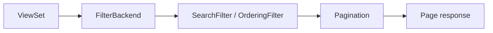

A large API cannot give the client all records in a row: there could be thousands, and it is slow. DRF solves this with three mechanisms: **filtering** (selection by exact values), **search** (substring in text fields), **pagination** (splitting the response into pages). Let us look at each.

## Filtering via django-filter

Exact filtering by field values is done with the **`django-filter`** package:

```bash
pip install django-filter
```

```python
# settings.py
INSTALLED_APPS = [
    ...
    "django_filters",
]

REST_FRAMEWORK = {
    "DEFAULT_FILTER_BACKENDS": [
        "django_filters.rest_framework.DjangoFilterBackend",
    ],
}
```

Now the view gets a `filterset_fields` parameter:

```python
from django_filters.rest_framework import DjangoFilterBackend


class BookViewSet(viewsets.ModelViewSet):
    queryset = Book.objects.all()
    serializer_class = BookSerializer
    filter_backends = [DjangoFilterBackend]
    filterset_fields = ["author", "published"]
```

The client can request:

```
GET /api/books/?author=Tolstoy
GET /api/books/?published=2020&author=Tolstoy
```

The response contains only books where `author="Tolstoy"` and `published=2020`. If more complex conditions are needed (for example, "year greater than 2000"), a filter class is created:

```python
import django_filters
from .models import Book


class BookFilter(django_filters.FilterSet):
    published_min = django_filters.NumberFilter(
        field_name="published", lookup_expr="gte")
    published_max = django_filters.NumberFilter(
        field_name="published", lookup_expr="lte")

    class Meta:
        model = Book
        fields = ["author", "published_min", "published_max"]
```

In the view we set `filterset_class = BookFilter`, and the client can write `?published_min=2000&published_max=2020`.

## Search and ordering

**`SearchFilter`** searches for a substring in text fields:

```python
from rest_framework.filters import SearchFilter, OrderingFilter


class BookViewSet(viewsets.ModelViewSet):
    queryset = Book.objects.all()
    serializer_class = BookSerializer
    filter_backends = [SearchFilter, OrderingFilter]
    search_fields = ["title", "author"]
    ordering_fields = ["published", "title"]
```

A `GET /api/books/?search=war` request will return books whose title or author contains the word "war". `search_fields` supports notation:

- `"title"` — exact substring match;
- `"^title"` — start of string;
- `"=title"` — exact match of the whole value.

**`OrderingFilter`** sorts by fields from `ordering_fields`:

```
GET /api/books/?ordering=published
GET /api/books/?ordering=-published
GET /api/books/?ordering=-published,title
```

A minus sign — reverse order, a comma — several sort levels.

## Pagination

**Pagination** splits the response into pages. Basic setup:

```python
REST_FRAMEWORK = {
    "DEFAULT_PAGINATION_CLASS": "rest_framework.pagination.PageNumberPagination",
    "PAGE_SIZE": 10,
}
```

Now `GET /api/books/` will return:

```json
{
  "count": 57,
  "next": "http://.../api/books/?page=2",
  "previous": null,
  "results": [ ... 10 objects ... ]
}
```

The client can move through pages via `?page=2`, `?page=3` and so on. `count` — total number of records, `next`/`previous` — links to neighboring pages.

Sometimes non-standard pagination is needed. For example, to let the client choose the page size itself:

```python
from rest_framework.pagination import PageNumberPagination


class BookPagination(PageNumberPagination):
    page_size = 10
    page_size_query_param = "page_size"
    max_page_size = 100
```

Connecting in the view:

```python
class BookViewSet(viewsets.ModelViewSet):
    queryset = Book.objects.all()
    serializer_class = BookSerializer
    pagination_class = BookPagination
```

Now `GET /api/books/?page_size=25` returns up to 25 records per page.

## Cursor pagination

An alternative to `PageNumberPagination` is **`CursorPagination`**. It uses a cursor (an encrypted position) instead of a page number and guarantees stability when new records are added:

```python
from rest_framework.pagination import CursorPagination


class BookCursorPagination(CursorPagination):
    page_size = 10
    ordering = "-id"
```



## Summary

Filtering (`django-filter`) removes extra records by exact values, search (`SearchFilter`) finds substrings, ordering (`OrderingFilter`) sets the order, and pagination splits the response into pages. Together they make the API fast and convenient for clients. In the final lesson we will write tests for all of this.

<!--TASK-->
### Task 1
Install `django-filter`, add `django_filters` to `INSTALLED_APPS` and connect `DjangoFilterBackend` in `REST_FRAMEWORK`. For `BookViewSet` add `filter_backends = [DjangoFilterBackend]` and `filterset_fields = ["author", "published"]`. Test via curl: `GET /api/books/?author=Tolstoy` should return only that author's books.

### Task 2
Add `SearchFilter` and `OrderingFilter` to `BookViewSet`. Set `search_fields = ["title", "author"]` and `ordering_fields = ["published", "title"]`. Test: `?search=war` finds books with that word, and `?ordering=-published` sorts by year descending.

### Task 3
Create a `BookFilter(django_filters.FilterSet)` class with `published_min` and `published_max` fields (lookup_expr: gte/lte) and connect it via `filterset_class` in the view. Test the request `?published_min=2000&published_max=2010`.

### Task 4
Enable pagination: `DEFAULT_PAGINATION_CLASS = PageNumberPagination` and `PAGE_SIZE = 5`. Create at least 12 books (with a loop or a shell command) and check that the response contains `count`, `next`, `previous`, `results`, and `?page=2` shows the second page.

### Task 5
Create a `BookPagination(PageNumberPagination)` class with `page_size = 10`, `page_size_query_param = "page_size"` and `max_page_size = 50`. Connect it in `BookViewSet` via `pagination_class`. Test: `?page_size=25` returns up to 25 records, and `?page_size=999` — no more than 50.
### Task 6 — Pagination class
Create `StandardResultsSetPagination(PageNumberPagination)` with `page_size = 5` and connect it to `BookViewSet.pagination_class`. Test: `?page=2` returns the corresponding page, and the response has `next`/`count`.
### Task 7 — Search and Ordering
Add to BookViewSet `filter_backends = [SearchFilter, OrderingFilter]`, `search_fields = ["title", "author"]`, `ordering_fields = ["price", "year"]`. Test `?search=war` and `?ordering=price`.

<!--/TASK-->

<!--HINT-->
### Hint 1
After `pip install django-filter` add `django_filters` to `INSTALLED_APPS`, and `DjangoFilterBackend` — to `DEFAULT_FILTER_BACKENDS`. In the view class specify `filter_backends = [DjangoFilterBackend]` and `filterset_fields`.

### Hint 2
`SearchFilter` and `OrderingFilter` are imported from `rest_framework.filters`. In `search_fields` the fields to search a substring in are listed, in `ordering_fields` — fields for sorting.

### Hint 3
A filter class is declared like this: `class BookFilter(django_filters.FilterSet):` with fields `published_min = django_filters.NumberFilter(field_name="published", lookup_expr="gte")`. Inside `class Meta` specify `model = Book` and list the available fields. In the view — `filterset_class = BookFilter`.

### Hint 4
The settings are added to `REST_FRAMEWORK`: `"DEFAULT_PAGINATION_CLASS": "rest_framework.pagination.PageNumberPagination"`, `"PAGE_SIZE": 5`. For bulk-creating books use `Book.objects.bulk_create([...])` in shell.

### Hint 5
The class inherits from `PageNumberPagination`, attributes: `page_size`, `page_size_query_param`, `max_page_size`. Connecting — `pagination_class = BookPagination` inside the view.
### Hint 6
PageNumberPagination uses the page parameter; the response gets count/next/previous/results.
### Hint 7
SearchFilter searches by search_fields (partial match), OrderingFilter sorts by ordering_fields.

<!--/HINT-->

<!--SOLUTION-->
### Solution 1
Solution:

```bash
pip install django-filter
```

```python
# settings.py
INSTALLED_APPS = [
    ...
    "django_filters",
]

REST_FRAMEWORK = {
    "DEFAULT_FILTER_BACKENDS": [
        "django_filters.rest_framework.DjangoFilterBackend",
    ],
}
```

```python
# books/views.py
from django_filters.rest_framework import DjangoFilterBackend


class BookViewSet(viewsets.ModelViewSet):
    queryset = Book.objects.all()
    serializer_class = BookSerializer
    filter_backends = [DjangoFilterBackend]
    filterset_fields = ["author", "published"]
```

What is going on here? `DjangoFilterBackend` analyzes query parameters and turns them into SQL conditions. `filterset_fields` indicates which fields can be used for filtering. The `?author=Tolstoy` request will run a query with the condition `author='Tolstoy'`. Fields outside the list are simply ignored.

### Solution 2
Solution:

```python
from rest_framework.filters import SearchFilter, OrderingFilter


class BookViewSet(viewsets.ModelViewSet):
    queryset = Book.objects.all()
    serializer_class = BookSerializer
    filter_backends = [SearchFilter, OrderingFilter]
    search_fields = ["title", "author"]
    ordering_fields = ["published", "title"]
```

What is going on here? `SearchFilter` takes the `search` parameter and searches for it as a substring in fields from `search_fields`, using case-insensitive search. `OrderingFilter` reads the `ordering` parameter: `-published` means descending sort, and a comma-separated list — several criteria.

### Solution 3
Solution:

```python
# books/filters.py
import django_filters
from .models import Book


class BookFilter(django_filters.FilterSet):
    published_min = django_filters.NumberFilter(
        field_name="published", lookup_expr="gte")
    published_max = django_filters.NumberFilter(
        field_name="published", lookup_expr="lte")

    class Meta:
        model = Book
        fields = ["author", "published_min", "published_max"]
```

```python
class BookViewSet(viewsets.ModelViewSet):
    queryset = Book.objects.all()
    serializer_class = BookSerializer
    filter_backends = [DjangoFilterBackend]
    filterset_class = BookFilter
```

What is going on here? `NumberFilter` with `lookup_expr="gte"` means "greater than or equal", `lte` — "less than or equal". The request `?published_min=2000&published_max=2010` turns into the condition `published >= 2000 AND published <= 2010`. This is much more flexible than plain `filterset_fields`.

### Solution 4
Solution:

```python
REST_FRAMEWORK = {
    "DEFAULT_PAGINATION_CLASS": (
        "rest_framework.pagination.PageNumberPagination"
    ),
    "PAGE_SIZE": 5,
}
```

This approach sets pagination globally. The response to `GET /api/books/`:

```json
{
  "count": 12,
  "next": "http://127.0.0.1:8000/api/books/?page=2",
  "previous": null,
  "results": [ ... ]
}
```

What is going on here? `PageNumberPagination` splits the queryset into pages of 5 records. `count` — total number, `next`/`previous` — links. The `?page=2` request will return records 6 through 10.

### Solution 5
Solution:

```python
from rest_framework.pagination import PageNumberPagination


class BookPagination(PageNumberPagination):
    page_size = 10
    page_size_query_param = "page_size"
    max_page_size = 50
```

```python
class BookViewSet(viewsets.ModelViewSet):
    queryset = Book.objects.all()
    serializer_class = BookSerializer
    pagination_class = BookPagination
```

What is going on here? `page_size_query_param` gives the client the ability to set the page size itself. `max_page_size` limits that size so that a too-large value does not overload the server. Now `?page_size=25` returns 25 records, and `?page_size=999` — no more than 50.
### Solution 6
```python
from rest_framework.pagination import PageNumberPagination

class StandardResultsSetPagination(PageNumberPagination):
    page_size = 5
    page_size_query_param = "page_size"

class BookViewSet(viewsets.ModelViewSet):
    queryset = Book.objects.all()
    serializer_class = BookSerializer
    pagination_class = StandardResultsSetPagination
```
Response: `{"count": 13, "next": "...?page=2", "results": [...]}`.
### Solution 7
```python
from rest_framework.filters import SearchFilter, OrderingFilter

class BookViewSet(viewsets.ModelViewSet):
    queryset = Book.objects.all()
    serializer_class = BookSerializer
    filter_backends = [SearchFilter, OrderingFilter]
    search_fields = ["title", "author"]
    ordering_fields = ["price", "year"]
```
`?search=war&ordering=price` gives a filtered and sorted list.

<!--/SOLUTION-->

<!--QUIZ-->
Which package is responsible for exact filtering in DRF?
- django-filter
- pandas
- django-jwt
* Correct answer: django-filter
DjangoFilterBackend from the django-filter package filters by field values.

How to enable filtering by the author and published fields?
- filterset_fields = ["author", "published"]
- search_fields = ["author", "published"]
- ordering_fields = ["author", "published"]
* Correct answer: filterset_fields = ["author", "published"]
filterset_fields specifies the fields that can be filtered by.

Which parameter does SearchFilter use?
- ?search=...
- ?q=...
- ?find=...
* Correct answer: ?search=...
SearchFilter reads the search parameter and looks for a substring.

How to sort by year descending?
- ?ordering=-published
- ?ordering=published
- ?sort=published-desc
* Correct answer: ?ordering=-published
A minus sign before the field means reverse order.

Which attribute defines the fields for sorting?
- ordering_fields
- sort_fields
- order_by
* Correct answer: ordering_fields
OrderingFilter allows sorting only by fields from ordering_fields.

What does the count key contain in a paginated response?
- Total number of records
- Current page number
- Page size
* Correct answer: Total number of records
count is the total number of records in the whole queryset.

What is the parameter for requesting a specific page called?
- page
- offset
- start
* Correct answer: page
PageNumberPagination uses ?page=N.

Which pagination class uses an encrypted position?
- CursorPagination
- OffsetPagination
- SlicePagination
* Correct answer: CursorPagination
CursorPagination works with cursors, not page numbers.

What does page_size_query_param do?
- Lets the client set the page size
- Limits the number of pages
- Hides the page field
* Correct answer: Lets the client set the page size
For example, ?page_size=25 returns 25 records.

What does max_page_size limit?
- The maximum page size
- The total number of records
- The maximum number of pages
* Correct answer: The maximum page size
Even if the client asks for 999, no more than max_page_size will be returned.

What does PageNumberPagination do?
- Splits the response into pages with the page parameter
- Sorts
- Searches
- Filters
* Correct answer: Splits the response into pages with the page parameter
The response gets count/next/results.

What does SearchFilter search for?
- A substring in the specified search_fields
- Exact match
- By id
- It does not search
* Correct answer: A substring in the specified search_fields
The query parameter is search.

What does OrderingFilter do?
- Sorts by the specified ordering_fields
- Paginates
- Restricts access
- Groups
* Correct answer: Sorts by the specified ordering_fields
The ordering parameter accepts field names.

How to set the page size?
- page_size, an attribute of the pagination class
- In views.py
- In models
- In URL
* Correct answer: page_size, an attribute of the pagination class
The pagination class is connected to the view.

# 
<!--/QUIZ-->
