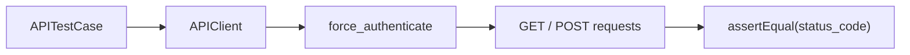

Developing an API without tests is dangerous: it is easy to accidentally break a route, validation or permissions. DRF provides ready-made testing tools: **`APITestCase`**, **`APIClient`** and helper utilities. In this lesson we will write full-fledged tests for our API.

## Why test the API

Imagine you changed the serializer validation and accidentally allowed an empty title. Without tests you will find out only when the client starts complaining. Tests check behavior automatically: you run `python manage.py test` and immediately see what broke. Tests are not "extra work" but insurance and living API documentation.

## Basic test on APITestCase

```python
# books/tests.py
from rest_framework.test import APITestCase
from rest_framework import status
from django.urls import reverse
from .models import Book


class BookAPITests(APITestCase):
    def setUp(self):
        Book.objects.create(title="War and Peace", author="Tolstoy", published=1869)

    def test_list_books(self):
        url = reverse("book-list")
        response = self.client.get(url)
        self.assertEqual(response.status_code, status.HTTP_200_OK)
        self.assertEqual(len(response.data["results"]), 1)
```

What is going on here?

- `APITestCase` — a special test class that understands DRF;
- `self.client` — that is `APIClient`, an extension of the standard Django client: it can send JSON and work with DRF responses;
- `reverse("book-list")` — builds the URL by route name (the name was given by the Router via `basename`);
- `response.data` — already parsed JSON, convenient to work with;
- `status.HTTP_200_OK` — the status code as a constant.

Important: each test works with a **clean database** — Django itself creates a temporary DB and rolls back changes after each test.

## setUpTestData vs setUp

Data can be created in two ways:

```python
class BookAPITests(APITestCase):
    @classmethod
    def setUpTestData(cls):
        cls.book = Book.objects.create(
            title="War and Peace", author="Tolstoy", published=1869)
```

`setUpTestData` is called once for the whole class and works faster. `setUp` is called before each test — use it if every test should get fresh data.

## Testing creation and deletion

```python
class BookAPITests(APITestCase):
    def setUp(self):
        self.url = reverse("book-list")

    def test_create_book(self):
        response = self.client.post(
            self.url,
            {"title": "Anna Karenina", "author": "Tolstoy",
             "published": 1877},
            format="json",
        )
        self.assertEqual(response.status_code, status.HTTP_201_CREATED)
        self.assertEqual(Book.objects.count(), 1)

    def test_delete_book(self):
        book = Book.objects.create(title="X", author="Y")
        url = reverse("book-detail", args=[book.id])
        response = self.client.delete(url)
        self.assertEqual(response.status_code, status.HTTP_204_NO_CONTENT)
        self.assertEqual(Book.objects.count(), 0)
```

The `format="json"` parameter tells the client to send data as JSON.

## Testing validation and permissions

```python
def test_invalid_year(self):
    response = self.client.post(
        self.url,
        {"title": "Bad book", "author": "Z", "published": 3000},
        format="json",
    )
    self.assertEqual(response.status_code, status.HTTP_400_BAD_REQUEST)
    self.assertIn("published", response.data)
```

Authentication check:

```python
from django.contrib.auth.models import User

def test_unauthorized(self):
    response = self.client.get(self.url)
    self.assertEqual(response.status_code, status.HTTP_401_UNAUTHORIZED)

def test_authorized(self):
    user = User.objects.create_user("anna", password=[redacted])
    self.client.force_authenticate(user=user)
    response = self.client.get(self.url)
    self.assertEqual(response.status_code, status.HTTP_200_OK)
```

`force_authenticate` is a convenient way to "log in" the client without a real request to the login endpoint.

## Common asserts

- `assertEqual(response.status_code, 200)` — response code;
- `assertIn("title", response.data)` — field in JSON;
- `assertContains(response, "text")` — substring in the response body;
- `assertNotIn(...)` — absence of a value;
- `assertIsNone(response.data["next"])` — checking for None.

## How to run

```bash
python manage.py test books
```

If you need to run a specific class or method:

```bash
python manage.py test books.tests.BookAPITests
python manage.py test books.tests.BookAPITests.test_create_book
```



## Summary

`APITestCase` + `APIClient` let you cover all scenarios with tests: lists, creation, validation, permissions, pagination, filtering. Tests run with a single command and work on a temporary database. This is a mandatory part of a professional API.

<!--TASK-->
### Task 1
Write a test class `BookAPITests(APITestCase)` with `setUpTestData` that creates the book "War and Peace". Add a `test_list_books` test: GET to `reverse("book-list")` should return `200` and at least one book in `response.data`.

### Task 2
Add a `test_create_book` test: POST with JSON data (`format="json"`) to `reverse("book-list")` should return `201 Created`, and `Book.objects.count()` should become 1 after creation.

### Task 3
Create a `test_invalid_year` test: POST with `published=3000` should return `400 Bad Request`, and `response.data` should contain the `published` key. This is a validation check from lesson 2.

### Task 4
Write `test_unauthorized` and `test_authorized` tests for a view with `IsAuthenticated`: without a user — `401`, after `self.client.force_authenticate(user=user)` — `200`. Create a user via `User.objects.create_user`.

### Task 5
Write a `test_delete_book` test: create a book, send DELETE to `reverse("book-detail", args=[book.id])`, check that the response is `204 No Content`, and `Book.objects.count()` is 0. Also check that a repeated GET of that book returns `404`.
### Task 6 — Test with statuses
Write a test: anonymous GET `/api/books/` returns 200; anonymous POST — 401 (if permission is configured). Use `APITestCase` and `self.client`.
### Task 7 — force_authenticate
Authorize a user via `self.client.force_authenticate(user=user)` and check that POST `/api/books/` creates an object (201). Make sure the object appeared in the database.

<!--/TASK-->

<!--HINT-->
### Hint 1
Imports: `from rest_framework.test import APITestCase`, `from rest_framework import status`, `from django.urls import reverse`. The route name for the list is `book-list` (if `basename="book"` in the router). `response.data` — already JSON.

### Hint 2
`self.client.post(url, {...}, format="json")`. Check `status.HTTP_201_CREATED` and the number of records via `Book.objects.count()`.

### Hint 3
Create a book with `published=3000` — the `validate_published` validator should fire. Look for the `published` key in `response.data`. Do not forget to check `status.HTTP_400_BAD_REQUEST`.

### Hint 4
Without a token `self.client.get(url)` should return `401`. Then: `user = User.objects.create_user("anna", password=[redacted]); self.client.force_authenticate(user=user)` — and GET returns `200`.

### Hint 5
`reverse("book-detail", args=[book.id])` builds the URL of a specific book. DELETE returns `204 No Content`. After deletion `Book.objects.count()` is 0, and GET to the same URL — `404`.
### Hint 6
`from rest_framework.test import APITestCase`; `self.client.get(url)` and `self.client.post(url, data)`.
### Hint 7
force_authenticate sets the user in the test client without a real token.

<!--/HINT-->

<!--SOLUTION-->
### Solution 1
Solution:

```python
# books/tests.py
from rest_framework.test import APITestCase
from rest_framework import status
from django.urls import reverse
from .models import Book


class BookAPITests(APITestCase):
    @classmethod
    def setUpTestData(cls):
        Book.objects.create(
            title="War and Peace", author="Tolstoy", published=1869)

    def test_list_books(self):
        url = reverse("book-list")
        response = self.client.get(url)
        self.assertEqual(response.status_code, status.HTTP_200_OK)
        self.assertEqual(len(response.data["results"]), 1)
```

What is going on here? `setUpTestData` creates a book once for all tests in the class. `reverse("book-list")` builds the URL by the name from the Router. `self.client.get` returns a response whose `status_code` is the HTTP code, and `data` is parsed JSON. If pagination is enabled, books are in `response.data["results"]`; if not — `response.data` will be a list directly.

### Solution 2
Solution:

```python
def test_create_book(self):
    url = reverse("book-list")
    response = self.client.post(
        url,
        {"title": "Anna Karenina", "author": "Tolstoy",
         "published": 1877},
        format="json",
    )
    self.assertEqual(response.status_code, status.HTTP_201_CREATED)
    self.assertEqual(Book.objects.count(), 1)
```

What is going on here? `format="json"` makes `APIClient` send the data as JSON with the correct header. If we did not specify the format, the client would send the data as a form, which also works but mimics a real API client less accurately. After creation we check that there is exactly one book in the database.

### Solution 3
Solution:

```python
def test_invalid_year(self):
    url = reverse("book-list")
    response = self.client.post(
        url,
        {"title": "Bad book", "author": "Z", "published": 3000},
        format="json",
    )
    self.assertEqual(response.status_code, status.HTTP_400_BAD_REQUEST)
    self.assertIn("published", response.data)
```

What is going on here? The `validate_published` validator from lesson 2 rejects year 3000. The serializer puts the error into `response.data["published"]`, so `assertIn("published", response.data)` verifies that the error actually appeared. Such a test protects validation from accidental breakage.

### Solution 4
Solution:

```python
def test_unauthorized(self):
    url = reverse("book-list")
    response = self.client.get(url)
    self.assertEqual(response.status_code, status.HTTP_401_UNAUTHORIZED)

def test_authorized(self):
    from django.contrib.auth.models import User
    user = User.objects.create_user("anna", password=[redacted])
    self.client.force_authenticate(user=user)
    url = reverse("book-list")
    response = self.client.get(url)
    self.assertEqual(response.status_code, status.HTTP_200_OK)
```

What is going on here? Without authentication `IsAuthenticated` rejects the request with `401`. `force_authenticate` directly inserts the user into the client — this is faster than going through a real login and does not require tokens. After that the request passes as from a logged-in user.

### Solution 5
Solution:

```python
def test_delete_book(self):
    book = Book.objects.create(
        title="X", author="Y", published=2000)
    url = reverse("book-detail", args=[book.id])
    response = self.client.delete(url)
    self.assertEqual(response.status_code, status.HTTP_204_NO_CONTENT)
    self.assertEqual(Book.objects.count(), 0)

    get_response = self.client.get(url)
    self.assertEqual(get_response.status_code, status.HTTP_404_NOT_FOUND)
```

What is going on here? `args=[book.id]` substitutes the id into the URL. DELETE on `RetrieveUpdateDestroyAPIView` deletes the book and returns `204 No Content`. The fact that GET then gives `404` confirms that the record is really deleted from the database.
### Solution 6
```python
from rest_framework.test import APITestCase
from rest_framework import status

class BookApiTests(APITestCase):
    def test_anon_get_ok(self):
        r = self.client.get("/api/books/")
        self.assertEqual(r.status_code, status.HTTP_200_OK)

    def test_anon_post_denied(self):
        r = self.client.post("/api/books/", {"title": "X"})
        self.assertEqual(r.status_code, status.HTTP_401_UNAUTHORIZED)
```
Anonymous access is checked with direct requests.
### Solution 7
```python
class BookApiTests(APITestCase):
    def setUp(self):
        self.user = User.objects.create_user(username="u", password="12345")
        self.client.force_authenticate(user=self.user)

    def test_create_book(self):
        r = self.client.post("/api/books/", {"title": "Book", "author": "Author", "year": 2020})
        self.assertEqual(r.status_code, status.HTTP_201_CREATED)
        self.assertEqual(Book.objects.count(), 1)
```
force_authenticate simplifies tests: no real token needed.

<!--/SOLUTION-->

<!--QUIZ-->
Which class do tests for DRF inherit from?
- APITestCase
- TestCase
- DjangoTestCase
* Correct answer: APITestCase
APITestCase from rest_framework.test understands DRF specifics.

What is self.client in APITestCase?
- APIClient
- A regular browser
- A mock server
* Correct answer: APIClient
APIClient can send JSON and understands DRF responses.

How to build a URL by route name?
- reverse("book-list")
- path("book-list")
- url("book-list")
* Correct answer: reverse("book-list")
reverse() builds the URL by the name that the Router gave via basename.

What does the format="json" parameter in post() mean?
- Send the data as JSON
- Get the response in JSON
- Enable logging
* Correct answer: Send the data as JSON
format="json" serializes the data to JSON and sets Content-Type.

What does setUpTestData do?
- Creates data once for the whole class
- Is called before each test
- Cleans the database
* Correct answer: Creates data once for the whole class
setUpTestData is a class method, executed once.

How to log in a client without a real request?
- client.force_authenticate(user=user)
- client.login(user)
- client.auth(user)
* Correct answer: client.force_authenticate(user=user)
force_authenticate directly inserts the user into the client.

Which code do we expect on successful creation?
- 201
- 200
- 204
* Correct answer: 201
201 Created — the response to successful resource creation.

What will DELETE of a successfully deleted book return?
- 204 No Content
- 200 OK
- 404 Not Found
* Correct answer: 204 No Content
DELETE without a response body returns 204.

Which command runs the tests of the books app?
- python manage.py test books
- python manage.py runserver books
- pytest books/views.py
* Correct answer: python manage.py test books
manage.py test runs the tests of the given app.

What does assertIn("published", response.data) check?
- That the response has the published key
- That the book is published
- That the response contains 200
* Correct answer: That the response has the published key
assertIn checks the presence of a key in the response.data dictionary.

What does force_authenticate do?
- Sets the user in the test client
- Creates a token
- Deletes the user
- Logs requests
* Correct answer: Sets the user in the test client
Tests pass without real authentication.

Which class should be used for API tests?
- APITestCase
- TestCase
- SimpleTestCase
- LiveServerTestCase
* Correct answer: APITestCase
It includes APIClient and support for DRF requests.

Which status is expected on successful creation?
- 201
- 200
- 302
- 404
* Correct answer: 201
201 Created — the standard for successful creation.

How to check that an object was created in the database?
- Book.objects.count() == 1
- r.data
- r.content
- len(r)
* Correct answer: Book.objects.count() == 1
A database query confirms creation.

# 
<!--/QUIZ-->
