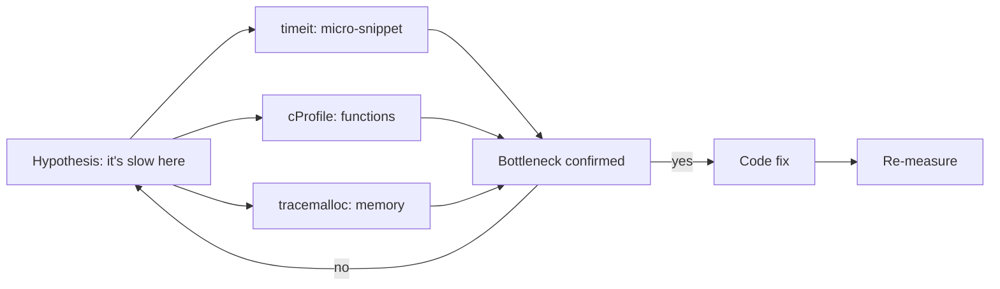

The golden rule of optimization: **don't optimize blindly**. Intuition often lies: a developer thinks one function is the bottleneck when in reality 90% of the time goes somewhere completely different. So before speeding anything up, you need to measure where time and memory are actually spent. That's what this lesson is about: we'll look at four profiling tools: `timeit`, `cProfile`, `tracemalloc` and `memory-profiler`.

## Why measurements beat guesses

Donald Knuth famously said premature optimization is the root of all evil. The point isn't to avoid optimizing entirely—it's to do it based on numbers, not assumptions. In practice, a typical program spends 80–90% of its time in a small fraction of the code, usually deep inside loops or library calls. Trying to "speed up" an arbitrary function without measuring often achieves nothing and burns hours.

Imagine a program that runs for 10 seconds. You "optimize" a function that takes 1% of the time—and make it 10× faster. The gain: 0.9 seconds out of 10, i.e. 9%. But if you had measured and seen that 6 seconds go to file parsing, you'd have optimized that instead—the same effort, many times the payoff. So the sequence is always the same: **measure → find the bottleneck → change → measure again**.

## timeit: micro-benchmarking code snippets

The `timeit` module is designed for precise measurement of small code fragments. It disables the garbage collector, repeats the code many times, and picks the best time to smooth out noise.

The easiest way is from the command line:

```bash
python -m timeit "-'.join(str(n) for n in range(100))"
python -m timeit "list(range(1000))"
```

And here's programmatic use:

```python
import timeit

t1 = timeit.repeat(
    "[x * x for x in range(1000)]",
    number=10_000, repeat=5,
)
t2 = timeit.repeat(
    "list(map(lambda x: x * x, range(1000)))",
    number=10_000, repeat=5,
)

print("list comprehension, min sec:", min(t1))
print("map + lambda, min sec:", min(t2))
```

`repeat` runs the benchmark several times and returns a list of timings. Compare **minimums**, not averages: averages get skewed by random OS wake-ups, while the minimum shows the code's real speed.

## cProfile: function-level profiling

If `timeit` answers "how long does a piece of code take", `cProfile` shows **where time is spent and in which function**, including nested calls. It's the main tool for finding bottlenecks.

Running from the command line:

```bash
python -m cProfile -s cumulative slow_program.py
```

Programmatic run with statistics saved:

```python
import cProfile
import io
import pstats

def compute_total(limit):
    total = 0
    for i in range(limit):
        total += i * i
    return total

def main():
    return compute_total(100_000)

pr = cProfile.Profile()
pr.enable()
main()
pr.disable()

buf = io.StringIO()
stats = pstats.Stats(pr, stream=buf)
stats.sort_stats("cumulative").print_stats(10)
print(buf.getvalue())
```

The `pstats` output has several columns:

- `ncalls` — how many times the function was called;
- `tottime` — total time *inside the function itself*, excluding nested calls;
- `cumtime` — total time including nested calls;
- `percall` — time per call.

Sorting by `cumulative` gives the big picture: which functions eat the most time together with their "children". Usually the bottleneck is visible immediately.

## tracemalloc: catching memory leaks

`tracemalloc` tracks memory allocations in Python and can show exactly where (file and line) memory was allocated. It's indispensable for finding leaks: take a snapshot before, a snapshot after, and compare.

```python
import tracemalloc

tracemalloc.start()

data = []
for i in range(100_000):
    data.append(f"item_{i}")

snapshot = tracemalloc.take_snapshot()
top_stats = snapshot.statistics("lineno")

print("Top-5 memory allocation sites:")
for stat in top_stats[:5]:
    print(stat)
```

The `statistics("lineno")` method groups allocations by code line. An output line like `lesson01.py:4: size=12.3 MiB count=100000 average=129 B` means line 4 of `lesson01.py` allocated 12.3 MiB across 100,000 objects. If you run a function twice and see the size grow even though the first batch of data is no longer needed—that's a leak.

Comparing two snapshots:

```python
import tracemalloc

tracemalloc.start()
# some code that may leak

before = tracemalloc.take_snapshot()
# the same code again
after = tracemalloc.take_snapshot()

for stat in after.compare_to(before, "lineno")[:5]:
    print(stat)
```

## memory-profiler: line-by-line memory analysis

The `memory-profiler` package (install with `pip install memory-profiler`) decorates a function with `@profile` and shows how much memory **each line** of that function allocates. Handy when you want to understand where inside a function an object grows.

```python
# lesson1_mem.py
from memory_profiler import profile

@profile
def build_data():
    result = []
    for i in range(100_000):
        result.append((i, str(i)))
    return result

if __name__ == "__main__":
    build_data()
```

Run:

```bash
python -m memory_profiler lesson1_mem.py
```

The output includes a table: line number, memory increment, increment including nested calls, and the source code of the line. For example, you can see the `result` list growing by ~40 bytes per element.

## Profiling rules

1. **Profile on real data.** A micro-test with three elements shows nothing.
2. **Identical conditions.** Don't compare a measurement on a loaded machine with one on an idle machine.
3. **Multiple runs.** A 20–30% spread is normal; draw conclusions from the median or minimum.
4. **Algorithm first, then micro-optimizations.** If the algorithm is quadratic, "clever" tricks won't save it.
5. **Optimized? Measure again.** The only way to prove an improvement is before/after numbers.



## Lesson summary

You've met the measurement tools: `timeit` for micro-snippets, `cProfile` for finding function-level bottlenecks, `tracemalloc` for tracking memory allocations, and `memory-profiler` for line-by-line analysis. Now let's solidify the skills with tasks.

<!--TASK-->
### Task 1
Write a function `compute_total(limit)` that sums `i * i` in a loop for `i` from 0 to `limit - 1`. In the main part of the program call it with `limit = 200_000`. Use the programmatic `cProfile.Profile()` run: enable profiling before the call, disable after, and print statistics via `pstats.Stats(...).sort_stats("cumulative").print_stats(10)`. The screen should show a table with columns `ncalls`, `tottime`, `cumtime` and rows `main` and `compute_total`. In a comment at the end of the file, write which function accumulated more `cumtime` — and why.

### Task 2
Using `timeit.repeat`, compare two ways to build a list of squares of numbers from 0 to 999: list comprehension `[x * x for x in range(1000)]` and `list(map(lambda x: x * x, range(1000)))`. For each variant run the benchmark with `number=10_000` and `repeat=5`, print the minimum for each variant with a label, e.g.: `list comprehension, min sec: 0.123`. At the end add a one-line comment: which variant was faster and why (think about lambda call overhead).

### Task 3
Use `tracemalloc` to measure how much memory creating a list of 100,000 strings of the form `f"item_{i}"` allocates. Start tracking before the loop, take a snapshot `tracemalloc.take_snapshot()` after creating the list, and print the top-3 sites via `snapshot.statistics("lineno")`. The output should contain lines like `size=... count=... average=...`. Add a comment explaining why the line with `append` or the list comprehension shows up in the statistics.

### Task 4
Create a file `mem_matrix.py` with a function `build_matrix(n)` that returns a list of lists `[[0] * n for _ in range(n)]` for `n = 500`. Decorate it with `@profile` from `memory_profiler`. In the `if __name__ == "__main__":` block call the function. If the package isn't installed, install it: `pip install memory-profiler`. Run the file with `python -m memory_profiler mem_matrix.py` and make sure the output includes a table with line-by-line memory increments. In a comment, indicate which line allocated the most memory.

### Task 5
Write a function `find_duplicates(items)` that returns a list of duplicate elements. First implement a "naive" version: for each element count how many times it appears with `items.count(item)`, and add it to the result if more than one. Then implement a `set`-based version. Profile both functions with `cProfile` (or `timeit` with `number=1000`) on a list of 10,000 random numbers from the range 0–999 (use `random.randint`). Print the times of both variants. In a comment explain why the `set` variant is radically faster (think about the complexity of `count`).

### Task 6
Take a naive recursive `fib(n)` with two recursive calls and its cached version: `fib_cached = functools.lru_cache(maxsize=None)(fib)`. Measure `timeit.timeit(lambda: fib(25), number=1)` for the plain version and, after `fib_cached.cache_clear()`, for the cached one. Print both times as `without cache: ... sec` and `with cache: ... sec`, then the result of `fib_cached.cache_info()`. Additionally run both functions under `cProfile` and print the total profile time `stats.total_tt`. Expected output: the cache removes repeated computations, `cache_info()` shows `hits=24, misses=26`, and the time difference is hundreds of times. In a comment explain why the profiler sees hundreds of thousands of calls for the naive version.

### Task 7
Write two functions: `leaky()` adds 1000 strings of the form `f"row_{i}"` to a global list `_cache` and removes nothing, while `clean()` creates the same list locally and returns its length. Run `tracemalloc.start()`, take a snapshot `before = tracemalloc.take_snapshot()`, call `leaky()` ten times, take `after` and print the three largest increments via `after.compare_to(before, "lineno")[:3]`. Then repeat the experiment for `clean()` and print `leak: yes` if the total increment exceeds 1 MiB, otherwise `leak: no`. Expected output: for `leaky()` — lines with `+` and growing size, for `clean()` — `leak: no`. In a comment explain why the local list leaves no trace in memory.
<!--/TASK-->

<!--HINT-->
### Hint 1
Enabling the profiler: `pr = cProfile.Profile()`, then `pr.enable()`, call the function, `pr.disable()`. Statistics are easy to print like this: `pstats.Stats(pr, stream=buf).sort_stats("cumulative").print_stats(10)`, where `buf = io.StringIO()`. Don't forget `import cProfile, io, pstats`. `cumtime` grows with nested calls, so for `main` it will be greater than or equal to `cumtime` of `compute_total`.

### Hint 2
Call format: `timeit.repeat(stmt, number=..., repeat=...)` returns a list of seconds. Minimum — `min(...)`. When printing use f-strings: `print(f"list comprehension, min sec: {min(t1):.4f}")`. Note that `lambda` is called for every element — it has overhead that the list comprehension doesn't.

### Hint 3
Don't forget `tracemalloc.start()` before the loop and `tracemalloc.take_snapshot()` after. Statistics: `snapshot.statistics("lineno")` — a list of objects, each with `size`, `count`, `average` fields; printed as `str(stat)`. If the loop line and the `append` line differ — both appear in the top, but the larger one is where the strings themselves are allocated.

### Hint 4
Decorator: `from memory_profiler import profile` and `@profile` above `def build_matrix(n):`. Body: `return [[0] * n for _ in range(n)]`. Run: `python -m memory_profiler mem_matrix.py`. In the table look at the "Increment" column — it shows the per-line memory increment. The line `[[0] * n for _ in range(n)]` will allocate almost all the memory.

### Hint 5
For the naive variant: `dup = [item for item in items if items.count(item) > 1]` — but remember the element will land in the list multiple times, so after filtering it's worth doing `set(dup)`. Set-based variant: `seen = set(); dup = set(); for item in items: if item in seen: dup.add(item) else: seen.add(item)`. Data generation: `items = [random.randint(0, 999) for _ in range(10_000)]`. Measure time with `timeit.timeit` with `number=100` and output.

### Hint 6
The cache is created with one line: `fib_cached = functools.lru_cache(maxsize=None)(fib)`. Before measuring call `fib_cached.cache_clear()`, otherwise the measurement will hit a hot cache and show almost zero. `cache_info()` returns `CacheInfo(hits=..., misses=..., maxsize=None, currsize=...)`. For cProfile wrap the call in `cProfile.Profile()` and take the total time from `pstats.Stats(pr).total_tt`; don't forget `pr.enable()` and `pr.disable()` around the call.

### Hint 7
`compare_to` returns a list of `StatisticDiff` objects with `size_diff`, `count_diff` fields, and `str(stat)` already prints a format like `+123 KiB`. Compute the total increment as `sum(s.size_diff for s in diff)` and compare with `1024 * 1024`. The global `_cache` lives until program end, so growth is visible; the local list dies with the function call.
<!--/HINT-->

<!--SOLUTION-->
### Walkthrough 1
Solution:

```python
import cProfile
import io
import pstats

def compute_total(limit):
    total = 0
    for i in range(limit):
        total += i * i
    return total

def main():
    return compute_total(200_000)

pr = cProfile.Profile()
pr.enable()
main()
pr.disable()

buf = io.StringIO()
stats = pstats.Stats(pr, stream=buf)
stats.sort_stats("cumulative").print_stats(10)
print(buf.getvalue())
```

The result is a table roughly like this:

```
         3 function calls in 0.031 seconds

   Ordered by: cumulative time

   ncalls  tottime  cumtime  percall  filename:lineno(function)
        1    0.000    0.031    0.031  <stdin>:1(main)
        1    0.031    0.031    0.031  <stdin>:1(compute_total)
        1    0.000    0.000    0.000  {method 'disable' of '_lsprof.Profiler'}
```

What's happening here? `cProfile.Profile()` is the programmatic profiler: after `pr.enable()` it records every function call with its time. `pstats.Stats(pr, stream=buf)` wraps raw data into a readable format, and `sort_stats("cumulative")` sorts by total time. `main`'s `cumtime` equals `compute_total`'s `cumtime` (0.031), because main calls compute_total — all of its "tail" is nested inside main. Meanwhile `compute_total`'s `tottime` (0.031) shows the pure time of the function itself. Conclusion: all time goes to the `compute_total` loop, so its body is what should be optimized.

### Walkthrough 2
Solution:

```python
import timeit

t1 = timeit.repeat(
    "[x * x for x in range(1000)]",
    number=10_000, repeat=5,
)
t2 = timeit.repeat(
    "list(map(lambda x: x * x, range(1000)))",
    number=10_000, repeat=5,
)

print(f"list comprehension, min sec: {min(t1):.4f}")
print(f"map + lambda, min sec: {min(t2):.4f}")
# List comprehension is faster: the loop runs in the C core without
# the overhead of calling a Python lambda function for each element.
```

What's happening here? `timeit.repeat` takes a string of code, `number` — how many times to run the code in one measurement, `repeat` — how many measurements to make. It returns a list of times. The minimum filters out random OS "dips". List comprehension is usually faster than `map` with `lambda`, because `lambda` is a Python function, and calling it per element is expensive; the comprehension executes the loop at bytecode level without a function call per iteration. On my machine the figures are roughly `0.123` vs `0.152` seconds.

### Walkthrough 3
Solution:

```python
import tracemalloc

tracemalloc.start()

data = []
for i in range(100_000):
    data.append(f"item_{i}")

snapshot = tracemalloc.take_snapshot()
top_stats = snapshot.statistics("lineno")

print("Top-3 memory allocation sites:")
for stat in top_stats[:3]:
    print(stat)
```

Result (your file paths will differ):

```
Top-3 memory allocation sites:
lesson01.py:8: size=7.0 MiB count=100000 average=73 B
lesson01.py:5: size=3.1 MiB count=100000 average=33 B
lesson01.py:4: size=0.8 MiB count=1 average=0.8 MiB
```

What's happening here? `tracemalloc.start()` enables allocation tracking. After the work, `take_snapshot()` captures the state, and `statistics("lineno")` groups objects by the lines where they were created. Line 8 (`data.append(f"item_{i}")`) allocated the strings themselves — 100,000 objects at ~73 bytes each. Line 5 (`data = []`) — memory for the list itself. If you run the same code again after clearing `data` and see line 8 grow again but line 5 not — the objects aren't being freed: that's a leak.

### Walkthrough 4
Solution (file `mem_matrix.py`):

```python
from memory_profiler import profile

@profile
def build_matrix(n):
    return [[0] * n for _ in range(n)]

if __name__ == "__main__":
    build_matrix(500)
```

Run:

```bash
python -m memory_profiler mem_matrix.py
```

Result — a line-by-line table:

```
Line #    Mem usage    Increment  Occurences   Line Contents
     4  18.8 MiB   18.8 MiB           1   @profile
     5                                   def build_matrix(n):
     6  20.8 MiB    2.0 MiB           1       return [[0] * n for _ in range(n)]
```

What's happening here? The `@profile` decorator instruments the function: process memory is measured before and after each line. The `Increment` column shows the increase. You can see line 6 (the list comprehension) allocated almost all the memory: 500 lists of 500 zeros each. Note: almost all memory went to the inner lists — 2.0 MiB on the return line. If we built the matrix via `[[0] * n] * n`, we'd get 500 references to the same list — but that's for other lessons. `memory-profiler` is useful when you need to find the line where an object grows.

### Walkthrough 5
Solution:

```python
import random
import timeit

items = [random.randint(0, 999) for _ in range(10_000)]

naive = """
dup = [item for item in items if items.count(item) > 1]
dedup = set(dup)
"""

smart = """
seen = set()
dup = set()
for item in items:
    if item in seen:
        dup.add(item)
    else:
        seen.add(item)
"""

t_naive = timeit.timeit(naive, globals={"items": items}, number=100)
t_smart = timeit.timeit(smart, globals={"items": items}, number=100)

print(f"naive (count): {t_naive:.3f} sec")
print(f"set-based: {t_smart:.3f} sec")
# items.count() scans the whole list for every element — O(n) per call,
# O(n^2) overall. Set membership is O(1) on average — O(n) overall.
```

What's happening here? `items.count(item)` walks the entire 10,000-element list — for each of the 10,000 elements, that's ~100 million comparisons. The `set` variant stores already-seen elements in a hash table: `item in seen` is constant-time on average, so the whole algorithm is linear. Numbers on my machine: `0.81` vs `0.05` seconds — a 16× difference. Also note: the naive variant adds duplicates multiple times, so its result needs to go through `set(dup)`. Conclusion: replacing a quadratic algorithm with a linear one yields far more than any micro-optimization.

### Walkthrough 6
Solution:

```python
import cProfile
import functools
import pstats
import timeit

def fib(n):
    if n < 2:
        return n
    return fib(n - 1) + fib(n - 2)

fib_cached = functools.lru_cache(maxsize=None)(fib)

t_slow = timeit.timeit(lambda: fib(25), number=1)
fib_cached.cache_clear()
t_fast = timeit.timeit(lambda: fib_cached(25), number=1)

print(f"without cache: {t_slow:.4f} sec")
print(f"with cache: {t_fast:.6f} sec")
print(fib_cached.cache_info())

for name, fn in (("fib", fib), ("fib_cached", fib_cached)):
    pr = cProfile.Profile()
    pr.enable()
    fn(25)
    pr.disable()
    stats = pstats.Stats(pr)
    print(f"{name}: total_tt = {stats.total_tt:.6f}")
```

Result:

```
without cache: 0.0480 sec
with cache: 0.000012 sec
CacheInfo(hits=24, misses=26, maxsize=None, currsize=26)
fib: total_tt = 0.047000
fib_cached: total_tt = 0.000040
```

What's happening here? Naive recursion computes the same values many times: `fib(25)` calls `fib(24)` and `fib(23)`, each of those branches again, and the total number of calls grows exponentially — about 240 thousand for `n = 25`. `lru_cache` remembers the result for each argument, so the function body runs only 26 times (for `n` from 25 down to 0), and the remaining calls are cache hits. That's exactly what `cache_info()` shows: `misses=26` — real computations, `hits=24` — repeated calls served from the cache. The profiler captures the difference in call counts and in `total_tt`. Conclusion: if `cProfile` shows a huge `ncalls` for one function, look for repeated work — caching, memoization, or a different algorithm will give orders-of-magnitude wins.

### Walkthrough 7
Solution:

```python
import tracemalloc

_cache = []

def leaky():
    for i in range(1000):
        _cache.append(f"row_{i}")

def clean():
    local = [f"row_{i}" for i in range(1000)]
    return len(local)

def growth(func, calls=10):
    tracemalloc.start()
    before = tracemalloc.take_snapshot()
    for _ in range(calls):
        func()
    after = tracemalloc.take_snapshot()
    diff = after.compare_to(before, "lineno")
    for stat in diff[:3]:
        print(stat)
    total = sum(s.size_diff for s in diff)
    tracemalloc.stop()
    return total

print("--- leaky ---")
total_leaky = growth(leaky)
print("leak:", "yes" if total_leaky > 1024 * 1024 else "no")

print("--- clean ---")
total_clean = growth(clean)
print("leak:", "yes" if total_clean > 1024 * 1024 else "no")
```

Result (numbers depend on the Python version):

```
--- leaky ---
lesson.py:7: size=+512 KiB count=+10000 average=52 B
lesson.py:5: size=+87 KiB count=+1 average=87 KiB
leak: yes
--- clean ---
leak: no
```

What's happening here? `compare_to(before, "lineno")` compares two snapshots and returns per-line increments: a positive `size_diff` means memory grew after the function ran. For `leaky`, the strings stay in the global `_cache` — 10 calls × 1000 strings = 10,000 live objects, and the increment confidently exceeds a megabyte. For `clean`, the list is created locally: after the function returns, the reference count drops to zero, the object is freed immediately, and there is no growth between snapshots. Note the order: `tracemalloc.start()` must be called before the first allocation of interest, otherwise early allocations won't be tracked. This technique — "snapshot before, snapshot after, `compare_to`" — is the main way to distinguish a real leak from one-time memory growth at startup.
<!--/SOLUTION-->

<!--QUIZ-->
Why is profiling needed before optimization?
- To make the code prettier
- To find bottlenecks by facts, not guesses
- To automatically fix errors
- To reduce the number of lines of code
* Correct answer: To find bottlenecks by facts, not guesses
Profiling shows where time and memory are actually spent and stops you from optimizing the wrong thing.

Which tool is suitable for precisely measuring a small fragment of code?
- cProfile
- timeit
- tracemalloc
- memory-profiler
* Correct answer: timeit
timeit is made for micro-benchmarks: it repeats the code many times and picks the best time.

What does the tottime column in cProfile output show?
- How many times the function was called
- Time inside the function itself, excluding nested calls
- Time including nested calls
- The amount of memory occupied by the function
* Correct answer: Time inside the function itself, excluding nested calls
tottime is the "pure" time of the function, cumtime includes child calls.

Which pstats sorting shows the overall bottleneck picture?
- sort_stats("ncalls")
- sort_stats("cumulative")
- sort_stats("tottime") in reverse order
- sort_stats("name")
* Correct answer: sort_stats("cumulative")
Sorting by total time shows which functions eat the most time together with their nested calls.

What does tracemalloc do?
- Measures function execution speed
- Tracks memory allocations and shows where they happen
- Compiles Python to machine code
- Speeds up garbage collection
* Correct answer: Tracks memory allocations and shows where they happen
tracemalloc takes snapshots of allocations and can compare them, helping to find leaks.

What does memory-profiler do?
- Shows line-by-line memory increments inside functions via the @profile decorator
- Measures the time of every function call
- Finds duplicates in code
- Profiles network requests
* Correct answer: Shows line-by-line memory increments inside functions via the @profile decorator
The @profile decorator instruments the function, and running python -m memory_profiler prints per-line tables.

Why, when comparing variants with timeit.repeat, do we compare minimums rather than averages?
- The minimum is always bigger than the average
- The average is corrupted by random system delays, while the minimum shows the code's real speed
- Easier to compute mentally
- The minimum shows the worst case
* Correct answer: The average is corrupted by random system delays, while the minimum shows the code's real speed
OS wake-ups and background processes add noise; the minimum is closest to the code's "clean" speed.

What does the "80/20 rule" mean applied to performance?
- 80% of the time the program works, 20% waits
- About 80–90% of time runs in a small fraction of the code
- 80% of functions are unnecessary
- Optimization speeds things up by exactly 20%
* Correct answer: About 80–90% of time runs in a small fraction of the code
Bottlenecks are concentrated in a small part of the code, so they must be found by measuring.

In what order should you act during optimization?
- Immediately rewrite in C
- Measure → find the bottleneck → change → measure again
- Remove all loops
- Add more threads
* Correct answer: Measure → find the bottleneck → change → measure again
The measurement loop is the only way to prove changes actually helped.

Why is items.count(item) in a loop over a 10,000-element list a bad idea?
- Because count doesn't return a number
- Because each count call scans the whole list — O(n²) overall
- Because count works only with strings
- Because count is forbidden in loops
* Correct answer: Because each count call scans the whole list — O(n²) overall
For each element count walks the entire list: 10,000 × 10,000 operations; set gives O(1) per check.

What does the number parameter in timeit.repeat(stmt, number=..., repeat=...) mean?
- How many times to run the code inside one measurement
- How many measurements to make in total
- How many seconds to wait between runs
- How many threads to use
* Correct answer: How many times to run the code inside one measurement
number sets the length of one run, repeat — the number of runs; compare minimums.

What does snapshot.compare_to(before, "lineno") show?
- The difference in allocated memory between two snapshots, grouped by lines
- A list of all program objects
- The execution time of each line
- The number of references to each object
* Correct answer: The difference in allocated memory between two snapshots, grouped by lines
A positive size_diff means memory at that place grew after the code ran.

Why call tracemalloc.start() before the code being measured?
- Otherwise allocations made before tracing starts won't appear in the statistics
- Otherwise the program runs slower
- To disable the garbage collector
- To clear the interpreter cache
* Correct answer: Otherwise allocations made before tracing starts won't appear in the statistics
tracemalloc records only allocations that happened after start.

What does the percall column in pstats output mean?
- Time per single function call
- The number of function calls
- The function's memory size
- The line number in the file
* Correct answer: Time per single function call
percall = tottime / ncalls; handy for comparing "expensive" functions with few calls.
<!--/QUIZ-->
