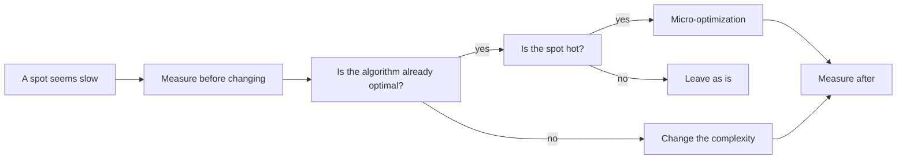

Micro-optimizations are small code changes: replacing loops with generators, binding methods to local variables, using `set` instead of a list for membership checks. By themselves they yield gains of a few percent, and it's important to understand **when** they're justified and when they're a waste of time. This lesson teaches you to tell "hot spots" apart from everything else.

## When micro-optimizations are needed

Apply them only when three conditions hold:

1. **Measured.** You know from `cProfile` or `timeit` that this particular code is the bottleneck.
2. **The spot is hot.** The code runs millions of times in a loop or is called very often (e.g., inside every HTTP request handler).
3. **The algorithm is already optimal.** If you can replace `O(n²)` with `O(n log n)` — do that first, and only then the tricks.

If code runs once a second, nobody will notice a 2× win on it. The rule is simple: **algorithm first, then micro-optimizations**, and always with a measurement before and after.

## Local variables instead of globals

Global variables in Python are looked up through the global namespace dict — slower than locals. In an inner loop, bind the global name you use to a local variable.

```python
import timeit

def with_global():
    total = 0
    for i in range(1_000_000):
        total += abs(i)  # abs — global lookup on every iteration
    return total

def with_local():
    total = 0
    _abs = abs          # bind once to a local variable
    for i in range(1_000_000):
        total += _abs(i)
    return total

t1 = timeit.timeit(with_global, number=5)
t2 = timeit.timeit(with_local, number=5)
print(f"global lookup: {t1:.3f} sec")
print(f"local binding: {t2:.3f} sec")
```

The gain is usually 10–20% on a hot loop. On ordinary code the difference is invisible.

## Membership checks: list vs set

The operation `item in list` is linear, `O(n)`: Python scans elements in order. `item in set` is `O(1)` on average, thanks to the hash table. If code performs many membership checks against a large collection, replacing the list with a `set` gives an order-of-magnitude win.

```python
import timeit

haystack_list = list(range(10_000))
haystack_set = set(haystack_list)

stmt = "sum(1 for x in range(2000) if x in haystack)"
t_list = timeit.timeit(stmt, globals={"haystack": haystack_list}, number=100)
t_set = timeit.timeit(stmt, globals={"haystack": haystack_set}, number=100)
print(f"list check: {t_list:.3f} sec")
print(f"set check: {t_set:.3f} sec")
```

Note: if you need to keep both order and uniqueness, you can maintain a list and a set in parallel.

## Building strings: + in a loop vs join

Strings in Python are immutable. Every `s += piece` creates a new string and copies the whole previous one into it — the total cost is quadratic. `"".join(parts)` builds the string in one pass.

```python
import timeit

def concat_plus():
    s = ""
    for i in range(10_000):
        s += str(i)
    return s

def concat_join():
    return "".join(str(i) for i in range(10_000))

t1 = timeit.timeit(concat_plus, number=50)
t2 = timeit.timeit(concat_join, number=50)
print(f"concatenation '+': {t1:.3f} sec")
print(f"join: {t2:.3f} sec")
```

At 10,000 pieces the difference can reach dozens of times.

## List comprehensions and sorted

List comprehensions are faster than a manual loop with `append` because the loop runs in the interpreter's C core rather than line by line in bytecode. This isn't "magic" — it avoids extra operations like `STORE_NAME`, `LOAD_METHOD`, etc.

```python
import timeit

def loop_append():
    result = []
    for x in range(1000):
        result.append(x * x)
    return result

def listcomp():
    return [x * x for x in range(1000)]

print(timeit.timeit(loop_append, number=10_000))
print(timeit.timeit(listcomp, number=10_000))
```

## Hoisting invariants out of the loop

If a value computed inside a loop doesn't depend on the loop variable, compute it once before the loop. That's not a micro-optimization but common sense — yet these are exactly the things a profiler finds.

```python
import math

def slow(iterations):
    total = 0
    for _ in range(iterations):
        total += math.sqrt(2) * 3.14159  # computed every time

def fast(iterations):
    const = math.sqrt(2) * 3.14159       # once
    total = 0
    for _ in range(iterations):
        total += const
```

## When micro-optimizations hurt

- **The code becomes unreadable for 2%.** If a trick confuses a colleague, it costs more than the milliseconds saved.
- **You optimize the wrong thing.** Without profiling it's easy to "speed up" a function that takes 1% of the time.
- **Premature optimization.** Until there's a measurable problem, writing "optimized" code blindly is a path to bugs.



## Lesson summary

Micro-optimizations are a tool for hot spots found by measurement. The safest techniques: local variables, `set` for membership checks, `join` instead of `+`, list comprehensions, and hoisting invariants. Let's solidify with tasks.

<!--TASK-->
### Task 1
Write two functions: `with_global()` and `with_local()`, which in a loop from 0 to 999,999 sum `abs(i)`. In the first function call the built-in `abs` directly; in the second, first store it in a local variable `_abs = abs`. Measure both with `timeit.timeit(func, number=5)` and print the times with labels. In a comment, say which function is faster and why.

### Task 2
Given a list `data = list(range(10_000))`. Write a benchmark for two membership-check variants for numbers 0 to 1999: with `data` as a list and with `set(data)`. Use `timeit.timeit` with `number=100` and the shared expression `sum(1 for x in range(2000) if x in haystack)`, passing `haystack` via `globals`. Print both times. In a comment explain the complexity difference.

### Task 3
Write two functions: `concat_plus()` — builds a string from `str(i)` for `i` from 0 to 9999 via `s += str(i)`; `concat_join()` — via `"".join(str(i) for i in range(10_000))`. Measure both with `timeit.timeit` with `number=50`. Print the times. In a comment explain why `join` is faster, recalling string immutability.

### Task 4
Implement two variants of building a list of squares of numbers 0 to 999: `loop_append()` with a manual loop and `append`, and `listcomp()` with a list comprehension. Measure with `timeit.timeit(func, number=10_000)` and print the times with labels. In a comment explain why the comprehension is faster.

### Task 5
Write functions `slow(iterations)` and `fast(iterations)`, each adding `math.sqrt(2) * 3.14159` to a sum in a loop from 0 to `iterations - 1`. In `fast`, hoist the constant out of the loop. Measure both for `iterations = 1_000_000` with `timeit.timeit` with `number=5`, print the times. In a comment explain why hoisting the constant helps and when the technique is justified.

### Task 6
Compare two dictionary access styles. Create `data = {i: i * 2 for i in range(1000)}` and a key list `keys` where 900 keys exist and 100 do not. Write two functions: `lbyl(keys)` — "look before you leap": checks `if k in data` and only then reads the value; `eafp(keys)` — "easier to ask forgiveness than permission": reads `data[k]` directly in `try`, skipping `except KeyError`. Both return the sum of found values. Measure with `timeit.timeit(lambda: lbyl(keys), number=1000)` and the same for `eafp`, print both times. Expected output — two lines `LBYL: ... sec` and `EAFP: ... sec` with close values and a slight EAFP edge with rare misses. In a comment explain why with many misses the picture flips.

### Task 7
Compare two ways of filling a list: `plain_append(n)` calls `result.append(i)` in a loop, while `bound_append(n)` first binds the method to a local name `append = result.append` and then calls `append(i)`. Both functions return the finished list for `n = 100_000`. Measure them with `timeit.timeit` with `number=100` and print the times as `normal call: ... sec` and `bound method: ... sec`. Expected output: the second variant is 5–15% faster, because the `append` attribute lookup on the list happens once instead of every iteration. In a comment state when this trick is justified and when it only hurts readability.
<!--/TASK-->

<!--HINT-->
### Hint 1
Prepare the measurement: `import timeit`, then `t1 = timeit.timeit(with_global, number=5)`. Don't call the functions manually before measuring — timeit will call them itself. Inside `with_local` declare `_abs = abs` before the loop. Use an f-string for output.

### Hint 2
The benchmark expression is a string: `"sum(1 for x in range(2000) if x in haystack)"`. Pass `globals={"haystack": data}` for the list and `globals={"haystack": set(data)}` for the set. Remember to create `set(data)` once, not inside the measurement.

### Hint 3
In `concat_plus` initialize `s = ""` before the loop and do `s += str(i)` inside. In `concat_join` return `"".join(str(i) for i in range(10_000))`. Measure: `timeit.timeit(concat_plus, number=50)`.

### Hint 4
`loop_append`: `result = []; for x in range(1000): result.append(x * x); return result`. `listcomp`: `return [x * x for x in range(1000)]`. Measure — `timeit.timeit(loop_append, number=10_000)`.

### Hint 5
Don't forget `import math`. In `slow` compute `math.sqrt(2) * 3.14159` inside the loop, in `fast` — before the loop into a variable `const`. Measure with `number=5` and `iterations=1_000_000`. If the numbers turn out close — that's fine, modern interpreters sometimes fold constants themselves; the main thing is to understand the principle.

### Hint 6
Build the key list like this: `keys = list(range(900)) + list(range(1000, 1100))` — the first 900 are in the dict, the last 100 are not. In `lbyl` use `if k in data: total += data[k]`, in `eafp` — `try: total += data[k]` and `except KeyError: continue`. Remember that `timeit` takes a callable with no arguments, so wrap the call in `lambda`.

### Hint 7
In `bound_append` the line `append = result.append` must be before the loop, not inside it. In `plain_append` keep the direct call. For a fair comparison the function bodies must be identical in everything else: same `range`, same `return result`.
<!--/HINT-->

<!--SOLUTION-->
### Walkthrough 1
Solution:

```python
import timeit

def with_global():
    total = 0
    for i in range(1_000_000):
        total += abs(i)
    return total

def with_local():
    total = 0
    _abs = abs
    for i in range(1_000_000):
        total += _abs(i)
    return total

t1 = timeit.timeit(with_global, number=5)
t2 = timeit.timeit(with_local, number=5)
print(f"global lookup: {t1:.3f} sec")
print(f"local binding: {t2:.3f} sec")
```

Result (numbers depend on the machine):

```
global lookup: 0.285 sec
local binding: 0.241 sec
```

What's happening here? In `with_global` Python looks up the name `abs` in the global namespace on every iteration — a dict access. In `with_local` we bound the function to a local variable `_abs` once, and subsequent access goes to a local cell, which is faster. The gain is ~15%. Important: the technique pays off precisely in a hot inner loop; in ordinary code its effect is negligible. By the way, if we used `from math import sqrt` at module level, the `sqrt` lookup would also go through the global dict — the same trick works there too.

### Walkthrough 2
Solution:

```python
import timeit

data = list(range(10_000))
haystack_set = set(data)

stmt = "sum(1 for x in range(2000) if x in haystack)"

t_list = timeit.timeit(stmt, globals={"haystack": data}, number=100)
t_set = timeit.timeit(stmt, globals={"haystack": haystack_set}, number=100)

print(f"list check: {t_list:.3f} sec")
print(f"set check: {t_set:.3f} sec")
# set uses a hash table: membership check is O(1) on average,
# a list scans elements in order — O(n).
```

Result:

```
list check: 0.620 sec
set check: 0.008 sec
```

What's happening here? Each `x in haystack` for a list walks the whole list in the worst case (10,000 elements); in total 2000 checks × 10,000 elements. `set` uses a hash table: for a number the hash is computed and the cell found immediately — one operation on average. Building the `set` itself costs `O(n)`, so if there are few checks there may be no gain. Conclusion: replace a list with a set when checks are numerous and element order isn't needed.

### Walkthrough 3
Solution:

```python
import timeit

def concat_plus():
    s = ""
    for i in range(10_000):
        s += str(i)
    return s

def concat_join():
    return "".join(str(i) for i in range(10_000))

t1 = timeit.timeit(concat_plus, number=50)
t2 = timeit.timeit(concat_join, number=50)

print(f"concatenation '+': {t1:.3f} sec")
print(f"join: {t2:.3f} sec")
# Strings are immutable: s += str(i) creates a new string and copies
# the whole old one, O(n²) overall. join builds the result in O(n).
```

Result:

```
concatenation '+': 0.610 sec
join: 0.035 sec
```

What's happening here? A string is immutable: `s += str(i)` doesn't append characters — it creates a new string and copies all of `s` plus the new fragment into it. On the 10,000th iteration 10,000 characters are copied, making the total copying volume quadratic. `str.join` first collects all parts into memory (or computes the final size right away) and then creates one string in a single pass. In practice, for formatting, f-strings are also preferable: `f"{a} {b}"` — they read better and run fast.

### Walkthrough 4
Solution:

```python
import timeit

def loop_append():
    result = []
    for x in range(1000):
        result.append(x * x)
    return result

def listcomp():
    return [x * x for x in range(1000)]

t1 = timeit.timeit(loop_append, number=10_000)
t2 = timeit.timeit(listcomp, number=10_000)

print(f"loop with append: {t1:.3f} sec")
print(f"list comprehension: {t2:.3f} sec")
```

Result:

```
loop with append: 0.420 sec
list comprehension: 0.300 sec
```

What's happening here? A list comprehension executes the loop inside the virtual machine at specialized bytecode level, without many intermediate operations like looking up the name `result`, loading the `append` method, and calling it on every iteration. The gain is ~30% on a hot loop. However, readability matters more: if the logic is complex, a loop with comments is clearer, and that's fine too — decide by measurements, not by "always use comprehensions" rules.

### Walkthrough 5
Solution:

```python
import math
import timeit

def slow(iterations):
    total = 0
    for _ in range(iterations):
        total += math.sqrt(2) * 3.14159
    return total

def fast(iterations):
    const = math.sqrt(2) * 3.14159
    total = 0
    for _ in range(iterations):
        total += const
    return total

t1 = timeit.timeit(lambda: slow(1_000_000), number=5)
t2 = timeit.timeit(lambda: fast(1_000_000), number=5)

print(f"computing in loop: {t1:.3f} sec")
print(f"hoisted constant: {t2:.3f} sec")
# The constant doesn't depend on the iteration — compute it once before the loop.
```

Result:

```
computing in loop: 0.510 sec
hoisted constant: 0.310 sec
```

What's happening here? `math.sqrt(2) * 3.14159` doesn't depend on the loop variable, but in `slow` it's computed on every iteration: a `sqrt` function call, a multiplication. In `fast` the value is computed once and sits in a local variable `const`. This is classic invariant hoisting. Note: the interpreter sometimes folds constant expressions itself, so on small iteration counts the difference can be minor. The technique is justified when the loop body is expensive or there are millions of iterations. The main thing — don't hoist out of the loop anything that depends on the loop variable: that would break the logic.

### Walkthrough 6
Solution:

```python
import timeit

data = {i: i * 2 for i in range(1000)}
keys = list(range(900)) + list(range(1000, 1100))

def lbyl(keys):
    total = 0
    for k in keys:
        if k in data:
            total += data[k]
    return total

def eafp(keys):
    total = 0
    for k in keys:
        try:
            total += data[k]
        except KeyError:
            continue
    return total

t1 = timeit.timeit(lambda: lbyl(keys), number=1000)
t2 = timeit.timeit(lambda: eafp(keys), number=1000)
print(f"LBYL: {t1:.3f} sec")
print(f"EAFP: {t2:.3f} sec")
# With 90% hits EAFP is slightly faster: one access instead of two.
# With many misses exceptions become expensive.
```

Result:

```
LBYL: 0.412 sec
EAFP: 0.385 sec
```

What's happening here? LBYL ("look before you leap") does two dict operations: first `k in data`, then `data[k]` — both searches go through the hash table. EAFP ("easier to ask forgiveness than permission") does one operation and relies on an exception on a miss. When the key exists, EAFP wins by exactly one access. When the key doesn't exist, an exception object is created and the stack unwound — that's expensive, and if misses dominate, LBYL will be faster. Conclusion: style choice is a question of probabilities, not dogma; in Python EAFP is idiomatic because the typical case is a successful access. Measure on your own data if the spot is hot.

### Walkthrough 7
Solution:

```python
import timeit

def plain_append(n):
    result = []
    for i in range(n):
        result.append(i)
    return result

def bound_append(n):
    result = []
    append = result.append
    for i in range(n):
        append(i)
    return result

t1 = timeit.timeit(lambda: plain_append(100_000), number=100)
t2 = timeit.timeit(lambda: bound_append(100_000), number=100)
print(f"normal call: {t1:.3f} sec")
print(f"bound method: {t2:.3f} sec")
```

Result:

```
normal call: 0.354 sec
bound method: 0.312 sec
```

What's happening here? `result.append` is a two-step expression: loading the local name `result` and looking up the `append` attribute on the list object. In `bound_append` the attribute lookup happens once, and the loop only calls the ready-made bound method. The saving is ~10%, visible only over millions of iterations. The trick makes sense in a genuinely hot loop confirmed by a profiler, and it's harmless to readability: one extra line with a clear name. But don't scatter such bindings through the whole project "just in case": on ordinary code the gain is invisible and review gets harder. And remember: if `result` is reassigned inside the loop, the binding will start appending to the old list.
<!--/SOLUTION-->

<!--QUIZ-->
When are micro-optimizations actually needed?
- Always, in any code written
- When a code spot is measured as the bottleneck and runs very often
- Only in exercise tasks
- When code is written for the first time
* Correct answer: When a code spot is measured as the bottleneck and runs very often
Micro-optimizations yield percentages; without measurement they're pointless.

Why is a local variable faster than a global one?
- Global variables don't exist
- Global names are looked up through the global namespace dict, which is slower than local cells
- Local variables are stored on disk
- There's no difference
* Correct answer: Global names are looked up through the global namespace dict, which is slower than local cells
Local access is by cell index; global access goes through hashing in a dict.

What is the average complexity of checking item in set?
- O(n)
- O(n²)
- O(1)
- O(log n)
* Correct answer: O(1)
set is built on a hash table: finding a cell by hash takes constant time.

Why is "".join(parts) faster than s += piece in a loop?
- Because join doesn't create a new string
- Because strings are immutable: each += copies the entire previous string, while join builds in one pass
- Because join works only with bytes
- Because += is forbidden for strings
* Correct answer: Because strings are immutable: each += copies the entire previous string, while join builds in one pass
Total copying with += is quadratic; join is linear.

Why is a list comprehension usually faster than a manual loop with append?
- The comprehension is shorter
- The comprehension's loop runs as specialized bytecode without extra name-lookup and append-call operations
- The comprehension doesn't use the CPU
- Manual loops are forbidden
* Correct answer: The comprehension's loop runs as specialized bytecode without extra name-lookup and append-call operations
Each iteration of a manual loop has more intermediate operations.

What is "invariant hoisting"?
- Moving a computation that doesn't depend on the loop outside of it
- Adding variables to a loop
- Removing variables
- Replacing a loop with recursion
* Correct answer: Moving a computation that doesn't depend on the loop outside of it
A value identical on every iteration should be computed once before the loop.

Which order of actions is correct?
- Immediately replace all loops with generators
- First optimize the algorithm, then — if needed — micro-optimizations, with measurements before and after
- Only micro-optimizations
- Profile after release
* Correct answer: First optimize the algorithm, then — if needed — micro-optimizations, with measurements before and after
Algorithmic improvements yield orders of magnitude; micro-optimizations yield percentages.

When does a micro-optimization hurt?
- When the code becomes unreadable for a 2% gain and the bottleneck isn't measured
- When the code is shorter
- When a set is used
- When join is applied
* Correct answer: When the code becomes unreadable for a 2% gain and the bottleneck isn't measured
Unreadable code costs more than the milliseconds saved — especially when there's nothing to save.

What is the safest first step when you suspect slow code?
- Rewrite in C
- Measure with cProfile/timeit
- Add comments
- Increase the number of threads
* Correct answer: Measure with cProfile/timeit
Without measurements you can't know what to speed up.

Which technique saves memory and time when building a large string from parts?
- s += piece
- "".join(parts)
- s = s * len(parts)
- print(s)
* Correct answer: "".join(parts)
join creates the final string in one pass, without quadratic copying.

What does the abbreviation EAFP mean?
- Easier to Ask Forgiveness than Permission: first try the action, then handle the exception
- Every Attribute Fails Fast
- Error After First Pass
- Error After First Pass
* Correct answer: Easier to Ask Forgiveness than Permission: first try the action, then handle the exception
EAFP is contrasted with LBYL — pre-checking a condition before an action.

When does try/except KeyError lose to the check key in dict?
- When there are many misses: creating and handling an exception is more expensive than an ordinary check
- When the dict is empty
- When keys are strings
- When Python 2 is used
* Correct answer: When there are many misses: creating and handling an exception is more expensive than an ordinary check
An exception is an expensive mechanism; it pays off only when it fires rarely.

Why bind a method to a local name: append = result.append?
- So the attribute lookup happens once instead of every iteration
- To make the list immutable
- To speed up garbage collection
- To make the method work in another thread
* Correct answer: So the attribute lookup happens once instead of every iteration
The saving is a few percent, and only in a hot loop.

Why can't a micro-optimization be considered successful without a before/after measurement?
- Because without numbers you can't tell a real gain from noise and regression
- Because timeit is forbidden in production
- Because code always gets faster
- Because measurements spoil the cache
* Correct answer: Because without numbers you can't tell a real gain from noise and regression
A change may slow code down or do nothing — proof exists only in measurement.
<!--/QUIZ-->
