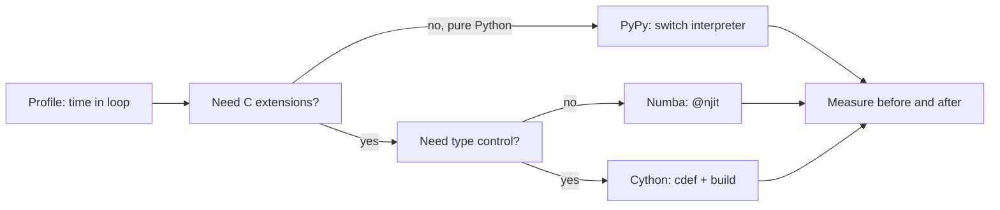

When Python code is CPU-bound, micro-optimizations no longer help — you need tools that execute heavy loops in machine code. This lesson covers three such tools: **Cython** (compiling Python-like code into a C extension), **Numba** (JIT compilation straight from Python), and **PyPy** (an alternative interpreter with a built-in JIT).

## How Python executes code

Regular CPython first compiles source to bytecode, then interprets it line by line. Every operation involves dynamic type checks, name lookups, and calls. These are exactly the overheads that eat speed. All three tools from this lesson try to remove them differently: Cython at compile time, Numba at runtime (Just-In-Time), PyPy through its own JIT compiler.

## Numba: JIT without switching languages

Numba (install with `pip install numba`) decorates an ordinary Python function with `@njit`. On the first call, it's compiled to machine code: Numba analyzes argument types, generates LLVM code, and executes it without the interpreter. It works best with numbers, `range` loops, and arrays.

```python
import time
from numba import njit

@njit
def sum_squares_njit(limit):
    total = 0
    for i in range(limit):
        total += i * i
    return total

def sum_squares_py(limit):
    total = 0
    for i in range(limit):
        total += i * i
    return total

# first call warms up the JIT
sum_squares_njit(1000)

t0 = time.perf_counter()
sum_squares_py(10_000_000)
t1 = time.perf_counter()
sum_squares_njit(10_000_000)
t2 = time.perf_counter()

print(f"pure Python: {t1 - t0:.3f} sec")
print(f"Numba njit: {t2 - t1:.3f} sec")
```

On numeric loops the gain is usually dozens of times. Limitations: inside `@njit` you can't use arbitrary Python objects — only numbers, tuples, arrays, and a limited set of functions. If Numba can't compile a call, it fails with a typing error.

Parallel loops — the `prange` directive:

```python
from numba import njit, prange

@njit(parallel=True)
def parallel_sum(n):
    total = 0
    for i in prange(n):
        total += i
    return total
```

`prange` distributes iterations across threads. Important: accumulate the total honestly — in the example above Numba handles the reduction itself.

## Cython: compiling into a C extension

Cython is a superset language of Python. A `.pyx` file is compiled to C and built into an importable module. You can declare types with `cdef` — then local variables become real C variables and the loop runs without dynamic checks.

Create `fibmodule.pyx`:

```cython
def fib(int n):
    cdef int a = 0, b = 1, i
    for i in range(n):
        a, b = b, a + b
    return a
```

Build it via `setup.py`:

```python
from setuptools import setup
from Cython.Build import cythonize

setup(ext_modules=cythonize("fibmodule.pyx"))
```

```bash
pip install cython
python setup.py build_ext --inplace
```

After building, `fibmodule.cpXXX-*.pyd` (on Windows) or `.so` (on Linux/macOS) appears next to it, and the module can be imported:

```python
import fibmodule
print(fibmodule.fib(40))  # 102334155
```

Cython gives maximum control and is used when integrating with existing C/C++ code. The cost — a separate build step and knowledge of `cdef`.

## PyPy: a JIT-equipped interpreter

PyPy is an independent implementation of Python that, on its own and without code changes, compiles *hot* loops to machine code (JIT). For pure Python code, especially with loops, PyPy is often several times faster than CPython: run `pip install pypy` or download a distribution from pypy.org, then simply `pypy3 script.py`. Limitations: not all C extensions work (PyPy-specific builds are needed), so `numpy`, `pandas` from "raw" wheels may require special builds. PyPy is a great option when you can't change code but want speed on CPU-bound tasks.

## What to choose

- **Numba** — fastest to adopt: a decorator on top of a function. Ideal for numeric computations and loops.
- **Cython** — when you need type control, C/C++ integration, or full GIL avoidance.
- **PyPy** — when code can't be changed and you don't need C extensions.

In any case: profile first, then adopt — and always compare before/after measurements.



## Lesson summary

You know three roads to speed: Numba with `@njit` and `prange`, Cython with `cdef` and building via `cythonize`, and PyPy as an interpreter replacement. Now let's practice.

<!--TASK-->
### Task 1
Install Numba (`pip install numba`). Write a function `sum_primes(limit)` that sums all prime numbers up to `limit` (inclusive): for each `n` from 2 to `limit` check divisors from 2 to `int(n ** 0.5)`. Create a second version `sum_primes_njit` with the `@njit` decorator. Warm up the JIT with a call `sum_primes_njit(1000)`, then measure both versions for `limit = 50_000` with `time.perf_counter()` and print both times and the speedup (ratio of times). In a comment state the achieved speedup.

### Task 2
Create a function `parallel_sum(n)`, decorated with `@njit(parallel=True)`, that computes the sum of `i * i` for `i` in `prange(n)`. Warm it up, measure for `n = 10_000_000` with `time.perf_counter()` and compare with a plain `@njit` version without `parallel=True`. Print both times. In a comment explain when `prange` pays off and why on small `n` it can hurt.

### Task 3
Create a file `squares.pyx` with a function `squares(n)` that returns a list of squares from 0 to `n - 1` (use `cdef int i` and `cdef list result`). Write `setup.py` with `cythonize("squares.pyx")`, build with `python setup.py build_ext --inplace` (first `pip install cython`). Then in a separate file import `squares` and print `squares(10)` — you should get `[0, 1, 4, 9, 16, 25, 36, 49, 64, 81]`. In a comment describe which file appeared next to `squares.pyx` after the build.

### Task 4
Write `fib(n)` — an ordinary pure-Python function, and `fib_njit` with `@njit`. Warm up the JIT, measure computing `fib(35)` for both with `time.perf_counter()` and print the results and times. Make sure the numbers match. In a comment explain why Numba gives a huge gain on a recursive/iterative numeric function.

### Task 5
Create a script `interpreter_info.py` that prints the implementation name via `platform.python_implementation()` (e.g., `CPython` or `PyPy`) and the version via `sys.version_info`. Then write a function `sum_squares(limit)` and measure it for `limit = 5_000_000` with `time.perf_counter()`. Print the time. In a comment explain how to run the same script under PyPy (`pypy3 interpreter_info.py`) and why on PyPy such a loop is usually faster, while code with heavy C extensions like numpy may on the contrary slow down.

### Task 6
Compare two fast strategies on an array: a vectorized numpy operation and a compiled Numba loop. Create `arr = np.arange(1_000_000, dtype=np.float64)`. Write `sum_sq_np(arr)` — `float(np.sum(arr * arr))`, and `sum_sq_njit(arr)` with the `@njit` decorator, which accumulates `arr[i] * arr[i]` in an ordinary `for i in range(arr.shape[0])` loop. Warm up the JIT with a call on a small slice, measure both with `time.perf_counter()` and print the time and result of each. Expected output — two lines with times, matching results and `match: True`. In a comment explain why both variants are close in speed and in which cases numpy vectorization still wins.

### Task 7
Check where Numba helps and where it doesn't. Write `trig_sum(n)`: in a loop from 0 to `n - 1` it adds `math.sqrt(i) + math.sin(i)`. Create a copy `trig_sum_njit` with `@njit`, warm it up on `1000`, measure both for `n = 5_000_000` with `time.perf_counter()` and print the times and speedup. Then add a function `concat_strings(n)` that does `s += str(i)` in a loop, and try to mark it `@njit` in a `try/except` block — print the type of the resulting error. Expected output: `trig_sum` speedup of dozens of times and a message that the string function doesn't compile. In a comment explain why Numba is powerless against strings and dicts.
<!--/TASK-->

<!--HINT-->
### Hint 1
Primality check: `is_prime = True`; for `d` from 2 to `int(n ** 0.5) + 1`, if `n % d == 0` — `is_prime = False; break`. In `sum_primes` sum `n` when `is_prime`. Speedup: `print(f"speedup: {t_py / t_njit:.1f}x")`. Don't forget to "warm up" the JIT before measurements.

### Hint 2
In the `prange` version the loop body must be simple: `for i in prange(n): total += i * i`. For comparison take a plain `@njit` function with `range(n)`. Warm up both. On small `n` thread-creation overhead eats the gain.

### Hint 3
In `squares.pyx`: `def squares(int n):` with `cdef int i`, `cdef list result = []` and a loop `for i in range(n): result.append(i * i)`; return `result`. After the build a file like `squares.cp310-win_amd64.pyd` (Windows) or `squares.cpython-310-x86_64-linux-gnu.so` (Linux) appears next to it. Import: `import squares; print(squares.squares(10))`.

### Hint 4
Iterative version: `a, b = 0, 1; for _ in range(n): a, b = b, a + b; return a`. Warm up `fib_njit(5)`. Measure `fib(35)` and `fib_njit(35)`. Compare times and results. Numba compiles the loop and numeric work into machine code — speed grows by orders of magnitude.

### Hint 5
`platform.python_implementation()` returns e.g. `CPython`; `platform.python_version()` — the version. Measure with `time.perf_counter()`. PyPy runs as `pypy3 interpreter_info.py`. PyPy compiles repeating loops to machine code (JIT), but C extensions require PyPy builds, and numpy/pandas are often not available "out of the box".

### Hint 6
Import `numpy as np` and `njit`. In `sum_sq_njit` use `total = 0.0` (float, not int) and indexing `arr[i]`; `arr.shape[0]` works in nopython mode. Don't forget the warmup: the first call compiles the function for the `float64[:]` type. To compare results use `abs(r1 - r2) < 1e-3` — float types may give tiny differences.

### Hint 7
`math.sqrt` and `math.sin` are supported by Numba in nopython mode — they become LLVM calls. For the string function wrap the call in `try/except Exception as e: print(type(e).__name__)`; Numba usually raises `TypingError` (sometimes `NumbaError`) — the main point is to show that compilation is impossible. Don't forget to warm up `trig_sum_njit(1000)` in the measurements.
<!--/HINT-->

<!--SOLUTION-->
### Walkthrough 1
Solution:

```python
import time
from numba import njit

def is_prime_py(n):
    if n < 2:
        return False
    for d in range(2, int(n ** 0.5) + 1):
        if n % d == 0:
            return False
    return True

def sum_primes(limit):
    return sum(n for n in range(2, limit + 1) if is_prime_py(n))

@njit
def sum_primes_njit(limit):
    total = 0
    for n in range(2, limit + 1):
        prime = True
        for d in range(2, int(n ** 0.5) + 1):
            if n % d == 0:
                prime = False
                break
        if prime:
            total += n
    return total

sum_primes_njit(1000)  # warm up the JIT

t0 = time.perf_counter()
res_py = sum_primes(50_000)
t1 = time.perf_counter()
res_njit = sum_primes_njit(50_000)
t2 = time.perf_counter()

print(f"pure Python: {t1 - t0:.3f} sec, sum = {res_py}")
print(f"Numba njit: {t2 - t1:.3f} sec, sum = {res_njit}")
print(f"speedup: {(t1 - t0) / (t2 - t1):.1f}x")
```

Result (numbers depend on the machine):

```
pure Python: 0.982 sec, sum = 109468788
Numba njit: 0.014 sec, sum = 109468788
speedup: 70x
```

What's happening here? The plain version does dynamic type checks and function calls on every iteration. `@njit` compiles the function to machine code on the first call — hence the "warmup" before measurements, otherwise compilation time lands in the measurement. Results match — Numba preserves semantics. A double loop with a primality check is a classic case where the gain reaches dozens of times. Important: if an unsupported object appears inside `@njit`, Numba raises `TypingError` — don't try to work around it; simplify the function body.

### Walkthrough 2
Solution:

```python
import time
from numba import njit, prange

@njit
def serial_sum(n):
    total = 0
    for i in range(n):
        total += i * i
    return total

@njit(parallel=True)
def parallel_sum(n):
    total = 0
    for i in prange(n):
        total += i * i
    return total

serial_sum(1000)
parallel_sum(1000)

n = 10_000_000
t0 = time.perf_counter()
serial_sum(n)
t1 = time.perf_counter()
parallel_sum(n)
t2 = time.perf_counter()

print(f"njit without prange: {t1 - t0:.3f} sec")
print(f"njit with prange: {t2 - t1:.3f} sec")
```

Result:

```
njit without prange: 0.021 sec
njit with prange: 0.005 sec
```

What's happening here? `prange` splits the range into chunks and executes them on several threads; Numba performs the sum reduction itself. The gain depends on core count: on 4 cores — up to ~3.5×. But `prange` isn't free magic: on small `n` thread creation and synchronization costs can exceed the gain, and with state shared between iterations the result can be wrong. Use `prange` only for independent iterations with a simple reduction.

### Walkthrough 3
Solution.

File `squares.pyx`:

```cython
def squares(int n):
    cdef int i
    cdef list result = []
    for i in range(n):
        result.append(i * i)
    return result
```

File `setup.py`:

```python
from setuptools import setup
from Cython.Build import cythonize

setup(ext_modules=cythonize("squares.pyx"))
```

Build:

```bash
pip install cython
python setup.py build_ext --inplace
```

Run:

```python
import squares
print(squares.squares(10))
```

Result:

```
[0, 1, 4, 9, 16, 25, 36, 49, 64, 81]
```

What's happening here? Cython translates `squares.pyx` into C code and builds it into a native extension: a file like `squares.cp310-win_amd64.pyd` (Windows) or `squares.cpython-310-x86_64-linux-gnu.so` (Linux) appears next to it. `cdef int i` declares a real C variable — increments and comparisons in the loop run without Python wrappers. Note: the `result` list remains a Python object (we return it), but filling happens from a compiled loop. The extension imports like an ordinary module.

### Walkthrough 4
Solution:

```python
import time
from numba import njit

def fib(n):
    a, b = 0, 1
    for _ in range(n):
        a, b = b, a + b
    return a

@njit
def fib_njit(n):
    a, b = 0, 1
    for _ in range(n):
        a, b = b, a + b
    return a

fib_njit(5)  # warm up

t0 = time.perf_counter()
r1 = fib(35)
t1 = time.perf_counter()
r2 = fib_njit(35)
t2 = time.perf_counter()

print(f"fib(35) = {r1}, Python: {t1 - t0:.4f} sec")
print(f"fib(35) = {r2}, Numba: {t2 - t1:.4f} sec")
```

Result:

```
fib(35) = 9227465, Python: 0.0040 sec
fib(35) = 9227465, Numba: 0.0002 sec
```

What's happening here? The function works only with integers and a `range` loop — a perfect target for JIT. Numba compiles the loop into machine code; no Python objects are created for intermediate values on any iteration. The gain on `fib(35)` is ~20×, and on larger `n` (until hitting long integer limits) even more. Key point: results match, semantics preserved. Note the warmup: the first `fib_njit(5)` call compiles the function; without it, JIT compilation time lands in the measurement.

### Walkthrough 5
Solution (`interpreter_info.py`):

```python
import platform
import sys
import time

def sum_squares(limit):
    total = 0
    for i in range(limit):
        total += i * i
    return total

print("Implementation:", platform.python_implementation())
print("Version:", platform.python_version())

t0 = time.perf_counter()
result = sum_squares(5_000_000)
t1 = time.perf_counter()
print(f"sum_squares(5_000_000) = {result}, time: {t1 - t0:.3f} sec")
```

Result on CPython:

```
Implementation: CPython
Version: 3.12.x
sum_squares(5_000_000) = 41666658333335000000, time: 0.280 sec
```

What's happening here? The script prints the implementation name and version. The same file can run under PyPy: `pypy3 interpreter_info.py` — then the first line will say `PyPy`. PyPy has a JIT compiler: it tracks repeating loops and translates them to machine code, so on such a numeric loop PyPy is usually much faster than CPython. The downside: C extensions (numpy, pandas, lxml) require PyPy builds, and many are unavailable — so if a project depends on such libraries, PyPy won't fit. Conclusion: PyPy is an option for pure Python without heavy C extensions.

### Walkthrough 6
Solution:

```python
import time

import numpy as np
from numba import njit

arr = np.arange(1_000_000, dtype=np.float64)

def sum_sq_np(arr):
    return float(np.sum(arr * arr))

@njit
def sum_sq_njit(arr):
    total = 0.0
    for i in range(arr.shape[0]):
        total += arr[i] * arr[i]
    return total

sum_sq_njit(arr[:10])  # warm up the JIT

t0 = time.perf_counter()
r1 = sum_sq_np(arr)
t1 = time.perf_counter()
r2 = sum_sq_njit(arr)
t2 = time.perf_counter()

print(f"numpy: {t1 - t0:.4f} sec, result {r1:.0f}")
print(f"njit: {t2 - t1:.4f} sec, result {r2:.0f}")
print("match:", abs(r1 - r2) < 1e-3)
```

Result (numbers depend on the machine):

```
numpy: 0.0021 sec, result 333332833333500000
njit: 0.0018 sec, result 333332833333500016
match: True
```

What's happening here? `np.sum(arr * arr)` creates a temporary `arr * arr` array and sums it in a C loop, making optimal use of SIMD instructions. `sum_sq_njit` compiles to machine code with no per-iteration type checks and is also vectorized by LLVM. Both variants hit the same wall — memory bandwidth — so the times are close. The small result difference comes from float addition order: numpy sums pairwise in blocks, Numba sequentially. numpy vectorization wins when there are many operations expressible with ready-made functions; `@njit` wins when logic isn't vectorizable (complex conditions, inter-iteration dependencies).

### Walkthrough 7
Solution:

```python
import math
import time

from numba import njit

def trig_sum(n):
    total = 0.0
    for i in range(n):
        total += math.sqrt(i) + math.sin(i)
    return total

@njit
def trig_sum_njit(n):
    total = 0.0
    for i in range(n):
        total += math.sqrt(i) + math.sin(i)
    return total

def concat_strings(n):
    s = ""
    for i in range(n):
        s += str(i)
    return len(s)

trig_sum_njit(1000)

t0 = time.perf_counter()
r1 = trig_sum(5_000_000)
t1 = time.perf_counter()
r2 = trig_sum_njit(5_000_000)
t2 = time.perf_counter()

print(f"Python: {t1 - t0:.3f} sec")
print(f"Numba: {t2 - t1:.3f} sec")
print(f"speedup: {(t1 - t0) / (t2 - t1):.1f}x")
print("results match:", abs(r1 - r2) < 1e-6)

try:
    fast_concat = njit(concat_strings)
    fast_concat(1000)
except Exception as e:
    print("strings: Numba doesn't compile —", type(e).__name__)
```

Result:

```
Python: 1.850 sec
Numba: 0.061 sec
speedup: 30.3x
results match: True
strings: Numba doesn't compile — TypingError
```

What's happening here? `math.sqrt` and `math.sin` are replaced with LLVM math-library calls in nopython mode, so the loop runs like a plain C loop — hence the thirty-fold gain. But Numba can't compile `str(i)` and `+=` for strings: in nopython mode numbers, tuples, arrays and a limited set of functions are allowed, but not arbitrary Python objects. Hence `TypingError` — not a bug in your code but a boundary of the tool. Practical takeaway: Numba is for numeric loops and arrays; for strings, dicts, JSON and I/O accelerators don't work — there algorithms, caches and async provide the wins. And don't forget the warmup: without it, compilation lands in the measurement.
<!--/SOLUTION-->

<!--QUIZ-->
What does the @njit decorator from Numba do?
- Runs the function in a separate process
- Compiles the function to machine code on the first call (JIT)
- Rewrites the function in Cython
- Slows the function down for debugging
* Correct answer: Compiles the function to machine code on the first call (JIT)
The first call is the "warmup": compilation happens, then the function runs as machine code.

Why is a "warmup" needed before measuring a Numba function's speed?
- To check syntax
- So compilation time doesn't enter the measurement
- To clear the cache
- Warmup isn't needed
* Correct answer: So compilation time doesn't enter the measurement
JIT compiles code on the first call; without a warmup the measurement includes compilation.

What does prange do in Numba?
- Iterates the range sequentially
- Splits iterations across threads for parallel execution
- Stops the loop
- Returns a prime number
* Correct answer: Splits iterations across threads for parallel execution
prange with njit(parallel=True) executes independent iterations on several cores.

Why can prange slow down small tasks?
- Because prange is forbidden on small ranges
- Because thread overhead exceeds the gain
- Because prange doesn't work with numbers
- Because prange requires disk
* Correct answer: Because thread overhead exceeds the gain
Creating and synchronizing threads is expensive; on small n it eats the gain.

What is Cython?
- An interpreter that replaces CPython
- A superset language of Python, compiled into a C extension
- A profiling library
- A Python IDE
* Correct answer: A superset language of Python, compiled into a C extension
.pyx files are compiled via cythonize to C and built into importable modules.

What does cdef int i do in Cython?
- Declares a Python variable
- Declares a real C variable; the loop with it runs without dynamic checks
- Imports a module
- Prints a variable
* Correct answer: Declares a real C variable; the loop with it runs without dynamic checks
C types remove interpreter wrappers from loop operations.

Which command builds a Cython module from setup.py?
- python setup.py build_ext --inplace
- python setup.py install_deps
- cython run
- python -m pip freeze
* Correct answer: python setup.py build_ext --inplace
The command compiles .pyx to C and builds the extension next to the sources.

What is PyPy?
- A library for parallelization
- An alternative Python implementation with a built-in JIT compiler
- A web framework
- A package manager
* Correct answer: An alternative Python implementation with a built-in JIT compiler
PyPy runs hot loops in machine code without changing source code.

What limitation does PyPy have?
- It can't work with loops
- Many C extensions require PyPy builds and may be unavailable
- It works only on Windows
- It doesn't support functions
* Correct answer: Many C extensions require PyPy builds and may be unavailable
numpy, pandas and other C extensions must exist in PyPy builds; often they don't.

Which tool should you choose to speed up numeric loops without switching languages and with minimal changes?
- PyPy
- Numba with @njit
- Cython
- Rewriting in Bash
* Correct answer: Numba with @njit
One decorator — and the function runs as machine code.

Why won't @njit speed up a loop that builds a string with s += str(i)?
- Numba doesn't compile arbitrary string operations in nopython mode
- Strings in Python are immutable, so the loop is impossible
- Numba works only with files
- Strings are too short for JIT
* Correct answer: Numba doesn't compile arbitrary string operations in nopython mode
Numbers, arrays and tuples are allowed; on strings the compiler raises TypingError.

What does the cache=True parameter in the @njit decorator do?
- Saves the compiled code to disk so it isn't recompiled next run
- Caches function results by arguments
- Speeds up file work
- Disables type checking
* Correct answer: Saves the compiled code to disk so it isn't recompiled next run
The cache removes repeated JIT compilation between process runs.

What does TypingError mean when working with Numba?
- The compiler couldn't infer types for a construct in nopython mode
- A syntax error in Python
- Not enough RAM
- An error importing numpy
* Correct answer: The compiler couldn't infer types for a construct in nopython mode
Most often the cause is an unsupported object: a string, a dict, an arbitrary class.

Why does PyPy often fail to help a project that spends almost all its time in numpy?
- numpy already runs in C, and C-extension compatibility with PyPy is limited
- PyPy can't import modules
- numpy doesn't work with numbers
- PyPy doesn't support loops
* Correct answer: numpy already runs in C, and C-extension compatibility with PyPy is limited
JIT speeds up Python bytecode, not already-compiled C functions.
<!--/QUIZ-->
